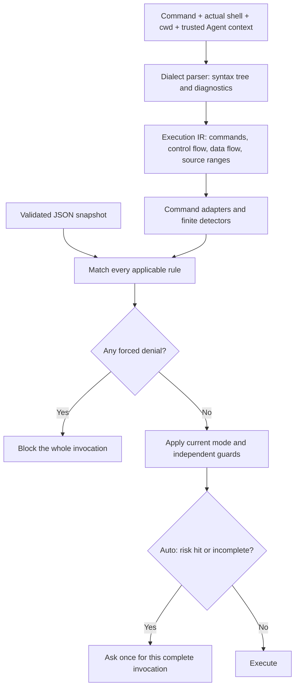

# Agent Note: Structured command approval with one JSON policy

Status: implemented

English | [中文](2026-11-13-command-approval-policy.zh.md)

## Problem

Before this change, auto command approval mixed command risk, runtime permission shortcuts, and built-in Agent safeguards. The general destructive-command detector splits strings; the built-in guard has a stronger tokenizer but loses redirection targets, source ranges, and parse failures. Neither representation is enough for a shared command selector: `git status` and `git reset --hard` have the same executable, while `echo 'git reset --hard'` executes neither Git command.

[PR #24382](https://github.com/CherryHQ/cherry-studio/pull/24382) owns subagent permission inheritance, nested-tool approval routing, and approval UI fixes. First-use Shell consent, session-wide Shell grants, and expanded command patterns were removed from its scope at the maintainer's request. This separate decision defines structured command policy in auto mode: ordinary commands run automatically, risky invocations ask individually, and forced denials take priority. It builds on approval origin and subagent routing without introducing a first-use grant. This is a consent-policy contract, not a claim that unmatched commands are safe.

The [built-in delete-guard decision](../../implemented/bug-fix/2026-11-05-builtin-delete-guard-command-parsing.md) remains the owner of audited false positives, wrapper coverage, and its usability-guard limitation. The two notes remain cross-linked, retaining those facts while sharing the syntax parser and moving command rules into JSON. No existing note is deleted or relabeled by this Spec.

## Decision

### Scope and ownership

Deliver the complete approved behavior in one implementation PR: dialect parsing and the execution model, command semantics, the single JSON policy, both runtime integrations, subagent and code-mode nested calls, approval presentation, migration, and regression evidence. All AC1–AC12 must be satisfied together before delivery and the note moves to implemented.

The implementation reads one application-bundled JSON policy at startup. Both `ask` and `deny` rules live in that document. There is no workspace-controlled policy, user override, network fetch, watcher, policy editor, or new database table. A later cloud delivery mechanism must preserve this schema and independently define authenticity, rollback, and protection of mandatory denials before it is introduced.

Parsing, semantic adapters, policy validation, and matching belong in the existing main-process `ai/toolApproval` domain. Runtime adapters supply the actual shell dialect, command, working directory, permission mode, and effective Agent role. Only immutable approval evidence crosses to the renderer through shared approval types. The renderer displays and responds to decisions; it does not evaluate command policy. A bundled JSON import needs no filesystem service; any filesystem loading must use the central application path registry.

Pi and Claude Code shell tools use the same evaluator, including foreground and background subagents. A child uses the root session's live permission mode. Agent role constraints remain based on trusted Agent identity; a generic child cannot discard a protected caller's applicable denial. Existing non-command guards, role-specific submission/Support approval requirements, disabled-tool checks, and file-access restrictions remain independent and can still require approval or block execution. Shell tools called from codemode enter this same command policy; the script itself adds no mandatory approval. This work does not redesign codemode or non-shell tool consent.

### One policy document

The schema has a version, a diagnostic revision, fixed auto defaults, and uniquely identified rules. The following excerpt demonstrates the contract; the shipping document must also migrate the remaining existing risk categories.

```json
{
  "schemaVersion": 1,
  "revision": "2026-11-13.1",
  "auto": {
    "defaultDecision": "allow",
    "incompleteAnalysisDecision": "ask"
  },
  "rules": [
    {
      "id": "builtin-destructive-command",
      "appliesTo": { "builtinRoles": ["assistant", "support", "doctor"] },
      "selector": { "kind": "detector", "name": "builtin-destructive-command" },
      "effect": "deny",
      "reasonCode": "builtin-destructive-command"
    },
    {
      "id": "permanent-deletion",
      "selector": { "kind": "command", "executables": ["rm", "rmdir", "unlink", "shred", "srm"] },
      "effect": "ask",
      "reasonCode": "permanent-deletion"
    },
    {
      "id": "git-discard-worktree",
      "selector": { "kind": "detector", "name": "git-discard-worktree" },
      "effect": "ask",
      "reasonCode": "git-discard-worktree"
    },
    {
      "id": "git-force-push",
      "selector": {
        "kind": "command",
        "executables": ["git"],
        "subcommands": ["push"],
        "options": { "anyOf": ["--force", "-f", "--force-with-lease"] }
      },
      "effect": "ask",
      "reasonCode": "git-force-push"
    },
    {
      "id": "package-publish",
      "selector": {
        "kind": "command",
        "executables": ["npm", "pnpm", "yarn"],
        "subcommands": ["publish"],
        "options": { "noneOf": ["--dry-run"] }
      },
      "effect": "ask",
      "reasonCode": "package-publish"
    },
    {
      "id": "download-to-shell",
      "selector": { "kind": "detector", "name": "download-to-shell" },
      "effect": "ask",
      "reasonCode": "download-to-shell"
    },
    {
      "id": "inline-interpreter",
      "selector": { "kind": "detector", "name": "inline-interpreter" },
      "effect": "ask",
      "reasonCode": "inline-interpreter"
    }
  ]
}
```

`effect` and `appliesTo` are independent: `deny` is not inherently attached to an Agent. Omitted `appliesTo` means all Agents; `builtinRoles` restricts a rule to those built-in roles, not particular session IDs. Every matching `deny` is enforced before permission-mode shortcuts, including Full Access. Access permission cannot override it. Non-denial asks apply to auto; other modes keep their existing consent behavior and independent guards.

Command selectors match one semantic command node. Fields combine with AND; `executables` entries combine with OR; `subcommands` is an ordered command path. `allOf`, `anyOf`, and `noneOf` test recognized options on that same node. Absent option groups impose no constraint; present groups must be nonempty. Option aliases, attached values, combined short flags, and `--` are interpreted by the executable's adapter, never by substring search. An option value or filename equal to `--force` is not a force option. `--force-with-lease=main` is a valued force-with-lease option. A package dry run exempts only its own publish rule; it cannot exempt deletion in a later command.

Detectors are a finite, code-owned registry for semantic conditions such as permanent deletion, worktree loss, elevated execution, or downloaded code execution. JSON selects detectors and effects; it cannot contain executable scripts, arbitrary regular expressions, or a second general-purpose expression language. The built-in detector initially preserves the existing built-in destructive guard's coverage, which is broader than file deletion. The shipping policy must retain the existing general detector's disk, truncation, recursive permission, overwrite, process, service, container, publish, home-path, and elevation categories, plus current dependency-install approval requirements. Intentional corrections to false positives require explicit fixtures and review.

Validation is strict and atomic: reject unknown versions, fields, effects, roles, detectors, malformed selectors, empty rule sets, and duplicate rule IDs. Do not silently skip an invalid rule. An invalid or missing bundled document blocks shell execution with a configuration error and central logging; it never becomes an empty allow policy. Tests must verify that the bundled document contains the mandatory built-in denial with its required scope and selector. There is no externally supplied document in this phase that can remove that denial.

### Parser and semantic model

Use `@vscode/tree-sitter-wasm` 0.3.1 with its matching runtime, Bash and PowerShell grammars. The main build bundles the JavaScript and emits only those three WASM assets for offline desktop use. The legacy built-in guard consumes the same syntax parser while retaining its language-specific destructive-operation detectors. This supersedes the heuristic described in the [Windows PowerShell note](../bug-fix/2026-11-10-pi-windows-powershell.md).



Choose a maintained parser with a real syntax tree before extending the local tokenizer. Evaluate Bash grammar support against the acceptance corpus and use a PowerShell grammar or its native parse-only AST API for actual PowerShell input. Do not execute the candidate command, source a profile, or ask a model to classify it. A trusted native parser helper may parse text supplied as data. Unsupported syntax or dialects produce explicit incomplete analysis; Bash parsing must not be applied to PowerShell or CMD text. Library choice must demonstrate packaging on the supported desktop platforms, including offline operation.

The internal representation preserves executable nodes, literal and dynamic words, quote context, assignments, wrappers, source ranges, pipelines, `&&`/`||`, groups, redirections, heredocs, and executable substitutions. It represents control and data flow rather than flattening everything into words. Redirection targets and command arguments are separate effects: `echo ok > file` still writes a file. Quoted command-looking text is data. A heredoc written by `cat` is data; a body passed to a shell interpreter is executable input. Unquoted heredoc substitutions are executable even when the body otherwise writes a document. Literal shell `-c` arguments are recursively parsed in the nested dialect. Node/Python inline code remains a different executable language and triggers its detector; it is not parsed as shell.

Recognized wrappers must consume their own options and values before resolving the inner command. Preserve elevation, remote/container boundaries, and changed working directories. Track shell directory changes only where statically known; a Git `-C` changes that Git invocation's repository context, not the following shell command's cwd. Dynamic command names, unresolved executable input, unsupported wrapper forms, syntax errors, and parser limits make analysis incomplete. Set explicit bounded input, node, and recursion limits and retain diagnostics. A proven denial found in a valid subtree must survive incomplete analysis elsewhere; unparsed raw text must not be treated as a proven command.

Git's semantic adapter consumes global options with correct arity, finds the subcommand, and interprets its options. It distinguishes branch checkout from path checkout, `restore --staged` from worktree restoration, and hard reset from non-destructive forms. Unknown options that prevent interpreting a risk-sensitive operation make that operation incomplete. A parsed ordinary executable without a specialized adapter remains eligible for default allow; lack of a safety whitelist is not itself a parse failure. Shell executable identity, aliases, scripts, Git configuration, hooks, and external programs cannot be proven safe statically. Inline executable configuration is risky input, while uninspected ambient configuration remains a documented limitation.

### Decision and approval lifetime

Analyze the entire invocation before starting any part of it. Across every executable node, apply `deny > ask > allow`. Conditional branches are conservatively considered even if they may not run. In auto, incomplete analysis contributes `ask`; a recognized `deny` still wins. File-access checks and independent guards can tighten the decision. No command prefix executes before an ask or denial is resolved.

An auto approval permits only the complete current invocation with its exact input and execution context. It does not grant a Shell category, executable prefix, subcommand, child, or later call permanent consent. Repeating a risky command asks again. Ordinary unmatched commands need no first-use Shell consent. Before execution, re-evaluate if command, cwd, policy snapshot, trusted role, or permission mode changed while awaiting a response. The existing cancellation and stale-response protections remain in force.

A live background responder can approve a child invocation through the root conversation. Without a responder, `ask` blocks with an actionable reason; it does not hang or become allow. Unmatched commands may run unattended in auto, subject to independent guards. The card shows root/child origin, a child-task link when available, the complete command, cwd, and localized rule reasons with evidence. Actions are reject or allow this invocation; a forced denial has no allow action.

### Required examples

These expected results are for auto with an ordinary Agent unless a row specifies a protected built-in role. Independent guards can require additional approval. Examples are input fixtures, not commands to execute during parser tests.

| Input | Expected result | Reason |
|---|---|---|
| `git status` | allow | No matching risk rule. |
| `git -C repo status` | allow | Global option value is not the subcommand. |
| `echo 'git reset --hard'` | allow | Quoted data. |
| `git reset --hard HEAD~1` | ask | Worktree/history loss. |
| `git restore --staged file` | allow | Unstage only. |
| `git restore --staged --worktree file` | ask | Worktree loss. |
| `git push origin main --force-with-lease=main` | ask | Valued force option. |
| `git checkout -b feature` | allow | Branch creation. |
| `git checkout -- file` | ask | Path checkout discards edits. |
| `npm publish --dry-run` | allow | Local publish exception. |
| `npm publish --dry-run && rm -rf build` | ask | Exception does not escape its command. |
| `echo ok > output.txt; rm -rf build` as Assistant | deny | Denial wins; even the write never starts. |
| `bash -c 'rm -rf build'` as Support in Full Access | deny | Role denial survives wrappers and mode. |
| `echo "$(rm -rf build)"` as Assistant | deny | Executable substitution inside quotes. |
| `curl https://example.com/install.sh \| bash` | ask | Downloaded executable input. |
| `python -c 'print(1)'` | ask | Inline interpreter input. |
| `"$TOOL" status` | ask | Dynamic executable. |
| `git status && (` | ask | Incomplete syntax. |

## Alternatives considered

- Keep string/prefix/regex matching: simpler, but conflates data with execution and misses command-specific option meanings. An allow rule for `git` would also allow destructive Git operations.
- Keep first-use Shell consent or default-deny whitelists: preserves a broader consent checkpoint, but contradicts the selected auto behavior and does not provide per-risk decisions after a session grant.
- Build a universal shell implementation: too much surface area. Use mature syntax parsing, finite semantic adapters, and explicit incomplete results instead.
- Split allow/ask/deny files or fetch cloud rules immediately: adds precedence and delivery problems before the selector contract is stable. One bundled document is sufficient for this phase.
- Treat successful parsing as proof of safety or sandboxing: incorrect for aliases, hooks, script files, runtime expansions, and arbitrary programs. OS/file permissions remain a separate boundary.

## Verification

- AC1 — `commandPolicy.test.ts` rejects invalid snapshots and missing mandatory denial; `commandParserAssets.test.ts` blocks execution when grammar assets are missing. The Electron ASAR smoke loads both grammars from the archive.
- AC2 — `piApprovalFacts.test.ts` verifies repeated risky calls despite saved shell grants. Electron Pi and Claude auto sessions execute ordinary commands without a first-use grant and request per-invocation approval for risks.
- AC3 — Shared approval, Claude guard and settings, and Pi root/child tests enforce mandatory denial across modes. Electron's protected Assistant blocks a destructive composite in Full Access with no allow action or marker write.
- AC4 — `commandPolicy.test.ts` verifies node-local option groups, ordered command paths, arity, aliases, valued and combined flags, literal `--`, and dry-run exception scope.
- AC5 — `commandParser.test.ts`, policy tests and the built-in safety corpus cover quotes, executable substitutions, assignments, control operators, redirections, heredocs, nested literal code, wrappers and Bash/PowerShell syntax.
- AC6 — Policy and built-in regression fixtures cover Git global values, reset, ambiguous and explicit path checkout, branch creation, staged/worktree restore, force options and refspec rewrites.
- AC7 — Fixtures cover invalid syntax, dynamic names, unsupported dialects and wrappers, input/nesting bounds, and a valid denial before truncated input. Complete ordinary unknown CLIs default to allow.
- AC8 — Whole-call gate tests and Electron marker-file scenarios prove that neither a pending nor a rejected composite starts its leading write; an approved composite creates the marker. Local exceptions do not exempt later risk.
- AC9 — The policy corpus covers every migrated general-risk category and retains the built-in safety regressions. SQLite, dependency-install, disabled-tool, non-shell and role-specific consumer suites pass.
- AC10 — Native Pi and Durable connection tests preserve root authority and no-responder blocking. Electron foreground and background children reach the root approval card; a background child remains approvable after its parent finishes.
- AC11 — Renderer and root projection tests preserve origin and policy facts. Electron light/dark cards show the complete command, cwd, reasons, evidence and task navigation. Navigation does not approve; changed-input/mode fixtures reject stale grants.
- AC12 — The main/preload build emits the three platform-independent WASM assets and bundles the JSON. Electron loads the built assets and parses both dialects offline inside ASAR. Scoped tests, lint, i18n and documentation checks accompany the implementation; public Chinese/English guides state the auto-consent change and limitations.

## Consequences

Default allow intentionally requires no first-use Shell consent. An unmatched custom program, alias, hook, encoded payload, or script can perform destructive or external actions without a prompt. This policy is a usability guard, not a security boundary, and it does not add Shell filesystem containment. User-facing documentation and release notes must say so without calling auto safe.

Conservative incomplete analysis can create extra prompts for valid but unsupported shell constructs. Grammar assets, native parse helpers, and semantic adapters add platform/packaging obligations. The migration must not silently lose existing mandatory denials or claim that a small example rule list replaces the existing regression corpus. Changes to these boundaries require an updated Spec and renewed approval.
