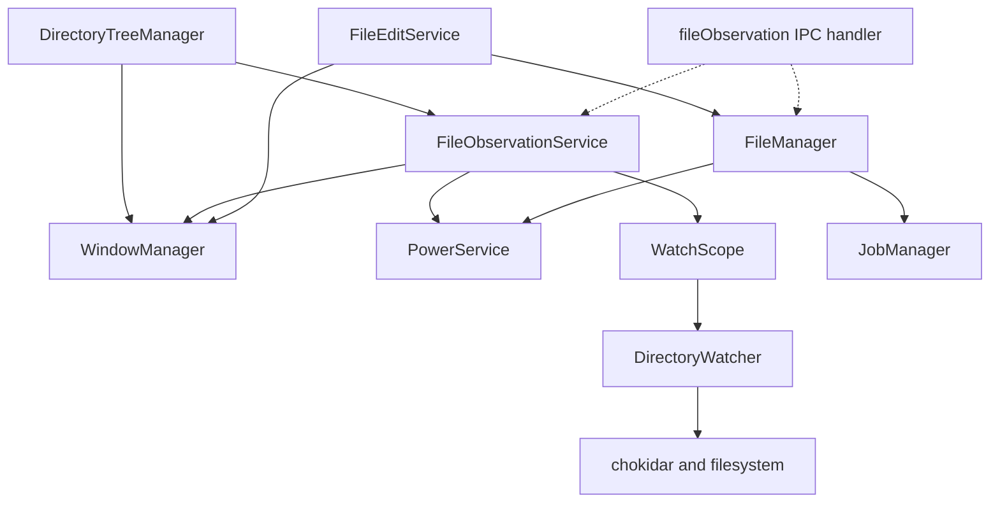
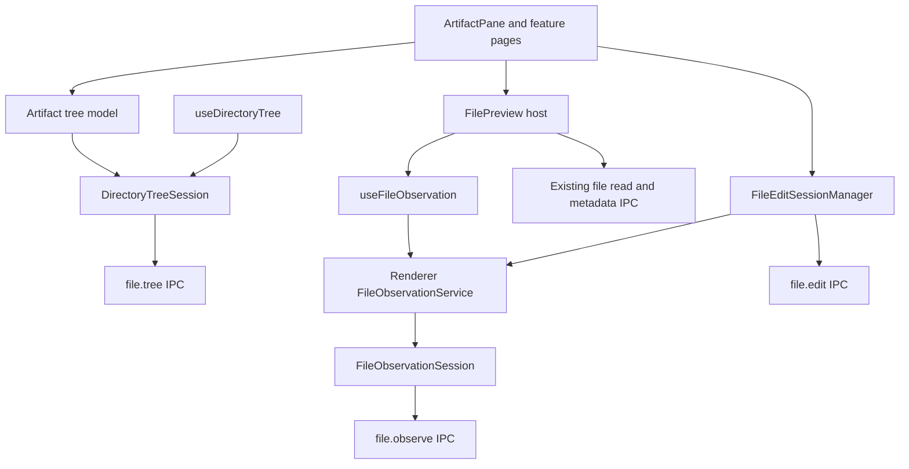

# Agent Note: 文件观察归属与视图一致性

Status: implemented

[English](2026-11-17-file-observation-and-view-consistency.md) | 中文

## 问题

外部程序、Agent 和编辑器可以独立修改同一个文件系统。目录成员、文件内容、本地草稿和视图状态有不同的所有者与生命周期。文件名或字节数不变，不能证明内容仍是最新；重新连上 watcher，也不能证明旧缓存仍然有效。

原实现可独立复现两个问题：目录折叠期间发生外部增删，重新展开后仍复用旧列表；文件发生等长或非等长外部写入后，已打开的预览仍显示旧内容。前者的第一个状态分歧出现在[文件面板树模型](../../../../src/renderer/components/chat/panes/useArtifactFileTreeModel.ts)：列表缓存与订阅被分开维护。后者在[预览宿主](../../../../src/renderer/components/chat/panes/ArtifactPane.tsx)：当时没有完整的内容观察链路；[目录树 builder](../../../../src/main/services/file/tree/builder.ts) 只有启用 `withStats` 才发送内容更新。[#23347](https://github.com/CherryHQ/cherry-studio/issues/23347) 和 [#24151](https://github.com/CherryHQ/cherry-studio/issues/24151) 是本次排查的反馈来源；后者的宽泛症状不能全部归因于这两次复现。

有界 TLA+ 模型暴露了这两个问题，并检查了候选目标的安全不变量。有限版本、抽象读取及缺少公平性约束，不能证明实现正确性、更新时间或最终收敛。修复前的文件系统与 IPC 重放用于定位缺陷；实现证据列于“验证”。

本决策承接文件观察与投影一致性，部分接替[独立编辑实例](../../proposed/architecture/2026-10-23-independent-file-edit-lifecycle.md)中延后观察能力的范围决定，同时保留独立草稿、现有写入租约、条件保存和恢复。[更早的生命周期提案](../../proposed/architecture/2026-10-22-file-edit-session-lifecycle.md)继续作为备选方案的来源，不构成额外交付清单。本决策不恢复共享草稿、别名合并、写者选举或窗口关闭协调器。

## 决策

### 状态归属与范围

| 状态 | 所有者 | 契约 |
|---|---|---|
| 物理监听覆盖范围与健康状态 | Main `FileObservationService` | 持有原生资源，报告失效或观察中断；不把通知当作当前文件字节 |
| 目录成员投影 | Main builder，以及每个请求投影对应的一个 renderer `DirectoryTreeSession` | 先安装完整基线，再消费有序更新；替换某目录的子项，而不是与过期条目做并集 |
| 已加载的文件内容 | 预览 source 或编辑实例 | 读取绑定资源和观察修订号；拒绝已被取代的结果 |
| 本地草稿与保存基线 | 独立的 `FileEditSessionManager` 会话 | 观察可以请求重新验证，但不能替换脏内容或确认保存成功 |
| 展开、选中、标签、缩放与滚动 | 功能／视图 | 改变展示需求，不决定其他消费者的观察生命周期 |

交付覆盖目录树、统一的 `FilePreview` 宿主及现有 Notes／Skills／Agent 编辑消费者。沿用文件引用和读写授权。观察属于运行时状态，不新增数据库表、DataApi 端点、Preference 或持久缓存。搜索仍是显式、有界查询；搜索结果不是第二份权威目录列表。

### 文件组织

文件布局分开原生观察、目录投影与 renderer 消费者；被替代的观察路径已移除。

```text
src/main/services/file/
├── index.ts
├── observation/
│   ├── FileObservationService.ts
│   └── WatchScope.ts
├── watcher.ts
├── watcherProtocol.ts
├── watcherWorker.ts
├── nativeWatcher.ts
├── tree/
│   ├── DirectoryTreeManager.ts
│   └── builder.ts
├── FileManager.ts
└── FileEditService.ts

src/main/ipc/handlers/
├── file.ts
└── fileObservation.ts

src/shared/ipc/schemas/
├── file.ts
├── fileObservation.ts
└── ipcSchemas.ts
src/shared/utils/file/tree.ts

src/renderer/services/
├── DirectoryTreeSession.ts
├── fileObservation/
│   ├── index.ts
│   ├── FileObservationService.ts
│   └── FileObservationSession.ts
└── fileEdit/FileEditSessionManager.ts
src/renderer/hooks/
├── useDirectoryTree.ts
├── useFileObservation.ts
└── useFileEditSession.ts
src/renderer/components/FilePreview/
├── FilePreview.tsx
├── ElectronFilePreview.tsx
└── plugins/
src/renderer/components/chat/panes/
├── useArtifactFileTreeModel.ts
└── ArtifactPane.tsx
```

| 文件或文件组 | 职责 |
|---|---|
| Main `observation/FileObservationService.ts` | 生命周期服务，持有物理 scope、进程内租约、renderer 订阅、失效修订号与观察健康状态 |
| Main `observation/WatchScope.ts` | 每个 scope 的私有实例，封装 `DirectoryWatcher`、就绪、引用计数与关闭；不是另一个服务／单例 |
| Main `watcher.ts`、`watcherProtocol.ts`、`watcherWorker.ts`、`nativeWatcher.ts` | Main 适配器及 dangling 存在性联动；服务持有一个共用 Worker 线程，在其中执行原生 scope 创建、过滤、回退及关闭 |
| Main `tree/builder.ts` 与 `tree/DirectoryTreeManager.ts` | 获取观察租约，保留扫描／索引／投影和现有 renderer 交接协议，向上传递新鲜度丢失与基线重置 |
| Main `ipc/handlers/fileObservation.ts` | 薄的所有者／句柄适配器，经现有文件边界解析 entry/path 请求，再委托观察服务 |
| Shared `ipc/schemas/fileObservation.ts` | 拥有请求／事件 schema 及推导的传输类型，接入 `ipcSchemas.ts` 和 `src/main/ipc/handlers/ipcHandlers.ts`，不增加第二套 preload API |
| Shared `utils/file/tree.ts` | 投影更新包含 stale/unavailable 状态并触发重新获取基线；本地草稿不属于此模块 |
| Renderer `services/DirectoryTreeSession.ts` | 从 `useDirectoryTree` 提取现有私有会话，普通与懒加载目录消费者复用同一套基线／更新实现 |
| Renderer `services/fileObservation/*` | 窗口内注册表和按资源管理的订阅会话，供兼容观察者共享；不持有草稿、撤销或文件字节缓存 |
| Renderer hooks | 把 React 需求绑定到无界面会话；hook 不拥有第二套 IPC 协议或原生资源 |
| `FilePreview`、Electron 适配器和本地插件 | 在统一宿主获取当前文件观察，同步失效元数据与内容，并在 source 读取／提交时拒绝过期结果 |
| 文件面板树／面板和现有编辑消费者 | 消费上述能力；删除重复的懒加载列表缓存／握手，以及按文件大小失效预览的逻辑 |

新增运行时代码全部放在现有进程分类下。Main 现有 file barrel 是公共边界，`observation/` 不建立嵌套 barrel。renderer 的 observation topic 只暴露一个显式重导出 barrel，并用规则封闭深导入。`DirectoryTreeSession.ts` 保持为扁平的多实例类。跨进程类型从 shared schema 推导，scope 账本留在 Main，renderer 的读取状态留在 renderer。

### 原生监听器的执行位置

chokidar 关闭时的同步部分必须离开 Main。一次 Electron trace 显示，终端清理期间关闭工作区树让 Main 阻塞了 2.77 秒；renderer 本身仍能执行，但无关输入和 IPC 被延迟。把 close 包在 Promise 或定时器里仍会在原位置执行阻塞调用。

`FileObservationService` 持有一个按需创建的 `DirectoryWatcherHost` 及其 Node Worker。各 scope 共用线程，保留 chokidar 对重叠句柄的复用，同时保留各自的过滤、健康状态和关闭回执。结构化过滤传递已加载的 gitignore 快照，不执行序列化函数，也不扩大监听范围。最后一个租约释放时立即停止 Main 事件投递，再等待原生关闭，包括回退时退役的句柄。服务退出还会等待 Worker 退出。Worker 意外退出会让已有 scope 不可用；后续获取会启动替代线程。

每个 scope 一个线程会增加隔离区数量，并失去 chokidar 在 scope 之间的句柄复用。独立 OS 进程会为只需要事件循环隔离的任务增加进程边界；终端的进程模型与这项决策独立。

### 为什么拆出观察服务

必要的边界是观察需求独立：折叠或释放目录树，不能停止已打开的预览或编辑器仍然需要的观察。这个边界不必通过新增生命周期服务实现。下面两种组织方式都能满足它：

| 决策 | 拆出 `FileObservationService` | 演进现有 `DirectoryTreeManager` |
|---|---|---|
| 运行时入口 | 保留树管理器，新增一个观察服务 | 扩展并重命名现有服务，不增加注册项 |
| 资源归属 | 观察服务持有原生 scope，树管理器持有共享投影 | 一个服务同时管理 scope 与投影注册表，在内部区分生命周期 |
| 只观察文件的消费者 | 获取观察，不构造目录树 | 增加绕过目录树构造的文件订阅 API |
| 现有行为 | 保留树消费者与交接协议，将原生资源所有权下移 | 保留现有生命周期机制，在内部拆开目录树专属状态 |
| 接受的成本 | 增加一个服务依赖，以及需要显式清理的租约边界 | 扩大公共 API，由同一生命周期所有者协调两类资源 |

实现采用拆分，因为两类消费者已经存在，而且资源生命周期不同。只要兼容的树、预览或编辑器仍有需求，物理 scope 就应保留；目录树投影则只随树消费者的需求保留。分开这两个所有者，让只观察文件的消费者无需构造树快照、过滤结果和变更状态，同时让树管理器保留职责集中的投影 API。演进现有管理器也是有效替代方案，可以提供相同的外部行为；服务数量本身不能决定边界。生命周期规范约束选定的所有者如何受管，并不要求一定引入另一个所有者。新增服务本身不构成性能收益的依据。

拆分要迁移所有权，避免增加第二套原生监听管理：

| 现有职责 | 目标归属与复用 |
|---|---|
| builder 创建 `DirectoryWatcher`、等待就绪并关闭它 | 迁入 `FileObservationService` 下的 `WatchScope`；builder 消费并释放租约，不再创建原生 watcher |
| manager 对 builder 去重、统计树消费者并提供释放宽限期 | 留在 `DirectoryTreeManager`，管理投影生命周期；物理 scope 的共享与最终关闭只由观察服务负责 |
| 树 ID、窗口所有权、快照激活与变更修订号 | 在 `DirectoryTreeManager` 保留现有树协议；文件订阅使用自己的 ID 与失效修订号，复用同一 IPC 基础设施 |
| 获取、所有者校验、交接与清理行为 | 复用现有契约和相关实现；只有两条路径确实需要时才提取共享 helper，不另建传输层或预设的通用注册表 |

两个服务都可以观察窗口销毁，因为它们释放的是不同的所属订阅。释放树消费者时，可以销毁投影并释放该投影的租约；底层 scope 是否仍有其他租约，只由观察服务决定。迁移必须验证关闭树后仍存活的预览能继续观察，以及最后一次释放只关闭一次原生资源，归入 AC7 与 AC8。

### 主进程服务依赖

下图箭头表示依赖，不表示事件流向。虚线是 IPC 边界的分派调用。现有 core 与持久化依赖只做摘要，不在此重新定义。



| 生命周期服务 | 阶段及显式同阶段依赖 | 原因 |
|---|---|---|
| `FileObservationService` | `WhenReady`；`@DependsOn(['WindowManager', 'PowerService'])` | 在所属窗口销毁时释放 renderer 订阅；系统恢复后将活跃观察标记失效 |
| `DirectoryTreeManager` | `WhenReady`；`@DependsOn(['WindowManager', 'FileObservationService'])` | 持有目录树消费者，同时使用下层观察租约 |
| `FileEditService` | 保留 `WhenReady`；`@DependsOn(['FileManager', 'WindowManager'])` | 固定目标的读写与所有者清理不依赖通知是否可用 |
| `FileManager` | 保留 `WhenReady`；`@DependsOn(['PowerService', 'JobManager'])` | entry 生命周期、存储与清理维持现有归属 |

`FileObservationService` 在 `src/main/core/application/serviceRegistry.ts` 注册，通过现有 file barrel 导出服务类。运行时使用 `application.get('FileObservationService')`。scope 辅助对象和 renderer 会话都是普通实例，不是生命周期服务。

观察服务在进程内接受已验证的文件系统 scope。它不解析 `FileEntry` 行，不导入 `@main/data`，不依赖 `FileManager`／`DirectoryTreeManager`／`FileEditService`，也不把 `IpcApiService` 作为启动依赖。IPC 适配器先经 `FileManager` 解析 entry 句柄再获取 scope，path 句柄沿用现有路径策略。这条调用边不能变成隐藏的服务依赖。定向推送沿用目录树 manager 已使用的所属 WebContents 事件传输。core 服务不反向依赖文件服务。

`DirectoryTreeManager` 为每个共享 builder 获取一个进程内观察租约，并把租约传给 `createDirectoryTree`／builder。builder 显式接收事件源，不查询服务容器，也不创建原生 watcher；租约在初始扫描前已就绪；构建基线期间收到的失效通知会被保留并校准，之后才能把基线视为当前状态。builder 清理时释放租约。物理 scope 共享与投影共享分开，观察服务不构造目录树。

观察服务使用生命周期清理和类型化事件。退出时停止接收新请求并释放全部 scope；依赖顺序保证先清理目录树，再清理观察。窗口关闭只释放本窗口订阅，其他窗口或进程内消费者仍可保留 scope。即使观察不可用，文件写入仍由现有编辑服务排空。

### 范围与身份

目录观察覆盖目录投影明确要求的深度和剪枝策略。文件观察覆盖请求文件的有效地址，以及检测替换所需的父目录／别名路径，不随目录树折叠而消失。监听父子关系以识别原子替换，而不是只绑定旧 inode。

只在物理覆盖等价且原生过滤兼容时共享资源。不能把显式文件观察扩大为无界工作区观察，也不能为了共享资源而移除递归树对依赖／构建目录的排除。独立的文件 scope 可以观察显式打开的隐藏或 gitignored 文件，即使目录树不展示它。`withStats` 只控制元数据采集，不决定是否发送内容失效通知。

保留原始 locator 和现有解析策略。订阅 ID 不是永久文件身份、读取权限或写入租约。符号链接／entry 改向触发重新验证与显式重新绑定；观察不能把编辑实例悄悄迁移到新目标。所有者发起的重命名／移动／删除仍使用现有 prepare/finish 契约，即使没有文件系统事件，也要使旧绑定失效。

### Renderer 依赖与需求



renderer 注册表是具名的窗口内单例 `fileObservationService`，不是 React Provider。它按受支持 locator 的原始值和观察策略索引订阅，不合并别名或草稿所有者。`useFileObservation` 是其外部 store 适配器；文件编辑会话直接获取同一无界面能力，服务不导入 hook／组件。

| 消费者需求 | 订阅生命周期 | 返回／恢复契约 |
|---|---|---|
| 可见树根与已展开目录 | 持有投影会话；折叠时释放该目录的需求，保留有界复用宽限期 | 释放后重新获取基线，不能只凭缓存子项证明新鲜度 |
| 活跃预览 | 持有当前文件观察，与树是否展开无关；隐藏视图可在有界宽限期内复用 | 可见性恢复时重新验证，释放后重新获取基线 |
| 已挂接编辑器或待完成保存 | 编辑实例持有观察，独立于树／组件挂接 | 用当前草稿／会话代次保护读取 |
| 已脱离但保留的草稿／失败／冲突 | 有界宽限期后释放观察，保留独立草稿／恢复实例 | 重新挂接时验证；没有连续观察时，条件保存仍是权威 |

提取出的 `DirectoryTreeSession` 拥有基线安装、激活、修订号验证和重置处理。文件面板模型只拥有展开需求和到 `FileTreeNode` 的投影。每个展开目录使用同一会话实现，最新快照替换该目录的子项。`LazyDirectoryWatcher`、展开时独立调用 `listDirectoryEntries` 的路径，以及对过期子项列表做加法合并的逻辑均已移除。`loadFolder` 获取必要的目录会话，不展开 UI 行。显式搜索可以保留当前有界列表 API。

统一的 `FilePreview` 宿主观察当前资源，包括 Agent 工作区之外的预览。插件消费宿主的 source／刷新代次，不自行建立 watcher。元数据与字节按同一代次重新加载，元数据响应本身不能把旧内容标记为最新。插件和 portable preview 适配器拒绝过期结果。宿主刷新代次也传给原生媒体和 artifact HTML 消费者。支持的格式保留阅读状态。portable package 沿用现有 source／refresh 契约，不依赖 Electron／IPC／服务。

已挂接编辑器独立于树观察自己的绑定资源。保存中会话保留观察，直到已接收的操作结束。已脱离的脏／失败／冲突会话在有界宽限期后释放观察，同时保留草稿和现有恢复状态；重新挂接后先重新验证再接纳磁盘内容，每次保存仍验证基线。已完成且脱离的会话释放租约。获取失败时同时释放部分订阅和已打开的编辑租约。观察回调调用带保护的重新验证：干净会话可接纳新字节；脏会话保留草稿并比较磁盘基线。Notes／Skills 到编辑器的树事件转发与 hook 中重复的聚焦监听已移除。保存确认仍以写入回复为准，不以 watcher 回声为准。

自动保存的准入由编辑状态决定。进入保存失败、冲突或变更封存状态时，在通知消费者之前取消待执行定时器。仅在安排定时器时检查状态并不足够：保存期间继续输入会创建一个在前次保存失败后仍存活的定时器，未经用户操作就再次尝试保存。已接受的队列项保持原顺序，显式恢复能力仍保留。

### 协议、新鲜度与恢复

| 边界 | 契约 |
|---|---|
| `file.observe.open` | 接受 `FileHandle`，验证受管窗口发送方及现有解析策略，返回所属订阅 ID、基线修订号和观察覆盖状态，不读取文件正文 |
| `file.observe.activate` | renderer 先安装监听器再激活，回放有界缓存中的失效通知，包括建立期间的变化 |
| `file.observe.changed` | 只向所有者发送有序失效／覆盖状态更新；即使 size/mtime 看似不变，内容变化也使已有认识失效 |
| `file.observe.close` | 幂等释放一个订阅；已关闭或被替代的代次不能向后继发布结果 |
| 现有 `file.tree.*` | 保留快照／监听器／激活契约；stale/unavailable 状态触发重新获取完整基线 |
| 现有读写路由 | 继续作为字节、元数据、目标验证和保存结果的权威；观察不替代它们 |

订阅 ID 标识其生命周期，单调递增的流修订号用于检测该生命周期内的重复／断档和读取过期。磁盘版本／哈希与草稿修订号继续分开。已有身份足以阻止旧结果提交时复用它，不为同一事实增加另一个计数器。

首次读取先尝试完成观察监听器／激活交接。建立失败时仍可读取一致的单次文件快照，同时明确保留观察不可用状态。读取成功不能证明后续失效通知可靠。建立期间可以展示旧缓存快照，但就绪后必须重新验证。每个消费者在读取前捕获资源、订阅和读取修订号。提交前任一项变化，结果即过期；保留最新失效标记并再次读取。编辑器将失效合并到一个进行中的重新验证。预览取消机制废弃过期的逻辑读取；已发出的 IPC 仍可能在后台结束。portable 适配器用同代次元数据校验带版本的字节。本地文本读取保留编码探测，并拒绝过期代次。一致／有界读取留在现有文件 helper 与 source 适配器，不进入观察服务。这是一套失效状态机，不是每个原始事件都排队重读一次大文档。

正在建立、中断和恢复中的订阅，都不能证明缓存内容仍然有效。显式观察状态区分 starting、live coverage、stale coverage 和 unavailable coverage；观察链路活跃本身，不代表消费者已经读到最新内容。文件缺失要与空内容、观察失败分开。启动／恢复、流断档、watcher 失败、焦点／可见性返回和显式重试时，将对应消费者标记过期并校准。树的基线重置替换投影；观察中断不能只写日志，却让镜像永久看起来健康。

沿用现有有界建立／重试行为；重试耗尽后保留可操作的 stale/error 状态。实现保证在收到失效通知或显式恢复触发、且读取成功的条件下完成校准，不承诺固定时延或对操作系统无限期无声漏事件的自主恢复。周期性完整性扫描需要独立决定成本与保证。不能每次事件都哈希所有文件，也不能扫描未使用的整个工作区。

手动恢复沿用现有所有者：目录刷新重新获取根目录与保留的已展开目录快照，并重新执行当前搜索；文件刷新使预览失效，或重新验证编辑基线。刷新失败时保留已显示的目录快照，脏草稿保留至用户明确解决冲突。工具栏反馈区分保存和刷新，只有当前草稿与已确认基线相同才标为已保存。内部托管条目的元数据恢复状态不加入按路径编辑的产物界面。

### 已替换的路径

- 原生 watcher 的创建与关闭从目录 builder 迁入观察 scope。
- 文件面板目录使用统一 renderer 会话，移除了独立列表缓存和重复激活协议。
- 预览失效不再依赖已保存文件的大小变化。Notes／Skills 转发和 hook 的外部变化代理已移除，编辑实例直接订阅。

## 考虑过的替代方案

- 演进并重命名 `DirectoryTreeManager`，将其作为统一观察入口：只要文件观察能绕过目录树构造，就能在不增加服务注册的前提下满足相同行为。上面的比较选择接受额外服务边界，以分开原生观察覆盖与目录投影的所有权。
- 在重新展开时增加刷新调用，并在目录树 watcher 上启用 `withStats`：能修复部分路径，但内容新鲜度仍耦合树的可见性／元数据策略，目录状态仍重复维护。
- 为每个工作区永久保留递归 watcher：能避开部分可见性空窗，但会付出隐藏工作区 I/O 和原生句柄成本；范围应跟随消费者需求。
- 每个预览插件和编辑器各建 watcher：重复所有权、错误恢复与交接逻辑，折叠／清理行为会再次分歧。
- 把内容观察、共享草稿和写入合并成通用文件资源服务：会把本决策扩大到编辑设计已经分离的身份、写者选举和持久化语义。
- 把原生事件或有序 IPC 修订号当作无损文件系统日志：它们都不保证完整历史、一致字节或保存确认，只用于触发校准。

## 验证

- Regression — `watcher.lifecycle.test.ts`：原生关闭阻塞时调用方仍能响应；scope 关闭等待回执；scope 共用一个线程；服务关闭等待 Worker 退出；意外退出先使覆盖失效，再启动替代线程。
- Regression — `watcher.errors.test.ts` 和 `watcher.test.ts`：polling 回退保留事件投递，最终清理等待退役句柄，Worker 过滤保留与扫描相同的已加载 gitignore 快照、否定规则及强制 `.git` 排除。
- Regression — macOS Electron 45.2.2 原生关闭重放与原生采样：大工作区的关闭在监听线程中执行，Main 仍持续响应 IPC；较小的 scope 完成了原生关闭及 Worker 退出。大 scope 随后确认关闭，全部 scope／待清理注册表归零；同一 Worker 随后成功观察并释放新的 scope。这验证了释放与复用，不能证明原生释放变快。
- AC1 — `useArtifactFileTreeModel.observation.test.tsx` 与真实 Electron 重放：折叠超过空闲释放期后，外部删建文件，再展开直接采用替换快照，无需后续事件。
- AC2 — `FileObservationService.test.ts`、`FilePreview.observation.test.tsx` 与真实 Electron：关闭树后的等长写入、原子替换、删除／重建、显式隐藏／工作区外路径，以及符号链接绑定变化。
- AC3 — `FileEditSessionManager.test.ts`、切换消费者测试与真实 Electron：独立的干净／脏实例接纳磁盘变化，或保留自己的草稿并暴露冲突；写入失败、响应丢失和冲突会取消较新的待执行自动保存，同时保留草稿。
- AC4 — `FilePreviewRefresh.test.tsx`、`FilePreview.observation.test.tsx` 与 `electronPreviewSource.test.ts`：延迟的过期读取不能替换最新内容，兼容的工作簿阅读状态在刷新后保留。
- AC5 — `DirectoryTreeManager.protocol.test.ts`、`useDirectoryTree.test.tsx` 与 `FileObservationSession.test.ts`：激活回放、修订号断档恢复，以及拒绝已退役的事件流。
- AC6 — Main watcher 错误注入、renderer 重连／聚焦测试与真实 Electron `powerMonitor` 挂起／恢复：观察覆盖丢失会显式暴露，并能在不重启 renderer 的情况下恢复。
- AC7 — Main 原生资源／引用计数与 renderer 空闲重获测试：等价消费者共享资源，释放一个消费者不影响其他消费者，最后一次释放关闭 scope；Electron 预览在树释放后仍保持活跃。
- AC8 — 限定范围的导入／变更审查、`docs:check`、Node／web 类型检查与针对性 lint：原生 watcher 只有一个所有者，renderer 目录交接只有一套实现，旧转发已移除，观察／编辑配对参考文档与实现一致。

本地验证运行于 macOS。Electron 重放使用真实文件系统操作、preload 和 IPC，不能替代 Windows 或网络文件系统验收。有界模型不作为实现验收证据。

## 后果

- 缓慢的原生关闭可能延迟观察线程上其他 scope 的处理。Main 保持响应；清理仍须等待原生确认，定时器不能证明资源已释放。
- 拆开 scope 与投影生命周期后，可能遗留租约，或在其他消费者仍有需求时关闭 watcher。迁移现有原生资源所有权，保留显式租约释放，验证树／预览的释放顺序与窗口清理；不能继续保留 builder 原有的 watcher 路径。
- 共享物理观察可能意外扩大递归范围或改变过滤。只共享兼容 scope，并在真实代码工作区测量原生句柄／扫描行为。
- 首次读取／激活／恢复的竞争可能发布过期内容。保留现有交接协议，验证具体竞争路径，不依赖只统计回调次数的 mock。
- 校准可能反复解析大文件。合并需求，在允许的重载期间保留过期内容，维持格式自身的字节／range 上限，不引入无界共享内容缓存。
- 本决策重新承接曾被延后的观察职责。把改动与草稿身份、持久化、关闭协调和崩溃恢复隔离，并与本 Spec 一起更新前一所有者的链接。
- 跨平台 watcher 行为和无声漏事件限定了保证边界。macOS 证据与有界模型不能替代 Windows 验收，也不能证明网络文件系统时延。
