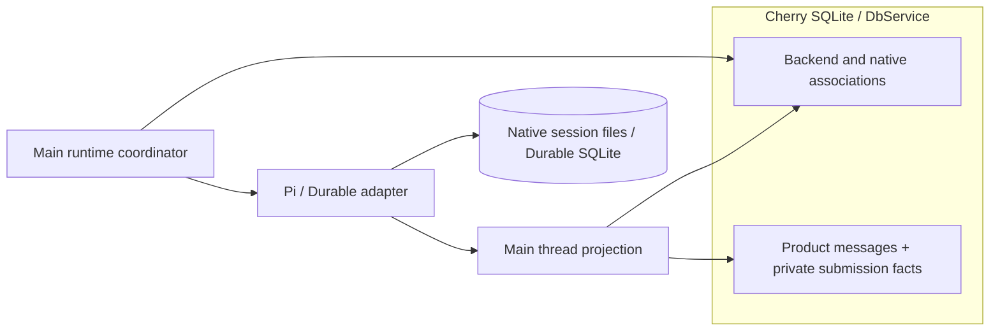
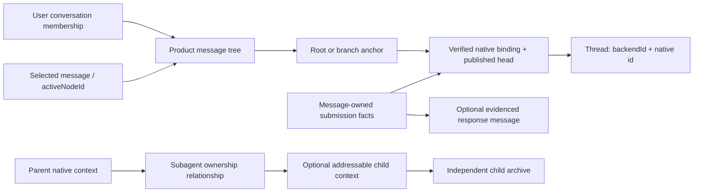

# Agent Note: Runtime access, input, observation, and lifecycle contracts

Status: proposed

English | [中文](2026-10-17-agent-runtime-contract.zh.md)

## Problem

Cherry needs to open native contexts, submit input, observe work independently of a particular submission, and release resources across different harnesses. Requiring every harness to adopt Cherry's session engine would duplicate native scheduling and recovery. A large capability matrix would instead make every consumer interpret those differences itself.

This note replaces the stack's runtime ownership and behavior design. It records the implemented v0 access boundary and its reasons, together with the host obligations still needed for integration. [Common types](../../../../packages/agent-runtime/src/contracts.ts), the [Pi adapter](../../../../packages/agent-runtime-pi/src/runtime.ts), and the [Pi Durable adapter](../../../../packages/agent-runtime-pi-durable/src/runtime.ts) own exact signatures. Package code exists; desktop adoption and the full acceptance below remain incomplete. The [harness boundaries](2026-10-17-agent-harness-boundaries.md) own the broader division of responsibilities.

## Proposal

### Keep the common entry small

The current public shape is:

```typescript
interface AgentRuntime {
  open(ref: Thread): Promise<OperationResult<ThreadHandle>>
  shutdown(): Promise<OperationResult<ShutdownReceipt>>
}

interface ThreadInput {
  readonly policies: readonly BusyPolicy[]
  submit(input: InputDraft): Promise<SubmitResult>
}

interface ThreadHandle {
  readonly thread: Thread
  readonly input?: ThreadInput
  observe(sink: ObservationSink): Promise<OperationResult<Observation>>
  interrupt?: () => Promise<OperationResult<InterruptReceipt>>
  release(): Promise<void>
}

interface Observation {
  stop(): Promise<void>
}
```

| Entry | Why it is separate |
| --- | --- |
| `open` | Access a known context without creating a replacement or overwriting its configuration. |
| `input?.submit` | Hand input to native admission where this access supports it. Its receipt is separate from observed output and does not own one exclusive response stream. |
| `observe` | Reattach to existing work, including child work that continues without a new submission. |
| `interrupt?` | Offer native interruption only where it exists, with its actual scope. |
| `release` / `stop` | End a caller's access or observation without cancelling work owned elsewhere. |
| `shutdown` | Let the resource owner close the entire configured runtime instance. |
| `thread` / `input.policies` | Save an addressable context and choose supported input arrangements without interpreting a generic capability language. |

Asynchronous factories and `create` stay adapter-specific. Pi accepts `AgentRuntimeSessionOptions`, including native `ModelRuntime`, `Model`, and `SessionManager`; Pi Durable accepts native `HarnessOptions`, an exclusively owned storage factory, and `ConversationCreateOptions`. These remain typed configurations, not arbitrary option bags. Initialization cleans up resources it acquired on failure; shared host model services remain borrowed resources.

Pi Durable additionally exposes runtime-wide `resume`, `lookupInput` and `retractInput` on its concrete handle, and deduplication through `input.submit`. Native command discovery, configuration changes, context editing, and forking are not mandatory common methods. Tools, approval, and model bridges stay at their existing adapter/host boundaries. Shared behavior is extracted only when a consumer needs the same semantics across implementations.

The interface has no universal `spawn`, exact assignment cancellation, interaction response, history pagination, or replay cursor. Optional `ThreadHandle.input` represents observation-only access; optional `Subagent.child` represents a relationship without an accessible context. Both concrete Pi and Durable handles currently provide input. Pi managed-child input goes through the extension owner, with only `steer` exposed. The [subagent control note](2026-10-18-agent-runtime-subagent-control.md) records this implemented slice and the remaining control proposals.

### Treat submission as native input admission

`InputDraft` contains a host `inputId`, `text`, and `whenBusy: 'reject' | 'steer' | 'follow-up'`. The concrete access determines the native input path. An ordinary Pi root prompt may invoke commands or hooks before reaching model admission:

```text
Input -> native command/input hooks -> locally handled
                                  -> model admission applies whenBusy
```

| At native model admission | `reject` | `steer` | `follow-up` |
| --- | --- | --- | --- |
| Foreground idle | May start work. | May start work. | May start work. |
| Foreground busy | Reject this model input without queueing it. | Arrange steering at a supported native boundary. | Arrange subsequent input under native rules. |

This is not an atomic condition on a named execution or proof that all background work and queues are empty. Unsupported policies are rejected before native dispatch. Configuration or closed resources can still prevent otherwise permitted input. A command or hook handled earlier is outside the busy policy: Pi's `/goal pause` can be handled while busy even with `reject`. `locally-handled` identifies the path, not command success. Skipping Pi prompt-template expansion does not skip all input handlers and therefore cannot implement a side-effect-free idle-only operation. Such a guarantee needs native atomic admission or constrained extensions, not a preceding `isIdle` check.

Pi managed-child input instead uses the owner's `messageSubagent`: a live run receives a queued message, while a finished child is loaded and starts a new background run. It accepts only `steer`; it does not reinterpret slash text as root commands or emulate other policies. Continuation retains the controller's load requirement, user-stop refusal, and native result delivery. These semantics are not a non-waking messaging guarantee.

Submission receipts report evidence: `accepted`, `queued`, `dispatch-started`, `locally-handled`, and `placed` are a fact set, not a linear state machine. Queueing, dispatch, and placement do not prove model consumption. Acknowledgement does not prove execution completion or goal success. General operations return `confirmed`, `rejected`, `unsupported`, or `unknown`; submission uses `acknowledged` for confirmed handoff. Expected failures are results; programming errors may still throw. Error codes are strings in v0, not an exhaustive public enum. Diagnostic messages must avoid secrets and raw native objects; the host connects the injected error callback to `loggerService`.

Return rejection only when non-admission is known. Unknown results must remain unknown; later query failure cannot undo confirmed admission. For message-backed input, the host saves the user message and the Main-private submission information needed for routing/recovery before submitting, retains its Promise after a window stops waiting, and records late receipts. `input.changed` can confirm a logical input without proving which uncertain transport attempt succeeded. P1 requires neither a separate input table nor per-attempt history. The runtime does not supply a durable host delivery journal.

The same `InputId` keeps immutable text, target and busy policy. Changing them creates a new logical input. Pi has no persistent native input deduplication, so an unknown result must not trigger automatic retry. Durable's native deduplication key and lookup permit a different delivery policy; for message-backed input, Main can explicitly pass the message ID as the key and query the captured target after reopening. Any permitted retry requires the original actual draft, not reconstruction from edited display content. Native same-type deduplication does not validate payload equality. A missing lookup is not proof that no side effect occurred. Retraction distinguishes `withdrawn`, `already-placed`, and `already-settled`; retracting one input is not conversation interruption.

### Expose identities needed by consumers

| Public identity | Purpose |
| --- | --- |
| `Thread { backendId, id }` | Locate native context in a configured backend; persistence is conditional on native storage. |
| `InputId` | Host logical input identity, unique at least within its target context, independent of transport attempts. |
| `ItemRef { session, id }` | Identify updateable content and tool relationships. |
| `SubagentId` | Identify a relationship within its parent thread across child inputs and runs. It does not establish an assignment identity or require an accessible child context. |
| `NativeInputRef { session, id }` | Address a real native input for lookup or retraction when supported. |

IDs use distinct branded string types. Consumers can serialize them but must not interchange them, parse prefixes, or infer lifetime from formatting. The host supplies `InputId`; adapters return native/context/content references. Validate storage and transport data before restoring branded IDs. The host assigns a stable `backendId` namespace and ensures a single writer for it; v0 adds no interprocess lock.

`SourceRef`, epoch, revision, and sequence stay internal to source mapping and ordering. Transport attempt identifiers, if needed, cross-process projection revisions, and subscription replacement markers belong to the host; this does not require a persistent attempt table. There is no universal call context or cancellation signal that conflates stopping local waiting, interrupting native work, and ending observation.

An adapter normalizes content once per shared source. Reobserving that live source preserves item identity. Pi currently assigns live message identities and resets its mapping on rebinding/compaction; they are not persistent history keys. Durable can derive saved item identity from native entries but uses an ephemeral epoch for previews. A known mapping can emit `replaces`; otherwise `gap` plus a replacement snapshot marks the break. IDs from a lost mapping must not be guessed equivalent across runtime reconstruction.

### Keep the observation a readable source view

Common content contains text/reasoning message parts, tool calls with possibly incomplete `argumentsText`, and tool results with optional serializable `JsonValue`. It does not export SDK objects, UI chunks, or a native replay format. `complete` describes content completeness, not goal achievement. Foreground `Activity` says nothing about all background tasks or pending preflight.

A parent snapshot may expose `Subagent { id, parent, child? }` records. The current two adapters discover children from native ownership evidence, identify each relationship by the native child ID within its parent, and route available child threads through the same runtime. Host-owned cross-harness routing is a separate concern. A relationship survives child continuation and carries no assignment completion status. Missing `subagents` means discovery is unavailable; an empty array means none are currently visible, not that no child ever existed. Missing `child` means no independently accessible context is supplied. Parent observation does not recursively mix in child content or deliver results back to the parent.

Snapshots replace only that source's current view, never the host archive, another thread, or a child view. Current adapters provide `current-view`; the protocol also permits `live-only` and `retained-view`. None promises every historical branch. An observation starts with a snapshot, then uses `item.upsert`, `item.remove`, `input.changed`, `activity.changed`, `subagent.upsert`, `diagnostic`, `gap`, and `closed`. Upserts carry accumulated values, not arbitrary token chunks; item removal is not native context deletion. Execution and interaction events are not reserved placeholder variants in v0.

[ThreadFeed](../../../../packages/agent-runtime/src/observation.ts) clones the view and events, serializes delivery within each sink, and isolates observers. The sink can run before the `observe` Promise returns, so its thread and subscription context must be captured in advance. Registration confirmation does not mean that the consumer has persisted the first frame. A sink's awaited Promise applies backpressure only to that observer, not to synchronous native dispatch or other sinks.

Pending delivery is bounded. The current feed coalesces overflow beyond 100 pending frames into an explicit `gap` and replacement snapshot while preserving the initial-snapshot requirement. This recovers a current view, not every dropped historical event. Mapping loss and disconnection are also explicit gaps; unrecoverable source loss closes observation. Snapshot attachment must not silently omit changes at the registration boundary.

After `stop` or access release, no new sink call starts; an already-entered asynchronous consumer may finish. Stop is idempotent and its resolution is sufficient acknowledgement, without a mandatory final callback. Shutdown/source loss sends `closed` on a best-effort basis. A throwing sink is detached and reported outside that sink without escaping into native dispatch. The host owns projection flush and fences old subscription writes before replacing an observation. Per-sink ordering does not solve cross-process replay or merging independent observers.

### Coordinate access without owning execution

Concurrent opens of the same context within one runtime share a load and native owner. `open` validates the backend and native identity, returns `not-found` for missing context, and does not fall back to `create`. Pi's host loader must return the exact saved manager/configuration and must not turn an empty or missing file into a new session. Reopening a saved thread in a new runtime creates new access and observation objects; unsaved context is not recoverable merely because it has an ID.

There is no per-thread eviction or automatic disposal on the last release. Resources and the current normalized view stay until runtime shutdown, so one released access cannot disrupt other callers or hidden native work. This retains memory as more threads are opened; the host needs a residency policy. Closing a shared Durable Harness to reclaim one conversation would close the entire group. Independent eviction requires a later, natively verified contract.

Each context serializes public submission admission until acknowledgement/rejection evidence or the native call settles, not until the entire model run ends. Waiting calls are local coordination, not an additional accepted or persistent queue. Native extensions and other processes are outside this ordering. A stuck Pi preflight can block subsequent public admission to that context; other contexts remain independent. The adapter does not guess failure after a timeout.

Interrupt bypasses the admission barrier. It does not cancel local undispatched attempts or guarantee that a pending preflight cannot later start. Release seals that access, prevents its queued attempts from dispatching, and lets already dispatched operations settle. The host still collects their results. If a cancelled product action later acquires an access or observation, it releases/stops that resource without deleting any context already created. A strict stop-and-remain-idle product operation would also need to seal host delivery and coordinate pending admission and native queues; v0 does not promise that atomic operation.

### Make adapter control scope explicit

| Operation | Pi | Pi Durable |
| --- | --- | --- |
| Initialize / open | Load and validate native context; extension initialization may have effects. No promise to restore in-flight calls or memory queues. | `Harness.open` reconciles saved native state; opening a conversation does not enable scheduling. |
| Observe / lookup | Observe known context without prompting; no native input lookup extension. | Use watch/status/submission lookup without calling a scheduler-enabling wait. |
| Submit | Roots use native prompt and preflight evidence; idle steering is not mapped to a direct native steer call. Managed children use the owner's message/continuation path with `steer` only. | Native transactional input admission; submit can enable the shared scheduler even if this input is rejected. |
| Interrupt | Owned access calls its session owner; a managed background child is stopped through the parent's controller, and a streaming foreground child may require aborting the parent turn. | Default `Conversation.abort` scope retracts queued inputs and interrupts owned nonbackground work. It enables scheduling and excludes queued writes and background work. |
| Resume / retract | No common Pi implementation of these native facilities. | Runtime-wide scheduler activation; separately, native submission retraction with placement/settlement receipts. |
| Shutdown | Seal access, track admission and native calls, abort and dispose owners through their lifecycle, then close observations. | Close the shared Harness, tracked operations, projections, and owned storage. Closing is not persistent task cancellation. |

For Pi, ordinary parent interruption does not stop all background children. The extension records the user abort and suppresses automatic parent wake-up; foreground cancellation follows its native ownership. Explicit child interruption uses child-level control. A background child's `requested` receipt does not prove termination; even `native-scope-idle` does not prove that queues, preflight, all extensions, or later work are stopped. These distinctions cannot be inferred merely from the presence of `interrupt`.

The resource owner must accept Durable's Harness-wide scheduling effects before using submit/interrupt/resume. Native recovery does not promise exactly-once external tool side effects. Strictly narrower controls need a concrete adapter capability or an upstream improvement, not a generic capability matrix that pretends all effects are equivalent.

### Close the runtime, not the product history

`shutdown` retires this configured adapter instance and all its contexts' access resources. It does not close another runtime instance, delete product or native history, undo tool effects, or universally mark every task cancelled. The instance and its old handles cannot be reused after shutdown; create a new runtime to reopen saved context.

Shutdown seals new open/create/submit/resume/control calls, rejects undispatched work, tracks already-started operations, and releases owned resources. Repeated calls share one shutdown attempt. Unknown cleanup keeps the runtime closed to new work and must not return confirmed `closed`. Pi may need to wait for an uncancellable preflight; there is no bounded shutdown-time guarantee. Host cancellation of waiting does not cancel the cleanup Promise. The host coordinates projection flush before process exit and must not invoke native wait merely to drain observations if that would start scheduling.

Pi can reopen persisted context but does not resume an interrupted execution or unsaved queues. Pi Durable can resume nonterminal tasks after reopening suitable persistent storage under native recovery rules; in-memory storage cannot survive process exit. Shutdown is therefore not a common save-and-pause operation.

| Host action | Appropriate access operation |
| --- | --- |
| Close a window | Stop its subscription and release its access if no longer needed; a host projection may continue observing. |
| Stop generation | Interrupt the addressed context if supported, interpreting the adapter's native scope. |
| Exit the app or retire an execution environment | Shut down the corresponding runtime and coordinate host persistence/flush. |
| Open existing work | Open the saved thread, observe it, then submit if that access supports the desired policy. |
| Follow a child after the parent finishes | Open the discovered child and observe it independently of the parent message. |

### Desktop integration implementation plan

This section is the implementation target for the four boundaries: native child ownership, continued input, independent projection, and persistence/recovery. It extends the package contract into Cherry's host; it does not declare the desktop migrated. Common spawn/stop and host-owned cross-harness orchestration remain the separate [control follow-up](2026-10-18-agent-runtime-subagent-control.md#keep-common-spawnstop-as-follow-up-work).

#### Starting point and change ownership

The inspected desktop path still runs `AgentChatContextProvider → AgentSessionRuntimeService → PiRuntimeDriver → PiRuntimeConnection → pi.createAgentSession`. The three packages and the AI SDK model binding exist, but production desktop calls do not yet use their runtime factories. Existing background output finds a parent assistant row through `rootToolCallId`; output without that anchor is ignored, and child parts are persisted back into the parent row. Replacing the factory alone would preserve this ownership problem.

| Location | Planned change | Responsibility retained there |
| --- | --- | --- |
| [Common contract](../../../../packages/agent-runtime/src/contracts.ts) | Use existing thread, optional input, relationship, and observation contracts first. Add a field only after native evidence and a consumer require it. | No product rows, delivery journal, scheduler, or UI lane. |
| [Pi runtime](../../../../packages/agent-runtime-pi/src/runtime.ts), [projection](../../../../packages/agent-runtime-pi/src/runtimeProjection.ts), and [subagent owner](../../../../packages/agent-runtime-pi/src/subagent.ts) | Add verifiable input correlation and restore child access through its native owner. | Native sessions, child execution, result delivery, and typed Pi extensions. |
| [Durable runtime](../../../../packages/agent-runtime-pi-durable/src/runtime.ts) | Reconcile persisted input mappings and child ownership against native submissions/tasks before scheduler activation. | Native Harness/storage ownership and recovery semantics. |
| [Desktop Pi integration](../../../../src/main/ai/runtime/pi/README.md) | Reuse host configuration/materialization and assemble the production AI SDK model port; replace execution and output routing incrementally. | Prompt, skills, MCP, approvals, shell environment, model policy, usage, and tracing. |
| [AgentSessionRuntimeService](../../../../src/main/ai/agentSession/AgentSessionRuntimeService.ts) and its persistence modules | Own configured runtime instances, logical input delivery, and a projection per thread. Extract an instance helper such as `threadProjection.ts` inside the existing module. | Product lifecycle, authorization, persistence barriers, and integration with delivery/fork operations. |
| [Data schemas](../../../../src/main/data/db/schemas/agentSession.ts) and [data services](../../../../src/main/data/services/README.md) | Add context associations and input delivery records using `DbService`, with appended migrations. | Product data transactions; no native execution or transcript parsing. |
| [useAgentSessionParts](../../../../src/renderer/hooks/useAgentSessionParts.ts) and shared IPC contracts | Address a context's projection independently of the parent assistant message. | Presentation and subscription; Main remains the persistence owner. |

The helper is owned by the existing lifecycle service, not a new singleton or a second execution engine. Native paths are resolved through `application.getPath`; cross-process schemas belong in `src/shared`. Persisted business reads use DataApi; submit, observe, interrupt, and recovery commands use IpcApi. Renderer input is authorized against the associated product session, not trusted merely because it contains a native ID.

#### Boundary 1: keep child lifecycle with its native owner

Discovery records a parent relationship; opening the child acquires access to its context. Neither operation creates an assignment or reports a result. Pi model tools and host child input must reach the same extension controller. Durable child access must retain the native conversation/task relationship; creating an unrelated conversation and submitting text does not implement a native subagent.

For Pi cold reopening, first restore the parent's saved subagent registry and delivery state, then resolve the child through that owner and its loader. Publish restored relationships even when no new `onSessionCreated` callback occurs. Loading a child file as an ordinary root would bypass continuation, stop, and reporting rules. If the owner cannot be restored, retain the historical relationship and fail the child open; the current concrete Pi handle promises input and cannot be treated as observation-only. Product history remains readable. Extend the Pi adapter's restoration path before making the desktop depend on it.

Keep result reporting in the Pi extension or Durable's native reporter mechanism. The projector never sends a completion back to the parent. Direct Durable child input does not create a reporter. Pi's suppression of automatic parent wake after a user stop is a Cherry policy to preserve when adding Durable reporting, not behavior guaranteed by the upstream example.

The later spawn/stop layer will expose owner methods shared by tools and host calls. It must distinguish child creation from initial input admission and retain a created child's identity when admission fails or is unknown. Stop must specify whether it affects the parent, the child's current work, or background descendants, and whether continuation remains allowed. Those decisions do not require a mandatory public spawn/stop interface in this integration.

#### Boundary 2: connect continued input to native evidence

For message-backed input, Main reuses the new user-message ID as `InputId` and captures one immutable `InputDraft` addressed to the child or root thread. The public contract does not require other callers to have a product message. Save the message and the private submission information needed by actual consumers before dispatch; collect the result in Main even if the window or caller stops waiting. A permitted retry of the unchanged draft keeps its identity; an edited or explicitly rerun message gets a new one. Admission, placement, answer attribution, and terminal outcome remain separate evidence.

| Evidence needed by Cherry | Pi implementation gate | Durable implementation gate |
| --- | --- | --- |
| Admission | Preserve preflight and owner-controller receipts, including locally handled commands and late acknowledgement. | Associate the message with its captured target, stable deduplication key and confirmed native Submission identity where needed. |
| Placement and output attribution | Carry input correlation through hooks, native queues, history insertion, and child continuation. Do not match by text or queue position. | Reconcile native submission placement and run input sets; several inputs may contribute to one answer. |
| Terminal product state | Associate native completion, error, abort, or truncation with the affected input set. A settled session or complete assistant item alone is insufficient. | Map native done/unanswered/abort evidence without treating admission or foreground idle as successful completion. |
| Recovery of an uncertain attempt | No automatic retry without durable deduplication; preserve uncertainty when correlation was lost. | Use lookup and the original immutable draft under native deduplication rules; lookup failure cannot revoke known admission. |

Unpatched Pi 1.3.0's `PromptOptions` has no caller correlation token, and its steering/follow-up bookkeeping uses text. The first P0 slice now adds native caller correlation through transformed input, queues, history placement, and owner-managed child continuation. Cherry carries that change in a pinned dependency patch while the linked Pi checkout holds the source and regression tests; it is not an upstream release. The [evidence note](../testing/2026-10-17-agent-harness-evidence.md#p0-input-correlation-check--2026-10-19) records its validation and limits. The token does not alter transcript content, provide deduplication, or survive reopening by itself.

P0 now has package-level terminal and many-input attribution evidence. The Pi patch snapshots unanswered placed inputs at native request preparation and emits `input_settled` with the actual response entry after a final reply or terminal settlement. Tool/boundary continuations and retries retain the batch; queued or later-placed inputs cannot inherit an earlier response. The typed Pi `input-settled` event preserves native entry ID, input IDs, stop reason, and abort evidence. This is native response attribution, not proof of semantic task success or literal input consumption after arbitrary context hooks. The desktop path still waits for P1–P4 integration gates.

The common addition is optional `InputState.response: ItemRef`: several inputs can share the same terminal response without inventing an execution ID or assigning one `MessageItem.inputId` to an assistant answer. Pi supplies native batch evidence; Durable supplies each submission's answer entry. The reference follows current-view identity/coverage rules and is not a universal persistent history key. Normal final replies yield `completed`, errors `failed`, interruption `aborted`, and truncation or no final answer `unanswered`. Durable's native `done` also covers truncated/tool-only answers, so its adapter reads the actual answer before declaring success. Missing evidence keeps outcome absent. A handled command can fail without an assistant answer; late receipts must preserve established terminal facts. Finalize product delivery only after its corresponding projection and terminal evidence have been persisted.

`whenBusy` remains input admission policy. Non-waking notification, answering an interaction, and changing model/configuration are separate owner operations; none is encoded as another spelling of `steer`. This plan adds no universal interaction/tool interface.

#### Boundary 3: project each thread independently in Main

Use one host projection owner per `(backendId, threadId)` within its configured runtime. It owns the adapter handle, observation, current view, source-to-product item mapping, and pending persistence. Renderer windows subscribe to that view; opening a second window does not create a competing native projection or persistence writer.

```text
Parent Thread observation -> parent projection -> parent display
          Subagent link ----------------------> child display link
Child Thread observation  -> child projection  -> child panel / tool card
                            |
                            +-> child context's product messages
```

The child's content belongs to its context, with its own product message identities. A parent tool card holds the relationship and a presentation link, not the child's only durable storage location. Parent turn completion, removal of its live assistant accumulator, and closing its view must not stop child observation. A UI lane, if needed, is a Cherry view grouping derived from this association; it is not a harness execution identity.

Attach with a replacement marker already captured by the sink, since the initial snapshot can arrive before `observe` resolves. Serialize projection writes per thread. Before replacing an observation, fence the old writer, stop it, and drain its already-entered writes; only the current marker may commit subsequent work. Send the Renderer a host revision with a full view on attachment or a missed update. That revision stays outside the common runtime contract.

Within a valid mapping, accumulated upserts update the same product message instead of appending token rows. `snapshot`, `item.remove`, and `gap` change the current view, not stored conversation history. After compaction, rebinding, or reconstruction, reuse history identities only with native evidence. Do not append a recovered snapshot as new historical messages or deduplicate it by matching text. When mapping is unavailable, preserve the archive, mark the view discontinuity, and display the new current view separately; a complete native-history import is outside this slice.

| Product action | Host behavior |
| --- | --- |
| Window closes or changes selection | Detach that subscriber; retain the Main observation needed for active work and persistence. |
| Parent finishes, child continues | Keep the child's projection and native owner reachable independently of the parent message. |
| User stops generation | Seal relevant host delivery, request the documented native interrupt, and track its result; do not substitute `release` or claim all queues are empty. |
| Last view releases | Release unneeded access without assuming native eviction. Current adapters retain loaded contexts until shutdown. |
| App exits or an execution environment is retired | Seal admission, collect in-flight receipts, shut down the owned runtime, then drain/fence final projection writes before closing the database. Unknown cleanup remains visible. |

For the first Pi integration, scope the runtime to a product session's native root and owned child tree; keep all its handles behind that owner. Durable scope follows its exclusive native storage/Harness, which may contain several conversations. Do not apply the legacy per-message or per-connection idle TTL to a single conversation inside either owner. The initial policy retains the configured owner until explicit retirement or app shutdown; memory growth is a known limit. Per-thread eviction needs later native support and separate validation.

#### Boundary 4: persist product associations, recover native state

##### Storage decision and scope

P1 uses `DbService` for Cherry's context associations and necessary message-owned submission information. It does not add `agent_session_input` or a general host input journal. Pi keeps native session files; Pi Durable uses its native SQLite storage in a separate file. Each harness owns its serialization, commits, and recovery. Cherry owns the location, lifecycle, and product associations. These are proposed host records, not additional public `agent-runtime` interfaces.

The current [message schema](../../../../src/main/data/db/schemas/agentSessionMessage.ts) already stores display content, search text, runtime resume tokens, and cross-session delivery fields. The [session schema](../../../../src/main/data/db/schemas/agentSession.ts) has no explicit native context association. The [old Pi loader](../../../../src/main/ai/runtime/pi/PiRuntimeConnection.ts) can initialize a session when a token has no flushed file. P1 preserves existing history while establishing explicit associations; migrated contexts use strict opening.

| Data | Authoritative owner | Physical storage and consumers |
| --- | --- | --- |
| Model history, branches, compaction, native queue/task/reporter state | Harness | Pi `SessionManager` files or one native Durable store. Native execution and recovery consume them. |
| Backend location, product/native context association and necessary submission facts | Cherry Main | Backend/context records and Main-private metadata on the existing user message in `DbService`. Runtime coordination and recovery consume them. |
| Product-visible messages, search, usage, display metadata | Cherry message service | Keep `agent_session_message` during native adoption; reuse the existing `topic`/`message` tree semantics in a separate product migration. Renderer and product queries consume it. |
| Streaming partials, observer revisions and current item mappings | Main projection owner | Memory, with coalesced updates to the same display rows. These are not a native event archive. |

Some text exists in both native history and display messages because the two records have different retention and consumers. Native compaction or branching cannot delete the product archive; product edits cannot silently rewrite the model's native context. Do not store a third complete transcript or mirror Durable entries/submissions/tasks/commits into Cherry tables. Keep the submitted message version stable instead of copying its body into a mandatory input record. If a future retry consumer requires a transformed payload that the retained message cannot reproduce, justify a private payload snapshot for that path; do not infer that every input needs one.



##### Reuse the product message tree

The existing [message tree](../../../../docs/references/chat/message-tree.md) uses `topic`, `message.parentId`, and `topic.activeNodeId` for message ancestry, edits/resends, and branch selection. Ordinary chat also builds model history from the selected path. Reuse that product structure rather than introduce a second tree of contexts. `agent_session_message` is currently a separate flat model; convergence is a design and migration task, not behavior already implemented by this proposal.

| Relationship | Owner and representation |
| --- | --- |
| Message continuation and alternative conversation branches | Product message tree and its existing branch selection. |
| Product position to native execution position | A binding containing the backend, native session/thread identity, and checkpoint where needed. |
| Parent agent to spawned child | A distinct derivation relationship, native ownership, and an input target when access permits; ordinary message `parentId` does not express these semantics. |

A product branch is not necessarily a native session: Pi's `SessionManager.branch()` can branch inside one session. Keep `Context` limited to native association, not a second message container or branch hierarchy. Before P2 integration, first evaluate binding at the session or branch anchor; per-message `contextId` needs a concrete projection consumer before being added. Resolve the selected product branch to its native target without maintaining a competing branch selection in `rootContextId`. A binding locates native state; it does not reconstruct that state from product messages.

Child content can reuse message storage and tree rendering, but nesting it under a parent in the UI does not make its independent history, tools, lifecycle, or input target part of the parent's ordinary conversation path. Preserve the separate spawn relationship and native owner before routing continued input. P1 does not require either `agent_session_message.contextId` or `agent_session.rootContextId`; settle binding placement and migration before finalizing those columns.

##### Current product model and the migration boundary

The following inventory is source inspection, not completed integration:

| Concern | Current ordinary chat | Current Agent path | Proposed boundary |
| --- | --- | --- | --- |
| Container and navigation | `topic` owns assistant selection, name, ordering, activity, trash, and `activeNodeId`. | `agent_session` mixes conversation metadata with agent/workspace binding, schedule reuse, and `conversation`/`background` classification. | Keep existing IDs and navigation owners during runtime cutover. Separate explicit conversation membership under [#20635](https://github.com/CherryHQ/cherry-studio/issues/20635); runtime access must not imply sidebar membership. |
| Message structure | `message.parentId`, one virtual root, sibling groups, and selected-path reads. | `agent_session_message` is ordered by `(createdAt, id)` and has no parent or selected node. | Reuse the message-tree contract for Agent archives. Do not use native contexts as substitute message nodes. |
| Editing and fork | Product tree operations select or create alternative paths. | [Edit](../../../../src/main/data/services/AgentSessionMessageService.ts) deletes the old tail after a native fork; [fork](../../../../src/main/ai/agentSession/fork/AgentSessionForkOperations.ts) publishes another product session and copied prefix. | The confirmed target behavior retains the old branch and selects the edited branch. Ship it with the corresponding UI/action change. Explicit “fork into a new conversation” remains distinct. |
| Native location | Ordinary chat assembles model history from the selected path. | Resume tokens and private `runtimeAnchor`/`nativeSessionId` live on message rows. | Persist verified native bindings; preserve historical checkpoints. The selected display path cannot reconstruct a harness. |
| Trusted product state | Shared message content, snapshots, usage, and attachments. | Additional Main-authored `delivery*` state and native checkpoint evidence. | Preserve Main-only writes and cross-session delivery semantics; shared message editing must not accept these fields. |
| Dependent records | Chat attachment references and topic navigation/search. | [Agent attachment references](../../../../src/main/data/db/schemas/fileRelations.ts), usage `messageKind`, session pins, task/channel bindings, and saved routes. | A table merge must migrate every consumer. Identical-looking content columns do not establish interchangeable ownership. |

Recommended first landing: share tree semantics and the existing [message UI contract](../../../../src/renderer/components/chat/messages/README.md), while retaining the two physical archive tables and their owning services. Agent reads/writes remain behind Agent APIs; shared components do not call Home topic mutations. Extract only tree operations with actual consumers in both services. This preserves one content writer per archive and avoids coupling native adoption to a navigation/table rewrite.

Physical consolidation into `topic`/`message` is a separate migration decision. Simply assigning a topic to every execution would make background or child history look like user conversation membership. That decision must specify the owner of hidden archives, native checkpoints and delivery state, and the treatment of session routes, pins and attachment foreign keys. #20635 initially specifies one-to-one conversation membership; this proposal does not silently expand that issue into a many-to-many conversation model.

##### Confirmed edit and branch behavior

The user confirmed that editing and resending retains the old branch and selects the new one. This is the target product behavior, not the current destructive-tail implementation.

```text
root
└── U1 → A1
    ├── U2  → A2       (retained)
    └── U2' → A2'      (selected)
```

The edited input gets a new message ID and logical input ID, with the same predecessor as the original input. The common prefix remains shared in the product tree; existing messages, input facts and native bindings are not rewritten. Native fork starts at the verified boundary before the edited input, not after the old answer. The new branch gets its own binding. Explicitly forking into another product conversation still copies the prefix with new product IDs and a native checkpoint mapping.

Editing the first input has an empty prefix. Explicitly create a new native context with the action's validated configuration instead of requiring a nonexistent pre-input checkpoint. This is a new branch operation, not fallback reconstruction of a missing context. For a nonempty prefix, a missing checkpoint still blocks execution; display text cannot substitute for it.

Publish the new branch and selection only after the native result is verified and the source version still matches. Before publication, failure leaves the old selection/history intact. After publication, a rejected or uncertain submission remains visible on the new branch with its actual state; do not delete that branch, restore the old tail, or resend automatically. Preserve the current guard against editing a source with unsettled work until a separate action defines how to interrupt or fork it safely. Opening or selecting the retained branch never resubmits its input.

##### Minimal host model and branch routing

The diagram describes logical relationships, not seven new tables. “Archive” means the existing product-owned message store; the initial Agent implementation keeps `agent_session_message`.



| Fact | Proposed placement and invariant | Consumer that needs it |
| --- | --- | --- |
| Product owner and selected path | Existing container plus product `activeNodeId`; add Agent tree support using the same virtual-root and parent rules. Selection is not an execution cursor. | History, branch navigation, and the composer. |
| Message ancestry | Product `parentId`, with same-owner validation, one root, and no cycles. It describes the displayed path, not proof that a model consumed every ancestor. | Existing message-tree views and branch operations. |
| Native storage identity | Existing proposed `agent_runtime_backend` and verified native thread identity. | Strict open, ownership, backup, and cleanup. |
| Branch-to-native binding | Existing proposed context record associates the product root or branch anchor with a native thread. A confirmed binding preserves its native identity; another native context gets another binding. | Resolve the destination of a new input without consulting a global “latest token.” |
| Published execution position | Main records the product head associated with confirmed native progress and keeps opaque checkpoints at supported boundaries. It is separate from the user's selected node. | Decide whether input continues the native head or requires a fork; fence late projections from another branch. |
| Logical input | Reuse the user-message ID and retained submitted content. Main-private metadata captures the target/anchor and only the receipts or optional response association required by consumers. It is not another message container. | Busy submission, late acknowledgement, recovery, and many-input/one-response attribution. |
| Child relationship | Parent-scoped subagent identity, native owner, optional child context and its archive. | Independent observation and owner-checked continued input. Browsing history does not grant control. |

Resolve input in Main from an explicit product owner and anchor captured when the action starts, not from a later read of `activeNodeId`. Find the published binding on that path, verify ownership and checkpoint compatibility, and reconcile pending native facts. If the selected position is the binding's writable head, submit to it. If it is a historical position, prepare a native fork before publishing a writable branch. If the checkpoint is missing or the operation remains uncertain, keep the history readable and reject that execution action; never fill the gap by replaying display messages.

The sparse anchor binding and published head are the facts to establish in P1/P2; their exact columns belong to the selected storage implementation. They do not require a `contextId` on every display row. A checkpoint is a resumable position, not proof that the newly forked context originally authored the copied prefix. Preserve explicit fork mappings without rewriting historical authorship.

For the initial writable-branch implementation, prefer independent native forks through the existing checkpoint/publication owner. Pi can navigate branches within one session, but sharing that mutable native leaf across simultaneously active product branches requires additional coordination that the current adapters do not expose. Viewing a branch never switches that native leaf. Multiple inputs can share one response, so the input-to-response association remains separate from the message tree's single-parent edges.

##### UI actions to Main and harness operations

Current Agent send/edit wiring lives in [useAgentChatRuntimeState](../../../../src/renderer/pages/agents/useAgentChatRuntimeState.ts), [AgentChatContextProvider](../../../../src/main/ai/streamManager/context/AgentChatContextProvider.ts), and the [AI IPC handlers](../../../../src/main/ipc/handlers/ai.ts). The following is the target mapping. DataApi owns stored product reads/writes; lifecycle/native commands go through Main coordination. Renderer supplies product IDs and intent, not raw native locators.

| UI action | Product/Main operation | Harness operation and boundary |
| --- | --- | --- |
| Create an empty conversation | Create/reuse the product placeholder and workspace association. | Native creation may wait for first input. Do not pre-create a file merely to display an empty conversation. |
| Open a conversation or reconnect a window | Read its archive, resolve the binding, attach an observation if available. | Strict `open` then `observe`; no implicit input, fork or Durable `resume`. Missing native state does not hide the archive. |
| Select another branch or historical node | Update the product selection and load that path. | No native mutation. An active source keeps writing to its captured branch, even if the window selects another one. |
| Send at the current native head | Persist the user message and required private submission information; capture target/anchor before native dispatch. | `handle.input.submit` using a supported policy; persist receipts separately from completion. |
| Send while busy | Keep the captured target and the selected supported `whenBusy` policy. A queued draft cannot follow a later branch switch. | Native admission decides reject/steer/follow-up. Hooks and commands retain their earlier handling boundary; do not emulate atomic idle admission. |
| Edit and resend, or continue from history | Validate the source version/checkpoint, prepare the native branch, then publish new branch/binding and input. Keep the old path and select the new one. | Typed native fork, or explicit create at an empty root, followed by submit; unsupported history actions remain unavailable. Ordinary history selection must not invoke it. |
| Fork into a new conversation | Reuse the existing coordinated file/checkpoint publication and workspace policy; create independent product membership and a copied prefix. | Native fork, not another root `create` populated from UI text. The source keeps its own execution. |
| Regenerate a historical answer | Treat as an explicit branch from a verified boundary, with a new logical input where applicable. | No universal “rerun answer” guarantee; expose only when the adapter and product action define the exact replay boundary. |
| Stop the visible execution | Resolve the captured execution target, distinguish pending host input from admitted native work, and report actual stop scope. | Optional `interrupt`; it is not `release`, deletion, or guaranteed cancellation of every child. Durable interrupt can enable Harness-wide scheduling. |
| View or message a child | Read its independent archive; resolve the relationship through its owner and validate input access. | Separate child `open`/`observe`; submit only if the handle exposes input. Pi continuation goes through its parent controller. Observation does not report a result back to the parent. |
| Close a window or tab | Detach its observation/access; retain Main's pending writes, receipts and other owners. | `Observation.stop`/`release`; no implicit native stop or history deletion. Application shutdown belongs to the runtime owner. |
| Rename, pin, archive, or delete | Metadata stays with product owners. Archive/purge uses lifecycle coordination; protected bindings and in-flight delivery cannot be bypassed by a shared tree delete. | No native call for ordinary metadata. Product deletion is not automatic store deletion; native purge needs retained-reference and active-work checks. |

Shared UI actions remain capability-driven. The current common `InputDraft` carries text only; existing rich message parts, attachments, tool approvals, configuration changes and native commands still need their production adapter/host path. Do not claim full composer parity by flattening unsupported content to text or by adding all such actions to the mandatory runtime interface.

##### Pi and Durable checks for the proposed mapping

The linked Pi baseline is `8efd314fa3d3232ce197d8d7a6a5660530b9d83e` / 1.3.0. These findings establish native facilities, not host integration acceptance.

| Operation | Pi | Pi Durable | Remaining integration work |
| --- | --- | --- | --- |
| Existing-context open | Package `open` checks the loader's native session ID; the host must load the existing file strictly. | Package `open` looks up an existing conversation in its backend store. | Validate location/store identity before recovery writes; never create a replacement. |
| Continue from a historical position | Native `SessionManager.branch()` changes the same session's leaf; current Cherry [piFork](../../../../src/main/ai/runtime/pi/piFork.ts) uses `createBranchedSession` and returns remapped checkpoints. | Native [`Conversation.fork(at, options, context)`](https://github.com/earendil-works/pi/blob/8efd314fa3d3232ce197d8d7a6a5660530b9d83e/packages/durable/src/harness/harness.ts) creates another conversation from an entry; ownership is specified separately. | Neither new Runtime adapter exposes fork yet. Extend a typed adapter history path using native facilities; do not add a mandatory common fork or manipulate adapter-private sessions from Main. |
| Continued child input | Owner controller enforces load/stop/reporting policy. | Child conversation can accept input; direct input does not create a reporter. | Restore ownership before allowing controls; keep result handoff separate from projection. |
| Reopen after exit | Saved native context can reopen; unfinished execution and in-memory queues are not recovered by opening. | Passive open/query precede explicit scheduler activation; submission or interruption can activate the whole Harness. | Real process-death tests and product lifecycle verification remain required. |

##### Four flows to validate before schema implementation

1. **First conversation and input:** create the product placeholder, including its virtual root once tree support is enabled; commit native-creation intent; create through the selected adapter outside the DB transaction; publish the verified binding; save the user message and necessary submission metadata, then submit. Pi's allocated session ID may precede file flush, so availability for reopening stays unconfirmed until supported evidence exists. Native success followed by a failed Cherry write is reconciliation work, not permission to create or submit again.
2. **Normal continued input:** capture the selected anchor and binding; validate the native head; persist the user message, required private metadata and projection placeholders; submit; reconcile receipts and events in any order. Final projection and evidenced input outcome commit together. Concurrent windows can select different paths without changing the captured input destination.
3. **Edit or branch continuation:** read a consistent source/checkpoint; prepare an independent native fork, or explicitly create at an empty root; recheck the source version; atomically publish the branch/binding and selection; only then submit the new input. An unresolved operation never publishes a successful branch or starts another native creation automatically. Old branches retain their bindings; copied history carries no new usage, approvals, delivery ownership, or child-control authority.
4. **Restart and branch selection:** restore product history and selected node first; validate backend/native identity and restore owner relationships; strictly open and observe; reconcile saved inputs and proven projection mappings; enable execution only after that. Selecting an older path is read-only. A later send at that path uses its confirmed head or explicit fork boundary. Unknown Pi admission remains unknown; Durable lookup/deduplication uses the original key and draft.

##### Native backend identity and location

Persist a small `agent_runtime_backend` record so contexts sharing one native namespace do not each own its path or independently close/delete its store. Its `id` supplies `backendId`; it survives process/runtime replacement. Store the harness kind and a versioned, Main-private locator. Credentials, provider configuration, and mutable runtime objects stay with their existing owners. `backendId` is not a process ID or a new public `Backend` interface.

For Pi, use the registered `feature.agents.pi.sessions` location and validate each loaded session header against the expected native ID. An optional relative file locator avoids scanning; it never substitutes for identity. Preserve existing files in place during association migration. Pi's allocated ID and `input-placed` event do not prove the lazy session file has reached durable storage. A context with no verified file remains unavailable for reopening; it is not silently initialized from display history.

For Durable, allocate a separate native SQLite file per configured backend. All conversations in that store share its Harness owner and scheduler scope. Prefer the existing 1.3.0 `openNodeSqliteStorage` implementation; the package test already uses it, while Electron availability and packaged loading still need P4 verification. Its optional table prefix does not make sharing Cherry's database transaction safe: `DbService` owns a synchronous better-sqlite3 connection, and Durable owns its own connection, transaction, schema, and failure lifecycle.

Durable numeric conversation IDs identify records inside a store, not the store itself. On explicit creation, persist the backend ID inside a Cherry-owned, session-scoped native document using Durable's existing `defineDoc` mechanism; validate it before binding conversations or allowing Harness recovery writes on reopen. A missing/mismatched marker in a previously bound store is unavailable access, not permission to initialize or relabel it. Creating the marker uses native storage, never raw writes to Durable's internal SQL tables. The marker and its creation/reopen tests are P1 work, not existing adapter behavior.

Resolve paths only through `application.getPath`. Register the new Durable location under `feature.agents.*`; creation-sensitive lookups use the path registry's `NO_ENSURE` mechanism. Database-only work and strict `open` must not materialize missing native files. Native APIs that create missing files, including `openNodeSqliteStorage`, require a strict existing-file opening path before production use; an existence check alone does not close a check/open race. P1 first probes existing-only opening and identity reads before `Harness.open` performs recovery writes. Prefer native facilities; if the pinned APIs cannot satisfy this boundary, record the required upstream change before implementing the loader.

##### Host records and invariants

The following table separates new backend/native-association records from information kept with existing messages. P1 uses the existing Agent session owner; the tree step adds sparse branch anchors when consumed by routing. Physical archive consolidation is not a prerequisite. Drizzle types and names follow the repository conventions. Data services own their writes. Runtime coordination stays in the existing lifecycle owner.

| Record | Minimum stored facts | Invariant |
| --- | --- | --- |
| `agent_runtime_backend` | Stable backend ID, harness kind, versioned private locator, creation intent and confirmed native binding. | Native storage has one Main owner. Location changes preserve identity; opening never initializes a missing bound store. |
| `agent_session_context` | Product context ID, `sessionId`, backend ID, creation intent, optional confirmed native thread ID and private locator. | Unique confirmed association by `(sessionId, backendId, nativeThreadId)`; an unbound creation intent cannot be opened. This describes native association, not message ancestry. |
| Existing user message plus Main-private submission metadata | Reuse the message ID for `InputId` and retain its submitted content. Save the captured target/policy, native identity or confirmed facts only where routing, UI or recovery needs them; a stable Durable key can be derived from the message ID and passed explicitly. | Changing target, content or policy creates a new message/input. Several messages may associate with the same evidenced response; neither a response nor an outcome is required. Message `success` does not prove native admission. |

Use `Context` for native association and retain `InputId` as a logical runtime identity, without introducing another `Ref` entity or requiring an input table. Main validates the versioned native locator/identity fields before constructing adapter types. Submission metadata is private to Main, outside renderer-editable message parts; add only fields with a concrete consumer. Do not expose file locations, native document payloads, or admission bookkeeping as editable message data.

P1 adds neither `agent_session_input` nor `agent_session_input_attempt`. The [current dispatch path](../../../../src/main/ai/streamManager/context/AgentChatContextProvider.ts) already saves a user message before execution, with `status: 'success'`; preserve separate evidence of native admission. Durable owns persisted submission/queue state, while the host keeps the minimum association needed to query it. Another table would not close the native/Cherry commit gap or guarantee exactly-once execution. Do not run concurrent retries of one input. A missing receipt remains uncertain, and a later query failure must not erase confirmed admission.

The retained-branch edit design creates a new message instead of overwriting the submitted one. The [current message update API](../../../../src/main/data/services/AgentSessionMessageService.ts) still allows in-place edits, so integration must enforce submitted-version immutability and prevent active/recoverable submission evidence from being hard-deleted. Preserve that evidence or explicitly retire its recovery obligation before deletion. Durable same-key submission does not compare payloads: retry is permitted only with the original actual payload, target and policy. If those cannot be established, keep the result unresolved rather than rebuilding a request from edited parts.

Reconsider an independent input table only for a demonstrated owner: durable host inputs without message rows, submission tracking that must outlive deleted display messages, or one product message dispatched as several independent executions. These needs require their own retention and lifecycle design; they are not P1 prerequisites. Existing cross-session delivery remains with its current owner.

Product branch selection and observed child ownership are distinct relationships. P3 persists the native relationship under `(parentContextId, nativeSubagentId)`, with optional child context and provenance, when the child projection consumes it. This relationship can describe an inaccessible child; it is neither an assignment result nor authority to submit. P1 must allow several native associations per product conversation without introducing an unused task or generic spawn table.

For response association, persist a product response-message ID once projection has identified it, plus native evidence when available. Pi's typed `input-placed`/`input-settled` events supply entry IDs. Durable's persisted submission ID can be queried again to recover its answer evidence. Live `ItemRef` strings, epochs and subscription revisions are not permanent keys and must not be decoded by host code. P2 owns the mapping from several native content items to one product message; P1 does not impose one-input/one-answer or one-item/one-row cardinality.

Keep `AgentSessionDeliveryService`'s cross-session business delivery separate from native input admission. Its existing `delivery*` columns continue to serve that workflow. A delivery can link to an input when dispatched, but `accepted` delivery, native acknowledgement, and answered input are different facts. Do not repurpose those columns as the universal runtime journal.

##### Writes, errors and partial success

Use [DbService.withWriteTx](../../../../src/main/data/db/DbService.ts) only for synchronous database work. Data services compose `*Tx` writes; the lifecycle coordinator performs harness/file operations outside those transactions and retains their Promises after a window stops waiting. A data API endpoint must not hide native execution inside a database mutation.

1. Commit the context creation intent, or the user message with the private submission information required by its consumers, together with the captured product/native association. If this commit fails, do not call the harness. This uses the message's identity and retained content, not a second input-body record.
2. Invoke the native operation outside the transaction. Subscribe to the source before dispatch and buffer facts that arrive before the receipt supplies its native identity. Bind them only through native evidence, never through text or arrival order. Serialize host writes per context.
3. Commit native identity, receipts and observed facts when known. Preserve confirmed admission and terminal evidence when an older receipt arrives. A later `input.changed` event may settle the logical input without reconstructing individual invocation history.
4. When P2 writes a final display response, commit that display update, response association and known input terminal facts together before declaring product delivery complete. Multiple affected inputs can share that one response. Coalesce streaming updates to existing rows; do not insert a row per token.

The native commit and Cherry transaction are separate failure boundaries, even if both use SQLite. Do not implement a distributed transaction or promise exactly-once model/tool execution.

| Failure point | Persisted evidence | Required recovery |
| --- | --- | --- |
| User message and submission information committed, no receipt | The operation might not have started, or might have started without its receipt being saved. | Preserve uncertainty. Neither message `success` nor a pre-call dispatch marker distinguishes the crash window. |
| Native context created, association write failed | Creation intent and, when supported, a preselected native identity/locator. | Find and verify that context before binding it. If its identity cannot be recovered, retain the unresolved intent instead of automatically creating another context. |
| Native input accepted, receipt write failed | Retained user message and captured target/key; native submission or observed entry evidence may survive. | Retry the Cherry write while its owner is alive. On restart, reconcile native evidence; do not resend merely because the product receipt is missing. |
| Query fails after acknowledgement | The confirmed acknowledgement remains valid. | Record the read failure separately; do not downgrade admission to rejection or overwrite a known outcome. |
| Output committed natively, display/terminal write failed | Product input and possibly native answer evidence. | Reopen passively and repair projection only where mapping is proven. Missing attribution stays unresolved; it does not justify another generation. |
| Native store is missing, empty, unreadable or has another identity | Product history and existing association. | Preserve them and report unavailable native access. Do not reconstruct or create replacement context in `open`. |

Pi has no durable input deduplication. Never automatically retry an uncertain Pi invocation; a user-chosen new invocation gets a new message/input ID and acknowledges the duplicate-execution risk. For Durable, query the captured conversation using the explicitly supplied stable key or known native submission ID. Only a defined retry policy with the unchanged actual draft may resubmit under that key; query support does not create a host retry queue. Reject a changed payload under an existing key. A failed or missing lookup is not proof of non-admission.

##### Migration, restoration and retention

Append new production migrations; never rewrite shipped migrations. The SQL migration creates records/nullable associations and preserves existing message IDs, data, search fields, statuses, delivery fields and resume tokens. It performs no filesystem or harness calls and does not backfill synthetic admission/outcome facts.

Keep three migration scopes separate:

| Scope | Data change | Cutover condition |
| --- | --- | --- |
| Native association and submission facts — P1 | Add backend/context records and only necessary Main-private submission metadata on existing messages. No input table or duplicate input body. Backfill only verifiable native bindings, not synthetic admission facts. | Existing archives and APIs still work; native recovery has one selected execution writer. This does not wait for conversation-membership or physical-table consolidation. |
| Agent tree and branch actions — before P2 product cutover | Add parent/root semantics to Agent messages and product selection to their owner. Replace flat history/edit-tail readers and writers together; add sparse branch/native bindings. | Selected-path queries, retained-branch edits, attachments, projection routing and native fork pass their acceptance checks. Until then, keep the current flat path; do not flatten a new tree for an old writer. |
| Physical archive consolidation / explicit membership — separate design | Decide archive ownership and, if consolidating, migrate table references and consumers. Coordinate explicit user membership with #20635; no automatic sidebar entry for a background/child archive. | One archive writer/read model per migrated owner, preserved IDs or an explicit complete mapping, and validated navigation/retention semantics. No permanent dual-write of full messages. |

For the tree step, backfill each existing session as one virtual root followed by its current `(createdAt, id)` display order. Preserve every existing message ID, content and dependent reference; empty sessions receive only a root. Initialize selection to the last display node, not a fabricated completed execution head. The root is structural: exclude it from public content, search and model input. This chain records the legacy display order, not proof that queued or rejected input was consumed. Historical tails already deleted by old edit behavior cannot be recovered from these rows; do not invent branches or import native history by text matching.

Tree activation is a coordinated service/UI change. Add same-owner parent validation and cycle prevention; revalidate source/version within the publication transaction. New edited messages are siblings at the edited position. The Agent message adapter queries the selected path and exposes branch actions through the shared UI contract; its write API and Main-only delivery/checkpoint fields stay owned by Agent services. Pending and streaming rows retain their recorded state until native reconciliation. An observer writes to its captured binding and message identities, never whichever branch a window currently selects.

If physical consolidation is later selected, migrate the following explicitly:

| Dependency | Preservation rule |
| --- | --- |
| Message IDs, ancestry and private state | Preserve IDs where collision-free; otherwise persist a complete old-to-new mapping and rewrite references atomically. Preserve Main-only checkpoints and `delivery*` state under an explicit owner; do not expose them as editable message parts. |
| Attachments | Rebuild the relevant foreign keys and reference rows before retiring the old table; account for different supported roles in chat and Agent attachment relations. Cascading deletion must not orphan or prematurely remove files. |
| Usage and search | Usage `messageKind`/message ID are request-time attribution, not a reason to charge a copied prefix again. Readers must resolve existing ledger identities. Rebuild search indexes from the authoritative archive, excluding structural roots. |
| Navigation and membership | Migrate pins, saved routes/tabs, order, activity, trash and placeholder reuse coherently. Preserve agent/workspace, task-schedule and channel bindings; an `agentId` is not an `assistantId`. Membership must be explicit before generic topic navigation includes Agent archives. |
| Backup and cleanup | Capture mappings, product metadata and native associations together; make restore and purge understand the new owner before removing the old one. Shared native stores remain protected by all retained bindings. |

Main performs resumable association backfill separately. For existing Pi rows, inspect `runtimeResumeToken` and the edited `data.nativeSessionId` through the current checkpoint/fork rules, verify the native header and location, then commit a confirmed context association. Conflicting candidates remain unresolved. Do not pick the latest assistant token blindly or manufacture one new native context per old message. Display content and text matching are never identity evidence. Persist progress as bound/unresolved records so restarting the backfill is idempotent.

Keep each unmigrated context on its existing execution path. Cutover selects one writer before native dispatch; it cannot fall back to the old driver after an error or unknown result. For migrated contexts, replace the existing crash-orphan sweep's blanket failure/token clearing with native reconciliation. Existing v2 history with no verifiable native context remains readable; this is not a v1 migration fallback.

A pre-cutover failure can leave the current execution owner in place only if no new native dispatch occurred. Once a migrated owner has written branches or native inputs, disabling the new path cannot hand it to an incompatible old binary/writer. Stop admission and repair forward, or restore a coordinated backup; never “roll back” by flattening branches, clearing receipts, or repeating native work.

Restart in this order: **load backend/context records → verify native store and ownership → open and observe → reconcile inputs and product mapping → decide whether to schedule**. Pi reopening restores saved context, not interrupted execution or an unflushed queue. Durable reconciliation stays passive. Only afterward may an explicit host decision enable submit/interrupt/resume for the entire Harness, including its other conversations. No extra reporter or parent notification is synthesized.

Edit/fork retains its existing checkpoint/file transaction owner. Publish any resulting native association and product branch selection only after its native result is known; do not retarget an old input or overwrite an old context's identity. Historical display rows can be retained without pretending they were generated in a newly forked native context; any copied prefix needs the fork operation's explicit native mapping.

Window close, access release and product soft deletion do not delete native storage. Permanent deletion is coordinated by the storage owner only after active work and all retained associations have been checked; deleting one Durable conversation's product view cannot unlink a store shared by other conversations. Message retention includes its private submission evidence; any separately justified payload snapshot follows the same policy. Native data retains its own coordinated retention boundary.

Backup/restore must include the backend/context records and their associated native data in one coordinated capture. Extend the existing write-quiesce boundary to native writers, drain product projection writes, and use a supported native snapshot or cleanly closed store. Never copy only a live SQLite main file while ignoring its WAL, or assume `DbService.createSnapshot` includes native files. Restore into staging, validate identities/associations before promotion, and retain history without replacement creation when an older backup lacks native data. This is a production cutover requirement, not completed backup integration or a claim that every Pi queue can be paused and resumed.

##### P1 implementation and verification boundary

P1 covers backend/native associations, necessary message-owned submission metadata, focused database services, native store binding/strict loaders, and recovery fixtures using existing product owners. It adds neither an input table nor attempt history; physical table consolidation, per-message `contextId`, and session `rootContextId` are not prerequisites. It changes no mandatory common runtime method and does not switch desktop execution. Before P2 product cutover, land the Agent tree migration, submitted-message protections and typed native history path; P2 then adds product projection writes and lifecycle integration. P3 adds independently persisted child relationships/output; P4 verifies Durable scheduling and crash recovery in the application. File ownership, backup capture and deletion coverage must be ready before production cutover for the affected backend.

| Scenario to verify | Required observable result | Owner / acceptance |
| --- | --- | --- |
| Migrate a populated current-v2 database | Existing history, delivery state and search remain readable; new associations can remain null. | Database tests with `setupTestDatabase()` and production migrations; AC8. |
| Backfill empty and populated flat Agent archives, including pending delivery | Existing IDs, attachments, usage, private state and ordering survive; one root/selected path is valid; no admission facts or lost branches are invented. | Production-migration/database fixtures for the tree step; AC8. |
| Edit the first or a later input, then revisit and continue both branches | Old descendants survive, the new branch is selected, and each send resolves its own native head/checkpoint. Empty-prefix creation is explicit; a nonempty prefix without a checkpoint is rejected. Reopening or browsing does not execute work. | Pi/Durable native-fork fixtures and product action tests; AC9, AC12. |
| Switch windows/branches while an input acknowledgement or projection is delayed | Late writes retain their original target and cannot change another branch's content or selection. Fork/version conflict leaves the source intact. | Coordinator/projection integration tests; AC6, AC9. |
| Reopen a missing/mismatched native context or a swapped Durable store | Access is unavailable and no replacement file/context/identity marker is created. | Strict-loader/native-storage tests; AC1, AC8. |
| Native create/admit succeeds but the following Cherry commit fails | Recovery binds the evidenced context/input once, or explicitly preserves uncertainty. | Coordinator tests with real DB/native fixtures and injected boundary failures; AC8. |
| Retry identical input, or edit a draft under its old identity/key | Durable uses native deduplication where supported; changed drafts are rejected; uncertain Pi work is not silently resent. | Input data/admission tests; AC2, AC8. |
| Edit or delete a submitted message, or mutate its private metadata through public APIs | Submitted content/target/policy and unresolved recovery evidence survive; an edit creates a new identity. Display `success` is not promoted to native acknowledgement. | Message-service/admission integration tests; AC2, AC8. |
| Terminal evidence arrives before acknowledgement; two inputs share one response | Late receipt preserves terminal facts; both associations reference the same product response where known. | Message-submission/projection integration tests; AC7, AC9. |
| Passive Durable reopen and lookup | No model/tool work starts. Forced-process recovery is separately required in P4. | Real-Harness fixtures in P1, worker-process crash tests in P4; AC8, AC11. |

These are planned acceptance checks. This storage proposal is documentation-only and does not claim schemas, migrations, storage markers, backup support or recovery tests have been implemented.

#### Delivery stages and verification gates

These are implementation units, not claims of completed work or newly created PRs. P0 and the P1 schema design can proceed independently; production cutover waits for both gates. Select one execution and persistence path per context before dispatch. Keep unmigrated contexts on their existing path; after native dispatch, an error or unknown receipt must not fall back to the other driver or start a second writer.

| Stage | Deliverable | Gate before moving on |
| --- | --- | --- |
| P0 — native evidence | Pi correlation/upstream improvement and typed terminal mapping; document many-input answer attribution. | Identical text, transformed/handled/failed commands, queued and undelivered input, abort, truncation, late acknowledgement, and child continuation preserve the correct identities/outcomes. AC2, AC7. |
| P1 — associations and submission facts | Native associations, necessary private submission metadata on messages, stable backend scope, strict loaders, and populated-database migration. | Read old history without inventing admission, detect missing native context, reconcile partial creation/admission, and reject changed drafts under an old identity/key. AC1, AC8. |
| P2 — Pi root integration | Agent tree migration, retained-branch edit actions, typed native history access, production model port, root projection, and lifecycle mapping. | Exercise the desktop create/open/submit/observe/stop/reopen path and independent branch continuation; preserve permissions, configuration, usage, commands, and delivery completion. AC3, AC4, AC6, AC9, AC12. |
| P3 — independent Pi children | Owner restoration, child projection, and child input without a live parent message. | Parent completion/window closure does not lose child output; cold reopening retains ownership; continuation reports once through the owner. AC5, AC9, AC10. |
| P4 — Durable host integration | Reuse host projection and message submission associations while retaining native submissions, task scheduling, reporting policy, and recovery. | Passive reopen performs no model/tool work; a forced process death and a new process using the same store reconcile unfinished work and input receipts. AC8, AC11, AC12. |
| Later — common controls | Optional spawn/stop and host-owned cross-harness delegation under the control note. | Prove creation/partial admission, stop scope, and continued-input semantics for both adapters before sharing signatures. Not a gate for P0–P4. |

Before P2 cutover, map each current `PiRuntimeConnection` responsibility to its replacement. The AI SDK port must execute a single model request through Cherry's provider path without re-entering `AiService.streamText`'s agent-session branch or adding a second tool loop. Name one usage-accounting owner. Preserve approval and MCP behavior, frozen/live configuration rules, identity prompts, shell setup, tracing, commands/compaction, and native edit/fork checkpoints. Resolve the model bridge's documented thinking-replay metadata gap and state how unsupported content/attachments are represented before claiming parity.

Extend existing public-boundary tests in the [Pi runtime suite](../../../../packages/agent-runtime-pi/tests/runtime.test.ts), [Durable runtime suite](../../../../packages/agent-runtime-pi-durable/tests/runtime.test.ts), and [observation suite](../../../../packages/agent-runtime/tests/observation.test.ts). Host verification belongs with the existing runtime, archive-persistence, delivery, message-backend, and `useAgentSessionParts` tests; add focused projection and private-submission-metadata tests there as those paths are introduced. SQLite tests use `setupTestDatabase()` and production migrations. Durable crash tests use an isolated worker process and persistent store, kill after an evidenced checkpoint without `shutdown`, and verify recovery in a fresh process. External tool effects are not assumed exactly once.

For implementation changes, run explicit affected test files and inspect `docs:affected`; update current reference docs only when their code path changes. Package tests and graceful close/reopen do not satisfy the Electron or crash-recovery gates. This documentation refinement itself runs only documentation, pairing, and scoped formatting checks.

## Alternatives considered

- Make `submit` return the only output stream: rejected because queued input, unsolicited native work, reconnects, and child streams do not share that lifetime.
- Add a second `Backend` abstraction or a string matrix for every native effect: rejected because the configured `AgentRuntime` already owns access, and consumers still need concrete native semantics.
- Put creation, tools, history editing, fork, resume, and delegation controls into the mandatory interface: rejected because current native capabilities and ownership differ. Keep typed adapter extensions until common use is established.
- Expose internal epochs, revisions, attempts, or raw SDK payloads: rejected because source mapping belongs to adapters and delivery/projection coordination belongs to the host; these fields would not create durable guarantees.
- Retry unknown input, dispose on last release, or simulate atomic idle admission with a local flag: rejected because each can lose evidence or race work the adapter does not own.
- Put Durable tables behind `DbService` or implement a universal host `Storage`: rejected for P1 because native asynchronous commit/recovery and Cherry synchronous business transactions have different owners; use the existing native backend in its own file.
- Use display messages as native history or retain only the latest resume token: rejected because native branch state, queues, partial creation, and exact native payloads cannot be recovered from that projection.
- Introduce a second context tree for edits/branches, or encode spawn through ordinary message ancestry: rejected because the existing product message tree owns branch navigation, while child execution has independent ownership and input routing.
- Require independent input/attempt tables or per-message `contextId` in P1: rejected for this slice. Logical identity does not require its own table. Reuse the submitted message and minimum private submission metadata, and evaluate session/branch-anchor bindings; independent input retention needs a demonstrated consumer.

## Acceptance criteria

The [evidence note](../testing/2026-10-17-agent-harness-evidence.md) distinguishes current adapter validation, historical probes, and acceptance not yet run. Package validation does not establish complete host integration.

- AC1 — Repeated and concurrent opens share native ownership, validate identity, and never replace missing context by creating a new one. (verification: unit — Pi and Pi Durable runtime tests)
- AC2 — Input receipts preserve native admission evidence across busy policies, hooks, unknown results, late acknowledgement, deduplication, and release races. (verification: unit — adapter admission and host delivery tests)
- AC3 — Multiple observers see consistent source identity and snapshot-first ordered delivery; overflow, mapping loss, sink failure, and stop are explicit and isolated. (verification: unit — ThreadFeed and adapter projection tests)
- AC4 — Releasing one access does not stop another access or native work; shutdown closes the whole owned instance without claiming history deletion or unsupported execution recovery. (verification: unit — adapter lifecycle and persistent-store reopening tests)
- AC5 — Child observation survives the parent message, managed-child controls preserve native ownership, and native result delivery is not duplicated by observation. (verification: unit — adapter child tests and host projection integration)
- AC6 — Desktop callers preserve logical input receipts and archives, fence replaced observations, flush outstanding writes, and present native interruption/scheduling scope accurately. (verification: Electron — product-session runtime integration)
- AC7 — Identical or transformed inputs, batched steering, local command failure, undelivered input, truncation, and late receipts retain evidence-based attribution without text matching or false successful completion. (verification: unit — native Pi correlation probes and adapter/host input tests)
- AC8 — Populated-database migration preserves history, IDs and dependent records; tree backfill preserves legacy display order without inventing admission facts. Submitted message identity/content and private submission evidence survive edits, protected deletion and partial native/DB success; recovery neither replaces missing context nor blindly retries uncertain input. (verification: unit — context/message-submission data tests with production migrations and native storage fixtures)
- AC9 — Child content persists independently of a parent assistant row; snapshot replacement and stale-observer writes cannot delete archives, duplicate recovered history, or overwrite a newer view. Branch selection does not retarget captured inputs or projections. (verification: unit — host thread projection and archive-persistence integration tests)
- AC10 — A fresh Pi runtime restores a child's parent owner and relationship before continued input, preserves native stop/reporting policy, and never upgrades an unowned historical child into a writable root. (verification: unit — persistent Pi parent/child reopening tests)
- AC11 — A forced process death followed by fresh-process Durable reopening preserves input identity and native ownership; passive reconciliation starts no model/tool work, and permitted resume respects Harness scope without an extra host report. (verification: unit — Durable worker-process crash integration tests)
- AC12 — Root and child desktop flows preserve product authorization, model/tool boundaries, single usage accounting, delivery finalization, and documented stop/recovery behavior. Editing retains the old branch and selects the new one; browsing executes no native work, and continuing either branch resolves the correct checkpoint/binding. (verification: Electron — Pi and Durable host integration scenarios)

## Risks

Exact assignment cancellation and host cross-harness orchestration remain proposals. Optional child/input fields make restricted access representable, but do not establish an adapter for every harness or grant controls from restored history. Pi child continuation requires the owner's loader and retains native reporting policy. Retaining contexts until shutdown increases memory use; uncancellable preflight can delay shutdown indefinitely. Normalized views omit native data and can lose intermediate events under backpressure. Durable's in-memory logical-input mappings alone do not persist their association with Cherry messages. Treating any of these limitations as already solved by a shared type would make the abstraction stronger on paper than its implementations.

Separate native stores add coordinated backup/deletion work and duplicate some display text. Reusing messages requires submitted-version immutability and Main-only submission metadata; deleting recovery evidence or retrying edited content would invalidate the association. Any later payload snapshot needs its own justified consumer and retention coverage. Strict existing-store opening, Durable store identity markers, populated-database migration, and Electron support for the selected native SQLite driver remain implementation gates.

Converging the flat Agent-session archive with `topic`/`message` requires explicit migration, branch-selection, native-binding, and child-history rules. Reusing the tree does not establish that its deletion, history-building, or routing behavior is already suitable for native agent execution.
