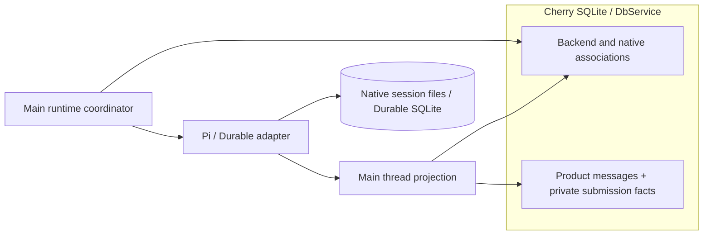
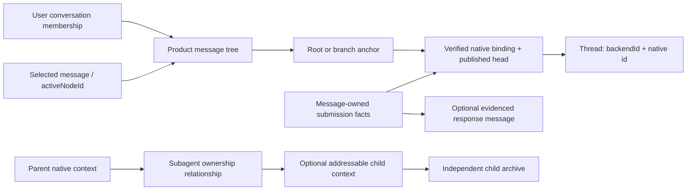

# Agent Note: Runtime 访问、输入、观察与生命周期契约

Status: proposed

[English](2026-10-17-agent-runtime-contract.md) | 中文

## Problem

Cherry 需要跨 harness 打开原生上下文、提交输入、独立于某次提交观察工作，并释放资源。要求所有 harness 采用 Cherry 的会话引擎，会重复实现原生调度和恢复；庞大的能力矩阵则会迫使每个消费者自行解释差异。

本文接替栈中的 Runtime 所有权与行为设计，记录已实现的 v0 访问边界及其理由，以及接入时仍需履行的宿主责任。[公共类型](../../../../packages/agent-runtime/src/contracts.ts)、[Pi 适配器](../../../../packages/agent-runtime-pi/src/runtime.ts)和 [Pi Durable 适配器](../../../../packages/agent-runtime-pi-durable/src/runtime.ts)维护精确签名。包代码已存在；桌面接入及下述完整验收尚未完成。[Harness 边界](2026-10-17-agent-harness-boundaries.md)维护更上层的职责划分。

## Proposal

### 保持公共入口精简

当前公共形状如下：

```typescript
interface AgentRuntime {
  open(ref: Thread): Promise<OperationResult<ThreadHandle>>
  shutdown(): Promise<OperationResult<ShutdownReceipt>>
}

interface ThreadInput {
  readonly policies: readonly BusyPolicy[]
  submit(input: InputDraft): Promise<SubmitResult>
}

interface ThreadHandle {
  readonly thread: Thread
  readonly input?: ThreadInput
  observe(sink: ObservationSink): Promise<OperationResult<Observation>>
  interrupt?: () => Promise<OperationResult<InterruptReceipt>>
  release(): Promise<void>
}

interface Observation {
  stop(): Promise<void>
}
```

| 入口 | 单独存在的原因 |
| --- | --- |
| `open` | 访问已知上下文，不创建替代品，也不覆写其配置。 |
| `input?.submit` | 在访问支持输入时交给原生接纳；回执与观察到的输出分开，不拥有唯一专属响应流。 |
| `observe` | 重新观察已有工作，包括没有新提交仍在继续的 child 工作。 |
| `interrupt?` | 仅在存在原生中断能力时提供入口，并保留实际作用范围。 |
| `release` / `stop` | 结束调用方的访问或观察，不取消其他所有者的工作。 |
| `shutdown` | 由资源所有者关闭整个已配置 Runtime 实例。 |
| `thread` / `input.policies` | 保存可寻址上下文并选择支持的输入安排，无需解释通用能力语言。 |

异步工厂与 `create` 保留在具体适配器。Pi 接收 `AgentRuntimeSessionOptions`，包含原生 `ModelRuntime`、`Model` 和 `SessionManager`；Pi Durable 接收原生 `HarnessOptions`、独占存储工厂和 `ConversationCreateOptions`。这些都是强类型配置，不是任意 options 袋。初始化失败时清理已取得的资源；宿主共享模型服务仍是借用资源。

Pi Durable 还提供 Runtime 级 `resume`、具体句柄上的 `lookupInput` 和 `retractInput`，以及 `input.submit` 的去重能力。原生命令发现、配置变更、上下文编辑和 fork 不属于公共强制方法。工具、审批和模型桥保留在现有适配器与宿主边界；只有消费者需要跨实现相同语义时才提取公共行为。

接口没有通用 `spawn`、精确任务取消、交互响应、历史分页或重放游标。可选的 `ThreadHandle.input` 表达只读访问，可选的 `Subagent.child` 表达没有可访问上下文的关系。当前 Pi 和 Durable 的具体句柄均提供输入。Pi 托管 child 的输入经过扩展所有者，只暴露 `steer`。[子智能体控制文档](2026-10-18-agent-runtime-subagent-control.md)记录本轮已实现部分及剩余控制方案。

### 把提交定义为原生输入接纳

`InputDraft` 包含宿主的 `inputId`、`text` 和 `whenBusy: 'reject' | 'steer' | 'follow-up'`。具体访问入口决定原生输入路径。普通 Pi 根会话 prompt 可能在到达模型接纳前触发命令或钩子：

```text
Input -> native command/input hooks -> locally handled
                                  -> model admission applies whenBusy
```

| 到达原生模型接纳点时 | `reject` | `steer` | `follow-up` |
| --- | --- | --- | --- |
| 前台空闲 | 可以开始工作。 | 可以开始工作。 | 可以开始工作。 |
| 前台忙碌 | 拒绝这次模型输入，不排队。 | 在原生支持的边界安排干预。 | 按原生规则安排后续输入。 |

这不是针对指定执行的原子条件，也不证明所有后台工作和队列均为空。不支持的策略在原生派发前拒绝；配置或已关闭资源仍可能阻止本来允许的输入。先前处理的命令或钩子不受 busy 策略约束：Pi 的 `/goal pause` 在忙碌且选择 `reject` 时仍可处理。`locally-handled` 标识处理路径，不证明命令成功。跳过 Pi prompt-template 展开不能跳过所有输入 handler，因此不能实现无副作用的 idle-only 操作。这类保证需要原生原子接纳或受约束的扩展，不能靠前置 `isIdle` 检查实现。

Pi 托管 child 输入使用所有者的 `messageSubagent`：运行中的 child 接收排队消息，已结束的 child 则加载上下文并启动新的后台 run。它仅接受 `steer`，不把斜杠文本解释为根会话命令，也不模拟其他策略。续接保留控制器对 loader 的要求、用户停止后的拒绝规则和原生结果交付。这不保证消息不会唤醒执行。

提交回执报告证据：`accepted`、`queued`、`dispatch-started`、`locally-handled` 和 `placed` 是事实集合，不是线性状态机。排队、派发和放置均不证明模型已消费。确认接纳不证明执行完成或目标成功。通用操作返回 `confirmed`、`rejected`、`unsupported` 或 `unknown`；提交使用 `acknowledged` 表示已确认交接。预期失败通过结果表达；编程错误仍可抛出。v0 的错误码是字符串，不是穷尽的公共枚举。诊断消息不能携带密钥或原生对象；宿主把注入的错误回调接到 `loggerService`。

只有明确未接纳时才能返回拒绝。未知结果必须保留未知；后续查询失败不能推翻已确认的接纳。对于有消息记录的输入，宿主在提交前保存用户消息及路由/恢复所需的 Main 私有提交信息，窗口停止等待后继续持有 Promise，并记录迟到回执。`input.changed` 可以确认逻辑输入，而不证明哪一次结果未知的传输成功。P1 不要求独立输入表或逐次尝试历史。Runtime 不提供持久的宿主投递日志。

同一 `InputId` 的文本、目标和 busy 策略不可变，变更时创建新的逻辑输入。Pi 没有持久的原生输入去重，未知结果不能触发自动重试。Durable 的原生去重键与查询允许采用不同的投递政策；对于有消息记录的输入，Main 可显式将消息 ID 作为 key 传入，并在重开后查询已捕获目标。任何获准重试都需要实际提交的原草稿，不能从编辑后的展示内容重建。原生同类型去重不会校验 payload 相等。查询未找到不证明没有副作用。撤回区分 `withdrawn`、`already-placed` 和 `already-settled`；撤回单个输入不是中断会话。

### 只公开消费者需要引用的身份

| 公共身份 | 用途 |
| --- | --- |
| `Thread { backendId, id }` | 定位已配置 backend 内的原生上下文；持久性取决于原生存储。 |
| `InputId` | 宿主逻辑输入身份，至少在目标上下文内唯一，独立于传输尝试。 |
| `ItemRef { session, id }` | 标识可更新内容与工具关联。 |
| `SubagentId` | 在父 Thread 内标识跨 child 输入和运行保留的关系，不建立任务身份，也不要求存在可访问的子上下文。 |
| `NativeInputRef { session, id }` | 在支持时定位真实原生输入，供查询或撤回。 |

ID 使用不同的 branded 字符串类型。消费者可以序列化它们，但不能互换、解析前缀或从格式推断生命周期。宿主提供 `InputId`；适配器返回原生、上下文和内容引用。恢复 branded ID 前应校验存储和传输数据。宿主配置稳定的 `backendId` 命名空间并保证唯一写入者；v0 不增加跨进程锁。

`SourceRef`、epoch、revision 和 sequence 留在来源映射与排序内部。需要时使用的传输尝试身份、跨进程投影版本和订阅替换标记属于宿主，这不要求新增持久化 attempt 表。不提供把停止本地等待、中断原生工作和结束观察混成同一含义的通用调用上下文或取消信号。

适配器在共享来源处统一归一化内容。重新观察同一实时来源保持 Item 身份。当前 Pi 分配实时消息身份，并在重新绑定或压缩时重置映射；这些不是持久历史键。Durable 可以从原生 entry 派生已保存内容的身份，但预览使用临时 epoch。有确定映射时可发送 `replaces`；否则通过 `gap` 和替换快照明确断点。Runtime 重建后不能猜测丢失映射中的 ID 与新 ID 等价。

### 观察提供可读的来源视图

公共内容包含 text/reasoning 消息 parts、参数可能尚不完整的 `argumentsText` 工具调用，以及可选携带可序列化 `JsonValue` 的工具结果。它不导出 SDK 对象、UI chunk 或原生重放格式。`complete` 表示内容完整，不表示目标达成。前台 `Activity` 不代表所有后台任务或等待中的 preflight。

父快照可以暴露 `Subagent { id, parent, child? }` 记录。当前两个适配器从原生所有权证据发现 child，以父方范围内的原生 child ID 标识关系，并通过同一 Runtime 路由可访问的子 Thread；宿主创建的跨 harness 路由是另一项职责。关系跨 child 续接保留，不携带任务完成状态。缺少 `subagents` 表示不提供发现能力；空数组表示当前没有可见关系，不表示从未存在 child。缺少 `child` 表示未提供可独立访问的上下文。父观察既不递归混入 child 内容，也不向父方交付结果。

快照只替换该来源的当前视图，不删除宿主归档、其他 Thread 或 child 视图。当前适配器提供 `current-view`；协议也允许 `live-only` 和 `retained-view`，均不承诺包含所有历史分支。观察先发送 snapshot，再使用 `item.upsert`、`item.remove`、`input.changed`、`activity.changed`、`subagent.upsert`、`diagnostic`、`gap` 和 `closed`。Upsert 携带累计值，不是任意 token chunk；移除 Item 不等于删除原生上下文。v0 没有为 execution 或 interaction 事件预留未定义的变体。

[ThreadFeed](../../../../packages/agent-runtime/src/observation.ts) 复制视图与事件，在每个 sink 内串行交付，并隔离观察者。Sink 可能在 `observe` Promise 返回前执行，必须预先捕获 Thread 和订阅上下文。注册确认不等于消费者已保存首帧。等待 sink Promise 仅对该观察者施加背压，不阻塞同步原生派发或其他 sink。

待交付队列有界。当前 feed 在待处理帧超过 100 时合并为明确的 `gap` 与替换快照，并保持首帧必须是快照的要求。这恢复的是当前视图，不是全部丢失的历史事件。映射丢失和断线也通过 gap 表达；来源无法恢复时关闭观察。快照接入不能静默遗漏注册边界的变化。

`stop` 或访问释放后，不再开始新的 sink 调用；已进入的异步消费者可以完成。Stop 幂等，其完成本身就是确认，不强制再发终态回调。Shutdown 或来源丢失尽力发送 `closed`。Sink 抛错时解除该订阅，并在 sink 之外报告，不能把异常传入原生派发。宿主负责投影 flush，并在替换观察前封闭旧订阅的写入。单 sink 顺序不解决跨进程重放，也不解决独立观察流合并。

### 协调访问，不接管执行

同一 Runtime 内并发打开相同上下文，共享加载过程与原生所有者。`open` 校验 backend 和原生身份，缺失时返回 `not-found`，不回退到 `create`。Pi 的宿主 loader 必须返回准确的已保存 manager 和配置，不能把空文件或缺失文件转成新会话。新 Runtime 重新打开已保存 Thread 时，需要新的访问和观察对象；未保存上下文不会仅因有 ID 就变得可恢复。

当前没有单 Thread 驱逐，也不在最后一个访问释放时自动 dispose。资源和当前归一化视图保留到 Runtime shutdown，因此某个访问释放不会干扰其他调用方或不可见的原生工作。随着打开 Thread 增多，内存会持续驻留；宿主需要驻留政策。为回收一个 conversation 而关闭共享 Durable Harness，会关闭整个组。独立驱逐需要后续经过原生验证的契约。

每个上下文串行处理公共提交的接纳，直到取得确认或拒绝证据，或原生调用结束；不等待整次模型运行完成。等待中的调用只是本地协调，不是额外的已接纳或持久队列。原生扩展与其他进程不受这个顺序约束。Pi preflight 挂起会阻塞该上下文后续公共接纳，其他上下文仍独立。适配器不能超时后猜测失败。

Interrupt 绕过接纳屏障。它不取消本地尚未派发的尝试，也不保证待决 preflight 后续不能启动。Release 封闭该访问，阻止其排队尝试派发，已派发操作继续结算；宿主仍收集结果。已取消的产品动作若迟到取得访问或观察，应 release/stop 该资源，不删除已创建的上下文。严格的“停止后保持静止”还需要封闭宿主投递，并协调待决接纳和原生队列；v0 不承诺这个原子操作。

### 明确适配器的控制范围

| 操作 | Pi | Pi Durable |
| --- | --- | --- |
| 初始化 / open | 加载并校验原生上下文；扩展初始化可能产生效果。不承诺恢复在途调用或内存队列。 | `Harness.open` 协调已保存的原生状态；打开 conversation 不开启调度。 |
| observe / lookup | 不发 prompt，只观察已知上下文；没有原生输入查询扩展。 | 使用 watch/status/submission 查询，不调用会开启调度的 wait。 |
| submit | 根会话使用原生 prompt 与 preflight 证据；空闲时的 steering 不直接映射到原生 steer 调用。托管 child 使用所有者的消息／续接路径，仅支持 `steer`。 | 原生事务接纳；即使本次输入被拒绝，submit 仍可能开启共享调度器。 |
| interrupt | 自有访问调用会话所有者；托管后台 child 经父控制器停止，仍在 streaming 的前台 child 可能需要中断父轮。 | 默认 `Conversation.abort` 撤回 queued input 并中断 owned nonbackground 工作；会开启调度，不覆盖 queued write 和 background 工作。 |
| resume / retract | Pi 不提供这些原生设施的公共实现。 | 开启整个 Runtime 的调度器；另有原生输入撤回，回报放置或结算状态。 |
| shutdown | 封闭访问、跟踪接纳与原生调用，按生命周期 abort/dispose 所有者，最后关闭观察。 | 关闭共享 Harness、在途操作、投影和独占存储。关闭不等于持久任务取消。 |

对于 Pi，普通父会话中断不会停止全部后台 child。扩展记录用户停止并抑制自动唤醒父会话；前台取消遵循原生所有权。显式 child 中断使用 child 级控制。后台 child 的 `requested` 回执不证明终止；即使是 `native-scope-idle`，也不证明队列、preflight、所有扩展或后续工作均已停止。仅凭 `interrupt` 方法存在，无法推断这些区别。

资源所有者必须先接受 Durable 的 Harness 级调度影响，才能使用 submit/interrupt/resume。原生恢复不承诺外部工具副作用恰好一次。更严格、更窄的控制需要具体适配器能力或上游增强，不能靠通用能力矩阵假装所有效果等价。

### 关闭 Runtime，而非产品历史

`shutdown` 让当前已配置适配器实例退出服务，释放其全部上下文的接入资源。它不关闭其他 Runtime 实例，不删除产品或原生历史，不撤销工具效果，也不统一把所有任务标成取消。Shutdown 后不能复用该实例及旧句柄；需要新建 Runtime 才能重新打开已保存上下文。

Shutdown 封闭新的 open/create/submit/resume/control 调用，拒绝未派发工作，跟踪已开始的操作并释放自有资源。重复调用共享同一次关闭尝试。清理结果未知时，Runtime 继续拒绝新工作，不能返回 confirmed `closed`。Pi 可能需要等待无法取消的 preflight，因此不保证停机时间有界。宿主取消等待不会取消清理 Promise。宿主协调进程退出前的投影 flush，不能仅为排空观察而调用会开启调度的 native wait。

Pi 可以重新打开已持久化的上下文，但不恢复被中断的执行或未保存队列。Pi Durable 在重新打开适当的持久存储后，可以按原生恢复规则继续未终结任务；内存存储无法跨进程退出保存。因此 shutdown 不是通用的保存后暂停操作。

| 宿主动作 | 对应访问操作 |
| --- | --- |
| 关闭窗口 | 停止窗口订阅，不再需要时释放访问；宿主投影可以继续观察。 |
| 停止生成 | 在支持时中断目标上下文，并按适配器原生范围解释结果。 |
| 退出应用或停用执行环境 | 关闭对应 Runtime，协调宿主持久化与 flush。 |
| 打开已有工作 | 打开已保存 Thread，开始观察，再在访问支持相应策略时提交输入。 |
| 父结束后继续关注 child | 打开发现的 child，独立于父消息观察它。 |

### 桌面接入实现方案

本节是四个边界的实现目标：原生 child 所有权、继续输入、独立投影，以及持久化与恢复。它把包契约延伸到 Cherry 宿主，不表示桌面已完成迁移。通用 spawn/stop 与宿主跨 harness 编排仍属于独立的[后续控制工作](2026-10-18-agent-runtime-subagent-control.md#keep-common-spawnstop-as-follow-up-work)。

#### 起点与改动归属

核对后的桌面路径仍是 `AgentChatContextProvider → AgentSessionRuntimeService → PiRuntimeDriver → PiRuntimeConnection → pi.createAgentSession`。三个包和 AI SDK 模型绑定已经存在，但桌面生产调用尚未使用其 Runtime 工厂。现有后台输出通过 `rootToolCallId` 找到父 assistant 行；没有该锚点就忽略输出，child parts 最终也写回父消息行。只替换工厂函数会保留这个所有权问题。

| 位置 | 计划改动 | 继续保留的职责 |
| --- | --- | --- |
| [公共契约](../../../../packages/agent-runtime/src/contracts.ts) | 优先使用已有 Thread、可选输入、关系和观察契约。只有原生证据与消费者都需要时才增加字段。 | 不放产品行、投递日志、调度器或 UI lane。 |
| [Pi Runtime](../../../../packages/agent-runtime-pi/src/runtime.ts)、[投影](../../../../packages/agent-runtime-pi/src/runtimeProjection.ts)和[子智能体所有者](../../../../packages/agent-runtime-pi/src/subagent.ts) | 增加可验证的输入关联，并通过原生所有者恢复 child 访问。 | 原生会话、child 执行、结果交付和强类型 Pi 扩展。 |
| [Durable Runtime](../../../../packages/agent-runtime-pi-durable/src/runtime.ts) | 激活调度前，依据原生 submission/task 对账持久输入映射和 child 所有权。 | 原生 Harness/storage 所有权与恢复语义。 |
| [桌面 Pi 接入](../../../../src/main/ai/runtime/pi/README.md) | 复用宿主配置与装配，接好生产 AI SDK 模型 port，逐步替换执行和输出路由。 | Prompt、skills、MCP、审批、shell 环境、模型政策、用量和 tracing。 |
| [AgentSessionRuntimeService](../../../../src/main/ai/agentSession/AgentSessionRuntimeService.ts) 及其持久化模块 | 持有已配置 Runtime 实例、逻辑输入投递和每个 Thread 的投影。在现有模块内提取 `threadProjection.ts` 这样的实例辅助模块。 | 产品生命周期、授权、持久化屏障，以及与投递、fork 操作的集成。 |
| [数据 schema](../../../../src/main/data/db/schemas/agentSession.ts) 与[数据服务](../../../../src/main/data/services/README.md) | 用 `DbService` 增加上下文关联和输入投递记录，并追加 migration。 | 产品数据事务；不执行原生任务或解析 transcript。 |
| [useAgentSessionParts](../../../../src/renderer/hooks/useAgentSessionParts.ts) 与共享 IPC 契约 | 独立于父 assistant 消息寻址某个上下文的投影。 | 展示和订阅；Main 继续负责持久化。 |

辅助模块由现有生命周期服务持有，不增加单例或第二套执行引擎。原生路径通过 `application.getPath` 解析；跨进程 schema 放在 `src/shared`。持久业务数据查询走 DataApi；提交、观察、中断和恢复命令走 IpcApi。Renderer 输入必须针对关联的产品会话校验权限，不能因为携带了原生 ID 就被信任。

#### 边界一：child 生命周期归原生所有者

发现操作记录父子关系；打开 child 获取其上下文的访问。两者都不创建任务，也不报告结果。Pi 模型工具与宿主 child 输入必须到达同一个扩展控制器。Durable child 访问必须保留原生 conversation/task 关系；创建一个无关 conversation 再提交文本，并不等于实现原生子智能体。

Pi 冷启动重开时，先恢复父会话保存的 subagent registry 与交付状态，再经过该所有者及其 loader 解析 child。即使没有新的 `onSessionCreated` 回调，也要发布恢复出的关系。把 child 文件作为普通 root 加载，会绕过续接、停止和报告规则。如果无法恢复所有者，则保留历史关系，并让 child 打开失败；当前具体 Pi 句柄承诺提供输入，不能把它当作只读句柄。产品历史仍然可读。先补全 Pi 适配器的恢复路径，再让桌面依赖它。

结果报告继续由 Pi 扩展或 Durable 原生 reporter 机制负责。投影器绝不向父会话补发完成结果。直接向 Durable child 输入不会创建 reporter。用户停止父会话后，Pi 抑制自动唤醒父会话，这是接入 Durable 报告时需要保留的 Cherry 政策，并非上游示例已经保证的行为。

后续 spawn/stop 层再暴露工具与宿主共用的所有者方法。它必须区分 child 创建和首条输入接纳，并在接纳失败或未知时保留已创建 child 的身份。Stop 必须明确是否影响父会话、child 当前工作或后台后代，以及是否允许继续输入。本轮接入不需要因此增加公共强制 spawn/stop 接口。

#### 边界二：继续输入必须关联原生证据

对于有消息记录的输入，Main 复用新用户消息 ID 作为 `InputId`，捕获一份目标为 child 或 root Thread 的不可变 `InputDraft`；公共契约不要求其他调用方必须拥有产品消息。派发前保存消息及实际消费者所需的私有提交信息；即使窗口或调用方停止等待，Main 仍收集结果。获准重试未变更草稿时保留身份，编辑或明确重新执行则使用新消息/输入身份。接纳、放置、回答归属和终态是不同的证据。

| Cherry 需要的证据 | Pi 实现门槛 | Durable 实现门槛 |
| --- | --- | --- |
| 接纳 | 保留 preflight 与所有者控制器回执，包括本地处理的命令和迟到确认。 | 按需将消息与已捕获目标、稳定去重键及已确认原生 Submission 身份关联。 |
| 放置与输出归属 | 让输入关联贯穿钩子、原生队列、历史插入和 child 续接。不按文本或排队位置匹配。 | 对账原生 submission 放置和 run 的输入集合；多个输入可以共同产生一个回答。 |
| 产品终态 | 把原生完成、错误、中止或截断关联到受影响的输入集合。仅会话 settled 或 assistant item complete 不足以证明。 | 映射原生 done/unanswered/abort 证据，不把接纳或前台空闲当作成功完成。 |
| 不确定尝试的恢复 | 没有持久去重就不自动重试；丢失关联时保留未知。 | 在原生去重规则下查询并使用原始不可变草稿；查询失败不能撤销已知接纳。 |

未打补丁的 Pi 1.3.0 `PromptOptions` 没有调用方关联 token，steering/follow-up 的内部记录使用文本。P0 的第一部分现已在原生层增加调用方关联，贯穿输入变换、队列、历史放置和由所有者管理的 child 续接。Cherry 通过固定版本的依赖补丁携带这项变更，关联的 Pi 工作区保留源码及回归测试；它尚不是上游发布版本。[证据记录](../testing/2026-10-17-agent-harness-evidence.md#p0-input-correlation-check--2026-10-19)列出验证及限制。token 不修改 transcript 内容，不提供去重，也不会自行跨重开保留。

P0 现在已有包级终态和多输入归属证据。Pi 补丁在原生请求准备时保存尚未回答且已放置的输入集合，并在最终回答或终态收束后通过 `input_settled` 返回实际响应 entry。工具／边界续接和重试会保留该集合；排队或稍后才放置的输入不能继承较早的响应。Pi 强类型 `input-settled` 事件保留原生 entry ID、输入 ID、停止原因和中止证据。这是原生响应归属，不证明任务语义上成功，也不证明任意上下文钩子处理后逐字消费了输入。桌面路径仍需满足 P1–P4 的接入门槛。

公共层仅增加可选的 `InputState.response: ItemRef`：多个输入可以共享同一个终态响应，无需创造执行 ID，也无需给 assistant 回答指定单个 `MessageItem.inputId`。Pi 提供原生输入集合证据，Durable 提供各 submission 的回答 entry。该引用遵循 current-view 身份与覆盖规则，不是通用持久历史键。正常最终回答映射为 `completed`，错误为 `failed`，中断为 `aborted`，截断或没有最终回答为 `unanswered`。Durable 原生 `done` 也包含截断／仅工具调用的回答，因此适配器读取实际回答后才声明成功。证据缺失时不设置 outcome。已处理命令可能失败而不产生 assistant 回答；迟到回执必须保留已确认终态。只有对应投影和终态证据完成持久化后，才结束产品投递。

`whenBusy` 仍只表达输入接纳政策。不唤醒通知、回答交互和修改模型/配置属于独立的所有者操作，不能都编码成另一种 `steer`。本方案不增加通用交互或工具接口。

#### 边界三：Main 按 Thread 独立投影

在已配置 Runtime 内，为每个 `(backendId, threadId)` 设置一个宿主投影所有者。它持有适配器句柄、观察、当前视图、来源到产品 Item 的映射，以及待持久化写入。Renderer 窗口订阅该视图；打开第二个窗口不创建竞争的原生投影或持久化写入者。

```text
Parent Thread observation -> parent projection -> parent display
          Subagent link ----------------------> child display link
Child Thread observation  -> child projection  -> child panel / tool card
                            |
                            +-> child context's product messages
```

Child 内容归其上下文，并拥有独立的产品消息身份。父工具卡片保存关系和展示入口，不再作为 child 唯一的持久存储位置。父回合结束、移除其实时 assistant accumulator，以及关闭父视图都不能停止 child 观察。如果 UI 需要 lane，它只是 Cherry 根据关联派生出的视图分组，不是 harness 执行身份。

附着前先让 sink 捕获订阅替换标记，因为初始快照可能早于 `observe` 返回。按 Thread 串行处理投影写入。替换观察前，封闭旧写入者、停止观察并排空已经进入的写入；之后只有当前标记可以提交。Renderer 附着或漏掉更新时，发送带宿主 revision 的完整视图。该 revision 不进入公共 Runtime 契约。

在有效映射内，累积 upsert 更新同一产品消息，不逐 token 插入行。`snapshot`、`item.remove` 和 `gap` 改变当前视图，不改变已保存的会话历史。压缩、重新绑定或重建后，只有原生证据支持时才能复用历史身份。不把恢复快照当作新的历史消息追加，也不按相同文本去重。映射不可用时保留归档、标记视图断点，并单独展示新的当前视图；完整原生历史导入不在本轮范围。

| 产品动作 | 宿主行为 |
| --- | --- |
| 窗口关闭或切换选择 | 移除该订阅者；继续保留活跃工作与持久化需要的 Main 观察。 |
| 父会话结束，child 继续 | 独立于父消息，继续持有 child 投影和原生所有者。 |
| 用户停止生成 | 封闭相关宿主投递，请求文档约定范围的原生中断，并跟踪结果；不能用 `release` 替代，也不宣称所有队列已清空。 |
| 最后一个视图释放 | 释放不再需要的访问，不假定已经驱逐原生资源。当前适配器保留已加载上下文直到 shutdown。 |
| 应用退出或执行环境退役 | 封闭接纳、收集进行中的回执、关闭自有 Runtime，随后在关闭数据库前排空并封闭最终投影写入。清理未知必须保留可见性。 |

首轮 Pi 接入把 Runtime 作用域限定为一个产品会话的原生 root 及其自有 child 树，全部句柄由该所有者管理。Durable 作用域遵循其独占原生 storage/Harness，其中可以有多个 conversation。不能把旧的逐消息、逐连接 idle TTL 套到任一所有者内部的单个会话上。首版政策是保留已配置所有者，直到明确退役或应用退出；内存增长是已知限制。逐 Thread 驱逐需要后续原生支持和单独验证。

#### 边界四：保存产品关联，恢复原生状态

##### 存储决策与范围

P1 使用 `DbService` 保存 Cherry 的上下文关联及消息上的必要提交信息，不新增 `agent_session_input` 或通用宿主输入日志。Pi 保留原生 session 文件；Pi Durable 使用独立文件中的原生 SQLite 存储。各 harness 拥有自己的序列化、提交和恢复语义，Cherry 负责位置、生命周期与产品关联。这些是 Main 私有的宿主记录，不增加公共 `agent-runtime` 接口。

当前[消息 schema](../../../../src/main/data/db/schemas/agentSessionMessage.ts)已经保存展示内容、搜索文本、运行时 resume token 和跨会话投递字段。[会话 schema](../../../../src/main/data/db/schemas/agentSession.ts)尚无显式原生上下文关联。[旧 Pi loader](../../../../src/main/ai/runtime/pi/PiRuntimeConnection.ts)在 token 没有已落盘文件时可能初始化会话。P1 在保留既有历史的同时建立明确关联；已迁移上下文采用严格打开。

| 数据 | 权威所有者 | 物理存储与消费者 |
| --- | --- | --- |
| 模型历史、分支、压缩、原生队列／task／reporter 状态 | Harness | Pi `SessionManager` 文件或一个原生 Durable store，由原生执行与恢复读取。 |
| Backend 位置、产品／原生上下文关联及必要提交事实 | Cherry Main | `DbService` 中的 backend/context 记录，以及既有用户消息上的 Main 私有元数据。由运行协调与恢复读取。 |
| 产品可见消息、搜索、用量与展示元数据 | Cherry 消息服务 | 原生接入期间保留 `agent_session_message`，另行迁移产品模型以复用既有 `topic`/`message` 树语义。由 Renderer 和产品查询读取。 |
| 流式片段、观察 revision 与当前 Item 映射 | Main 投影所有者 | 保留在内存，将合并后的更新写回同一展示行；不作为原生事件归档。 |

部分文本同时存在于原生历史与展示消息中，因为二者的保留规则和消费者不同。原生压缩或分支不能删除产品归档；产品编辑也不能静默改写模型的原生上下文。不再保存第三份完整 transcript，不把 Durable entry/submission/task/commit 镜像到 Cherry 表。保持已提交消息版本稳定，不强制向独立输入记录复制正文。未来若有重试消费者需要保留消息无法重现的变换后载荷，应为该路径单独论证私有载荷快照，不能据此要求每条输入都存一份。



##### 复用产品消息树

既有[消息树](../../../../docs/references/chat/message-tree.md)使用 `topic`、`message.parentId` 和 `topic.activeNodeId` 表达消息前序、编辑／重发和分支选择，普通聊天也沿选中路径构造模型历史。产品结构优先复用这套模型，不再建立第二棵 context 树。`agent_session_message` 当前仍是独立的平铺模型；两者收敛属于设计与迁移工作，不是本方案已实现的行为。

| 关系 | 所有者与表达方式 |
| --- | --- |
| 消息续接与对话的备选分支 | 产品消息树及其既有分支选择。 |
| 产品位置到原生执行位置 | 包含 backend、原生 session／Thread 身份及必要 checkpoint 的绑定。 |
| 父 agent 到派生的 child | 独立的派生关系、原生所有权，以及访问允许时的输入目标；普通消息 `parentId` 不表达这些语义。 |

产品分支不必对应独立的原生 session：Pi 的 `SessionManager.branch()` 可以在同一 session 内分支。`Context` 只表达原生关联，不再承担第二套消息容器或分支层级。P2 接入前优先评估会话或分支锚点上的绑定，有具体投影消费者证明必要后才增加逐消息 `contextId`。由选中的产品分支解析原生目标，不通过 `rootContextId` 再维护一套分支选择。绑定用于定位原生状态，不负责从产品消息重建原生状态。

Child 内容可以复用消息存储和树形渲染，但界面上嵌套到父消息下，不代表它独立的历史、工具、生命周期或输入目标属于父 agent 的普通对话路径。继续输入前保留独立的 spawn 关系与原生所有者。P1 不要求 `agent_session_message.contextId` 或 `agent_session.rootContextId`；先明确绑定位置和迁移方案，再定稿这些字段。

##### 当前产品模型与迁移边界

以下盘点来自源码检查，不表示接入已完成：

| 关注点 | 当前普通聊天 | 当前 Agent 路径 | 拟议边界 |
| --- | --- | --- | --- |
| 容器与导航 | `topic` 拥有 assistant 选择、名称、排序、活跃时间、回收站及 `activeNodeId`。 | `agent_session` 混合了会话元数据、agent/workspace 绑定、计划复用及 `conversation`/`background` 分类。 | Runtime 切换期间保留既有 ID 和导航所有者。显式用户会话成员关系由 [#20635](https://github.com/CherryHQ/cherry-studio/issues/20635) 拆分；能够访问 Runtime 不代表应进入侧栏。 |
| 消息结构 | `message.parentId`、单个虚拟根、兄弟分组和选中路径查询。 | `agent_session_message` 按 `(createdAt, id)` 排序，没有父节点或选中节点。 | Agent 归档复用消息树契约，不以原生 context 代替消息节点。 |
| 编辑与 fork | 产品树操作选择或创建替代路径。 | [编辑](../../../../src/main/data/services/AgentSessionMessageService.ts)在原生 fork 后删除旧尾部；[fork](../../../../src/main/ai/agentSession/fork/AgentSessionForkOperations.ts)发布另一个产品会话并复制前缀。 | 已确认的目标行为是保留旧分支并选中编辑后的分支，随相应 UI/action 改动一起交付。“fork 为新会话”仍是另一项操作。 |
| 原生位置 | 普通聊天根据选中路径组装模型历史。 | Resume token 和私有 `runtimeAnchor`/`nativeSessionId` 位于消息行中。 | 持久化经过验证的原生绑定，保留历史 checkpoint；不能从选中的展示路径重建 harness。 |
| 可信产品状态 | 共享消息内容、snapshot、用量及附件。 | 另有 Main 写入的 `delivery*` 状态和原生 checkpoint 证据。 | 保留 Main 独占写入和跨会话投递语义；共享消息编辑不能接受这些字段。 |
| 依赖记录 | 聊天附件引用及 topic 导航/搜索。 | [Agent 附件引用](../../../../src/main/data/db/schemas/fileRelations.ts)、用量 `messageKind`、session 收藏、task/channel 绑定和保存的路由。 | 合表需要迁移所有消费者；内容列看起来相同不代表所有权可以互换。 |

建议首先共用树语义和既有[消息 UI 契约](../../../../src/renderer/components/chat/messages/README.md)，保留两套物理归档表及其所属服务。Agent 读写仍经 Agent API，共享组件不调用 Home topic mutation。只提取两个服务都有实际消费者的树操作。这样每份归档保持唯一内容写入者，原生接入也不依赖导航/表重构。

物理合并到 `topic`/`message` 是独立的迁移决策。给每个执行创建 topic，会混淆后台或 child 历史与用户会话成员关系。该决策必须明确隐藏归档、原生 checkpoint 和投递状态的所有者，以及 session 路由、收藏、附件外键的处理。#20635 初期指定一对一会话成员关系；本方案不将该 issue 隐式扩展为多对多会话模型。

##### 已确认的编辑与分支行为

用户已确认：编辑并重发时保留旧分支，并切换到新分支。这是目标产品行为，当前实现仍会删除旧尾部。

```text
root
└── U1 → A1
    ├── U2  → A2       (retained)
    └── U2' → A2'      (selected)
```

编辑后的输入使用新的消息 ID 和逻辑输入 ID，与原输入拥有相同前序节点。产品树共享公共前缀，不改写既有消息、输入事实或原生绑定。原生 fork 从被编辑输入之前的已验证边界开始，不能从旧回答之后开始。新分支获得独立绑定。显式 fork 到另一个产品会话仍复制前缀，使用新的产品 ID 和原生 checkpoint 映射。

编辑首条输入时前缀为空，使用该操作已验证的配置显式创建新原生上下文，不要求不存在的输入前 checkpoint。这是创建新分支的操作，不是对缺失上下文的降级重建。前缀非空而 checkpoint 缺失时仍拒绝执行，展示文本不能替代 checkpoint。

原生结果验证通过且来源版本仍匹配后，才发布新分支与选中状态。发布前失败，保留旧选中状态和历史。发布后提交被拒绝或结果未知，新分支仍展示真实状态；不能删除该分支、恢复旧尾部或自动重发。在另行定义如何安全中断或 fork 之前，保留当前禁止编辑尚有未结束工作的来源这一限制。打开或选中保留的分支，不会重新提交其输入。

##### 最小宿主模型与分支路由

下图表示逻辑关系，不代表新增七张表。“归档”指既有产品所有的消息存储；Agent 初期保留 `agent_session_message`。



| 事实 | 拟议位置与约束 | 所需消费者 |
| --- | --- | --- |
| 产品所有者与选中路径 | 既有容器加产品 `activeNodeId`；Agent 按相同虚拟根及父节点规则支持树结构。选择状态不是执行游标。 | 历史、分支导航和输入框。 |
| 消息祖先关系 | 产品 `parentId`，校验相同所有者、单根及无环。表示展示路径，不证明模型消费了所有祖先。 | 既有消息树视图和分支操作。 |
| 原生存储身份 | 既有提案中的 `agent_runtime_backend` 和已验证原生 Thread 身份。 | 严格打开、所有权、备份与清理。 |
| 分支到原生的绑定 | 既有提案中的 context 记录将产品根或分支锚点关联到原生 Thread。已确认绑定保持原生身份不变；另一个原生上下文使用另一个绑定。 | 解析新输入目标，无需查询全局“最新 token”。 |
| 已发布执行位置 | Main 记录与已确认原生进度对应的产品末端，并在支持的边界保留 opaque checkpoint。它与用户选中节点分开。 | 判断继续原生末端还是 fork；隔离其他分支的迟到投影。 |
| 逻辑输入 | 复用用户消息 ID 和保留的已提交内容。Main 私有元数据捕获目标/锚点，仅保存消费者所需的回执或可选响应关联，不另建消息容器。 | Busy 提交、迟到确认、恢复及多输入/单响应归属。 |
| Child 关系 | 父作用域下的 subagent 身份、原生所有者、可选 child 上下文及归档。 | 独立观察和经过所有者校验的继续输入；浏览历史不授予控制权。 |

Main 从操作开始时明确捕获的产品所有者和锚点解析输入，不在稍后重新读取 `activeNodeId` 决定目标。找到该路径上已发布的绑定，验证所有权及 checkpoint 兼容性，并对账待确认的原生事实。所选位置是绑定的可写末端时直接提交；位于历史位置时先准备原生 fork，再发布可写分支。Checkpoint 缺失或操作仍不确定时，历史保持可读并拒绝该执行操作，不能通过重放展示消息补齐。

稀疏锚点绑定和已发布末端是 P1/P2 需要建立的事实，具体列归属由选定存储实现决定，无需给每条展示行添加 `contextId`。Checkpoint 是可恢复位置，不证明新 fork 上下文最初生成了所复制的前缀。保留明确的 fork 映射，不改写历史作者归属。

初版可写分支优先经既有 checkpoint/发布所有者创建独立原生 fork。Pi 能在同一 session 中切换分支，但多个同时活跃的产品分支共享可变原生 leaf，需要当前适配器未暴露的额外协调。浏览分支绝不切换该原生 leaf。多个输入可能共用一个响应，因此输入到响应的关联与消息树的单父边分开。

##### UI 操作到 Main 与 harness 的映射

当前 Agent 发送/编辑接线位于 [useAgentChatRuntimeState](../../../../src/renderer/pages/agents/useAgentChatRuntimeState.ts)、[AgentChatContextProvider](../../../../src/main/ai/streamManager/context/AgentChatContextProvider.ts)和 [AI IPC handlers](../../../../src/main/ipc/handlers/ai.ts)。下表为目标映射：DataApi 负责已存产品数据的读写，生命周期/原生命令经 Main 协调；Renderer 提供产品 ID 与意图，不提供原始原生定位信息。

| UI 操作 | 产品/Main 操作 | Harness 操作与边界 |
| --- | --- | --- |
| 创建空会话 | 创建/复用产品占位会话及 workspace 关联。 | 可到首次输入时才创建原生上下文，不为展示空会话预先创建文件。 |
| 打开会话或窗口重连 | 读取归档、解析绑定，有条件时附加观察。 | 严格 `open` 后 `observe`；不隐式输入、fork 或 Durable `resume`。原生状态缺失不隐藏归档。 |
| 选择其他分支或历史节点 | 更新产品选择并加载该路径。 | 不修改原生状态。窗口切换后，活跃来源仍写入已捕获的分支。 |
| 在当前原生末端发送 | 持久化用户消息及必要私有提交信息；原生派发前捕获目标/锚点。 | 按支持的策略调用 `handle.input.submit`，回执与完成分开保存。 |
| Busy 时发送 | 保持已捕获目标及所选、受支持的 `whenBusy` 策略。排队草稿不能跟随之后的分支切换。 | 原生接纳决定 reject/steer/follow-up；钩子和命令保留前文处理边界，不模拟原子 idle 接纳。 |
| 编辑并重发，或从历史继续 | 验证来源版本/checkpoint，准备原生分支，然后发布新分支/绑定及输入。保留旧路径并选中新路径。 | 强类型原生 fork，或在空根显式 create，之后再提交；不支持的历史操作保持不可用，普通历史选择不能触发它。 |
| Fork 为新会话 | 复用既有文件/checkpoint 协调发布及 workspace 政策，创建独立产品成员关系并复制前缀。 | 原生 fork，不能另行 `create` 后填入 UI 文本。来源继续拥有自己的执行。 |
| 重新生成历史回答 | 视为从已验证边界创建显式分支，适用时创建新逻辑输入。 | 不承诺通用“重跑回答”；只有适配器和产品操作定义了准确重放边界时才开放。 |
| 停止可见执行 | 解析已捕获执行目标，区分宿主待派发输入与原生已接纳工作，报告真实停止范围。 | 可选 `interrupt`，不等于 `release`、删除或保证取消全部 child。Durable interrupt 可能启用整个 Harness 调度。 |
| 查看或向 child 发消息 | 读取独立归档，通过所有者解析关系并验证输入访问。 | 独立 child `open`/`observe`；仅 handle 暴露 input 时提交。Pi 续接经父 controller，观察不向父报告结果。 |
| 关闭窗口或标签页 | 解除该视图的观察/访问；保留 Main 待写入数据、回执及其他所有者。 | `Observation.stop`/`release`，不隐式停止原生执行或删除历史。应用关闭由 Runtime 所有者处理。 |
| 重命名、收藏、归档或删除 | 元数据留在产品所有者。归档/永久删除经生命周期协调；共享树删除不能绕过受保护绑定和未完成投递。 | 普通元数据不调用原生。产品删除不自动删除 store；原生清理需检查保留引用及活跃工作。 |

共享 UI 操作继续由能力决定。当前公共 `InputDraft` 仅携带文本；既有富消息 parts、附件、工具审批、配置变更和原生命令仍需要生产适配器/宿主路径。不能通过将不支持的内容压平成文本，或把所有操作加入强制 Runtime 接口，宣称输入框完全等价。

##### 用 Pi 和 Durable 校验目标映射

所检查的关联 Pi 基线为 `8efd314fa3d3232ce197d8d7a6a5660530b9d83e` / 1.3.0。以下结论证明原生能力，不代表宿主接入通过验收。

| 操作 | Pi | Pi Durable | 剩余接入工作 |
| --- | --- | --- | --- |
| 打开既有上下文 | 包内 `open` 校验 loader 返回的原生 session ID；宿主必须严格加载既有文件。 | 包内 `open` 查询 backend store 中已有 conversation。 | 恢复写入前验证位置/store 身份，绝不创建替代状态。 |
| 从历史位置继续 | 原生 `SessionManager.branch()` 改变同一 session 的 leaf；当前 Cherry [piFork](../../../../src/main/ai/runtime/pi/piFork.ts)使用 `createBranchedSession` 并返回重映射 checkpoint。 | 原生 [`Conversation.fork(at, options, context)`](https://github.com/earendil-works/pi/blob/8efd314fa3d3232ce197d8d7a6a5660530b9d83e/packages/durable/src/harness/harness.ts)从 entry 创建另一 conversation，单独指定所有权。 | 两个新 Runtime 适配器都尚未暴露 fork。通过原生能力扩展强类型适配器历史路径；不增加公共强制 fork，也不在 Main 操作适配器私有 session。 |
| 继续向 child 输入 | 所有者 controller 执行加载/停止/报告政策。 | Child conversation 可以接收输入，直接输入不创建 reporter。 | 允许控制前恢复所有权，结果回交与投影分开。 |
| 退出后重开 | 可重开已保存原生上下文；打开不能恢复未完成执行及内存队列。 | 被动打开/查询先于显式启用调度；提交或中断可能启用整个 Harness。 | 仍需真实进程崩溃测试及产品生命周期验证。 |

##### Schema 实现前需要验证的四条流程

1. **首次会话与输入：**创建产品占位会话，启用树后同时创建虚拟根；提交原生创建意图；在 DB 事务外经所选适配器创建；发布已验证绑定；保存用户消息及必要提交元数据，再派发。Pi 分配 session ID 可能早于文件落盘，因此重开能力在取得受支持证据前仍未确认。原生成功而 Cherry 写入失败时需要对账，不能据此再次创建或提交。
2. **正常继续输入：**捕获选中锚点及绑定，验证原生末端，保存用户消息、必要私有元数据及投影占位行，提交并处理任意顺序到达的回执/事件。最终投影与有证据的输入结果共同提交。并发窗口可选择不同路径，但不改变已捕获输入目标。
3. **编辑或分支续写：**读取一致来源/checkpoint，准备独立原生 fork，或在空根显式 create，重新校验来源版本，原子发布分支/绑定及选择，之后才提交新输入。未解决的操作不能发布成功分支或自动再次创建原生上下文。旧分支保留绑定；复制历史不产生新的用量、审批、投递所有权或 child 控制权限。
4. **重启与选择分支：**先恢复产品历史和选中节点，验证 backend/原生身份并恢复所有者关系，严格打开并观察，对账保存的输入及有证据的投影映射，之后才允许执行。选择旧路径是只读操作；之后在该路径发送时，使用已确认末端或显式 fork 边界。未知 Pi 接纳仍保持未知；Durable 查询/去重使用原 key 和草稿。

##### 原生 backend 身份与位置

持久化一条精简的 `agent_runtime_backend` 记录，让共享原生命名空间的上下文不必分别拥有路径，或各自关闭／删除 store。其 `id` 提供 `backendId`，在进程或 Runtime 对象替换后保持不变。保存 harness 类型和带版本的 Main 私有定位信息；凭据、提供商配置与可变 Runtime 对象仍归既有所有者。`backendId` 不是进程 ID，也不新增公共 `Backend` 接口。

Pi 使用已注册的 `feature.agents.pi.sessions` 位置，并验证每个加载出的 session header 与预期原生 ID 一致。可选的相对文件定位信息用于避免扫描，不能代替身份。关联迁移期间保持现有文件位置。Pi 分配出的 ID 和 `input-placed` 事件不证明延迟写入的 session 文件已持久化。尚无已验证文件的上下文仍不可重开，不能根据展示历史静默初始化。

Durable 为每个已配置 backend 分配独立的原生 SQLite 文件。同一 store 中的所有 conversation 共享 Harness 所有者和调度作用域。优先使用 1.3.0 已有的 `openNodeSqliteStorage`；包测试已经使用它，但 Electron 可用性与打包后的加载仍需 P4 验证。可选的 table prefix 不代表它能安全共享 Cherry 的数据库事务：`DbService` 拥有同步 better-sqlite3 连接，Durable 拥有自己的连接、事务、schema 和故障生命周期。

Durable 的数字 conversation ID 只标识 store 内记录，不能标识 store 本身。显式创建时，通过 Durable 已有的 `defineDoc` 机制，在 Cherry 拥有、session 作用域的原生文档中保存 backend ID；重开时先验证，再绑定 conversation 或允许 Harness 的恢复写入。已绑定 store 的标记缺失或不匹配意味着访问不可用，不能据此初始化或重新标记。创建标记走原生存储，不直接写 Durable 内部 SQL 表。Main 原生上下文辅助模块创建并校验该标记；它不属于公共适配器接口。

路径只通过 `application.getPath` 解析。Durable 的新位置注册在 `feature.agents.*` 下；需要由所有者控制创建时机的路径查询使用路径注册表的 `NO_ENSURE` 机制。纯数据库操作和严格 `open` 不得生成缺失的原生文件。包括 `openNodeSqliteStorage` 在内、会创建缺失文件的原生 API，必须在生产使用前具备严格打开已有文件的路径；单独检查文件存在不能消除检查／打开之间的竞态。P1 先验证仅打开已有存储、并在 `Harness.open` 执行恢复写入前读取身份的能力。优先使用原生能力；固定版本 API 无法满足该边界时，先记录所需的上游改进，再实现 loader。

##### 宿主记录与约束

下表区分新增的 backend/原生关联记录与保存在既有消息上的信息。P1 沿用既有 Agent session 所有者；树结构阶段在路由实际使用时增加稀疏分支锚点，物理归档合表不是前置条件。Drizzle 类型与命名遵循仓库规范。数据服务拥有对应写入；运行协调仍由现有生命周期所有者负责。

| 记录 | 最少保存的事实 | 约束 |
| --- | --- | --- |
| `agent_runtime_backend` | 稳定 backend ID、harness 类型、带版本的私有定位信息、创建意图和已确认的原生绑定。 | 原生存储只有一个 Main 所有者；位置变更保留身份，打开不初始化缺失的已绑定 store。 |
| `agent_session_context` | 产品上下文 ID、`sessionId`、backend ID、创建意图、可选的已确认原生 Thread ID 与私有定位信息。 | 已确认关联按 `(sessionId, backendId, nativeThreadId)` 唯一；未绑定的创建意图不可打开。它描述原生关联，不表达消息前序。 |
| 既有用户消息及 Main 私有提交元数据 | 复用消息 ID 作为 `InputId`，保留已提交内容。仅在路由、UI 或恢复需要时保存已捕获目标/策略、原生身份或确认事实；稳定 Durable key 可由消息 ID 得出并显式传入。 | 改变目标、内容或策略时创建新消息/输入。多条消息可以关联同一有证据的响应，响应或 outcome 都可以缺失。消息 `success` 不证明原生接纳。 |

使用 `Context` 表示原生关联，保留 `InputId` 作为逻辑 Runtime 身份，不另建 `Ref` 实体，也不要求输入表。Main 在构造适配器类型前验证带版本的原生定位/身份字段。提交元数据由 Main 私有管理，位于 Renderer 可编辑的消息 parts 之外，只增加有具体消费者的字段。不把文件位置、原生文档载荷或接纳记录暴露为可编辑消息数据。

P1 不新增 `agent_session_input` 或 `agent_session_input_attempt`。[当前派发路径](../../../../src/main/ai/streamManager/context/AgentChatContextProvider.ts)已经在执行前保存 `status: 'success'` 的用户消息，因此仍需单独保留原生接纳证据。Durable 拥有持久 submission/队列状态，宿主只保存查询它所需的最少关联。增加一张表不能消除原生与 Cherry 提交之间的窗口，也不能保证恰好执行一次。不并发重试同一输入。缺少回执时仍保留不确定性，后续查询失败不能抹去已确认接纳。

保留旧分支的编辑设计会创建新消息，不覆盖已提交消息。[当前消息更新 API](../../../../src/main/data/services/AgentSessionMessageService.ts)仍允许原地编辑，因此接入时必须保证已提交版本不可变，并禁止直接硬删除活跃或仍需恢复的提交证据。删除前保留这些证据，或明确结束其恢复责任。Durable 同 key 提交不比较载荷，只有原实际载荷、目标和策略保持不变时才允许重试；无法确定时保留未知，不能从编辑后的 parts 重建请求。

只有明确消费者证明需要时，才重新考虑独立输入表：没有消息行的持久宿主输入、展示消息删除后仍需追踪的提交，或一条产品消息派发为多个独立执行。这些需求需要各自的保留与生命周期设计，不是 P1 前置要求。既有跨会话投递仍由原所有者负责。

产品分支选择与已观察到的 child 所有权是不同关系。P3 在 child 投影使用该关系时，以 `(parentContextId, nativeSubagentId)` 保存原生关系、可选 child 上下文及来源。关系可以描述不可访问的 child，既不是任务结果，也不是提交权限。P1 需要支持一个产品会话具有多个原生关联，无需引入尚无消费者的 task 或通用 spawn 表。

响应关联在投影确认后保存产品响应消息 ID，并在可用时保留原生证据。Pi 的强类型 `input-placed`／`input-settled` 事件提供 entry ID；Durable 的持久 submission ID 可再次查询以恢复回答证据。实时 `ItemRef` 字符串、epoch 和订阅 revision 不是永久键，宿主代码不得解析其编码。P2 负责多个原生内容项到一个产品消息的映射；P1 不强制一条输入对应一个回答，或一个 Item 对应一行。

`AgentSessionDeliveryService` 的跨会话业务投递继续与原生输入接纳分开。既有 `delivery*` 字段仍服务于该流程。投递在派发时可以关联输入，但业务投递 `accepted`、原生确认接纳和输入获得回答是不同事实，不把这些字段改成通用 Runtime 日志。

##### 写入、错误与部分成功

[DbService.withWriteTx](../../../../src/main/data/db/DbService.ts)只执行同步数据库操作。数据服务组合 `*Tx` 写入；生命周期协调者在事务外执行 harness／文件操作，并在窗口停止等待后继续持有其 Promise。DataApi 端点不能把原生执行藏进数据库 mutation。

1. 在同一事务中提交上下文创建意图，或用户消息及其消费者所需的私有提交信息，同时保存已捕获的产品/原生关联。提交失败则不调用 harness。复用消息身份及保留内容，不另存一份输入正文记录。
2. 在事务外调用原生操作。派发前订阅来源，缓存那些早于回执提供原生身份的事实。只通过原生证据绑定，不按文本或到达顺序归属。按上下文串行处理宿主写入。
3. 得知原生身份、回执和观察事实后提交记录。旧回执晚到时，保留已确认的接纳和终态证据。较晚的 `input.changed` 可以确认逻辑输入结果，无需重建各次调用的历史。
4. P2 写入最终展示响应时，在同一事务中提交展示更新、响应关联及已知输入终态，再宣布产品投递完成。多个受影响输入可共享同一响应。流式更新合并写回既有行，不逐 token 插入。

即使都使用 SQLite，原生提交与 Cherry 事务仍是两个独立故障边界。不实现分布式事务，也不承诺模型／工具恰好执行一次。

| 故障位置 | 已持久化证据 | 所需恢复行为 |
| --- | --- | --- |
| 用户消息和提交信息已保存，没有回执 | 操作可能尚未开始，也可能已开始但未保存回执。 | 保留不确定性；消息 `success` 或调用前的派发标记都不能区分这个崩溃窗口。 |
| 原生上下文已创建，关联写入失败 | 创建意图，以及原生支持时预先选定的身份／定位信息。 | 先找回并验证该上下文再绑定；身份无法恢复时保留未解决意图，不自动另建上下文。 |
| 原生输入已接纳，回执写入失败 | 保留的用户消息及已捕获目标/key；原生 submission 或观察到的 entry 证据可能仍存在。 | 所有者仍存活时重试 Cherry 写入；重启后对账原生证据，不能仅因产品回执缺失就重发。 |
| 确认接纳后查询失败 | 已确认的接纳仍有效。 | 单独记录读取失败，不降级为拒绝，也不覆盖已知终态。 |
| 原生输出已提交，展示／终态写入失败 | 产品输入，以及可能存在的原生回答证据。 | 被动重开，仅在映射可证实时修复投影；归属缺失保持未解决，不能据此再生成一次。 |
| 原生 store 缺失、为空、不可读或身份不符 | 产品历史及既有关联。 | 保留这些数据并报告原生访问不可用，`open` 不重建或创建替代上下文。 |

Pi 没有持久输入去重，不自动重试不确定的 Pi 调用。用户明确选择再次执行时，创建新的消息/输入 ID，并说明重复执行风险。Durable 使用显式传入的稳定 key 或已知原生 submission ID 查询已捕获 conversation。只有明确重试政策且实际草稿未变时，才可使用该 key 再次提交；支持查询不代表增加宿主重试队列。旧 key 下的变更载荷必须被拒绝。查询失败或未找到都不证明此前未接纳。

##### 迁移、恢复与保留

追加新的生产 migration，不改写已发布 migration。SQL 迁移增加表／可空列，保留既有消息 ID、内容、搜索字段、状态、投递字段和 resume token；不执行文件或 harness 调用，也不补造接纳／终态事实。

将三个迁移范围分开：

| 范围 | 数据变更 | 切换条件 |
| --- | --- | --- |
| 原生关联与提交事实 — P1 | 增加 backend/context 记录，以及既有消息上必要的 Main 私有提交元数据。不新增输入表或复制输入正文。先回填候选身份，只确认验证通过的原生绑定，不补造接纳事实。 | 既有归档和 API 仍可使用，原生恢复具有唯一选定执行写入者。无需等待会话成员关系或物理合表。 |
| Agent 树与分支操作 — P2 产品切换前 | 为 Agent 消息增加 parent/root 语义，由产品所有者保存选择状态。一起替换平铺历史/删除尾部的读写路径，增加稀疏分支/原生绑定。 | 选中路径查询、保留分支的编辑、附件、投影路由及原生 fork 通过验收。在此之前保留当前平铺路径，不能把新树压平交给旧写入者。 |
| 物理归档合并/显式成员关系 — 独立设计 | 确定归档所有权；选择合表时迁移表引用和消费者。显式用户成员关系与 #20635 协调，后台/child 归档不自动进入侧栏。 | 每个已迁移所有者只有一套归档写入/读取模型，保留 ID 或具备完整映射，导航/保留语义得到验证。不长期双写完整消息。 |

树结构阶段将每个既有 session 回填为一个虚拟根，后面按当前 `(createdAt, id)` 展示顺序串成单链。保留所有既有消息 ID、内容和依赖引用，空 session 仅有根节点。选择状态初始化为最后一个展示节点，不能据此补造已完成执行末端。根仅表示结构，不进入公开内容、搜索或模型输入。该链只记录旧展示顺序，不证明排队或被拒绝的输入曾被消费。旧编辑逻辑已经删除的尾部无法从现有行中恢复，不能补造分支或按文本匹配导入原生历史。

启用树结构需要服务与 UI 协同变更。增加父节点同所有者校验及无环约束，在发布事务中重新验证来源/版本。新编辑消息位于被编辑位置的兄弟分支。Agent 消息适配器查询选中路径，通过共享 UI 契约开放分支操作；写入 API 及 Main 专属投递/checkpoint 字段仍由 Agent 服务拥有。Pending 和 streaming 行在原生对账前保留已记录状态。观察者写入已捕获的绑定和消息身份，不能写入窗口此刻选中的分支。

之后若选择物理合表，需要明确迁移以下依赖：

| 依赖 | 保留规则 |
| --- | --- |
| 消息 ID、祖先关系及私有状态 | 无冲突时保留 ID；否则持久化完整旧新映射并原子重写引用。为 Main 专属 checkpoint 和 `delivery*` 状态保留明确所有者，不能暴露为可编辑消息 parts。 |
| 附件 | 移除旧表前重建相关外键和引用行，考虑聊天与 Agent 附件关系支持的 role 差异。级联删除不能产生孤立文件或提前删除文件。 |
| 用量与搜索 | 用量 `messageKind`/消息 ID 是请求发生时的归属，复制前缀不能再次计费；读取方必须能解析既有账本身份。根据权威归档重建搜索索引，排除结构根。 |
| 导航与成员关系 | 协同迁移收藏、保存的路由/标签页、排序、活跃时间、回收站及占位会话复用。保留 agent/workspace、task-schedule 和 channel 绑定；`agentId` 不能当作 `assistantId`。通用 topic 导航纳入 Agent 归档前，必须明确成员关系。 |
| 备份与清理 | 一起捕获映射、产品元数据和原生关联；移除旧所有者前，恢复/永久删除必须理解新所有者。共享原生 store 仍受全部保留绑定保护。 |

数据库回填通过已注册的 [AgentSessionContextSeeder](../../../../src/main/data/db/seeding/seeders/AgentSessionContextSeeder.ts) 执行，顺序在旧 runtime 迁移 seeder 之后。它采用 `run-on-change`，覆盖已有安装，并在 `DbService` 尚在初始化时，使用传入的 `db` 执行同步事务。对于已知 Pi 会话，收集去重后的 `runtimeResumeToken` 和编辑后的 `data.nativeSessionId` 候选；待执行的 DSH 转换仅提供预先分配的新 Pi 身份，不使用旧 DSH token。其他 harness 和无法确定所有者的孤立历史保留归档，不猜测 Pi 关联。保留已有关联不变；新候选只设置 `intendedThreadId`，`nativeThreadId` 保持 null。

Seeder 事务只操作数据库，不读取原生文件、不创建 harness、不选择写入者、不改写消息历史，也不补造提交事实。Seeder journal 表示候选登记完成，不表示原生历史可用。事务失败不会留下部分回填；写入已提交但 journal 丢失时，重跑仍保留已有身份。

原生上下文层单独验证原生 header 与位置，再由 `confirmPiContext` 提交已确认的关联。文件缺失或证据冲突时保持未解决，并可独立于 Seeder journal 重试。不盲选最新 assistant token，也不按每条旧消息新造原生上下文。展示内容和文本匹配都不是身份依据。生产确认流程以及旧路径继续运行期间新增身份的登记，仍属于 P2 生命周期切换。

未迁移上下文保持既有执行路径。切换在原生派发前选定唯一写入者；发生错误或未知结果后，不能退回旧 driver 再调用一次。对于已迁移上下文，用原生对账替代现有 crash-orphan 扫描的一律报错／清 token 行为。无法验证原生上下文的既有 v2 历史仍可读取；这不是 v1 迁移兼容路径。

切换前失败，只有尚未发生新的原生派发时，才可继续保留现有执行所有者。已迁移所有者一旦写入分支或原生输入，关闭新路径不能将其交回不兼容的旧版本/写入者。应停止接纳并向前修复，或恢复协调备份；不能通过压平分支、清空回执或重复原生工作“回滚”。

重启顺序为 **加载 backend／context 记录 → 验证原生存储与所有权 → 打开并观察 → 对账输入和产品映射 → 决定是否调度**。Pi 重开恢复已保存的上下文，不恢复中断执行或未落盘队列。Durable 对账保持被动，只有之后明确的宿主决策才能对整个 Harness 启用 submit／interrupt／resume，其中包括其他 conversation。不额外制造 reporter 或父通知。

编辑／fork 保留现有 checkpoint／文件事务所有者。得知原生结果后再发布产生的原生关联和产品分支选择；不改变旧输入的目标，也不覆盖旧上下文身份。历史展示行可以继续保留，但不能声称它们是在新 fork 的原生上下文中生成；复制前缀需要 fork 操作提供明确的原生映射。

窗口关闭、访问释放和产品软删除都不删除原生存储。永久删除由存储所有者在检查活跃工作和全部保留关联后协调；删除某个 Durable conversation 的产品视图不能移除其他 conversation 共用的 store。消息保留政策包含其私有提交证据；单独论证后增加的载荷快照遵循相同政策。原生数据仍有独立但需协调的保留边界。

备份／恢复必须协调捕获 backend／context 记录及关联原生数据。将既有 write-quiesce 边界扩展至原生写入者，排空产品投影写入，并使用受支持的原生快照或正常关闭的 store。不能只复制活跃 SQLite 主文件而忽略 WAL，也不能认为 `DbService.createSnapshot` 已包含原生文件。先恢复到暂存区，在发布前验证身份／关联；旧备份缺少原生数据时保留历史，不创建替代上下文。这是生产切换要求，不代表已经接入备份，也不代表所有 Pi 队列都能暂停后恢复。

##### P1 实现与验证边界

P1 沿用既有产品所有者，覆盖 backend/原生关联、消息上必要的提交元数据、聚焦数据库服务、原生 store 绑定/严格 loader，以及恢复 fixture。不增加输入表或 attempt 历史；物理合表、逐消息 `contextId` 及会话 `rootContextId` 也不是前置要求。不改变公共 Runtime 必需方法，也不切换桌面执行。P2 产品切换前先完成 Agent 树迁移、保留旧分支的编辑操作及强类型原生历史路径，再由 P2 接入产品投影写入与生命周期。P3 增加独立持久化的 child 关系/输出，P4 在应用中验证 Durable 调度与崩溃恢复。对应 backend 在生产切换前必须完成文件所有权、备份捕获与删除覆盖。

| 待验证场景 | 必须可观察的结果 | 所有者／验收 |
| --- | --- | --- |
| 迁移包含真实行的当前 v2 数据库 | 既有历史、投递状态和搜索仍可用，新关联可保持 null。 | 使用 `setupTestDatabase()` 和生产 migration 的数据库测试；AC8。 |
| 回填空的及有数据的平铺 Agent 归档，包含待投递输入 | 保留既有 ID、附件、用量、私有状态和顺序；单根/选中路径有效，不补造接纳事实或已丢失分支。 | 树结构阶段的生产 migration/数据库 fixture；AC8。 |
| 编辑首条或后续输入，再查看并分别继续两个分支 | 旧后续消息保留，新分支被选中；每次发送解析各自原生末端/checkpoint。空前缀显式创建，非空前缀缺少 checkpoint 则拒绝。重开或浏览不执行工作。 | Pi/Durable 原生 fork fixture 与产品操作测试；AC9、AC12。 |
| 输入确认或投影迟到时切换窗口/分支 | 迟到写入保持原目标，不能改变另一分支的内容或选择；fork/版本冲突保持来源完整。 | 协调者/投影集成测试；AC6、AC9。 |
| 重开缺失／身份不符的原生上下文，或被换成另一份文件的 Durable store | 访问不可用，不创建替代文件／上下文／身份标记。 | 严格 loader／原生存储测试；AC1、AC8。 |
| 原生创建／接纳成功，随后 Cherry 提交失败 | 恢复只绑定一次有证据的上下文／输入，或明确保留不确定性。 | 真实 DB／原生 fixture 加边界故障注入的协调测试；AC8。 |
| 重试相同输入，或在旧身份／键下修改草稿 | Durable 在支持时使用原生去重；变更草稿被拒绝，不确定的 Pi 工作不静默重发。 | 输入数据／接纳测试；AC2、AC8。 |
| 编辑或删除已提交消息，或通过公开 API 修改其私有元数据 | 已提交内容/目标/策略和未解决的恢复证据保留；编辑创建新身份。展示 `success` 不被当成原生确认接纳。 | 消息服务/接纳集成测试；AC2、AC8。 |
| 终态先于确认接纳到达；两个输入共享一个响应 | 晚到回执保留终态；已确认时，两条关联指向同一产品响应。 | 消息提交/投影集成测试；AC7、AC9。 |
| 被动重开 Durable 并查询 | 不启动模型／工具工作；强制退出进程后的恢复另由 P4 验证。 | P1 真实 Harness fixture，P4 worker 进程崩溃测试；AC8、AC11。 |

P1 基础现已包含 backend/context 的增量 migration、现有消息上的私有 `submission` 列、已提交内容保护、显式原生创建、严格打开和被动对账。[原生存储 fixture](../../../../src/main/ai/agentSession/__tests__/nativeContext.test.ts)、[消息提交测试](../../../../src/main/data/services/__tests__/AgentSessionSubmission.test.ts) 和[已有数据迁移 fixture](../../../../src/main/data/db/__tests__/agentNativeContextMigration.test.ts) 使用真实适配器和 SQLite。[Seeder 测试](../../../../src/main/data/db/seeding/seeders/__tests__/AgentSessionContextSeeder.test.ts) 覆盖已注册的升级路径、初始化时机、事务回滚、重复执行和待转换 DSH 的目标身份。原生 fixture 单独验证 Seeder 完成后的确认与重试。Durable 会话创建后的关联若丢失且无法恢复原生身份，则保留未解决的创建意图。

严格打开通过固定版本依赖的小补丁实现：`SessionManager.openExisting` 验证当前格式的文件头，不初始化文件；`SqliteStorage.openExisting` 读取已有 schema，不执行 migration。Node SQLite 使用 [`mode=rw`](https://www.sqlite.org/uri.html)，缺失文件不会被创建。不支持的原生格式版本保持不可用，等待显式迁移。Main 观察器保留写入失败的事实供 `flush()` 补写，由调用者持有至停止；这些辅助模块不注册第二个生命周期服务，也不切换桌面执行。初始输入路径接受保留的纯文本内容，拒绝其他 parts，不另存转换后的 payload 副本。

文档仍为 proposed：产品消息树、桌面所有者/投影接线、原生备份/删除集成及强制退出进程后的崩溃验收仍属于 P2–P4。原生正常关闭/重开和数据库故障注入不能替代应用崩溃门槛。

#### 实现阶段与验证门槛

以下阶段描述完整路线；上面的实现证据说明哪些门槛已经验证。生产切换需同时满足 P0 原生证据与 P1 存储门槛。派发前为每个上下文选定唯一的执行和持久化路径。未迁移上下文保留既有路径；原生派发后，错误或未知回执不能触发回退到另一个 driver，也不能启动第二个写入者。

| 阶段 | 交付物 | 进入下一步前的门槛 |
| --- | --- | --- |
| P0 — 原生证据 | Pi 输入关联/上游改进与强类型终态映射；说明多输入共同回答的归属。 | 相同文本、文本变换/已处理/失败命令、排队及未送达输入、中止、截断、迟到确认和 child 续接都保留正确身份与终态。AC2、AC7。 |
| P1 — 关联与提交事实 | 原生关联、消息上必要的私有提交元数据、稳定 backend 作用域、严格 loader，以及已有数据迁移。 | 读取旧历史而不补造接纳事实、识别原生上下文缺失、对账部分创建/接纳，并拒绝旧身份/key 下的变更草稿。AC1、AC8。 |
| P2 — Pi root 接入 | Agent 树迁移、保留分支的编辑操作、强类型原生历史访问、生产模型 port、root 投影及生命周期映射。 | 通过桌面 create/open/submit/observe/stop/reopen 及独立分支续写路径，保留权限、配置、用量、命令和投递完成行为。AC3、AC4、AC6、AC9、AC12。 |
| P3 — Pi child 独立接入 | 所有者恢复、child 投影，以及没有活跃父消息时的 child 输入。 | 父结束/窗口关闭不丢 child 输出；冷启动重开保留所有权；续接仅由所有者报告一次结果。AC5、AC9、AC10。 |
| P4 — Durable 宿主接入 | 复用宿主投影和消息提交关联，保留原生 submission、task 调度、报告政策与恢复。 | 被动重开不执行模型/工具；强制进程退出后，新进程使用同一 store 对账未完成工作和输入回执。AC8、AC11、AC12。 |
| 后续 — 公共控制 | 在控制文档下推进可选 spawn/stop 与宿主跨 harness 委派。 | 两种适配器都证明创建/部分接纳、停止范围和继续输入语义后，才共享签名。不是 P0–P4 的门槛。 |

P2 切换前，把当前 `PiRuntimeConnection` 的各项职责逐一映射到替代实现。AI SDK port 必须经 Cherry provider 路径执行单次模型请求，不能重新进入 `AiService.streamText` 的 agent-session 分支，也不能增加第二套工具循环。明确唯一的用量记账方。保留审批与 MCP 行为、冻结/实时配置规则、身份 prompt、shell 装配、tracing、命令/压缩和原生编辑/fork checkpoint。在声称行为一致前，解决模型桥已记录的 thinking replay 元数据缺口，并说明如何表达不支持的内容/附件。

扩展现有 [Pi Runtime 测试](../../../../packages/agent-runtime-pi/tests/runtime.test.ts)、[Durable Runtime 测试](../../../../packages/agent-runtime-pi-durable/tests/runtime.test.ts)和[观察测试](../../../../packages/agent-runtime/tests/observation.test.ts)，走公共边界验证。宿主验证放在现有 Runtime、归档持久化、投递、消息 backend 与 `useAgentSessionParts` 测试旁；引入投影及私有提交元数据路径时，再增加聚焦测试。SQLite 测试使用 `setupTestDatabase()` 和生产 migration。Durable 崩溃测试使用隔离 worker 进程与持久 store，在有证据的 checkpoint 后直接杀进程，不调用 `shutdown`，再用新进程验证恢复。不假定外部工具副作用恰好执行一次。

实现改动只运行显式指定的受影响测试文件，并检查 `docs:affected`；仅在代码路径改变后更新当前参考文档。包级测试和有序 close/reopen 不能满足 Electron 或崩溃恢复门槛。P1 层还运行限定范围的宿主/原生 fixture、受影响消费者测试、Main 类型检查和 migration 检查。

## Alternatives considered

- 让 `submit` 返回唯一输出流：不采用，因为排队输入、原生自发工作、重连和 child 流不共享该生命周期。
- 再增加 `Backend` 抽象或为每种原生效果建立字符串矩阵：不采用，因为已配置的 `AgentRuntime` 已负责访问，消费者仍需要明确的原生语义。
- 把创建、工具、历史编辑、fork、resume 和委派控制放进强制接口：不采用，因为当前原生能力与所有权不同。在证明公共用途前保留强类型适配器扩展。
- 公开内部 epoch、revision、attempt 或原始 SDK payload：不采用，因为来源映射属于适配器，投递和投影协调属于宿主；增加字段不会创造持久保证。
- 重试未知输入、最后一个访问释放时 dispose，或用本地标记模拟原子 idle 接纳：不采用，因为这些做法会丢失证据，或与适配器不拥有的工作竞争。
- 把 Durable 表接到 `DbService` 后面，或实现通用宿主 `Storage`：P1 不采用，因为原生异步提交／恢复与 Cherry 同步业务事务具有不同所有者；复用独立文件中的既有原生 backend。
- 用展示消息充当原生历史，或只保留最新 resume token：不采用，因为这种投影无法恢复原生分支状态、队列、部分创建结果及准确原生载荷。
- 为编辑／分支另建 context 树，或通过普通消息前序表达 spawn：不采用，因为现有产品消息树已经负责分支导航，而 child 执行具有独立所有权和输入路由。
- P1 强制增加独立 input/attempt 表或逐消息 `contextId`：本阶段不采用。逻辑身份无需独立表；复用已提交消息及最少私有提交元数据，评估会话/分支锚点绑定。独立保留输入需要具体消费者证明必要性。

## Acceptance criteria

[证据文档](../testing/2026-10-17-agent-harness-evidence.md)区分当前适配器验证、历史探针和尚未执行的验收。包级验证不代表宿主接入已完成。

- AC1 — 重复和并发打开共享原生所有者、校验身份，且从不通过新建替代缺失上下文。 (verification: unit — Pi 与 Pi Durable Runtime 测试)
- AC2 — 输入回执在 busy 策略、钩子、未知结果、迟到确认、去重及 release 竞争中保留原生接纳证据。 (verification: unit — 适配器接纳与宿主投递测试)
- AC3 — 多观察者获得一致的来源身份和先快照后更新的有序交付；溢出、映射丢失、sink 失败和停止均明确且隔离。 (verification: unit — ThreadFeed 与适配器投影测试)
- AC4 — 释放一个访问不会停止其他访问或原生工作；shutdown 关闭整个自有实例，不宣称删除历史或支持未经保证的执行恢复。 (verification: unit — 适配器生命周期与持久存储重开测试)
- AC5 — Child 观察跨越父消息结束，托管 child 控制保留原生所有权，观察不会重复原生结果交付。 (verification: unit — 适配器 child 测试与宿主投影集成)
- AC6 — 桌面调用方保留逻辑输入回执与归档，封闭被替换观察的写入，flush 未完成写入，并准确呈现原生中断和调度范围。 (verification: Electron — 产品会话 Runtime 集成)
- AC7 — 相同或变换后的输入、批量 steering、本地命令失败、未送达输入、截断和迟到回执都保持有证据的归属，不按文本匹配，也不误报成功完成。 (verification: unit — 原生 Pi 关联探针与适配器/宿主输入测试)
- AC8 — 已有数据的数据库迁移保留历史、ID 及依赖记录；树回填保留旧展示顺序，不补造接纳事实。已提交消息身份/内容及私有提交证据经受编辑、受保护删除及原生/DB 部分成功后仍保留，恢复不替换缺失上下文，也不盲目重试不确定输入。 (verification: unit — 使用生产 migration 与原生存储 fixture 的上下文/消息提交数据测试)
- AC9 — Child 内容独立于父 assistant 行持久化；快照替换和旧观察写入不能删除归档、重复恢复的历史或覆盖更新视图。分支切换不改变已捕获输入/投影目标。 (verification: unit — 宿主 Thread 投影与归档持久化集成测试)
- AC10 — 新 Pi Runtime 在继续输入前恢复 child 的父所有者与关系，保留原生停止/报告政策，绝不把失去所有者的历史 child 升级为可写 root。 (verification: unit — 持久 Pi 父子会话重开测试)
- AC11 — 强制进程退出后用新进程重开 Durable，保留输入身份与原生所有权；被动对账不执行模型/工具，允许的 resume 遵循 Harness 作用域，宿主不额外报告结果。 (verification: unit — Durable worker 进程崩溃集成测试)
- AC12 — Root 与 child 桌面流程保留产品授权、模型/工具边界、单次用量记账、投递终态，以及约定的停止/恢复行为。编辑保留旧分支并选中新分支，浏览不调用原生执行，各分支续写解析正确 checkpoint/绑定。 (verification: Electron — Pi 与 Durable 宿主接入场景)

## Risks

精确任务取消和宿主跨 harness 编排仍是方案。可选 child/input 字段让受限访问可以表达，但不代表已有每种 harness 的适配器，也不从恢复的历史授予控制权限。Pi child 续接需要所有者的 loader，并保留原生报告策略。上下文保留到 shutdown 会增加内存占用；无法取消的 preflight 可能无限推迟关闭。归一化视图省略原生数据，背压下还可能丢失中间事件。Durable 的内存逻辑输入映射本身不能持久保存其与 Cherry 消息的关联。把这些限制当作公共类型已经解决的问题，会让纸面抽象强于实际实现。

独立原生 store 会增加协调备份/删除的工作，也会保留部分重复展示文本。复用消息要求已提交版本不可变、提交元数据仅由 Main 管理；删除恢复证据或重试编辑后的内容会破坏关联。未来的载荷快照同样需要明确消费者及保留政策。P1 fixture 已在 Node 下覆盖严格打开已有 store、Durable store 身份标记及带真实数据的数据库迁移。所选原生 SQLite driver 在 Electron 中的支持仍是生产门槛。

将平铺的 Agent 会话归档与 `topic`/`message` 收敛，需要明确迁移、分支选择、原生绑定和 child 历史规则。复用树结构不代表其删除、历史构造或路由行为已经适用于原生 agent 执行。
