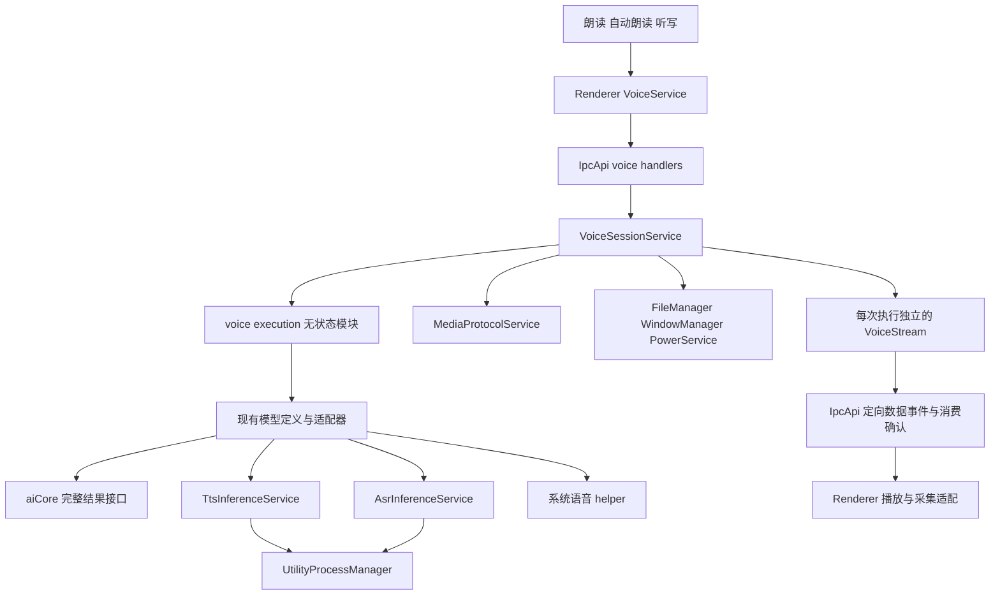
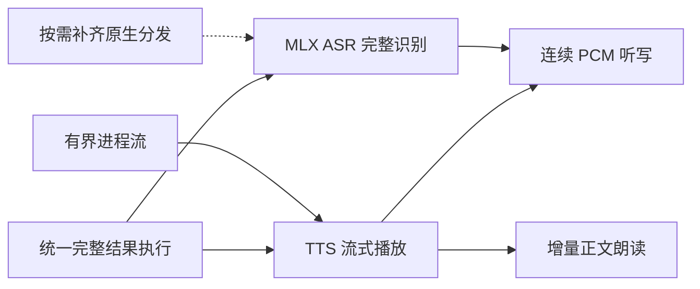

# Agent Note: Unified voice execution and bounded streaming

Status: proposed

English | [中文](2026-10-18-unified-voice-execution.zh.md)

## Problem

System speech, MLX, and Sherpa expose different production and cancellation behavior. Putting those differences in playback or dictation callers would couple user flows to engines. Treating generated output, execution cleanup, model residency, and playback completion as one event would either release resources too early or retain them indefinitely. Streaming also needs a consumer acknowledgement path: an unbounded sequence of ordinary process events cannot provide backpressure.

This note owns the revisitable decisions for the six-stage voice plan. The [interface design](2026-10-18-unified-voice-execution.md#detailed-interface-design) and [implementation plan](2026-10-18-unified-voice-execution.md#capability-implementation-plan) retain detailed protocol and file-level proposals. The [adapter README](../../../../src/main/ai/voice/localAdapters/README.md) describes the current private implementation.

## Proposal

### Ownership and contracts

Keep `VoiceSessionService` responsible for window ownership, admission, selected-model configuration, cancellation, and its current execution. It depends on the existing `TtsInferenceService` and `AsrInferenceService`, rather than routing voice through `AiService`. Earlier-phase services are not added as same-phase dependencies. No additional global voice service or model registry is needed.

Use distinct `SpeechExecution` and `TranscriptionExecution` interfaces with common `cancel()` and `closed` semantics. Result completion, execution cleanup, shared-model residency, and playback drain remain separate. Cancellation is idempotent and waits for execution-owned cleanup. Cleanup failure stays observable; a session cannot start another operation while retaining an unsuccessfully closed execution. Execution closure must not revoke media still owned by active playback.

Derive serializable capabilities from typed adapter operation tables. Shared tags use constant objects and derived unions; SDK objects, promises, and abort signals remain in Main. Only implemented input/output pairs are advertised. Validate unsupported pairs at runtime as well as at the type boundary. Copy submitted audio, including Buffer views, so caller mutation cannot change admitted work. A complete ASR adapter may emit one final revision; `completed` remains the authority for final submission.

### Adapter boundaries

`sdkOperations.ts` adapts SDK models to complete-result operations and retains its private lifecycle helper. `systemSpeech.ts` owns the system helper client and system-adapter failure mapping. `scratch.ts` owns temporary directories and requires caller-supplied error mapping. `recordingDecoder.ts` owns the shared recording decode request and timeout. `checkAbort` belongs to `VoiceRuntimeError.ts`.

These are voice-owned execution and resource capabilities, not global utilities. Do not create `voice/utils` merely because several adapters share code. Backend-specific error conversion stays with the backend. Adding a backend with an existing input/output pair should change its adapter and catalog entries without adding engine branches to session, playback, or dictation consumers. New input/output semantics require an explicit contract extension.

### Streaming and delivery

Extend the existing utility-process transport with typed request streams. Keep ordinary request/event behavior unchanged. Bound frame size, queued bytes, frame count, and pending writers; compute costs from transmitted data rather than trusting a sender's claimed cost. Cancellation and terminal control frames must remain deliverable when data capacity is exhausted. Handler cleanup or process exit determines closure, not receipt of a cancellation request.

An inference execution retains its model queue slot until closure. Main relays only to the authorized window and attempt. Renderer owns PCM playback and capture; consumption returns capacity. Producer EOF does not imply playback drain. Pausing applies backpressure, stopping invalidates late frames, and stream faults cannot revive an old generation. Audio conversion must preserve state across chunks and flush the tail.

Deliver complete-result compatibility first, then bounded process streams and Qwen3 streaming playback. Validate the transport with the real TTS producer before merging it separately. Add MLX ASR complete transcription before continuous dictation; incremental read-aloud can follow TTS playback independently. Realtime conversations, concurrent model residency, plugin registration, and speculative cloud adapters are outside this proposal.

## Alternatives considered

- Engine-specific branches in `AiService` or Renderer callers duplicate selection and cleanup rules. Keep callers dependent on execution contracts instead.
- Another global manager or registry duplicates the service container and model catalog. Reuse their existing ownership.
- Requiring every backend to stream hides complete-result semantics. Keep finite output supported and publish streaming capabilities only when executable.
- Unbounded process events or waiting promises move the memory problem between queues. Bound both transferred data and producers waiting to send it.
- A broad `nativeSupport` or generic `utils` module couples filesystem cleanup and decoding to system-speech dependencies. Use cohesive adapter-private modules and explicit error conversion.
- Releasing a queue slot when a handle is returned, or treating producer completion as playback completion, permits overlapping inference or truncates playback. Hold each resource until its owner's terminal condition.

## Acceptance criteria

- AC1 — Existing complete-result TTS/ASR preserves selected model, voice, language, output, and sanitized failure behavior; unsupported operation pairs are rejected and only implemented capabilities are published (verification: unit and Node/Web typechecks; owner: unified complete-result execution)
- AC2 — Cancellation before consumption and during native work settles without abandoned waiters; scratch cleanup failures remain observable, input bytes are owned, and active playback retains its media until its own end (verification: unit and Electron; owner: unified complete-result execution)
- AC3 — System, FunASR, Qwen3-TTS, and Kokoro complete-result paths remain usable on their supported platforms after migration, including packaged native loading and Windows canonical WAV input (verification: unit, Electron, and packaged artifact; owner: unified complete-result execution)
- AC4 — Real utility processes remain within declared queue budgets under slow consumption; cancellation, input EOF, crash, and restart settle readers and writers without changing ordinary requests (verification: unit and Electron process smoke with queue measurements; owner: bounded process streams, integrated with TTS streaming playback)
- AC5 — Qwen3 preview and manual read-aloud play before generation finishes; pause/resume stays bounded and nonduplicating, EOF drains the tail, and stop or model maintenance releases execution ownership (verification: renderer, Electron, and packaged AudioWorklet; owner: TTS streaming playback)
- AC6 — A matching MLX ASR distribution can be installed, selected, loaded, cancelled, and removed without substituting another model or deleting a shared artifact still used by TTS (verification: unit, Electron, and packaged artifact; owner: MLX ASR complete recognition)
- AC7 — Continuous dictation displays revisions, retains the accepted tail on normal stop, commits final text once to the correct input, and never silently drops input or commits cancelled work (verification: renderer, Electron, and packaged artifact; owner: continuous PCM dictation)
- AC8 — Incremental read-aloud begins before the answer ends, excludes reasoning, avoids duplicate text and segmentation, and closes correctly on input EOF, interruption, or failure (verification: renderer and Electron; owner: incremental body reading)
- AC9 — Apple system TTS starts PCM playback before complete synthesis, preserves frame order and the final tail, and releases its helper before cancellation settles; finite-audio and other adapters remain usable (verification: native, package contract, Electron and packaged-path harness; owner: Apple streaming extension)

## Evidence and approval boundary

This records the user-authorized design and implementation. The [review record](https://github.com/CherryHQ/cherry-studio/pull/21795) had no formal Spec Approval when implementation began on 2026-10-18. User authorization and implementation evidence do not replace Spec approval. No lifecycle transition is claimed.

| Criteria | Available evidence | Remaining boundary |
| --- | --- | --- |
| AC1–AC2 | After the merge of main at `46ef0b8ce37`, 10 focused Main test files passed 265 tests; Node/Web typechecks, scoped lint, and the docs gate passed. Tests include `execution.test.ts`, `sdkOperations.test.ts`, `scratch.test.ts`, session/admission tests, adapter tests, and the voice IPC handler. | Unit results do not establish every native platform or packaged path. |
| AC3 | Before that main merge, the adapter split passed 273 tests across 13 Main files. Development Electron generated and played Apple and Qwen3 WAV to completion and returned to idle. Windows canonical WAV, byte-offset input, cancellation, and timeout cleanup were covered by the later focused tests. | Native ASR resources were unavailable; Windows and packaged execution were not exercised locally. The earlier Electron run is not an exact-head run after the merge. |
| AC4 (partial) | Bounded process streams implement typed bounded input/output, ordered EOF, pending-writer limits, and cleanup acknowledgement. Focused unit tests cover stream and ordinary request behavior. Real Electron unpacked and ASAR smoke passed; duplex queue peaks were 6,016 bytes / 2 frames per direction against limits of 8,192 bytes / 3 frames. | TTS streaming playback now exercises the real Qwen3 producer through bounded IPC and the Worklet. Queue measurements are not RSS or audio-quality evidence. Windows was not exercised. |
| AC5 | TTS streaming playback implements typed PCM output, attachment/consumption credits, native backpressure, source-rate Worklet playback, EOF drain and fresh-attempt retry. Real Qwen3 development Electron measured hot first consumption at 514 ms, generation completion at 13,950 ms, zero underruns and a peak of 23,936 frames against a 24,000-frame renderer bound. Pause preserved the consumption cursor; stop released the session in 40 ms and restart succeeded. Fresh-attempt retry preserved frozen options, and 0.75×/1.5× runs drained without underruns on a 48 kHz output device. UI pause/resume/stop also passed. Production Vite Worklet assets played 12,000 stereo frames at 24 kHz from both unpacked and ASAR paths. | Device output timing was observed through Web Audio; human listening, Windows and full packaged-application Qwen3 inference were not exercised. The native/utility limits are enforced budgets, not measured RSS. |
| AC6 (partial) | MLX ASR complete recognition adds typed Sherpa/MLX dispatch, selected-bundle installation and Qwen3-ASR 1.7B complete recognition. Electron WebM recognition passed for English and Chinese; cancellation/retry and native recognition from unpacked/ASAR package paths passed. All 18 GitHub/ModelScope model-file URLs are anonymously readable with matching published SHA-256 metadata. | Real microphone dictation and other platforms are not covered; complete application packaging is distinct from the ASAR utility/package harness. Formal Spec Approval is still absent. |
| AC7 (partial) | Continuous PCM dictation connects bounded PCM capture, typed input IPC, Qwen streaming, revisions, and exactly-once completion. Electron 48 kHz audio routed through the real 16 kHz capture worklet produced correct English and Chinese final text, intermediate revisions, nonzero analyser levels and released tracks. Cancelling during capture inserted no text; subsequent English and Chinese sessions succeeded. A roughly 50-second non-repeating native recording retained its final sentence across window rollover. | The actual microphone produced silence: capture/release passed, live spoken recognition remains unverified. A separate 53-second repeated-sentence native probe omitted the final repetition; no application-side repair is applied. Packaged capture and full-duration stress acceptance remain outstanding. |
| AC8 (partial) | Incremental body reading implements capability-selected incremental reading, bounded text input, and lifecycle wiring in main chat, Agent and Quick Assistant. Focused integration tests and the real Qwen3/Electron pipeline passed. | Provider-driven acceptance in all three windows and other platforms remain unverified; formal Spec Approval is absent. |
| AC9 (partial) | Apple PCM helper and adapter are implemented. Native early output, exact framing/tail, blocked cancellation/restart, visible Electron waveform/pause/resume/stop, and production package loading from unpacked/ASAR paths passed. A warm Electron run consumed first audio at 1,184 ms, ended production at 8,968 ms and drained all 194,744 frames with zero underruns; peak renderer occupancy was 21,944/22,050 frames. Stop returned idle in 31 ms. | Full signed application packaging, human listening and older macOS/Intel devices were not exercised. Transport bounds do not measure native-engine RSS. |

TTS streaming playback uses the existing service graph without new singleton services. `VoiceSessionService` owns each `VoiceStream`; the relay receives narrow send/expiry callbacks. Renderer output adapters own their audio graphs and observable close promises. MLX segments the finite text in its bounded two-segment queue while playback continues. The implementation delegates device-rate conversion to a source-rate AudioContext instead of introducing a custom resampler. Runtime budgets are one second of native PCM, four utility messages / 131,072 bytes, one second of renderer PCM, 15 seconds for attachment, 120 seconds for loading or an unblocked producer read, and 15 minutes of stream retention. These budgets include pauses without treating blocked credit as a producer stall. The Worklet starts after 500 ms of source audio (or EOF for shorter clips), within the existing one-second bound; this eliminated the underruns observed in the initial 1.5× run.

Keep this note proposed while any criterion is incomplete. Before future implementation layers, establish the Spec review and AC coverage required by the current workflow. Transition only when the complete approved scope has actual cumulative evidence; a draft, a push, or a passing subset does not establish completion.

## Risks

Backpressure introduces deadlock risks if control traffic waits for data credit or maintenance releases a model before inference closes. Native cancellation latency and cleanup failure must remain visible rather than being hidden by successful result delivery. Repeated resampling per chunk can introduce discontinuities, and production EOF can truncate the tail if confused with playback drain.

MLX ASR source support does not establish a compatible distributable artifact. Native ASR, Windows, and packaged AudioWorklet coverage require their actual environments. Buffer limits, prebuffering, conversion choices, and timeout policies remain prototype decisions; document measured values before approving their implementation. Material changes to ownership, behavior, alternatives, criteria, or risk require renewed Spec approval.

## Detailed interface design

Status: design proposal. Historical source baseline: `9d1bf05fe2c`. The call relationships and file actions below preserve the refactoring targets at that baseline; the evidence above governs unified complete-result execution's current implementation and verification status, and “new” does not mean a file is still absent. This proposal builds on the voice execution and playback boundaries in [#21662](https://github.com/CherryHQ/cherry-studio/issues/21662) and model/engine separation in [#21668](https://github.com/CherryHQ/cherry-studio/issues/21668).

The goal is to let read-aloud, automatic reading, and dictation use different voice backends through unified interfaces. Model adapters own differences between MLX, Sherpa, system speech, and future cloud protocols; callers select operations by explicit input/output capabilities. Unify capability descriptions, execution results, cancellation, and release semantics while preserving the distinction between complete and continuous audio.

The first streaming implementation uses the existing Qwen3-TTS. ASR adds continuous PCM and text revisions within the same session and transport boundaries. Initially retain cross-window voice exclusion; do not add bidirectional Realtime conversations, concurrent residency for multiple models, a plugin registration system, or another global voice management service.

### Historical call baseline and target boundaries

| Baseline entry | Baseline behavior | Target change |
| --- | --- | --- |
| `VoiceSessionService` | Owns admission, window ownership, configuration, cancellation, temporary files, playback state, and resource operations | Retain session ownership and hold unified execution handles and stream transports |
| `AiService.generateSpeech/transcribe` | Creates local SDK models and calls aiCore complete-result APIs | `VoiceSessionService` is the only production caller; move these execution paths into voice and remove wrappers left without callers |
| `localAdapters.ts` and `voiceModelTypes.ts` | Unify model definitions, platform support, installation status, and voices, but expose only SDK `createModel` for execution | Add operation capabilities and execution entry points to the same definitions, without a second registry |
| `TtsInferenceService` | Isolates inference, model selection, serial execution, cancellation, and unloading | Add streaming output under the same model-use and unload barrier |
| `inferenceTtsHandlers.ts` | Already calls `synthesizeStream`, applies speed conversion, then writes everything to WAV | Add chunked PCM consumption instead of aggregating streaming requests into complete WAV |
| `AsrInferenceService` | Runs offline Sherpa FunASR with VAD segmentation inside complete audio | Retain complete input and add a real model adapter for continuous input |
| `SpeechPlaybackService` | Waits for a complete media URL and plays it through `HTMLAudioElement` | Support finite media and PCM under the same coordinator |
| `DictationService` | Collects a complete recording with `MediaRecorder` and inserts text after recognition | Add PCM capture and revision previews; continue final insertion through `VoiceTargetManager` |

The existing [aiCore voice APIs](../../../../packages/aiCore/src/core/runtime/voice.ts) wrap complete results. [Model definitions](../../../../src/main/ai/voice/voiceModelTypes.ts) and [playback state](../../../../src/main/ai/voice/playbackState.ts) are the immediate boundaries for this evolution.

### Service dependencies and lifecycle

#### Dependency direction

Solid edges represent calls or module dependencies; they do not mean every node must be a registered lifecycle service.



`execution.ts` resolves adapters, validates capabilities, and creates execution handles. It holds no global sessions, processes, timers, or connections, so it remains an ordinary function module. In-flight tasks and temporary resources belong to execution handles held by `VoiceSessionService`. Model caches and processes remain with existing inference services and `UtilityProcessManager`.

Do not add `VoiceRuntimeService`, `VoiceTransportService`, or `VoiceModelManager`. `VoiceStream`, `PcmPlayback`, and `PcmCapture` are resource objects created per session, not singletons. They receive no `Service` suffix and do not enter `serviceRegistry.ts`.

#### Lifecycle dependency table

| Service | Phase | Proposed same-phase dependencies and responsibilities |
| --- | --- | --- |
| `LocalModelService` | `BeforeReady` | Retain installation, validation, status, and shared-runtime reclamation; invoke existing capability hooks when removing models |
| `UtilityProcessManager` | `WhenReady` | Retain generic process startup, request correlation, confirmed exit, and protocol lifecycle; no dependency on voice services |
| `TtsInferenceService` / `AsrInferenceService` | `WhenReady` | Continue depending on `UtilityProcessManager` through `InferenceServiceBase`; hold inference queue occupancy for the execution lifecycle |
| `VoiceSessionService` | `WhenReady` | Replace `AiService` with `TtsInferenceService` and `AsrInferenceService`; retain `FileManager`, `WindowManager`, `UtilityProcessManager`, `PowerService`, and `MediaProtocolService` |
| `AiService` | `WhenReady` | Do not introduce a reverse dependency on `VoiceSessionService` after moving voice calls; preserve existing chat, MCP, and Job responsibilities |

`VoiceSessionService` still directly depends on `UtilityProcessManager` because it registers the `voice.audio` decoding process in `onInit`. File processing still uses `FileManager`, so this does not remove every indirect dependency on Job infrastructure.

`PreferenceService`, `CacheService`, `IpcApiService`, and `LocalModelService` belong to earlier phases; do not add them to a WhenReady service's `@DependsOn`. Derived inference services that add dependencies must preserve the base class's `UtilityProcessManager` dependency; current decorator overrides do not automatically merge dependencies.

The removal hook in `LocalModelService` is a runtime callback after readiness, not an initialization dependency on WhenReady services. Retain the `LocalModelService → inference.removeModelThen` maintenance path without adding `LocalModelService → VoiceSessionService`.

#### Stopping and unloading

Normal shutdown proceeds from stopping voice admission and cleaning executions, through inference consumer cleanup, to `UtilityProcessManager` confirming child exit. The lifecycle container initiates stops in reverse initialization order, but continues to later services after a service timeout. Decorators alone cannot establish successful cleanup.

Every close first invalidates the current execution identity, stops audio delivery and new input, then cancels production, rejects pending reads/writes, and awaits release. Stop, window closure, screen lock, process exit, and repeated callbacks must be idempotent. Runtime cleanup failure retains the existing unavailable state and recovery path; application shutdown reports failure or timeout to the lifecycle system instead of pretending release succeeded.

Inference queue occupancy lasts from execution startup through cleanup after cancellation or normal completion; returning a stream handle cannot release it. Pausing stops consumption without releasing model ownership. `removeModelThen(modelId, ...)` must wake tasks waiting on backpressure and await process exit before deleting files. Removing unused model A does not interrupt B; retain shared runtimes while any model references them.

### Unified execution contracts

#### Capabilities come from model definitions

Retain existing audio-generation and transcription model categories. Add voice operation capabilities that describe allowed input/output pairs. Do not use one `streaming: boolean` or independent booleans that imply combinations the backend cannot execute.

Define capability tags once as constant objects and derived types in `src/shared/ai/voice.ts`. String values support cross-process serialization; callers use named members instead of repeating strings in adapters, consumers, and validators. Tags identify input/output kinds; requests and results carry the actual text and audio.

```ts
export const SpeechInputKind = {
  Text: 'text',
  TextStream: 'text_stream'
} as const
export type SpeechInputKind = (typeof SpeechInputKind)[keyof typeof SpeechInputKind]

export const SpeechOutputKind = {
  Audio: 'audio',
  PcmStream: 'pcm_stream'
} as const
export type SpeechOutputKind = (typeof SpeechOutputKind)[keyof typeof SpeechOutputKind]

export const TranscriptionInputKind = {
  Audio: 'audio',
  PcmStream: 'pcm_stream'
} as const
export type TranscriptionInputKind = (typeof TranscriptionInputKind)[keyof typeof TranscriptionInputKind]

export const TranscriptionOutputKind = {
  Final: 'final',
  Segments: 'segments',
  Revisions: 'revisions'
} as const
export type TranscriptionOutputKind = (typeof TranscriptionOutputKind)[keyof typeof TranscriptionOutputKind]

interface VoiceCapabilities {
  speech?: readonly {
    input: SpeechInputKind
    output: SpeechOutputKind
  }[]
  transcription?: readonly {
    input: TranscriptionInputKind
    output: TranscriptionOutputKind
  }[]
}

const qwenSpeechCapabilities = {
  speech: [
    { input: SpeechInputKind.Text, output: SpeechOutputKind.Audio },
    { input: SpeechInputKind.Text, output: SpeechOutputKind.PcmStream }
  ]
} as const satisfies VoiceCapabilities
```

IpcApi schemas use the same constant objects for enum validation, with route types still inferred from schemas rather than a second string list. Discriminants such as `SpeechSource.kind` also use the corresponding constant member types; fixed protocol formats such as MIME may remain literal constraints. Capability arrays declare supported pairs individually, never a Cartesian product of all inputs and outputs.

Capabilities describe executable operations. Installation, system support, and authorization remain separate status fields. Main validates requested combinations. Renderer selects capture, preview, and playback by capability, without branching on OS, model name, or engine ID.

| Adapter path | Initial exposed capabilities |
| --- | --- |
| Apple system TTS | Complete text → PCM stream; retain complete audio |
| Windows system TTS and Kokoro | Complete text → complete audio |
| Qwen3-TTS MLX | Complete text → PCM stream; retain complete audio |
| Existing system ASR and FunASR | Complete audio → final text |
| MLX Qwen3-ASR | Continuous PCM → replaceable text revisions and a final result; complete-recording input remains available |
| Future FunASR VAD continuous mode | Continuous PCM → completed segments; do not claim within-segment revisions |

Expose incremental text input only after integrating its consumer. Cloud models must reuse existing provider/endpoint resolution and credential management. Do not register unimplemented cloud capabilities or assume every cloud audio format can directly become PCM.

#### Separate in-process interfaces from cross-process data

The following shapes are Main-internal interfaces; implementation supplies concrete request and result fields. They belong in `src/main/ai/voice/executionTypes.ts`, not `@shared`, and are not transmitted directly over IPC.

```ts
interface SpeechExecution {
  readonly output: Promise<SpeechSource>
  readonly completed: Promise<SpeechCompletion>
  readonly closed: Promise<void>
  cancel(): Promise<void>
}

type SpeechSource =
  | { kind: typeof SpeechOutputKind.Audio; audio: Uint8Array; mediaType: 'audio/wav' }
  | { kind: typeof SpeechOutputKind.PcmStream; format: PcmFormat; chunks: AsyncIterable<PcmChunk> }

interface TranscriptionExecution {
  readonly updates: AsyncIterable<TranscriptRevision>
  readonly completed: Promise<TranscriptResult>
  readonly closed: Promise<void>
  cancel(): Promise<void>
}
```

Use two entry functions, `startSpeech(request, signal)` and `startTranscription(request, signal)`. Each request accepts a discriminated complete input or asynchronous input source. TTS text streams have explicit `flush`; iteration ending means no more text. ASR input iteration ending means recording stops and final recognition is requested. Closing input alone does not cancel submitted work.

Unified semantics:

- `output` means an audio source is ready for consumption. Complete-audio adapters wait for synthesis; streaming adapters need only prepare the format and stream.
- `completed` reports producer success, failure, or cancellation independently of the consumption loop; backpressure can still make normal completion wait for consumption. Truncation cannot report success.
- `closed` means production tasks and execution-owned temporary resources have finished cleanup; cleanup failure rejects it. It neither waits for Renderer playback nor means a shared warm model has unloaded.
- `cancel()` is idempotent, stops input/output, wakes waiters, and awaits `closed`; failures remain observable. External signals and early iterator exit use the same cancellation entry.
- Normal completion, failure, and cancellation before iteration must eventually settle all relevant promises and reads/writes. Observe terminal states as soon as the session creates a handle instead of relying on a consumer to iterate before discovering errors.

Adapters create no media URLs, broadcast no IPC, and manipulate no UI. `VoiceSessionService` stores complete audio in `MediaProtocolService` and gives PCM sources to its transport object. `SpeechPlaybackService` offers the same play, pause, stop, and completion-reporting entry points for both.

#### Text results and audio formats

Cross-process value types belong in `src/shared/ai/voice.ts`. IpcApi requests, events, and validation remain in `src/shared/ipc/schemas/voice.ts`, with input/output types inferred from schemas.

- `PcmFormat`: sample rate, channel count, initially fixed `f32` encoding, and interleaved channel layout.
- `PcmChunk`: stream sequence number, `startFrame`, and samples; frame count equals sample count divided by channel count. All offsets refer to output after speed conversion.
- `TranscriptRevision`: monotonically increasing `revision`, full current transcript `text`, start of the revisable suffix, and `final`. Suffix offsets use JavaScript UTF-16 offsets, never vendor token indices.
- `VoiceOutputDescriptor`: a finite media URL or PCM stream description plus session, request, and playback attempt identity; no paths, SDK instances, or functions.

Model definitions, resolved configuration, and displayed capabilities share one source. Freeze `modelId`, voice, language, speed, and internal bundle/engine resolution per execution; settings changes affect only subsequent executions. Missing models or unsupported pairs fail explicitly without silently substituting models.

ASR adapters normalize vendor deltas, cumulative text, or segments into full revisions. UI replaces the current preview instead of appending duplicate text. A supposedly stable prefix can still change with backend revisions; only the final result is an immutable submission point. Initially insert exactly once after `completed`, using existing target binding. If the input closes or the target expires, use existing recovery rather than writing into whichever input later gains focus. Long transcriptions retain explicit input-duration and text-size limits; full transcript memory is not promised constant for unlimited recording.

### Transport and backpressure

#### Main and Renderer

Initially use IpcApi targeted events and acknowledged requests, without native channels or a dedicated preload voice bridge. The repository's [IPC escape hatch rules](../../../../docs/references/ipc/ipc-migration-guide.md#escape-hatch--when-a-channel-may-stay-out) do not permit bypassing IpcApi for Main → Renderer traffic merely because it is frequent.

Proposed routes all pass existing sender validation and `VoiceSessionService` ownership checks:

| Route or event | Purpose |
| --- | --- |
| `ai.voice.speech.start` | Accept input mode and required capabilities; return execution identity and output description after admission |
| `ai.voice.transcription.start` | Create complete or continuous recognition |
| `ai.voice.stream.attach` | Confirm Renderer receivers are installed and declare initial capacity bounded by Main's limits |
| `ai.voice.stream.write` | Bounded input batches for PCM and later incremental text; limit in-flight requests per stream |
| `ai.voice.stream.finish_input` | End input, process the tail, and complete normally; not cancellation |
| `ai.voice.stream.ack` | Report cumulative consumed audio frames monotonically and idempotently; cannot acknowledge unsent frames |
| `ai.voice.stream_event` | Send format, PCM, transcript revisions, EOF, or failure only to the owner |

Reuse pause, resume, stop, playback-report, and session-discard semantics; new routes do not create parallel admission. Keep `ai.speech.generate` and `ai.transcription.generate` during migration using the unified layer's complete input/output paths.

TTS delivery is limited by actual remaining player capacity. The worklet releases credit after consuming samples; only then does Main continue pulling from inference. Include prefetch, process message queues, Main relay, and Renderer queues in the total budget. Receipt is not playback acknowledgement, and underrun silence cannot advance consumption. PCM does not enter Cache or broadcast to every window.

Mono 24 kHz float32 PCM carries `24,000 × 4 = 96,000` bytes per second, suitable for initial bounded-batch validation of existing channels. Batch duration and prebuffering are internal parameters. Measure cold startup, first sound, underruns, and total queue occupancy before choosing values; do not add user settings first.

ASR captures on the audio thread and batches on Renderer's ordinary thread, sending according to Main's input capacity. Write acknowledgement means the bounded input queue accepted data, not that recognition finished. Capture cannot block the hardware clock; sustained saturation terminates with input overload instead of silently dropping frames or accumulating indefinitely. Normal recording stop sends accepted tail frames before `finish_input`; cancellation discards unsubmitted input.

Only measured failure to meet transport targets warrants a MessagePort extension to IpcApi infrastructure, together with IPC specification and identity-binding updates. Electron [MessagePort handoff](https://www.electronjs.org/docs/latest/tutorial/message-ports) requires `postMessage`; a port cannot simply be placed in the current `invoke` return value. This affects transport implementation, not execution interfaces.

#### Main and isolated inference processes

Existing `UtilityProcessMethod` supports incremental events, but synchronous `emit` / `onEvent` callbacks provide no input streams, consumption waits, or credit. Add optional request-level bounded streams in `core/utilityProcess` first, retaining existing `request()` and ordinary event semantics.

This extension owns only request correlation, bidirectional bounded frames, input/output EOF, terminal state, and cancellation. Consumers receive awaitable reads/writes or iterators; handlers receive input iterators and awaitable output. Capacity waits never block cancellation. Limits measure bytes and frames, without sample rates, voices, models, or playback state.

A stream remains an active request through terminal state and cleanup. Waiting for input or consumption cannot count as process idleness. Crash, maintenance stop, and cancellation close associated streams and reject waiters. Retain generation/tombstone protection; duplicate terminal frames and old-generation events cannot reopen streams.

This is an upstream extension to the generic process module. Voice handlers must not bypass it with private message ports, ACK RPCs, or a second request map. `InferenceServiceBase` then holds queue occupancy for entire stream executions, reusing model switching, cancellation, and unload barriers. Initially retain local inference's terminate cancellation policy; cooperative cancellation separately requires proof that native calls always exit.

### Playback and recording ownership

`SpeechPlaybackService` remains the sole Renderer playback coordinator, creating `FinitePlayback` or `PcmPlayback` according to the output descriptor. Both expose the same pause, resume, stop, drain, and failure reporting. `PcmPlayback` owns AudioContext, AudioWorklet, and bounded queues; the worklet only processes audio, without IPC or business configuration parsing.

Playback state remains split into `synthesis`, `desired`, and `observed`. At the baseline, `completePlaybackSynthesis()` increments `attemptId` only after generation. Streaming must allocate the attempt before publishing output; generation completion then updates only synthesis and cannot reset an already playing/paused observed state to ready. Report `ended` only after EOF and queue drain.

Stop invalidates Renderer output and clears local queues before awaiting Main cancellation and release. Reject data from old session/request/attempt identities. Main cannot release a session on producer EOF alone; handle playback drain or cancellation cleanup. Slow playback and pause cannot inherit the fixed synthesis-total timeout and falsely time out. Define separate budgets for preparation, model execution, input idleness, and consumption pause; pause does not consume active-generation budget.

`DictationService` owns recording devices and `PcmCapture`, labeling PCM with the actual device sample rate. Model adapters resample at an explicit input boundary; playback explicitly converts from source format to AudioContext's actual rate. Prefer existing libraries with streaming support and flush conversion tail state. Do not change speed or sample rate repeatedly across layers. Browser [AudioWorklet](https://developer.mozilla.org/en-US/docs/Web/API/AudioWorklet) handles audio-thread processing; its callbacks cannot run inference or synchronous waits.

Long text cannot retain “submit the next segment only when the current segment ends playback,” which would reduce only intra-segment waiting. Schedule finite-text paragraphs inside one speech execution, preserving `readableText` normalization and length confirmation. Incremental text reuses the same input stream without another segmentation layer driven by playback completion.

### File organization and module boundaries

“New” below identifies candidate implementation files; the proposal itself creates no empty directories or scaffolding. Reuse `ai/voice`, `ai/localModel`, and `services/voice`, without adding process-root directories or relocating the entire voice module.

| Location | Action and responsibility |
| --- | --- |
| `src/main/ai/voice/VoiceSessionService.ts` | Modify: sole session owner, holding execution/transport and coordinating release |
| `src/main/ai/voice/execution.ts` | New: `startSpeech` / `startTranscription`, capability validation and adapter selection, without global state |
| `src/main/ai/voice/executionTypes.ts` | New: Main-internal request, source, and execution types |
| `src/main/ai/voice/VoiceStream.ts` | New: bounded per-execution relay, credits, input end, and transport cleanup; created by session |
| `src/main/ai/voice/localAdapters.ts` | Modify: retain local model-definition resolution without a parallel registry |
| `src/main/ai/voice/voiceModelTypes.ts` | Modify: definitions declare capabilities and start operations; installation, languages, and voices retain one source |
| `src/main/ai/voice/localAdapters/*.ts` | Modify: wrap SDK complete results or create engine stream executions; keep error mapping in adapters |
| `src/main/ai/voice/playbackState.ts` | Modify: allocate attempts early, permit concurrent generation/playback, distinguish EOF and drained |
| `src/main/ai/localModel/capabilities/{tts,asr}/` | Modify: align inference entry points, protocols, model paths, and capabilities; no window state |
| `src/main/ai/localModel/runtime/InferenceServiceBase.ts` | Modify: retain serial occupancy throughout stream execution and preserve switching/unload barriers |
| `src/main/ai/localModel/runtime/utilityEntries/` | Modify: actual engine reads/writes and incremental results; build MLX ASR under existing entry conventions |
| `src/main/core/utilityProcess/{types.ts,protocol,host,runtime}` | Modify: generic bounded-stream protocol; no voice or business imports |
| `src/main/ipc/handlers/voice.ts` | Modify: delegate to services after schema validation; keep handlers thin |
| `src/shared/ai/voice.ts` | New: genuinely cross-process capability, PCM, transcript revision, and output descriptor value types |
| `src/shared/ai/localVoice.ts` | Modify: local model descriptions reference unified capabilities and retain existing IDs |
| `src/shared/ipc/schemas/voice.ts` | Modify: single source for request/event contracts; validate public frame size, format, and sequence |
| `src/renderer/services/voice/VoiceService.ts` | Modify: execution startup, event subscription, input, and consumption acknowledgements; no playback implementation |
| `src/renderer/services/voice/SpeechPlaybackService.ts` | Modify: coordinate finite media and PCM for read-aloud and previews |
| `src/renderer/services/voice/{FinitePlayback,PcmPlayback}.ts` | Extract / add: output resource objects created by the coordinator, without singletons |
| `src/renderer/services/voice/{PcmCapture,DictationService}.ts` | Add / modify: capture, input capacity, revision preview, and final submission |
| `src/renderer/services/voice/pcmPlaybackProcessor.ts`, `pcmCaptureProcessor.ts` | New: independently built browser AudioWorklet entries; no barrel with service side effects |
| `src/main/core/application/serviceRegistry.ts` | No new voice service; verify existing registrations cover dependencies |
| `src/preload/ipc.ts` | Initially retain the generic bridge, without voice-specific branches |
| `packages/aiCore/src/core/runtime/voice.ts` | Retain complete-result APIs without Electron; adapters call them, without moving sessions, IPC, or installation into aiCore |

Use named file imports for new Main files rather than hastily adding an `ai/voice` barrel. Renderer retains `services/voice/index.ts`, exposing only consumer-needed services/types while playback, capture, and worklets stay private. Extend `localModel/index.ts` only for actual external consumers; do not deep-import its protocols externally. See [naming conventions](../../../../docs/references/architecture/naming-conventions.md#64-barrel--index-files).

aiCore is not an application service container. The initial unified interfaces belong in Main because current session and local execution consumers are there. Extract a pure runtime contract into a separate package only when desktop and mobile actually share it. `packages/aiCore` must not import `src/shared`, `@application`, or Cherry model-installation services.

### Staged implementation and acceptance

| Stage | Scope | Required proof |
| --- | --- | --- |
| A Unified complete-result interfaces | Model capabilities, execution contracts, existing adapter wrappers, migration from `AiService`, and service dependencies | One caller contract covers existing TTS/ASR; preserve voice/language/speed, release model usage and temporary files around cancellation, and retain read-aloud/dictation behavior |
| B Generic bounded streams and Qwen3-TTS | Utility-process streams, inference leases, IpcApi batches/acknowledgements, and PCM playback | Sound before generation completes; bounded buffers at every layer; no truncated tail, duplicate resume, or sound from late stopped frames; new sessions work after worker crash |
| C Continuous ASR | PCM capture, continuous input, MLX ASR adapter, and text revisions | Bounded input without silent drops, revisable intermediate results, correct tail flush, exactly one final insertion, no wrong-focus insertion or old results after cancellation |
| D Incremental text and other backends | Stable LLM body input and actual-model-based Sherpa online or VAD segment adapters | Input end differs from audio end; exclude reasoning, avoid duplicate submissions, and add backends without engine branches in business consumers |

ASR requires matching model packages, JS APIs, and native runtime versions. The fork's [Qwen3-ASR stream interface](https://github.com/CherryHQ/mlx-node/blob/f4c21043f557965345b527bc04179ad26d08378f/packages/asr/README.md) provides rolling input and text revisions, but successful TTS packaging does not validate ASR delivery. Multi-model work follows [Local Models](../../../../docs/references/ai/local-models.md) installation/shared-runtime boundaries; a default capability mapping is not the user's selection for this execution.

Inspect scope with `pnpm check --plan` for each stage, then select explicit test files; do not run unfiltered repository suites. Existing regression entry points include:

- Main: `src/main/ai/voice/__tests__/VoiceSessionService.test.ts`, `playbackState.test.ts`, `voiceAdmissionCoordination.test.ts`, and `src/main/ipc/handlers/__tests__/voice.test.ts`.
- Adapters: `src/main/ai/voice/localAdapters/__tests__/{apple,windows,funasr,qwen3Tts}.test.ts` and `src/main/ai/localModel/runtime/__tests__/{InferenceServiceBase,inferenceEntryTts}.test.ts`.
- Processes: `src/main/core/utilityProcess/__tests__/ProcessHost.cancellation.test.ts`, `ProcessHost.stop.test.ts`, `serveUtilityProcess.test.ts`, and new bounded-stream contract tests.
- Renderer: `src/renderer/services/voice/__tests__/{VoiceService,SpeechPlaybackService,DictationService,AutoReadService,VoiceTargetManager}.test.ts`, plus new PCM output/capture tests.
- aiCore: run `packages/aiCore/src/core/runtime/__tests__/voice.test.ts` when migrating complete-result wrappers; move still-valid contract assertions from `AiService.voice.test.ts`.

New tests must catch real failures: capacity overflow, duplicate samples, lost tails, false pause timeouts, revival after stop, unload races, duplicate final text, or cross-window authorization violations. Follow [frontend testing guidance](../../../../docs/references/testing/frontend-testing.md) and [unified mock rules](../../../../tests/__mocks__/README.md).

Record actual Electron first-audible latency, source/consumed-frame continuity, underruns, peak queue occupancy, pause stability, cold/warm startup, and restart after cancellation separately. Cover development and packaged resource paths. Historical first-PCM-chunk data proves engine output only, not speaker latency, streaming playback, or real-device ASR acceptance.

### Capability boundaries and dependencies

See the [capability implementation plan](2026-10-18-unified-voice-execution.md#capability-implementation-plan) for classes/interfaces, files, release order, type constraints, and acceptance. This section summarizes scope and dependencies; proposed symbols do not establish implementation.

The design has six capability areas, plus native ASR distribution when matching artifacts are unavailable. Each area has independent ownership and acceptance criteria. Implementation order follows technical dependencies; formal Spec approval remains a separate requirement.

| Capability | Scope | Dependencies | Independent acceptance |
| --- | --- | --- | --- |
| Unified complete-result execution | Constants/capabilities, unified handles, complete-result adapters, migration from `AiService`, and lifecycle dependencies; advertise only executable capabilities | None | Existing system speech, FunASR, Qwen3-TTS, and Kokoro complete-result paths use the unified entry; selection, cancellation, file release, and errors remain correct |
| Bounded process streams | Generic request input/output streams, capacity, EOF, cancellation, and exit settlement; preserve request/event APIs without voice semantics | No hard code dependency; align with unified execution and streaming playback | Real Electron child processes remain bounded under slow consumption/input overload; cancellation wakes reads/writes, old frames expire after exit, and existing requests work |
| TTS streaming playback | TTS producer, full-execution inference occupancy, Main/IpcApi flow control, Renderer PCM, playback state; extract finite-media adapters with real consumers | Unified execution, bounded process streams | Preview/read-aloud starts before generation ends; pause, resume, drain, stop, cross-window admission, unload, and worker recovery work; packaged AudioWorklet loads |
| MLX ASR complete recognition | MLX ASR definitions, packages, native-version checks, download/selection, and complete-audio recognition; reuse resource management without streaming dictation UI | Unified execution; matching native distribution | Download/select/recognize works; switching with FunASR preserves model identity; missing selected models fail; cancellation, unload, domestic/international sources, and packaged loading work without shared-TTS-runtime regression |
| Continuous PCM dictation | Continuous PCM capture, input/write/end, Qwen3-ASR stream, revisions, and final submission; reuse TTS streaming playback identity/transport/cleanup | Bounded process streams, streaming playback lifecycle, MLX ASR | Preview updates while recording; no silent drops; normal stop retains tail; cancellation never submits; text inserts once into the correct input |
| Incremental body reading | Stable readable body enters one speech execution with flush/EOF; update automatic reading and reuse audio output | Streaming playback | Read before answer completion; exclude reasoning; no duplicate text or segmentation; pause, input end, failure, and interruption work |



Validate bounded process streams and streaming playback together with real Qwen3-TTS before delivering either boundary. Test doubles alone do not establish transport acceptance; do not prebuild plugin, scheduling, or process-pool interfaces for hypothetical models. Keep the producer-to-player path complete, with real consumers for the PCM player and transport.

MLX ASR complete recognition can proceed after unified complete-result execution. It validates model delivery, weight formats, and loading separately from continuous recording. It neither establishes a second Sherpa ASR model nor completes all of #21668. Incremental body reading can proceed after TTS streaming playback without waiting for ASR.

Extend the native distribution only if existing artifacts lack ASR JS APIs, exports, or matching native support. It owns reproducible builds, exact versions, native exports, and distribution manifests; Cherry audio transport, playback, and sessions remain in the main repository. Source changes and release publication are separate actions. Prepare and validate artifacts before publishing, and confirm pinned versions/checksums are available before referencing them from the main repository.

Validate unified execution and bounded transport first, then streaming playback. Complete ASR can be validated independently before continuous dictation. Incremental body reading can follow streaming playback whenever reading during answer generation is the priority.

Cross-platform online ASR or FunASR VAD segmentation, Sherpa multi-model acceptance, individual cloud voice adapters, and Realtime each belong in separate follow-up capabilities. New backends must use existing contracts; change public interfaces only for capabilities they cannot actually express.

### Design decisions

Retain existing service ownership, unify backends behind stateless execution functions, start with bounded IpcApi batches, and add flow control upstream in utility-process. Preserve complete-result adapters while the existing player coordinates new PCM output.

Before implementation, use a small Stage B prototype to confirm generic stream APIs, batch size, prebuffering, and sample-rate conversion. If measurements show existing IPC is inadequate, propose infrastructure/specification changes instead of an unowned business-specific channel. Leave cloud encoded streams, bidirectional Realtime, continuous background transcription, and concurrent models to later proposals with actual consumers.

## Capability implementation plan

The following sections detail the capability boundaries in the [unified interface and streaming design](2026-10-18-unified-voice-execution.md#detailed-interface-design). They retain the design targets from source baseline `9d1bf05fe2c`, including Kokoro complete-result adaptation after `425b15397e7`; the evidence table above governs implementation and validation status. Proposed interfaces, files, and acceptance targets are not proof of delivery.

Unified execution provides complete-result operation tables, handles, capability descriptions, and VoiceSessionService integration. Cleanup failure remains observable through `closed`; PCM and incremental types belong to their corresponding capabilities.

Validate bounded process streams with the real TTS producer before depending on that transport. Complete ASR requires unified execution and matching native artifacts. Continuous dictation additionally requires the shared stream lifecycle; incremental body reading depends on streaming playback and does not wait for ASR.

### Shared implementation boundaries

#### Ownership and service dependencies

| Object | Lifecycle and ownership | Dependencies and excluded responsibilities |
| --- | --- | --- |
| `VoiceSessionService` | `WhenReady` lifecycle service; sole holder of session, owner, admission, and current execution | Depends on TTS/ASR inference and existing file, window, power, media, and process services; no direct vendor SDK calls |
| `execution.ts` / model definitions | Stateless start functions and static definitions; each start returns one handle | Depends on concrete adapters; no IPC registration or global playback state |
| `SpeechExecution` / `TranscriptionExecution` | One operation from creation to `closed` settlement; cancelled by session | Owns operation tasks, temporary files, and listeners, not shared warm models |
| `VoiceStream` | Per-execution transport created and closed by session | Depends on narrow send callbacks and execution; no settings reads, model selection, or playback-state decisions |
| `TtsInferenceService` / `AsrInferenceService` | Existing `WhenReady` services owning queues, model-use barriers, and process definitions | Inherit `UtilityProcessManager` dependency from `InferenceServiceBase`; no dependency on session or Renderer |
| `UtilityProcessManager` / `ProcessHost` | Application service and its process objects; request correlation, exit, and maintenance barriers | Understand generic protocols, capacity, and cancellation only; no voice/localModel imports |
| Renderer voice coordinators | Retain existing service entry points and own per-operation resource objects | `SpeechPlaybackService` owns players; `DictationService` owns capture; `AutoReadService` owns message subscriptions and text cursors |
| `FinitePlayback` / `PcmPlayback` / `PcmCapture` | Ordinary classes instantiated per operation and explicitly closed | No Main service registration, new singleton, or reverse call into business coordinators |
| `LocalModelService` | Existing `BeforeReady` service owning model/shared-artifact installation and removal | After readiness, capability hooks call inference maintenance barriers; no reverse dependency on VoiceSessionService |

Add no lifecycle services or mandatory executor inheritance hierarchy. Shared interfaces such as `SpeechExecution` constrain behavior; adapters reuse complete-result wrappers through composition. Extract helpers only when two real callers need the same logic. Implement shared interfaces in their owning domains; reuse does not justify moving model business logic into `core`.

Replace the baseline `AiService` same-phase dependency in `VoiceSessionService` with `TtsInferenceService` and `AsrInferenceService`, retaining other dependencies. Do not add earlier-phase Preference, Cache, IPC, or LocalModel services to `@DependsOn`. Derived classes declaring dependencies must explicitly preserve base dependencies; decorators do not merge them. Lifecycle stop timeouts can overlap cleanup, so all close paths remain idempotent.

#### Terminal states and type rules

Distinguish four moments: input EOF, producer completion, execution-resource closure, and playback drain. `completed` provides a result or error; `closed` means execution-owned resources are cleaned; Renderer reports playback drain separately. `cancel()` is idempotent and awaits closure. Closure failure must remain observable rather than being swallowed as apparent release success.

Observe failures and terminal states immediately on handle creation. Cancellation cleanup cannot depend on the caller starting `for await`. Cancellation must wake capacity waits, input waits, and waits after model loading. Terminal states cannot share a credit-dependent PCM queue, or pause could prevent cancellation/failure delivery forever. Normal EOF carries the final sequence number; consumers still drain accepted data.

Only value types cross processes. Capability tags use constant objects and derived unions such as `SpeechInputKind` from the design above. Requests use discriminated unions rather than optional fields for mutually exclusive inputs. IPC types derive from schemas, and schemas/capabilities share tags without separate string lists. Runtime still validates owner, selected-model combinations, format, size, monotonic sequence, and state; compile-time types cannot replace these checks.

The open/closed goal is that another backend with existing capabilities adds an adapter, catalog data, and engine implementation while business consumers retain the same contract. It does not promise zero changes when adding a model: static catalogs, ID unions, and explicit exports may gain entries. New input/output semantics require contract changes and updates to every consumer. Do not add dynamic plugins, a generic dependency-injection container, or abstract factories without real consumers.

### Unified complete-result execution

No prerequisite capability. Existing features remain fully usable after delivery, without exposing streaming yet.

#### Classes and interfaces

Define the design's `SpeechExecution`, `TranscriptionExecution`, and input unions in Main's `executionTypes.ts`. `startSpeech(request, signal)` and `startTranscription(request, signal)` are ordinary functions: resolve frozen configuration → find existing definition → validate input/output pair → invoke adapter. They do not reread live Preference during execution.

Model definitions retain shared installation, support, language, and voice metadata. Add corresponding execution entry points to `SpeechModelDefinition` / `TranscriptionModelDefinition`. Derive capabilities from the same operation table: each `speechOperations` entry contains input/output tags and a `start` accepting only that input type. Use mapped unions to correlate tags with handler parameters rather than widening every handler to all inputs. Serialize capabilities by projecting tags; separately handwritten capabilities/implementations could advertise unsupported execution.

Complete-result adapters continue using existing `createModel` and aiCore APIs internally. SDK factories become private adapter details, never exposed by public execution entry points. Migrate two different backends to validate common behavior before extracting genuinely duplicated wrappers. Do not create a `BaseVoiceAdapter` with empty methods.

Register only `Text → Audio` and `Audio → Final` at the complete-result boundary. Reserved protocol tags cannot be advertised early. Complete ASR may emit one final revision, but only `completed` authorizes final submission. Backends without updates must still complete, without fabricated intermediate results.

#### File organization

| File | Implementation |
| --- | --- |
| `src/shared/ai/voice.ts` (new) | Capability tags and cross-process audio/transcript value types; no execution Promise or AbortSignal |
| `src/shared/ai/localVoice.ts`, `src/shared/ipc/schemas/voice.ts` | Add capabilities to model descriptions; retain complete-result routes and existing IDs |
| `src/main/ai/voice/{execution.ts,executionTypes.ts}` (new) | Stateless entry points, Main execution handles, and discriminated requests |
| `voiceModelTypes.ts`, `localAdapters.ts`, `localAdapters/{apple,windows,funasr,qwen3Tts}.ts` (same directory) | Static operation tables, existing backend wrappers, and backend error normalization |
| `src/main/ai/voice/VoiceSessionService.ts` | Hold handles and migrate calls/same-phase dependencies |
| `src/main/ai/AiService.ts` | Remove the two wrappers left without callers and their orphaned imports |

Do not move aiCore or create `ai/voice/index.ts`. Add only consumer-required named exports to `localModel/index.ts`, retaining the ban on external deep imports.

#### Resources and dependencies

For complete TTS, execution cleans temporary files after reading audio. Session registers and owns `MediaProtocolService` audio/URLs until playback ends or is cancelled. `execution.closed` cannot revoke a URL still in use. Original owners retain uploaded/recorded ASR input; execution deletes only derived files it created.

Load failure, SDK errors, empty recognition, and cancellation before output must settle output/updates/completed/closed consistently. Move existing empty-text and `NoTranscriptGeneratedError` → `no_speech` behavior from `AiService` into adapters so unification does not turn silence into generic failure. Window destruction, screen lock, and service stop continue through session's unified close path.

#### Implementation order and acceptance

1. Add contracts and operation tables → prove invalid input pairs fail compilation, unknown runtime pairs fail explicitly, and every advertised capability has an implementation.
2. Wrap existing backends individually → verify real complete inputs preserve voice, language, speed, failure reasons, and final text.
3. Migrate session calls/dependencies and remove wrappers → search for remaining production callers and run lifecycle regressions.

Focused tests cover `VoiceSessionService.test.ts`, `voiceAdmissionCoordination.test.ts`, Apple, Windows, FunASR, Qwen3-TTS, and Kokoro adapters, IPC handler `voice.test.ts`, and aiCore `voice.test.ts`. Move valuable contract assertions from `src/main/ai/__tests__/AiService.voice.test.ts` into new `src/main/ai/voice/__tests__/execution.test.ts`; do not retain tests that only count wrapper calls.

Merge gate: existing system TTS/ASR, FunASR, Qwen3-TTS, and Kokoro paths require no streaming client; restart works after failure/cancellation; temporary files and media URLs do not leak. Unified complete-result execution introduces no worklets, PCM channels, or package dependencies.

### Generic request-level bounded streams

Preserve ordinary request/event behavior, review core protocol changes separately, and validate with the streaming playback prototype.

The bounded process-stream implementation uses per-request `StreamChannel` shared by host and child, host-only `StreamRequest` for result/closure ownership, and `streamFrame.ts` for bounded scalar-metadata / byte-view encoding. It adds no lifecycle service or voice dependency. Limits are explicit per direction; protocol version 2 rejects stale bundles. The [consumer reference](../../../../docs/references/utility-process/README.md#bounded-request-streams) owns the delivered API.

#### Interface and protocol design

Add optional stream-method declarations to existing contracts; ordinary methods retain `UtilityProcessMethod`. A stream method declares initial request, input frame, output frame, and final result types. `client.openStream(method, input, options)` accepts only declared streaming methods and returns the following handle semantics. Confirm generic integration in a small prototype rather than widening to arbitrary method names and `unknown` returns.

```ts
interface UtilityProcessStream<InputFrame, OutputFrame, Result> {
  readonly output: AsyncIterable<OutputFrame>
  readonly completed: Promise<Result>
  readonly closed: Promise<void>
  write(frame: InputFrame): Promise<void>
  finishInput(): Promise<void>
  cancel(): Promise<void>
}
```

`write` waits for bounded receiving capacity. `finishInput` closes input and waits for ordered delivery of submitted batches, not the entire task. Output-only operations use `never` input frames and cannot accept business data. Handlers receive an input iterator, awaitable output, and existing signal/logger; output submission waits for capacity. Do not turn synchronous `emit` into a Promise and silently alter existing error/cancellation semantics.

Frames retain requestId/generation correlation. New frame kinds cover at least data, returned capacity, input EOF, output EOF, and close acknowledgement. Terminal states use a control path unblocked by data credit. Separate `completed` and `closed`: especially with cooperative cancellation, receiving cancellation does not mean the handler exited. Retain terminate policy; only confirmed process exit or handler cleanup acknowledgement closes resources.

Capacity bounds individual frame bytes, total unconsumed bytes, and frame count. The prototype chooses accountable frame shapes: small bounded metadata plus binary payload, constrained by generics. Core measures actual serialized metadata and TypedArray view `byteLength`, never a sender-declared cost. Existing ordinary events remain unaffected. Do not design a generic cost algorithm for arbitrary JavaScript object graphs.

Bound pending writers in each direction and reject excess explicitly. Bounding sent frames while permitting unlimited waiting Promises is insufficient. Consumption acknowledgement releases only that queue's ownership credit; frames taken but retained by callers count toward the next layer. Core guards validate capacity, sequence, and terminal state; voice validates audio layout and text contents.

#### File organization and resource lifecycle

| File | Implementation |
| --- | --- |
| `src/main/core/utilityProcess/types.ts` | Type relationships among stream contracts, clients, and handlers |
| `protocol/{constants,frames,guards}.ts` | Frame unions, boundary validation, old generations, and duplicate terminal states |
| `host/ProcessHost.ts` | Stream request registration, send/consume credits, stop/crash settlement |
| `runtime/{utilityProcessServer,serveUtilityProcess}.ts` | Handler stream context, input EOF, and cleanup acknowledgement |
| `streamState.ts` (inside this core directory, if needed) | Extract per-request capacity/waiter state only if host/runtime share real logic; no global registry |
| `scripts/utility-process-smoke/harness/` | Actual child-process slow-consumer, bidirectional-stream, and termination scenarios |

Registering a stream prevents idle reaping. Input waits, paused output, and handler cleanup remain active. Normal completion finishes data boundaries and handler cleanup before unregistering. Cancellation, crashes, and maintenance stop reject waiters and settle handles; late data cannot recreate finished requests. `withStopped` still confirms exit before invoking maintenance callbacks.

The process-stream layer does not alter the lifecycle service graph or depend on VoiceSessionService/inference services. ProcessHost/utility server own core objects; no global StreamManager. Respect child-entry imports so Main application/logger do not enter child builds.

#### Implementation order and acceptance

1. Stream types and frame guards → prove method/input/output types cannot be mixed; reject excess, oversized, out-of-order, and post-close writes.
2. Host/child state and closure → verify cancellation with full queues and before reading, continued output after input EOF, crash/restart, and repeated cancellation.
3. Electron smoke plus streaming playback’s real TTS producer → measure peak queues and in-flight amounts at every layer; prove ordinary requests and existing cancellation policy remain unchanged.

Add `src/main/core/utilityProcess/__tests__/ProcessHost.stream.test.ts` and `utilityProcessStream.test.ts`; run existing `protocolGuards.test.ts`, `serveUtilityProcess.test.ts`, `ProcessHost.cancellation.test.ts`, `ProcessHost.stop.test.ts`, and `ProcessHost.lifecycle.test.ts` in that directory. Extend the existing harness and run `pnpm smoke:utility-process`, recording the actual Electron version and results.

Merge gate: explainable memory budgets under slow consumption, credit-independent cancellation, settlement of waiting input/output, and passing ordinary request/event tests. Mock MessagePort tests alone do not establish cross-process acceptance.

### Complete Qwen3-TTS streaming playback path

Depends on unified execution and bounded process streams. First expose `Text → PcmStream` while retaining complete audio.

#### Classes and interfaces

Add streaming synthesis to `TtsInferenceService`, returning a queue-managed execution rather than a bare async iterator. `InferenceServiceBase` adds streaming execution sharing `run` model selection, generation validation, and maintenance barriers. Once admitted to execution, publish the handle while the queue task continues awaiting `closed`. Returning a handle directly from the PQueue callback would release serial occupancy early. Cancellation while queued must immediately settle the public handle and make the later dequeued task skip startup.

The child passes existing `synthesizeStream` output through speed conversion once, then writes chunks into the generic stream. WAV and PCM sinks share genuinely needed loading, parameters, and error normalization without forcing every backend to stream. Child-produced sample rates, channels, and continuous frame offsets are authoritative; Renderer cannot infer them from model names.

`VoiceStream` is a per-execution session-internal relay owning owner/execution identity, input-closed state, output credits, in-flight frames, and cleanup. It receives narrow send callbacks instead of locating every service through application. Session owns authorization and state transitions; VoiceStream handles already-authorized data/backpressure.

Renderer adds a private `SpeechPlayback` interface with two implementations, covering at least start, pause, resume, close, and drain/failure observation. Extract `FinitePlayback` from the HTMLAudioElement path; `PcmPlayback` owns AudioContext, AudioWorkletNode, and bounded queues. The coordinator dispatches exhaustively once on output kind, without Qwen/MLX checks. Each resource has one owner; repeated close returns the same cleanup result.

#### File organization

| Area | Files and changes |
| --- | --- |
| Inference | `src/main/ai/localModel/capabilities/tts/{TtsInferenceService,protocol}.ts`, `runtime/InferenceServiceBase.ts`, `runtime/utilityEntries/inferenceTtsHandlers.ts` |
| Main voice | New `src/main/ai/voice/VoiceStream.ts`, plus `VoiceSessionService.ts`, `playbackState.ts`, `localAdapters/qwen3Tts.ts` |
| IPC | `src/shared/ipc/schemas/voice.ts`, `src/main/ipc/handlers/voice.ts`; reuse generic preload |
| Renderer | `src/renderer/services/voice/{VoiceService,SpeechPlaybackService}.ts`; new private `speechPlaybackTypes.ts`, `FinitePlayback.ts`, `PcmPlayback.ts`, `pcmPlaybackProcessor.ts` |
| Build | Verify Renderer worklet resource output in `electron.vite.config.ts`; change configuration only if existing builds cannot handle it |

AudioWorklet entries import only audio-thread-safe pure code or types, never service singletons through the services/voice barrel. Verify development and packaged resource URLs.

#### Timing, lifecycle, and type constraints

1. Renderer installs targeted stream listeners before calling start. Main admits, freezes configuration, allocates request/attempt, and creates execution. Start returns identity/source description without waiting for full synthesis.
2. Renderer creates the matching player and calls attach. Main sends only after owner/identity-matching attach; waiting permits bounded prefetch only and has a preparation timeout.
3. Worklet returns credit after actual audio consumption through monotonic cumulative-frame acknowledgements excluding underrun silence. Pause stops consumption/credit return, naturally backpressuring upstream.
4. Producer completion updates only synthesis completed. EOF carries the final frame position. Session releases playback resources and admission occupancy after the player drains and reports ended.
5. Stop first invalidates Renderer identity and closes local output, then Main cancels production/relay and awaits closure. Lost windows, screen lock, unload, and shutdown share cleanup semantics.

Input/output descriptors are discriminated unions. Audio metadata precedes data and stays constant throughout a stream. Frames must be complete and contiguous; zero-padding cannot hide invalid formats. MediaProtocolService retains finite media. PCM creates no complete WAV and does not pass through Cache or broadcast.

Allocate `attemptId` before publishing output. Generation completion cannot reset already playing/paused observed state. Separate EOF/drained; retries get new attempts and ignore old data, ACKs, and playback reports. Repeated close of a normally closed identity is idempotent; cross-owner requests always fail.

Playback resampling retains cross-chunk state and flushes at end. Consumption acknowledgements count source frames, not AudioContext output frames. Map channels explicitly. Verify platform/existing-library streaming support before choosing a minimal converter; never resample each chunk independently. Change speed only once on the producer side.

Preparation/loading has timeouts. Count execution stalls only while generation makes no progress and is not blocked by backpressure; pause does not consume generation-progress budget. Retain explicit disconnected-client cleanup and maximum resource-retention policies so models cannot remain held indefinitely. Record measured prototype values in implementation and acceptance, rather than copying the complete-synthesis fixed 120-second total budget.

Move finite long-text scheduling into one speech execution, advancing a bounded text queue without waiting for the previous segment's playback ended. Preserve normalization, length limits, and confirmation without unrelated copy or concurrency changes.

#### Verification and merge gate

Add `VoiceStream.test.ts`, `PcmPlayback.test.ts`, and pure PCM queue/conversion tests. Cover Main `playbackState.test.ts`, `VoiceSessionService.test.ts`, `voiceAdmissionCoordination.test.ts`; inference `InferenceServiceBase.test.ts`, `inferenceEntryTts.test.ts`; Renderer `VoiceService.test.ts`, `VoiceService.interruptions.test.ts`, `SpeechPlaybackService.test.ts`, `manualPlayback.test.ts`, and `messagePlayback.test.ts`.

Assert contracts: first frames consumable before generation completes, bounded paused memory, no duplicates after resume, complete tail drain, no output from old stopped frames, no deadlock unloading a backpressured model, and no interruption when unloading another model. For differing source/device rates, check duration, continuity, and tails rather than merely asserting resume was called.

Real Electron records cold/warm first sound, generation end, total playback duration, underruns, maximum buffers per layer, and restart after stop, covering development and packaged worklets. Without speaker validation, report only protocol/player-local test success. Streaming playback makes preview and manual reading use the same output adaptation; do not merge a player without consumers separately.

### MLX Qwen3-ASR complete recognition

Depends on unified complete-result execution and a matching available distribution, not streaming dictation UI. Advertise only `Audio → Final`.

Implementation decision: use Qwen3-ASR 1.7B with the unchanged `mlx-node-5db3d24bc87a-r2`
native artifact. The pinned loader validates 1.7B tensor layout; 0.6B requires a separate
upstream fix and native verification. Convert official `Qwen/Qwen3-ASR-1.7B-hf` revision
`bcd2b5b7f32b480ab5790554cfa8347f246a14f3` with the pinned native converter, keeping audio
weights dense and quantizing decoder weights to affine 8-bit/group-size 64. Standard
safetensors sharding preserves values. The supporting fork owns ASR JavaScript packaging
and model-artifact provenance; it does not replace the shared native binary.

Lifecycle validation: the application downloaded and verified the full GitHub bundle.
Alternating installed FunASR and Qwen3 twice produced a distinct single ASR process per
selection. Removing Qwen3 rejected subsequent Qwen3 inference instead of falling back;
the resident TTS PID stayed unchanged and synthesized again successfully. Electron WebM
recognition, cancellation/retry, and unpacked/ASAR utility-package loading passed. The
supporting distribution is documented in the [native distribution change](https://github.com/CherryHQ/mlx-node/pull/1).

Native validation: complete English and Chinese recordings (about four seconds each)
produce the expected final text, and silence produces empty text. Both single-file and
sharded weights load with the existing native package. These fixtures are synthesized
speech; they do not establish live microphone or streaming-dictation acceptance.

#### Model and engine interfaces

Add the `qwen3Asr` definition with explicit mappings among voice modelId, bundleId, engine, and requires. Pass the selected ID through install/status/path/infer/remove instead of deriving it from a capability's default bundle. Report platform support, installed runtime, installed weights, and executable model separately.

The baseline `AsrModelPaths` has FunASR-specific fields. Replace it with backend-discriminated requests: Sherpa uses encoder/llm/embedding/tokenizer/VAD; MLX uses the resolved model directory and parameters. Derive tag types from constants and dispatch exhaustively, without empty paths, `as any`, or all-optional fields. Public `TranscriptResult` exposes none of these engine paths. Engines without reliable timestamps cannot fabricate segments.

Retain one `AsrInferenceService`, one serial ASR queue, and the `inference.asr` process. Model changes follow the base class sequence: stop the old process, confirm exit, then load the new model. Make `inferenceAsrHandlers.ts` a thin dispatcher, extracting FunASR and adding MLX implementations; load only the selected engine per request.

Process init receives resolvable artifact paths but does not require every engine installed or import MLX at the top level. The selected bundle's requires determine readiness. MLX consumes independently prepared PCM, without implicitly pulling Sherpa through its readWave/resampler; reuse voice.audio decoding. Configure native bindings before the engine's first lazy load, without pretending MLX is an existing ONNX CPU/CoreML profile.

#### File organization and dependencies

| File | Implementation |
| --- | --- |
| `src/shared/ai/localVoice.ts`, `src/shared/data/presets/localModel.ts`, voice IPC schema | New model ID, displayed capabilities, and selection; reuse setting keys without arbitrarily editing generated Preference files |
| New `src/main/ai/voice/localAdapters/qwen3Asr.ts`, `localAdapters.ts` | Selection, status, installation operations, and complete-recognition adaptation |
| `src/main/ai/localModel/catalog/{catalog,types}.ts`, `mlxNodeRelease.json` | Weights, engine dependencies, pinned versions, hashes, and download sources; update only changed metadata |
| `capabilities/asr/{AsrInferenceService,protocol,modelPaths}.ts` (inside localModel) | Per-model resolution and typed requests without playback/recording state |
| `runtime/utilityEntries/inferenceAsrHandlers.ts`, `inferenceAsr.ts`, and `inferenceRuntime.ts` if needed | Backend dispatch, lazy loading, and release wiring |
| New `runtime/utilityEntries/{inferenceFunAsr,inferenceQwen3Asr}.ts` | Two concrete engines, not additional process entries or services |
| `package.json`, `pnpm-lock.yaml`, and necessary packaging configuration | Matching ASR JS/native distribution; inspect `patches/` before upgrades |

Keep new files child-safe; installation/download remains in Main. Extract same-directory pure MLX loading helpers only for actual TTS/ASR sharing; ASR cannot import TTS handlers to obtain the runtime.

#### Resource lifecycle

Each recognition owns derived input files, its recognition stream, and final result. The ASR child owns model caches. Failure/cancellation closes operation objects; uninterruptible native work uses existing terminate policy with confirmed process exit. Normal completion may retain warm models; execution.closed does not mean model dispose.

Download/removal reuse LocalModelService capability hooks and reference protection. Replacing a shared MLX artifact version requires a maintenance barrier covering all TTS/ASR consumers using it: block new use, stop related processes, confirm exit, then replace files. If the installer lacks this guarantee, add the explicit barrier in its owning module instead of overwriting an active runtime from the ASR adapter. Do not replace unchanged shared artifacts again.

Removing Qwen3-ASR weights neither deletes artifacts still referenced by Qwen3-TTS nor stops unrelated TTS tasks. Actual shared-artifact replacement is a different operation requiring both consumers' coordination. Failed installation preserves the previous working version and cannot mark a partially extracted directory ready.

#### Implementation order and acceptance

1. Verify exact-version ASR JS/native exports, weight format, and platform limits → complete supporting fork work first if artifacts are missing; working TTS does not prove ASR works.
2. Connect selected-bundle installation/selection and typed engine dispatch → with only one engine installed, verify the absent other engine cannot block the selected model.
3. Integrate complete recognition with unified complete-result execution → verify FunASR ↔ Qwen3-ASR switching, cancellation, retry, removal, and shared-runtime updates.

Add `localAdapters/__tests__/qwen3Asr.test.ts` and `runtime/__tests__/inferenceEntryAsr.test.ts`. Run affected consumers in existing `capabilities/asr/__tests__/AsrInferenceService.test.ts`, `catalog/__tests__/catalog.test.ts`, `capabilities/__tests__/capabilityHooks.test.ts`, `LocalModelService.test.ts`, `BundleInstaller.test.ts`, `LocalModelStorageService.test.ts`, and `inferenceEntryTts.test.ts`. Resolve directories in their owning modules and list full paths when running tests.

Merge gate: development/packaged loading on the target Mac works and ordinary complete recordings transcribe; missing selected models fail explicitly; installation sources/checksums are reproducible; ASR removal does not damage TTS; existing Sherpa paths on other platforms do not load MLX. Do not report this as completed Sherpa multi-model support.

### Continuous PCM dictation

Depends on bounded process streams, the streaming playback lifecycle, and MLX ASR complete recognition. Add `PcmStream → Revisions` using delivered sessions and flow control.

#### Interfaces and files

`PcmCapture` is an ordinary resource class owned by DictationService, with start, normal stop/tail drain, and immediate cancel behavior. It exclusively owns MediaStream, tracks, AudioContext, worklet, and pending batches. Device switching cannot silently recreate input during active recording.

`VoiceService` reuses streaming playback identities/listeners and adds PCM write / finish_input. `VoiceInputStream` owns the single pending PCM handoff within the existing session; playback `VoiceStream` keeps its output-only responsibility. `AsrInferenceService` uses streaming playback’s full-stream queue occupancy; the MLX handler feeds serially, finishes after input EOF, and maps revisions/final results. Raw SDK streams remain exclusively in the child process.

| File | Implementation |
| --- | --- |
| New `src/renderer/services/voice/{PcmCapture.ts,pcmCaptureProcessor.ts}` | Device capture, bounded batches, normal-stop tail, and cancellation |
| `DictationService.ts`, `VoiceService.ts`, and `VoiceTargetManager.ts` if needed (same directory) | Continuous recognition coordination, revision preview, and exactly one final submission using existing target binding |
| `src/shared/ai/voice.ts`, voice IPC schema and handler | Input formats/batches, finish, revision unions, and runtime constraints |
| `src/main/ai/voice/{VoiceSessionService,VoiceInputStream}.ts`, `localAdapters/qwen3Asr.ts` | Input authorization/credit, execution terminal states, and capability exposure |
| localModel ASR protocol/service, `inferenceQwen3Asr.ts` | Continuous recognition, input EOF, SDK cleanup, and revision normalization |

Use existing dictation display entry points for previews; UI holds no native streams. Without new settings, do not modify Preference. New visible copy uses i18n. New components use `@cherrystudio/ui` and frontend testing guidance.

#### Flow control, types, and close order

Capture records actual sample rate, channels, and frame positions. Web Audio owns continuous conversion to mono 16 kHz; the worklet checks and batches the resulting samples without implementing another resampler. Normal stop flushes the accepted partial worklet batch at EOF. Never label 48 kHz samples as 16 kHz. Recording hardware does not wait for model capacity, so client buffers need limits; reaching them fails and stops capture without silently dropping old samples.

A `write` ACK means only that data entered bounded receiving capacity. Include total Main/child queued data rather than acknowledging early at each layer and buffering indefinitely. Slow revision consumption may coalesce full snapshots to the latest, but final results/errors cannot be lost. Coalescing applies only to full text snapshots, never PCM or text-input deltas.

| Event | Required action |
| --- | --- |
| Normal recording stop | Stop new device input, retrieve the worklet's accepted tail, send it in order, flush conversion, send finish_input once, and await final |
| User cancellation/window closure/screen lock | Stop tracks/local output immediately, discard pending input, cancel Main execution, and prohibit later text submission |
| Sustained input overload/device disconnect/worker crash | Fail explicitly and clean devices/handles; do not replay old audio automatically or submit partial text as success |
| Recognition completion | Submit once using frozen target/execution identity, then clean previews/listeners; expired targets use existing recovery |

Revisions carry monotonic versions and full text. Normalize provisional offsets to UTF-16, never mixed token/code-point offsets. Ignore older revisions. `final` updates display, while only execution.completed submits, avoiding submission from both events. Replace snapshots even when the model revises the prefix; do not permanently lock supposedly stable text.

#### Verification and merge gate

Add `PcmCapture.test.ts` and streaming ASR adapter/handler cases. Run `DictationService.test.ts`, `VoiceTargetManager.test.ts`, `VoiceService.test.ts`, Main `VoiceStream.test.ts`, `VoiceSessionService.test.ts`, ASR inference, and IPC schema/handler tests.

Contract cases cover exactly-once tail handling, continuous resampling, excessive writes, input EOF versus cancellation, revised text, no speech, final/completed races, focus loss, and target destruction. Prove buffer limits with sustained input and slow models; do not drop frames to make tests appear realtime.

Real-device validation proves updates while recording, retained final words on normal stop, released microphones after cancellation, correct target after focus changes, and restart after disconnect. Missing/unsupported streaming models retain complete-recording behavior selected by capability rather than platform branches. UI must not describe rolling-window recognition latency as instantaneous phoneme-level recognition.

### Incremental assistant-body reading

Depends on TTS streaming playback, adds `TextStream → PcmStream`, and does not wait for ASR.

#### Classes, interfaces, and integration points

Extend `AutoReadService` to receive body snapshots/deltas and terminal states during message execution, owning one read-aloud execution per `messageId + attemptId`. Retain completion callbacks for complete-text backends. `SpeechPlaybackService` adds text-input-stream startup while reusing the same player, admission, and stop behavior.

Add pure `incrementalReadableText.ts` for readable-text commit boundaries/cursors, without devices or sessions. Input already separates text/reasoning/tool content; do not guess the body from mixed raw model tokens. Main accepts tagged `Text` / `Flush` events, with real EOF through finish_input. Vendor instruct extensions do not pass directly into the public protocol.

Files include `src/renderer/services/voice/{AutoReadService,SpeechPlaybackService,VoiceService,readableText}.ts`, the new pure module, Main execution input, voice schema, and Qwen3-TTS adapter/handler. Production automatic-reading callers are `src/renderer/pages/home/useChatRuntimeState.ts`, `src/renderer/pages/agents/useAgentChatRuntimeState.ts`, and `src/renderer/windows/quickAssistant/home/HomeWindow.tsx`. Connect each to its real stream lifecycle; keep shared text handling in the service instead of duplicating it across pages.

#### Text boundaries and backpressure

Maintain a stable cursor for submitted body text. Hold incomplete Markdown in bounded pending storage, normalizing/submitting only at explicit sentence/paragraph boundaries. Do not normalize every complete snapshot then slice by previous string length: later Markdown closure can change earlier output. If already-submitted body text changes, explicitly stop this reading execution rather than appending duplicates. Only unsubmitted tails may be replaced.

Model-input flush requests processing of existing text, not input termination. Successful message end flushes the tail, calls finish_input, and awaits PCM drain. One place segments text within an execution; do not combine a sentence queue with scheduling that waits for previous audio ended.

LLM generation does not stop for slow speech consumption. Reading backlog needs character and in-flight batch limits, including while paused. On overflow, stop this automatic reading, release voice resources, and explain the reason without blocking chat, silently dropping segments, or switching to unlimited buffering. Preserve existing automatic-reading length confirmation/limits; small incremental batches cannot bypass cumulative limits.

#### Resource lifecycle and extension boundaries

AutoReadService's execution record owns subscriptions, cursors, and pending text. Successful EOF, chat abort/error, disabling automatic reading, manual voice preemption, navigation, and window destruction all end the record. Invalidate identity before deleting it so late snapshots cannot recreate the same attempt. Do not automatically retry an already audible failed execution from the beginning and repeat speech.

Voice cleanup cannot abort chat generation. Input end differs from playback end; successful messages may still play their tail. Disabling automatic reading stops subscriptions/speech; reenabling affects only future eligible executions, without rereading historical snapshots.

Use this path only for models advertising incremental text. Complete-text backends keep the completion-time path. Once incremental reading starts, the completion callback cannot start a second full reading. New streaming TTS backends implement/declare the same operation without model branches in AutoReadService.

#### Verification and merge gate

Add `incrementalReadableText.test.ts`. Run `readableText.test.ts`, `AutoReadService.test.ts`, `SpeechPlaybackService.test.ts`, `VoiceService.test.ts`, `messagePlayback.test.ts`, and existing affected tests for the three integration points. Where a page has no focused test, record the gap and verify through Electron rather than substituting the full suite.

Cover interleaved body/reasoning, unclosed code fences/links, replayed snapshots, revisions before/after submission, retry attempts, duplicate completion callbacks, paused backlogs, chat failure, and manual preemption. Assert final readable input is submitted exactly once in order, with no new voice input after cancellation.

On real Electron, verify main chat, Agent, and Quick Assistant separately: audible body before generation ends, retained tail on success, and immediate speech stop on cancellation/toggle-off without disrupting chat. Do not claim incremental support for unintegrated message runtimes.

#### Incremental body reading evidence

The user authorized implementation on 2026-10-19. `SpeechTextInput` owns the renderer
backlog, `VoiceTextInput` owns the Main input handshake, and `VoiceSessionService` owns
both execution and input lifetime. No lifecycle service or same-phase dependency was added.
Qwen3 reuses the pinned native package's incremental text input and segmentation. Shared
operation types discriminate text versus text-stream inputs; complete adapters cannot
accidentally receive an async input. Transport budgets and public behavior are documented in
[Local Models](../../../../docs/references/ai/local-models.md).

Focused tests cover stable Markdown boundaries, reasoning exclusion, duplicate snapshots,
EOF tail drain, cumulative overflow, cancellation during capability discovery, late updates,
owner/request identity, and the three production entry callbacks. These entry tests exercise
the coordinator with controlled snapshots, not a real provider conversation.

A native-package probe produced first PCM in 142 ms before input EOF. A development Electron
run on macOS arm64 exercised the real renderer/Main/utility/Qwen3/player pipeline: first
consumption in 2,358 ms before answer completion; pause kept the cursor at 1,024 frames;
success drained all 234,240 frames with zero underruns and peak buffering of 23,808 / 24,000
frames. Cancellation rejected late text, and restart drained 186,240 frames. The application
playback bar showed 16 distinct waveform frames before answer EOF; pause flattened the bars
and resume restarted animation. Timings describe
this local controlled-snapshot run, not a latency guarantee. Provider-driven acceptance in
main chat, Agent and Quick Assistant separately remains outstanding, so AC8 stays partial.

### Optional native ASR distribution

Create only if pinned artifacts cannot support MLX ASR complete recognition, in `CherryHQ/mlx-node`. Deliver matching ASR JS exports, native bindings, platform resources, and reproducible build/checksum manifests. Exclude Cherry sessions, IPC, model-download UI, and players.

Verify complete recognition first, then actual stream feed/finish/cancel, revisions, and cleanup, distinguishing model cache from individual recognition objects. Maintain consistent release metadata for exports, platform requirements, versions, and weight formats. The main repository pins exact versions and validates hashes instead of following floating branches.

Acceptance includes clean-directory installation, Electron utility-process loading, packaged paths, complete/continuous local input, and reload after cancellation, with regression coverage for shared native TTS support. Integrating source changes, preparing draft artifacts, and publishing releases are separate actions. Validate artifacts before public release; authorizing a proposal or source change does not authorize publication.

### Verification and delivery records

Each capability records actual interface/ownership changes, same-phase dependency changes, explicit test files/results, real-device platform/build, and uncovered cases. Streaming playback, continuous dictation, and incremental body reading also record first sound/revision, peak queues, tail drain, cancellation, and recovery. Design targets cannot be reported as passed evidence.

Run `pnpm install` before implementation, then inspect scope with `pnpm check --plan`. Select `pnpm test:main <完整测试文件路径...>`, `pnpm test:renderer <完整测试文件路径...>`, or equivalent commands for the cases above. Type changes run affected-project typechecks; format/lint only changed files without automatically running unfiltered repository tests. New schemas, IPC events, and utility contracts require compilation checks for producers and consumers.

For changes only to this note, run `pnpm docs:index`, `pnpm docs:check`, and `git diff --check`. Repository Oxfmt ignores Markdown; separately check final newlines, trailing whitespace, and closed fences. No Vitest run is needed. Update generated `docs/README.md` only through its index script.

### Apple system TTS streaming extension

This extension adds Apple system speech to the shared streaming playback lifecycle. It adds complete text to PCM output, not incremental text input or system ASR. The existing proposed note remains the owner; formal GitHub Spec approval and remaining ACs are not implied.

`packages/system-speech` owns a request-scoped helper and a bounded, pull-consumed NDJSON output protocol: one format frame, ordered Float32 little-endian PCM frames, then an exact frame-count end marker. Each PCM frame holds at most 1,024 frames in one or two channels; each protocol line is limited to 16 KiB. The synchronous native pipe writer and Node pull reader propagate backpressure without an application audio queue or scratch WAV. Platform callbacks remain exclusively in the helper. Native-engine internal allocation is not covered by these transport budgets.

The Apple adapter declares `Text → PcmStream` alongside complete audio and maps errors. Existing VoiceSessionService, VoiceStream, playback credits, waveform and player ownership remain unchanged; no new lifecycle service or dependency is added. The package stream handle owns the process, timeout/listeners and iterator; `completed` requires valid EOF and successful process exit, and `closed` means the child and stdio are closed. Early iterator exit or cancellation terminates the helper and waits for exit. A producer-read timeout applies only while a read is pending; downstream pause does not count as producer inactivity. The existing session retention deadline still applies.

Alternatives: retaining a WAV before playback defeats first-audio latency; a flowing event reader or unbounded callback queue breaks backpressure; routing through a second utility child adds an unnecessary process. Windows and macOS ASR streaming remain separate extensions. Verification must cover malformed/truncated output, blocked-reader cancellation, missing voices, complete-audio regression, tail drain, pause/resume and restart.
