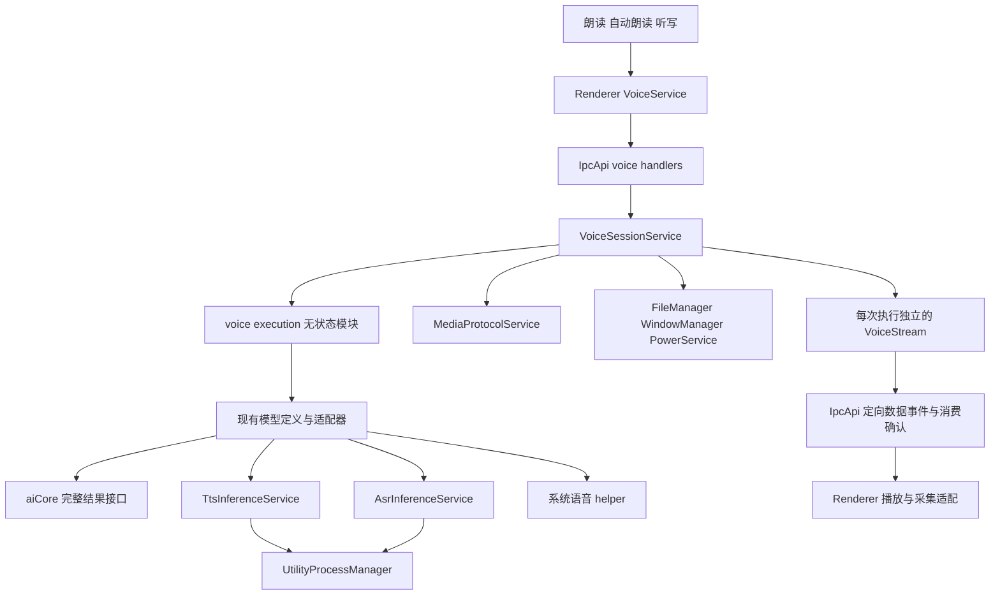
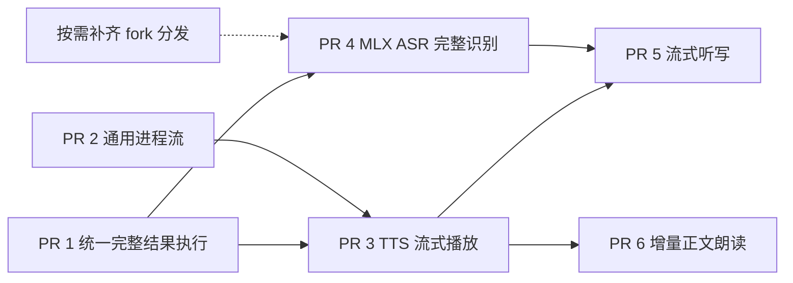

# Agent Note: 统一语音执行与有界流式传输

Status: proposed

[English](2026-10-18-unified-voice-execution.md) | 中文

## 问题

系统语音、MLX 和 Sherpa 的生成与取消行为不同。如果把这些差异放进播放或听写调用方，用户流程就会与引擎耦合。将输出生成、执行清理、模型驻留和播放结束视为同一个事件，会导致资源过早释放或无限保留。流式传输还需要消费者确认路径：无限发送普通进程事件无法提供背压。

本笔记负责记录六阶段语音方案中可能被重新讨论的决策。[接口设计](2026-10-18-unified-voice-execution.md#detailed-interface-design)和[实现方案](2026-10-18-unified-voice-execution.md#per-pr-implementation-plan)保留协议及文件层面的详细提案。[适配器 README](../../../../src/main/ai/voice/localAdapters/README.md)描述当前私有实现。

## 提案

### 所有权与契约

保持由 `VoiceSessionService` 负责窗口所有权、准入、选中模型的配置、取消和当前执行。它依赖现有 `TtsInferenceService` 与 `AsrInferenceService`，不再经由 `AiService` 调用语音。更早阶段的服务不加入同阶段依赖。不需要额外的全局语音服务或模型注册表。

使用独立的 `SpeechExecution` 和 `TranscriptionExecution` 接口，共用 `cancel()` 与 `closed` 语义。结果完成、执行清理、共享模型驻留和播放排空保持分离。取消幂等，并等待执行拥有的资源清理。清理失败保持可观察；会话持有未成功关闭的执行时，不能启动另一项操作。执行关闭不得撤销仍由活动播放持有的媒体。

从类型化的适配器操作表派生可序列化能力。共享标签使用常量对象与派生联合；SDK 对象、Promise 和取消信号留在 Main。只公布已经实现的输入输出组合。除类型边界外，运行时也拒绝不支持的组合。复制提交的音频，包括 Buffer 视图，避免调用方修改已准入任务的输入。完整结果 ASR 适配器可以只产生一次最终修订；`completed` 仍是最终提交的依据。

### 适配器边界

`sdkOperations.ts` 将 SDK 模型适配为完整结果操作，并保留私有生命周期函数。`systemSpeech.ts` 负责系统辅助程序客户端和系统适配器错误转换。`scratch.ts` 负责临时目录，要求调用方提供错误转换。`recordingDecoder.ts` 负责共享录音解码请求与超时。`checkAbort` 归属 `VoiceRuntimeError.ts`。

这些是语音领域拥有的执行和资源能力，不是全局工具。不能仅因多个适配器共用代码就创建 `voice/utils`。后端特有的错误转换留在后端。新增支持既有输入输出组合的后端，应只调整其适配器与目录条目，不在会话、播放或听写消费者中增加引擎分支。新的输入输出语义需要显式扩展契约。

### 流式传输与交付

为现有 utility-process 传输增加类型化请求流。普通 request/event 行为保持不变。限制单帧大小、排队字节、帧数和等待写入者；按传输数据计算成本，不信任发送方声称的成本。数据容量耗尽时，取消和终态控制帧仍须可送达。以 handler 清理完成或进程退出作为关闭依据，不能以收到取消请求作为依据。

推理执行在关闭前持续占有模型队列位置。Main 只向已授权窗口和匹配的 attempt 中继。Renderer 负责 PCM 播放与采集；消费后归还容量。生产端 EOF 不代表播放排空。暂停施加背压，停止使迟到帧失效，流故障不能复活旧代任务。音频转换需要跨块保留状态，并排出尾部。

先交付完整结果兼容，再交付有界进程流与 Qwen3 流式播放。传输层单独合并前，必须用真实 TTS producer 联合验证。连续听写之前先接入 MLX ASR 完整识别；增量朗读可以在 TTS 播放之后独立推进。Realtime 对话、多模型并行驻留、插件注册和没有实际需求的云端适配器不在本提案内。

## 已考虑的替代方案

- 在 `AiService` 或 Renderer 调用方增加引擎分支，会重复模型选择与清理规则。调用方应依赖执行契约。
- 新增全局管理器或注册表，会重复服务容器与模型目录的职责。复用现有所有权。
- 强迫所有后端流式化，会掩盖完整结果语义。保留有限输出，仅在可执行时公布流式能力。
- 无界进程事件或等待 Promise 只是将内存问题转移到另一个队列。传输数据和等待发送的 producer 都须有界。
- 宽泛的 `nativeSupport` 或通用 `utils` 模块，会让文件系统清理和解码耦合系统语音依赖。使用职责内聚的适配器私有模块及显式错误转换。
- 返回句柄就释放队列位置，或将生产结束视为播放结束，会允许推理重叠或截断播放。每项资源都应保留到其所有者的终止条件成立。

## 验收标准

- AC1 — 现有完整结果 TTS/ASR 保留选中模型、音色、语言、输出及脱敏错误行为；拒绝不支持的操作组合，只公布已实现能力 (verification: unit 与 Node/Web typechecks; owner: PR 1)
- AC2 — 消费开始前和原生执行期间的取消均能结算，不遗留等待者；临时目录清理失败可观察，输入字节归执行所有，活动播放在自身结束前保留媒体 (verification: unit 与 Electron; owner: PR 1)
- AC3 — 系统语音、FunASR、Qwen3-TTS 和 Kokoro 的完整结果路径在迁移后仍可用于各自支持的平台，包括打包后的原生加载与 Windows 标准 WAV 输入 (verification: unit、Electron 与 packaged artifact; owner: PR 1)
- AC4 — 真实 utility process 在慢消费下遵守已声明的队列预算；取消、输入 EOF、崩溃与重启能结算读写双方，普通请求行为不变 (verification: unit 与带队列测量的 Electron process smoke; owner: PR 2，与 PR 3 联合验证)
- AC5 — Qwen3 试听和手动朗读在生成结束前播放；暂停和恢复保持有界且不重复，EOF 排空尾部，停止或模型维护释放执行所有权 (verification: renderer、Electron 与打包后的 AudioWorklet; owner: PR 3)
- AC6 — 匹配的 MLX ASR 分发产物可安装、选择、加载、取消和移除，不替换成其他模型，不删除仍被 TTS 使用的共享 artifact (verification: unit、Electron 与 packaged artifact; owner: PR 4)
- AC7 — 连续听写展示修订，正常停止时保留已接受的尾部，只向正确输入框提交一次最终文本，不静默丢弃输入或提交已取消任务 (verification: renderer、Electron 与 packaged artifact; owner: PR 5)
- AC8 — 增量朗读在回答结束前开始，排除 reasoning，不重复文本或分段，并在输入 EOF、中断或失败时正确关闭 (verification: renderer 与 Electron; owner: PR 6)

## 证据与审批边界

这是对用户已授权设计及 PR 1 实现的补充记录，不是已经执行 Spec-first 评审的证据。2026-10-18 核对时，[PR #21795](https://github.com/CherryHQ/cherry-studio/pull/21795) 为开放的 Draft，提交为 `1d98ad19aef9d04fd8a1b3b899be2c2826602905`；GitHub stack 发现结果显示没有关联 stack，评审中没有 Approval。尚未建立单独获批的 Spec head。本次不声明生命周期迁移。 用户于 2026-10-18 明确授权实现 PR 2；开始实施时，PR #21795 仍为 Draft，head 为 `240554f11d36c72d640531b31d67affbd85674b0`，没有 Approval。

| 标准 | 已有证据 | 剩余边界 |
| --- | --- | --- |
| AC1–AC2 | 合入 main 的 `46ef0b8ce37` 后，10 个 Main 定向测试文件共 265 项通过；Node/Web 类型检查、定向 lint 和文档检查通过。测试包含 `execution.test.ts`、`sdkOperations.test.ts`、`scratch.test.ts`、会话与准入测试、适配器测试及语音 IPC handler。 | 单元测试不能证明所有原生平台或打包路径。 |
| AC3 | 此次 main 合并前，适配器拆分通过 13 个 Main 文件共 273 项测试。开发版 Electron 完成 Apple 与 Qwen3 WAV 生成及播放，并回到 idle。后续定向测试覆盖了 Windows 标准 WAV、字节偏移输入、取消和超时清理。 | 原生 ASR 资源不可用；本地未执行 Windows 与打包环境验证。较早的 Electron 验证不代表合并后当前提交的实机验证。 |
| AC4（部分） | PR 2 已实现类型化有界输入输出、有序 EOF、等待写入者上限及清理确认。定向单元测试覆盖流和普通请求行为。真实 Electron 普通目录和 ASAR smoke 通过；双向队列每个方向的峰值为 6,016 字节 / 2 帧，低于 8,192 字节 / 3 帧上限。 | 与 PR 3 的 Qwen3-TTS 生产者到播放器联调尚未验证；队列测量不是 RSS 或音频质量证据。未验证 Windows。 |
| AC5–AC8 | 实现方案中已有详细提案。 | 本分支未实现或验证 PR 3–6。 |

任一标准未完成时，本笔记保持 proposed。后续实现层开始前，按当前流程建立 Spec 评审及 AC 覆盖关系。只有完整获批范围具备实际累计证据后才能迁移；Draft、推送或部分检查通过都不代表完成。

## 风险

如果控制消息等待数据额度，或维护操作在推理关闭前释放模型，背压会带来死锁风险。原生取消延迟和清理失败必须保持可见，不能被成功返回结果掩盖。逐块重复重采样可能产生不连续；将生产 EOF 混同播放排空会截断尾部。

MLX ASR 源码支持不代表已有兼容的分发产物。原生 ASR、Windows 和打包后的 AudioWorklet 验证需要对应真实环境。缓冲限制、预缓冲、转换方案和超时策略仍待原型确定；批准实现前须记录测量值。所有权、行为、替代方案、验收标准或风险的实质变更需要重新批准 Spec。

## 详细接口设计

状态：设计提案。历史源码基线：`9d1bf05fe2c`。以下调用关系和文件动作保留当时的改造目标；PR 1 的当前实现与验证状态以上文证据为准，不将“新增”视为仍未创建。本方案承接 [#21662](https://github.com/CherryHQ/cherry-studio/issues/21662) 的语音执行与播放边界，以及 [#21668](https://github.com/CherryHQ/cherry-studio/issues/21668) 的模型与引擎解耦。

目标是让朗读、自动朗读和听写通过统一接口使用不同语音后端。模型适配器负责 MLX、Sherpa、系统语音和后续云端协议的差异；上层根据明确的输入输出能力选择操作。统一能力描述、执行结果、取消和释放语义，同时保留完整音频与连续音频的区别。

首个流式实现使用已有 Qwen3-TTS。ASR 在同一会话和传输边界下接入连续 PCM 与文本修订。首期保持现有跨窗口语音互斥，不增加双向 Realtime 对话、多个模型并行驻留、插件注册系统或新的全局语音管理服务。

### 历史基线调用关系与目标边界

| 基线入口 | 基线行为 | 目标改动 |
| --- | --- | --- |
| `VoiceSessionService` | 管理 admission、窗口归属、配置、取消、临时文件、播放状态和资源操作 | 保持会话所有权，持有统一执行句柄与流传输对象 |
| `AiService.generateSpeech/transcribe` | 创建本地 SDK 模型，再调用 aiCore 的完整结果接口 | 当前生产调用者只有 `VoiceSessionService`；将这两段执行逻辑迁入语音模块，删除迁移后无调用者的包装 |
| `localAdapters.ts` 与 `voiceModelTypes.ts` | 统一模型定义、平台支持、安装状态和音色，但执行契约仅有 SDK `createModel` | 在同一份模型定义中增加操作能力和执行入口，不另建模型注册表 |
| `TtsInferenceService` | 隔离推理、模型选择、串行执行、取消和卸载 | 增加流式输出，保持同一个模型使用与卸载屏障 |
| `inferenceTtsHandlers.ts` | 已调用 `synthesizeStream`，经语速处理后全部写入 WAV | 增加逐块 PCM 消费路径，停止将流式请求聚合为完整 WAV |
| `AsrInferenceService` | Sherpa FunASR 离线识别，完整音频内做 VAD 分段 | 保留完整输入路径，新增连续输入的实际模型适配 |
| `SpeechPlaybackService` | 等待完整媒体 URL，使用 `HTMLAudioElement` 播放 | 在同一协调器下容纳有限媒体与 PCM 两种输出 |
| `DictationService` | `MediaRecorder` 收集完整录音，识别完成后插入文本 | 增加 PCM 采集和修订预览，最终插入继续使用 `VoiceTargetManager` |

现有 [aiCore 语音接口](../../../../packages/aiCore/src/core/runtime/voice.ts) 是完整结果包装；[模型定义](../../../../src/main/ai/voice/voiceModelTypes.ts) 和 [播放状态](../../../../src/main/ai/voice/playbackState.ts) 是本次演进的直接边界。

### 服务依赖与生命周期

#### 依赖方向

图中的实线表示调用或模块依赖，不代表每个节点都需要注册为生命周期服务。



`execution.ts` 负责解析适配器、验证能力并创建执行句柄，不保存全局会话、进程、计时器或连接，因此使用普通函数模块。执行中的异步任务和临时资源属于执行句柄，句柄由 `VoiceSessionService` 持有。模型缓存与进程仍归现有推理服务和 `UtilityProcessManager`。

不新增 `VoiceRuntimeService`、`VoiceTransportService` 或 `VoiceModelManager`。`VoiceStream`、`PcmPlayback`、`PcmCapture` 是按会话创建的资源对象，不是单例，不加 `Service` 后缀，也不进入 `serviceRegistry.ts`。

#### 生命周期依赖表

| 服务 | 阶段 | 方案中的同阶段依赖与职责 |
| --- | --- | --- |
| `LocalModelService` | `BeforeReady` | 保持安装、校验、状态与共享运行时回收；移除模型时调用现有 capability hook |
| `UtilityProcessManager` | `WhenReady` | 保持通用进程启动、请求关联、退出确认和协议生命周期，不依赖语音服务 |
| `TtsInferenceService` / `AsrInferenceService` | `WhenReady` | 继续通过 `InferenceServiceBase` 依赖 `UtilityProcessManager`；按执行生命周期占用推理队列 |
| `VoiceSessionService` | `WhenReady` | 用 `TtsInferenceService`、`AsrInferenceService` 替换 `AiService` 依赖；保留 `FileManager`、`WindowManager`、`UtilityProcessManager`、`PowerService`、`MediaProtocolService` |
| `AiService` | `WhenReady` | 语音调用迁出后不反向依赖 `VoiceSessionService`；原有聊天、MCP 和 Job 依赖保持原职责 |

`VoiceSessionService` 仍直接依赖 `UtilityProcessManager`，因为它当前在 `onInit` 注册 `voice.audio` 解码进程。文件处理仍经 `FileManager`，所以这并不意味着完全移除语音对 Job 基础设施的间接依赖。

`PreferenceService`、`CacheService`、`IpcApiService` 和 `LocalModelService` 位于更早阶段，不为它们增加 WhenReady 服务的 `@DependsOn`。派生推理服务如需增加依赖，必须保留基类的 `UtilityProcessManager` 依赖；当前装饰器覆盖规则不能当作自动合并。

`LocalModelService` 的移除 hook 是就绪后的运行期回调，不是初始化时依赖 WhenReady 服务。保持 `LocalModelService → inference.removeModelThen` 的维护路径，不增加 `LocalModelService → VoiceSessionService` 的反向依赖。

#### 停止与卸载

正常停机顺序为：语音会话停止接收请求并清理执行 → 推理消费者收尾 → `UtilityProcessManager` 确认子进程退出。生命周期容器按初始化逆序发起停止，但单服务超时后会继续停止后续服务，因此不能仅靠装饰器假定清理已成功。

每次关闭操作先使当前执行身份失效，停止音频发送与新输入，再取消生产、拒绝等待中的读写并等待释放。停止、窗口关闭、锁屏、进程退出和重复回调都必须幂等。运行中清理失败时保留现有不可用状态与恢复路径；应用停机则向生命周期系统报告失败或超时，不伪装成正常释放。

推理队列的占用从开始执行持续到取消或正常完成后的资源清理结束，不能在返回流句柄时释放。暂停播放只停止消费，不释放模型使用权。`removeModelThen(modelId, ...)` 必须能够唤醒正在等待背压的任务，等待进程退出后才删除文件。卸载未使用的 A 不打断 B；共享运行时在仍有模型引用时保留。

### 统一执行契约

#### 能力由模型定义提供

保留现有模型的音频生成、转录分类；新增语音操作能力，表达允许的输入输出组合。不要使用一个 `streaming: boolean`，也不要让独立布尔值产生后端实际不支持的组合。

能力标签使用常量对象与派生类型，统一定义在 `src/shared/ai/voice.ts`。字符串值用于跨进程序列化，调用方使用具名成员，避免在适配器、消费者与校验规则中重复书写字符串。标签只描述输入输出的种类，实际文本和音频由对应请求及结果承载。

```ts
export const SpeechInputKind = {
  Text: 'text',
  TextStream: 'text_stream'
} as const
export type SpeechInputKind = (typeof SpeechInputKind)[keyof typeof SpeechInputKind]

export const SpeechOutputKind = {
  Audio: 'audio',
  PcmStream: 'pcm_stream'
} as const
export type SpeechOutputKind = (typeof SpeechOutputKind)[keyof typeof SpeechOutputKind]

export const TranscriptionInputKind = {
  Audio: 'audio',
  PcmStream: 'pcm_stream'
} as const
export type TranscriptionInputKind = (typeof TranscriptionInputKind)[keyof typeof TranscriptionInputKind]

export const TranscriptionOutputKind = {
  Final: 'final',
  Segments: 'segments',
  Revisions: 'revisions'
} as const
export type TranscriptionOutputKind = (typeof TranscriptionOutputKind)[keyof typeof TranscriptionOutputKind]

interface VoiceCapabilities {
  speech?: readonly {
    input: SpeechInputKind
    output: SpeechOutputKind
  }[]
  transcription?: readonly {
    input: TranscriptionInputKind
    output: TranscriptionOutputKind
  }[]
}

const qwenSpeechCapabilities = {
  speech: [
    { input: SpeechInputKind.Text, output: SpeechOutputKind.Audio },
    { input: SpeechInputKind.Text, output: SpeechOutputKind.PcmStream }
  ]
} as const satisfies VoiceCapabilities
```

IpcApi schema 引用同一常量对象建立枚举校验，路由类型继续从 schema 推导，不维护第二份字符串列表。`SpeechSource.kind` 等判别字段也引用对应常量成员的类型；MIME 等固定协议格式仍可使用字面量约束。能力数组逐项声明实际支持的组合，不能将全部输入与全部输出自动做笛卡尔积。

能力是可执行操作的描述，安装状态、系统支持和授权状态继续分别报告。Main 校验请求组合；Renderer 只依据能力选择录音、预览和播放流程，不依据操作系统、模型名称或引擎 ID 分支。

| 适配路径 | 首期对外能力 |
| --- | --- |
| 现有系统 TTS 与 Kokoro | 完整文本 → 完整音频 |
| Qwen3-TTS MLX | 完整文本 → PCM 流；完整音频路径保留 |
| 现有系统 ASR 与 FunASR | 完整音频 → 最终文本 |
| 后续 MLX Qwen3-ASR | 连续 PCM → 文本修订与最终结果，完成打包和实机验证后开放 |
| 后续 FunASR VAD 连续模式 | 连续 PCM → 已完成分段；不能声明具有句内修订能力 |

增量文本输入待消费者接入后才开放。云端模型必须沿用既有 provider/endpoint 解析和凭据管理；本方案不提前注册尚未实现的云端能力，也不假定所有云端音频都能直接转换为 PCM。

#### 进程内接口与跨进程数据分开

以下是 Main 内部的接口形状，具体请求和结果字段由实现阶段补全。它们放在 `src/main/ai/voice/executionTypes.ts`，不放入 `@shared`，不经 IPC 直接传递。

```ts
interface SpeechExecution {
  readonly output: Promise<SpeechSource>
  readonly completed: Promise<SpeechCompletion>
  readonly closed: Promise<void>
  cancel(): Promise<void>
}

type SpeechSource =
  | { kind: typeof SpeechOutputKind.Audio; audio: Uint8Array; mediaType: 'audio/wav' }
  | { kind: typeof SpeechOutputKind.PcmStream; format: PcmFormat; chunks: AsyncIterable<PcmChunk> }

interface TranscriptionExecution {
  readonly updates: AsyncIterable<TranscriptRevision>
  readonly completed: Promise<TranscriptResult>
  readonly closed: Promise<void>
  cancel(): Promise<void>
}
```

执行入口使用 `startSpeech(request, signal)` 与 `startTranscription(request, signal)` 两个函数。请求分别接受带判别字段的完整输入或异步输入源；TTS 文本流有显式 `flush`，输入迭代结束表示不再接受文本；ASR 输入迭代结束表示停止录音并请求最终识别。只关闭输入不会取消已经提交的工作。

统一语义如下：

- `output` 表示音频源已可消费。完整音频适配器需要等待合成，流式适配器只需完成格式与流准备。
- `completed` 表示生产端成功、失败或取消，独立于消费循环可观察；背压仍可能使正常完成等待消费推进。截断不能报告成功。
- `closed` 表示生产任务和执行器拥有的临时资源已收尾；失败会拒绝该 Promise。它不等待 Renderer 播放完毕，也不代表共享热模型已卸载。
- `cancel()` 幂等，停止输入和输出，唤醒等待者，并等待 `closed`；失败保持可观察。外部 signal 和提前退出迭代走同一个取消入口。
- 正常完成、失败、未开始迭代即取消，都必须使相关 Promise 和读写最终结算。会话创建句柄后立即观察其终态，避免依赖消费者恰好遍历才能发现错误。

适配器不创建媒体 URL、不广播 IPC、不操作 UI。完整音频交给 `VoiceSessionService` 存入 `MediaProtocolService`；PCM 源交给会话拥有的传输对象。`SpeechPlaybackService` 对两者提供相同的播放、暂停、停止和完成报告入口。

#### 文本结果与音频格式

跨进程值类型放入 `src/shared/ai/voice.ts`；IpcApi 请求、事件和校验仍由 `src/shared/ipc/schemas/voice.ts` 定义，输入输出类型从 schema 推导。

- `PcmFormat`：采样率、声道数、固定首版编码 `f32`、交错声道布局。
- `PcmChunk`：流内序号、`startFrame` 和样本；帧数等于样本数除以声道数。所有偏移基于语速转换后的输出。
- `TranscriptRevision`：单调递增 `revision`、当前完整转录 `text`、可回改后缀的起点、`final`。后缀起点统一为 JavaScript UTF-16 偏移，不暴露厂商 token 下标。
- `VoiceOutputDescriptor`：有限媒体 URL 或 PCM 流的描述，以及会话、请求、播放 attempt 身份；不携带路径、SDK 实例或函数。

模型定义、解析后的配置和显示能力使用同一来源。每次执行冻结 `modelId`、音色、语言、语速以及内部 bundle/engine 解析结果；过程中修改设置只影响下一次执行。模型缺失或组合不支持时明确失败，不默默换模型。

ASR 适配器将厂商 delta、累计文本或分段结果转换为完整 revision；UI 替换当前预览，不追加重复文本。所谓 stable 前缀仍可能因后端修订而变化，真正不可变的提交点是最终结果。首版只在 `completed` 后通过原有目标绑定插入一次；输入框关闭或目标失效时沿用恢复流程，不能把文本写进后来获得焦点的输入框。长时间转录保持明确的输入时长与文本大小上限，不承诺无限录音时的全量文本内存恒定。

### 传输与背压

#### Main 与 Renderer

首版沿用 IpcApi 的定向事件和带确认请求，不新增原生通道或 preload 专用语音桥。仓库的 [IPC escape hatch 规则](../../../../docs/references/ipc/ipc-migration-guide.md#escape-hatch--when-a-channel-may-stay-out) 不允许仅以高频为由将 Main → Renderer 数据绕出 IpcApi。

拟新增路由如下，均经过现有 sender 校验与 `VoiceSessionService` 的所有权检查：

| 路由或事件 | 作用 |
| --- | --- |
| `ai.voice.speech.start` | 接收输入方式和能力要求，准入后返回执行身份与输出描述 |
| `ai.voice.transcription.start` | 创建完整或连续识别执行 |
| `ai.voice.stream.attach` | Renderer 已安装接收器后确认准备就绪，并声明受 Main 上限约束的初始容量 |
| `ai.voice.stream.write` | 有界输入批次；用于 PCM，后续用于增量文本；限制每个流的在途请求数 |
| `ai.voice.stream.finish_input` | 输入结束，执行器处理尾部并正常完成；不等价于取消 |
| `ai.voice.stream.ack` | 报告累计已消费音频帧，单调、幂等，不能确认尚未发送的帧 |
| `ai.voice.stream_event` | 仅发送给 owner 的格式、PCM、文本 revision、EOF 或失败事件 |

暂停、恢复、停止、播放报告和 session discard 复用现有语义；新路由不并行建立另一套 admission。旧的 `ai.speech.generate`、`ai.transcription.generate` 在迁移期保留，并使用统一执行层的完整输入输出路径。

TTS 以播放器真实剩余容量限制发送。工作线程消费样本后释放额度，Main 才继续向推理进程拉取；预读、进程消息队列、Main 中继和 Renderer 队列的上限均计入总预算。不能在收到消息时就确认已播放，也不能用工作线程输出的欠载静音增加消费进度。PCM 数据不进入 Cache、不广播给所有窗口。

普通 mono 24 kHz float32 PCM 的数据率为 `24,000 × 4 = 96,000` 字节每秒，适合先用有界批次验证现有通道。批次时长和预缓冲是内部实现参数，验收记录冷启动、首音、欠载和总队列占用，再决定具体值，不先增加用户设置。

ASR 在音频线程采集、在 Renderer 普通线程聚合批次，按 Main 接收额度送入执行器。写入确认表示有界输入队列已接收，不表示该段已识别。采集不能阻塞硬件时钟；缓冲持续满时终止并报告输入过载，不静默丢帧或无限堆积。停止录音应先送完已接受的尾部帧再 `finish_input`；取消则丢弃未提交输入。

只有实测显示现有传输无法达到目标时，才提出 IpcApi 基础层的 MessagePort 扩展，同时更新 IPC 规范与身份绑定方案。Electron 的 [MessagePort 交接](https://www.electronjs.org/docs/latest/tutorial/message-ports) 需要 `postMessage`，不能直接塞进当前 `invoke` 返回值。这个选择影响传输实现，不改变语音执行接口。

#### Main 与独立推理进程

现有 `UtilityProcessMethod` 支持增量事件，但 `emit` / `onEvent` 是同步回调，没有输入流、消费等待和信用额度。先在 `core/utilityProcess` 增加一个可选的请求级有界流能力；现有 `request()` 和普通事件语义保持不变。

该增量能力只负责请求关联、双向有界数据帧、输入 EOF、输出 EOF、终态与取消。向消费者暴露可等待的读写或迭代器，向 handler 暴露输入迭代器及可等待输出；阻塞只等待容量，不阻塞取消。限制按字节和帧数计量，不包含采样率、音色、模型或播放状态等业务字段。

流仍属于一个活跃请求，直到终态与清理完成；等待输入或消费不应被误判为进程空闲。进程崩溃、维护停机或请求取消时，关闭全部关联流并拒绝等待者。保持现有 generation/tombstone 防护，终态重复和旧代事件不能重新打开流。

这是通用进程模块的上游扩展。语音 handler 不另建消息端口、私有 ACK RPC 或第二套请求映射来绕过框架。`InferenceServiceBase` 随后增加整次流执行的队列占用，复用原有模型切换、取消和卸载屏障。首期保留本地推理的 terminate 取消策略；是否切换 cooperative 取消需要另外证明原生调用始终可退出。

### 播放和录音的所有权

`SpeechPlaybackService` 保持唯一 Renderer 播放协调器，内部按输出描述创建 `FinitePlayback` 或 `PcmPlayback`。两者提供相同的暂停、恢复、停止、排空和失败报告。`PcmPlayback` 拥有 AudioContext、AudioWorklet 与有界队列；工作线程只处理音频，不发 IPC、不解析业务配置。

播放状态继续分为 `synthesis`、`desired`、`observed`。当前 `completePlaybackSynthesis()` 在生成结束时才增加 `attemptId`；流式路径必须在输出源发布前分配 attempt，之后生成完成仅更新 synthesis，不能把已经 playing/paused 的 observed 重置为 ready。`ended` 仅在 EOF 且队列排空后报告。

停止时先让 Renderer 本地输出失效并清空队列，再等待 Main 取消与释放；旧 session/request/attempt 的数据全部拒绝。Main 不在仅收到生产 EOF 后释放会话，必须处理播放排空或取消后的释放。慢速播放、暂停时的等待不能沿用当前固定合成总超时而误报超时；准备、模型执行、输入空闲和消费暂停分别定义预算，暂停不消耗有效生成预算。

`DictationService` 拥有录音设备和 `PcmCapture`，以实际设备采样率标记 PCM。模型适配器在明确的输入边界完成所需重采样；播放端按源格式与 AudioContext 实际采样率做明确转换。优先复用现有可流式处理的库能力，转换尾部状态必须 flush；不在多个层重复改变语速或采样率。浏览器 [AudioWorklet](https://developer.mozilla.org/en-US/docs/Web/API/AudioWorklet) 用于音频线程处理，不能把推理或同步等待放进其回调。

长文本不能保持“当前段播放 ended 才提交下一段”的调度，否则流式只减少每段内部等待。有限文本的段落调度放在同一 speech execution 内，保留 `readableText` 的内容规范化与长度确认；增量文本模式复用同一条输入流，不再叠加另一层播放结束驱动的分段器。

### 文件组织与模块边界

以下“新增”表示实现阶段的候选文件，不在方案阶段创建空目录或骨架。沿用现有 `ai/voice`、`ai/localModel`、`services/voice`，不新建进程根目录，不搬迁整个语音模块。

| 位置 | 动作与责任 |
| --- | --- |
| `src/main/ai/voice/VoiceSessionService.ts` | 修改：唯一会话所有者，持有 execution/transport，编排释放 |
| `src/main/ai/voice/execution.ts` | 新增：`startSpeech` / `startTranscription`，模型能力校验与适配器选择，无全局状态 |
| `src/main/ai/voice/executionTypes.ts` | 新增：Main 内的请求、source、execution 类型 |
| `src/main/ai/voice/VoiceStream.ts` | 新增：每次执行的有界中继、额度、输入结束与传输清理；由 session 创建 |
| `src/main/ai/voice/localAdapters.ts` | 修改：继续作为本地模型定义解析入口，不再新增平行 registry |
| `src/main/ai/voice/voiceModelTypes.ts` | 修改：模型定义声明能力和启动操作；安装、语言与音色继续同源 |
| `src/main/ai/voice/localAdapters/*.ts` | 修改：包装现有 SDK 完整结果，或创建引擎流执行；错误映射留在适配器 |
| `src/main/ai/voice/playbackState.ts` | 修改：提前分配 attempt，允许生成与播放同时进行，区分 EOF 与 drained |
| `src/main/ai/localModel/capabilities/{tts,asr}/` | 修改：推理入口、protocol、模型路径与能力对应，不持有窗口状态 |
| `src/main/ai/localModel/runtime/InferenceServiceBase.ts` | 修改：流执行全程串行占用，保持模型切换与卸载屏障 |
| `src/main/ai/localModel/runtime/utilityEntries/` | 修改：实际引擎读写与增量结果；新增 MLX ASR 时按现有 entry 约定构建 |
| `src/main/core/utilityProcess/{types.ts,protocol,host,runtime}` | 修改：通用有界流协议；不导入 voice 类型或业务模块 |
| `src/main/ipc/handlers/voice.ts` | 修改：schema 后委派服务，保持薄 handler |
| `src/shared/ai/voice.ts` | 新增：真正跨进程使用的能力、PCM、转录修订和输出描述值类型 |
| `src/shared/ai/localVoice.ts` | 修改：现有本地模型描述引用统一能力；保留既有 ID |
| `src/shared/ipc/schemas/voice.ts` | 修改：请求与事件的单一契约来源；公共数据帧也要校验大小、格式与顺序 |
| `src/renderer/services/voice/VoiceService.ts` | 修改：执行启动、事件订阅、输入与消费确认，不负责播放实现 |
| `src/renderer/services/voice/SpeechPlaybackService.ts` | 修改：协调有限媒体与 PCM 输出，继续服务朗读和试听 |
| `src/renderer/services/voice/{FinitePlayback,PcmPlayback}.ts` | 提取 / 新增：输出资源对象，由播放协调器创建，无单例 |
| `src/renderer/services/voice/{PcmCapture,DictationService}.ts` | 新增 / 修改：设备采集、输入额度、修订预览与最终提交 |
| `src/renderer/services/voice/pcmPlaybackProcessor.ts`、`pcmCaptureProcessor.ts` | 新增：AudioWorklet 入口；作为独立浏览器资源构建，不经过含服务副作用的 barrel |
| `src/main/core/application/serviceRegistry.ts` | 不新增语音 service；核对现有类型注册仍覆盖依赖 |
| `src/preload/ipc.ts` | 首版保持通用桥，无语音专用分支 |
| `packages/aiCore/src/core/runtime/voice.ts` | 保留现有无 Electron 的完整结果 API；由适配器调用，不搬入会话、IPC 或模型安装 |

新增 Main 文件使用具名文件导入，不为 `ai/voice` 仓促增加聚合 barrel；Renderer 继续使用已有 `services/voice/index.ts`，只公开消费者需要的服务和类型，播放、采集与工作线程保持私有。`localModel/index.ts` 只按实际外部消费者补充必要导出；不从外部深导入它的 protocol。规则依据 [命名规范](../../../../docs/references/architecture/naming-conventions.md#64-barrel--index-files)。

aiCore 不是应用服务的依赖容器。首版统一接口放 Main，是因为会话与本地执行适配的当前消费者在 Main；将来若桌面和移动端真正共用执行协议，再提取纯运行时契约到独立包。不能让 `packages/aiCore` 反向导入 `src/shared`、`@application` 或 Cherry 的模型安装服务。

### 分批实施与验收

| 批次 | 改动范围 | 必须证明的结果 |
| --- | --- | --- |
| A 统一完整结果接口 | 模型能力、execution 契约、现有适配器包装；迁出 `AiService` 语音方法；补齐服务依赖 | 同一套调用覆盖已有 TTS/ASR；音色语言语速保持；取消前后模型使用和临时文件正确释放；既有朗读听写行为不变 |
| B 通用有界流与 Qwen3-TTS | utility-process 上游流能力、推理租约、IpcApi 批次与消费确认、PCM 播放 | 未完成生成时已经播放；各级缓冲有界；EOF 不截尾；暂停恢复不重复；停止后迟到帧不发声；worker 崩溃后能启动新会话 |
| C 连续 ASR | PCM 采集、连续输入、MLX ASR 适配、文本修订 | 输入有界且无静默丢帧；中间结果可修订；尾部正确 flush；最终仅插入一次；焦点切换不误写；取消后无旧结果 |
| D 增量文本及其他后端 | LLM 稳定正文输入，按真实模型选择 Sherpa 在线或 VAD 分段适配 | 文本输入结束与音频结束分离；不读 reasoning；无重复提交；新后端无需修改业务消费者的引擎分支 |

ASR 批次需要补齐模型包、JS API 和原生运行时版本匹配。fork 的 [Qwen3-ASR 流接口](https://github.com/CherryHQ/mlx-node/blob/f4c21043f557965345b527bc04179ad26d08378f/packages/asr/README.md) 提供滚动输入与文本修订，但当前 TTS 打包成功不等于 ASR 的交付链已验证。多模型改造继续遵循 [Local Models](../../../../docs/references/ai/local-models.md) 的安装和共享运行时边界，不能将默认 capability 映射当成用户本次选择。

每批先用 `pnpm check --plan` 查看影响范围，再选显式测试文件；不执行无过滤的全仓库测试。现有回归入口包括：

- Main：`src/main/ai/voice/__tests__/VoiceSessionService.test.ts`、`playbackState.test.ts`、`voiceAdmissionCoordination.test.ts`，以及 `src/main/ipc/handlers/__tests__/voice.test.ts`。
- Adapter：`src/main/ai/voice/localAdapters/__tests__/{apple,windows,funasr,qwen3Tts}.test.ts` 与 `src/main/ai/localModel/runtime/__tests__/{InferenceServiceBase,inferenceEntryTts}.test.ts`。
- 进程：`src/main/core/utilityProcess/__tests__/ProcessHost.cancellation.test.ts`、`ProcessHost.stop.test.ts`、`serveUtilityProcess.test.ts`，加有界流的新契约测试。
- Renderer：`src/renderer/services/voice/__tests__/{VoiceService,SpeechPlaybackService,DictationService,AutoReadService,VoiceTargetManager}.test.ts`，加 PCM 输出和采集的新测试。
- aiCore：迁移完整结果包装时执行 `packages/aiCore/src/core/runtime/__tests__/voice.test.ts`；移走原 `AiService.voice.test.ts` 中仍有效的契约断言。

新测试必须能捕获实际失效：容量越界、重复样本、尾音丢失、暂停误超时、停止后复活、卸载竞争、最终文本重复插入或跨窗口越权。Frontend 测试遵循 [前端测试指南](../../../../docs/references/testing/frontend-testing.md)，依赖替身遵循 [统一 mock 规则](../../../../tests/__mocks__/README.md)。

真实 Electron 验证单独记录首次可听延迟、源帧与消费帧连续性、欠载次数、峰值队列占用、暂停稳定性、冷/热启动和取消后重新执行；覆盖开发与打包资源路径。历史首块 PCM 数据只证明引擎输出，不替代扬声器首音、流式播放或 ASR 实机验收。

### PR 拆分与依赖

每个 PR 的类与接口、文件清单、资源释放顺序、类型约束和验收项见 [逐 PR 实现方案](2026-10-18-unified-voice-execution.md#per-pr-implementation-plan)。本节保留交付范围与依赖总览；实现方案中的新增符号均为提案，不代表已经实现。

建议拆为六个 Cherry Studio 实现 PR；MLX ASR 的发布产物若需要补齐，另有一个 `CherryHQ/mlx-node` 配套 PR。这是评审与交付划分，不要求一次创建全部分支。PR 1 已先行实现；后续实现层应按 Agent Note 流程建立独立 Spec 评审与 AC 覆盖关系，不能把本方案随附在实现 PR 中视为正式 Approval。

| PR | 建议标题 | 范围 | 依赖 | 独立验收 |
| --- | --- | --- | --- | --- |
| 1 | `refactor(voice): unify speech and transcription execution` | 常量与能力契约、统一执行句柄、完整结果适配；迁出 `AiService` 语音方法，补齐生命周期依赖。只声明本 PR 真正可执行的能力 | 无 | 现有系统语音、FunASR、Qwen3-TTS、Kokoro 的完整结果路径经过统一入口；选择、取消、文件释放和错误语义保持正确 |
| 2 | `feat(utility-process): support bounded request streams` | 通用请求级输入输出流、容量控制、EOF、取消和进程退出结算；保持原 request/event 接口兼容。流量控制不携带 voice 业务语义 | 无硬性代码依赖；接口与 PR 1、3 对齐 | 真实 Electron 子进程中，慢消费和输入过载均有界，取消唤醒阻塞读写，退出后旧代帧无效，现有请求不受影响 |
| 3 | `feat(voice): stream Qwen3 speech to playback` | TTS producer、推理执行全程占用、Main 会话与 IpcApi 流控、Renderer PCM 输出、播放状态迁移；有限媒体输出适配随真实消费者一起提取 | 1、2 | 试听与朗读在生成结束前出声；暂停、恢复、排空、停止、跨窗口仲裁、卸载和 worker 崩溃恢复通过；打包后的 AudioWorklet 可用 |
| 4 | `feat(local-asr): add MLX Qwen3 transcription` | MLX ASR 的模型定义、包依赖、原生版本校验、模型下载与选择、完整音频识别适配。复用现有资源管理，不改流式听写 UI | 1；必要时依赖配套引擎发布 | 下载后可选择并识别；与 FunASR 切换不串模型；缺少选中模型时明确失败；取消、卸载、国内外源及打包加载正确，TTS 共用运行时无回归 |
| 5 | `feat(voice): support streaming dictation` | 连续 PCM 采集、输入写入与结束、Qwen3-ASR stream、转录修订与最终提交；复用 PR 3 的身份、传输和清理规则 | 2、3、4 | 边录边更新预览；无静默丢帧；正常停止保留尾部；取消不提交；文本只插入一次且不误写其他输入框 |
| 6 | `feat(voice): read incremental assistant text` | 将稳定可朗读正文提交到同一 speech execution，支持文本 flush 和输入结束；调整自动朗读调度，复用已有音频输出 | 3 | 回答未结束时可朗读；排除 reasoning；无重复文本和双重分段；暂停、输入结束、失败和中途打断正确 |



PR 2 与 PR 3 应先在同一验证分支跑通真实 Qwen3-TTS，再按基础设施与业务边界拆开评审，合并顺序为 2 → 3。PR 2 不以测试替身通过作为结束条件，也不为后续模型预建插件、调度或进程池接口。PR 3 保持从 producer 到播放器的完整交付，避免单独合并没有真实消费者的 PCM 播放器或传输层。

PR 4 可以在 PR 1 后独立推进。它将模型交付、权重格式和加载问题与连续录音问题分开验证；不代表 Sherpa 已支持第二个 ASR 模型，也不作为 #21668 全部验收完成的依据。PR 6 在 PR 3 后即可推进，不必等待 ASR。

配套 fork PR 仅在现有产物缺少 ASR JS API、导出或匹配原生能力时创建。它负责可重复构建、精确版本、原生导出及分发清单验证；Cherry 的音频传输、播放和会话逻辑留在主仓库。源码 PR 与 Release 发布是独立动作；准备并验证产物后再发布，主仓库引用前确认固定版本和校验值可获取。

建议优先交付 PR 1 → 2 → 3，使统一接口首先支撑一条完整的流式 TTS 产品路径，再交付 PR 4 → 5。若当前最需要“边回答边朗读”，可把 PR 6 排在 PR 3 之后。

跨平台在线 ASR 或 FunASR VAD 分段、Sherpa 同引擎多模型验收、每个云端语音适配器以及 Realtime 分别另开后续 PR；不与上述六个 PR 捆绑。每个新增后端都必须使用已有统一契约，只有实际无法表达的能力才修改公共接口。

### 方案决策

本方案选择保留现有服务所有权，以无状态执行入口统一后端；先使用 IpcApi 的有界批次，在 utility-process 上游补齐流控；保留完整结果适配器，由现有播放器协调新的 PCM 输出。

实现前需要以批次 B 的小范围原型确认通用进程流 API、批次大小、预缓冲与采样率转换方案。若原型证明现有 IPC 传输不足，再提出基础层扩展及规范变更，不在业务模块添加未经归属的专用通道。云端编码流、双向 Realtime、后台持续转录与多个模型同时运行留给有实际消费者的后续方案。

## 逐 PR 实现方案

状态：PR 1 已创建 [Draft PR #21795](https://github.com/CherryHQ/cherry-studio/pull/21795)，PR 2 已完成基础设施实现和进程 smoke 验证，但与 PR 3 的集成门槛仍未完成；PR 3–6 待实现。方案基于 `9d1bf05fe2c` 的代码结构，并在合入 `425b15397e7` 后补齐 Kokoro 完整结果适配，细化 [统一接口和流式执行方案](2026-10-18-unified-voice-execution.md#detailed-interface-design) 中的六个 PR。下文保留各 PR 的实施目标，不能将后续接口、文件和验收项视为已交付。

PR 1 已提供完整结果操作表、统一执行句柄和能力描述，迁移了 VoiceSessionService 的调用与依赖；清理失败通过 `closed` 保持可观察。共享层目前只定义已支持的完整输入输出标签，PCM 与增量标签随对应 PR 加入。定向自动化及 Node/Web 类型检查通过；合入 `46ef0b8ce37` 之前，开发版 Electron 已验证 Apple/Qwen3 TTS 生成、播放结束、Qwen 取消与随后重启操作。原生 ASR 因本地资源未安装尚未完成实机识别，Windows 与打包产物也仍需对应环境验收。

交付顺序为 PR 1 → PR 2 → PR 3；PR 4 可在 PR 1 后推进，PR 5 等待 PR 3、4，PR 6 只等待 PR 3。PR 2 的真实消费者验证与 PR 3 一起完成，再先合并基础设施 PR。可选的 fork 分发 PR 是 PR 4 的产物前置条件。

### 所有 PR 共用的边界

#### 所有权与服务依赖

| 对象 | 生命周期与所有权 | 依赖及禁止承担的职责 |
| --- | --- | --- |
| `VoiceSessionService` | `WhenReady` 生命周期服务；唯一持有会话、owner、admission 和当前 execution | 依赖 TTS/ASR 推理服务及既有文件、窗口、电源、媒体、进程服务；不直接调用厂商 SDK |
| `execution.ts` / 模型定义 | 无状态启动函数与静态定义；每次启动返回一个执行句柄 | 依赖具体适配器；不注册 IPC、不持有全局播放状态 |
| `SpeechExecution` / `TranscriptionExecution` | 一次操作，从创建到 `closed` 结算；由 session 取消 | 拥有该操作的任务、临时文件和监听器；不拥有共享热模型 |
| `VoiceStream` | 一次执行的传输资源，由 session 创建和关闭 | 依赖窄的发送回调和 execution；不读取设置、不选择模型、不做播放状态决策 |
| `TtsInferenceService` / `AsrInferenceService` | 现有 `WhenReady` 服务；队列、模型使用屏障、进程定义 | 继承 `InferenceServiceBase` 的 `UtilityProcessManager` 依赖；不依赖 session 或 Renderer |
| `UtilityProcessManager` / `ProcessHost` | 应用级服务及其拥有的进程对象；请求关联、退出和维护屏障 | 只理解通用协议、容量、取消；不导入 voice/localModel 类型 |
| Renderer 语音协调器 | 保留现有服务入口；按操作持有资源对象 | `SpeechPlaybackService` 持有播放器；`DictationService` 持有采集器；`AutoReadService` 持有消息订阅与文本游标 |
| `FinitePlayback` / `PcmPlayback` / `PcmCapture` | 普通类，按操作实例化、显式关闭 | 不进主进程服务注册表，不另建单例，不反向调用业务协调器 |
| `LocalModelService` | 现有 `BeforeReady` 服务；模型和共享 artifact 安装、移除 | 就绪后的 capability hook 调用推理服务维护屏障；不反向依赖 VoiceSessionService |

不新增生命周期服务，不要求给所有执行器建立继承体系。共享 `SpeechExecution` 等接口约束行为，适配器通过组合复用完整结果包装；只有两个真实调用者需要相同逻辑时才提取 helper。共享接口的实现放在所属领域，不能为复用把模型业务下沉到 `core`。

`VoiceSessionService` 用 `TtsInferenceService`、`AsrInferenceService` 替换当前 `AiService` 同阶段依赖；其余现有依赖保留。更早阶段的 Preference、Cache、IPC、LocalModel 服务不加入 `@DependsOn`。派生类若声明自己的依赖，显式保留基类依赖，不能误认为装饰器会合并。生命周期容器的停止超时可能使清理重叠，所有关闭路径仍需幂等。

#### 终态与类型规则

统一区分四个时刻：输入 EOF、生产完成、执行资源关闭、播放排空。`completed` 给出结果或错误，`closed` 表示执行拥有的资源已清理；播放 drained 由 Renderer 单独报告。`cancel()` 幂等且等待关闭。关闭失败必须可观察，不能靠吞掉错误假装释放成功。

所有句柄创建后立即观察失败与终态；不能依靠调用方开始 `for await` 才执行取消清理。取消要能唤醒容量等待、输入等待和模型加载后的等待。终态不能与 PCM 共用需要额度的队列，否则暂停时可能永远收不到取消或失败；正常 EOF 携带最终序号，消费者仍要排空已接受的数据。

跨进程仅传值类型；能力标签使用常量对象与派生联合，沿用总方案中的 `SpeechInputKind` 等定义。请求使用判别联合，不使用一组可选字段表达互斥输入。IPC 类型从 schema 推导，能力与 schema 共用标签，不分别维护字符串名单。运行期仍校验 owner、选中模型支持的组合、格式、大小、单调序号和状态，编译期类型不能替代这些检查。

开闭原则的目标是：增加同能力后端时只增加适配器、模型目录数据和引擎实现，业务消费者继续使用同一契约。不是承诺“加模型零改动”；静态 catalog、ID 联合和显式导出允许增加条目，新增输入输出语义则必须扩展公共契约并补齐所有消费者。不做动态插件、通用依赖注入容器或无实际消费者的抽象工厂。

### PR 1：统一完整结果执行

建议标题：`refactor(voice): unify speech and transcription execution`。无前置 PR，交付后现有功能完整可用；尚不开放流式能力。

#### 类与接口

在 Main 的 `executionTypes.ts` 定义总方案中的 `SpeechExecution`、`TranscriptionExecution` 与输入联合。`startSpeech(request, signal)`、`startTranscription(request, signal)` 是普通函数：解析冻结后的配置 → 查找现有模型定义 → 验证输入输出组合 → 调用适配器。入口不重新读取运行中的 Preference。

模型定义继续共用安装、支持性、语言和音色元数据，在原 `SpeechModelDefinition` / `TranscriptionModelDefinition` 增加各自的执行入口。能力应从同一份操作表导出，例如 `speechOperations` 每项包含一对 input/output 标签及只接受该输入类型的 `start`。用映射联合关联标签与 handler 入参，避免把所有 handler 扩宽成接受所有输入。能力序列化时只投影标签；不能分别手填 capabilities 与 implementations 导致“声明支持但没有实现”。

完整结果适配器内部继续调用现有 `createModel` 与 aiCore API。SDK 模型工厂成为适配器内部细节，公共执行入口不暴露 SDK 对象。先迁移两个不同后端验证共性，再提取确实重复的完整结果包装函数；不建立包含空方法的 `BaseVoiceAdapter`。

本 PR 只注册 `Text → Audio` 与 `Audio → Final`。即使协议预留了其他标签，也不能提前向 UI 公布。完整 ASR 可以有一个最终 revision，但 `completed` 是最终提交的唯一依据；无更新的后端也必须完成，不强迫伪造中间结果。

#### 文件组织

| 文件 | 实现内容 |
| --- | --- |
| `src/shared/ai/voice.ts`（新增） | 能力标签、跨进程音频与转录值类型；不放 execution Promise 或 AbortSignal |
| `src/shared/ai/localVoice.ts`、`src/shared/ipc/schemas/voice.ts` | 模型描述接入能力；保留旧完整结果路由与既有 ID |
| `src/main/ai/voice/{execution.ts,executionTypes.ts}`（新增） | 无状态入口、Main 内执行句柄和判别请求 |
| `voiceModelTypes.ts`、`localAdapters.ts`、`localAdapters/{apple,windows,funasr,qwen3Tts}.ts`（同目录） | 静态操作表、现有后端包装、后端错误归一化 |
| `src/main/ai/voice/VoiceSessionService.ts` | 持有句柄，迁移调用和同阶段依赖 |
| `src/main/ai/AiService.ts` | 删除迁移后无调用者的两个语音包装及其孤立 import |

不移动 aiCore，不创建 `ai/voice/index.ts`。现有 `localModel/index.ts` 仅补真实消费者需要的具名导出，继续禁止外部深导入。

#### 资源与依赖

完整 TTS 的临时文件在读出音频后由 execution 清理；`MediaProtocolService` 的音频和 URL 由 session 注册、持有，直到播放结束或取消后释放。不得因 `execution.closed` 就提前撤销仍在播放的 URL。完整 ASR 的上传或录音输入由原所有者管理，执行器只删除自己创建的派生文件。

加载失败、SDK 抛错、空识别、输出前取消，都必须使 output/updates/completed/closed 进入一致终态。将 `AiService` 中空文本和 `NoTranscriptGeneratedError` 到 `no_speech` 的现有语义迁入执行适配层，避免统一接口后变成普通失败。窗口销毁、锁屏和服务停止仍走 session 的统一关闭路径。

#### 实施顺序与验收

1. 增加契约和适配器操作表 → 验证错误输入组合编译失败，运行时未知组合明确拒绝，已公布能力均有实现。
2. 逐个包装现有后端 → 用真实完整输入验证音色、语言、语速、错误原因和最终文本保留。
3. 迁移 session 调用与依赖、删除旧包装 → 搜索确认没有生产调用者遗留；执行生命周期回归。

定向测试覆盖现有 `VoiceSessionService.test.ts`、`voiceAdmissionCoordination.test.ts`、Apple、Windows、FunASR、Qwen3-TTS、Kokoro adapter 测试、IPC handler 的 `voice.test.ts` 和 aiCore `voice.test.ts`。把 `src/main/ai/__tests__/AiService.voice.test.ts` 中有价值的契约断言迁至新增 `src/main/ai/voice/__tests__/execution.test.ts`，不保留只验证包装调用次数的测试。

合并门槛：系统 TTS/ASR、FunASR、Qwen3-TTS、Kokoro 的原路径均不要求流式客户端；失败和取消后可再次启动；无临时文件与媒体 URL 泄漏。PR 1 不引入工作线程、PCM 通道或新的包依赖。

### PR 2：通用请求级有界流

建议标题：`feat(utility-process): support bounded request streams`。保持普通 request/event 行为，单独评审 core 协议变更；与 PR 3 原型联合验证后合并。

PR 2 当前实现使用主进程与子进程共享的请求级 `StreamChannel`，由仅主进程使用的 `StreamRequest` 管理结果与关闭所有权，`streamFrame.ts` 负责有界标量元数据和字节视图编码。不增加生命周期服务或语音依赖。每个方向显式指定容量；协议版本 2 会拒绝旧 bundle。[消费者参考](../../../../docs/references/utility-process/README.md#bounded-request-streams) 维护已交付 API。

#### 接口与协议设计

在现有 contract 上增加可选的流方法声明；普通方法仍使用 `UtilityProcessMethod`。流方法声明初始请求、输入帧、输出帧和最终结果四种类型。`client.openStream(method, input, options)` 只接受声明为流式的方法，返回以下语义的句柄；实际泛型接入方式由小范围原型确认，不放宽成任意方法名加 `unknown` 返回。

```ts
interface UtilityProcessStream<InputFrame, OutputFrame, Result> {
  readonly output: AsyncIterable<OutputFrame>
  readonly completed: Promise<Result>
  readonly closed: Promise<void>
  write(frame: InputFrame): Promise<void>
  finishInput(): Promise<void>
  cancel(): Promise<void>
}
```

`write` 等待有界接收容量；`finishInput` 关闭输入并等待已提交批次有序交付，不等待整个任务完成。只有输出的操作使用 `never` 输入帧，不能写入业务数据。handler 获得输入迭代器、可等待的输出写入和现有 signal/logger；输出提交等待容量。不要把原有同步 `emit` 改成 Promise，否则会悄悄改变所有现有消费者的错误与取消语义。

帧沿用 requestId 与 generation 关联，新增的帧种类至少覆盖数据、容量归还、输入 EOF、输出 EOF 和关闭确认。终态使用控制路径，不受数据额度阻塞。`completed` 与 `closed` 分离，尤其是 cooperative 取消时，调用者已收到取消不等于 handler 已退出。保留 terminate 策略，只有进程确认退出或 handler 的清理确认才完成资源关闭。

容量必须同时限制单帧字节、未消费总字节和帧数。原型选择可核算的帧结构：小型有界元数据加二进制载荷，泛型约束元数据与载荷的组合；核心按实际序列化元数据和 TypedArray 视图的 `byteLength` 计量，不信任发送方上报的“成本”。既有普通事件不受此新结构影响。不要为任意 JS 对象图设计通用成本算法。

每个方向限制等待写入的数量；超出限制明确拒绝，不能只限制已发送帧却允许调用方创建无限等待 Promise。消费确认只释放对应队列的所有权额度；调用方取走但仍持有的帧计入下一层预算。容量、序号、终态在 core 守卫检查，音频帧排列和文本内容校验留在 voice 层。

#### 文件组织与资源生命周期

| 文件 | 实现内容 |
| --- | --- |
| `src/main/core/utilityProcess/types.ts` | 流 contract、client 与 handler 的类型关联 |
| `protocol/{constants,frames,guards}.ts` | 帧联合、边界校验、旧代与重复终态处理 |
| `host/ProcessHost.ts` | 流请求登记、发送与消费额度、停止与崩溃结算 |
| `runtime/{utilityProcessServer,serveUtilityProcess}.ts` | handler 流上下文、输入 EOF、清理确认 |
| `streamState.ts`（该 core 目录内，按需新增） | 若 host/runtime 确有共同逻辑，提取单个请求的额度与等待者状态；无全局 registry |
| `scripts/utility-process-smoke/harness/` | 增加实际子进程的慢消费、双向流与终止场景 |

流请求登记成功即阻止 idle reaping；等待输入、暂停输出和 handler 清理期间仍为活跃。正常结束先完成数据边界和 handler 清理，再解除请求登记。取消、进程崩溃、维护停止都拒绝等待者并让句柄结算；数据晚到不能重建已结束的请求。`withStopped` 仍须确认退出后才执行维护回调。

本 PR 不改变生命周期服务图，不依赖 VoiceSessionService 或推理服务。核心对象由 ProcessHost/utility server 持有，不能新增全局 StreamManager。遵守现有 child entry 的导入边界，不能让主进程 application/logger 进入子进程构建。

#### 实施顺序与验收

1. 流类型与帧守卫 → 编译证明方法、输入输出不能串用；拒绝超额、超长、乱序和已关闭写入。
2. 主子进程状态与关闭 → 验证满队列时取消、未开始读取即取消、输入 EOF 后输出继续、崩溃与重启、重复取消。
3. Electron smoke 与 PR 3 的真实 TTS producer → 测量峰值队列及各层在途量，证明普通请求和原取消策略不变。

新增 `src/main/core/utilityProcess/__tests__/ProcessHost.stream.test.ts` 与 `utilityProcessStream.test.ts`，并运行该目录已有 `protocolGuards.test.ts`、`serveUtilityProcess.test.ts`、`ProcessHost.cancellation.test.ts`、`ProcessHost.stop.test.ts`、`ProcessHost.lifecycle.test.ts`。扩展既有 smoke harness 后执行 `pnpm smoke:utility-process`，记录 Electron 实际版本与结果。

合并门槛：慢消费者下内存预算可解释，取消不受信用额度影响，等待中的输入与输出都能退出，普通 request/event 测试保持通过。单纯模拟 MessagePort 的测试通过不算跨进程验收完成。

### PR 3：Qwen3-TTS 流式播放闭环

建议标题：`feat(voice): stream Qwen3 speech to playback`。依赖 PR 1、2，首次开放 `Text → PcmStream`；保持完整音频能力。

#### 类与接口

`TtsInferenceService` 增加流式合成入口；其返回值是受队列管理的执行，而不是裸异步迭代器。`InferenceServiceBase` 增加与 `run` 共用模型选择、generation 校验和维护屏障的流执行路径：排队成功后把句柄发布给调用者，队列任务继续等待 `closed`。不要从 PQueue 回调直接返回句柄而提前释放串行占用。排队中取消也必须立即结算对外句柄，并使后来出队的任务跳过启动。

子进程将现有 `synthesizeStream` 输出经过一次语速转换后逐块写入通用流。WAV sink 与 PCM sink 共享实际需要的模型加载、参数和错误归一化逻辑，不把所有后端包装成强制流式。子进程处理后的采样率、声道、连续帧偏移是权威值，不能由 Renderer 根据模型名猜测。

`VoiceStream` 是 session 内部的单次中继，持有 owner 和执行身份、输入关闭状态、输出额度、在途帧与清理任务。通过窄接口接收 send 回调，不自行调用 application 定位所有服务。session 负责授权和状态迁移，VoiceStream 负责已授权执行的数据与背压。

Renderer 增加私有 `SpeechPlayback` 接口及两个实现，至少包含启动、暂停、恢复、关闭，以及 drained/失败观察。`FinitePlayback` 从现有 HTMLAudioElement 路径提取；`PcmPlayback` 拥有 AudioContext、AudioWorkletNode 和有界队列。协调器只在输出 kind 上做一次穷尽分派，不出现 Qwen/MLX 判断。每个资源对象只允许一个 owner，重复 close 返回同一清理结果。

#### 文件组织

| 范围 | 文件与变更 |
| --- | --- |
| 推理 | `src/main/ai/localModel/capabilities/tts/{TtsInferenceService,protocol}.ts`、`runtime/InferenceServiceBase.ts`、`runtime/utilityEntries/inferenceTtsHandlers.ts` |
| Main 语音 | `src/main/ai/voice/VoiceStream.ts`（新增）、`VoiceSessionService.ts`、`playbackState.ts`、`localAdapters/qwen3Tts.ts` |
| IPC | `src/shared/ipc/schemas/voice.ts`、`src/main/ipc/handlers/voice.ts`；沿用通用 preload |
| Renderer | `src/renderer/services/voice/{VoiceService,SpeechPlaybackService}.ts`；新增私有 `speechPlaybackTypes.ts`、`FinitePlayback.ts`、`PcmPlayback.ts`、`pcmPlaybackProcessor.ts` |
| 构建 | 核对 `electron.vite.config.ts` 的 Renderer worklet 资源输出；只有现有构建不能正确处理时才修改配置 |

AudioWorklet 入口只导入可运行于音频线程的纯代码或类型，禁止经 services/voice barrel 导入服务单例。开发和打包资源 URL 都要验证。

#### 时序、生命周期与类型约束

1. Renderer 先安装定向流事件监听器，再调用 start；Main 准入、冻结配置、分配 request/attempt，创建 execution。start 返回身份与源描述，不等待完整合成。
2. Renderer 建立对应播放器后调用 attach。Main 只有收到匹配 owner/identity 的 attach 才发送数据；等待 attach 期间仅允许有界预取，并设置准备超时。
3. Worklet 实际消费音频后归还额度；按累计消费帧进行单调确认，排除欠载静音。暂停停止消费与额度归还，上游自然背压。
4. producer 完成只设置 synthesis completed；EOF 携带最终帧位置。播放器排空并报告 ended 后 session 释放播放资源和仲裁占用。
5. stop 先在 Renderer 失效当前身份并关闭本地输出，Main 随后取消生产和中继、等待关闭；窗口丢失、锁屏、卸载及停机走同一清理语义。

输入/输出描述是判别联合，音频元数据必须先于数据且在一次流内不变。帧必须连续且完整，异常格式不能通过补零掩盖。有限媒体输出仍由 MediaProtocolService 持有；PCM 不生成完整 WAV，也不经 Cache 或广播传输。

`attemptId` 在发布输出前分配，生成完成不能重置已 playing/paused 的 observed。EOF 与 drained 分离；重试得到新 attempt，旧数据、ACK、播放报告均忽略。对已正常关闭的身份，重复关闭幂等；跨 owner 的请求始终拒绝。

播放端采样率转换具有跨块状态，结束时 flush；消费确认按源帧计量，不能直接用 AudioContext 输出帧数当源帧数。声道映射显式处理。先验证平台或已有库的流式能力，再决定是否需要最小转换实现，不对每个块独立重采样。语速只在生产侧改变一次。

准备/加载有超时，持续无生成进展且未被背压阻塞时才计执行停滞；暂停不消耗生成进展预算。保留明确的失联清理与最大资源保留策略，不能无限挂住模型。数值根据原型测量写入实现与验收记录，不直接沿用当前完整合成的固定 120 秒总预算。

有限长文本的生成调度迁入一次 speech execution，在有界文本队列中推进，不能等待上一段播放 ended 才提交。保留既有内容规范化、长度限制与确认；不要顺带改产品文案或并发规则。

#### 验证与合并门槛

新增 `VoiceStream.test.ts`、`PcmPlayback.test.ts` 和纯 PCM 队列/转换测试；覆盖 Main 的 `playbackState.test.ts`、`VoiceSessionService.test.ts`、`voiceAdmissionCoordination.test.ts`，推理的 `InferenceServiceBase.test.ts`、`inferenceEntryTts.test.ts`，Renderer 的 `VoiceService.test.ts`、`VoiceService.interruptions.test.ts`、`SpeechPlaybackService.test.ts`、`manualPlayback.test.ts`、`messagePlayback.test.ts`。

断言真实契约：生成未完成时可消费首帧，暂停后内存有界，恢复不重复，尾部全部排空，停止后的旧帧不进入输出，卸载正在背压的模型不会死锁，卸载其他模型不打断当前模型。不同源/设备采样率下检查持续时间、帧连续性和尾部，不能只断言调用了 resume。

Electron 实机记录冷/热首音、生成结束时间、总播放时长、欠载、最大各级缓冲和停止后恢复；覆盖开发与打包工作线程。未完成扬声器验证时只能报告协议/播放器局部测试通过。PR 3 合并后，试听和手动朗读都应使用同一输出适配路径，不单独合并无消费者的播放器。

### PR 4：MLX Qwen3-ASR 完整识别

建议标题：`feat(local-asr): add MLX Qwen3 transcription`。依赖 PR 1 和可用的匹配分发产物，不依赖流式听写 UI；只公布 `Audio → Final`。

#### 模型与引擎接口

新增 `qwen3Asr` 模型定义，明确 voice modelId、bundleId、engine 和 requires 的映射。install/status/path/infer/remove 均传递本次选中的 ID，不能从 capability 默认 bundle 反推。平台支持、运行时已安装、权重已安装和模型可执行分别报告。

当前 `AsrModelPaths` 是 FunASR 专用字段，改为按后端判别的请求：Sherpa 分支使用 encoder/llm/embedding/tokenizer/VAD；MLX 分支使用已解析模型目录和对应参数。标签常量派生类型，分派必须穷尽，禁止补空路径、`as any` 或把所有字段设为 optional。公共 `TranscriptResult` 不暴露这组引擎路径；不具备可靠时间戳的引擎不伪造 segments。

保留一个 `AsrInferenceService`、一个 ASR 串行队列和 `inference.asr` 进程。所选模型变化时沿用基类停止旧进程、确认退出、再加载新模型的顺序。`inferenceAsrHandlers.ts` 成为薄分派层，提取原 FunASR 实现并新增 MLX 实现；按请求只加载所选引擎。

进程 init 传入可定位的 artifact 路径，但初始化不要求所有引擎同时安装，也不在顶层 import MLX。所选 bundle 的 requires 决定 readiness。MLX 分支只消费独立准备的 PCM，不通过 Sherpa 的 readWave 或 resampler 隐式拉入 Sherpa 依赖；复用已有 voice.audio 解码边界。原生 binding 配置必须在该引擎首次懒加载前生效，不能把 MLX 伪装成现有 ONNX CPU/CoreML profile。

#### 文件组织与依赖

| 文件 | 实现内容 |
| --- | --- |
| `src/shared/ai/localVoice.ts`、`src/shared/data/presets/localModel.ts`、voice IPC schema | 新模型 ID、显示能力和选择；复用已有设置键，不随意改 Preference 生成文件 |
| `src/main/ai/voice/localAdapters/qwen3Asr.ts`（新增）、`localAdapters.ts` | 选择、状态、安装操作和完整识别适配 |
| `src/main/ai/localModel/catalog/{catalog,types}.ts`、`mlxNodeRelease.json` | 权重、引擎依赖、固定版本、哈希和下载源；只更新实际变化的元数据 |
| `capabilities/asr/{AsrInferenceService,protocol,modelPaths}.ts`（localModel 内） | 按模型解析与强类型请求，不加入播放或录音状态 |
| `runtime/utilityEntries/inferenceAsrHandlers.ts`、`inferenceAsr.ts`、必要的 `inferenceRuntime.ts` | 后端分派与懒加载、释放接线 |
| `runtime/utilityEntries/{inferenceFunAsr,inferenceQwen3Asr}.ts`（新增） | 两个具体引擎实现；不是新的进程 entry 或服务 |
| `package.json`、`pnpm-lock.yaml`、必要的打包配置 | 匹配的 ASR JS 包与 native 分发；升级前检查 `patches/` |

新增文件保持 child-safe；安装下载仍在 Main。只有 TTS/ASR 确实共享的 MLX 加载代码才提取为同目录纯 helper，不能让 ASR import TTS handler 获得运行时。

#### 资源生命周期

每次识别拥有输入派生文件、单次识别流和最终结果；模型缓存归 ASR 子进程。异常和取消关闭本次对象，原生不可中断时按既有 terminate 策略确认进程退出。正常完成可保留热模型，不能把 execution.closed 等同于模型 dispose。

下载和卸载沿用 LocalModelService 的 capability hook 与引用保护。若变更共享 MLX artifact 版本，需要维护屏障覆盖所有正在使用该 artifact 的 TTS/ASR 消费者：先阻止新的使用、停止相关进程并确认退出，再替换文件。现有安装器若不能保证这一点，应在其所属模块补齐明确屏障，不能在 ASR adapter 内覆盖正在使用的运行时。未变化的共享 artifact 不重复替换。

删除 Qwen3-ASR 权重不删除仍被 Qwen3-TTS 引用的共享 artifact，也不停止无关的 TTS 任务；实际替换共享 artifact 是需要协调两者的另一种操作。失败安装保留原可用版本，不将部分解压目录标成 ready。

#### 实施顺序与验收

1. 核对精确版本的 ASR JS 导出、native 导出、权重格式和平台限制 → 缺产物先完成配套 fork 工作，不以 TTS 已工作推断 ASR 可用。
2. 打通指定 bundle 安装/选择和强类型引擎分派 → 在只装一个引擎的环境验证另一个引擎缺失不阻塞当前模型。
3. 完整音频识别接入 PR 1 → 验证 FunASR ↔ Qwen3-ASR 切换、取消、重试、模型移除与共享运行时更新。

新增 `localAdapters/__tests__/qwen3Asr.test.ts`、`runtime/__tests__/inferenceEntryAsr.test.ts`；运行现有 `capabilities/asr/__tests__/AsrInferenceService.test.ts`、`catalog/__tests__/catalog.test.ts`、`capabilities/__tests__/capabilityHooks.test.ts`、`LocalModelService.test.ts`、`BundleInstaller.test.ts`、`LocalModelStorageService.test.ts` 及 `inferenceEntryTts.test.ts` 的受影响消费者用例。目录以各所属模块为准，执行时列出完整文件路径。

合并门槛：目标 Mac 的开发/打包加载均通过，普通完整录音能识别；所选模型缺失明确报错；安装源与校验可复现；ASR 卸载不破坏 TTS；其他平台原 Sherpa 路径不加载 MLX。不把这项验收写成 Sherpa 同引擎多模型已经完成。

### PR 5：连续 PCM 听写

建议标题：`feat(voice): support streaming dictation`。依赖 PR 2、3、4，新增 `PcmStream → Revisions` 能力并复用已交付的会话与流控。

#### 接口与文件

`PcmCapture` 是 DictationService 拥有的普通资源类，提供开始、正常停止并排出尾部、立即取消三种行为。实际 MediaStream、tracks、AudioContext、worklet 和待提交批次只归它管理；设备切换不能在活动录音中静默重建输入源。

`VoiceService` 使用 PR 3 的流身份和监听器，增加 PCM write / finish_input 调用；`VoiceStream` 增加有界输入方向，不建立另一套 ASR session。`AsrInferenceService` 使用 PR 3 的整次流队列占用，MLX handler 串行 feed；输入 EOF 后 finish，映射修订与最终结果。原始 SDK stream 只存在于子进程。

| 文件 | 实现内容 |
| --- | --- |
| `src/renderer/services/voice/{PcmCapture.ts,pcmCaptureProcessor.ts}`（新增） | 设备采集、有界批次、停止尾部及取消 |
| `DictationService.ts`、`VoiceService.ts`、必要的 `VoiceTargetManager.ts`（同目录） | 连续识别编排、修订预览、已有目标绑定上的最终一次提交 |
| `src/shared/ai/voice.ts`、voice IPC schema 与 handler | 输入格式与批次、finish、revision 联合及运行期约束 |
| `src/main/ai/voice/{VoiceSessionService,VoiceStream}.ts`、`localAdapters/qwen3Asr.ts` | 输入授权/额度、执行终态与后端能力开放 |
| localModel 的 ASR protocol/service、`inferenceQwen3Asr.ts` | 连续识别、输入 EOF、SDK 资源释放和 revision 归一化 |

预览接入现有听写展示入口，UI 不持有原生流。不新增设置时不修改 Preference；新增可见文案须走 i18n。若增加组件，沿用 `@cherrystudio/ui`，测试遵循前端测试指南。

#### 流控、类型与关闭顺序

采集格式记录真实采样率、声道与帧位置；输入边界明确下混与连续重采样由谁完成，转换状态跨批次保留且 EOF 时 flush。不得声明 16 kHz 却提交 48 kHz 样本。录音硬件不会等待模型容量，客户端必须有上限；达到上限即失败并停止采集，不静默丢掉旧样本。

`write` ACK 只意味着数据进入受限接收范围，仍需计算 Main/子进程已排队的总量；不能在每层提前 ACK 后各自无限缓冲。revision 消费慢时可以只保留最新完整快照，但最终结果和错误不能丢失；这项合并只用于完整文本快照，不能用于 PCM 或文本输入 delta。

| 事件 | 必须执行的动作 |
| --- | --- |
| 正常停止录音 | 停止新增设备输入，取得工作线程已接受尾部，按序送完，flush 转换，发送一次 finish_input，等待 final |
| 用户取消/窗口关闭/锁屏 | 立即停 tracks 和本地输出，丢弃待送输入，取消 Main execution；禁止后续提交文本 |
| 输入持续过载/设备断开/worker 崩溃 | 显式失败、清理设备和句柄；不自动重放旧音频，不把部分文本作为成功提交 |
| 识别完成 | 依据冻结的 target 与执行身份提交一次，再清理预览与监听器；目标失效走已有恢复流程 |

revision 使用单调版本和完整文本；provisional 起点统一成 UTF-16 下标，不能混用 token 或 code point 偏移。较旧 revision 忽略。`final` 更新用于展示，只有 execution.completed 触发提交，避免“final 事件一次、completed 又一次”。模型允许回改前缀时也替换快照，不永久锁死所谓 stable 文本。

#### 验证与合并门槛

新增 `PcmCapture.test.ts` 和流式 ASR adapter/handler 用例；运行 `DictationService.test.ts`、`VoiceTargetManager.test.ts`、`VoiceService.test.ts`、Main 的 `VoiceStream.test.ts`、`VoiceSessionService.test.ts`、ASR 推理与 IPC schema/handler 测试。

契约用例覆盖尾帧只处理一次、连续重采样、超额写入、输入 EOF 与取消的差异、revision 回改、空语音、final/completed 竞争、失焦和目标销毁。用持续输入和慢模型证明缓冲上限；不要用丢帧让测试“保持实时”。

实机证明边录边更新、正常停止保留尾词、取消后麦克风释放、焦点切换不误插入、设备断开后可重新开始。未安装或不支持流式模型时仍使用现有完整录音路径，按能力选择，不根据平台写条件分支。UI 不应把有滚动窗口延迟的模型描述成逐音素即时识别。

### PR 6：增量正文朗读

建议标题：`feat(voice): read incremental assistant text`。依赖 PR 3，新增 `TextStream → PcmStream`，无需等待 ASR。

#### 类、接口与接入点

扩展现有 `AutoReadService`，在消息执行中接收正文快照/增量和终态，按 `messageId + attemptId` 持有一个朗读执行；现有完成回调作为完整文本后端的路径保留。`SpeechPlaybackService` 增加启动文本输入流的入口，继续复用同一播放器、仲裁和停止行为。

新增纯模块 `incrementalReadableText.ts`，负责可朗读文本的提交边界和游标，不持有播放设备或 session。输入是已经区分 text/reasoning/tool 的消息内容，不能对模型的原始混合 token 字符串猜测正文。Main 的输入是带标签的 `Text` / `Flush` 事件联合，真正的 EOF 走 finish_input；厂商 instruct 等扩展不直接透传为公共协议。

文件涉及 `src/renderer/services/voice/{AutoReadService,SpeechPlaybackService,VoiceService,readableText}.ts` 和新增纯模块，Main 的 execution 输入、voice schema、Qwen3-TTS adapter/handler。当前自动朗读生产调用点是 `src/renderer/pages/home/useChatRuntimeState.ts`、`src/renderer/pages/agents/useAgentChatRuntimeState.ts`、`src/renderer/windows/quickAssistant/home/HomeWindow.tsx`，分别接到各自实际流生命周期；共享文本处理留在 service，不在三个页面复制。

#### 文本边界与背压

对提交过的正文保留稳定游标；未完成 Markdown 结构留在有限 pending 区，达到明确句子/段落边界后才规范化并提交。不得每次对全量快照执行 normalize 后按旧字符串长度截取，因为后续 Markdown 闭合可能改变此前输出。正文内容在已提交范围内回改时，停止本次朗读并明确结束，不能继续追加导致重复；只有尚未提交的尾部可以替换。

模型输入 flush 是催促处理已有文本，不是结束整次输入；消息成功结束时 flush 尾部，再 finish_input，等 PCM 排空。一个执行内只有一处负责文本分段，不叠加“句子队列”和“等上一音频 ended”的双重调度。

LLM 生成不会因为语音消费慢而停止。朗读文本 backlog 必须有字符数与在途批次上限；暂停时 backlog 仍可能增加。超限停止本次自动朗读、释放语音资源并提示原因，不阻塞聊天流、不静默丢段，也不自动改用无限缓冲。长文本确认沿用既有自动朗读限制；不能因为增量单批较短绕过总量限制。

#### 资源生命周期与扩展边界

订阅、游标和待提交文本由 AutoReadService 的本次执行记录拥有；成功 EOF、聊天 abort/error、关闭自动朗读、手动语音抢占、页面离开或窗口销毁都结束该记录。记录删除前先使身份失效，晚到快照不能重新创建同一 attempt。已输出过声音的失败任务不自动从头重试，避免重复播报。

自动朗读不能为了清理语音而 abort 聊天生成。输入结束不等于播放结束，成功完成消息后仍允许播放尾部。禁用自动朗读要停止订阅和语音，恢复开启只影响后续合格执行，不追读历史快照。

只有声明支持增量文本的模型才走此路径；完整文本后端在消息完成时使用原路径。一旦已启动增量朗读，完成回调不再触发第二次完整朗读。增加新的流式 TTS 后端只需声明并实现同一操作，不修改 AutoReadService 的模型分支。

#### 验证与合并门槛

新增 `incrementalReadableText.test.ts`；运行现有 `readableText.test.ts`、`AutoReadService.test.ts`、`SpeechPlaybackService.test.ts`、`VoiceService.test.ts`、`messagePlayback.test.ts` 以及三个接入点已有受影响测试。若对应页面没有可用定向测试，明确记录缺口并用 Electron 验证，不以全量测试代替。

覆盖正文与 reasoning 交错、未闭合代码块和链接、快照重放、提交前/后修订、重试 attempt、完成回调重复、暂停积压、聊天失败与手动抢占。断言最终提交的可朗读文本恰好一次且顺序正确，取消后无新语音输入。

实机在主聊天、Agent 与快捷助手分别验证：生成未结束即可听见正文；成功结束保留尾音；取消和关闭开关立即停止语音但不干扰聊天。不宣称未接入的消息运行时自动支持增量朗读。

### 可选配套 PR：MLX ASR 分发

仅在固定版本的产物不能支持 PR 4 时创建，范围在 `CherryHQ/mlx-node`。它交付匹配的 ASR JS 导出、native binding、平台资源与可复现构建/校验清单；不包含 Cherry 的 session、IPC、模型下载 UI 或播放器。

先验证完整识别，再验证实际 stream 的 feed/finish/cancel、修订与清理语义，清楚区分模型缓存和单次识别对象。对导出、平台要求、版本和权重格式建立一份一致的发布元数据；主仓库 pin 精确版本并校验哈希，不跟随浮动分支。

验收包括干净目录安装、Electron utility process 加载、打包路径、本地完整输入和连续输入、取消后的再次加载；与现有 TTS 的共享原生能力一起回归。源码 PR 合并、准备草稿产物和正式发布是不同动作；公开发布前完成产物验证，不能把创建方案或源码 PR 当成发布授权。

### 验证与交付记录

每个实现 PR 在正文记录：实际改动的接口与所有权、同阶段服务依赖变化、显式测试文件及结果、实机平台/构建方式、未覆盖项。PR 3/5/6 还记录首音或首个 revision、队列峰值、尾部排空、取消与恢复结果。设计中的目标不能填成已经通过的证据。

实施前运行 `pnpm install`，再用 `pnpm check --plan` 查看影响范围；根据上述用例选择 `pnpm test:main <完整测试文件路径...>`、`pnpm test:renderer <完整测试文件路径...>` 等命令。类型改动运行受影响项目的 typecheck，格式和 lint 只覆盖改动文件，不自动执行无过滤的全仓库测试。新增 schema、IPC 事件和 utility contract 同时检查生产者与消费者的编译类型。

仅更新本笔记时，运行 `pnpm docs:index`、`pnpm docs:check` 与 `git diff --check`。仓库 Oxfmt 忽略 Markdown，另检查末尾换行、行尾空白和 fenced block 闭合；无需运行 Vitest。生成的 `docs/README.md` 只通过索引脚本更新。
