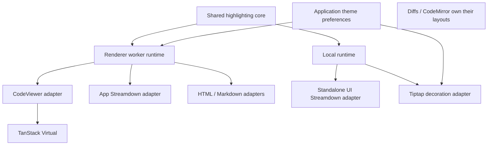

# Agent Note: Highlights migration and highlighting architecture convergence

Status: proposed

English | [中文](2026-10-22-code-highlights-virtualization.zh.md)

## Problem

The original expanded CodeViewer treated its full-height internal scroller as the virtualizer viewport, mounting every row. Highlight requests also materialized the prefix through the last visible line. Replacing the lexer alone could not remove this DOM and token-transfer cost.

This Spec was proposed against a local Highlights migration that fixed CodeViewer's viewport but still duplicated highlighting policy. It preserves AC1–AC7 and adds convergence criteria. The table below records that planning baseline; the user subsequently approved implementation in this workspace. Local verification is recorded below, while the note remains proposed pending the repository review lifecycle.

| Planning-baseline consumer | Execution and state | Remaining duplication or cost |
| --- | --- | --- |
| CodeViewer | Worker, per-caller LiveTokenizer, visible token range | Every range request still carries the complete source; updates and reads are coupled |
| Shared Streamdown preset | Main-thread whole-block tokens, 24-result cache | Own language normalization, theme loading, fallback and cache |
| Tiptap code blocks | Main-thread tokens and decorations, per-editor theme | A changed block causes all code blocks to be highlighted again |
| MCP/meta HTML previews and MCP description | Worker HTML or MarkdownIt rendering | Share transport with viewport work; output is not virtualized |
| Agent diff | `@pierre/diffs` with Highlights selected | Library owns its rendering and engine lifecycle |
| CodeMirror | Its own editing and language system | Independent, intentional boundary |

The planning checkout was HEAD `f84fbb04637efa9a6e924ace4feeb4ab3027b1d1` plus the uncommitted local migration; local implementation and evidence remain uncommitted.

Production code and constraints were checked in `CodeViewer.tsx`, `CodeHighlightService.ts`, `CodeHighlightDocument.ts`, `codeHighlight.worker.ts`, `CodeBlockView.tsx`, the shared Markdown preset/plugin, and the Tiptap highlighting plugin. The local lockfile experiment opened about 1.07 MiB / 31,390 source rows with 50 mounted first-screen rows; these measurements cover FilePreview, not every highlighting consumer.

## Proposal

### 1. Scope and invariants

Converge shared policy and execution mechanics while retaining renderer-specific adapters. Preserve source text, preview theme identifiers, separate CodeMirror preferences, rich-editor persisted node attributes, existing copy actions and unsupported-language plain-text behavior. Retain TanStack Virtual.

This phase does not enable highlighting during chat streaming: `CodeBlockView` currently passes `highlight: false` while streaming. Test incremental capability separately from this product behavior. It does not virtualize ProseMirror or Streamdown's native block renderer, replace CodeMirror/Diffs layout, add semantic language-server highlighting, remove all transitive Shiki packages, or create a general engine-plugin framework.

The authoritative text remains with the consumer. Highlight state is disposable derived data. No document is persisted, shared across windows or placed in DataApi/Preference/Cache merely to support highlighting.

### 2. Verified library constraints

- Highlights 0.2 exposes LiveTokenizer edits, line ranges, flush and disposal. Its deferred mode may return previous tokens until processing finishes. The first convergence phase uses completed tokenization in the worker and returns only the requested lines; it does not expose stale deferred tokens as current results.
- LiveTokenizer has no public theme setter. A theme or language change rebuilds the tokenizer while preserving the consumer's text and session handle. Independently recoloring lexical records would need a supported upstream API; do not read private internals or write a second theme engine.
- Streamdown 2.5's code plugin receives source, language, themes and a callback, but no stable block ID, revision, cancellation token or disposal hook. Treat it as a snapshot consumer, not as an incremental document. Its installed highlighted-body effect also lacks callback invalidation on cleanup; guard that upstream call site before injecting asynchronous worker work.
- ProseMirror owns node positions and transaction mappings. Keep its decoration adapter inside the editor. A shared runtime must not know ProseMirror nodes or assign persisted block IDs.

Library context: [Highlights](https://diffs.com/highlights), [Streamdown code plugins](https://streamdown.ai/docs/plugins/code), and [Tiptap extension API](https://tiptap.dev/docs/editor/extensions/custom-extensions/create-new/extension). Version-specific constraints above come from the installed declarations and source, not an assumption that latest online docs match the lockfile.

### 3. Ownership and dependency direction

Place a headless highlighting core in the existing `packages/ui/src/lib/code-highlight` area and expose the dedicated `@cherrystudio/ui/code-highlight` entry. Both the generic UI plugin and application renderer already depend downward on this package. The core has no React, Electron, Streamdown, ProseMirror, preference or application-service dependencies. Do not re-export its engine implementation from the root UI barrel; the dedicated built entry must work in a Worker without importing UI components or styles. This avoids a new workspace package and preserves the current primitive-layer dependency rule.

| Owner | Responsibilities | Exclusions |
| --- | --- | --- |
| `packages/ui/src/lib/code-highlight` | Language catalog/aliases, theme resolution, Highlights adapter, document session, snapshot cache policy, token/style conversion, escaped code HTML | UI trees, app preferences, Worker creation, Markdown parsing |
| Renderer `CodeHighlightService` and worker | Per-window transport, request ordering, session recovery, deadlines, host logging | Independent language/theme rules or a second tokenizer implementation |
| `CodeStyleProvider` | Resolve app preferences and expose selected themes | Owning or terminating a module-global highlighting worker |
| `useCodeHighlight` / CodeViewer | Session ownership, latest visible request, source fallback, TanStack layout and selection/copy | Engine calls, second result cache or theme fallback tables |
| UI Streamdown adapter | Convert snapshot result to Streamdown's shape and satisfy its compatibility discriminator | Own tokenizer, source cache or application imports |
| Tiptap adapter | Track code nodes, update only changed block sessions, map decorations and dispose removed blocks | Own alias/theme tables, global editor state |
| HTML/Markdown adapters | Turn structured output into existing HTML/Markdown presentation | An additional highlighting engine |

The dedicated entry exposes a small explicit API. Importing its metadata must not initialize WASM or load all themes. Engine loading is lazy. Its public barrel is re-export-only with an enforced no-deep-import boundary; implementation imports stay internal. Contracts remain renderer/library-local, not in `src/shared`, because there is no main-process consumer.



Create executors at their runtime-owner boundary and keep plugin instances stable across React renders; do not instantiate caches or workers inside render functions.

Local and worker execution use the same core implementation. They are not two independent policies. Distinct caches are allowed for distinct owners/realms; mirroring the same result cache in a hook, plugin and service is not.

### 4. Minimal contracts

Separate session mutation from range reads. The following is a wire-shape sketch, not a mandate to export a method for every message. The service can expose a session handle that owns these operations.

```ts
open({ sessionId, revision, code, language, theme })
update({ sessionId, baseRevision, revision, change })
configure({ sessionId, configurationRevision, language, theme })
read({ sessionId, revision, configurationRevision, requestId, range })
close({ sessionId })

highlightSnapshot({ requestId, code, language, theme })
```

`change` is either a batch of edits or an explicit replacement. Edits use zero-based UTF-16 positions and end-exclusive ranges, matching Highlights; reads use half-open line ranges. Preserve source line endings for copying/export and preserve Unicode, trailing whitespace and trailing blank lines. Adapt positions at the renderer boundary rather than silently normalizing the authoritative text.

Each response identifies the worker generation, session, source revision, configuration revision and request ID, plus its actual start line and tokens. Snapshot responses need request identity but no artificial session. Use library-compatible styled tokens and root styles; do not introduce a separate AST or language-server token protocol. Normalize token offsets to line-relative UTF-16 at the core boundary so each adapter does not invent its own conversion.

A settled request is either a current result or an explicit terminal outcome such as superseded, missing session or failure. Cancellation must settle its promise; it must not leave callbacks or timers retained. No caller renders a result for a different source/configuration revision or a closed session.

### 5. Session lifecycle and scheduling

| Event | Required behavior |
| --- | --- |
| Mount / first demand | Create a unique session handle and send the initial source once; show source while initialization runs |
| Scroll | Send only session/revision/range metadata; no source, edits, reset or re-lexing caused by the scroll itself |
| Append | Send only the appended edit against the accepted base revision |
| Replacement | Send one explicit replacement; do not run a speculative generic diff algorithm |
| Rapid updates | Keep mutations ordered; coalesce unsent snapshots into a replacement against the acknowledged revision when necessary |
| Language/theme change | Preserve source revision, advance configuration revision, invalidate old styled results and rebuild through the library's public API |
| Hide / disable | Stop range work and release the lease; do not retain off-screen token arrays indefinitely |
| Unmount / removed code block | Close idempotently; discard late responses and release tokenizer/WASM state |
| Worker crash / timeout | Settle every request affected by that worker generation, display source, and discard its handles |
| Next demand after loss/eviction | Reopen from the consumer's latest source/configuration once, then retry the read once; further failure stays plain text until a later demand |

Keep at most one in-flight read and the latest unsent read per viewer session. Ordered mutations cannot be overtaken by reads, configure or close. Worker generation checks prevent a late response from a terminated worker matching a new request. Request supersession discards work/results; it cannot interrupt an already executing synchronous WASM call.

Start with one lazy worker per renderer window. Yield between jobs so already queued viewport work can be selected before another whole-source HTML/snapshot job; preserve per-session mutation order. Do not add a worker pool before profiling proves this is necessary. A large synchronous job already running can still delay other work; record this limitation rather than claiming preemption.

Keep the existing 30-second failure ceiling initially. The service owns worker lifetime and exposes explicit disposal for window teardown/tests. A CodeStyleProvider unmount must not terminate a shared worker still used by another provider. Use the renderer window's existing lifetime boundary; do not introduce main-process lifecycle/IPC for browser-local resources.

### 6. Cache and resource policy

The worker owns an LRU of at most 50 document sessions, disposing evicted tokenizers. A handle may outlive an evicted worker entry; the missing-session outcome triggers the bounded reopen above. Eviction is not permission to display old tokens. Full-source transfer on explicit reopen is expected and is distinguished from normal scroll queries.

The shared snapshot executor owns the former plugin cache: at most 24 entries, with an additional total retained-source limit of 1,048,576 UTF-16 code units. A result larger than this source budget is returned without retention. This is a practical input-based bound, not a claim of exact token-heap accounting; acceptance includes retained-memory measurement. Document state is not duplicated in this snapshot cache.

Snapshot keys include complete source identity, canonical language, resolved theme selection and tokenizer options. Never key only by length or first/last fragments. Share in-flight identical requests, settle all subscribers, remove failures from pending state and do not cache failure fallbacks as successful highlights. Theme-load promises are cached in the shared resolver; a rejected load is removable so later demand can recover. Rendering adapters keep only the result needed for their current view.

### 7. Common language, theme and failure rules

One catalog owns advertised canonical languages and aliases. It must support synchronous capability checks without eagerly loading WASM. Highlights 0.2 does not expose its full runtime catalog at a public package subpath; keep one explicit compatibility catalog pinned to the installed version and verify advertised entries against `isSupportedLanguage` in package tests. Remove the separate UI list and RichEditor candidate/filter policy after equivalent aliases and special-view choices are accounted for. Mermaid and other non-code special views remain renderer choices, not fake lexers.

One resolver owns single-theme and light/dark theme selections, fallback, white-on-light readability handling and style conversion. The app supplies its existing viewer preferences; the standalone UI preset retains its GitHub light/dark defaults. These are explicit consumer defaults, not separate fallback implementations. CodeMirror continues to read its separate editor settings. Unsupported custom TextMate objects resolve to the documented defaults rather than being interpreted by a new custom theme converter.

CodeStyleProvider exposes both the resolved viewer light/dark pair and the active single selection. AppMarkdown supplies the pair to a stable plugin factory together with the snapshot executor; the worker snapshot request uses that explicit selection rather than implicitly reading whichever single theme is active.

The core produces neutral CSS/style data; application CSS variable substitutions are supplied by the host rather than hardcoding `var(--foreground)` into an app-agnostic core. Streamdown's `name: 'shiki'` and `--shiki-*` variables stay in its adapter. Existing application `.shiki` classes and persisted `codeBlockShiki` attributes remain compatibility details of their renderers.

Unsupported language is a normal plain-text result. Engine/load/transport failures preserve exact source and settle the operation. HTML output escapes text; MarkdownIt keeps HTML disabled. The renderer reports failures through `loggerService`; the standalone UI host receives errors/diagnostics and never logs through `console`. Failure handling and line-length limits belong to the shared executor, with adapters only choosing how plain source is displayed. Retain the 10,000-character tokenization limit for token consumers; qualify HTML behavior against the library's separate API instead of pretending it accepts that option.

### 8. Adapter migration

| Adapter | Target behavior | Completion evidence |
| --- | --- | --- |
| CodeViewer | Own a session lease; send updates only when source changes and read ranges on scroll; keep TanStack and selection/copy logic | Inspect worker messages while scrolling a real lockfile; source payload count stays unchanged |
| Streamdown | `createCodeHighlightPlugin` accepts a snapshot executor; the app injects its worker-backed executor and standalone UI uses the core's lazy local executor | Real Markdown/StreamingMarkdown render correct source and dual-theme styles with both executors |
| Tiptap | Use the core's local document sessions, one per live code block; reuse unchanged block tokens and map decorations through transactions | Editing one block never retokenizes another; insert/delete/move/split/undo keep positions and disposal correct |
| HTML previews | Reuse core code-to-HTML execution through the existing worker; preserve current truncation and output behavior | MCP/meta previews preserve escaping and content; no new engine/cache in their components |
| Markdown description | Keep MarkdownIt in a renderer worker-side adapter and call core code highlighting for fences | Links, typographer behavior and safe HTML defaults remain unchanged |
| Agent diff | Retain the library's Highlights backend and feed resolved supported theme selections | Compare real diff rendering; do not replace library internals to force reuse of a session |
| CodeMirror | Keep its parser, editor viewport and preferences | Existing editing/theme consumer tests remain valid |

Before the Streamdown worker integration, make a narrow change to its existing patch so the highlighted-body effect invalidates asynchronous callbacks on dependency change/unmount and shows current raw text while new tokens are pending. Test out-of-order responses using the real Streamdown component. A factory cannot infer block identity from callback functions; do not emulate cancellation with a global latest-source variable. Propose the fix upstream; publication is a separate authorized action, not part of this local plan.

For Tiptap, first retain local synchronous execution to preserve transaction semantics. Track block sessions using transaction mappings and ephemeral editor-local identity, not new persisted node attributes. Map surviving decorations when positions move; update only changed text/language/configuration; recreate sessions when identity is ambiguous (split/join/replacement). Dispose removed sessions and all sessions on editor destruction. Keep this tracking inside the ProseMirror adapter. Highlight-only metadata transactions stay out of undo history and do not modify persisted nodes or trigger document autosave; theme changes must not recreate the editor or lose selection. If very large editable blocks still cause measurable input stalls, propose asynchronous decoration work separately with an explicit stale-position contract; the current plan does not claim large-editor latency is solved by the worker used for previews.

### 9. File ownership and deletion plan

| Current location | Planned destination or action |
| --- | --- |
| `src/renderer/utils/codeHighlight.ts` | Move engine-independent normalization/theme/style policy into `packages/ui/src/lib/code-highlight`; retain only app preference/CSS adaptation in renderer |
| `src/renderer/workers/CodeHighlightDocument.ts` | Move the reusable session implementation into the core; worker becomes a transport host |
| `src/renderer/types/codeHighlight.ts` | Consume core result/session contracts; keep worker-only envelopes beside renderer transport |
| UI `plugins/code-highlight.ts` | Retain factory and Streamdown shape conversion; remove direct engine import, language table and private cache |
| `CodeHighlightService.ts` / `codeHighlight.worker.ts` | Split update/read messages, own window-level lifecycle, recovery and ordering |
| `CodeStyleProvider.tsx` / `useCodeHighlight.ts` | Theme selection and consumer session adapter respectively; remove provider-owned global disposal and full-source range messages |
| Tiptap `highlightPlugin.ts` | Keep decorations and transaction mapping; remove direct engine/theme-policy implementation and all-block recomputation |
| Existing Shiki service/tokenizer/worker | Remain removed; no second fallback engine |

The core contains a small set of policy, session, snapshot and HTML modules, not a generic backend registry or a directory per method. Add only entry points required by the two consumers and lazy loading. UI subpath exports, build entries, renderer aliases, bundle boundaries and dependency declarations must be updated together; reuse the existing UI test project. Check existing patches before dependency work; this plan does not upgrade library versions.

### 10. Delivery sequence

The steps below are reviewable implementation slices, not instructions to rename this workspace branch or publish a PR during planning.

| Step | Deliverable | Verification before proceeding | AC coverage |
| --- | --- | --- | --- |
| P0 | Complete this proposed bilingual Spec, record current source/runtime baseline and settle ownership | Docs gates; no claim of runtime acceptance for the proposed design | Define AC1–AC16 |
| P1 | Shared core and subpath export, lightweight catalog, theme resolver, token/HTML contracts and lazy local executor; migrate existing helpers | Core tests for aliases, Unicode, styles, fallback and exact-source cache identity; UI build boundary | AC1, AC5, AC8, AC10, AC14 |
| P2 | Session worker protocol, service-owned lifecycle and CodeViewer migration | Explicit update/read ordering, stale results, timeout/crash/eviction/reopen tests; real lockfile scroll transport trace | AC2–AC4, AC7, AC9, AC11, AC15 |
| P3 | Streamdown upstream callback guard and injected snapshot executor; remove plugin-local policy/cache | Real-component delayed/out-of-order/unmount tests, standalone UI and Electron Markdown checks | AC6, AC8, AC10, AC12, AC14 |
| P4 | Per-code-block Tiptap sessions and decoration mapping | Real editor transactions for editing, insert/delete/move/split/join, undo/redo, composition and destruction | AC1, AC3, AC5, AC13, AC14 |
| P5 | HTML/Markdown and diff integration audit, remove superseded implementation, publish final evidence | Targeted consumer tests, renderer/UI builds, dependency scan, Electron performance matrix and docs gates | AC1–AC16 cumulative evidence |

Keep the existing migration functional throughout; each slice removes the duplication it replaces. No permanent dual execution or hidden Shiki fallback. A failing new path degrades to current plain-source behavior, not the obsolete engine. If P4 requires a larger editor behavior change, stop that slice for a revised Spec rather than silently weakening the acceptance criteria.

### 11. Validation plan

| Area | Contract or regression to prove |
| --- | --- |
| Shared core | One alias/default policy; UTF-16 offsets; CRLF/Unicode/trailing lines; supported and unsupported languages; single/dual themes; no eager WASM from metadata imports |
| Session transport | Scroll sends no source; append sends only delta; mismatched base revision cannot mutate the wrong document; response revision/configuration matches; late closed-session results are ignored |
| Resource/failure | At most one window worker; provider unmount does not kill another consumer; LRU disposal/reopen; every timeout/crash/supersession settles; failed snapshots do not poison the success cache |
| Streamdown | Source changes before initialization, out-of-order completions, same-length middle edits, multiple concurrent blocks, unmount, dual-theme CSS and standalone bundle |
| Tiptap | Real document edits preserve text, selection, IME and undo/redo; unrelated blocks are not retokenized; decorations track mapped positions; sessions release on deletion/destruction |
| Production consumers | CodeViewer/FilePreview, chat code views, MCP/meta HTML, MCP description, RichEditor and AgentFileDiffView |

Use explicit test file paths only. Existing candidates include `CodeViewer.test.tsx`, `useCodeHighlight.test.ts`, `CodeHighlightService.test.ts`, `CodeHighlightDocument.test.ts`, UI `code-highlight.test.ts`/`markdown.test.tsx`/`streaming-markdown.test.tsx`, RichEditor `codeHighlight.test.ts`/`codeBlockLanguage.test.tsx`/`nativeMarkdown.test.ts`, `CodeBlockView.test.tsx`, and `AgentFileDiffView.test.tsx`. Add contract tests beside the new core/changed adapters and include affected existing consumers; do not substitute a full local suite.

Electron performance runs use the verified isolated instance and actual file-preview route. Record fixture bytes/line count/hash, viewport, theme, build mode, cold/warm state and hardware. Run five warmed samples before and after each performance-sensitive slice; compare medians with the same inputs. The lockfile acceptance target is fewer than 100 mounted rows in the recorded approximately 550 px viewport, final-line visibility at normal and narrow widths, no source payload on scroll, and warmed jump-to-end median at most 500 ms and at most 20% above the paired baseline. Treat a missed budget as a failed target requiring investigation, not as a cross-platform guarantee.

Also exercise 10,000 lines with an offset before the viewer, a 50,000-character single line, Unicode/multiline comments, theme changes during requests, and rapid append/replacement. Record main-thread long tasks, heap after repeated mount/unmount and worker/session/cache counts. Current snapshots are historical local evidence only; neither current UI-plugin performance nor packaged/Windows/Linux acceptance can be inferred from the lockfile result.

## Workspace verification

The approved implementation was exercised on macOS arm64 / Apple M5 using an isolated Electron development profile. The shared core also preserves CRLF and standalone CR when adapting engine line boundaries to LF-delimited viewer ranges. The HTML/Markdown routes retain their existing escaped-source failure behavior.

Pointer selection keeps an immutable source anchor and a moving source focus for each held-button gesture. The manager captures selection changes without debounce during the gesture, then freezes the final logical range on release; a new selection, cancellation, focus loss during dragging or source replacement invalidates that gesture. DOM eviction and Chromium reanchoring cannot redefine its source anchor. Copy slices the original source, including partial-line offsets and reverse drags, without retaining additional rows. The viewer enables text selection itself so standalone file previews do not inherit the application shell's disabled selection. Local native Electron checks cover forward and backward dragging, crossing the original anchor, internal and outer scrolling, wrapping, keyboard scrolling after release and immediate reselection. The real FilePreview route opened the 1,126,144-byte lockfile and copied all 196 selected source lines after anchor eviction with 67 mounted rows and no renderer errors.

Secondary presses inside the owning viewer checkpoint the native selection boundaries before browser defaults run. The manager reconciles them on selection changes, pointer release and before copy: unchanged boundaries preserve the full source range, while a changed range releases the frozen gesture and imports the new selection. Presses outside the owner still invalidate retained source state. Copy performs this check synchronously, including when the debounced selection notification has not arrived. The checkpoint stores node/offset values rather than a live Range. Native macOS Electron checks preserve all 30 source lines after right-clicking an unchanged truncated selection, accept a new word selection, invalidate detached source ownership on an outside click, and preserve all 196 selected lines in the real lockfile FilePreview route.

Image capture materializes CodeViewer rows from an authoritative source snapshot only for the explicit capture. The capture pipeline awaits full-range highlighting and the React layout commit before measuring or cloning, then awaits restoration of the virtualized view on success or failure. Capture highlighting uses a separate, released session so viewport work cannot replace its result. Normal viewing remains virtualized; capture temporarily pays the full-document DOM cost and retains the existing image-dimension limit. Local regression checks cover complete source including trailing blank lines, offscreen highlighting, rasterization failure and partial preparation failure. A macOS Electron capture included all 120 highlighted lines in a 1748 × 5066 PNG and restored the original 43 mounted rows; the offscreen Blob path also included all 120 lines.

| Area | Local evidence |
| --- | --- |
| Shared core and Streamdown | 72 tests across seven UI/core files; includes lazy metadata, cache limits and retry, mixed line endings, real-component stale callbacks, and streaming Markdown |
| Renderer consumers | 136 tests across 18 explicit files; includes worker ordering/eviction, source-free reads, stale revisions, per-block editor sessions, selection/history, viewer and chat consumers |
| Electron | Actual lockfile preview; 10,000-line wrapped/unwrapped viewers and copy; 50,000-character line; independent provider unmount; worker crash/recovery and eviction/reopen; standalone and worker-backed Markdown; chat streaming completion; diff; real editor IME, undo/redo, theme and selection |
| Performance | 1,126,144-byte / 31,390-line lockfile, 549 px viewport; 50 top rows, 57 end rows, 47 narrow-width rows. Five warmed end-jump samples: median 363 ms, no observed long tasks. Reconstructed previous full-source transport baseline: 337 ms; ratio 1.079, within both approved budgets |
| Resources | Five 10,000-line mount/unmount cycles retained one worker. After first warm-up, DOM nodes stayed at 903 and listeners at 521; renderer heap after diagnostic GC ranged from 106.84 to 107.03 MB. This does not measure worker WASM memory |
| Build boundary | Renderer and UI builds, web typecheck, and actual ESM/CJS subpath imports on the pinned Node runtime; metadata imports succeeded with engine/React/CSS imports forbidden |

Temporary scripts, raw measurements and screenshots remain in the ignored workspace context. These are local development checks, not packaged-app, Windows/Linux, remote CI or production performance acceptance. The performance comparison isolates the session-transport change; it is not a fresh whole-migration Shiki comparison. Tiptap still executes synchronous highlighting locally, so an exceptionally large editable code block remains a separate latency risk.

## Alternatives considered

- Retain Shiki for unsupported languages: duplicates loading and failure paths for languages outside the requested compatibility scope.
- Replace Shiki without fixing virtualization: expanded documents still create all DOM rows.
- Highlight each visible slice independently: loses multiline lexical state at viewport boundaries.
- Fall back to synchronous highlighting after worker failure: moves expensive preview work onto the UI thread.
- Switch to Virtua: it supports dynamic sizes, but TanStack already supplies the needed outer-scroll and measured-row primitives.
- Create a separate workspace package now: it adds distribution and primitive-layer dependency changes; the existing UI package can expose a headless subpath without them.
- Put every consumer behind one global worker: couples editor transactions and standalone UI to application lifetime and promises cancellation that the upstream interfaces do not provide.
- Import the renderer service from `packages/ui`: violates the existing downward dependency boundary.
- Put browser-only mutable state in `src/shared`: introduces a cross-process ownership fiction and mutable shared runtime.
- Build a custom lexical-token/theme pipeline to avoid theme-change re-tokenization: exceeds the public Highlights API and duplicates upstream implementation.
- Keep full-source range requests: simpler transport, but repeats document serialization and string comparison on every scroll; sessions have a concrete large-file consumer.

## Acceptance criteria

- AC1 — Unsupported languages, Unicode, trailing whitespace and blank lines preserve their source text. (verification: unit and renderer)
- AC2 — Expanded and collapsed 10,000-line viewers mount fewer than 100 rows in a bounded viewport and can display the last line, including with wrapping and a preceding content offset. (verification: renderer and Electron)
- AC3 — Streaming append, replacement, theme changes and disabled highlighting cannot display obsolete tokens. (verification: unit, renderer and Electron)
- AC4 — Worker crash or timeout preserves visible text, escapes HTML fallback and allows subsequent highlighting to recover. (verification: unit)
- AC5 — Existing editor theme selection, rich-editor language round trips, agent diff rendering and Markdown descriptions remain usable with the new backend. (verification: renderer and Electron)
- AC6 — The shared Markdown preset uses Highlights, preserves source through concurrent streaming updates and same-length middle edits, and supplies both light and dark styles. (verification: unit and Electron)
- AC7 — The actual `pnpm-lock.yaml` opens through FilePreview, mounts fewer than 100 rows and reaches the last line at full and narrow widths. (verification: Electron)
- AC8 — Renderer and standalone UI consume one language/theme/fallback policy without upward imports; metadata imports do not initialize WASM and the built UI artifact resolves its dependencies. (verification: unit and packaged artifact)
- AC9 — Normal scroll requests contain no source; append updates carry only the delta; mismatched, superseded or closed-session responses cannot replace current content. (verification: unit and Electron)
- AC10 — Identical snapshots share work, middle edits never collide, retained caches meet the documented bounds, and failure fallbacks do not prevent later successful highlighting. (verification: unit)
- AC11 — Unmounting one provider does not break another consumer; every closed/evicted session is disposed and a worker restart settles requests and permits one bounded reopen. (verification: unit and renderer)
- AC12 — Streamdown ignores late callbacks after source/theme changes or unmount, including when using the injected worker executor. (verification: renderer and Electron)
- AC13 — Editing one Tiptap code block does not retokenize unrelated blocks; mapped decorations, selection, composition, undo/redo and disposal remain correct. (verification: renderer and Electron)
- AC14 — Viewer, UI and editor adapters contain no independent alias/fallback/cache implementation or direct Highlights engine invocation; Diffs' delegated backend and CodeMirror remain explicit exceptions. (verification: unit and docs gate)
- AC15 — The five-sample warmed lockfile jump-to-end median meets both the 500 ms and paired-baseline budgets; long tasks and retained heap are reported with fixture and environment metadata. (verification: Electron)
- AC16 — Chat retains its existing plain-source behavior during streaming and highlights after completion; no new persisted preferences or rich-editor attributes are introduced. (verification: renderer and Electron)

## Risks

Highlights has fewer lexers and different token boundaries from TextMate, so theme appearance can differ. Theme changes still rebuild tokenizer state with the pinned API. Virtualized text limits browser-native operations to mounted rows; whole-code copy must continue using authoritative source. Very long individual lines keep all text but skip fine-grained token styling at the configured limit.

Per-block Tiptap sessions reduce unrelated work but do not guarantee responsiveness for a single enormous editable block. Snapshot consumers still request whole-block tokens, and moving them to a worker does not virtualize their DOM. One worker cannot preempt a large synchronous job already running. Cache count/source budgets do not precisely bound WASM or token heap; the performance evidence must include retained resources.

A new UI subpath adds a build boundary that must remain headless and lazy; test both source-mode aliases and built output. Raw borrowed WASM buffers must be copied/decoded before later calls invalidate them. Streamdown remains tied to its installed plugin types and compatibility discriminator; upstream changes require adapter tests rather than casts that hide incompatibility.

The user authorized this workspace implementation. The verification section records completed local checks; it does not claim that a Spec PR or implementation PR has been reviewed, merged or shipped.
