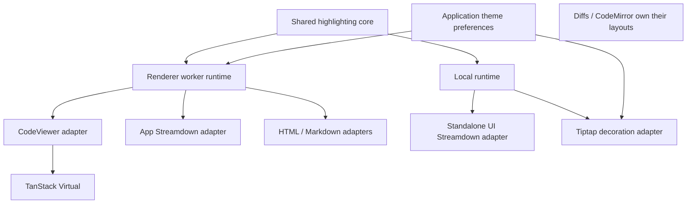

# Agent Note: Highlights 迁移与高亮架构收敛

Status: proposed

[English](2026-10-22-code-highlights-virtualization.md) | 中文

## 问题

原来的 CodeViewer 在展开时，将撑满全文高度的内部滚动容器当作虚拟列表视口，导致挂载所有行。高亮请求还会生成从首行到最后一个可见行的全部 token。只替换词法分析器无法消除这些 DOM 和 token 传输开销。

本 Spec 提出时，本地 Highlights 迁移已修复 CodeViewer 的视口，但高亮策略仍有重复。本文保留 AC1–AC7 并补充收敛标准。下表记录规划时的基线；用户随后批准了本工作区的实现。已完成的本地验证记录于下文，文档状态仍为 proposed，等待仓库评审流程。

| 规划基线调用方 | 执行与状态 | 仍存在的重复或成本 |
| --- | --- | --- |
| CodeViewer | Worker、按调用方保存 LiveTokenizer、返回可见 token 范围 | 每次范围请求仍携带完整源文本；更新和读取耦合 |
| 共享 Streamdown 预设 | 主线程整块生成 token、24 项结果缓存 | 独立维护语言归一化、主题加载、回退和缓存 |
| Tiptap 代码块 | 主线程生成 token 和 decorations、各编辑器保存主题 | 一个代码块变化会导致所有代码块重新高亮 |
| MCP/meta HTML 预览与 MCP 描述 | Worker 内生成 HTML 或运行 MarkdownIt | 与视口请求共享传输通道；输出没有虚拟化 |
| 智能体 diff | `@pierre/diffs` 选择 Highlights 后端 | 库拥有渲染和引擎生命周期 |
| CodeMirror | 自身的编辑与语言系统 | 有意保留的独立边界 |

规划基线为 HEAD `f84fbb04637efa9a6e924ace4feeb4ab3027b1d1` 加上尚未提交的本地迁移；本地实现及验证记录仍未提交。

已核对的生产代码与约束来自 `CodeViewer.tsx`、`CodeHighlightService.ts`、`CodeHighlightDocument.ts`、`codeHighlight.worker.ts`、`CodeBlockView.tsx`、共享 Markdown 预设/插件，以及 Tiptap 高亮插件。本地锁文件实验打开了约 1.07 MiB、31,390 行源文本，首屏挂载 50 行；这些测量覆盖 FilePreview，不代表所有高亮调用方。

## 提案

### 1. 范围与不变量

收敛公共策略和执行机制，保留渲染器专属适配。保留源文本、预览主题标识、独立的 CodeMirror 偏好设置、富文本编辑器持久化节点属性、现有复制操作，以及不支持语言时显示纯文本的行为。继续使用 TanStack Virtual。

本阶段不启用聊天流式期间的高亮：`CodeBlockView` 当前在流式期间传入 `highlight: false`。增量能力与这项产品行为分别测试。本阶段不虚拟化 ProseMirror 或 Streamdown 原生代码块渲染器，不替换 CodeMirror/Diffs 布局，不增加语言服务器语义高亮，不移除所有间接 Shiki 包，也不建立通用引擎插件框架。

权威文本仍由调用方拥有。高亮状态是可丢弃的派生数据。不为高亮持久化文档、跨窗口共享文档，或将文档放入 DataApi/Preference/Cache。

### 2. 已核实的库约束

- Highlights 0.2 提供 LiveTokenizer 编辑、行范围、flush 和释放接口。其延迟处理模式在完成前可能返回旧 token。首轮收敛在 Worker 中完成分词后仅返回所需行，不将旧的延迟 token 当作当前结果暴露。
- LiveTokenizer 没有公开的主题设置接口。语言或主题变化时，保留调用方文本和会话句柄，重建 tokenizer。若要独立为词法记录重新着色，需要上游提供受支持的 API；不读取私有实现，也不另写主题引擎。
- Streamdown 2.5 的代码插件收到源文本、语言、主题和回调，但没有稳定的代码块 ID、版本、取消令牌或释放钩子。将其视为快照调用方，不当作增量文档。已安装版本的 highlighted-body effect 在清理时也没有使回调失效；注入异步 Worker 工作前先保护这个上游调用点。
- ProseMirror 拥有节点位置和事务映射。装饰适配器保留在编辑器内部。公共运行时不应理解 ProseMirror 节点，也不应分配持久化代码块 ID。

库背景资料：[Highlights](https://diffs.com/highlights)、[Streamdown 代码插件](https://streamdown.ai/docs/plugins/code)、[Tiptap 扩展 API](https://tiptap.dev/docs/editor/extensions/custom-extensions/create-new/extension)。上述版本约束来自已安装的声明和源码，不假定最新在线文档与锁文件一致。

### 3. 职责归属与依赖方向

在已有 `packages/ui/src/lib/code-highlight` 中放置无界面的高亮核心，通过独立入口 `@cherrystudio/ui/code-highlight` 暴露。通用 UI 插件和应用 renderer 已经向下依赖该包。核心不依赖 React、Electron、Streamdown、ProseMirror、偏好设置或应用服务。不要从 UI 根 barrel 再导出引擎实现；独立构建入口必须能在 Worker 中使用，不导入 UI 组件或样式。这样无需新增 workspace 包，并保持现有基础层依赖规则。

| 所有者 | 职责 | 不包含 |
| --- | --- | --- |
| `packages/ui/src/lib/code-highlight` | 语言目录/别名、主题解析、Highlights 适配、文档会话、快照缓存策略、token/样式转换、转义的代码 HTML | UI 树、应用偏好设置、创建 Worker、解析 Markdown |
| Renderer `CodeHighlightService` 和 worker | 每窗口传输、请求顺序、会话恢复、超时、宿主日志 | 独立语言/主题规则或第二份 tokenizer 实现 |
| `CodeStyleProvider` | 解析应用偏好设置并暴露选定主题 | 拥有或终止模块级全局高亮 Worker |
| `useCodeHighlight` / CodeViewer | 会话所有权、最新可见范围请求、源文本回退、TanStack 布局和选择/复制 | 引擎调用、第二层结果缓存或主题回退表 |
| UI Streamdown 适配器 | 将快照结果转换为 Streamdown 结构，满足其兼容判别字段 | 自有 tokenizer、源文本缓存或应用层导入 |
| Tiptap 适配器 | 跟踪代码节点、只更新变化的代码块会话、映射 decorations、释放已删除块 | 自有别名/主题表、全局编辑器状态 |
| HTML/Markdown 适配器 | 将结构化输出转为现有 HTML/Markdown 展示 | 额外的高亮引擎 |

独立入口只暴露小范围明确 API。导入元数据不得初始化 WASM 或加载全部主题。引擎按需加载。公共 barrel 只做重新导出，并以规则禁止外部深层导入；实现导入留在内部。契约保留在 renderer/库的范围内，不放进 `src/shared`，因为没有主进程调用方。



在运行时所有者边界创建执行器，React 重渲染时保持插件实例稳定；不在 render 函数中创建缓存或 Worker。

本地执行和 Worker 执行使用同一份核心实现，不是两套独立策略。不同所有者/运行环境可以各自拥有缓存；不允许在 hook、插件和服务中镜像同一份结果缓存。

### 4. 最小契约

将会话修改与范围读取分离。下面是消息结构示意，不要求每种消息都导出一个方法。服务可以提供拥有这些操作的会话句柄。

```ts
open({ sessionId, revision, code, language, theme })
update({ sessionId, baseRevision, revision, change })
configure({ sessionId, configurationRevision, language, theme })
read({ sessionId, revision, configurationRevision, requestId, range })
close({ sessionId })

highlightSnapshot({ requestId, code, language, theme })
```

`change` 为一批编辑或明确的全文替换。编辑使用从零开始的 UTF-16 位置和不包含终点的范围，与 Highlights 一致；读取使用半开行范围。复制/导出保留源文本的行结束符，同时保留 Unicode、行尾空白和末尾空行。在 renderer 边界适配位置，不暗中归一化权威文本。

每个响应标明 Worker 代次、会话、源文本版本、配置版本和请求 ID，并附上实际起始行和 tokens。快照响应需要请求身份，不需要伪造会话。使用与库兼容的带样式 tokens 和根样式，不引入额外 AST 或语言服务器 token 协议。在核心边界将 token 偏移统一为行内 UTF-16 偏移，避免各适配器自行转换。

已结束的请求必须给出当前结果，或明确的终态，例如被取代、会话缺失或失败。取消必须完成对应 Promise，不能留下回调或计时器。任何调用方都不得渲染属于其他源文本/配置版本或已关闭会话的结果。

### 5. 会话生命周期与调度

| 事件 | 必须满足的行为 |
| --- | --- |
| 挂载 / 首次需要 | 创建唯一会话句柄，只发送一次初始源文本；初始化期间显示源文本 |
| 滚动 | 只发送会话/版本/范围元数据；滚动本身不携带源文本、编辑或重置，不触发重新分词 |
| 追加 | 仅发送基于已接受版本的追加编辑 |
| 替换 | 发送一次明确替换；不运行推测性的通用 diff 算法 |
| 快速更新 | 保持修改有序；必要时将未发送快照合并为基于已确认版本的一次替换 |
| 语言/主题变化 | 保持源文本版本，递增配置版本，使旧样式结果失效，并通过库公开 API 重建 |
| 隐藏 / 禁用 | 停止范围任务并释放会话租约；不无限保留离屏 token 数组 |
| 卸载 / 删除代码块 | 幂等关闭；丢弃迟到响应，释放 tokenizer/WASM 状态 |
| Worker 崩溃 / 超时 | 完成该 Worker 代次涉及的所有请求，显示源文本，并使其句柄失效 |
| 丢失/淘汰后的下次需要 | 使用调用方最新源文本/配置重开一次，再重试读取一次；仍失败则保持纯文本，直到后续新的请求 |

每个预览会话最多保留一个执行中的读取和最新一个未发送读取。读取、配置和关闭不得越过有序修改。Worker 代次校验防止已终止 Worker 的迟到响应匹配新请求。请求被取代意味着丢弃工作/结果，不能中断已经执行中的同步 WASM 调用。

初期每个 renderer 窗口使用一个按需创建的 Worker。任务之间让出执行机会，使已经排队的视口任务可在下一个全文 HTML/快照任务前被选择，同时保持每个会话的修改顺序。没有性能证据前不增加 Worker 池。正在执行的大型同步任务仍可能阻塞其他工作；明确记录这项限制，不宣称可抢占执行。

初期保留现有 30 秒故障上限。服务拥有 Worker 生命周期，为窗口销毁/测试提供明确释放入口。卸载一个 CodeStyleProvider 不得终止仍被其他 provider 使用的共享 Worker。沿用 renderer 窗口已有生命周期边界，不为浏览器本地资源引入主进程生命周期/IPC。

### 6. 缓存与资源策略

Worker 拥有最多 50 个文档会话的 LRU，淘汰时释放 tokenizer。句柄可能比 Worker 中被淘汰的条目活得更久；会话缺失结果触发上面的有限重开流程。淘汰不允许显示旧 tokens。明确重开时传输全文是预期行为，要与正常滚动查询区分。

公共快照执行器接管原插件缓存：最多 24 项，额外限制保留源文本总量不超过 1,048,576 个 UTF-16 代码单元。单项超过该源文本预算时返回结果但不缓存。这是实用的输入规模限制，不是精确的 token 堆内存核算；验收包含保留内存测量。文档状态不再复制进该快照缓存。

快照键包含完整源文本身份、规范语言、解析后的主题选择和 tokenizer 选项。不得只按长度或首尾片段生成键。相同的进行中请求共享计算，完成所有订阅方，失败时清理 pending 状态，不将失败回退作为成功高亮缓存。公共解析器缓存主题加载 Promise；失败的加载可移除，使后续请求能够恢复。渲染适配器只保存当前视图需要的结果。

### 7. 公共语言、主题与故障规则

由一份目录负责对外声明的规范语言和别名。必须能同步检查能力，且不提前加载 WASM。Highlights 0.2 没有通过公开包子路径暴露完整运行时目录；保留一份与已安装版本绑定的明确兼容目录，并在包测试中通过 `isSupportedLanguage` 校验声明的条目。确认别名和特殊视图选项等价后，删除独立 UI 列表和 RichEditor 候选/筛选策略。Mermaid 等非代码特殊视图仍由 renderer 决定，不伪装成词法分析器。

由一个解析器负责单主题和亮暗双主题选择、回退、浅色背景上白字的可读性处理，以及样式转换。应用传入既有预览偏好设置；独立 UI 预设保留 GitHub 亮暗默认主题。这些是明确的调用方默认值，不是两套回退实现。CodeMirror 继续读取独立的编辑器设置。不支持的自定义 TextMate 对象使用约定默认值，不另建自定义主题转换器。

CodeStyleProvider 同时暴露解析后的预览亮暗主题对和当前单主题选择。AppMarkdown 将主题对和快照执行器一起传给稳定的插件工厂；Worker 快照请求使用这份明确选择，不隐式读取当时生效的单主题。

核心产生中立的 CSS/样式数据；应用 CSS 变量替换由宿主传入，不将 `var(--foreground)` 写死在无应用依赖的核心中。Streamdown 的 `name: 'shiki'` 和 `--shiki-*` 变量留在其适配器内。应用已有 `.shiki` 类及持久化的 `codeBlockShiki` 属性继续作为各渲染器的兼容细节保留。

不支持的语言是正常的纯文本结果。引擎/加载/传输故障保留准确源文本并完成操作。HTML 输出转义文本，MarkdownIt 保持禁用 HTML。Renderer 通过 `loggerService` 报告故障；独立 UI 宿主接收错误/诊断信息，不通过 `console` 日志输出。故障处理和行长限制归公共执行器，适配器只决定如何显示纯文本。Token 调用方保留 10,000 字符的分词上限；HTML 行为按库的独立 API 验证，不假称它也接受此选项。

### 8. 适配器迁移

| 适配器 | 目标行为 | 完成证据 |
| --- | --- | --- |
| CodeViewer | 拥有会话租约；源文本变化才发送更新，滚动只读范围；保留 TanStack 和选择/复制逻辑 | 滚动真实锁文件时检查 Worker 消息；源文本载荷次数不增长 |
| Streamdown | `createCodeHighlightPlugin` 接受快照执行器；应用注入 Worker 执行器，独立 UI 使用核心的延迟加载本地执行器 | 真实 Markdown/StreamingMarkdown 在两种执行器下均正确显示源文本和双主题样式 |
| Tiptap | 使用核心本地文档会话，每个存活代码块一个；复用未变代码块 tokens，通过事务映射 decorations | 编辑一块不重新分词其他块；插入/删除/移动/拆分/撤销后位置与释放正确 |
| HTML 预览 | 经现有 Worker 复用核心代码转 HTML 能力；保留当前截断和输出行为 | MCP/meta 预览保留转义与内容；组件中没有新引擎/缓存 |
| Markdown 描述 | MarkdownIt 保留在 renderer Worker 侧适配器内，围栏代码调用核心高亮 | 链接、typographer 行为和安全 HTML 默认值保持不变 |
| 智能体 diff | 保留库的 Highlights 后端，传入解析后的受支持主题选择 | 对照真实 diff 渲染；不为强制复用会话替换库内部实现 |
| CodeMirror | 保留其解析器、编辑器视口和偏好设置 | 既有编辑/主题调用方测试仍成立 |

接入 Streamdown Worker 前，对已有补丁做窄范围修改：highlighted-body effect 在依赖变化/卸载时使异步回调失效，并在新 tokens 等待期间显示当前原始文本。通过真实 Streamdown 组件测试乱序响应。工厂无法从回调函数推断代码块身份；不要用全局“最新源文本”变量模拟取消。向上游提出修复，但发布属于另行授权的动作，不是本地规划的一部分。

Tiptap 第一阶段保留本地同步执行，维持事务语义。通过事务映射和编辑器内部临时身份跟踪代码块会话，不增加持久化节点属性。位置移动时映射仍存在的 decorations；只更新变化的文本/语言/配置；身份无法明确对应时重建会话，例如拆分、合并、替换。删除时释放对应会话，编辑器销毁时释放全部会话。跟踪逻辑留在 ProseMirror 适配器内。仅更新高亮的元数据事务不进入撤销历史，不修改持久化节点，也不触发文档自动保存；主题变化不得重建编辑器或丢失选择。如果超大可编辑代码块仍有可测量的输入停顿，再单独提出异步 decorations 方案并明确旧位置结果的处理契约；本方案不以预览 Worker 证明大编辑器的延迟已经解决。

### 9. 文件归属与删除计划

| 当前位置 | 计划目标或处理 |
| --- | --- |
| `src/renderer/utils/codeHighlight.ts` | 将与引擎调用方无关的归一化/主题/样式策略移入 `packages/ui/src/lib/code-highlight`；renderer 只保留应用偏好/CSS 适配 |
| `src/renderer/workers/CodeHighlightDocument.ts` | 可复用会话实现移入核心；worker 成为传输宿主 |
| `src/renderer/types/codeHighlight.ts` | 使用核心结果/会话契约；Worker 专属消息封套留在 renderer 传输附近 |
| UI `plugins/code-highlight.ts` | 保留工厂和 Streamdown 结构转换；移除直接引擎导入、语言表和私有缓存 |
| `CodeHighlightService.ts` / `codeHighlight.worker.ts` | 分离更新/读取消息，负责窗口级生命周期、恢复和顺序 |
| `CodeStyleProvider.tsx` / `useCodeHighlight.ts` | 分别负责主题选择和调用方会话适配；移除 provider 对全局 Worker 的释放和携带全文的范围消息 |
| Tiptap `highlightPlugin.ts` | 保留 decorations 和事务映射；移除直接引擎/主题策略实现及全代码块重算 |
| 旧 Shiki service/tokenizer/worker | 保持删除，不引入第二个回退引擎 |

核心由少量策略、会话、快照和 HTML 模块组成，不建立通用后端注册表，也不为每个方法创建目录。只增加两个调用方和延迟加载实际需要的入口。UI 子路径导出、构建入口、renderer 别名、打包边界和依赖声明必须同步更新，复用已有 UI 测试项目。依赖工作前检查已有补丁；本计划不升级库版本。

### 10. 交付顺序

以下步骤是可独立评审的实现切片，不代表规划阶段要重命名当前工作区分支或发布 PR。

| 步骤 | 交付物 | 继续前的验证 | AC 覆盖 |
| --- | --- | --- | --- |
| P0 | 完成本双语 proposed Spec，记录当前源码/运行基线，明确归属 | 文档检查；不将提案宣称为已通过运行验收 | 定义 AC1–AC16 |
| P1 | 公共核心和子路径导出、轻量语言目录、主题解析器、token/HTML 契约及延迟加载本地执行器；迁移既有工具 | 核心测试覆盖别名、Unicode、样式、回退、完整源文本缓存身份；验证 UI 构建边界 | AC1, AC5, AC8, AC10, AC14 |
| P2 | 会话 Worker 协议、服务拥有生命周期、迁移 CodeViewer | 更新/读取顺序、旧结果、超时/崩溃/淘汰/重开测试；真实锁文件滚动传输记录 | AC2–AC4, AC7, AC9, AC11, AC15 |
| P3 | Streamdown 上游回调保护和注入式快照执行器；删除插件私有策略/缓存 | 真实组件延迟/乱序/卸载测试，独立 UI 和 Electron Markdown 检查 | AC6, AC8, AC10, AC12, AC14 |
| P4 | Tiptap 按代码块保存会话和映射 decorations | 真实编辑器事务覆盖编辑、插入/删除/移动/拆分/合并、撤销/重做、输入法组合输入和销毁 | AC1, AC3, AC5, AC13, AC14 |
| P5 | 审核 HTML/Markdown 与 diff 集成，删除被替代实现，整理最终证据 | 定向调用方测试、renderer/UI 构建、依赖扫描、Electron 性能矩阵与文档检查 | AC1–AC16 累计证据 |

迁移期间保持当前实现可用，每个切片删除其替代的重复逻辑。不长期保留双重执行或隐藏 Shiki 回退。新路径失败时退回当前纯源文本行为，不退回旧引擎。如果 P4 需要更大范围的编辑器行为变化，暂停该切片并修订 Spec，不暗中降低验收标准。

### 11. 验证计划

| 范围 | 要证明的契约或回归 |
| --- | --- |
| 公共核心 | 一份别名/默认值策略；UTF-16 偏移；CRLF/Unicode/末尾空行；支持和不支持的语言；单/双主题；元数据导入不提前加载 WASM |
| 会话传输 | 滚动不发送源文本；追加只传增量；基版本不匹配不得修改错误文档；响应版本/配置匹配；忽略已关闭会话的迟到结果 |
| 资源/故障 | 每窗口最多一个 Worker；卸载 provider 不杀死其他调用方；LRU 释放/重开；超时/崩溃/被取代请求均完成；失败快照不污染成功缓存 |
| Streamdown | 初始化前源文本变化、乱序完成、等长中间编辑、多个并发代码块、卸载、双主题 CSS 和独立打包 |
| Tiptap | 真实文档编辑保留文本、选择、IME 和撤销/重做；不重新分词无关代码块；decorations 跟随映射位置；删除/销毁释放会话 |
| 生产调用方 | CodeViewer/FilePreview、聊天代码视图、MCP/meta HTML、MCP 描述、RichEditor 和 AgentFileDiffView |

只运行明确测试文件路径。现有候选包括 `CodeViewer.test.tsx`、`useCodeHighlight.test.ts`、`CodeHighlightService.test.ts`、`CodeHighlightDocument.test.ts`、UI 的 `code-highlight.test.ts`/`markdown.test.tsx`/`streaming-markdown.test.tsx`、RichEditor 的 `codeHighlight.test.ts`/`codeBlockLanguage.test.tsx`/`nativeMarkdown.test.ts`，以及 `CodeBlockView.test.tsx` 和 `AgentFileDiffView.test.tsx`。在新核心/变化的适配器旁增加契约测试，同时覆盖受影响的既有调用方；不以全量本地测试代替范围判断。

Electron 性能运行使用已核实的隔离实例和真实文件预览路由。记录样本字节数/行数/hash、视口、主题、构建模式、冷/热状态和硬件。每个影响性能的切片前后各运行五次热态样本，使用相同输入比较中位数。锁文件验收目标是在记录的约 550 px 高视口中挂载少于 100 行，正常和窄宽度下均能看到最后一行，滚动不携带源文本，热态跳到末尾中位数不超过 500 ms，且相对配对基线的增幅不超过 20%。超出预算视为需要调查的失败目标，不作为跨平台保证。

还需覆盖：前方有内容偏移的 10,000 行文本、50,000 字符单行、Unicode/多行注释、请求中的主题变化、快速追加/替换。记录主线程长任务、重复挂载/卸载后的堆内存，以及 Worker/会话/缓存数量。当前快照仅是历史本地证据；不能从锁文件结果推断当前 UI 插件性能，也不能推断打包版本/Windows/Linux 验收。

## 工作区验证

已批准的实现在 macOS arm64 / Apple M5 的隔离 Electron 开发配置中验证。共享核心在将引擎行边界适配为按 LF 划分的视图范围时，也保留 CRLF 和独立 CR。HTML/Markdown 路由保留原有的转义源码失败回退行为。

指针选择为每次按住鼠标的拖拽保存不可变的源码锚点和持续更新的源码终点。管理器在拖拽期间即时处理选区变化，松开后固定最终逻辑范围；新一次选择、取消、拖拽期间失焦或源码替换会使该手势失效。DOM 卸载和 Chromium 重新定位原生选区均不能改变源码锚点。复制按原始源码截取，保留部分行偏移和反向拖拽范围，无须额外保留行。查看器自行启用文本选择，避免独立文件预览继承应用外壳禁用选择的样式。本地 Electron 原生交互验证覆盖正向与反向拖拽、跨越原锚点、内部与外层滚动、换行、松开后的键盘滚动和立即重新选择。实际 FilePreview 路由打开 1,126,144 字节的锁文件，在锚点卸载后完整复制了选中的 196 行源码，挂载行数为 67，未出现 renderer 错误。

在当前选区所属查看器内按下鼠标次键时，管理器先保存浏览器默认行为执行前的原生选区边界，再在选区变化、松开和复制前核对：边界未变则保留完整源码范围；范围改变则释放固定的手势并接收新选区。在所属查看器外按下鼠标仍会使保存的源码状态失效。复制同步执行核对，即使防抖的选区通知尚未到达。快照保存节点与偏移值，而非会随 DOM 变化的活 Range。macOS Electron 原生验证在右击未改变的截短选区后保留全部 30 行源码，接收新的单词选区，在外部点击后使脱离 DOM 的源码归属失效，并在实际锁文件 FilePreview 路由中保留选中的全部 196 行。

图片捕获仅在显式操作期间，从权威源码快照生成 CodeViewer 的完整行。捕获管线等待全范围高亮和 React 布局提交完成后再测量与克隆，并在成功或失败后等待虚拟视图恢复。捕获高亮使用独立且及时释放的会话，避免视口请求覆盖其结果。普通浏览仍保持虚拟化；捕获期间临时承担全文 DOM 成本，并保留现有图片尺寸限制。本地回归检查覆盖完整源码及末尾空行、离屏高亮、栅格化失败和部分准备失败。macOS Electron 捕获生成的 1748 × 5066 PNG 包含全部 120 行高亮代码，完成后恢复为原来的 43 个挂载行；离屏 Blob 路径同样包含全部 120 行。

| 范围 | 本地证据 |
| --- | --- |
| 共享核心与 Streamdown | 七个 UI/core 文件的 72 项测试；包括元数据延迟加载、缓存容量与重试、混合换行、真实组件过期回调和流式 Markdown |
| Renderer 调用方 | 18 个明确指定文件的 136 项测试；包括 Worker 顺序/淘汰、无源码范围读取、过期版本、编辑器逐块会话、选区/历史、查看器和聊天调用方 |
| Electron | 真实锁文件预览；10,000 行换行/不换行查看器及复制；50,000 字符长行；独立 Provider 卸载；Worker 崩溃恢复及淘汰重开；独立和 Worker 驱动的 Markdown；聊天流式完成；diff；真实编辑器 IME、撤销/重做、主题与选区 |
| 性能 | 1,126,144 字节 / 31,390 行锁文件，549 px 视口；顶部 50 行、末尾 57 行、窄宽度 47 行。五次预热跳转末尾中位数 363 ms，未观察到长任务。复现之前的全文传输路径作为基线：337 ms；比值 1.079，满足两项已批准预算 |
| 资源 | 五次 10,000 行挂载/卸载循环保持一个 Worker。首次预热后 DOM 节点保持 903、监听器保持 521；诊断性 GC 后 renderer 堆在 106.84 至 107.03 MB 之间。此结果不包含 Worker 的 WASM 内存 |
| 构建边界 | Renderer 与 UI 构建、web 类型检查，以及固定 Node 运行时下实际 ESM/CJS 子路径导入；禁止加载引擎/React/CSS 时，元数据导入仍成功 |

临时脚本、原始测量和截图保存在被忽略的工作区上下文中。这些是本地开发检查，不代表打包应用、Windows/Linux、远程 CI 或生产性能验收。性能对比仅隔离会话传输改动，不是重新测量整次 Shiki 迁移。Tiptap 仍在本地同步执行高亮，极大的可编辑代码块仍有独立的延迟风险。

## 考虑过的替代方案

- 为不支持的语言保留 Shiki：为不在本次兼容范围内的语言重复维护加载和故障路径。
- 只替换 Shiki，不修复虚拟化：展开的文档仍然创建所有 DOM 行。
- 独立高亮每个可见片段：丢失视口边界上的多行词法状态。
- Worker 故障后回退到同步高亮：将昂贵的预览计算移回 UI 线程。
- 换用 Virtua：它支持动态尺寸，但 TanStack 已提供所需的外部滚动和行测量能力。
- 现在新增独立 workspace 包：增加分发和基础层依赖变更；已有 UI 包可以通过无界面子路径提供能力，无需这些成本。
- 所有调用方都经过一个全局 Worker：将编辑器事务和独立 UI 与应用生命周期耦合，并承诺上游接口不具备的取消能力。
- 从 `packages/ui` 导入 renderer 服务：违反既有向下依赖边界。
- 将仅浏览器使用的可变状态放进 `src/shared`：虚构跨进程归属，并引入可变共享运行时。
- 自建词法 token/主题流水线以避免换主题重新分词：超出 Highlights 公开 API，重复上游实现。
- 保留携带全文的范围请求：传输更简单，但每次滚动都重复序列化文档和比较字符串；会话机制已有明确的大文件调用方。

## 验收标准

- AC1 — 不支持的语言、Unicode、行尾空白和空行保留源文本。 (verification: unit and renderer)
- AC2 — 展开和折叠的 10,000 行预览在有界视口中挂载少于 100 行，并能显示最后一行，包括自动换行和前方存在内容偏移的情况。 (verification: renderer and Electron)
- AC3 — 流式追加、替换、主题变化和禁用高亮不会显示过时的 token。 (verification: unit, renderer and Electron)
- AC4 — Worker 崩溃或超时保留可见文本，对 HTML 回退进行转义，并允许后续高亮恢复。 (verification: unit)
- AC5 — 现有编辑器主题选择、富文本编辑器语言往返、智能体 diff 渲染和 Markdown 描述在新后端下仍然可用。 (verification: renderer and Electron)
- AC6 — 共享 Markdown 预设使用 Highlights，在并发流式更新和等长中间编辑时保留正确源文本，并提供亮暗两套样式。 (verification: unit and Electron)
- AC7 — 真实 `pnpm-lock.yaml` 通过 FilePreview 打开，挂载少于 100 行，并能在正常和窄宽度下到达最后一行。 (verification: Electron)
- AC8 — Renderer 和独立 UI 使用同一份语言/主题/回退策略，没有向上导入；元数据导入不初始化 WASM，构建后的 UI 产物能够解析依赖。 (verification: unit and packaged artifact)
- AC9 — 正常滚动请求不携带源文本，追加更新只携带增量；不匹配、被取代或已关闭会话的响应不能替换当前内容。 (verification: unit and Electron)
- AC10 — 相同快照共享计算，中间编辑不会发生缓存冲突，保留缓存满足约定上限，失败回退不阻止后续成功高亮。 (verification: unit)
- AC11 — 卸载一个 provider 不影响其他调用方；关闭/淘汰的会话均释放，Worker 重启完成所有请求并允许一次有限重开。 (verification: unit and renderer)
- AC12 — Streamdown 在源文本/主题变化或卸载后忽略迟到回调，包括使用注入式 Worker 执行器时。 (verification: renderer and Electron)
- AC13 — 编辑一个 Tiptap 代码块不重新分词无关代码块；映射后的 decorations、选择、组合输入、撤销/重做及释放保持正确。 (verification: renderer and Electron)
- AC14 — Viewer、UI 和编辑器适配器没有独立别名/回退/缓存实现，也不直接调用 Highlights 引擎；Diffs 委托的后端和 CodeMirror 是明确例外。 (verification: unit and docs gate)
- AC15 — 锁文件五次热态跳到末尾的中位数同时满足 500 ms 和配对基线预算；长任务与保留堆内存附带样本和环境信息报告。 (verification: Electron)
- AC16 — 聊天保留流式期间显示纯源文本、完成后高亮的既有行为；不增加持久化偏好或富文本编辑器属性。 (verification: renderer and Electron)

## 风险

Highlights 的词法分析器比 TextMate 少，token 边界也不同，因此主题外观可能变化。使用固定版本 API 时，主题变化仍需重建 tokenizer 状态。虚拟文本将浏览器原生操作限制在已挂载行；整段代码复制必须继续使用权威源文本。超长单行保留全部文本，但达到配置上限后跳过细粒度 token 样式。

Tiptap 按块保存会话可减少无关计算，但不保证单个超大可编辑代码块的响应性。快照调用方仍请求整块 tokens，将其移入 Worker 不会虚拟化 DOM。一个 Worker 无法抢占正在执行的大型同步任务。缓存条数/源文本预算不能精确限制 WASM 或 token 堆内存；性能证据必须包含保留资源。

新增 UI 子路径带来一个必须保持无界面和延迟加载的构建边界；同时测试源码模式别名和构建产物。借用的原始 WASM 缓冲区必须在后续调用使其失效前复制/解码。Streamdown 仍受已安装插件类型和兼容判别字段约束；上游变化需要适配器测试，不能通过类型断言掩盖不兼容。

用户已授权本工作区实现。验证章节记录已完成的本地检查，不代表 Spec PR 或实现 PR 已经过评审、合并或发布。
