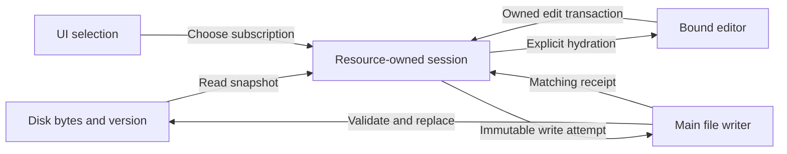
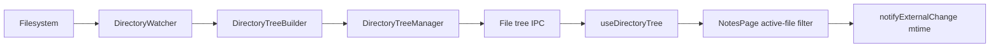
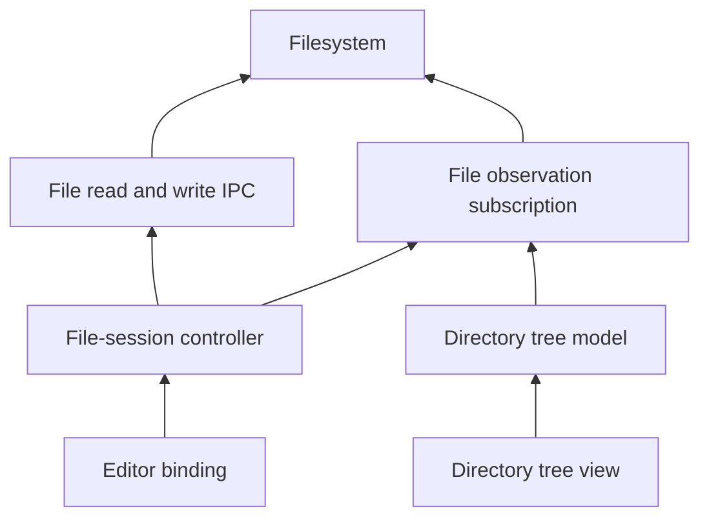
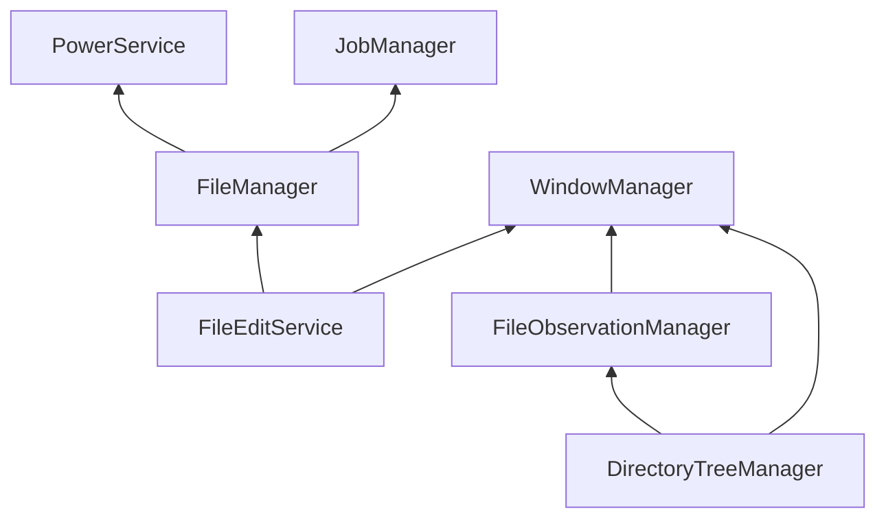

# Agent Note: File editing session lifecycle and persistence ownership

Status: proposed

English | [中文](2026-10-22-file-edit-session-lifecycle.zh.md)

## Problem

Scope revision: [Independent file editing instances and bounded persistence](2026-10-23-independent-file-edit-lifecycle.md) now owns the proposed current-PR scope and acceptance gate. The broader design below is retained for its alternatives and future lifecycle discussion; its shared-session, observation-pool and close requirements are not additional delivery prerequisites. Implementation and acceptance evidence follow that revision.

Notes can expose one file's draft under another file's identity during a cached switch. Markdown normalization then triggers the page's string-comparison synchronization, which previously emitted an edit callback and saved the old content through the new file's model. The [bounded repair](../../implemented/bug-fix/2026-10-22-notes-session-isolation.md) binds callbacks to model instances, hides mismatched snapshots, and makes rich-editor snapshot loading silent. It preserves the live Markdown getter. Its local regressions and Electron reproduction establish that repair, not the absence of races throughout the editing lifecycle.

The remaining design distributes ownership across React state mirrors, mutable model references, SWR snapshots, editor instances, and page effects. A file selection is a presentation decision, but previously also determined where a callback's content went. A Markdown representation difference is a formatting fact, but previously also acted as a synchronization command. Saving, changing modes, reloading, and disposing a view need explicit contracts rather than coordination through those incidental signals.

This proposed Spec owns the full lifecycle target. It supplements the bounded repair without relabeling its evidence as full acceptance. Local implementation has started under the user’s explicit session authorization. This does not claim GitHub approval or complete acceptance of every criterion.

Implementation scope for this PR: generic exit coordination and its window/application/reload integration are deferred by user decision. The close protocol below remains a proposed future target, not current behavior; AC12, AC19 and AC23 are not delivered by this PR. File-view detachment and file mutation preparation remain in scope.

## Proposal

### Scope and ownership

Keep Markdown files as the persistence format. Keep Tiptap's live `getMarkdown()`. Introduce no notes database, collaboration protocol, or new editor framework. Apply the shared session contract to Notes, ArtifactPane, AgentRightPane, and SkillFileBrowser; rich/source-mode rules apply where those modes exist.

| Owner | State it owns | Boundary |
| --- | --- | --- |
| Renderer file-session controller | Resource identity, accepted draft, disk baseline, revisions, pending operations and failures | One live session per resource key in one renderer, shared by its consumers; survives view detachment while work or unsaved content remains |
| React hook and page | Subscription and selected session | Publish one coherent session snapshot; selection never supplies the destination of an existing operation |
| Editor binding | One session attachment, editor instance, selection, undo state and applied content revision | Tiptap or source editor accepts edits only for its current binding; it does not own filesystem paths or writes |
| Main file services | Resource resolution, write coordination, disk validation, atomic replacement and managed-file metadata | Reuse the existing file IPC and mutation coordination; independent renderer sessions cannot silently overwrite one another |
| Tab/window/application close owner | Whether a normal close may proceed | Await a session close barrier before destroying the renderer; React effect cleanup is not an asynchronous close protocol |

The controller belongs under the existing renderer services layer; `useFileEditSession` remains the consumer adapter. Its mutable runtime state is not DataApi business data or a losable cache. SWR may cache immutable read snapshots, but must not overwrite a live dirty session or decide whether it is safe to dispose. Use the existing Main service/lifecycle and IPC boundaries for any filesystem contract changes.



### Identities and coherent state

Use four identities with separate purposes. `resourceKey` identifies the logical file using the existing `FileHandle` and path rules. `sessionId` identifies a live session incarnation. `bindingId` identifies one editor attachment; replacing an editor or loading a replacement document invalidates its old binding. `revision` orders accepted content changes within a session. Read/reload attempts additionally carry an operation identity so late results cannot replace a newer operation's result.

File paths are addresses, not session generations. File-entry IDs retain their existing logical semantics. Device/inode values can identify a physical snapshot but cannot become permanent note IDs: atomic replacement can change them. Resource resolution and path-alias treatment belong to the file layer; UI components must not invent independent normalization. Same-key consumers share a session in a renderer. Cross-window sessions remain independent and coordinate at the Main write boundary; this proposal does not promise live collaborative merging.

Publish one immutable observable snapshot containing identity, availability, baseline, draft revision, dirty status, write status and error/conflict details. Update it through owned transitions. A snapshot must never contain A's resource identity with B's content. Loading, unsupported content, missing files and read failures are distinct from a ready empty file. Dirty and writing may both be true; an in-flight save does not imply that the latest draft is persisted.

The baseline binds decoded content, byte-preservation metadata, disk version and a content hash to the same read snapshot. The draft is the latest accepted persistence representation. The active editor owns its editing document and emits changes into the session; the session's draft is its accepted snapshot, not a competing source that is echoed back after every keystroke. A content revision orders work but is not by itself proof of dirtiness or persistence.

### Invariants

1. Every edit carries the session and binding that produced it; a retired identity cannot mutate another attachment or incarnation.
2. A write captures its resource, session, revision, baseline and bytes. Neither its destination nor its acknowledgement is resolved from the current UI selection.
3. Opening, reading, focusing, serializing, rendering and switching modes without an edit produce no write and preserve the original bytes.
4. Only accepted content edits schedule autosave. Selection-only transactions and snapshot hydration do not. Focus is not an edit-origin classifier.
5. A save receipt advances only the baseline it actually committed. Newer accepted edits remain pending; an older receipt never replaces the current draft.
6. Async reads, reloads and conflict actions must validate their operation identity and revision preconditions before applying results, even when the path has not changed.
7. Detaching an editor revokes its callbacks, not the session's accepted content or running writes. A dirty, failed, conflicted or writing session is not evictable.
8. No operation reports saved or closed merely because a timer fired, IPC was accepted, a component unmounted, or an error was logged.

### Lifecycle transitions

| Trigger | Required transition | Completion and failure rule |
| --- | --- | --- |
| Open a resource | Acquire its existing live session or start an owned read; publish loading until a matching snapshot is available | Reopening pending/failed A reuses A's retained session; a cancelled or older read cannot populate B or a replacement A session |
| Read succeeds or fails | Adopt a coherent baseline and draft, or publish an unavailable state without an editable empty substitute | Empty content is valid; unsupported encoding/size remains blocked; retry starts a new read attempt |
| Attach editor | Create a binding and hydrate the session's accepted snapshot without emitting edits | Parse/initialization failure retains the session content and exposes an error; it cannot save an empty or partial document |
| Edit, paste, undo/redo or dictation | Validate the binding, accept a content transaction, advance its revision and schedule a save when bytes differ | Stale callbacks and asynchronous insertion results are rejected; selection/focus changes do not create content revisions |
| Change editor mode | Finish the outgoing input transaction, revoke that binding, then attach the new mode to the same session | Composition must finish or the transition waits/cancels; mode change alone never normalizes the persisted draft |
| Switch A to B | Detach A's editor and subscribe to B; retain A if it has pending work or unsaved content | A's write can finish in the background against A; failures remain recoverable and are surfaced through the owning consumer |
| Autosave or explicit save | Capture one write attempt and serialize it through the resource's queue | Coalesce edits not yet submitted; capture a new attempt for newer edits after the prior receipt; debounce is only scheduling |
| Save succeeds | Advance the matching baseline and compute dirty against the current draft | Do not reset the editor, selection or undo history; do not mark a newer revision saved |
| Save fails or conflicts | Retain the draft and expose a blocked save reason | Stop automatic retry loops; explicit retry uses the retained draft; conflicts require a named resolution |
| Watcher/revalidation event | Treat as an invalidation hint; read with an operation identity when safe | Apply only if the session is still clean, its revision/baseline unchanged and the read still current; dirty drafts are never silently replaced |
| Reload or discard | Enter an explicit replacement operation; settle any in-flight write and temporarily block new edits | Replace only after a successful, current operation; failure preserves the prior draft; restoration creates a fresh editor binding |
| Keep local draft after conflict | Preserve the captured draft, refresh the disk baseline under a guarded resolution operation, then attempt a conditional save | Block edits during the decision boundary; another disk change causes another conflict, not an unconditional overwrite |
| Rename/move/delete or change root | Seal affected editing, flush and settle writes, then perform the explicit file operation | Failure leaves the session recoverable; success retires/rebinds identities after the operation, never by mutating a running write's target |
| External removal/replacement | Mark the resource unavailable or changed while retaining local unsaved content | Never silently recreate a deleted file; recreation or Save As requires an explicit action and a fresh validated destination |
| Close a view | Revoke its binding and release its attachment | A clean idle unreferenced session may be disposed; an unsaved or writing session remains owned and reachable for recovery |
| Close a window or quit normally | Seal input, collect all retained sessions and await flush/settlement | Failure or conflict cancels the close unless the user explicitly discards affected unsaved revisions; timeout is not success |
| Crash or forced termination | No asynchronous renderer cleanup is assumed to finish | Restart reads disk truth and existing Main recovery state; only confirmed committed bytes are covered, not unsaved memory drafts |

Releasing a view must not strand a retained failure. Its owning consumer must keep an actionable recovery surface, including when a removed file no longer appears in the tree. Reacquiring the resource returns its retained draft. If a consumer cannot provide a recovery owner, it must block that view's close until saving or explicit discard completes. Clean session eviction is permitted; dirty eviction is not.

For normal close, input is sealed before capturing the flush target, including completion of IME composition and pending accepted editor transactions. Cancelling close restores editing with a new binding. A submitted filesystem operation cannot be made uncommitted by cancelling its promise: settle it before applying discard, rename or final disposal. Discard during a write therefore uses the latest confirmed baseline after settlement, not an older baseline that could undo a successful save.

### File watcher dependencies and subscription ownership

The current notification path runs through the directory-tree consumer before reaching the editor session:



[NotesPage](../../../../src/renderer/pages/notes/NotesPage.tsx) forwards only the active file's update and passes its modification time to the session. This couples external-change awareness to the tree UI and current selection. The target makes the session controller and tree model independent consumers of file observations; an editor consumes only its bound session. Arrows below mean dependency, not event direction:



Observation and file I/O are parallel capabilities. A write receipt, never a watcher echo, confirms a save. Every conditional write validates its baseline even if no notification arrived. A watcher event is an invalidation hint, not a content snapshot, edit transaction or save acknowledgement. Dirty sessions record pending revalidation and expose confirmed conflicts without replacing their draft; clean sessions may adopt a guarded read. Reads capture resource/session identity, operation identity, draft revision and baseline, then recheck them before applying. Retiring a subscription also invalidates callbacks from its previous generation.

Keep three versions separate: the directory-tree stream sequence detects gaps and duplicates; the disk version/content hash checks a persistence baseline; the session revision orders accepted edits. None substitutes for another. Preserve the existing snapshot/listener/activation handoff when reusing the tree transport, including events replayed during activation. A gap, watcher failure or resumed subscription makes freshness unknown and requires reconciliation; it never means empty content or successful persistence. Retained drafts remain recoverable while observation is unavailable.

[DirectoryTreeManager](../../../../src/main/services/file/tree/DirectoryTreeManager.ts) already shares a builder and watcher for identical root/options, owns window-scoped consumers, and awaits disposal during service shutdown. [DirectoryWatcher](../../../../src/main/services/file/watcher.ts) is a disposable primitive owned by its caller, not a separate lifecycle service. Reuse this resource management. The observation boundary does not require sessions to maintain a whole directory tree. The concrete design below extracts shared watcher ownership within the file module, rather than mounting a hidden tree UI or opening one watcher per note. Retain explicit scope/options and reference-counted ownership.

The session owner holds its observation subscription independently of editor attachments and directory-tree visibility. Hidden retained sessions keep coverage while they have unsaved content, failures, conflicts or pending writes. Detaching an editor releases its binding; closing a tree releases that consumer's subscription; disposing a settled session releases its subscription. The underlying watcher closes only after its last consumer leaves, allowing the existing bounded reuse grace period. Root replacement retires the old subscription generation. Route path events to affected resource identities, including descendants of removed directories; raw unlink/add events alone do not establish a rename or authorize retargeting a write.

Service dependencies express actual lifetime requirements, not shared interest in files. Currently `DirectoryTreeManager` depends on `WindowManager` for ownership cleanup, while `FileManager` depends on `PowerService` and `JobManager`; this design does not add a mutual dependency between the two file services. Normal close seals input and settles sessions while renderer and file I/O are still available, then releases subscriptions and destroys the window. Window-destroyed cleanup is a resource-release fallback, not a draft-save protocol; lifecycle decorators alone cannot implement that barrier.

### Tiptap and Markdown boundary

Tiptap owns a structured ProseMirror document; the [Markdown extension](https://tiptap.dev/docs/editor/markdown) parses Markdown into that structure and serializes it back. `getMarkdown()` is a query of current editor content, not a disk snapshot, dirty detector or synchronization trigger. Preserve its immediate-read behavior for voice and other consumers.

Use explicit hydration commands for initial load, reload, discard and an accepted external replacement. Tiptap's [`setContent`](https://tiptap.dev/docs/editor/api/commands/content/set-content) supports `emitUpdate: false`; the adapter must also suppress its own content-change callbacks. That option does not revoke application callbacks or reset undo history by itself. Cross-resource attachment must use a fresh editor state; explicit replacement must prevent undo from resurrecting the discarded/replaced document. An ordinary save acknowledgement must preserve undo history.

Remove the page effect that compares serialized Markdown with the session draft to decide whether to reload the editor. Track the binding's applied content revision and the origin of changes instead. Accepting an editor's own update must not immediately reapply that update as a full-document replacement. Mode changes use the last accepted session content; a mode with no edits must not serialize its initial parsed representation back into the draft.

Preserve original Markdown spelling, UTF-8 BOM and supported LF/CRLF bytes until an actual edit is accepted. Rich-text edits may normalize supported Markdown syntax; this proposal does not introduce a source-preserving Markdown parser. Unsupported constructs must not disappear merely because a file was viewed or a mode was toggled. Expanding rich-text round-trip fidelity is separate work and must not be hidden inside lifecycle synchronization.

### Disk writes, conflicts and recovery

Keep file I/O behind existing Main file services and IPC. Reuse their mutation coordination rather than adding a second renderer-only lock and calling it cross-window protection. All covered write paths must participate in the existing Main coordination for the resolved resource, including managed-entry and path consumers that can reach the same target. A renderer session queue governs local revision order; Main validation arbitrates independent writers.

Carry a content hash bound to the bytes actually read, and validate the disk baseline before replacing the destination. `mtime + size` alone cannot detect same-size changes with unchanged/coarse timestamps. The path IPC already exposes read hashes and expected write hashes, but the current hook does not use them; managed-entry support and consistent validation need explicit implementation and tests. Do not silently omit the baseline check for a supported handle kind. Hashes detect accidental changes; they are not an adversarial authenticity mechanism.

Retain the codec's byte-preservation and unsupported-content rules. Prepare the complete output, validate the baseline near commit, and atomically replace the file through the existing writer. A metadata-only touch may rebase after confirming the baseline content is unchanged. If disk already contains the attempted bytes, reconcile that attempt without overwriting a newer local draft. A real content mismatch stops saving until reload or keep-local resolution.

Treat `COMMITTED_METADATA_PENDING` separately from a failed byte write: reconcile the confirmed file contents and preserve the Main metadata-recovery outcome. Do not replay the same payload just to repair metadata, and do not mark a newer draft saved. When a write outcome is uncertain, retain the operation and draft until rereading establishes the outcome or an explicit recoverable error is shown.

Atomic replacement prevents partial files; it is not a filesystem compare-and-swap against arbitrary external programs. Main can serialize participating app writes. External writers can still race between validation and replacement, especially on synchronized or network volumes. This boundary must remain explicit; this Spec promises application ownership isolation and conflict detection at validation, not universal cross-process exclusion or recovery of edits never committed before a crash. A durable unsaved-draft journal would be a separate persistence proposal.

### Concrete service boundaries and placement

The following names and signatures describe the proposed implementation, not APIs already available. Keep the current bounded patch until its replacement passes the same regressions. Use the existing codec, IpcApi schemas, lifecycle container, event primitives and atomic writer; no generic state-machine framework, event bus or collaboration engine is required.

| Component | Placement and lifetime | Dependencies and responsibility |
| --- | --- | --- |
| `FileEditSessionManager` | Renderer `services/fileEdit/`, one instance owned by the window composition root | Owns session registry, drafts, timers, read/write attempts, recovery inventory and editor bindings; calls file IPC and observation adapter; never imports a page or editor component |
| `useFileEditSession` | Existing hook, subscription lifetime | Uses `useSyncExternalStore` against a lease; handles acquisition/loading by request identity; no draft mirror, SWR mutation or writer |
| Editor adapters | Existing RichEditor and source-editor integration | Implements the narrow adapter below; editor transactions submit owned content; Tiptap instance, selection, history and IME remain here |
| `FileEditService` | New Main lifecycle service inside `services/file/`, `WhenReady` | Depends on `FileManager` and `WindowManager`; owns window-scoped edit leases and write-outcome records, dispatches strict editing I/O through existing file internals; owns no draft or editor state |
| `FileObservationManager` | New Main lifecycle service inside `services/file/`, `WhenReady` | Depends on `WindowManager`; owns pooled watchers, observation leases, activation queues and cleanup; uses existing watcher primitive; does not depend on editing sessions or FileManager |
| `DirectoryTreeManager` | Existing Main lifecycle service | Depends on `WindowManager` and `FileObservationManager`; builders consume shared observations and retain their tree projection, scan and activation protocol |
| Close integration | Existing window/application owners plus renderer composition root | Registers generic close participants in WindowManager/Application; composes the session manager and IPC; neither core module imports file-edit business services |

This selects extraction of shared observation ownership from tree builders into `FileObservationManager`; it does not duplicate the existing tree pool. Tree builders still pool by tree options; raw watcher pooling uses only observation-affecting root/options. Presentation filters must not suppress events needed by sessions. Share exact equivalent coverage first; overlapping roots need not be merged in this refactor. A session borrows the configured workspace-root coverage when available, otherwise parent-directory coverage; files in the same scope share it. Do not open one watcher per file. Main services extend `BaseService`, register in `serviceRegistry.ts`, and release owned resources through lifecycle disposables. Renderer manager construction/disposal is explicit at the composition root, not per hook.

The proposed Main lifecycle DAG is shown below; arrows mean `@DependsOn`, not IPC/event flow. Reverse dependency order releases tree/edit owners before the observation/file services they use. Normal-close preparation runs before this shutdown order begins.



Keep renderer-only contracts under `renderer/services/fileEdit/` or `renderer/types/`; file contracts belong in `shared/ipc/schemas/file.ts`, window-close contracts in `shared/ipc/schemas/window.ts`, and domain errors in the corresponding `shared/ipc/errors/` module. Main handlers remain stateless adapters. File bytes and runtime leases use IpcApi, not DataApi or Cache. These new Main services are required by persistent resource/receipt ownership; helper functions do not become services.

### Session and editor function contracts

The shapes below use existing `FileHandle`, `FileVersion` and `ContentHash` types. IDs are opaque and immutable; implementation may brand them. Snapshots are immutable and retain reference equality until an owned transition changes them. Null draft/baseline means unavailable, never an empty editable file. A missing or unsupported resource may still retain its previously accepted draft. `freshness: verified` means verified at the last reconciliation, not continuously synchronized with disk.

```typescript
type SessionRef = Readonly<{ resourceKey: string; sessionId: string }>
type BindingRef = SessionRef & Readonly<{ bindingId: string; documentEpoch: number }>
type DiskBaseline = Readonly<{ version: FileVersion; contentHash: ContentHash }>
type TextSnapshot = Readonly<{
  text: string
  lineEnding: 'lf' | 'crlf'
  hasBom: boolean
  baseline: DiskBaseline
}>
type SessionFailure = Readonly<{
  kind: 'read' | 'unsupported' | 'missing' | 'conflict' | 'write'
    | 'outcome-unknown' | 'observation' | 'editor' | 'target-changed'
  code: string
  operationId?: string
}>
type SessionContent =
  | { availability: 'loading'; draft: null; baseline: null }
  | { availability: 'ready'; draft: string; baseline: TextSnapshot }
  | { availability: 'missing' | 'unsupported' | 'error'; draft: string | null; baseline: TextSnapshot | null }
type SessionSnapshot = Readonly<SessionContent & {
  ref: SessionRef
  revision: number
  documentEpoch: number
  dirty: boolean
  save: 'idle' | 'scheduled' | 'writing' | 'blocked' | 'outcome-unknown'
  access: 'editable' | 'sealed'
  freshness: 'verified' | 'invalidated' | 'unknown'
  metadataRecoveryPending: boolean
  failures: readonly SessionFailure[]
}>
type EditResult =
  | { kind: 'accepted'; revision: number }
  | { kind: 'rejected'; reason: 'stale-binding' | 'sealed' | 'not-ready' }
type CommandResult<T> =
  | { ok: true; value: T }
  | { ok: false; error: SessionFailure | { kind: 'cancelled' | 'busy' } }
type FlushReceipt = Readonly<{
  ref: SessionRef
  revision: number
  baseline: DiskBaseline
  metadataRecoveryPending: boolean
}>
interface SessionLease {
  readonly ref: SessionRef
  getSnapshot(): SessionSnapshot
  subscribe(listener: () => void): () => void
  attachEditor(adapter: EditorAdapter): CommandResult<BindingRef>
  acceptEdit(binding: BindingRef, next: string): EditResult
  detachEditor(binding: BindingRef): void
  flush(): Promise<CommandResult<FlushReceipt>>
  retrySave(): Promise<CommandResult<FlushReceipt>>
  discard(): Promise<CommandResult<void>>
  reload(): Promise<CommandResult<void>>
  keepLocal(): Promise<CommandResult<FlushReceipt>>
  release(): void
}
interface EditorAdapter {
  prepareDetach(): Promise<'ready' | 'cancelled'>
  hydrate(input: { binding: BindingRef; text: string; resetHistory: boolean }): void
  setEditable(editable: boolean): void
  rebind(binding: BindingRef): void
}
interface PreparedTransition {
  commit(input?: { replacements: readonly { source: SessionRef; handle: FileHandle }[] }): Promise<CommandResult<void>>
  cancel(): Promise<void>
}
interface FileEditSessionManager {
  acquire(handle: FileHandle): Promise<CommandResult<SessionLease>>
  listRetained(): readonly SessionSnapshot[]
  prepareTransition(input: {
    resources: readonly SessionRef[] | 'all'
    reason: 'mode' | 'rename' | 'move' | 'delete' | 'root' | 'close'
  }): Promise<CommandResult<PreparedTransition>>
}
```

`acquire` first resolves a Main edit lease, then deduplicates by the returned resource key before starting an editor or writer. Concurrent acquisitions join one session; redundant Main leases are released. A retained session is reused without replacing its draft with a new read. Acquisition attempts belong to the manager before any await, so close can cancel/settle them. A failed resolution returns a failure; the hook publishes an unavailable result tied to that request. Changing the selected handle masks the old snapshot immediately. A cancelled acquisition that completes later releases its lease rather than attaching to the new selection.

Resource keys identify the canonical file address produced by the file layer, not the spelling of a renderer handle. Entry and path handles resolving to the same permitted canonical address share a renderer session; retain every acquired locator for validation rather than choosing a more privileged one. Managed-storage path writes remain forbidden. This proposal does not change persisted `FileEntry.externalPath` canonicalization or promise deduplication of every symlink/hard-link alias. Existing path semantics remain; a resolved entry that changes target is rejected and explicitly rebound, never followed by an already captured write. Resource-key equality is not authorization.

Only one writable editor binding exists per session in a renderer. Other consumers may subscribe or render read-only views. A second editable attachment returns `busy`; an explicit handoff seals and detaches the previous binding first. This prevents two independent full-document editors from overwriting each other's transactions without introducing collaborative merging. `acceptEdit` checks the complete binding and editability synchronously, normalizes accepted line endings through the codec contract, advances revision only for changed content, and schedules autosave. It accepts no path argument. Stale/cancelled producer callbacks are expected rejections, not save errors or notification storms.

`documentEpoch` advances on initial adoption or an explicit replacement, not on ordinary edits or save receipts. Only a new binding/epoch requests full hydration. `hydrate` is synchronous, silent and may throw an editor initialization failure; the adapter must not enable editing or acknowledge readiness after partial parsing. `prepareDetach` completes composition and already accepted transactions, or cancels the transition; it never serializes an unedited parsed document merely to flush. After it returns ready, the controller seals input synchronously before yielding. Cancelling a transition issues a fresh binding via `rebind` while preserving the same editor document and undo history. A successful replacement hydrates a fresh state with history reset. Async dictation/insertion results must still present the original binding.

`flush` captures the current accepted revision and materialized bytes at invocation. That explicit target cannot be coalesced away by later edits; success means those bytes committed or were verified already on disk. Later edits can remain dirty. A flush that currently matches the baseline must still settle older writes that could change that baseline before returning. Autosave alone may coalesce unsent revisions. Explicit flush targets run in invocation order; callers for the same target may share a receipt. `retrySave` resumes a known failed attempt against a validated baseline; it cannot bypass a conflict or unknown outcome. `discard` settles writes then restores the latest confirmed session baseline without writing; `reload` settles writes then reads disk before replacement. `keepLocal` seals and captures the local draft, reads a fresh disk baseline, and conditionally writes that captured draft. Failure retains content and restores a usable binding; no command reports success from logging an exception.

`release` is idempotent attachment release, not save completion. Dirty, failed, conflicted, writing or outcome-unknown sessions remain listed by `listRetained` with an owning recovery surface. A clean settled session can be evicted after all attachments and bindings leave. `prepareTransition` serializes incompatible commands per affected session, seals bindings, and settles writes. Mode handoff needs composition settlement but need not force a disk write; rename/move/delete/root/close require flush or explicit discard. It acquires multi-session seals in stable resource-key order without holding Main filesystem locks. Preparing all sessions for close freezes new acquisition before the first await and includes pending acquisitions; cancel reopens admission. `commit` and `cancel` are idempotent and mutually exclusive; cancellation preserves accepted edits. If preparation fails, undo every seal acquired by that attempt before returning failure. For rename/move, seal source and any already-open destination, execute the existing conditional file operation, then pass its validated replacement handle to `commit`; failure calls `cancel`. Commit opens and verifies the replacement before retiring source identities. A failure after the filesystem mutation retains the old draft as recoverable with target-changed status; cancellation cannot undo the completed rename. Delete commit retires the settled source; mode commit releases the old binding for a fresh attachment. No arbitrary asynchronous callback executes inside a session state transition.

### Main I/O, observation and close interfaces

Use dedicated strict editing routes so existing non-editing `file.read` consumers keep their contracts. All requests use existing IpcApi sender validation. Main derives the owner from `IpcContext`, checks every opaque lease against that owner, and enforces existing filesystem/managed-storage boundaries. IDs are not transferable capabilities between windows. The following payloads and route names are proposed:

```typescript
type EditResource = Readonly<{ editId: string; resourceKey: string; path: AbsoluteFilePath }>
type EditRead = Readonly<{ data: Uint8Array; baseline: DiskBaseline }>
type WriteRequest = Readonly<{
  editId: string
  sequence: number
  expected: DiskBaseline
  data: Uint8Array
}>
type FileWriteOutcome =
  | { kind: 'committed'; sequence: number; baseline: DiskBaseline; metadataRecoveryPending: boolean }
  | { kind: 'not-committed'; sequence: number; code: string }
  | { kind: 'not-started'; sequence: number }
type ObservationLease = Readonly<{ observationId: string; generation: string; sequence: number }>
type ObservationEvent = ObservationLease & (
  | { kind: 'invalidate'; paths: readonly AbsoluteFilePath[]; subtree: boolean }
  | { kind: 'resync-required'; reason: 'overflow' | 'gap' | 'watcher-error' }
)
```

| Route/event | Input → output | Contract |
| --- | --- | --- |
| `file.edit.open` | `{ handle }` → `EditResource` | Resolve and pin canonical address and locator; register owner before returning; does not create a missing file |
| `file.edit.read` | `{ editId }` → `EditRead` | Validate pinned target; bounded consistent binary read with mandatory hash of returned bytes; enforce the 8 MiB editing limit before and during bounded reading, including file growth after stat |
| `file.edit.write` | `WriteRequest` → `FileWriteOutcome` | Register sequence before awaiting; validate target plus version/hash, commit once, record terminal outcome before replying |
| `file.edit.settle_write` | `{ editId, sequence }` → `FileWriteOutcome` | Wait for a registered operation; if not started, record a terminal fence that rejects a late request for that sequence |
| `file.edit.close` | `{ editId }` → void | Retire lease, reject new requests, settle submitted writes, then release outcome records; idempotent for its owner |
| `file.observe.create` | `{ rootPath, options }` → `ObservationLease` | Acquire ready scoped coverage and buffer subsequent events until activation; bounded owner-scoped queue |
| `file.observe.activate` | `ObservationLease` → boolean | Activate only the captured generation/sequence after listener installation; overflow requires reacquisition and reconciliation |
| `file.observe.dispose` | `{ observationId }` → void | Release only this owner's lease; invalidate late callbacks; await final watcher close when no consumers remain |
| `file.observe.event` | Main → renderer `ObservationEvent` | Resource-addressed invalidations or resync request; no draft or save-status payload |
| `window.edit.prepare_close` | Main → renderer `{ requestId, reason }` | Ask the composition root to prepare every retained session; no editor-specific data in Main |
| `window.edit.close_prepared` | `{ requestId, outcome }` → void | Owner-scoped acknowledgement: prepared or blocked; a blocked attempt must finish cancellation before acknowledging |
| `window.edit.finish_close` | Main → renderer `{ requestId, action }` | Commit or cancel only the matching prepared request; duplicate delivery is harmless |
| `window.edit.close_finished` | `{ requestId, outcome }` → void | Report cleanup for commit or confirm editing restoration for cancel; this acknowledgement is not a new data-safety approval |

The generic core registration surface below replaces the synchronous close result; implementation must migrate its affected callers and native close handlers together. Main window/application owners register a bridge participant whose tickets send the scoped events above. `FileEditService` does not implement window UI policy. File-service methods corresponding to the editing routes take an explicit owner derived by the handler; observation acquisition takes the owner plus a typed root/options scope. Internal tree builders acquire a service-owned observation lease, not a fabricated renderer identity.

```typescript
type CloseContext = Readonly<{
  requestId: string
  reason: 'window' | 'quit' | 'reload' | 'pool-reset'
}>
interface PreparedClose {
  commit(): void
  cancel(): Promise<void>
}
interface CloseParticipant {
  prepare(context: CloseContext): Promise<
    | { kind: 'prepared'; ticket: PreparedClose }
    | { kind: 'blocked'; code: string }
  >
}
interface WindowCloseRegistration {
  registerCloseParticipant(windowId: WindowId, participant: CloseParticipant): Disposable
  close(windowId: WindowId): Promise<'closed' | 'retained' | 'cancelled'>
}
interface QuitParticipation {
  registerQuitParticipant(participant: CloseParticipant): Disposable
}
```

`PreparedClose.commit` is a terminal, synchronous release of an already-proven close barrier, not another save attempt. All participants must be prepared before any commits. Commit keeps input sealed, retires session admission and initiates cleanup; it must not fail due to watcher-close IPC. Main retains responsibility for final owner cleanup and awaits service disposal at shutdown. Cancellation applies only before global commit and waits for responsive renderers to restore editing. A timeout during preparation/cancellation leaves the window alive and recovery ownership intact; an unresponsive renderer cannot be claimed restored. Request cancellation is recorded even while prepare is pending, so a late successful preparation is cancelled rather than accepted. After global commit, a lost cleanup acknowledgement cannot reopen admission or invalidate the already-confirmed persistence barrier.

At open, activate observation before reading; every invalidation increments a local invalidation generation. A read captures that generation. If events arrive during it, schedule another bounded reconciliation and do not declare the result current. If coverage cannot be established, allow a successful content read with freshness unknown and a visible observation error; conditional writes remain protected. Repeated external churn ends in a recoverable unavailable/stale state rather than an unbounded read loop. Dirty-session revalidation can compare disk with its baseline but cannot adopt a different baseline without an explicit resolution. A notification queued while writing is reconciled after its receipt; it is never interpreted as that receipt.

Each edit lease has one monotonically increasing write sequence and at most one in-flight operation plus its terminal outcome. The next sequence implicitly acknowledges the previous terminal result; reject skipped, conflicting or retired sequences. Identical duplicate requests for the current sequence join/return the existing result; compare the immutable request fingerprint including baseline and bytes. A different payload with the same sequence is a protocol error. Retry after a known not-committed or fenced not-started result uses the next sequence and revalidates its baseline; it cannot rewrite a terminal record. Terminal records survive transport reply loss and are not expired while their lease is live. `settle_write` fences even an operation whose request arrived late, so a timeout cannot lead to a second writer after a misleading not-found result. If settlement IPC itself is unavailable, retain outcome-unknown and block dependent writes, destructive operations and normal close. After a Main crash, these in-memory records are gone; restart reads disk and existing metadata recovery, without claiming recovery of unsaved renderer drafts.

`FileEditService` delegates actual writes to the file module's coordinated internals. Preserve the existing global `pathMutationLock` initially; it is not currently a per-resource lock. Extend participating entry/path mutations to share commit coordination. Lock order is entry lock(s) in stable order, then path mutation lock; path-only operations take only the latter. Prepare immutable temporary bytes before the short commit section; re-resolve, validate mandatory content hash even for sub-second mtimes, atomically replace and finalize synchronous metadata under coordination. Never acquire an entry lock while holding the path lock, reacquire the same non-reentrant lock through a public wrapper, hold a SQLite transaction across await, or wait for a renderer while holding a file lock. Reads used for reconciliation participate in the same order. Audit competing entry writes, stream commits and explicit file mutations before claiming application-wide coverage; unrelated unconditional writers are not converted into merge operations.

The committed baseline comes from the prepared bytes and commit result, not a later unguarded stat. `COMMITTED_METADATA_PENDING` becomes a committed outcome with the metadata flag; existing Main recovery retains responsibility. Renderer can mark that revision's bytes persisted and allow close, while exposing pending metadata separately. A subsequent disk mismatch remains a separate invalidation. A version mismatch with unchanged bytes may rebase and retry at most the existing bounded three rounds; equal attempted bytes may be acknowledged as already present. Any other content mismatch is conflict. Missing targets are not recreated by retry. Save As uses the existing explicit destination workflow after sealing the source, checks the destination independently, and requires confirmation for overwrite; it never mutates an existing attempt's target.

Window close needs an upstream contract because current `WindowManager.close()` can directly destroy a window. Add generic asynchronous close participants at that owner, preserving hide-to-tray/pool semantics when the same renderer/session remains alive. Destruction, renderer reload and pool reset must prepare participants first. User-requested relaunch must pass the same barrier before marking the application quitting; audit all ordinary destroy/reload call paths so they cannot bypass it. Update installation integration is deferred to a separate change; this PR preserves its existing quit flow. Register listeners on window creation. Normal `close()` and native close converge on one pending request; its eventual result distinguishes closed/retained/cancelled instead of treating request acceptance as completion. Core WindowManager invokes registered participants without depending on `FileEditService`.

Application already has boolean/async `registerQuitGuard`; run those policy guards before preparing file-close participants. Add a transactional participant phase with `prepare`, `commit` and `cancel`: all windows prepare while services are live; one failure, new window/session admission, timeout or revoked approval cancels all prepared participants. Successful preparation keeps input sealed until commit or cancellation. This avoids leaving a window sealed when a later quit guard vetoes. Only after every participant has prepared successfully may global commit authorize normal teardown; asynchronous cleanup acknowledgements report resource release, not additional save approval. Existing system-shutdown paths that bypass user guards and forced termination remain outside the normal-close guarantee. A missing or unresponsive renderer is a failed preparation, not permission to discard; explicit force quit remains a separate user action.

### Error handling and recovery decisions

Existing `FILE_STALE_VERSION` and `FILE_COMMITTED_METADATA_PENDING` retain their meanings. Add explicit file-edit codes for target-changed, lease-closed, invalid-sequence, missing, read-unstable, permission-denied and no-space failures; never dispatch recovery by matching exception text. Keep codec unsupported reasons renderer-local. Domain failures cross IPC as stable codes with structured data; renderer maps them to `SessionFailure` and localized actions. Unexpected programming/transport failures are normalized at the adapter boundary and logged through `loggerService` with resource/session/operation identifiers, never document bodies. Expected stale callbacks are ignored; an I/O failure must stay observable after a view detaches. An observation warning and a save conflict can coexist, so one generic `error` slot must not erase the other.

| Failure | Preserved state | Allowed recovery and save/close behavior |
| --- | --- | --- |
| Initial read failure or unsupported encoding/mixed EOL/size | Resource identity; any retained draft | Retry/open read-only/Save As where valid; no writable empty fallback |
| Editor parse/initialization failure | Session text and disk baseline | Retry adapter or source mode; no partial content accepted |
| Missing file or changed entry target | Draft, original locator and pending outcome | Explicit rebind/reload/Save As; no automatic recreation or retarget |
| `STALE_VERSION` with different bytes | Local draft and original baseline; observed disk information | Pause autosave; reload, keep local with a new conditional write, or cancel |
| Permission, disk-full or known pre-commit failure | Draft and confirmed baseline | Explicit retry after cause is resolved; no auto retry loop; close blocked unless discarded |
| Lost write response / uncertain commit | Immutable attempt, sequence and current draft | Settle the same sequence before new writes; no blind retry or false failed-write claim |
| Committed bytes with metadata pending | Receipt and newer draft if any | Expose metadata recovery; no payload replay; close may proceed for committed revisions |
| Watcher error, queue overflow or event gap | Draft and last baseline, freshness unknown | Reacquire/reconcile with bounded attempts; no clear/reset; conditional save validation remains mandatory |
| Stale read, binding callback or close acknowledgement | Current session unchanged | Drop result and release its resources; no user-facing error for ordinary cancellation |
| Close timeout, save conflict or participant veto | All unsaved sessions and bindings capable of recovery | Cancel prepared close and restore editing; never equate timeout with success |

### Deterministic race rules and verification matrix

Session transitions are synchronous: validate token/preconditions, update the complete snapshot and schedule side effects. Every side effect returns through another validated transition; no state-changing async closure consults current page selection. Recheck after every await, not only on request creation. Cancellation revokes adoption authority; it does not undo an already submitted filesystem commit.

| Controlled ordering | Required result | Verification focus |
| --- | --- | --- |
| A read starts; B selected; A completes | B never exposes A, A result only belongs to its retained incarnation | Request/session identity, AC1/AC2 |
| Two consumers open the same canonical target concurrently | One renderer session and writer, one writable binding; redundant Main lease released | Acquisition deduplication, AC20 |
| Watcher read starts; edit or another read wins; old read returns | Old result cannot replace draft/baseline; invalidation remains pending where needed | Operation, baseline, revision and invalidation generation, AC7/AC18 |
| Save B starts from baseline A; user undoes to A before it finishes | B receipt makes current A dirty again; A is subsequently saved, never lost because it briefly matched old baseline | Recompute dirty after every receipt, AC5 |
| Save revision n starts; revision n+1 accepted; n completes | Baseline advances to n, n+1 stays pending; editor selection/history unchanged | Captured attempt vs current draft, AC4/AC5 |
| Explicit flush captures n; later edits arrive before submission | n's promised bytes are committed/verified before its receipt; later autosave follows | Pinned flush target, AC21 |
| Write response is lost; settle overtakes delayed request | Main either returns the terminal commit or fences not-started; late request cannot write afterward | Sequence fencing and outcome retention, AC22 |
| Self echo arrives before receipt; external write follows receipt | Echo never acknowledges save; next reconciliation/hash check detects external content | Independent receipt/observation paths, AC7/AC9/AC18 |
| Reload/discard/keep-local races with a write or IME | Seal or cancel, settle submitted work, then replace; failed read preserves draft and undo state | Command exclusion and composition boundary, AC4/AC8 |
| Rename/delete/root switch races with old watcher callbacks or writes | Operations finish against captured source; old generations cannot affect new identity | Resource operation barrier, AC11/AC16 |
| One window prepares close; another vetoes or becomes unresponsive | Responsive prepared windows resume editing; unresponsive windows remain alive with recovery ownership retained | Transactional cancellation, AC12/AC19/AC23 |
| Final subscriber releases while watcher creation is pending | Late watcher is closed; no resurrected consumer or leaked descriptors | Creation/disposal generation, AC17 |

Tests use deferred read/write/IPC completions and actual file bytes, not sleeps or callback-count assertions. Renderer tests cover the full hook/page/editor boundary; Main tests use real temporary files and the existing database helper when entry metadata participates. Electron covers original large-note switching, IME/mode handoff, two windows, normal close cancellation, renderer reload and process restart. Report macOS/Windows/Linux evidence separately; unit success is not desktop acceptance.

### Delivery stages and completion gates

| Stage | Deliverable | Gate before advancing |
| --- | --- | --- |
| 1. Strict file boundary | Main edit leases, mandatory hashes, coordinated commit and recoverable write outcomes | Real-file entry/path parity, lock-order and lost-response tests; AC9/AC10/AC22 |
| 2. Observation ownership | Shared observation manager, tree builder migration and activation/recovery protocol | Existing tree behavior plus independent session subscriptions and disposal tests; AC16–AC18 |
| 3. Session owner and adapters | Registry, coherent snapshots, single writable binding, queue and command contracts | Deterministic identity/undo/read/write tests; AC1–AC8/AC20/AC21 |
| 4. Consumer migration | Notes, ArtifactPane, AgentRightPane and SkillFileBrowser; retained-draft recovery surfaces | Real consumer tests and original overwrite Electron reproduction; AC11/AC14/AC15 |
| 5. Close and acceptance | Window close/reload/pool reset plus transactional app quit; recovery and restart | Close-veto/timeout tests, platform Electron evidence and complete AC mapping; AC12/AC13/AC19/AC23 |

Stages may be developed against typed adapters, but no consumer migrates to the new owner without the corresponding persistence and observation contracts. Keep old and new writers mutually exclusive for each migrated consumer; no dual-write rollout. Remove the old page string-comparison effect, mutable hook model and page-owned watcher forwarding only when their replacements pass the relevant regressions. Reference docs describe shipped behavior and update with implementation, not merely with this proposed design.

### Implementation and verification boundaries

Follow the delivery stages above: establish strict Main persistence and observation boundaries, then migrate the renderer owner, consumers and close integration. Each step must remain independently reviewable and retain the bounded repair's regressions. No new implementation is authorized by this document's existence; the Spec follows the repository's approval workflow.

Current entry points are [useFileEditSession](../../../../src/renderer/hooks/useFileEditSession.ts), [NotesPage](../../../../src/renderer/pages/notes/NotesPage.tsx), [NotesEditor](../../../../src/renderer/pages/notes/NotesEditor.tsx), [useRichEditor](../../../../src/renderer/components/RichEditor/useRichEditor.ts), [file IPC](../../../../src/main/ipc/handlers/file.ts), and [path content operations](../../../../src/main/services/file/utils/content.ts). Close integration follows the existing [window manager](../../../../docs/references/window-manager/README.md) and [lifecycle](../../../../docs/references/lifecycle/README.md) boundaries. Any new cross-process contracts belong in the shared IPC schema; UI/editor identities stay renderer-local unless a Main operation actually needs them.

Tests must control read/write completion with deferred operations and assert visible content plus persisted target bytes. Cover stale completion after an identity change and after an edit within the same identity. Include React cleanup/re-attachment, repeated cancellation, and watcher echoes. Timers may exercise debounce, but sleeps or click speed cannot be the mechanism that creates a race. Use real editor behavior at the renderer boundary and real temporary files at Main/Electron boundaries; do not reproduce the page's synchronization implementation inside the regression harness.

## Alternatives considered

- Revert the live getter: conceals a normalization trigger while restoring stale immediate reads and leaving lifecycle ownership implicit.
- Add delays, more effects or editor keys alone: timing and remounts cannot establish the provenance of the content supplied to an editor or a write.
- Keep mutable drafts inside SWR or selected-page state: cache replacement and component disposal would remain persistence decisions.
- Compare normalized strings or document trees on every render: representation equality cannot identify a load operation, a stale callback or a write's owner; it can also be expensive for large files.
- Move all editor state into Main or switch notes to SQLite/Tiptap JSON: broadens the persistence contract without being necessary for ownership isolation.
- Add a global collaboration engine or crash journal now: useful for different guarantees, but not required to eliminate cross-session writes; those capabilities need separate designs.

## Acceptance criteria

- AC1 — Cold, cached and out-of-order A→B→A opens never expose another resource's ready draft; empty files remain editable and failed/unsupported reads never become writable empty content (verification: renderer; owner: session controller)
- AC2 — Callbacks from a retired session or editor binding cannot alter the current draft, including same-path reopen, source/rich replacement, delayed dictation and repeated cleanup/attachment (verification: renderer; owner: editor binding)
- AC3 — Viewing, focusing, live reads and source/rich/read-mode toggles without edits leave file bytes and modification time unchanged for normalized Markdown, empty content, BOM/CRLF and a 150000-character fixture (verification: renderer and Electron; owner: Notes integration)
- AC4 — Typing, paste, undo/redo, IME and programmatic insertion update the intended session and save to its resource; save acknowledgements preserve selection and undo, while explicit replacement cannot undo into the replaced document (verification: renderer and Electron; owner: editor binding)
- AC5 — Edits accepted during an in-flight save survive its completion, remain pending when different, and are committed in order; no receipt updates another session or marks newer unsaved content clean (verification: renderer and Main; owner: save coordinator)
- AC6 — Switching away and reopening during a save or after a save failure recovers the same pending draft without a competing local writer; detached failures remain reachable, and only clean settled sessions are evicted (verification: renderer and Electron; owner: session controller and consumers)
- AC7 — Watcher reads and cache revalidation cannot replace edits made after the read began or revive an older baseline; self-save echoes produce no save loop, and external clean replacements hydrate silently (verification: renderer; owner: snapshot reconciliation)
- AC8 — Reload, discard and keep-local resolution settle existing writes and reject stale completions; edits cannot be lost during the replacement boundary, read failure retains the draft, and a new external change reopens conflict (verification: renderer and Main; owner: resolution commands)
- AC9 — Same-size/coarse-timestamp external changes and competing app writers are detected against content-bound baselines for supported path and entry handles; unchanged-content touches can rebase without losing local edits (verification: Main with real files and Electron with two windows; owner: file services)
- AC10 — Save failures retain actionable drafts without retry storms; committed bytes with pending metadata are reconciled without replaying the payload or falsely acknowledging a newer draft (verification: renderer and Main; owner: persistence recovery)
- AC11 — Rename, move, delete and root changes cannot redirect an in-flight save; failure preserves recovery, external removal never causes implicit recreation, and explicit Save As uses a new destination identity (verification: Main and Electron; owner: file operations and consumers)
- AC12 — Normal tab/view, window and application close either preserve an owned recoverable session or await successful save/explicit discard; failure, conflict or timeout cannot silently destroy unsaved content, and cancelling close restores editing (verification: renderer and Electron; owner: close coordination)
- AC13 — Abrupt termination and restart expose the last committed complete file and never replay an operation into a different resource; the tested boundary explicitly excludes recovery of unsaved memory drafts and universal exclusion of external writers (verification: Main failure injection and Electron process restart; owner: persistence recovery)
- AC14 — Notes, ArtifactPane, AgentRightPane and SkillFileBrowser satisfy the shared identity/save contract without losing their existing conflict, unsupported-file and explicit-save behavior (verification: explicit renderer consumer tests; owner: consumer migration)
- AC15 — The original normalization-triggered overwrite remains prevented in the full Notes page with real temporary files; completion-order tests fail when ownership checks or silent hydration are removed, and platform-specific evidence is reported separately (verification: renderer and Electron; owner: regression coverage)
- AC16 — Hidden retained sessions receive resource-scoped invalidations independently of directory-tree visibility and current selection; callbacks from retired roots/subscriptions cannot affect replacement sessions, and directory removal preserves affected unsaved drafts (verification: renderer and Electron; owner: session observation)
- AC17 — Equivalent observation consumers share the underlying watcher; detaching an editor or tree cannot release another consumer's coverage, and final consumer release or service shutdown completes watcher disposal without leaks (verification: Main with real files and renderer; owner: file observation lifecycle)
- AC18 — Activation replay, duplicate/gapped events, watcher failure and subscription resumption preserve drafts and reconcile freshness; a successful write completes without waiting for an echo, and a missed notification cannot bypass write-baseline validation (verification: Main and renderer with controlled event delivery; owner: observation transport and snapshot reconciliation)
- AC19 — Normal close waits for session settlement while file I/O remains available, releases observation subscriptions afterward, and never relies on window-destroyed callbacks to save renderer drafts (verification: Electron with delayed writes and close cancellation; owner: close coordination)

- AC20 — Concurrent acquisitions through permitted entry/path handles for one canonical address share one renderer session and writer; a second writable binding is refused until explicit handoff, while read-only subscriptions remain available (verification: renderer and Main; owner: session registry and resource resolution)
- AC21 — Explicit flush preserves its captured revision even when later edits arrive before submission; ordinary autosave coalesces only unsubmitted work, and undo to an old baseline during an in-flight save is subsequently persisted (verification: renderer with deferred writes; owner: save coordinator)
- AC22 — Lost replies, duplicate requests and settlement overtaking a delayed write never duplicate a commit or permit a late fenced write; unresolved settlement blocks dependent operations while preserving drafts (verification: Main and renderer with controlled IPC delivery; owner: write outcome protocol)
- AC23 — Multi-window quit veto, reload/reset, preparation timeout and cancellation restore every prepared participant without stale acknowledgements authorizing a later close; no core window/application dependency points back to file-edit business services (verification: Main lifecycle tests and Electron; owner: close participation)

## Risks

Retaining unsaved sessions consumes memory and needs an actionable recovery owner; bounding memory must never silently evict a draft. A session registry must release clean idle resources and revoke subscriptions without conflating unmount with persistence completion.

Replacing editor state can reset selection, history or composition. These resets must follow the explicit transition policy; ordinary autosave and React rerenders must not replace the document. Markdown normalization remains possible after real rich-text edits, so no-edit byte preservation and edit fidelity are separate acceptance claims.

Hash verification adds work for large files. Keep it at snapshot/write boundaries and retain existing size limits; do not hash or parse the whole document on every selection change. Path aliases, managed-entry resolution and platform filesystem behavior require tests before claiming cross-window coverage.

New editing leases and outcome records add Main memory/resource ownership; bound admissions per owner and release them on lease/window/service disposal, never evict an unresolved write to meet a limit. A single writable binding is an explicit product constraint: simultaneous editable views require handoff, not silent last-writer-wins. Broadening generic close participants and file commit coordination must be reviewed with their existing consumers before implementation.

Close integration crosses renderer and Main lifecycles and must avoid waiting on a renderer already destroyed. Forced termination, power loss, external writers that do not participate in coordination, and unsaved-draft crash recovery remain outside the stronger guarantees stated above. The proposed lifecycle is not accepted merely because the earlier bounded patch passed its tests.
