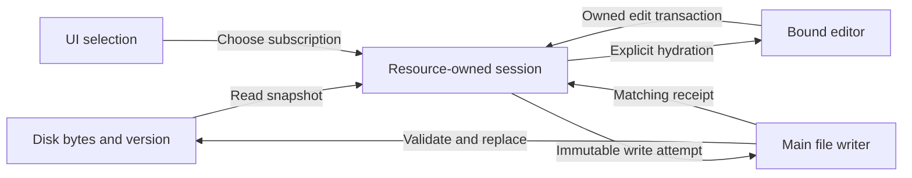
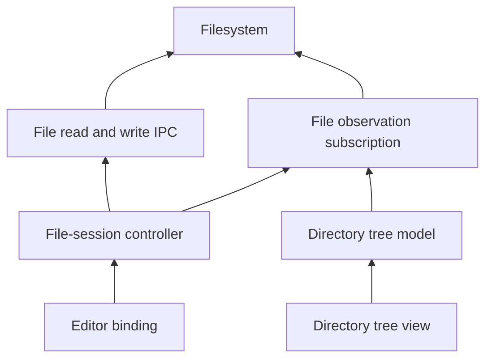
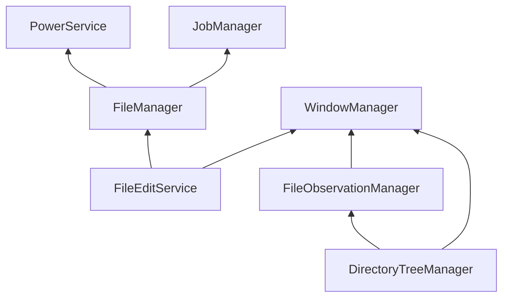

# Agent Note: 文件编辑会话生命周期与持久化归属

Status: proposed

[English](2026-10-22-file-edit-session-lifecycle.md) | 中文

## Problem

范围修订：[独立文件编辑实例与有界持久化](2026-10-23-independent-file-edit-lifecycle.md)现负责定义当前 PR 的拟议范围与验收门槛。下方更广泛的设计保留其备选方案及未来生命周期讨论，其中的共享会话、观察池和退出要求不再构成额外交付前提。实现与验收证据按该修订记录。

笔记在切换到已缓存文件时，可能以另一个文件的身份暴露旧文件的草稿。Markdown 规范化随后触发页面基于字符串比较的同步；这条同步路径此前会发出编辑回调，通过新文件的模型保存旧正文。[本次局部修复](../../implemented/bug-fix/2026-10-22-notes-session-isolation.md) 将回调绑定到模型实例、隐藏身份不匹配的快照，并让富文本编辑器静默加载快照，同时保留实时 Markdown getter。其本地回归测试和 Electron 复现验证了这次修复，不能证明整个编辑生命周期都没有竞态。

现有设计仍将所有权分散在 React 镜像状态、可变模型引用、SWR 快照、编辑器实例和页面 effect 中。选择文件属于展示决策，此前却也决定了回调正文的写入归属。Markdown 表示不同属于格式事实，此前却也充当同步命令。保存、切换模式、重新加载和释放视图需要明确契约，不能依赖这些间接信号协调。

本 proposed Spec 负责定义完整生命周期目标。它补充局部修复，不将已有证据重新解释为完整验收。本方案已按用户在会话中的明确授权开始本地实现；这不代表 GitHub 审批或所有验收项已经完成。

本 PR 的实现范围：按用户决定，暂不接入通用退出协调及其窗口／应用／重载流程。下文关闭协议仍是未来提案，不代表当前行为；本 PR 不交付 AC12、AC19 和 AC23。文件视图释放及文件变更操作准备仍在本次范围内。

## Proposal

### 范围与所有权

保留 Markdown 文件作为持久化格式，保留 Tiptap 实时 `getMarkdown()`。不引入笔记数据库、协作协议或新的编辑器框架。共享会话契约覆盖 Notes、ArtifactPane、AgentRightPane 和 SkillFileBrowser；富文本／源码模式规则适用于提供相应模式的使用方。

| 所有者 | 拥有的状态 | 边界 |
| --- | --- | --- |
| Renderer 文件会话控制器 | 资源身份、已接受草稿、磁盘基线、版本、待处理操作和失败状态 | 同一 renderer 内每个资源键只有一个活跃会话，由使用方共享；存在待处理工作或未保存正文时，视图脱离后仍保留 |
| React Hook 与页面 | 订阅及当前选择的会话 | 发布一份一致的会话快照；当前选择不为已存在的操作提供目标地址 |
| 编辑器绑定 | 一个会话挂接、编辑器实例、选区、撤销状态和已应用正文版本 | Tiptap 或源码编辑器只为当前绑定接受编辑；不拥有文件系统路径或写入操作 |
| Main 文件服务 | 资源解析、写入协调、磁盘验证、原子替换和受管文件元数据 | 复用现有文件 IPC 和变更协调；独立 renderer 会话不能静默覆盖彼此 |
| 标签页／窗口／应用关闭所有者 | 正常关闭是否可以继续 | 销毁 renderer 前等待会话关闭屏障；React effect 清理不是异步关闭协议 |

控制器位于现有 renderer services 层；`useFileEditSession` 保留为使用方适配器。控制器的可变运行时状态既不是 DataApi 业务数据，也不是可丢弃缓存。SWR 可以缓存不可变的读取快照，但不能覆盖活跃脏会话或决定能否安全释放它。文件系统契约的变更沿用现有 Main 服务／生命周期和 IPC 边界。



### 身份与一致状态

使用四种身份，各自承担不同职责。`resourceKey` 通过现有 `FileHandle` 和路径规则标识逻辑文件。`sessionId` 标识一个活跃会话实例。`bindingId` 标识一次编辑器挂接；替换编辑器或加载替代文档时，旧绑定失效。`revision` 为会话内已接受的正文变更排序。读取／重新加载尝试还携带操作身份，防止晚到结果替换较新操作的结果。

文件路径是地址，不是会话代次。文件条目 ID 保留现有逻辑语义。设备号／inode 可以标识物理快照，但不能成为永久笔记 ID：原子替换可能改变它们。资源解析和路径别名处理属于文件层，UI 组件不能各自发明路径规范化规则。同一 renderer 内，相同键的使用方共享会话。跨窗口会话保持独立，在 Main 写入边界协调；本提案不承诺实时协作合并。

发布一份不可变的可观察快照，整体包含身份、可用性、基线、草稿版本、脏状态、写入状态及错误／冲突详情，由拥有这些状态的转换统一更新。快照不能包含 A 的资源身份与 B 的正文。加载中、不支持的内容、文件缺失和读取失败必须区别于已就绪的空文件。脏状态和写入中可以同时成立；在途保存不代表最新草稿已持久化。

基线将解码正文、字节保留元数据、磁盘版本和内容哈希绑定到同一次读取快照。草稿是最新已接受的持久化表示。活跃编辑器拥有其编辑文档，并将变更提交给会话；会话草稿是已接受的快照，不是每次按键后都回填给编辑器的另一套竞争状态源。正文版本负责工作排序，本身不能证明内容脏了或已持久化。

### 不变量

1. 每次编辑都携带产生它的会话和绑定；已退役身份不能修改其他挂接或会话实例。
2. 写入固定捕获资源、会话、版本、基线和字节。其目标和确认结果均不能通过当前 UI 选择来定位。
3. 未编辑时，打开、读取、聚焦、序列化、渲染和切换模式均不产生写入，并保留原始字节。
4. 只有已接受的正文编辑安排自动保存。仅改变选区的事务和快照加载不触发保存。焦点不能用于判定编辑来源。
5. 保存确认只推进其实际提交的基线。较新的已接受编辑继续保持待保存；旧确认不能替换当前草稿。
6. 异步读取、重新加载和冲突操作在应用结果前，必须验证操作身份及版本前提，即使路径没有改变。
7. 编辑器脱离撤销的是其回调资格，不是会话已接受的正文或正在运行的写入。脏、失败、冲突或写入中的会话均不能被淘汰。
8. 不能仅因定时器触发、IPC 已受理、组件卸载或记录了错误，就报告已保存或已关闭。

### 生命周期转换

| 触发条件 | 必须执行的转换 | 完成与失败规则 |
| --- | --- | --- |
| 打开资源 | 获取已有活跃会话，或发起归属明确的读取；匹配快照可用前发布加载状态 | 重新打开待保存／失败的 A 时复用其保留会话；已取消或较旧的读取不能填入 B 或替代的 A 会话 |
| 读取成功或失败 | 整体采用一致的基线与草稿，或发布不可用状态，不能用可编辑空内容替代 | 空正文有效；不支持的编码／大小仍阻止编辑；重试创建新的读取尝试 |
| 挂接编辑器 | 创建绑定，加载会话已接受的快照，不发出编辑事件 | 解析／初始化失败时保留会话正文并展示错误；不能保存空文档或部分文档 |
| 编辑、粘贴、撤销／重做或听写 | 验证绑定，接受正文事务，推进版本，字节不同时安排保存 | 拒绝过期回调和异步插入结果；选区／焦点变化不创建正文版本 |
| 切换编辑模式 | 完成离开编辑器的输入事务，撤销其绑定，再将新模式挂接到同一会话 | 输入法组合输入必须完成，否则等待或取消切换；仅切换模式不能规范化持久化草稿 |
| 从 A 切换到 B | 脱离 A 编辑器并订阅 B；A 存在待处理工作或未保存正文时予以保留 | A 的写入可以在后台针对 A 完成；失败仍可恢复，并由所属使用方展示 |
| 自动保存或显式保存 | 固定捕获一次写入尝试，经资源队列串行执行 | 合并尚未提交的编辑；前次确认后，为较新编辑捕获新尝试；防抖仅负责调度 |
| 保存成功 | 推进匹配的基线，并根据当前草稿计算脏状态 | 不重置编辑器、选区或撤销历史；不能把较新版本标成已保存 |
| 保存失败或冲突 | 保留草稿，展示保存受阻原因 | 停止自动重试循环；显式重试使用保留草稿；冲突必须通过明确的解决操作处理 |
| 文件监听／重新验证事件 | 视作失效提示；在安全时发起带操作身份的读取 | 只有会话仍干净、版本／基线未变且读取仍有效时才应用；不能静默替换脏草稿 |
| 重新加载或放弃修改 | 进入明确的替换操作；等待在途写入结束，并暂时阻止新编辑 | 仅在当前操作成功后替换；失败保留原草稿；恢复正文时创建新编辑器绑定 |
| 冲突后保留本地草稿 | 保留捕获的草稿，在受保护的冲突解决操作中刷新磁盘基线，再尝试条件保存 | 决策期间阻止编辑；磁盘再次变化会产生新冲突，不能无条件覆盖 |
| 重命名／移动／删除或更换根目录 | 暂停受影响资源的编辑，刷新并等待写入结束，再执行明确的文件操作 | 失败后会话仍可恢复；成功后才退役／重新绑定身份，不能修改正在运行的写入目标 |
| 外部删除／替换 | 将资源标为不可用或已改变，同时保留本地未保存正文 | 不能静默重建已删除文件；重建或另存为必须经明确操作并验证新目标 |
| 关闭视图 | 撤销绑定并释放挂接 | 干净、空闲且无引用的会话可释放；未保存或写入中的会话仍有所有者，并可进入恢复流程 |
| 正常关闭窗口或退出 | 暂停输入，收集所有保留会话，等待保存／在途操作结束 | 失败或冲突取消关闭，除非用户明确放弃受影响的未保存版本；超时不是成功 |
| 崩溃或强制终止 | 不假定 renderer 异步清理能完成 | 重启后读取磁盘真实状态和已有 Main 恢复状态；只覆盖已确认提交的字节，不覆盖未保存内存草稿 |

释放视图不能让保留的失败状态失去处理入口。所属使用方必须保留可操作的恢复界面，包括已删除文件不再出现在树中的情况。重新获取资源时返回保留草稿。如果使用方无法提供恢复所有者，就必须阻止该视图关闭，直到保存成功或明确放弃。允许淘汰干净会话，不允许淘汰脏会话。

正常关闭时，在捕获待保存目标前暂停新输入，并完成输入法组合输入和待处理的已接受编辑器事务。取消关闭后，以新绑定恢复编辑。已提交的文件系统操作不会因取消其 promise 就撤回提交：必须等待其结束，才能执行放弃、重命名或最终释放。因此写入期间放弃修改，应使用写入结束后最新确认的基线，不能回到更旧的基线而撤销成功保存。

### 文件监听依赖与订阅归属

当前通知先经过目录树使用方，再到达编辑会话：


[NotesPage](../../../../src/renderer/pages/notes/NotesPage.tsx) 只转发当前文件的更新，并将修改时间传给会话。这使外部变化感知依赖目录树 UI 和当前选择。目标是让会话控制器与目录树模型分别消费文件观察结果；编辑器只消费绑定的会话。下图箭头表示依赖方向，不表示事件方向：



文件观察与文件 I/O 是并列能力。保存以写入返回结果确认，不能以监听回声确认。即使没有收到通知，每次条件写入仍须验证基线。监听事件是失效提示，不是正文快照、编辑事务或保存确认。脏会话记录待核对状态，展示已确认的冲突，但不替换草稿；干净会话可以采用经过保护性检查的读取。读取捕获资源／会话身份、操作身份、草稿版本与基线，应用前再次核对。订阅退役时，其上一代回调也随之失效。

区分三种版本：目录树事件序号用于检测缺口和重复；磁盘版本／内容哈希用于校验持久化基线；会话版本用于排列已接受的编辑。三者不能互相替代。复用目录树传输时，保留现有快照／监听器／激活衔接协议，包括激活期间重放的事件。事件缺口、监听失败或订阅恢复意味着内容是否最新尚不确定，需要重新核对；不能解释为空正文或持久化成功。观察不可用期间，保留草稿仍可恢复。

[DirectoryTreeManager](../../../../src/main/services/file/tree/DirectoryTreeManager.ts) 已为相同根目录／选项共享 builder 与 watcher，管理窗口所属的使用方，并在服务停止时等待释放。[DirectoryWatcher](../../../../src/main/services/file/watcher.ts) 是由调用方持有的可释放基础能力，不是独立生命周期服务。复用这些资源管理能力。观察边界不要求会话维护整棵目录树。下述具体设计在文件模块内抽出共享 watcher 归属，不挂载隐藏目录树 UI，也不为每篇笔记单独开启 watcher。保持明确的观察范围／选项和引用计数归属。

会话所有者独立持有观察订阅，不依赖编辑器挂接或目录树是否可见。后台保留会话存在未保存正文、失败、冲突或待完成写入时，继续保持监听覆盖。编辑器脱离释放绑定；目录树关闭释放该使用方的订阅；操作已结束的会话释放时，释放其订阅。底层 watcher 仅在最后一个使用方离开后关闭，允许沿用现有有界复用宽限期。根目录替换使旧订阅代次退役。路径事件应路由到受影响的资源身份，包括被删除目录的后代；仅凭原始 unlink/add 事件不能判定重命名，也不能据此改变写入目标。

服务依赖表达实际生命周期要求，不表达“都关心文件”。当前 `DirectoryTreeManager` 依赖 `WindowManager` 来清理所属资源，`FileManager` 依赖 `PowerService` 和 `JobManager`；本设计不为两个文件服务增加相互依赖。正常关闭时，在 renderer 与文件 I/O 仍可用期间暂停输入并等待会话操作结束，再释放订阅和销毁窗口。窗口销毁后的清理是资源释放兜底，不是草稿保存协议；仅靠生命周期装饰器无法实现该关闭屏障。

### Tiptap 与 Markdown 边界

Tiptap 拥有结构化 ProseMirror 文档；[Markdown 扩展](https://tiptap.dev/docs/editor/markdown) 将 Markdown 解析为该结构，并将其序列化回 Markdown。`getMarkdown()` 查询当前编辑器正文，不是磁盘快照、脏状态检测器或同步触发器。为语音及其他使用方保留其立即读取最新正文的行为。

初次加载、重新加载、放弃修改和已接受的外部替换使用明确的加载命令。Tiptap 的 [`setContent`](https://tiptap.dev/docs/editor/api/commands/content/set-content) 支持 `emitUpdate: false`；适配器也必须停止主动发出自己的正文变更回调。该选项本身不会撤销应用回调或重置撤销历史。跨资源挂接必须采用全新的编辑器状态；明确替换正文后，撤销不能恢复已放弃／已替换的文档。普通保存确认必须保留撤销历史。

移除页面通过比较序列化 Markdown 与会话草稿来决定是否重新加载编辑器的 effect，改为跟踪绑定已应用的正文版本及变更来源。接受编辑器自己的更新后，不能立即将该更新作为整份文档替换再次应用。模式切换使用会话最后接受的正文；没有编辑的模式不能将其初始解析表示序列化回草稿。

在接受真实编辑之前，保留原始 Markdown 写法、UTF-8 BOM 和支持的 LF/CRLF 字节。富文本编辑可能规范化受支持的 Markdown 语法；本提案不引入保留源码写法的 Markdown 解析器。不支持的结构不能仅因查看文件或切换模式而从文件中消失。提升富文本往返保真度属于独立工作，不能隐藏在生命周期同步逻辑中。

### 磁盘写入、冲突与恢复

文件 I/O 继续经过现有 Main 文件服务和 IPC。复用其变更协调，不能另加一把仅存在于 renderer 的锁，就宣称具备跨窗口保护。所有范围内的写入路径都必须为解析后的资源参与现有 Main 协调，包括能够访问同一目标的受管条目和路径使用方。Renderer 会话队列负责本地版本顺序；Main 验证负责协调独立写入方。

携带与实际读取字节绑定的内容哈希，在替换目标前验证磁盘基线。仅靠 `mtime + size` 无法检测时间戳未变或精度较低时的同大小修改。路径 IPC 已提供读取哈希和预期写入哈希，但当前 Hook 未使用；受管条目支持和一致验证需要明确实现与测试。不能对某种已支持句柄静默省略基线检查。哈希用于检测意外变化，不是对抗攻击的真实性验证机制。

保留编解码器的字节保留规则和不支持内容的处理规则。准备完整输出，在接近提交时验证基线，通过现有写入器原子替换文件。仅元数据改变时，可在确认基线内容未变后重新建立基线。如果磁盘已包含本次尝试的字节，应确认该尝试的结果，不能覆盖较新的本地草稿。真实正文不匹配时停止保存，直到执行重新加载或保留本地内容的冲突解决操作。

将 `COMMITTED_METADATA_PENDING` 与字节写入失败区分开：核对已确认的文件正文，并保留 Main 元数据恢复结果。不能仅为修复元数据就重放相同载荷，也不能把较新草稿标为已保存。写入结果不确定时，保留操作与草稿，直到重新读取确定结果，或展示明确且可恢复的错误。

原子替换防止产生半份文件；它不是针对任意外部程序的文件系统比较并交换。Main 可以串行协调参与协议的应用写入。外部写入方仍可能在验证与替换之间发生竞态，同步盘或网络卷尤其如此。必须保留这个边界：本 Spec 承诺应用内所有权隔离，以及在验证时检测冲突；不承诺通用跨进程互斥，也不承诺恢复崩溃前从未提交的编辑。持久化未保存草稿日志需要独立的持久化提案。

### 具体服务边界与代码归属

以下名称和签名描述拟实现的接口，不代表当前已经提供。替代实现通过同样的回归测试前，保留现有局部补丁。复用现有编解码器、IpcApi schema、生命周期容器、事件基础能力和原子写入器；不需要通用状态机框架、事件总线或协作引擎。

| 组件 | 位置与生命周期 | 依赖与职责 |
| --- | --- | --- |
| `FileEditSessionManager` | Renderer `services/fileEdit/`，由窗口组合根持有一个实例 | 拥有会话注册表、草稿、定时器、读写尝试、恢复清单和编辑器绑定；调用文件 IPC 与观察适配器；不导入页面或编辑器组件 |
| `useFileEditSession` | 现有 Hook，订阅生命周期 | 通过 lease 和 `useSyncExternalStore` 订阅；按请求身份处理获取／加载；不持有草稿镜像、SWR 变更或写入器 |
| 编辑器适配器 | 现有 RichEditor 与源码编辑器集成处 | 实现下述窄接口；编辑事务提交归属明确的正文；Tiptap 实例、选区、历史和输入法仍由此处持有 |
| `FileEditService` | Main `services/file/` 内新增生命周期服务，`WhenReady` | 依赖 `FileManager` 和 `WindowManager`；拥有窗口所属的编辑 lease 和写入结果记录，经现有文件内部实现执行严格编辑 I/O；不拥有草稿或编辑器状态 |
| `FileObservationManager` | Main `services/file/` 内新增生命周期服务，`WhenReady` | 依赖 `WindowManager`；拥有共享 watcher 池、观察 lease、激活队列及清理；复用现有 watcher 基础能力；不依赖编辑会话或 FileManager |
| `DirectoryTreeManager` | 现有 Main 生命周期服务 | 依赖 `WindowManager` 和 `FileObservationManager`；builder 消费共享观察结果，保留目录树投影、扫描与激活协议 |
| 关闭集成 | 现有窗口／应用所有者与 renderer 组合根 | 向 WindowManager／Application 注册通用关闭参与者；组合会话管理器与 IPC；两个核心模块均不导入文件编辑业务服务 |

本方案选择将共享观察归属从目录树 builder 抽到 `FileObservationManager`，不复制现有目录树池。树 builder 仍按目录树选项共享；原始 watcher 仅按影响观察的根目录／选项共享。展示过滤条件不能抑制会话需要的事件。先共享完全等价的观察范围；本次不必合并重叠根目录。会话优先借用已配置工作区根目录的监听覆盖，否则使用父目录范围；同一范围内的文件共享监听，不能每个文件开启一个 watcher。Main 服务继承 `BaseService`，在 `serviceRegistry.ts` 注册，通过生命周期 disposable 释放资源。Renderer 管理器由组合根明确创建／释放，不能每个 Hook 创建一份。

拟议 Main 生命周期依赖图如下；箭头表示 `@DependsOn`，不表示 IPC／事件方向。按逆依赖顺序，目录树／编辑所有者先于其使用的观察／文件服务释放。正常关闭准备发生在该停止顺序开始之前。



Renderer 专用契约放在 `renderer/services/fileEdit/` 或 `renderer/types/`；文件契约进入 `shared/ipc/schemas/file.ts`，窗口关闭契约进入 `shared/ipc/schemas/window.ts`，领域错误进入对应的 `shared/ipc/errors/` 模块。Main handler 保持无状态适配器。文件字节和运行时 lease 使用 IpcApi，不使用 DataApi 或 Cache。新增 Main 服务是因为其拥有持久资源／结果记录；辅助函数不因此升级为服务。

### 会话与编辑器函数契约

下述结构使用现有 `FileHandle`、`FileVersion` 和 `ContentHash` 类型。ID 不透明且不可变，实现时可增加品牌类型。快照不可变，只有所属状态转换改变内容时才更换引用。草稿／基线为 null 表示不可用，不能解释成可编辑空文件。文件缺失或不支持时，仍可能保留此前接受的草稿。`freshness: verified` 表示最近一次核对时已验证，不表示与磁盘持续同步。

```typescript
type SessionRef = Readonly<{ resourceKey: string; sessionId: string }>
type BindingRef = SessionRef & Readonly<{ bindingId: string; documentEpoch: number }>
type DiskBaseline = Readonly<{ version: FileVersion; contentHash: ContentHash }>
type TextSnapshot = Readonly<{
  text: string
  lineEnding: 'lf' | 'crlf'
  hasBom: boolean
  baseline: DiskBaseline
}>
type SessionFailure = Readonly<{
  kind: 'read' | 'unsupported' | 'missing' | 'conflict' | 'write'
    | 'outcome-unknown' | 'observation' | 'editor' | 'target-changed'
  code: string
  operationId?: string
}>
type SessionContent =
  | { availability: 'loading'; draft: null; baseline: null }
  | { availability: 'ready'; draft: string; baseline: TextSnapshot }
  | { availability: 'missing' | 'unsupported' | 'error'; draft: string | null; baseline: TextSnapshot | null }
type SessionSnapshot = Readonly<SessionContent & {
  ref: SessionRef
  revision: number
  documentEpoch: number
  dirty: boolean
  save: 'idle' | 'scheduled' | 'writing' | 'blocked' | 'outcome-unknown'
  access: 'editable' | 'sealed'
  freshness: 'verified' | 'invalidated' | 'unknown'
  metadataRecoveryPending: boolean
  failures: readonly SessionFailure[]
}>
type EditResult =
  | { kind: 'accepted'; revision: number }
  | { kind: 'rejected'; reason: 'stale-binding' | 'sealed' | 'not-ready' }
type CommandResult<T> =
  | { ok: true; value: T }
  | { ok: false; error: SessionFailure | { kind: 'cancelled' | 'busy' } }
type FlushReceipt = Readonly<{
  ref: SessionRef
  revision: number
  baseline: DiskBaseline
  metadataRecoveryPending: boolean
}>
interface SessionLease {
  readonly ref: SessionRef
  getSnapshot(): SessionSnapshot
  subscribe(listener: () => void): () => void
  attachEditor(adapter: EditorAdapter): CommandResult<BindingRef>
  acceptEdit(binding: BindingRef, next: string): EditResult
  detachEditor(binding: BindingRef): void
  flush(): Promise<CommandResult<FlushReceipt>>
  retrySave(): Promise<CommandResult<FlushReceipt>>
  discard(): Promise<CommandResult<void>>
  reload(): Promise<CommandResult<void>>
  keepLocal(): Promise<CommandResult<FlushReceipt>>
  release(): void
}
interface EditorAdapter {
  prepareDetach(): Promise<'ready' | 'cancelled'>
  hydrate(input: { binding: BindingRef; text: string; resetHistory: boolean }): void
  setEditable(editable: boolean): void
  rebind(binding: BindingRef): void
}
interface PreparedTransition {
  commit(input?: { replacements: readonly { source: SessionRef; handle: FileHandle }[] }): Promise<CommandResult<void>>
  cancel(): Promise<void>
}
interface FileEditSessionManager {
  acquire(handle: FileHandle): Promise<CommandResult<SessionLease>>
  listRetained(): readonly SessionSnapshot[]
  prepareTransition(input: {
    resources: readonly SessionRef[] | 'all'
    reason: 'mode' | 'rename' | 'move' | 'delete' | 'root' | 'close'
  }): Promise<CommandResult<PreparedTransition>>
}
```

`acquire` 先解析 Main 编辑 lease，再按返回的资源键去重，之后才启动编辑器或写入器。并发获取加入同一会话；多余 Main lease 被释放。已有保留会话直接复用，不能用新读取替换其草稿。获取尝试在任何 await 之前就归管理器所有，以便关闭流程取消或等待其结束。解析失败返回错误；Hook 发布绑定该请求的不可用状态。所选句柄变化时立即隐藏旧快照。已取消获取晚到完成时释放其 lease，不能挂接到新选择。

资源键标识文件层产生的规范文件地址，不使用 renderer 句柄的原始拼写。条目与路径句柄解析到相同且允许访问的规范地址时，共享 renderer 会话；保留每个已获取的定位信息用于验证，不能选择权限更高的一种来绕过限制。受管存储的路径写入仍禁止。本提案不改变持久化 `FileEntry.externalPath` 的规范化规则，也不承诺去重所有符号链接／硬链接别名。沿用现有路径语义；已解析条目改变目标时拒绝操作并明确重新绑定，已捕获的写入不能跟随变化。资源键相等不代表获得授权。

同一 renderer 的每个会话仅允许一个可写编辑器绑定。其他使用方可以订阅或呈现只读视图。第二次可编辑挂接返回 `busy`；明确移交时先暂停并脱离前一绑定。这避免两份独立的整文档编辑器互相覆盖事务，也不引入协作合并。`acceptEdit` 同步校验完整绑定与可编辑性，按编解码契约规范化已接受内容的换行，仅在正文变化时推进版本并安排自动保存。它不接受路径参数。过期／取消的生产者回调属于预期拒绝，不应变成保存错误或通知风暴。

`documentEpoch` 仅在首次采用正文或明确替换时推进，普通编辑和保存确认不推进。只有新绑定／epoch 才请求整文档加载。`hydrate` 同步、静默，可以抛出编辑器初始化错误；部分解析后不能启用编辑或确认就绪。`prepareDetach` 完成组合输入及已接受的事务，或取消转换；不能仅为了 flush 就序列化未经编辑的解析文档。返回 ready 后，控制器必须在再次让出执行权前同步封闭输入。取消转换通过 `rebind` 发放新绑定，保留同一编辑器文档和撤销历史。成功替换时以全新状态加载并重置历史。异步听写／插入结果仍须携带原绑定。

`flush` 在调用时捕获当前已接受版本及其编码字节。这个明确目标不能被后续编辑合并掉；成功表示这些字节已提交或确认已在磁盘。后续编辑可以仍然为脏。即使 flush 当前等于基线，也必须先等待可能改变该基线的较旧写入结束才能返回。只有自动保存可以合并尚未发送的版本。明确 flush 目标按调用顺序执行；相同目标的调用方可以共享确认结果。`retrySave` 在验证基线后恢复已知失败的尝试，不能绕过冲突或未知结果。`discard` 等待写入结束后恢复最新已确认会话基线，不写文件；`reload` 等待写入结束后读取磁盘，再替换正文。`keepLocal` 暂停输入并捕获本地草稿，读取新磁盘基线，再条件写入该草稿。失败保留正文并恢复可用绑定；任何命令都不能因记录了异常就报告成功。

`release` 是幂等的挂接释放，不代表保存完成。脏、失败、冲突、写入中或结果未知的会话仍由 `listRetained` 列出，并拥有恢复入口。干净且操作已结束的会话，在全部挂接和绑定离开后可以淘汰。`prepareTransition` 对受影响会话串行处理不兼容命令，封闭绑定并等待写入结束。模式移交需要完成组合输入，但不必强制写盘；重命名／移动／删除／根目录／关闭需要保存或明确放弃。多会话按稳定资源键顺序封闭，不持有 Main 文件系统锁。为关闭准备全部会话时，在第一次 await 前暂停新获取，并纳入尚未完成的获取；取消后重新开放准入。`commit` 和 `cancel` 幂等且互斥；取消保留已接受编辑。准备失败时，返回错误前撤销该尝试取得的全部封闭状态。重命名／移动时封闭源与已打开的目标，执行现有条件文件操作，再将经过验证的替代句柄交给 `commit`；失败调用 `cancel`。提交先打开并验证替代目标，再退役源身份。文件系统操作完成后发生失败时，保留旧草稿供恢复，并标为目标已改变；取消不能撤销已完成的重命名。删除提交退役已结束操作的源；模式提交释放旧绑定以便重新挂接。会话状态转换内部不执行任意异步回调。

### Main I/O、观察与关闭接口

使用专用的严格编辑路由，保留现有非编辑 `file.read` 使用方的契约。所有请求沿用 IpcApi 发送方验证。Main 从 `IpcContext` 获取所有者，检查每个不透明 lease 是否属于该所有者，并执行现有文件系统／受管存储边界。ID 不能作为跨窗口转让的能力。以下载荷与路由名称均为拟议接口：

```typescript
type EditResource = Readonly<{ editId: string; resourceKey: string; path: AbsoluteFilePath }>
type EditRead = Readonly<{ data: Uint8Array; baseline: DiskBaseline }>
type WriteRequest = Readonly<{
  editId: string
  sequence: number
  expected: DiskBaseline
  data: Uint8Array
}>
type FileWriteOutcome =
  | { kind: 'committed'; sequence: number; baseline: DiskBaseline; metadataRecoveryPending: boolean }
  | { kind: 'not-committed'; sequence: number; code: string }
  | { kind: 'not-started'; sequence: number }
type ObservationLease = Readonly<{ observationId: string; generation: string; sequence: number }>
type ObservationEvent = ObservationLease & (
  | { kind: 'invalidate'; paths: readonly AbsoluteFilePath[]; subtree: boolean }
  | { kind: 'resync-required'; reason: 'overflow' | 'gap' | 'watcher-error' }
)
```

| 路由／事件 | 输入 → 输出 | 契约 |
| --- | --- | --- |
| `file.edit.open` | `{ handle }` → `EditResource` | 解析并固定规范地址与定位信息；返回前登记所有者；不创建缺失文件 |
| `file.edit.read` | `{ editId }` → `EditRead` | 验证固定目标；有界的一致二进制读取，强制提供返回字节的哈希；Main 在读取前及有界读取期间执行8 MiB 编辑上限，包括 stat 后文件增大的情况 |
| `file.edit.write` | `WriteRequest` → `FileWriteOutcome` | await 前登记序号；验证目标和版本／哈希，仅提交一次，回复前记录终态 |
| `file.edit.settle_write` | `{ editId, sequence }` → `FileWriteOutcome` | 等待已登记操作；尚未开始则记录终态屏障，拒绝该序号晚到的请求 |
| `file.edit.close` | `{ editId }` → void | 退役 lease、拒绝新请求、等待已提交写入结束，再释放结果记录；对其所有者幂等 |
| `file.observe.create` | `{ rootPath, options }` → `ObservationLease` | 获取已就绪的范围监听，激活前缓存后续事件；队列有界并归发送方所有 |
| `file.observe.activate` | `ObservationLease` → boolean | 安装监听器后，仅激活捕获的代次／序号；溢出需要重新获取并核对 |
| `file.observe.dispose` | `{ observationId }` → void | 只释放该所有者的 lease；使晚到回调失效；最后一个使用方离开时等待 watcher 关闭 |
| `file.observe.event` | Main → renderer `ObservationEvent` | 带资源地址的失效通知或重新同步请求；不携带草稿或保存状态 |
| `window.edit.prepare_close` | Main → renderer `{ requestId, reason }` | 请求组合根准备所有保留会话；Main 不接收编辑器专用数据 |
| `window.edit.close_prepared` | `{ requestId, outcome }` → void | 绑定所有者的确认：已准备或受阻；受阻尝试必须完成取消后才能确认 |
| `window.edit.finish_close` | Main → renderer `{ requestId, action }` | 只提交或取消匹配的已准备请求；重复投递无副作用 |
| `window.edit.close_finished` | `{ requestId, outcome }` → void | 提交时报告清理结果，取消时确认编辑恢复；该确认不是新的数据安全批准 |

下述通用核心注册接口替代同步关闭返回值；实现时必须同时迁移受影响的调用方和原生关闭处理器。Main 窗口／应用所有者注册桥接参与者，其 ticket 发送上述带作用域的事件。`FileEditService` 不实现窗口 UI 策略。与编辑路由对应的文件服务方法显式接收 handler 解析的所有者；观察获取接收所有者及有类型的根目录／选项范围。内部树 builder 获取服务所属的观察 lease，不能伪造 renderer 身份。

```typescript
type CloseContext = Readonly<{
  requestId: string
  reason: 'window' | 'quit' | 'reload' | 'pool-reset'
}>
interface PreparedClose {
  commit(): void
  cancel(): Promise<void>
}
interface CloseParticipant {
  prepare(context: CloseContext): Promise<
    | { kind: 'prepared'; ticket: PreparedClose }
    | { kind: 'blocked'; code: string }
  >
}
interface WindowCloseRegistration {
  registerCloseParticipant(windowId: WindowId, participant: CloseParticipant): Disposable
  close(windowId: WindowId): Promise<'closed' | 'retained' | 'cancelled'>
}
interface QuitParticipation {
  registerQuitParticipant(participant: CloseParticipant): Disposable
}
```

`PreparedClose.commit` 同步、终结性地放行已证明安全的关闭屏障，不再次尝试保存。所有参与者均准备成功后才能提交任何参与者。提交保持输入封闭，停止会话准入并启动清理；不能因 watcher 关闭 IPC 失败而失败。Main 继续负责最终所属资源清理，在应用停止时等待服务释放。取消仅适用于全局提交之前，并等待有响应的 renderer 恢复编辑。准备／取消超时保持窗口存活及恢复归属；不能宣称无响应 renderer 已恢复。即使 prepare 尚未完成，也记录请求取消，使晚到的成功准备被取消而非接受。全局提交后，清理确认丢失不能重新开放准入，也不能使已确认的持久化屏障失效。

打开时先激活观察，再读取；每次失效通知推进本地失效代次，读取捕获该代次。如果读取期间收到事件，则安排下一次有界核对，不能宣称结果最新。无法建立监听时，可接受成功读取的正文，但新鲜度为 unknown，并展示观察错误；条件写入仍受保护。外部持续变化最终进入可恢复的不可用／过期状态，不能无限读取。脏会话重新核对时可以比较磁盘与基线，但不能未经明确解决就采用不同基线。写入期间排队的通知在保存确认之后核对，不能充当该确认。

每个编辑 lease 拥有单调递增的写入序号，最多一个在途操作及其终态结果。下一序号隐式确认前一终态；拒绝跳号、冲突或已退役序号。当前序号的相同重复请求加入／返回已有结果；比较包括基线和字节在内的不可变请求指纹。同一序号携带不同载荷属于协议错误。已知未提交或已建立未开始屏障后，重试使用下一序号并重新验证基线，不能改写终态记录。终态记录在回复丢失后仍保留，lease 活跃期间不因超时淘汰。`settle_write` 对晚到写入也建立屏障，避免超时后因错误的“未找到”判断产生第二个写入器。如果查询结果的 IPC 本身不可用，保持结果未知，阻止依赖它的新写入、破坏性操作和正常关闭。Main 崩溃后这些内存记录不再存在；重启读取磁盘及已有元数据恢复状态，不宣称恢复未保存的 renderer 草稿。

`FileEditService` 将实际写入交给文件模块已有的协调内部实现。初期保留现有全局 `pathMutationLock`；它目前不是按资源分组的锁。让参与协议的条目／路径变更共享提交协调。锁顺序是按稳定顺序获取条目锁，再获取路径变更锁；纯路径操作只获取后者。在短提交区间之前准备不可变临时字节；协调区间内重新解析目标、强制验证内容哈希（即使 mtime 含毫秒）、原子替换并同步完成元数据。不能持有路径锁时获取条目锁，不能通过公共包装重复获取同一不可重入锁，不能跨 await 持有 SQLite 事务，也不能持有文件锁等待 renderer。核对读取遵循同样顺序。声明应用级覆盖前，审计竞争的条目写入、流式提交和明确文件变更；不把其他无条件写入方改成合并操作。

已提交基线来自准备好的字节和提交结果，不能来自随后不受保护的 stat。`COMMITTED_METADATA_PENDING` 转为带元数据标志的 committed 结果；恢复责任仍由已有 Main 机制承担。Renderer 可以确认该版本字节已持久化并允许关闭，同时单独展示元数据待恢复。后续磁盘不匹配属于独立失效。版本不匹配但字节未变时，最多按现有有界三轮重新建立基线并重试；磁盘已等于尝试字节时可以确认内容已存在。其他正文不匹配均为冲突。重试不能重建缺失目标。另存为先暂停源会话，再走现有明确目标选择流程，独立验证目标，覆盖需要确认；不能修改已有尝试的目标。

窗口关闭需要上游契约，因为当前 `WindowManager.close()` 可能直接销毁窗口。在该所有者中增加通用异步关闭参与者；同一 renderer／会话继续存活时，保留隐藏到托盘／窗口池语义。销毁、renderer 重新加载和窗口池重置必须先准备参与者。用户请求的重新启动也必须先经过同一屏障，再标记应用正在退出；审计所有普通销毁／重新加载调用路径，防止绕过。更新安装的接入留到单独的改动中处理，本 PR 保留其原有退出流程。监听器在窗口创建时注册。正常 `close()` 与原生关闭汇入同一个待处理请求；最终结果区分已关闭／保留／取消，不能把受理当作完成。核心 WindowManager 调用已注册参与者，不依赖 `FileEditService`。

Application 已提供返回布尔值／Promise 的 `registerQuitGuard`；先执行这些策略 guard，再准备文件关闭参与者。增加具有 `prepare`、`commit`、`cancel` 的事务式参与阶段：服务仍可用时所有窗口准备；任一失败、新窗口／会话进入、超时或批准失效，均取消所有已准备参与者。准备成功后保持输入封闭，直到提交或取消。这避免后续 quit guard 否决后窗口一直无法编辑。只有所有参与者均准备成功，全局提交才可授权正常销毁；异步清理确认报告资源释放，不是额外保存批准。现有绕过用户 guard 的系统关闭路径及强制终止，不在正常关闭保证内。Renderer 缺失或无响应表示准备失败，不能视为允许放弃；明确强制退出仍是独立用户操作。

### 错误处理与恢复决策

现有 `FILE_STALE_VERSION` 和 `FILE_COMMITTED_METADATA_PENDING` 保留原义。为目标改变、lease 关闭、无效序号、文件缺失、读取不稳定、权限拒绝及空间不足增加明确的文件编辑错误码；不能通过匹配异常文本决定恢复方式。编解码器不支持原因保持 renderer 专用。领域失败以稳定错误码及结构化数据跨 IPC 传输；renderer 映射为 `SessionFailure` 和本地化操作。未预期的程序／传输错误在适配器边界规范化，经 `loggerService` 记录资源／会话／操作标识，不记录正文。预期的过期回调忽略；I/O 错误在视图脱离后仍须可观察。观察警告与保存冲突可以同时存在，不能用单一通用 `error` 槽互相覆盖。

| 失败 | 保留状态 | 允许的恢复及保存／关闭行为 |
| --- | --- | --- |
| 初次读取失败或不支持的编码／混合换行／大小 | 资源身份及已有保留草稿 | 重试／只读打开／适用时另存为；不能退化为可写空文件 |
| 编辑器解析／初始化失败 | 会话正文与磁盘基线 | 重试适配器或源码模式；不接受部分正文 |
| 文件缺失或条目目标改变 | 草稿、原定位信息和待确认结果 | 明确重新绑定／重新加载／另存为；不自动重建或改变目标 |
| `STALE_VERSION` 且字节不同 | 本地草稿、原基线及已观察磁盘信息 | 暂停自动保存；重新加载、基于新条件写入保留本地，或取消 |
| 权限、磁盘已满或已知提交前失败 | 草稿与已确认基线 | 原因解决后明确重试；不自动循环；除非放弃，否则阻止关闭 |
| 写入回复丢失／提交结果不确定 | 不可变尝试、序号及当前草稿 | 新写入前确认同一序号结果；不盲重试，不错误宣称写入失败 |
| 字节已提交、元数据待恢复 | 确认结果及可能存在的较新草稿 | 展示元数据恢复；不重放载荷；已提交版本可以关闭 |
| 监听错误、队列溢出或事件缺口 | 草稿、上次基线，新鲜度未知 | 有界重新获取／核对；不清空／重置；条件保存仍强制验证 |
| 过期读取、绑定回调或关闭确认 | 当前会话不变 | 丢弃结果并释放所属资源；普通取消不弹错误 |
| 关闭超时、保存冲突或参与者否决 | 所有未保存会话及可恢复绑定 | 取消已准备关闭并恢复编辑；超时不能等于成功 |

### 确定性竞态规则与验证矩阵

会话转换同步执行：验证令牌／前提，更新完整快照，再安排副作用。每个副作用均通过另一项经过验证的转换返回；改变状态的异步闭包不能读取当前页面选择。每次 await 之后再次核对，不能只在创建请求时检查。取消撤销的是采用结果的资格，不会撤销已提交的文件系统写入。

| 可控完成顺序 | 必须得到的结果 | 验证重点 |
| --- | --- | --- |
| A 开始读取；选择 B；A 完成 | B 不暴露 A，A 结果仅属于其保留实例 | 请求／会话身份，AC1/AC2 |
| 两个使用方并发打开同一规范目标 | 一个 renderer 会话和写入器、一个可写绑定；多余 Main lease 释放 | 获取去重，AC20 |
| 监听读取开始；编辑或另一读取先完成；旧读取返回 | 旧结果不能替换草稿／基线；必要时继续保留待核对状态 | 操作、基线、版本及失效代次，AC7/AC18 |
| 基线 A 开始保存 B；完成前用户撤销回 A | B 确认后当前 A 重新变脏，随后保存 A；不能因曾暂时等于旧基线就丢失 | 每次确认后重新计算脏状态，AC5 |
| 开始保存版本 n；接受 n+1；n 完成 | 基线推进到 n，n+1 仍待保存；编辑器选区／历史不变 | 捕获尝试与当前草稿，AC4/AC5 |
| 明确 flush 捕获 n；发送前又发生编辑 | 确认前提交／验证承诺的 n 字节；后续自动保存继续 | 固定 flush 目标，AC21 |
| 写入回复丢失；结果查询先于延迟请求到达 | Main 返回终态提交，或建立未开始屏障；晚到请求此后不能写入 | 序号屏障与结果保留，AC22 |
| 自身回声先于保存确认到达；确认后又有外部写入 | 回声不确认保存；后续核对／哈希检查检测外部正文 | 独立的确认／观察路径，AC7/AC9/AC18 |
| 重新加载／放弃／保留本地与写入或输入法竞争 | 暂停或取消，等待已提交工作结束，再替换；读取失败保留草稿和撤销状态 | 命令互斥与组合输入边界，AC4/AC8 |
| 重命名／删除／切换根目录与旧监听回调或写入竞争 | 操作针对捕获的源结束；旧代次不能影响新身份 | 资源操作屏障，AC11/AC16 |
| 一个窗口已准备关闭；另一窗口否决或无响应 | 有响应的已准备窗口恢复编辑；无响应窗口保持存活并保留恢复归属 | 事务式取消，AC12/AC19/AC23 |
| watcher 创建未完成时最后一个订阅释放 | 晚到 watcher 被关闭，不复活使用方、不泄漏文件描述符 | 创建／释放代次，AC17 |

测试通过可延迟完成的读写／IPC 与真实文件字节断言，不能靠睡眠或回调次数。Renderer 测试覆盖完整 Hook／页面／编辑器边界；Main 使用真实临时文件，涉及条目元数据时使用现有数据库测试 helper。Electron 覆盖原始大笔记切换、输入法／模式移交、双窗口、正常关闭取消、renderer 重新加载和进程重启。分别报告 macOS／Windows／Linux 证据；单元测试成功不代表桌面验收。

### 交付阶段与完成门槛

| 阶段 | 交付内容 | 继续推进前的门槛 |
| --- | --- | --- |
| 1. 严格文件边界 | Main 编辑 lease、强制哈希、协调提交及可恢复写入结果 | 真实文件条目／路径一致性、锁顺序和回复丢失测试；AC9/AC10/AC22 |
| 2. 观察归属 | 共享观察管理器、目录树 builder 迁移与激活／恢复协议 | 既有目录树行为、独立会话订阅和释放测试；AC16–AC18 |
| 3. 会话所有者与适配器 | 注册表、一致快照、单可写绑定、队列和命令契约 | 确定性身份／撤销／读写测试；AC1–AC8/AC20/AC21 |
| 4. 使用方迁移 | Notes、ArtifactPane、AgentRightPane、SkillFileBrowser 与保留草稿恢复入口 | 真实使用方测试及原始覆盖 Electron 复现；AC11/AC14/AC15 |
| 5. 关闭与验收 | 窗口关闭／重新加载／池重置与事务式应用退出、恢复及重启 | 关闭否决／超时测试、分平台 Electron 证据及完整 AC 映射；AC12/AC13/AC19/AC23 |

各阶段可以基于有类型的适配器开发，但对应持久化与观察契约未完成前，使用方不能迁移到新所有者。每个迁移使用方的旧、新写入器必须互斥；不采用双写发布。只有替代实现通过对应回归后，才删除旧页面字符串比较 effect、可变 Hook 模型和页面持有的监听转发。参考文档描述已交付行为，随实现更新，不能仅凭本提案就改写为已经实现。

### 实现与验证边界

按上述交付阶段推进：先建立严格的 Main 持久化与观察边界，再迁移 renderer 所有者、使用方和关闭集成。每一步都必须可独立评审，并保留局部修复的回归覆盖。文档存在本身不授权开展新的实现；Spec 遵循仓库审批流程。

当前入口包括 [useFileEditSession](../../../../src/renderer/hooks/useFileEditSession.ts)、[NotesPage](../../../../src/renderer/pages/notes/NotesPage.tsx)、[NotesEditor](../../../../src/renderer/pages/notes/NotesEditor.tsx)、[useRichEditor](../../../../src/renderer/components/RichEditor/useRichEditor.ts)、[文件 IPC](../../../../src/main/ipc/handlers/file.ts) 和[路径正文操作](../../../../src/main/services/file/utils/content.ts)。关闭集成遵循现有[窗口管理器](../../../../docs/references/window-manager/README.md)和[生命周期](../../../../docs/references/lifecycle/README.md)边界。新的跨进程契约进入 shared IPC schema；UI／编辑器身份留在 renderer，除非 Main 操作确实需要它们。

测试必须通过可延迟完成的操作控制读写顺序，同时断言可见正文和持久化目标字节。覆盖身份改变后的过期完成，也覆盖同一身份内发生编辑后的过期完成。包含 React 清理／重新挂接、重复取消和文件监听回声。定时器可以验证防抖，但不能靠睡眠或点击速度制造竞态。Renderer 边界使用真实编辑器行为，Main／Electron 边界使用真实临时文件；不能在回归 harness 中复制页面的同步实现。

## Alternatives considered

- 回退实时 getter：掩盖规范化触发条件，同时恢复立即读取到旧正文的问题，生命周期归属仍不明确。
- 仅增加延时、effect 或编辑器 key：时序和重新挂载无法证明交给编辑器或写入操作的正文来自哪里。
- 将可变草稿留在 SWR 或当前页面状态中：缓存替换与组件释放仍会决定持久化行为。
- 每次渲染比较规范化字符串或文档树：表示相等无法识别加载操作、过期回调或写入所有者；大文件还可能产生较高开销。
- 将全部编辑器状态移到 Main，或将笔记改存 SQLite／Tiptap JSON：扩大持久化契约，并非实现所有权隔离所必需。
- 立即增加全局协作引擎或崩溃恢复日志：它们提供其他保证，但消除跨会话写入并不依赖这些能力；应分别设计。

## Acceptance criteria

- AC1 — 冷启动、缓存及乱序完成的 A→B→A 打开流程从不暴露其他资源的就绪草稿；空文件仍可编辑，读取失败／不支持的内容不会变成可写空正文 (verification: renderer; owner: session controller)
- AC2 — 已退役会话或编辑器绑定的回调不能修改当前草稿，包括相同路径重开、源码／富文本替换、延迟听写及重复清理／挂接 (verification: renderer; owner: editor binding)
- AC3 — 对会发生 Markdown 规范化的内容、空正文、BOM/CRLF 和 150000 字符样本，未编辑时的查看、聚焦、实时读取和源码／富文本／只读模式切换均不改变文件字节及修改时间 (verification: renderer and Electron; owner: Notes integration)
- AC4 — 输入、粘贴、撤销／重做、输入法和程序插入均更新目标会话并保存到其资源；保存确认保留选区与撤销历史，明确替换正文后不能撤销回被替换文档 (verification: renderer and Electron; owner: editor binding)
- AC5 — 在途保存期间接受的编辑不会被其完成结果抹掉，内容不同时仍待保存，并按顺序提交；确认结果不能更新其他会话或将较新未保存正文标为干净 (verification: renderer and Main; owner: save coordinator)
- AC6 — 保存期间或保存失败后切走并重新打开，会恢复同一份待保存草稿，不产生竞争的本地写入器；脱离视图后的失败仍可进入恢复流程，只淘汰干净且操作已结束的会话 (verification: renderer and Electron; owner: session controller and consumers)
- AC7 — 文件监听读取和缓存重新验证不能替换读取开始后发生的编辑，也不能恢复较旧基线；自身保存回声不形成保存循环，干净状态下的外部替换静默加载 (verification: renderer; owner: snapshot reconciliation)
- AC8 — 重新加载、放弃和保留本地内容的冲突解决会等待已有写入结束并拒绝过期结果；替换期间不丢编辑，读取失败保留草稿，新的外部修改重新产生冲突 (verification: renderer and Main; owner: resolution commands)
- AC9 — 对支持的路径及条目句柄，基于与正文绑定的基线检测同大小／低精度时间戳的外部修改及应用内竞争写入；正文未变的元数据触碰可重新建立基线而不丢本地编辑 (verification: Main with real files and Electron with two windows; owner: file services)
- AC10 — 保存失败保留可操作的草稿，不产生重试风暴；字节已提交但元数据待恢复时，核对结果而不重放载荷，也不错误确认较新草稿 (verification: renderer and Main; owner: persistence recovery)
- AC11 — 重命名、移动、删除和根目录变更不能重定向在途保存；失败保留恢复能力，外部删除不导致隐式重建，显式另存为使用新的目标身份 (verification: Main and Electron; owner: file operations and consumers)
- AC12 — 正常关闭标签页／视图、窗口和应用时，要么保留有所有者的可恢复会话，要么等待保存成功／明确放弃；失败、冲突或超时不能静默销毁未保存正文，取消关闭后恢复编辑 (verification: renderer and Electron; owner: close coordination)
- AC13 — 异常终止与重启呈现最后提交的完整文件，不会将操作重放到其他资源；验证边界明确排除未保存内存草稿恢复和对外部写入方的通用互斥 (verification: Main failure injection and Electron process restart; owner: persistence recovery)
- AC14 — Notes、ArtifactPane、AgentRightPane 和 SkillFileBrowser 满足共享身份／保存契约，保留各自已有的冲突、不支持文件和显式保存行为 (verification: explicit renderer consumer tests; owner: consumer migration)
- AC15 — 在完整 Notes 页面和真实临时文件上，仍能阻止原来的规范化触发覆盖；移除归属检查或静默加载时，相应完成顺序测试应失败；各平台证据分别报告 (verification: renderer and Electron; owner: regression coverage)
- AC16 — 后台保留会话独立接收带资源身份的失效通知，不依赖目录树可见性和当前选择；已退役根目录／订阅的回调不能影响替代会话，目录删除仍保留受影响的未保存草稿 (verification: renderer and Electron; owner: session observation)
- AC17 — 等价观察使用方共享底层 watcher；编辑器或目录树脱离不能释放其他使用方的监听覆盖，最后一个使用方释放或服务停止时完整释放 watcher，不泄漏资源 (verification: Main with real files and renderer; owner: file observation lifecycle)
- AC18 — 激活重放、重复／缺失事件、监听失败和订阅恢复均保留草稿并重新核对内容是否最新；成功写入不等待监听回声，遗漏通知不能绕过写入基线验证 (verification: Main and renderer with controlled event delivery; owner: observation transport and snapshot reconciliation)
- AC19 — 正常关闭在文件 I/O 仍可用时等待会话操作结束，随后释放观察订阅，不能依赖窗口销毁回调保存 renderer 草稿 (verification: Electron with delayed writes and close cancellation; owner: close coordination)

- AC20 — 经允许的条目／路径句柄并发获取同一规范地址时，共享一个 renderer 会话及写入器；明确移交前拒绝第二个可写绑定，同时允许只读订阅 (verification: renderer and Main; owner: session registry and resource resolution)
- AC21 — 发送前发生后续编辑时，明确 flush 仍保留捕获版本；普通自动保存仅合并尚未提交的工作，在途保存期间撤销回旧基线也会随后持久化 (verification: renderer with deferred writes; owner: save coordinator)
- AC22 — 回复丢失、重复请求和结果查询先于延迟写入到达，均不重复提交，也不允许已建立屏障的晚到写入；无法确认结果时保留草稿并阻止依赖操作 (verification: Main and renderer with controlled IPC delivery; owner: write outcome protocol)
- AC23 — 多窗口退出否决、重新加载／重置、准备超时和取消，均恢复所有已准备参与者；过期确认不能授权后续关闭，核心窗口／应用依赖不能反向指向文件编辑业务服务 (verification: Main lifecycle tests and Electron; owner: close participation)

## Risks

保留未保存会话会消耗内存，并需要可操作的恢复所有者；限制内存不能静默淘汰草稿。会话注册表必须释放干净空闲资源并撤销订阅，不能混淆卸载与持久化完成。

替换编辑器状态可能重置选区、历史或组合输入。这些重置必须符合明确的转换策略；普通自动保存和 React 重新渲染不能替换文档。真实富文本编辑后仍可能规范化 Markdown，因此无编辑时的字节保留与编辑保真度属于不同验收结论。

哈希验证增加大文件处理开销。应只在快照／写入边界执行，保留现有大小限制，不能每次改变选区就哈希或解析整份文档。路径别名、受管条目解析和不同平台文件系统行为必须经过测试，才能声明跨窗口覆盖。

新的编辑 lease 和结果记录增加 Main 内存／资源归属；对每个所有者限制准入数量，并在 lease／窗口／服务释放时清理，不能为满足限制而淘汰未确认写入。单可写绑定是明确的产品约束：同时编辑的多个视图需要移交，不能静默采用最后写入者。通用关闭参与者及文件提交协调的扩展，必须结合现有使用方评审后再实现。

关闭集成跨越 renderer 与 Main 生命周期，必须避免等待已销毁的 renderer。强制终止、断电、不参与协调的外部写入方和未保存草稿的崩溃恢复，不在上述更强保证范围内。局部补丁的既有测试通过，并不代表本提议生命周期已验收。
