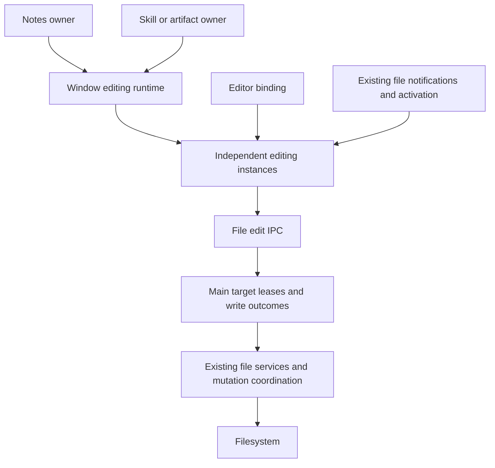

# Agent Note: Independent file editing instances and bounded persistence

Status: proposed

English | [中文](2026-10-23-independent-file-edit-lifecycle.zh.md)

## Problem

The original Notes overwrite combined two defects: a selected document could expose another document's draft, and loading an editor snapshot could produce an edit callback. That callback then used the currently selected model as its write destination. The [bounded isolation repair](../../implemented/bug-fix/2026-10-22-notes-session-isolation.md) records the reproduction and the first repair.

The [earlier lifecycle proposal](2026-10-22-file-edit-session-lifecycle.md) expanded into shared drafts across features, canonical resource identity, single-writer attachments, shared observation infrastructure and transparent session migration after moves. Those capabilities are not prerequisites for preventing the original loss. Their interactions expanded the review surface and introduced address normalization into the I/O path.

This proposal supersedes the earlier document's current-PR scope and acceptance gate. The earlier document retains the broader design alternatives and future lifecycle discussion; it is not an additional delivery checklist. This is a design revision, not evidence that the branch already implements it. Existing reference documentation continues to describe the current implementation until code changes land.

## Proposal

### Goal and scope

An accepted edit belongs to one editing instance. It can only be saved through that instance's captured file target and disk baseline. It remains recoverable while the renderer is alive until saved or explicitly discarded. Opening, switching and displaying a document cannot create an edit.

| Keep in this PR | Remove from this PR or defer |
|---|---|
| Coherent identity/content snapshots, silent hydration, binding generations | Cross-feature shared drafts and writer election |
| Instance-owned save queue, conditional writes, terminal outcomes and actionable errors | Canonical resource registry and entry/path/alias merging |
| Retention of detached unsaved instances within a live renderer | Crash journal, history, collaboration and cross-window draft synchronization |
| Safe preparation for existing file rename/move/delete operations | Transparent draft/session migration and alias-aware subtree matching |
| Guarded revalidation from existing notifications and activation | New observation IPC, shared watcher pool and directory-tree filter restructuring |
| Existing managed-file authorization, retention and metadata recovery | General close coordinator, Application/WindowManager/updater/reload changes |
| The agreed 8 MiB load/preview limit and ability for an open draft to grow | New arbitrary size limits or parser/dependency upgrades |

Notes, SkillFileBrowser, ArtifactPane and AgentRightPane may reuse the same implementation, but own independent state. Consumer edits are limited to explicit ownership, binding, recovery and existing file-operation integration. No simultaneous-editing product feature is added.

### Ownership and dependencies



| Owner | State and responsibility | Must not own |
|---|---|---|
| Window editing runtime | Instance inventory, retained recovery UI, preparation barrier and disposal | Canonical file identity, cross-feature draft merging, filesystem locks |
| Feature owner | Stable identity of a Notes workspace or an artifact/skill editing surface; current selection | File persistence through the currently selected mutable ref |
| Editing instance | Captured handle, Main lease, baseline, draft, revisions, queue and errors | Another feature's draft or editor undo history |
| Editor binding | Editor document, selection, undo history, composition and callback generation | File addressing or save completion |
| Main FileEditService | Owner-checked target lease, write receipts, pending operations and temporary-entry retention | Renderer selection, feature sharing or draft text |
| Existing file services | Authorization, target resolution, coherent reads, conditional commit and metadata recovery | UI lifecycle and shared editor selection |

Keep the current window provider as the stable lifetime owner. Change its registry from canonical-resource lookup to instance ownership; do not add a second registry service. Main services keep their existing lifecycle registration and dependency direction. There is no new dependency from core application/window services to file editing.

The feature supplies an `ownerId` that survives its editor remounts and ordinary navigation. It is allocated at the stable feature/tab boundary, not on every Hook render. The runtime retains pending owners after their view disappears. Within that owner only, the exact locator `(kind, entryId)` or `(kind, original path string)` locates a retained instance. It is an application lookup token, not a filesystem equivalence claim and never an I/O address transformation. Concurrent acquisitions of that same owner/locator join one pending acquisition. A second feature gets a separate instance even for the same file.

Use `sessionId` for instance inventory/recovery actions, a binding generation for callback eligibility, a document generation for explicit document replacement, and a revision for accepted edits. None is a permanent file ID. Reopening A in the same owner while A is saving or failed restores A's retained instance. Reopening a clean released A creates a new generation. Retired callbacks cannot mutate either case.

### Renderer interface

The following signatures describe the contract; implementation should adapt the existing manager and Hook rather than introduce parallel abstractions. `FileHandle` remains the existing entry/path discriminated union; `SessionSnapshot` is one immutable identity/content/status snapshot.

```typescript
interface FileEditRuntime {
  acquire(ownerId: string, handle: FileHandle): Promise<EditorBinding>
  recover(sessionId: string, action: 'retry' | 'discard'): Promise<void>
  prepareMutation(): Promise<PreparedMutation>
}

interface EditorBinding {
  getSnapshot(): SessionSnapshot
  subscribe(listener: () => void): () => void
  acceptEdit(text: string, documentEpoch: number, bindingEpoch: number): boolean
  flush(): Promise<void>
  reload(): Promise<void>
  discard(): Promise<void>
  keepLocal(): Promise<void>
  invalidate(): void
  release(): void
}

interface PreparedMutation {
  finish(): Promise<void>
}
```

`acquire` publishes loading until the requested instance has a coherent snapshot. Late abandoned acquisitions release their Main leases. A binding belongs to one editing surface; replacing rich/source editors retires the previous binding. There is no cross-feature writable/read-only election. Live `getMarkdown()` remains a query; explicit hydration is silent and cannot schedule a save. Mode switches wait for composition to finish or cancel the switch, and transfer the latest accepted draft without serializing an untouched document back to disk.

`release` revokes callbacks immediately and requests settlement of accepted work; it does not mean saved. Clean idle detached instances are evicted. Dirty, failed, conflicted and unknown-outcome instances remain in the runtime inventory with copy/retry/discard actions keyed by `sessionId`, labelled by feature and original locator. Retry does not silently resolve a conflict. The runtime cannot evict these instances to satisfy an admission limit; reject a new acquisition instead. Final disposal of an owner follows the same rule.

`flush` captures the current draft/revision immediately and resolves only after that content has a confirmed commit, or was already confirmed with no intervening write. New edits do not replace this explicit target. Autosave may coalesce only work not yet submitted. Ordinary save receipts update the baseline without hydrating the editor or resetting selection/undo. An undo to the previous disk content while a different write is in flight still requires a follow-up write after that write commits.

### Lifecycle and errors

| Event | Required transition | Failure behavior |
|---|---|---|
| Open/read | Bind result to acquisition and instance; publish identity, content and availability together | Missing/unsupported/unreadable is not an editable empty document |
| Accept edit | Check binding/document generations; advance draft revision; schedule instance queue | Stale callbacks are rejected without redirecting to current selection |
| Save | Capture target lease, sequence, bytes, revision and baseline | No retargeting from a later selection or pathname change |
| Successful receipt | Advance only the committed baseline; recompute dirty against the current draft | A newer draft remains pending |
| I/O failure | Pause automatic retries and retain draft; explicit retry keeps baseline validation | Permissions/no-space/read-only failures never become empty or clean state |
| Conflict | Preserve draft and baseline; show conflict with reload or explicit keep-local resolution | Never silently rebase changed external content and overwrite it |
| Lost IPC reply | Retain immutable attempt; settle the same lease/sequence | Unknown is not failure or success; block subsequent writes and destructive transitions |
| Metadata failure after byte commit | Record committed baseline and pending metadata recovery | Do not replay already committed bytes |
| Reload/discard/keep-local | Seal input, settle writes, then run one replacement operation | Failed read or unresolved outcome preserves draft; stale results cannot apply |
| Leave/reopen view | Release binding; retain unfinished instance; reacquire within its owner | Recovery remains reachable even if the file disappears from the tree |
| Normal file mutation | Prepare barrier, run existing operation, finish in `finally` | Failed preparation cancels the operation; partial filesystem failure still triggers revalidation |
| Window/process destruction | Preserve existing lifecycle behavior; Main settles accepted operations | No promise that unsent memory drafts survive quit, reload, crash or forced termination |

`discard` restores the latest confirmed baseline after settlement. `reload` explicitly reads a replacement document. `keepLocal` freezes the captured draft, obtains a fresh baseline and conditionally writes against it; a second intervening change produces another conflict. Replacements retire old editor history so undo cannot resurrect discarded content. Every read checks operation generation, draft revision, baseline and write state before adoption, including A→B→A and same-path reopen.

### Main persistence and address contract

Retain the existing `file.edit.open/read/write/settle_write/close` protocol and `EditWriteLedger` where they establish target ownership and terminal outcomes. Simplification removes `resourceKey` and `observationRoot` from the edit resource, not settlement, security checks or temporary-entry retention. Main owns the resolved write target; the renderer does not need it for instance identity. The original locator remains available for display. [A later decision](../../implemented/bug-fix/2026-10-25-file-edit-unblocked-writes.md) removed `settle_write`, write sequences and `EditWriteLedger`.

| Route | Required contract |
|---|---|
| `open(handle)` | Authorize the handle, resolve and pin the existing target, return an opaque `editId` |
| `read(editId)` | Return bytes and mandatory version/hash from the same coherent read |
| `write(editId, sequence, expected, data)` | Validate owner/target and baseline, commit under existing coordination, return terminal outcome |
| `settle_write(editId, sequence)` | Return the recorded outcome or fence an attempt that never started; unresolved stays blocked |
| `close(editId)` | Stop admission, drain accepted work, release target lease and retention |

Use filesystem target resolution on the original address before lexical path manipulation. For existing path handles, use Node's asynchronous [`realpath`](https://nodejs.org/api/fs.html#fspromisesrealpathpath-options) and test the actual runtime. [`path.normalize`](https://nodejs.org/api/path.html#pathnormalizepath) is lexical and cannot establish what a symlink traversal accesses. Do not normalize `/a/link/../note.md` before resolving it. Pin the resolved target for both reads and atomic writes, including temporary-file placement; a final symlink should remain a symlink while its resolved file is edited. Resolve the original locator again before a commit and reject a changed target. Entry handles retain their FileManager authorization/retention and validate their current target consistently.

Authorization must cover the actual resolved target. Audit `managedStorageGuard` on this call path: resolving a lexically collapsed address first is not sufficient. Do not broaden raw-path access to managed storage or fall back to another handle after denial. Failed resolution is an error, not permission to create a replacement file. Do not change persisted `FileEntry.externalPath` normalization or use inode/dev as permanent identity. Different aliases may yield independent drafts even when Main resolves the same target.

The baseline binds exact bytes, version and content hash; save validates it immediately before replacement under the existing application mutation coordination. Entry writes preserve entry-lock → path-mutex ordering. Independent participating writers with changed content cannot both successfully overwrite the same baseline. Equal-size/equal-mtime changes must still be detected by hash. Preserve BOM/line endings through the existing codec; hash only read/save boundaries, not every render or keystroke.

This is optimistic conflict detection, not a cross-process filesystem transaction. Atomic rename prevents partially installed content; it does not make the preceding hash comparison atomic against arbitrary external programs. External replacement between validation and rename, including symlink retargeting, remains outside the exclusion guarantee. Do not add OS locking, a collaboration engine or global alias identity to claim otherwise. Hard-link topology preservation is also outside this change: atomic replacement updates the selected pathname, not every hard-link alias.

### Observation and file operations

Reuse existing consumer notifications as invalidation hints. Also revalidate on activation/reacquisition and explicit reload. Background retained drafts do not need dedicated watcher subscriptions: writes always validate their baseline. A notification cannot acknowledge a save, overwrite a dirty draft, or cancel a real save error. A failed observation read only means freshness is unknown. This deliberately does not promise immediate external-change updates in every hidden view.

Remove the new `FileObservationManager`, editing observation IPC/adapter and tree watcher-sharing changes once their consumers are disconnected. Restore the target branch's directory-tree ownership; retain any independently landed upstream fixes. Do not remove the underlying existing watcher or its existing event protocol.

For existing in-window rename/move/delete actions, use one conservative window preparation barrier instead of resolving path aliases or matching descendant strings. `prepareMutation()` pauses acquisitions and edits across the runtime, settles reads/writes and flushes all retained dirty instances. A conflict, composition in progress or unknown outcome prevents the filesystem operation and releases the preparation seal. This is a coordination barrier only; it never merges drafts.

After successful preparation, the caller invokes the existing file operation and calls `finish()` in `finally`, including when the operation partially fails. `finish()` revalidates attached instances before resuming them; missing or retargeted handles become unavailable, unchanged documents retain history, and clean changed documents load as explicit replacements. A failed revalidation keeps that instance non-writable with recovery available but releases the window barrier for other instances. Old bindings remain retired. The caller opens a renamed destination through its returned handle as a new instance; the runtime never constructs a destination by replacing a path prefix. Clean detached instances can simply be released. Abandoned acquisitions and repeated finish calls must be safe.

The accepted cost is that an unrelated unsaved conflict in the same window can block a file mutation, and preparation may flush unrelated drafts. This avoids a new filesystem identity/matching subsystem. It does not globally block other windows: their participating writes remain subject to Main target/baseline checks. If finer-grained preparation becomes a product requirement, design it separately rather than restoring heuristic path matching here. [A later decision](../../implemented/bug-fix/2026-10-25-file-edit-unblocked-writes.md) keeps the window barrier but stops sessions already in conflict or save failure from blocking it.

### Implementation sequence and verification

| Step | Concrete change | Verification before proceeding |
|---|---|---|
| 1. Fix target semantics | Remove key-driven access normalization; align lease reads/writes/guard validation with the actual target | Real filesystem symlink-plus-parent, final-symlink, target-change and managed-root denial tests |
| 2. Isolate editing instances | Keep provider/manager; introduce stable owner-local lookup and session-ID recovery; remove locator merging and writer election | Deferred A→B→A, duplicate acquisition, independent owners, stale binding and retained failure tests |
| 3. Simplify transitions | Replace move remapping with preparation/finish and new-instance opening; keep outcome settlement | Mutation cancellation/partial failure, queued open, unknown receipt and unrelated-view recovery tests |
| 4. Remove observation expansion | Restore existing tree ownership and consumer invalidation; remove orphaned observation routes/services/tests | Existing tree consumers plus dirty/clean revalidation and missed-event save-conflict tests |
| 5. Align consumers and evidence | Update only affected adapters, reference docs and PR description; preserve 8 MiB behavior | Focused renderer/Main tests and real Electron Notes regression; separate local, platform and CI results |

Before each removal, trace its consumers and compare with the verified merge base; do not revert later upstream changes wholesale. Keep contract tests for actual data loss, settlement, authorization and metadata recovery. Replace tests whose only contract was shared drafts/watchers with independent-owner behavior; do not delete failing safety tests to shrink the diff.

Run explicit affected test paths, scoped formatting/lint and required documentation checks. Historical test totals for the broader branch do not certify this revision. The previous local macOS reproduction (150006-character A and normalized Markdown in B) is evidence for the original defect only; rerun it against the final narrowed implementation and add the agreed 8 MiB case. No implementation changes or runtime acceptance are implied by this document update.

## Alternatives considered

- Share one draft per canonical resource across every feature: useful for synchronized views, but introduces alias identity, permissions, writer handoff and relocation rules unrelated to the original overwrite.
- Depend on the OS or serialize writes alone: neither proves that a later draft was based on current disk content; baseline validation remains necessary.
- Revert the live Markdown getter, compare serialized strings, add delays or only remount editors: these do not establish callback ownership or distinguish loading from editing.
- Return to component-owned drafts with fire-and-forget unmount saves: failed detached saves lose their recovery owner.
- Use a per-file watcher or pool refactor as a correctness prerequisite: notifications cannot replace write validation and need not govern draft lifetime.
- Move persistence to SQLite/Tiptap JSON, add CRDT, history or crash recovery: each changes a separate product/persistence contract and needs its own scope.
- Automatically follow renamed paths or normalize aliases in the renderer: target addressing belongs to the file layer; new-instance opening avoids migrating live write ownership.
- Flush only the currently visible file before a directory mutation: misses retained instances; the conservative window barrier accepts broader blocking instead of guessing filesystem relationships.

## Acceptance criteria

- AC1 — Cold, cached and delayed A→B→A never expose another instance's ready content; abandoned acquisitions release leases and failures are not editable empty documents (verification: renderer; owner: instance runtime)
- AC2 — Viewing, focusing, live Markdown queries and mode switches without edits leave bytes and mtime unchanged, including normalization, empty files, BOM/CRLF and 8 MiB fixtures (verification: renderer and Electron; owner: editor integration)
- AC3 — Retired callbacks, composition and delayed insertions cannot edit a replacement binding; ordinary saves preserve undo/selection and explicit replacements retire old history (verification: renderer and Electron; owner: editor binding)
- AC4 — Edits during save and undo to an old baseline survive earlier receipts; explicit flush commits its captured content before completing and autosave eventually commits newer accepted edits (verification: renderer with deferred writes; owner: save queue)
- AC5 — Same-owner reopen recovers unfinished drafts without a competing acquisition; different owners retain independent editable drafts, and changed competing writes cannot silently commit against the same baseline (verification: renderer and Main with real files; owner: runtime and file persistence)
- AC6 — Failed/conflicted/unknown-outcome detached drafts remain actionable by session ID; retries do not loop automatically or bypass conflict resolution, and only clean settled instances are evicted (verification: renderer; owner: recovery surface)
- AC7 — A real symlink-plus-parent address and a final symlink read and write the intended file without altering a sibling or replacing the symlink; changed targets and managed-storage raw-path access are rejected (verification: Main with real filesystem and database helpers where needed; owner: target lease)
- AC8 — Hash baselines detect equal-size/equal-mtime content changes; metadata-pending commits, duplicate attempts and lost replies settle without replay or false clean state (verification: Main and renderer; owner: persistence outcomes)
- AC9 — Existing notifications, activation and reload cannot overwrite edits made after a read began; missing notifications do not bypass save validation, and observation failure does not clear or create a persistence error (verification: renderer and Main; owner: revalidation)
- AC10 — Preparation settles retained work before rename/move/delete; failure or composition cancels the operation, finish releases barriers after partial failure, and moved files reopen without redirecting an existing write (verification: renderer, Main and Electron; owner: file operation integration)
- AC11 — Notes, SkillFileBrowser, ArtifactPane and AgentRightPane preserve their existing supported/unsupported, conflict, explicit-save and recovery behavior with independent ownership (verification: explicit renderer consumer tests; owner: consumer adapters)
- AC12 — The original no-input overwrite and a real 8 MiB edit/save/reopen pass against final code with byte assertions; removed sharing infrastructure has no consumers, and docs distinguish these results from unrun platforms and excluded shutdown guarantees (verification: Electron, source inspection and docs gate; owner: delivery validation)

## Risks

Independent owners can produce more visible conflicts than shared drafts. That is the chosen behavior; no automatic merge or cross-feature live synchronization is promised. Retained drafts consume memory and require a visible recovery owner, including deleted files and closed feature views.

The conservative mutation barrier can block on an unrelated draft and adds read/flush work. It is deliberately bounded in algorithm and ownership rather than optimized by path equivalence. Main target checks and conditional writes still need platform evidence; local mock tests cannot establish Windows UNC/SMB behavior.

Resolving and pinning filesystem targets must be tested with the deployed Node/Electron runtime, its atomic-write helper and authorization path together. Do not treat a successful lexical comparison or hash of the wrong file as target correctness. External concurrent changes remain subject to the explicitly limited optimistic guarantee.

Renderer shutdown and crash can still lose edits not submitted to Main. This PR does not claim a normal-quit veto or durable draft journal. The broader proposal retains those separate design questions; they are not hidden implementation prerequisites for this bounded repair.
