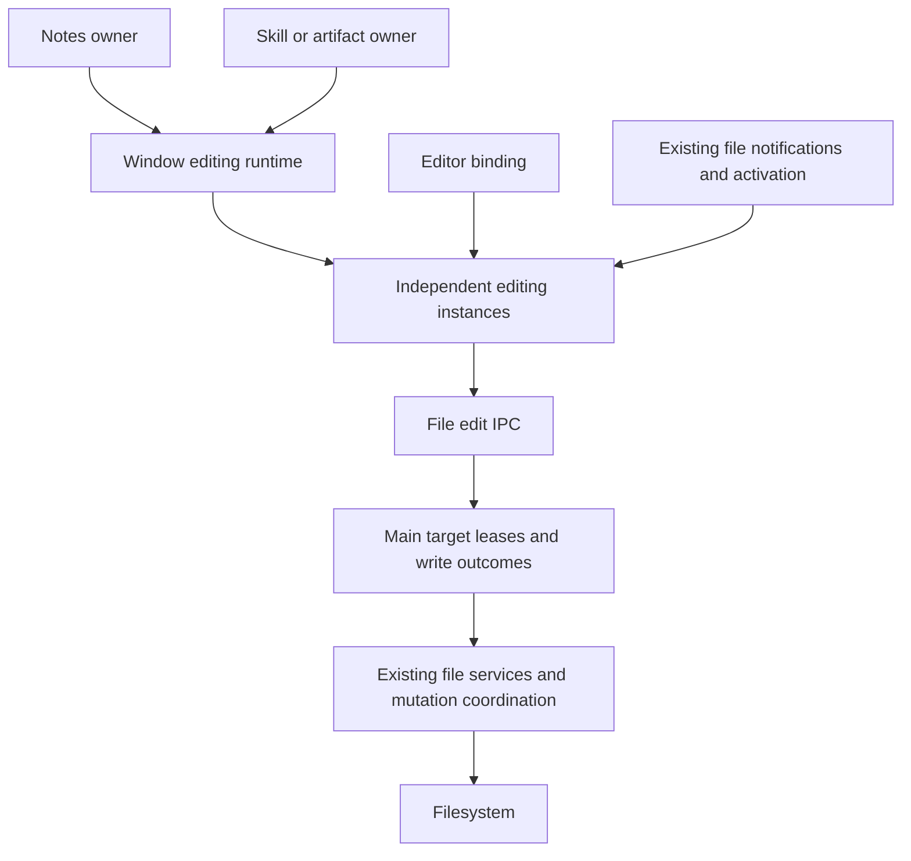

# Agent Note: 独立文件编辑实例与有界持久化

Status: proposed

[English](2026-10-23-independent-file-edit-lifecycle.md) | 中文

## Problem

原始笔记覆盖问题由两个缺陷共同触发：当前选中的文档可能暴露另一个文档的草稿，加载编辑器快照又可能产生编辑回调。该回调随后将当前选中的模型当成写入目标。[局部隔离修复](../../implemented/bug-fix/2026-10-22-notes-session-isolation.md)记录了复现过程与首次修复。

[此前的生命周期提案](2026-10-22-file-edit-session-lifecycle.md)扩展到了跨功能共享草稿、规范资源身份、唯一写者挂接、共享观察基础设施，以及移动文件后透明迁移会话。这些能力并非防止原始数据丢失的前提。它们之间的交互扩大了审查范围，并将地址规范化引入了 I/O 路径。

本提案取代此前文档对当前 PR 范围及验收门槛的定义。此前文档保留更广泛的设计备选与未来生命周期讨论，不再构成本次交付的额外清单。这是设计修订，不代表分支已经实现。现有参考文档继续描述当前实现，随代码变更再更新。

## Proposal

### 目标与范围

一次已接受的编辑归属于一个编辑实例，只能通过该实例捕获的文件目标与磁盘基线保存。在 renderer 存活期间，直到保存成功或明确放弃之前，这份编辑始终可以恢复。打开、切换和显示文档不能产生编辑。

| 本次 PR 保留 | 从本次 PR 撤出或延期 |
|---|---|
| 一致的身份／正文快照、静默加载、绑定代次 | 跨功能共享草稿与写者选举 |
| 实例持有的保存队列、条件写入、终态结果与可处理错误 | 规范资源注册表及 entry／path／别名归并 |
| renderer 存活期间保留已脱离视图的未保存实例 | 崩溃日志、历史、协作与跨窗口草稿同步 |
| 现有重命名／移动／删除操作的安全准备 | 透明迁移草稿／会话及识别别名的子树匹配 |
| 从现有通知与激活事件发起受保护的重新验证 | 新增观察 IPC、共享 watcher 池及目录树过滤重构 |
| 现有受管文件授权、保留与元数据恢复 | 通用退出协调及 Application／WindowManager／更新／重载改造 |
| 已约定的 8 MiB 加载／预览限制及打开后草稿可继续增长 | 新增任意大小限制或解析器／依赖升级 |

Notes、SkillFileBrowser、ArtifactPane 和 AgentRightPane 可以复用同一套实现，但各自拥有独立状态。使用方改动限于显式所有权、绑定、恢复与现有文件操作接入，不新增同时编辑的产品能力。

### 所有权与依赖



| 所有者 | 状态与职责 | 不应拥有 |
|---|---|---|
| 窗口编辑运行时 | 实例清单、保留草稿的恢复界面、准备屏障与释放 | 规范文件身份、跨功能草稿合并、文件系统锁 |
| 功能所有者 | Notes 工作区或 artifact／skill 编辑界面的稳定身份；当前选择 | 通过当前选中的可变 ref 执行文件持久化 |
| 编辑实例 | 捕获的句柄、Main 租约、基线、草稿、版本、队列与错误 | 其他功能的草稿或编辑器撤销历史 |
| 编辑器绑定 | 编辑器文档、选区、撤销历史、输入法组合输入与回调代次 | 文件寻址或保存完成状态 |
| Main FileEditService | 校验所属窗口的目标租约、写入回执、待完成操作与临时条目保留 | renderer 选择、功能间共享或草稿正文 |
| 现有文件服务 | 授权、目标解析、一致读取、条件提交与元数据恢复 | UI 生命周期与共享编辑器选择 |

保留当前窗口 provider 作为稳定的生命周期所有者。将其注册表从按规范资源查找改为按实例归属管理，不增加第二套注册表服务。Main 服务保持现有生命周期注册和依赖方向，不新增核心应用／窗口服务对文件编辑的依赖。

功能侧提供 `ownerId`，在编辑器重新挂载及普通导航期间保持稳定。它在稳定的功能／标签页边界分配，不能每次 Hook 渲染都重新创建。视图消失后，运行时继续持有存在待完成工作的所有者。仅在该所有者内部，通过原样定位信息 `(kind, entryId)` 或 `(kind, original path string)` 查找保留实例。这是应用内查找标记，不声明文件系统等价关系，也绝不用于变换 I/O 地址。同一 owner／定位信息的并发获取加入同一次待完成获取。另一个功能即使打开同一文件，也得到独立实例。

使用 `sessionId` 定位实例清单和恢复操作，绑定代次决定回调资格，文档代次标识明确的文档替换，revision 排列已接受的编辑。它们都不是永久文件 ID。同一 owner 在 A 保存中或失败后重新打开 A，恢复保留的 A 实例；干净且已释放的 A 重新打开时创建新代次。已退役回调不能修改这两种情况下的实例。

### Renderer 接口

以下签名描述契约；实现应调整现有管理器和 Hook，不另建平行抽象。`FileHandle` 沿用现有 entry／path 可辨识联合类型，`SessionSnapshot` 是一份不可变的身份／正文／状态快照。

```typescript
interface FileEditRuntime {
  acquire(ownerId: string, handle: FileHandle): Promise<EditorBinding>
  recover(sessionId: string, action: 'retry' | 'discard'): Promise<void>
  prepareMutation(): Promise<PreparedMutation>
}

interface EditorBinding {
  getSnapshot(): SessionSnapshot
  subscribe(listener: () => void): () => void
  acceptEdit(text: string, documentEpoch: number, bindingEpoch: number): boolean
  flush(): Promise<void>
  reload(): Promise<void>
  discard(): Promise<void>
  keepLocal(): Promise<void>
  invalidate(): void
  release(): void
}

interface PreparedMutation {
  finish(): Promise<void>
}
```

`acquire` 在所请求实例获得一致快照前发布加载状态。已放弃的获取结果晚到时释放其 Main 租约。一个绑定归属一个编辑界面；替换富文本／源码编辑器时退役原绑定，不做跨功能的可写／只读选举。实时 `getMarkdown()` 仍是查询；明确加载快照保持静默，不能安排保存。模式切换等待组合输入结束，或取消切换；移交最新已接受草稿，不将未经编辑的文档序列化回磁盘。

`release` 立即撤销回调资格，并请求完成已接受工作；它不代表已保存。干净、空闲、已脱离的实例被释放。脏、失败、冲突及结果未知的实例保留在运行时清单，通过 `sessionId` 提供复制／重试／放弃操作，并显示所属功能与原定位信息。重试不会静默解决冲突。运行时不能为了满足接纳数量限制而淘汰这些实例，应拒绝新的获取。所有者最终释放也遵守相同规则。

`flush` 立即捕获当前草稿／revision，仅在该正文确认提交，或已确认且没有其他在途写入会改变该结果时完成。新编辑不能替换这次显式保存的目标。自动保存只能合并尚未提交的工作。普通保存回执更新基线，不回填编辑器，也不重置选区／撤销历史。在另一份正文写入中撤销到旧磁盘正文，仍须在该写入提交后执行后续写入。

### 生命周期与错误

| 事件 | 必须发生的转换 | 失败行为 |
|---|---|---|
| 打开／读取 | 将结果绑定到获取操作与实例；整体发布身份、正文、可用性 | 缺失／不支持／不可读不能变成可编辑空文档 |
| 接受编辑 | 校验绑定／文档代次；推进草稿版本；调度实例队列 | 拒绝过期回调，不能转向当前选择 |
| 保存 | 捕获目标租约、序号、字节、版本与基线 | 不随后续选择或路径变化改变目标 |
| 成功回执 | 只推进已提交基线；按当前草稿重新计算脏状态 | 较新草稿继续保持待保存 |
| I/O 失败 | 暂停自动重试并保留草稿；显式重试仍校验基线 | 权限／磁盘满／只读错误不能变成空内容或干净状态 |
| 冲突 | 保留草稿和基线；展示冲突，允许重新加载或明确保留本地版本 | 不能静默接受已改变的外部基线后覆盖它 |
| IPC 回执丢失 | 保留不可变尝试；查询同一租约／序号的最终结果 | 未知既非失败也非成功；阻止后续写入与破坏性转换 |
| 字节提交后元数据失败 | 记录已提交基线与待恢复元数据状态 | 不重放已提交字节 |
| 重新加载／放弃／保留本地 | 暂停输入，完成在途写入，再执行一次替换操作 | 读取失败或结果未知保留草稿；过期结果不能应用 |
| 离开／重新打开视图 | 释放绑定；保留未完成实例；在其 owner 内重新获取 | 即使文件从目录树消失，恢复仍有入口 |
| 正常文件变更 | 准备屏障、执行现有操作、在 `finally` 中结束准备 | 准备失败取消操作；文件系统部分失败仍触发重新验证 |
| 窗口／进程销毁 | 保持现有生命周期行为；Main 完成已接受操作 | 不承诺尚未提交的内存草稿能在退出、重载、崩溃或强制终止后保留 |

`discard` 在写入完成后恢复最新已确认基线。`reload` 明确读取替代文档。`keepLocal` 冻结捕获的草稿，获得新基线并据此执行条件写入；期间再次发生变化会再次产生冲突。替换操作退役旧编辑器历史，不能通过撤销恢复已放弃的正文。每次读取采用结果前都检查操作代次、草稿版本、基线与写入状态，包括 A→B→A 和同路径重新打开。

### Main 持久化与地址契约

保留现有 `file.edit.open/read/write/settle_write/close` 协议及负责目标归属、终态结果的 `EditWriteLedger`。简化时从编辑资源中移除 `resourceKey` 和 `observationRoot`，而不是删除结果查询、安全检查或临时条目保留。Main 拥有解析后的写入目标，renderer 不需要用它建立实例身份。原始定位信息仍可用于显示。[后续决策](../../implemented/bug-fix/2026-10-25-file-edit-unblocked-writes.md)已移除 `settle_write`、写入序号和 `EditWriteLedger`。

| 路由 | 必须满足的契约 |
|---|---|
| `open(handle)` | 校验句柄权限，解析并固定已存在的目标，返回不透明的 `editId` |
| `read(editId)` | 返回同一次一致读取所得字节及必填的版本／哈希 |
| `write(editId, sequence, expected, data)` | 校验所有者／目标和基线，在现有协调机制下提交，返回终态结果 |
| `settle_write(editId, sequence)` | 返回已记录结果，或封禁尚未开始的尝试；未决状态继续阻止后续操作 |
| `close(editId)` | 停止接纳操作，完成已接受工作，释放目标租约与保留资源 |

在做词法路径处理之前，先基于原地址解析文件系统目标。对已存在的路径句柄使用 Node 异步 [`realpath`](https://nodejs.org/api/fs.html#fspromisesrealpathpath-options)，并测试实际运行时。[`path.normalize`](https://nodejs.org/api/path.html#pathnormalizepath) 只做词法处理，不能确定符号链接遍历实际访问的目标。不能在解析之前规范化 `/a/link/../note.md`。读取和原子写入都固定使用解析后的目标，包括临时文件位置；末端符号链接应保持为符号链接，编辑的是它指向的文件。提交前再次解析原定位信息，目标变化则拒绝。entry 句柄保留 FileManager 的授权／保留规则，并以一致方式校验当前目标。

授权必须覆盖实际解析出的目标。审查这条调用路径上的 `managedStorageGuard`：先折叠词法地址再解析并不足够。不能扩大原始路径访问受管存储的权限，也不能在拒绝后换一种句柄绕过。解析失败是错误，不代表允许创建替代文件。不改变持久化 `FileEntry.externalPath` 的规范化规则，也不把 inode/dev 用作永久身份。即使 Main 将不同别名解析到相同目标，它们仍可拥有独立草稿。

基线绑定精确字节、版本与内容哈希；保存时在现有应用内变更协调范围内、紧邻替换前验证基线。entry 写入保持 entry-lock → path-mutex 的锁顺序。遵循该协调的独立写者不能都基于同一基线成功覆盖已改变的内容。等大小／等 mtime 的变化仍须由哈希检测。沿用现有编解码器保留 BOM／换行；只在读取／保存边界计算哈希，不在每次渲染或按键时计算。

这是乐观冲突检测，不是跨进程文件系统事务。原子 rename 避免安装不完整内容，却不能让此前的哈希比较对任意外部程序也成为原子操作。校验与 rename 之间的外部替换，包括符号链接改向，不在排他保证内。不能为了声称更强保证而引入 OS 锁、协作引擎或全局别名身份。保留硬链接拓扑也不在本次范围内：原子替换更新选中的路径名，而非全部硬链接别名。

### 文件观察与文件操作

复用现有使用方通知作为失效提示，在激活／重新获取及显式重载时也重新验证。后台保留草稿不需要专属 watcher 订阅：写入始终验证基线。通知不能确认保存、覆盖脏草稿或清除真正的保存错误。观察读取失败仅表示是否最新尚不确定。本方案明确不承诺每个隐藏视图都立即显示外部变化。

断开使用方依赖后，移除新增的 `FileObservationManager`、编辑观察 IPC／适配器，以及目录树 watcher 共享改动。恢复目标分支的目录树归属，保留已独立合入上游的修复。不删除底层现有 watcher 及其现有事件协议。

对于现有窗口内的重命名／移动／删除操作，使用一个保守的窗口准备屏障，不解析路径别名或匹配后代路径字符串。`prepareMutation()` 暂停运行时内的获取与编辑，完成读写并保存所有保留的脏实例。冲突、正在进行的组合输入或未知结果阻止文件系统操作，并释放准备状态。这只是协调屏障，从不合并草稿。

准备成功后，调用方执行现有文件操作，并在 `finally` 中调用 `finish()`，包括操作部分失败的情况。`finish()` 在恢复已挂接实例之前重新验证它们：缺失或改向的句柄变为不可用，未变化文档保留历史，干净且变化的文档按明确替换加载。重新验证失败时，该实例保持不可写并保留恢复入口，但为其他实例释放窗口屏障。旧绑定仍然退役。调用方通过重命名结果返回的句柄，以新实例打开目标；运行时不通过替换路径前缀构造目标地址。干净且已脱离的实例可直接释放。放弃的获取与重复 finish 调用必须安全。

接受的代价是：同窗口另一份未保存草稿的冲突可能阻止文件变更，准备操作也可能保存无关草稿。这避免了新增文件系统身份／匹配子系统。它不全局阻塞其他窗口：其他窗口遵循协议的写入仍受 Main 目标／基线检查约束。如果将来产品需要更细粒度的准备，应另行设计，而不是在这里恢复启发式路径匹配。[后续决策](../../implemented/bug-fix/2026-10-25-file-edit-unblocked-writes.md)保留窗口屏障，但已处于冲突或保存失败状态的会话不再阻止它。

### 实施顺序与验证

| 步骤 | 具体改动 | 进入下一步前的验证 |
|---|---|---|
| 1. 修复目标语义 | 移除为键服务的访问地址规范化；使租约读写／权限校验与实际目标一致 | 真实文件系统的符号链接加父级遍历、末端符号链接、目标变化和受管根目录拒绝测试 |
| 2. 隔离编辑实例 | 保留 provider／manager；引入稳定 owner 内查找与 session-ID 恢复；移除定位信息归并和写者选举 | 可控制完成顺序的 A→B→A、重复获取、独立 owner、过期绑定与失败保留测试 |
| 3. 简化转换 | 用准备／finish 和新实例打开取代移动映射；保留结果查询 | 变更取消／部分失败、排队打开、未知回执及无关视图恢复测试 |
| 4. 移除观察扩展 | 恢复现有目录树归属及使用方失效通知；移除失去调用方的观察路由／服务／测试 | 现有目录树使用方，以及干净／脏状态重新验证和漏事件后的保存冲突测试 |
| 5. 对齐使用方与证据 | 仅更新受影响适配器、参考文档和 PR 描述；保留 8 MiB 行为 | 定向 renderer／Main 测试及真实 Electron 笔记回归；分别报告本地、平台与 CI 结果 |

每次删除前追踪使用方，并与已验证的 merge base 比较；不能整体撤销随后合入的上游改动。保留实际数据丢失、结果查询、授权与元数据恢复的契约测试。将仅要求共享草稿／watcher 的测试替换为独立 owner 行为测试，不能为缩小 diff 而删除失败的安全测试。

运行显式指定路径的受影响测试、定向格式／lint 及必要文档检查。较宽范围分支的历史测试总数不能验收本次修订。此前本地 macOS 复现（A 为 150006 字符，B 含规范化 Markdown）只证明原始缺陷；需在最终收窄实现上重跑，并补充已约定的 8 MiB 场景。本次文档更新不代表已改动实现或通过运行时验收。

## Alternatives considered

- 每个规范资源跨所有功能共享一份草稿：有利于同步视图，但引入了与原始覆盖无关的别名身份、权限、写者交接和迁移规则。
- 只依赖操作系统或串行写入：都不能证明后来的草稿基于当前磁盘内容，仍须验证基线。
- 回退实时 Markdown getter、比较序列化字符串、增加延迟或只重新挂载编辑器：这些不能建立回调归属，也不能区分加载与编辑。
- 回到组件持有草稿、卸载时发起不等待结果的保存：已脱离视图的保存失败会失去恢复所有者。
- 将每文件 watcher 或监听池重构作为正确性前提：通知不能替代写入验证，也无需决定草稿生命周期。
- 改存 SQLite／Tiptap JSON，添加 CRDT、历史或崩溃恢复：它们分别改变独立的产品／持久化契约，需要单独确定范围。
- 自动跟随重命名路径，或在 renderer 规范化别名：目标寻址属于文件层，以新实例打开可避免迁移活跃写入的归属。
- 目录变更前只保存当前可见文件：会遗漏保留实例；保守的窗口屏障接受更广泛的阻塞，不猜测文件系统关系。

## Acceptance criteria

- AC1 — 冷启动、缓存及延迟 A→B→A 不暴露其他实例的就绪正文；已放弃的获取释放租约，失败不变为可编辑空文档 (verification: renderer; owner: instance runtime)
- AC2 — 未编辑时，查看、聚焦、实时 Markdown 查询及模式切换不改变字节与 mtime，覆盖规范化、空文件、BOM/CRLF 和 8 MiB 数据 (verification: renderer and Electron; owner: editor integration)
- AC3 — 已退役回调、组合输入及延迟插入不能编辑替代绑定；普通保存保留撤销／选区，明确替换退役旧历史 (verification: renderer and Electron; owner: editor binding)
- AC4 — 保存期间的编辑及撤销到旧基线不被先前回执丢弃；显式 flush 在完成前提交捕获的正文，自动保存最终提交较新的已接受编辑 (verification: renderer with deferred writes; owner: save queue)
- AC5 — 同 owner 重新打开恢复未完成草稿，不产生竞争获取；不同 owner 保持独立可编辑草稿，竞争的变化写入不能静默基于同一基线提交 (verification: renderer and Main with real files; owner: runtime and file persistence)
- AC6 — 已脱离的失败／冲突／未知结果草稿仍可通过 session ID 处理；重试不自动循环或绕过冲突解决，仅淘汰干净且操作已完成的实例 (verification: renderer; owner: recovery surface)
- AC7 — 真实符号链接加父级遍历地址及末端符号链接读写预期文件，不修改旁边文件或替换符号链接；拒绝目标变化及原始路径访问受管存储 (verification: Main with real filesystem and database helpers where needed; owner: target lease)
- AC8 — 哈希基线检测等大小／等 mtime 的内容变化；元数据待恢复提交、重复尝试与回执丢失不导致重放或错误的干净状态 (verification: Main and renderer; owner: persistence outcomes)
- AC9 — 现有通知、激活与重载不覆盖读取开始后的编辑；通知缺失不绕过保存校验，观察失败不清除或创建持久化错误 (verification: renderer and Main; owner: revalidation)
- AC10 — 准备操作在重命名／移动／删除前完成保留工作；失败或组合输入取消操作，finish 在部分失败后释放屏障，移动文件重新打开时不改变已有写入目标 (verification: renderer, Main and Electron; owner: file operation integration)
- AC11 — Notes、SkillFileBrowser、ArtifactPane 和 AgentRightPane 在独立所有权下保留现有支持／不支持、冲突、显式保存与恢复行为 (verification: explicit renderer consumer tests; owner: consumer adapters)
- AC12 — 原始无输入覆盖及真实 8 MiB 编辑／保存／重新打开在最终代码上通过字节断言；被移除的共享基础设施无残留使用方，文档区分已验证结果、未运行平台及排除的退出保证 (verification: Electron, source inspection and docs gate; owner: delivery validation)

## Risks

独立 owner 可能比共享草稿产生更多可见冲突。这是选定的行为，不承诺自动合并或跨功能实时同步。保留草稿消耗内存，并且需要可见的恢复所有者，包括文件已删除及功能视图已关闭的情况。

保守的变更屏障可能被无关草稿阻塞，也会增加读取／保存工作。它通过限制算法和所有权来控制复杂度，不通过路径等价关系优化。Main 目标校验和条件写入仍需要平台证据；本地 mock 测试不能证明 Windows UNC／SMB 行为。

解析和固定文件系统目标时，必须一起测试实际部署的 Node／Electron 运行时、原子写入辅助函数与授权路径。词法比较成功或错误文件的哈希正确，都不能证明目标正确。外部并发变化仍受明确限定的乐观保证约束。

renderer 退出或崩溃仍可能丢失未提交到 Main 的编辑。本 PR 不承诺正常退出否决或持久化草稿日志。更广泛的提案保留这些独立设计问题，它们不是本次有界修复的隐藏实现前提。
