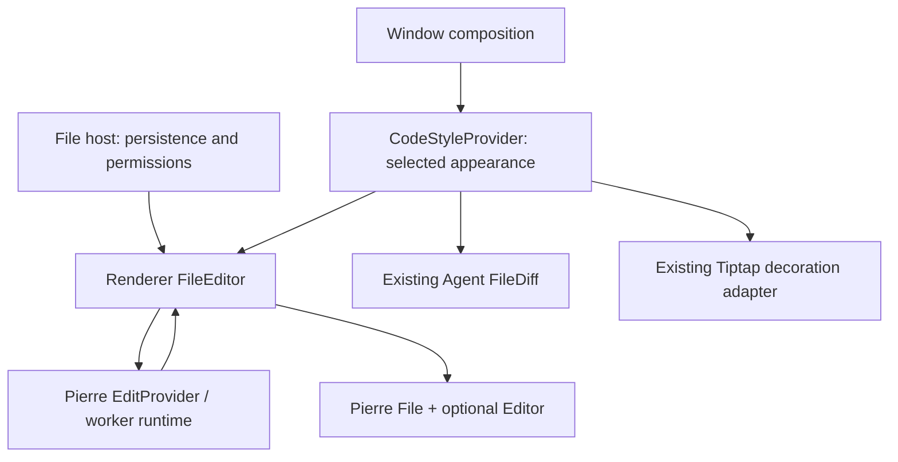

# Agent Note: Shared Pierre surfaces for code viewing and editing

Status: proposed

English | [中文](2026-10-24-pierre-code-surfaces.zh.md)

## Problem

Ordinary source code currently changes renderer when the user starts editing: CodeViewer uses Highlights and TanStack Virtual, while CodeEditor uses CodeMirror language packs, themes and layout. Viewer and editor preferences have different defaults, and the code-style selector changes its meaning with `chat.code.editor.enabled`. Matching a few colors cannot make these two paths render identical tokens or preserve the same viewport.

The installed `@pierre/diffs@1.6.1` already exports `@pierre/diffs/edit`. It can attach an editor to a rendered File or FileDiff; the application currently uses only its read-only Agent diff integration with the Highlights backend. Adopting this editor does not require implementing a text buffer, selection model or IME pipeline ourselves. Its public editing demo still labels the feature experimental.

This is a partial successor to [Highlights migration and highlighting architecture convergence](2026-10-22-code-highlights-virtualization.md). It replaces that note's intentional CodeMirror/layout boundary only for the consumers migrated here. The existing headless Highlights core, HTML/Markdown adapters, Tiptap ownership, unsupported-language behavior and previous verification remain valid. Do not delete that note or reinterpret its old evidence as Pierre acceptance.

The source baseline is local HEAD `f740f7d65d130fb27e0ed6fcf6b62dd00e395811`. Existing uncommitted Markdown size-limit removal is separate work and must be preserved. Implementation is authorized locally. The user limited this iteration to files: message CodeMirror stays because Pierre 1.6.1 does not expose equivalent completion and folding configuration. The user also approved a minimal pinned dependency patch for the reproduced Highlights editor theme-cache defect. Platform and performance acceptance remains subject to the evidence below.

## Proposal

### 1. Scope and target behavior

Use Pierre File for ordinary source viewing and its attached Editor for source editing; retain Pierre FileDiff for diff presentation. Select Highlights explicitly instead of introducing another default highlighting backend. This iteration migrates files only. A later message migration requires a separate capability decision.

Message read/edit convergence is now owned by the separate [code-block language/style proposal](2026-10-26-message-code-block-surfaces.md): keep a dedicated viewer plus CodeMirror rather than extending FileEditor to messages. The deferred message layer below is an ownership handoff, not a planned Pierre rollout.

| Consumer | Target in this Spec | Preserved boundary |
| --- | --- | --- |
| SkillFileBrowser | First editable file pilot; source view and edit use the same generic surface | FileEditSession, Skill reconciliation, permission and navigation guards |
| FilePreview text and Markdown source | Pierre read-only source body | Plugin registry, metadata/refresh, file I/O and rich Markdown preview |
| ArtifactPane source editor and TextFilePreviewPopup | Reuse the same source surface | Existing save/recovery, pane navigation and read-only permissions |
| CodeBlockView ordinary source/edit | Keep the existing viewer and CodeMirror editor in this iteration | Existing toolbar, save action, execution, collapse, wrapping and special views |
| AgentFileDiffRenderer | Keep FileDiff; align appearance and shared runtime configuration | Existing diff payload, split/unified presentation and read-only behavior |
| Tiptap and Notes rich text | Keep ProseMirror and existing highlight decorations; consume the same selected code palette | Document model, serialization, selection and history |
| Notes source, prompt/config editors and standalone UI CodeEditor | Keep CodeMirror in this Spec | Existing language extensions, completion, commands and theme preferences |

Do not add edit actions to currently read-only previews. Do not enable diff editing, AI edit prediction, a language server or new selection actions. Whole-Markdown parsing, GFM table performance and Markdown block virtualization are separate work. This migration adds no file-size rejection or truncation and must not restore the removed Markdown preview limit; existing file I/O/edit admission constraints are not a performance solution and are not expanded here.

### 2. Ownership and source placement

| Owner / planned location | Responsibility | Must not own |
| --- | --- | --- |
| Existing `components/CodeStyleProvider.tsx` and `hooks/useCodeStyle.ts` | Resolve current theme and code appearance | Editor instances, source text, undo stacks or eager editor imports |
| New `src/renderer/components/FileEditor.tsx` | Directly compose Pierre File/editing, consume application theme/hooks and bind existing host actions | Another language catalog, persistence implementation or second document store |
| FileEditor composition | Mount Pierre's EditProvider and library-shared worker pool on demand with a lazy editor factory | A new application Provider abstraction, file business state or main-process service |
| Existing file/message hosts | Own accepted content, draft persistence, external replacements, permissions and actions | Editor internals or duplicated tokenizer state |
| Existing `packages/ui/src/lib/code-highlight` and remaining renderer service/worker | Continue serving non-migrated highlight consumers | Highlighting the same migrated surface a second time |

Use the application's existing `@pierre/diffs` dependency. FileEditor is an application component and may consume renderer theme/hooks and existing session/actions; it does not belong in the app-independent UI package. Do not add a `packages/ui/code-surface` wrapper, a second renderer adapter, a custom CodeSurfaceProvider or a new package export. New component chrome uses existing Shadcn/Tailwind UI primitives and [DESIGN.md](../../../../DESIGN.md). Keep renderer-only contracts out of `src/shared`; do not add `renderer/editor`, a new workspace package, a general engine interface or a new global store.

Use Pierre's public File props, edit events and Editor handles directly inside FileEditor. Its props cover only the document/session and actions required by real consumers; do not invent an engine-neutral handle API or copy the whole CodeMirror API. FileEditor can bind the existing file-save action, but FileEditSession remains the persistence/conflict owner. Message saves still use the existing message action instead of entering the file persistence path.

### 3. Theme and style contract

All migrated Pierre source and diff views use `chat.code.viewer.theme_light` / `theme_dark` as the canonical code theme. Preserve their existing identifiers and `auto` defaults. Starting edit mode does not switch to the CodeMirror theme. The visible shared code-style selector always reads and writes these keys, independent of `chat.code.editor.enabled`.

Keep existing `chat.code.editor.theme_*` values for the remaining CodeMirror consumers; expose their controls with an explicit CodeMirror scope instead of silently overwriting or attempting a lossy theme migration. No new persisted theme keys are required. The editor-enabled switch continues to control the existing message editing capability, not the theme catalog.

The source surface shares font family, size, line height, padding, foreground/background and selection appearance between reading and editing. Preserve intentional host-specific font sizes; do not force a Notes editor and a compact message to have identical dimensions. Preserve the current code-card toolbar and special-view layout. Styling must be stable while highlighting loads or is disabled, including the streaming-to-complete transition.

The pinned dependency patch refreshes the file render cache after an editor theme change. It also adds `EditorOptions.readOnly` so read-only files reuse Pierre's document selection and clipboard model across virtualized rows. Read-only content is non-editable and focusable, mutation commands and public edit APIs are blocked, and find remains available. React bindings apply live editor options; pointer selection retains its document anchor when a DOM row is recycled, and offscreen edits invalidate the render cache before the new viewport restores focus. Changes before or within the render range repaint visible rows, including batch replacements and structural shifts. Writable text drops resolve the pointer position and enter the existing normalized document/history transaction; read-only drops cannot mutate source. Clipboard providers honor the requested MIME type; unavailable selection metadata is absent, never synthesized from plain text. The application does not maintain a second selection model.

Configure Pierre's Shadow DOM through public options/theme APIs, not private DOM selectors. Tiptap retains its current Highlights decoration adapter and uses the same selected palette; this Spec does not embed Pierre editors in ProseMirror nodes or promise identical document typography. Preserve supported Custom CSS hooks; document any unavoidable Shadow DOM styling incompatibility before switching the affected consumer.

### 4. Document, draft and history lifecycle

During an active edit session, Pierre owns live editing mechanics; the application owns the draft used for persistence. Bridge change notifications in one direction to `FileEditSession.setDraft` or the existing message-save boundary. An echoed draft from that bridge is not an external document replacement and must not reset the editor or feed an edit back into it. `onEditComplete` accepts/rejects the local rendering result; it is not a disk-save acknowledgement. Keep the existing explicit save/autosave timing and failure UI for each host.

| Event | Required behavior |
| --- | --- |
| First read / first edit | Render current source; lazy-load editing before attachment; do not lose source on loading failure |
| Edit or undo/redo | Notify the host with current text and retain existing persistence semantics; do not create a feedback loop |
| Theme, wrap, size or toolbar change | Update through public configuration without replacing the document/history or changing its identity |
| Read/edit toggle or compatible Activity reconnect | Resume the same draft/history/selection for the same retained document session |
| Discard, reload or accepted external replacement | Start a new document epoch and clear incompatible retained state after detachment |
| External file change with a dirty draft | Retain the existing FileEditSession conflict decision; do not overwrite either version |
| File switch or late callback | Check owner/session/epoch before mutating a draft; preserve current flush and navigation guards |
| Closing the document/window | Release listeners, editor and worker leases; clear inactive retained state when the document is actually closed |

Build file `editStateKey` from surface-owner identity plus the existing session ID and document epoch. Do not use a theme, filename alone or array index. Two simultaneous surfaces must not claim the same active key. Retained state is bounded in-memory state; there is no promise to restore undo history after a process reload, and dirty-draft recovery remains FileEditSession's responsibility.

A mounted message code block owns its local session. Use existing stable message/block identity when available; otherwise retain only within that mounted instance. Do not add persisted block IDs or promise cross-unmount history based on a source hash. A later message replacement must not resurrect a retained draft from an older block.

Keep the existing `data-file-edit` composition boundary and verify Shadow DOM event retargeting against FileEditSessionProvider. Adapt the integration at the owning boundary if required. A synthetic composition event test alone cannot establish native Chinese IME correctness.

### 5. Virtualization, streaming and resources

Use Pierre's existing Virtualizer/VirtualizedFile capabilities. Bind them to the actual FilePreview or message-list scroll root. For expanded message code blocks, use the public Virtualizer context/setup APIs to observe the outer scroller instead of creating an artificial full-height internal viewport. Collapsed/bounded code blocks may retain their existing inner scrolling. Never nest a TanStack row virtualizer and a Pierre row virtualizer for the same source body; TanStack remains for consumers not migrated by this Spec.

Start with one lazy Pierre worker per renderer window and explicitly select Highlights, with `useTokenTransformer: true` for editable surfaces using a worker pool. Share that runtime between migrated surfaces where the library permits; retain the existing highlight worker only for its remaining consumers. The selected editor tokenizer may run on the main thread, so worker use is not a claim that all typing/tokenization leaves it. Measure the actual path and production chunk graph, including editor lazy loading.

Keep current streaming product behavior: incoming source remains read-only and initially unhighlighted; completion enables highlighting without a font/background/layout jump. Validate the pinned library's public plain-source option before replacing this path. Buffer only the latest pending source update for a surface and reject obsolete work after source/theme/language changes or unmount. Do not introduce a custom incremental parser, duplicate whole-document token cache or a second transport for Pierre's own tokenizer.

If module/worker initialization fails, keep the latest source selectable/copyable and report through the existing error boundary and `loggerService`; a failed editor attachment must not claim a save or discard a draft. Verify Pierre's automatic main-thread fallback against the large-input budget. If public APIs cannot maintain the required behavior, identify the upstream improvement and revise the Spec before adding a workaround or changing the default engine.

### 6. Implementation layers and stop conditions

| Layer | Concrete work | Verification before expansion |
| --- | --- | --- |
| 1. Capability pilot | Direct Pierre integration in the application FileEditor; real Skill file/session binding; test pinned 1.6.1 APIs, IME/clipboard and source fidelity | AC2–AC6 and initial AC7/AC8 evidence; no general consumer switch before the gate passes |
| 2. Shared file surfaces and appearance | Window/runtime integration, canonical theme controls; FilePreview source, Skill and Artifact editing, read-only popup, existing diff appearance | AC1–AC8 and AC11; compare source/selection/history across modes and refresh |
| 3. Separate message proposal | Dedicated viewer plus CodeMirror with shared language/style, owned by the linked message Spec; preserve real message actions | Separate message approval/evidence; this file Spec covers AC9/AC10 only as scope boundaries |
| 4. Scoped cleanup and final acceptance | Remove replaced imports/adapters/dependencies only after their last consumer is gone; update owning docs and complete evidence | AC1–AC12 cumulative evidence; move this triplet only in the final layer |

Message capability inventory includes autocompletion, fold gutter, active-line highlighting, configurable keymaps, line numbers, wrapping, collapse/expand, selection/copy, explicit save, Python execution and special preview/split mode. Classify every item as preserved, upstream-blocked, or a separately approved product change. Absence in the new library is not permission to ignore the setting. An unmet required capability blocks that consumer's default switch; a permanent parallel engine selector is not the default resolution.

The first pilot is a product integration check, not a library-only demo. If it fails, record the failing input/path and the smallest upstream requirement. Do not proceed to a broad migration, write a custom editor, or silently replace this plan with the Lezer alternative. Implementation PRs follow the repository's [Spec-first workflow](../../README.md); this planning task does not create branches or PRs.

### 7. Verification plan

Use the existing [frontend test rules](../../../../docs/references/testing/frontend-testing.md). Renderer tests cover FileEditor's external-update/completion contract, owner/epoch, permissions and persistence integration. No new UI-package test layer is needed. Browser/Electron tests use the real Pierre implementation rather than mocking it into a textarea. Assert saved file/message contents and user-visible recovery, not just callback invocation.

Run explicit affected test paths per implementation layer, including existing CodeStyleProvider, CodeViewer, CodeBlockView, FileEditSessionProvider/useFileEditSession, FileEditSessionManager, SkillFileBrowser, ArtifactPane, AgentFileDiffView, MarkdownFilePreview and Tiptap codeHighlight consumers as applicable. Add only tests that catch a named regression. New FileEditor tests follow the existing renderer component test layout; a reviewed `tests/e2e/ondemand/specs/file-editor.ts` scenario uses the existing controller. Follow [on-demand scenario conventions](../../../../tests/e2e/ondemand/specs/README.md); do not invent a second Electron launcher or inject successful UI results.

| Scenario | Required observations | Verification owner |
| --- | --- | --- |
| File editing | Edit/undo/redo, autosave/flush, read/edit toggles, reopen saved file, discard, read-only and external conflict | Electron implementer, macOS and Windows |
| Appearance/session | Light/dark and theme choice, selection and undo after theme change, wrap, resize, hide/reconnect and file switch | Renderer tests plus Electron implementer |
| Input/accessibility | Native Chinese IME, Unicode/emoji, CRLF/trailing newline, clipboard, keyboard focus and find/replace | Electron implementer; manual native IME evidence on both platforms |
| Messages | No message engine switch; retain existing completion/folding, streaming and save actions | Existing affected-consumer tests; migration deferred |
| Large source | Repository `pnpm-lock.yaml`, deterministic 1/5 MiB multiline source, 1 MiB single line and many small blocks | Performance implementer, production renderer build |
| Failure/lifecycle | Editor-load/worker failure, rapid source/theme replacement, close/reopen and 20 mount/unmount cycles | Adapter tests plus Electron implementer |

Record fixture hashes/bytes/rows, exact application SHA, OS/CPU/RAM, viewport/font/wrap settings, cold versus warm runs, worker count, first visible source/highlight time, input-to-paint p95, longest main-thread task, mounted rows, and retained-memory trend. Compare baseline and candidate on the same machine with three cold and five warm runs. Exclude fixture setup from the timed interval but include renderer decoding, highlighting and DOM work after contents are delivered; report file-read latency separately.

Proposed performance gate on each recorded reference machine: warm first-source p95 within 1 second for 1 MiB and 2.5 seconds for 5 MiB; typing and scrolling input-to-paint p95 within 100 ms, with no main-thread task over 200 ms in the steady interaction interval. Warm first-source p95 must also be no more than 20% slower than baseline. Use the same visible prefix/viewport for the 1/5 MiB multiline fixtures and require mounted source rows to grow by at most 1.5 times, not in proportion to document length. The long-line fixture must remain responsive and preserve all text; library-defined omission of expensive token detail must not truncate content. Report cold initialization and memory separately rather than presenting them as passes under these warm budgets.

Numbers are proposed acceptance budgets, not existing results or a universal maximum Markdown size. Missing native IME, Windows, production-build or performance evidence remains an open criterion. This Spec does not require a full local test suite; inspect `pnpm check --plan`, run scoped tests/checks and rely on CI for broader gates.

## Alternatives considered

| Alternative | Assessment |
| --- | --- |
| Shared Lezer parser/class rules for read-only rendering and CodeMirror editing | Feasible small-sample probe; preserves CM extensions, but still leaves us owning viewer layout, incremental scheduling and cross-engine diff appearance. Reconsider if the Pierre capability gate exposes a required unsupported editor feature. |
| Keep current renderers and map only colors | Lowest migration cost, but token classification, viewport and mode-switch behavior remain independent; insufficient as the first choice for this goal. |
| Instantiate read-only CodeMirror everywhere | Could share the existing editor, but adds an editor lifecycle to every read-only block and does not reuse Pierre's diff surface. |
| Replace every rich-text/source editor at once | Unnecessary scope; ProseMirror owns structured documents and several CM consumers have specialized extensions. |
| Reimplement the ChatGPT/Pierre text model and selection system | Duplicates an already public dependency and creates an avoidable input/IME maintenance burden. |

## Acceptance criteria

- AC1 — Migrated read/edit/diff surfaces use one selected viewer theme and stable body styling; editor-enabled toggles no longer change the shared theme selector, and legacy CodeMirror theme values remain usable by unmigrated consumers. (verification: renderer and Electron; owner: appearance implementer)
- AC2 — Reading, editing, copying, saving and reopening preserve Unicode, whitespace, line endings and trailing newlines without additional renderer normalization, truncation or a new size rejection. (verification: adapter tests and Electron; owner: code-surface implementer)
- AC3 — Skill and Artifact edits retain their existing save/flush/recovery behavior; local edit completion never reports an unacknowledged disk save, and echoed drafts do not reset history. (verification: renderer and Electron; owner: file-session integrator)
- AC4 — Read-only permission, external-file conflicts and navigation guards remain effective; stale callbacks from a replaced session cannot mutate the new document. (verification: renderer and Electron; owner: file-session integrator)
- AC5 — Theme/style changes, read/edit toggles and compatible Activity reconnects preserve draft, selection and undo/redo for the same retained file epoch; reload/discard/close cannot resurrect incompatible retained state or collide active keys. (verification: renderer and Electron; owner: lifecycle implementer)
- AC6 — Native Chinese IME, keyboard selection, find/replace and Electron clipboard work on macOS and Windows; composition does not produce duplicate/lost input or a premature persisted partial composition. (verification: Electron with manual native IME evidence; owner: desktop verifier)
- AC7 — Expanded source uses the real outer viewport and bounded source uses its intended inner viewport; 1/5 MiB fixture row counts satisfy the 1.5-times bound with complete selection/copy and no duplicated row virtualizer. (verification: Electron performance run; owner: performance implementer)
- AC8 — The baseline/candidate report includes the specified fixtures, cold/warm timings, input latency, long tasks, mounted rows and retained-memory trend; the proposed warm performance budgets pass on both recorded platform reference machines. (verification: production renderer in Electron; owner: performance implementer)
- AC9 — Message source and editing keep their current engines and capabilities in this iteration; shared theme changes preserve the CodeMirror preference values. (verification: affected-consumer tests; owner: appearance implementer)
- AC10 — Later message convergence follows the separately approved code-block Spec rather than extending FileEditor to messages; existing completion/folding remain effective. (verification: source scope and capability inventory; owner: implementation integrator)
- AC11 — Application FileEditor directly uses Pierre and existing theme/session/actions without a new UI-package wrapper or parallel persistence path; editing loads on demand, resources have one owner and are released, and initialization/late-result failures preserve selectable current source and recoverable drafts without a false save. (verification: scoped static checks, production chunk inspection, renderer and Electron; owner: runtime implementer)
- AC12 — The final implementation maps every criterion to actual scoped test and macOS/Windows evidence, preserves unmigrated Tiptap/CodeMirror behavior, updates owning documentation and the bilingual triplet, and passes the relevant CI gates. (verification: scoped tests, docs gate and CI; owner: final implementation integrator)

## Risks

Pierre editing is experimental and its public API may change; pin the installed version initially and review patches before any dependency change. Source/API inspection does not establish runtime quality. Existing completion/folding settings, outer-scroller integration, Shadow DOM composition/selection events, Custom CSS compatibility and automatic worker-failure fallback are explicit feasibility gates.

Retained Pierre state is bounded and process-local; it is not durable recovery. Never dispose the application's dirty draft merely because an editor detaches or the library evicts retained history. The plan intentionally keeps existing non-migrated highlight execution and CM consumers, so success is a bounded surface migration rather than a claim that all renderer text technology becomes one engine.

The user-supplied ChatGPT bundle analysis is contextual static evidence, not proof of ChatGPT's current product implementation or its authors' motivations. The choice here follows the installed library's public capabilities and Cherry Studio's verified requirements. Upstream context: [editing demo](https://diffs.com/edit) and [React editing recipe](https://github.com/pierrecomputer/pierre/blob/main/skills/diffs/references/recipe-edit-react.md); verify signatures against pinned declarations before implementation.
