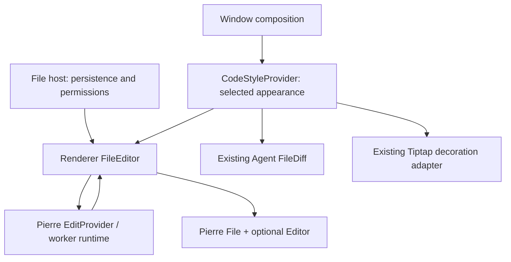

# Agent Note: 使用 Pierre 统一代码阅读与编辑视图

Status: proposed

[English](2026-10-24-pierre-code-surfaces.md) | 中文

## 问题

当前普通源码进入编辑态时会更换渲染器：CodeViewer 使用 Highlights 和 TanStack Virtual，CodeEditor 则使用 CodeMirror 的语言包、主题与布局。阅读和编辑偏好的默认值不同，代码样式选择器的含义还会随 `chat.code.editor.enabled` 改变。只映射几种颜色，无法让两条路径具有相同的 token 分类或视口状态。

已安装的 `@pierre/diffs@1.6.1` 已公开 `@pierre/diffs/edit`，可以在已渲染的 File 或 FileDiff 上附加编辑器；应用目前只接入了使用 Highlights 后端的智能体只读 diff。采用该编辑器不需要我们自己实现文本缓冲区、选区模型或 IME 输入管线。官方编辑演示仍将该功能标为 experimental。

本方案部分接替 [Highlights 迁移与高亮架构收敛](2026-10-22-code-highlights-virtualization.md)，仅在本次迁移的调用方中替换旧方案有意保留的 CodeMirror/布局边界。现有无界面 Highlights 核心、HTML/Markdown 适配、Tiptap 职责、不支持语言的处理方式和原有验证仍然有效。不得删除旧文档，也不得将旧证据当作 Pierre 的验收结果。

源码基线为本地 HEAD `f740f7d65d130fb27e0ed6fcf6b62dd00e395811`。现有未提交的 Markdown 大小上限移除属于独立工作，必须保留。本地实现已获批准。用户将本轮限定为文件迁移：Pierre 1.6.1 没有等价的补全和折叠配置，消息继续保留 CodeMirror。用户另行批准为已复现的 Highlights 编辑器主题缓存缺陷加入最小版本锁定依赖补丁。平台和性能验收仍需下述证据。

## 提案

### 1. 范围与目标行为

普通源码阅读使用 Pierre File，源码编辑使用附着于其上的 Editor；diff 展示继续使用 Pierre FileDiff。显式选择 Highlights，避免引入另一套默认高亮后端。本轮只迁移文件；后续消息迁移需要另行确认功能兼容方案。

消息读写收敛现在由独立的 [代码块语言/样式方案](2026-10-26-message-code-block-surfaces.md) 拥有：保留专用 Viewer 和 CodeMirror，不将 FileEditor 扩展到消息。下述延后消息层表示所有权移交，不是计划中的 Pierre 推广。

| 调用方 | 本 Spec 的目标 | 保留的边界 |
| --- | --- | --- |
| SkillFileBrowser | 首个可编辑文件试点；源码阅读和编辑使用同一通用视图 | FileEditSession、技能协调、权限与导航保护 |
| FilePreview 文本及 Markdown 源码 | Pierre 只读源码正文 | 插件注册、元数据/刷新、文件 I/O 与 Markdown 富文本预览 |
| ArtifactPane 源码编辑器及 TextFilePreviewPopup | 复用同一源码视图 | 现有保存/恢复、面板导航与只读权限 |
| CodeBlockView 普通源码/编辑 | 本轮保留现有阅读视图与 CodeMirror 编辑器 | 现有工具栏、保存动作、执行、折叠、换行与特殊预览 |
| AgentFileDiffRenderer | 保留 FileDiff；统一外观和共享运行时配置 | 现有 diff 数据、分栏/统一展示与只读行为 |
| Tiptap 及 Notes 富文本 | 保留 ProseMirror 和现有高亮装饰，使用同一选定代码色板 | 文档模型、序列化、选区与历史 |
| Notes 源码、提示词/配置编辑器及独立 UI CodeEditor | 本 Spec 中保留 CodeMirror | 现有语言扩展、补全、命令与主题偏好 |

不为当前只读的预览新增编辑入口。不启用 diff 编辑、AI 编辑预测、语言服务器或新的选区操作。整篇 Markdown 解析、GFM 表格性能与 Markdown 块虚拟化单独处理。本迁移不新增文件大小拒绝或截断，也不得恢复已移除的 Markdown 预览上限；既有文件 I/O/编辑准入约束不能作为性能方案，本次也不扩大这些约束。

### 2. 职责与源码位置

| 归属 / 计划位置 | 职责 | 不得持有 |
| --- | --- | --- |
| 现有 `components/CodeStyleProvider.tsx` 与 `hooks/useCodeStyle.ts` | 解析当前主题和代码外观 | 编辑器实例、源码文本、撤销栈或提前加载的编辑器依赖 |
| 新增 `src/renderer/components/FileEditor.tsx` | 直接组合 Pierre File/编辑，读取应用主题/hooks，绑定现有宿主动作 | 另一份语言目录、持久化实现或第二份文档存储 |
| FileEditor 装配 | 按需挂载 Pierre 自带的 EditProvider 与库共享的 Worker 池，提供懒加载编辑器工厂 | 新的应用 Provider 抽象、文件业务状态或主进程服务 |
| 现有文件/消息宿主 | 拥有已接受内容、草稿持久化、外部替换、权限和动作 | 编辑器内部实现或重复的 tokenizer 状态 |
| 现有 `packages/ui/src/lib/code-highlight` 及保留的 renderer 服务/Worker | 继续服务未迁移的高亮调用方 | 对同一个已迁移视图再次执行高亮 |

使用应用现有的 `@pierre/diffs` 依赖。FileEditor 是应用组件，可以读取 renderer 主题/hooks，绑定现有会话/动作，不应放进与应用无关的 UI 包。不新增 `packages/ui/code-surface` 包装、第二层 renderer 适配、自定义 CodeSurfaceProvider 或新的包导出。新组件外框使用现有 Shadcn/Tailwind UI 基础组件并遵守 [DESIGN.md](../../../../DESIGN.md)。仅供 renderer 使用的契约不放入 `src/shared`；不新增 `renderer/editor`、工作区包、通用引擎接口或全局 store。

FileEditor 内直接使用 Pierre 公开的 File props、编辑事件和 Editor 句柄。其 props 仅覆盖真实调用方所需的文档/会话和动作，不另造引擎无关的句柄 API，也不复制整套 CodeMirror API。FileEditor 可以绑定现有文件保存动作，但持久化/冲突仍由 FileEditSession 拥有。消息保存继续使用现有消息动作，不进入文件持久化路径。

### 3. 主题与样式契约

所有已迁移的 Pierre 源码与 diff 视图统一使用 `chat.code.viewer.theme_light` / `theme_dark` 作为代码主题来源，保留现有标识和 `auto` 默认值。进入编辑态不切换到 CodeMirror 主题。共享代码样式选择器始终读写这些键，不再依赖 `chat.code.editor.enabled`。

为剩余 CodeMirror 调用方保留现有 `chat.code.editor.theme_*` 值；其设置控件明确标注 CodeMirror 适用范围，不静默覆盖，也不做有损主题迁移。不需要新增持久化主题键。编辑器开关继续控制现有消息编辑能力，不再决定主题目录。

同一源码视图的阅读与编辑共享字体、字号、行高、内边距、前景/背景和选区外观。保留宿主有意设置的字号差异，不强制 Notes 编辑器与紧凑消息采用相同尺寸。保留现有代码卡片工具栏和特殊预览布局。高亮尚在加载或被关闭时，样式也必须稳定，包括流式结束的切换过程。

锁定版本的依赖补丁在编辑器主题变化后刷新文件渲染缓存，并新增 `EditorOptions.readOnly`，让只读文件复用 Pierre 的文档选区和剪贴板模型，跨虚拟行选择不再依赖已卸载的 DOM。只读内容不可编辑但可聚焦，修改命令及公开编辑 API 被阻止，查找保留可用。React 绑定实时应用编辑选项；鼠标选区在 DOM 行回收后保留文档锚点，屏外修改在新视口恢复焦点前使渲染缓存失效。渲染范围之前或之内的修改会重绘可见行，覆盖批量替换与行结构变化。可写视图拖入文本时解析指针位置，并进入已有的换行规范化文档/历史事务；只读拖入不能修改源码。剪贴板 provider 按请求的 MIME 类型读取；不存在的选区元数据保持缺失，不能用普通文本冒充。应用不维护第二套选区模型。

通过公开选项/主题 API 配置 Pierre Shadow DOM，不依赖私有 DOM 选择器。Tiptap 保留现有 Highlights 装饰适配，使用同一选定色板；本 Spec 不在 ProseMirror 节点里嵌入 Pierre 编辑器，也不承诺文档排版完全一致。保留受支持的 Custom CSS 钩子；若 Shadow DOM 存在不可避免的样式兼容差异，必须在切换对应调用方前说明。

### 4. 文档、草稿与历史生命周期

编辑期间，Pierre 拥有实时编辑机制，应用拥有用于持久化的草稿。修改通知单向交给 `FileEditSession.setDraft` 或现有消息保存边界。该链路回传的草稿不是外部文档替换，不得重置编辑器或将修改再次灌回编辑器。`onEditComplete` 接受/拒绝的是本地渲染结果，不是磁盘保存确认。各宿主现有的显式保存/自动保存时机与失败 UI 保持不变。

| 事件 | 要求 |
| --- | --- |
| 首次阅读 / 首次编辑 | 显示当前源码；附加编辑器前懒加载编辑能力；加载失败不能丢失源码 |
| 编辑或撤销/重做 | 将当前文本通知宿主，保留现有持久化语义，不形成反馈循环 |
| 主题、换行、尺寸或工具栏变化 | 通过公开配置更新，不替换文档/历史或改变文档身份 |
| 阅读/编辑切换或兼容的 Activity 重连 | 对同一保留文档会话恢复草稿、历史和选区 |
| 丢弃、重新加载或接受外部替换 | 开始新的文档 epoch，脱离编辑器后清理不兼容的保留状态 |
| 有脏草稿时文件被外部修改 | 保留现有 FileEditSession 冲突决策，不覆盖任一版本 |
| 文件切换或迟到回调 | 修改草稿前核对 owner/session/epoch，保留当前 flush 与导航保护 |
| 关闭文档/窗口 | 释放监听、编辑器与 Worker 租约；文档真正关闭时清理非活动保留状态 |

文件 `editStateKey` 由视图所有者身份、现有 session ID 和文档 epoch 组成，不使用主题、单独文件名或数组下标。两个同时存在的视图不能占用同一活动 key。保留状态有界且仅存在于内存，不承诺进程重新加载后恢复撤销历史；脏草稿恢复仍由 FileEditSession 负责。

已挂载的消息代码块拥有本地会话。已有稳定消息/块身份时复用该身份；否则仅在当前挂载实例内保留。不新增持久化块 ID，也不基于源码 hash 承诺跨卸载历史恢复。后续消息替换不得恢复旧代码块的保留草稿。

保留现有 `data-file-edit` 组字边界，并核对 Shadow DOM 事件重定向是否能接入 FileEditSessionProvider。需要适配时，在拥有该职责的边界处理。仅测试合成 composition 事件不能证明原生中文输入法正确。

### 5. 虚拟化、流式与资源

使用 Pierre 现有 Virtualizer/VirtualizedFile 能力，将其绑定到真实的 FilePreview 或消息列表滚动根。展开的消息代码块通过公开 Virtualizer context/setup API 观察外层滚动器，不再创建撑满全文高度的伪内部视口。折叠/限高代码块可以保留已有内部滚动。同一源码正文不得嵌套 TanStack 行虚拟化和 Pierre 行虚拟化；未迁移的调用方继续使用 TanStack。

每个 renderer 窗口初始使用一个懒加载的 Pierre Worker，并显式选择 Highlights；使用 Worker 池的可编辑视图配置 `useTokenTransformer: true`。库允许时，已迁移视图共享该运行时；现有高亮 Worker 只继续服务剩余调用方。选定的编辑 tokenizer 可能运行于主线程，因此启用 Worker 不代表输入/分词全部离开主线程。必须测量真实路径与生产 chunk 依赖，包括编辑器懒加载。

保留当前流式产品行为：传入源码只读，初始不高亮；完成后启用高亮，字体/背景/布局不跳变。替换该路径前先验证锁定版本的公开纯源码选项。每个视图只保留最新待处理源码更新，源码/主题/语言改变或卸载后拒绝过期结果。不自建增量解析器、重复的整篇 token 缓存或 Pierre tokenizer 的第二套传输。

模块/Worker 初始化失败时，保留最新源码的选择与复制能力，通过现有错误边界和 `loggerService` 报告；编辑器附加失败不能声称保存成功，也不能丢弃草稿。必须验证 Pierre 自动回到主线程的行为是否满足大输入预算。若公开 API 无法保持要求，先指出上游需要改进的位置并修订 Spec，再考虑变通实现或切换默认引擎。

### 6. 实施分层与停止条件

| 层次 | 具体工作 | 扩展前的验证 |
| --- | --- | --- |
| 1. 能力试点 | 在应用 FileEditor 中直接接入 Pierre；绑定真实 Skill 文件/会话；验证锁定 1.6.1 的 API、IME/剪贴板与源码保真 | AC2–AC6 及初步 AC7/AC8 证据；检查通过前不普遍切换调用方 |
| 2. 共享文件视图与外观 | 窗口/运行时接入，规范主题控件；FilePreview 源码、Skill 与 Artifact 编辑、只读弹窗、现有 diff 外观 | AC1–AC8 与 AC11；核对模式切换和刷新后的源码/选区/历史 |
| 3. 独立消息方案 | 专用 Viewer 和 CodeMirror 共享语言/样式，由链接的消息 Spec 拥有；保留真实消息动作 | 独立的消息批准/证据；本文件 Spec 的 AC9/AC10 仅约束范围边界 |
| 4. 范围内清理与最终验收 | 最后一个调用方移除后再删除被替代的导入/适配/依赖；更新归属文档并补齐证据 | AC1–AC12 累积证据；仅最后一层迁移本文三件套状态 |

消息能力清单包含自动补全、折叠栏、活动行高亮、可配置快捷键、行号、换行、折叠/展开、选区/复制、显式保存、Python 执行及特殊预览/分屏。每项标记为已保留、受上游阻塞或另行批准的产品变更。新库不具备某项能力不代表可以忽略对应设置。必要能力不满足时，阻止对应调用方的默认切换；不默认通过永久并存的引擎选择器解决。

首个试点必须验证产品接入，不能只是库演示。失败时记录具体输入/调用路径及最小上游要求，不继续普遍迁移、不自研编辑器，也不静默改为 Lezer 方案。实施 PR 遵循仓库的 [Spec-first 流程](../../README.md)；本次规划任务不创建分支或 PR。

### 7. 验证计划

遵循现有 [前端测试规则](../../../../docs/references/testing/frontend-testing.md)。renderer 测试验证 FileEditor 的外部更新/完成契约、owner/epoch、权限及持久化接入，不新增 UI 包测试层。浏览器/Electron 测试使用真实 Pierre 实现，不将它 mock 成 textarea。断言实际保存的文件/消息内容和用户可见恢复行为，不只断言回调被调用。

每层实施仅运行明确受影响的测试路径，按需包含现有 CodeStyleProvider、CodeViewer、CodeBlockView、FileEditSessionProvider/useFileEditSession、FileEditSessionManager、SkillFileBrowser、ArtifactPane、AgentFileDiffView、MarkdownFilePreview 和 Tiptap codeHighlight 调用方。只新增能捕获明确回归的测试。新增 FileEditor 测试沿用现有 renderer 组件测试布局；经评审的 `tests/e2e/ondemand/specs/file-editor.ts` 场景复用现有控制器。遵循 [按需场景约定](../../../../tests/e2e/ondemand/specs/README.md)，不另造 Electron 启动器，也不注入 UI 成功结果。

| 场景 | 必须观察的结果 | 验证负责人 |
| --- | --- | --- |
| 文件编辑 | 编辑/撤销/重做、自动保存/flush、读写切换、重开已保存文件、丢弃、只读与外部冲突 | Electron 实施者，macOS 和 Windows |
| 外观/会话 | 明暗及主题选择、切主题后的选区和撤销、换行、调整尺寸、隐藏/重连及文件切换 | renderer 测试及 Electron 实施者 |
| 输入/无障碍 | 原生中文 IME、Unicode/emoji、CRLF/末尾换行、剪贴板、键盘焦点与查找替换 | Electron 实施者；两个平台的原生 IME 人工证据 |
| 消息 | 不切换消息引擎；保留现有补全/折叠、流式与保存动作 | 受影响调用方现有测试；迁移延后 |
| 大源码 | 仓库 `pnpm-lock.yaml`、确定性的 1/5 MiB 多行源码、1 MiB 单行及大量小代码块 | 性能实施者，生产 renderer 构建 |
| 失败/生命周期 | 编辑器加载/Worker 失败、快速替换源码/主题、关闭/重开及 20 次挂载/卸载 | 适配测试及 Electron 实施者 |

记录夹具 hash/字节数/行数、准确应用 SHA、OS/CPU/RAM、视口/字体/换行设置、冷/热运行、Worker 数量、首个源码/高亮可见耗时、输入到绘制的 p95、最长主线程任务、挂载行数及保留内存趋势。在同一机器上对比基线与候选版本，各执行三次冷运行和五次热运行。计时区间不含夹具准备，但包含内容交付后的 renderer 解码、高亮和 DOM 工作；文件读取耗时单独报告。

每台记录的参考机器采用以下提议性能门槛：1 MiB 热态首个源码可见 p95 不超过 1 秒，5 MiB 不超过 2.5 秒；稳定交互期间，输入及滚动到绘制的 p95 不超过 100 ms，主线程单任务不超过 200 ms。热态首个源码可见 p95 同时不得比基线慢超过 20%。1/5 MiB 多行夹具使用相同可见前缀/视口，挂载源码行数最多增长至 1.5 倍，不能随全文长度等比例增加。长单行夹具必须保持响应并保留全部文本；库为控制成本而省略高亮细节时，也不能截断内容。冷初始化和内存单独报告，不把它们算作满足这些热态预算。

这些数字是提议验收预算，不是现有结果，也不是通用 Markdown 大小上限。缺少原生 IME、Windows、生产构建或性能证据时，对应标准仍未完成。本 Spec 不要求本地全量测试；检查 `pnpm check --plan`，运行定向测试/检查，并由 CI 执行更广的检查。

## 考虑过的替代方案

| 替代方案 | 评估 |
| --- | --- |
| 只读渲染和 CodeMirror 编辑共享 Lezer 解析器/class 规则 | 小样本实验证明可行，能保留 CM 扩展，但仍需自有 viewer 布局、增量调度及跨引擎 diff 外观适配。若 Pierre 能力检查暴露必要且不支持的编辑功能，再重新评估。 |
| 保留当前渲染器，只映射颜色 | 迁移成本最低，但 token 分类、视口及模式切换仍独立，不作为本目标的首选。 |
| 所有只读场景都实例化 CodeMirror | 可以共享已有编辑器，但每个只读代码块都会多出编辑器生命周期，也不能复用 Pierre diff 视图。 |
| 一次替换所有富文本/源码编辑器 | 范围过大；ProseMirror 拥有结构化文档，一些 CM 调用方有专属扩展。 |
| 重新实现 ChatGPT/Pierre 的文本模型和选区系统 | 重复已有公开依赖的能力，增加可避免的输入/IME 维护成本。 |

## 验收标准

- AC1 — 已迁移的阅读/编辑/diff 视图使用同一选定 viewer 主题和稳定正文样式；编辑器开关不再改变共享主题选择器，未迁移调用方仍能使用原 CodeMirror 主题值。(verification: renderer and Electron; owner: appearance implementer)
- AC2 — 阅读、编辑、复制、保存及重开保留 Unicode、空白、行结束符与末尾换行，不额外进行 renderer 规范化、截断或新增大小拒绝。(verification: adapter tests and Electron; owner: code-surface implementer)
- AC3 — Skill 和 Artifact 编辑保留现有保存/flush/恢复行为；本地编辑完成不将尚未确认的磁盘保存视为成功，回传草稿不重置历史。(verification: renderer and Electron; owner: file-session integrator)
- AC4 — 只读权限、外部文件冲突和导航保护继续有效；被替换会话的过期回调不能修改新文档。(verification: renderer and Electron; owner: file-session integrator)
- AC5 — 对同一保留文件 epoch，主题/样式变化、读写切换与兼容的 Activity 重连保留草稿、选区和撤销/重做；重新加载/丢弃/关闭不能恢复不兼容保留状态或产生活动 key 冲突。(verification: renderer and Electron; owner: lifecycle implementer)
- AC6 — 原生中文 IME、键盘选区、查找替换和 Electron 剪贴板在 macOS 与 Windows 上可用；组字不产生重复/丢失输入，也不会提前持久化未完成组字。(verification: Electron with manual native IME evidence; owner: desktop verifier)
- AC7 — 展开源码使用真实外层视口，限高源码使用预期内部视口；1/5 MiB 夹具挂载行数满足 1.5 倍限制，选区/复制完整，且没有重复行虚拟化。(verification: Electron performance run; owner: performance implementer)
- AC8 — 基线/候选报告包含指定夹具、冷/热耗时、输入延迟、长任务、挂载行数及保留内存趋势；两个平台记录的参考机器均满足提议热态性能预算。(verification: production renderer in Electron; owner: performance implementer)
- AC9 — 本轮消息源码与编辑保留现有引擎和能力；共享主题变更保留 CodeMirror 的偏好值。（验证：受影响调用方测试；负责人：外观实施者）
- AC10 — 后续消息收敛遵循另行批准的代码块 Spec，不将 FileEditor 扩展到消息；现有补全/折叠保持有效。（验证：源码范围与功能清单；负责人：实现集成者）
- AC11 — 应用 FileEditor 直接使用 Pierre 及现有主题/会话/动作，不新增 UI 包包装或并行持久化路径；编辑能力按需加载，资源具有单一所有者并得到释放；初始化/迟到结果失败不影响当前源码的选择能力和草稿恢复，也不虚报保存成功。(verification: scoped static checks, production chunk inspection, renderer and Electron; owner: runtime implementer)
- AC12 — 最终实现为所有标准关联真实定向测试及 macOS/Windows 证据，保留未迁移 Tiptap/CodeMirror 行为，更新归属文档和双语三件套，并通过相关 CI 检查。(verification: scoped tests, docs gate and CI; owner: final implementation integrator)

## 风险

Pierre 编辑仍处于 experimental，公开 API 可能变化；初期固定已安装版本，任何依赖变化前先检查补丁。源码/API 检查不能证明运行时质量。现有补全/折叠设置、外层滚动接入、Shadow DOM 组字/选区事件、Custom CSS 兼容，以及 Worker 失败后的自动回退都是明确的可行性检查项。

Pierre 保留状态有界且仅在当前进程存在，不是持久化恢复。不能因为编辑器脱离视图或库淘汰保留历史就丢弃应用脏草稿。本方案有意保留未迁移高亮执行链和 CM 调用方，因此验收目标是范围明确的视图迁移，不声称 renderer 所有文本技术都变成一个引擎。

用户提供的 ChatGPT bundle 分析只是静态背景证据，不证明 ChatGPT 当前产品实现或作者动机。本方案依据已安装库的公开能力与 Cherry Studio 已核实的需求选择。上游背景：[编辑演示](https://diffs.com/edit) 与 [React 编辑示例](https://github.com/pierrecomputer/pierre/blob/main/skills/diffs/references/recipe-edit-react.md)；实施前按锁定版本的声明核对签名。
