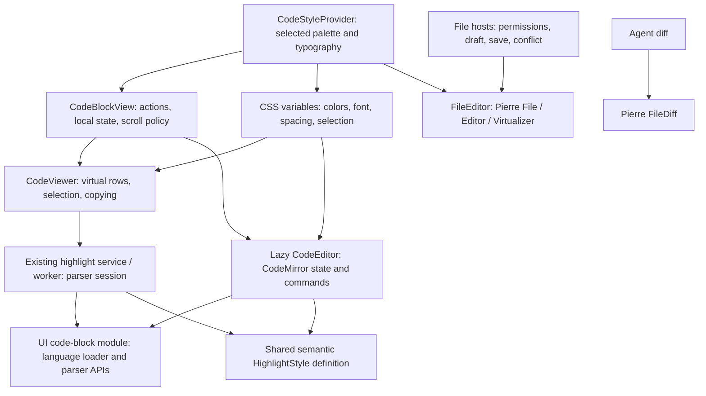

# Agent Note: Code-block viewing and editing with shared language and style

Status: proposed

English | [中文](2026-10-26-message-code-block-surfaces.zh.md)

## Problem

CodeBlockView switches between a renderer CodeViewer and a UI CodeEditor. The viewer uses a Highlights worker with TanStack Virtual; the editor uses CodeMirror language extensions and themes. They have independent token classification, colors and scroll implementations. Lazy editing currently falls back to a plain pre, and the outer block retains an imperative handle rather than EditorState across mode switches.

Files have a different boundary: paths, permissions, external updates, save/flush, conflicts and recoverable drafts belong to FileEditSession and its host. A message code block has source and existing message actions. Routing both through FileEditor would couple code-block reading to a file-oriented integration and its upstream editing patches without solving the shared-parser requirement.

This is a partial successor to [Highlights convergence](2026-10-22-code-highlights-virtualization.md) for CodeViewer range jobs and a scope clarification of [Pierre file surfaces](2026-10-24-pierre-code-surfaces.md). Preserve both notes and their unique evidence. Pierre remains the file/diff choice; the existing Highlights snapshot/HTML/Markdown and Tiptap consumers remain outside this proposal. Local implementation was approved in this conversation on 2026-10-26. Implementation and acceptance evidence are recorded below; the note remains proposed while the platform/performance gates are incomplete.

## Proposal

### 1. Two scene boundaries



| Scene | Target | Owner |
| --- | --- | --- |
| Message code-block reading | CodeViewer renders virtual text rows and syntax classes without creating EditorView | Existing renderer component and block host |
| Message code-block editing | Lazy CodeMirror; same language configuration and semantic style as reading | Existing UI CodeEditor; local state retained by block host |
| File source reading/editing and diff | Existing Pierre FileEditor and FileDiff integration | File hosts and existing FileEditSession |
| Rich Markdown, Tiptap, Notes and configuration editors | Preserve their current engines and behavior | Existing owners |
| Other CodeViewer consumers | Adopt the same read-only implementation after compatibility checks | Existing tool, error, Trace and HTML-artifact hosts |

Ordinary message blocks start in reading mode and load CodeMirror only after the edit action. Retain the CodeViewer role and name initially. There is no goal to delete it merely because FileEditor exists. FilePreview remains the format-routing/loading/toolbar container. Its remaining HTML source-body migration belongs to the file work, not to this code-block rollout. Keep current multi-language editing, completion, folding, keymaps, execution, special previews, split mode and screenshot actions. Do not copy ChatGPT's reported Python-only editing policy or fixed 64 KB / 10,000-span highlighting cutoff.

### 2. Placement and dependency direction

```text
packages/ui/src/
├── lib/code-block/                 language loading, semantic style, parser ranges
├── code-block.ts                   dedicated re-export-only public entry
└── components/composites/code-editor/
    ├── code-editor.tsx             existing CodeMirror wrapper
    ├── hooks.ts                    consume shared language loader
    ├── lazy-code-editor.tsx        accept caller-provided viewer fallback
    └── types.ts                    narrow state / fallback contract
src/renderer/
├── components/CodeBlockView/       local editor state, actions, mode and scroll policy
├── components/CodeViewer.tsx       existing viewport / selection presentation
├── components/FileEditor.tsx       file-only Pierre composition
├── components/CodeStyleProvider.tsx palette and shared appearance
├── services/CodeHighlightService.ts existing transport and lifetime
└── workers/codeHighlight.worker.ts Lezer range jobs; existing Highlights snapshots
```

Extract the actual language-loading code from the existing CodeEditor hooks rather than adding a second registry. Preserve aliases, caller-provided languageConfig and special DOT/Mermaid loaders. When the mapped extension has no grammar, try the normalized canonical name and its declared aliases from the existing compatibility catalog against installed grammar keys; directly supported grammars and configured extension mappings retain precedence. The installed loader returns LanguageSupport, StreamLanguage or null; normalize through public Language/LanguageSupport APIs, not an assumed language property on any Extension. Both consumers use the same parser configuration and language-support extensions, with lint enabled only by the editor's existing option. Unsupported or failed languages remain complete plain text.

The small code-block module belongs in the existing UI lib category because both UI CodeEditor and renderer/worker consumers need it. It owns only language loading, stable semantic class definitions and public parser/range operations. It imports no application Preference, IPC, React component or file-save layer. Add one dedicated built public subpath and seal it with the repository's import-boundary rules; do not re-export the parser runtime from the root UI barrel. Keep the existing code-highlight entry for its Highlights consumers. No universal engine interface, new Provider, persisted block ID or global editor store is introduced.

Reuse the existing CodeHighlightService, worker queue, request IDs, source/configuration revisions, generation protection, failure ceiling and bounded session ownership. Source inspection found that its range-highlighting API serves only CodeViewer; change that range path to the shared CodeMirror/Lezer parser after the pilot. Preserve the existing Highlights snapshot, HTML and Markdown job behavior. Do not create a second worker pool or a permanent per-consumer engine selector. Update renderer-local range result types to source offsets/classes; do not change shared snapshot token contracts as a side effect.

### 3. Shared syntax and appearance

One HighlightStyle definition maps semantic tags to stable classes. The viewer calls highlightTree with it; the editor installs syntaxHighlighting with the same definition. A worker and the main thread share module definitions, not object identity, syntax trees or an in-memory language cache. Each realm owns its own loaded grammar and parser state.

Resolve the selected palette once at the application appearance boundary. Use the existing viewer theme preferences as the canonical code-block palette, matching file/diff palette selection. Map the already resolved theme's syntax roles to local CSS variables through a thin explicit adapter; unassigned roles inherit the source foreground. Reuse existing theme resolution, not a new theme engine. The editor is transparent over the shared block background. Colors, selection, font family/size, line height, content inset and gutter geometry come from the same host variables. Palette changes update variables without re-parsing the source. This guarantees matching viewer/editor classification for the same completed source and language configuration; it does not promise identical Lezer and Pierre token boundaries.

For adopted message blocks, syntax colors follow the canonical viewer palette instead of chat.code.editor.theme_*. Preserve those legacy preference values and their existing CodeMirror-scoped control for Notes, prompt/configuration and other unmigrated editors; do not rewrite stored preferences. Suppress conflicting legacy syntax highlighters on the adopted block path, since CodeMirror combines classes from multiple non-fallback highlighters. Generic CodeEditor consumers keep their existing defaults.

Use the public HighlightStyle/highlightTree/syntaxHighlighting APIs. Language modules may depend on CodeMirror runtime modules even without EditorView construction: inspect the production chunk graph rather than claiming a parser-only import loads no CodeMirror code. References: [CodeMirror highlighting](https://github.com/codemirror/language/blob/main/src/highlight.ts) and [Lezer tree highlighting](https://github.com/lezer-parser/highlight/blob/main/src/highlight.ts). Online source explains the public mechanism; installed declarations/source remain the implementation authority.

### 4. State, mode switching and actions

CodeBlockView retains one local EditorState for the current mounted block/document epoch once editing begins. Derive the displayed draft from that state's document; do not mirror it in a second mutable string store. The accepted message source remains owned by the parent. A plain viewer that has never entered editing does not create EditorState. No history persistence across process reload or unrelated message identity is promised.

The HTML artifact popup retains a separate local EditorState across code, preview and split layouts. Preview/capture continue using the accepted parent HTML; switching layout does not save or run a draft. Matching save echoes retain selection/history; external replacements, closing/reopening and switching artifact identity start fresh sessions. Its loading fallback can read the retained parsed range. The standalone HTML fast path passes raw canonical source, so the Markdown adapter must not remove a HAST structural LF from it.

| Event | Required behavior |
| --- | --- |
| Enter editing | Show the same viewer during lazy loading; attach a new EditorView to retained compatible state or initialize from current source |
| Local edit | Update retained state/draft; preserve existing explicit message-save semantics |
| Return to reading and re-enter | Display the local draft and resume compatible selection/history; do not recreate from unchanged parent source |
| Save echo equal to current draft | Accept the parent update without resetting state/history |
| Genuine external source replacement | Begin a new document epoch; do not resurrect old history or publish callbacks from the old epoch |
| Theme, wrap, size or language configuration | Reconfigure through public extensions/transactions; preserve compatible document/history and invalidate obsolete highlights |
| Editor/language load failure | Keep complete current source selectable/copyable; retain recoverable draft and report through existing error/logging boundaries |
| Block removal | Destroy the view, close parser jobs and release local state; avoid a cross-block state cache |

Keep the existing CodeEditor wrapper. Add only the state retention and caller-provided fallback contract needed by this consumer. The UI package must not import renderer CodeViewer; the renderer passes its viewer as fallback and owns the load-error boundary. Restore state only on attachment through public EditorView APIs, reconfigure current extensions/callbacks, and use transactions for normal updates. Do not call setState on theme changes. Correctly mark/filter external updates to avoid onChange feedback; verify this against the installed React CodeMirror wrapper before widening scope.

Toolbar copy/download/run/save must read the currently displayed draft through existing block actions. Copying a selected editor range must not become an outer copy-message action. Streaming retains the current read-only policy and must not overwrite an active user edit. Preserve exact source whitespace and Unicode in reading/copying; remove trimEnd from the adopted message synchronization path. Check CRLF behavior with CodeMirror's public line-separator/slice APIs rather than assuming doc.toString preserves input separators. Source replacement/normalization requires an explicit contract, not hidden parser preprocessing. At the Markdown boundary, code document text is the AST code value: remove exactly the structural LF appended by mdast-to-HAST, preserve every authored blank line/space, and match that canonical value during save. A save/render round trip must produce the exact draft so history is retained.

Document positions count each line break once; serialized CRLF uses two characters. Normalize initial content and external replacements into CodeMirror Text before computing positions. Normalize inserted text at the shared transaction boundary for built-in commands, search replacements, paste/drop and extension edits; compose corrections into the original transaction so selections and effects map with the change and undo remains atomic. Inspect only inserted text, not the remaining document. Keep the serialization separator independent of syntax styling, without custom search or paste/drop handlers.

### 5. Viewport, streaming and scheduling

Retain the existing TanStack viewport binding, row measurement, selection/copy behavior and capture integration during the parser change. Expanded views observe the actual outer scroller; bounded views use their intended inner viewport. CodeMirror keeps its own editing viewport. Share wrap/height/content-inset values and host-owned stick-to-bottom policy; each view executes scrolling through its public APIs. User scroll-up stops following, and mode changes preserve the visible source position. Do not force both engines to own the same DOM scroller or add a second row virtualizer around CodeMirror.

The existing worker owns parser sessions and returns classes for requested source ranges; the viewer retains only current visible output and pending work. Use public parser incremental fragments/partial parsing for source changes and bound scheduling between jobs. Keep one active read and the latest unsent read per session. Initial parsing may need preceding context before a distant viewport: render source immediately while valid syntax is pending. Never parse only the visible text or the appended tail as a standalone program.

A stream append may change an earlier token or lexical context, such as slash followed by star or a newly closed string. Reuse valid syntax state, invalidate affected ranges and reject stale source/language generations. Append-only text is not proof that earlier spans remain correct. Already valid highlighting can remain only for a compatible source/language revision; pending content stays plain and must neither disappear nor regress. No source truncation or fixed size/span cutoff is introduced. Worker/parser failure falls back to full readable source instead of synchronous full-document parsing on the renderer thread.

### 6. Delivery and verification gates

| Stage | Deliverable | Verification and stop condition |
| --- | --- | --- |
| 1. Capability pilot | Small non-shipping harness using real language packages, HighlightStyle and CodeMirror | TS/YAML, a StreamLanguage, DOT/Mermaid, lazy/error fallback, syntax changes across appends; production import graph; stop if public APIs cannot preserve required behavior |
| 2. Shared syntax adoption | Shared module and palette adapter; atomically switch CodeViewer range jobs and the adopted CodeMirror syntax style | Matching completed-source colors, cold palette/language loads, actual outer scrolling, existing tool/error/Trace/HTML-artifact consumers and production performance gate |
| 3. Mode and streaming lifecycle | Local EditorState, shared viewer fallback, explicit echo/replacement handling and progressive stream highlighting | Read/edit/read/edit, undo/redo, copy/save/run, stale results, lexical-boundary appends, 1/5 MiB and long-line copy; no mocked-editor acceptance or permanent engine flag |
| 4. Scoped cleanup and acceptance | Remove only orphaned viewer Highlights code/imports; update owners/docs | Affected tests, real Electron, chunk graph and performance comparison; keep note proposed while any required gate lacks evidence |

Stages are implementation layers, not permission to leave incompatible half-migrations enabled. Preserve current production behavior until the relevant pilot passes. Do not remove Highlights, TanStack, CodeViewerSelectionManager or shared worker jobs solely from an import count: keep every remaining legitimate consumer. Local implementation follows the user approval recorded above; branch/PR publication is not part of that approval.

Tests must catch named regressions: shared syntax yields the same visible token colors, appends across lexical boundaries stay correct, stale results never replace current text, external echoes do not reset undo, external replacements cannot revive old drafts, and copy/save retain the complete displayed content. Follow [frontend testing rules](../../../../docs/references/testing/frontend-testing.md); use explicit affected-file filters for UI CodeEditor, renderer CodeViewer/CodeBlockView/themes, service/worker and existing affected consumers. Broader CI is separate from local scoped validation.

Real Electron verification covers streaming to completion, cold editor load and failure fallback, multi-language editing/completion/folding, selection/copy, mode/theme/wrap changes and undo, message save/reopen, screenshot and special views. Verify native Chinese IME on macOS and Windows; inserting Unicode is not IME evidence. Use the existing tracked-instance and on-demand scenario workflows rather than another launcher.

Compare baseline/candidate production renderer builds on the same machine, viewport, font and wrap configuration: pnpm-lock.yaml, deterministic 1/5 MiB multiline source, 1 MiB single line, and many small blocks. Record three cold and five warm runs, first visible source/highlight separately, input-to-paint and scrolling p95, longest task, mounted rows, worker count and retained-memory trend over 20 mount/unmount cycles. Budgets: warm first-source p95 within 1 s / 2.5 s for 1/5 MiB and no more than 20% slower than baseline; steady input/scroll p95 within 100 ms and no task over 200 ms. Require 5 MiB mounted rows at most 1.5 times 1 MiB with the same viewport. Treat a missed budget as a blocker to widening this rollout, not a reason to truncate source or declare an unmeasured pass.

## Remaining-surface rollout

The user authorized migrating all remaining surfaces on 2026-10-27. Extend this proposal to HTML file source, Notes source, CLI/MCP/CSS/prompt editors, Tiptap code decorations and snapshot/HTML/Markdown jobs. Existing file/save/conflict and ProseMirror history ownership remain unchanged. Message and HTML-artifact code editors use the shared semantic HighlightStyle and selected viewer palette. Generic Notes, CLI/MCP/CSS and prompt editors retain their independent CodeMirror theme preferences and selector; sharing a language loader does not opt these hosts into message styling. Tiptap decorates its own document using asynchronous shared-parser sessions, rejects obsolete results and keeps theme changes outside document/history transactions. Snapshot adapters preserve the existing token/HTML contracts using the same parser and palette. Pierre's internal Highlights backend stays library-owned. Trace/error truncation policies are separate and unchanged. No new persistence, engine toggle, size cutoff or worker pool is introduced. Local conversation approval authorizes implementation; Spec lifecycle and cross-platform acceptance remain proposed.

- HTML source reuses FileEditor; iframe security and host controls remain unchanged.
- Shared parser/palette adoption must preserve editor drafts, focus, selections, history, form callbacks, exact whitespace and unknown-language fallback. Host-specific heights and save semantics remain local.
- Real macOS Electron covers Notes rich/source editing, generic form editors, HTML file source and existing message/popup scenarios. Native IME/Windows evidence is reported separately; it is not inferred from Unicode insertion.

Local rollout verification passed 298 scoped renderer/UI tests and real macOS Electron checks for Notes rich/source, CSS, MCP JSON, prompt preview/edit, CLI config drafts, HTML file source, message blocks and HTML popups. The existing large-file scenario remains unaccepted: rapid jump-and-type failed two unchanged runs and passed three diagnostic runs without a product fix. This is recorded separately from the migrated-entry checks; its root cause, Windows, native IME and remote CI remain unverified. Current evidence is recorded in `.context/cherry-electron-dev/remaining-validation.md`.

## Alternatives considered

| Alternative | Assessment |
| --- | --- |
| Route message code blocks through Pierre FileEditor | Retains a file-centric integration and upstream edit/selection patch burden; does not share CodeMirror completion/folding or its parser with reading |
| Read-only CodeMirror for every block | Shares behavior but creates EditorView lifecycles for all reading blocks; retain as a measured alternative only if a lightweight viewer cannot satisfy selection/performance requirements |
| Keep Highlights viewer and map colors only | Lowest immediate cost, but syntax classification and two independent theme paths remain; insufficient for exact read/edit syntax consistency |
| Rebuild parser, virtual list, selection and input together | Enlarges the change and obscures regressions; retain existing viewport/selection behavior while changing syntax and state boundaries |
| Copy ChatGPT's thresholds or editing restrictions | Static bundle analysis is context, not evidence that those product policies meet Cherry Studio's requirements |

## Acceptance criteria

- AC1 — Files/diffs retain Pierre ownership and message blocks retain a dedicated viewer plus CodeMirror; no new universal surface/provider/store or persistence boundary is introduced. (verification: source/import audit; owner: architecture implementer)
- AC2 — Viewer/editor use the same language configuration and semantic style definition, including StreamLanguage and special loaders; unsupported/failed languages preserve full source. (verification: UI parser tests and real Electron; owner: syntax implementer)
- AC3 — Completed source has matching syntax colors, font, line height, insets, background and selection appearance across modes; palette changes preserve text/history without parser restarts or rewriting legacy preferences. (verification: renderer and Electron appearance checks; owner: appearance implementer)
- AC4 — Read/edit/read/edit and lazy loading/failure retain the current local draft and compatible history/selection; parent echoes preserve history while genuine replacements reject old callbacks/state. (verification: real CodeMirror component and Electron; owner: state implementer)
- AC5 — Streaming never loses/regresses source, handles lexical changes across appends correctly, discards obsolete jobs and remains selectable/copyable during pending or failed syntax work. (verification: parser/worker tests and Electron streaming scenario; owner: viewer implementer)
- AC6 — Existing multi-language editing, completion/folding, wrapping, expansion, actions, special/split views and screenshots work; copy/save/run operate on the displayed draft and full source/whitespace remains intact. (verification: affected-consumer tests and Electron; owner: code-block integrator)
- AC7 — Viewer range jobs use the existing transport with bounded sessions/output and actual viewport binding; snapshot/HTML/Markdown/Tiptap and unmigrated CodeMirror consumers keep their contracts. (verification: service/worker tests, import audit and Electron; owner: runtime implementer)
- AC8 — Production baseline/candidate reports satisfy the stated cold/warm, interaction, mounted-row and lifecycle-memory checks without truncation or unreported main-thread fallback. (verification: production Electron measurements; owner: performance verifier)
- AC9 — macOS and Windows real Electron scenarios pass native Chinese IME, clipboard, focus, mode/theme/history and message save/reopen checks; Unicode insertion is not substituted for IME. (verification: platform Electron evidence; owner: desktop verifier)
- AC10 — Owning bilingual docs, dedicated entry/import boundaries, affected tests and required CI checks pass; implementation is reported separately from missing runtime evidence, and Spec transition waits for every criterion. (verification: docs gate, scoped checks, CI and evidence mapping; owner: final integrator)

- AC11 — Adopted message/HTML-artifact editors and Tiptap code blocks share parser classes and the selected palette without resetting compatible drafts, selections or history; generic CodeMirror editors retain separate themes and controls. (verification: renderer and Electron; owner: surface integrator)
- AC12 — Remaining HTML file source uses FileEditor without changing restricted preview security or existing file session ownership. (verification: renderer and Electron; owner: file integrator)
- AC13 — Snapshot, HTML and Markdown highlighting preserve existing source/token/export contracts using shared parser classification; stale asynchronous Tiptap results cannot decorate a changed or removed block. (verification: parser/worker/plugin tests and Electron; owner: syntax integrator)

## Local implementation evidence

User approval on 2026-10-26 also includes a minimal `vfile-location@5.0.3` dependency patch. The CPU profile of the production baseline identified `next()` repeatedly searching the remaining source for a missing CR on LF-only input. A single forward newline regex preserves CRLF, standalone CR and UTF-16 position behavior without a size cutoff. `markdownLocations.test.ts` checks coordinates, independent documents and a 5 MiB scan budget.

| Scope | Evidence | Acceptance limit |
| --- | --- | --- |
| AC1 / AC2 / AC7 | Dedicated code-block entry; shared real TS/YAML/StreamLanguage/DOT/Mermaid parser tests; existing worker protocol tests | Grammar imports retain CodeMirror runtime dependencies; the uiw language barrel is loaded as a bundle, not one independent chunk per grammar |
| AC3 / AC4 | Real CodeMirror tests retain CRLF, selection/history/folds serialization and current callbacks; `tests/e2e/ondemand/specs/code-block.ts` exercises a real persisted message | macOS production renderer checks colors, font/line/inset geometry, theme selection, read/edit/read/edit, undo/redo, full draft copy and save/reopen |
| AC5 / AC6 | Parser lexical-boundary appends, stale worker replies, streaming host tests and existing consumers | Full live-provider streaming, completion/folding/special-view interaction and cross-mode visible-position continuity remain runtime acceptance gaps |
| AC8 | Local production baseline and patched renderer: 5 MiB warm first-source p95 about 12.9 s to 0.90 s; 37 initial rows for both 1/5 MiB; full-copy hashes pass for multiline, lockfile and a 1 MiB single line | Measurements use reload/switch scenarios on a shared machine, not isolated process cold starts; initial Markdown work still has long tasks; 10 event-to-paint samples per 1/5 MiB editor are about 18–34 ms, and expanded 5 MiB reading recycles 86 rows through the actual outer scroller |
| AC9 / AC10 | Local macOS Electron and targeted UI/renderer tests, production renderer/UI package builds and documentation checks | Native Chinese IME, Windows and remote CI are not established by these local checks |

Evidence lives under `.context/code-block/` and `.context/cherry-electron-dev/message-scenario/`. This records local implementation; it does not transition the Spec to implemented or accept the separate Pierre file-line limitations.

## Risks

Shared parser definitions do not make parsing free or guarantee fewer bytes. Language loaders can pull large CodeMirror dependency graphs; worker/main realms each load grammars. StreamLanguage, embedded languages, long lines and partial parser reuse require real compatibility evidence. Semantic theme-role mapping can differ from the old Highlights classification, so compare viewer/editor equality separately from old-renderer screenshots.

Retaining EditorState can also retain obsolete extension callbacks; attachment must install current handlers and generation ownership. The existing React wrapper filters its own ExternalChange annotation, while the local CodeEditor has its own dispatch path: a fresh unrelated Annotation is not proof of callback suppression. Palette changes and ordinary updates must not repeatedly reset the view. Selection and native IME remain engine/platform contracts rather than conclusions from a static diagram.

The supplied ChatGPT analysis is a design reference, not an independently verified runtime result. File-line limitations already recorded in the Pierre validation report, including the 5 MiB select-all long task, remain separate open work; this message plan neither fixes them nor reclassifies them as accepted.
