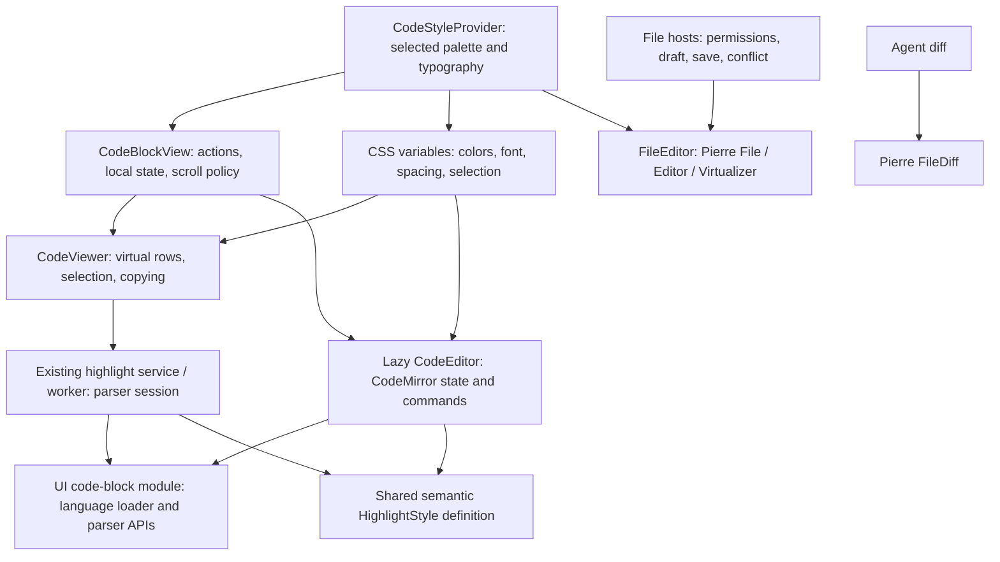

# Agent Note: 共享语言与样式的代码块阅读和编辑

Status: proposed

[English](2026-10-26-message-code-block-surfaces.md) | 中文

## 问题

CodeBlockView 在 renderer 的 CodeViewer 与 UI CodeEditor 之间切换。Viewer 使用 Highlights Worker 和 TanStack Virtual；Editor 使用 CodeMirror 语言扩展与主题。两边的语法分类、颜色和滚动实现相互独立。编辑器懒加载当前回退到普通 pre，外层代码块保存的是操作句柄，而不是能跨模式切换保留的 EditorState。

文件有不同的边界：路径、权限、外部更新、保存/flush、冲突和可恢复草稿属于 FileEditSession 及其宿主。消息代码块则以源码和已有消息动作为边界。将两者都交给 FileEditor，会让代码块阅读依赖文件集成和上游编辑补丁，却不能解决共享解析器的要求。

本文针对 CodeViewer 范围任务，部分承接 [Highlights 收敛方案](2026-10-22-code-highlights-virtualization.md)，并明确 [Pierre 文件视图方案](2026-10-24-pierre-code-surfaces.md) 的范围。保留两份文档及其独有证据。文件/diff 继续选择 Pierre；现有 Highlights 快照/HTML/Markdown 与 Tiptap 调用方不在本方案内。用户已于 2026-10-26 在本会话批准本地实现。下文记录实现与验收证据；平台/性能门槛未完成时，本文保持 proposed。

## 方案

### 1. 两个场景边界



| 场景 | 目标 | 所有者 |
| --- | --- | --- |
| 消息代码块阅读 | CodeViewer 渲染虚拟文本行和语法 class，不创建 EditorView | 现有 renderer 组件与代码块宿主 |
| 消息代码块编辑 | 懒加载 CodeMirror；与阅读共用语言配置和语义样式 | 现有 UI CodeEditor；代码块宿主保留本地状态 |
| 文件源码阅读/编辑与 diff | 现有 Pierre FileEditor 和 FileDiff 集成 | 文件宿主及已有 FileEditSession |
| 富文本 Markdown、Tiptap、Notes 与配置编辑器 | 保留当前引擎及行为 | 现有所有者 |
| 其他 CodeViewer 调用方 | 通过兼容检查后使用同一只读实现 | 已有工具、错误、Trace 和 HTML Artifact 宿主 |

普通消息代码块默认进入阅读，点击编辑后才加载 CodeMirror。先保留 CodeViewer 的职责和名称，不因存在 FileEditor 就以删除它为目标。FilePreview 继续作为格式路由、加载和工具栏容器。它剩余的 HTML 源码正文迁移属于文件工作，不属于本次代码块推广。保留当前多语言编辑、补全、折叠、快捷键、运行、特殊预览、分屏和截图动作。不照搬附件所述 ChatGPT 仅 Python 可编辑的策略，也不引入固定的 64 KB / 10,000 个 span 高亮门槛。

### 2. 代码位置与依赖方向

```text
packages/ui/src/
├── lib/code-block/                 language loading, semantic style, parser ranges
├── code-block.ts                   dedicated re-export-only public entry
└── components/composites/code-editor/
    ├── code-editor.tsx             existing CodeMirror wrapper
    ├── hooks.ts                    consume shared language loader
    ├── lazy-code-editor.tsx        accept caller-provided viewer fallback
    └── types.ts                    narrow state / fallback contract
src/renderer/
├── components/CodeBlockView/       local editor state, actions, mode and scroll policy
├── components/CodeViewer.tsx       existing viewport / selection presentation
├── components/FileEditor.tsx       file-only Pierre composition
├── components/CodeStyleProvider.tsx palette and shared appearance
├── services/CodeHighlightService.ts existing transport and lifetime
└── workers/codeHighlight.worker.ts Lezer range jobs; existing Highlights snapshots
```

从现有 CodeEditor hooks 提取实际语言加载代码，不再建立第二份注册表。保留别名、调用方传入的 languageConfig 及 DOT/Mermaid 特殊加载器。映射后的扩展名没有对应语法时，使用已有兼容目录中规范化后的完整语言名及其别名，匹配已安装的语法键；直接支持的语法和已配置的扩展名映射保留优先级。已安装加载器返回 LanguageSupport、StreamLanguage 或 null；通过公开 Language/LanguageSupport API 统一处理，不能假定任意 Extension 都具有 language 属性。两端使用相同解析器配置和语言支持扩展；lint 仅由编辑器已有选项启用。不支持或加载失败的语言保留完整纯文本。

小型 code-block 模块放在现有 UI lib 分类中，因为 UI CodeEditor 与 renderer/Worker 都需要它。它只负责语言加载、稳定语义 class 定义和公开解析器/范围操作，不导入应用 Preference、IPC、React 组件或文件保存层。增加一个独立构建的公共子路径，并通过仓库导入边界规则封装；不从 UI 根 barrel 重新导出解析运行时。现有 code-highlight 入口继续服务 Highlights 调用方。不引入通用引擎接口、新 Provider、持久化块 ID 或全局编辑器状态仓库。

复用现有 CodeHighlightService、Worker 队列、请求 ID、源码/配置版本、generation 保护、故障超时上限和有界会话所有权。源码检查确认其范围高亮 API 只服务 CodeViewer；试点通过后，将该范围路径改为共享的 CodeMirror/Lezer 解析器。保留现有 Highlights 快照、HTML 和 Markdown 任务行为。不新建第二个 Worker 池，也不引入永久的逐调用方引擎选择器。将 renderer 本地范围结果类型改为源码偏移/class；不顺带修改共享快照 token 契约。

### 3. 共享语法与外观

一份 HighlightStyle 定义将语义标签映射到稳定 class。Viewer 用它调用 highlightTree，Editor 用相同定义安装 syntaxHighlighting。Worker 与主线程共享模块定义，不共享对象身份、语法树或内存中的语言缓存。每个执行环境各自拥有已加载的语法和解析状态。

在应用外观边界解析一次所选调色板。消息代码块以已有 viewer 主题偏好作为统一调色板，与文件/diff 的调色板选择一致。用一层明确的小型适配，将已解析主题的语法角色映射到局部 CSS 变量；未分配的角色继承源码前景色。复用已有主题解析，不另建主题引擎。编辑器背景透明，共享代码块背景。颜色、选区、字体/字号、行高、正文内边距和行号槽几何都来自相同宿主变量。调色板变化更新变量，不重新解析源码。这保证相同完整源码和语言配置在读写两端具有相同分类，不承诺 Lezer 与 Pierre 的 token 边界完全一致。

接入后的消息代码块使用统一 viewer 调色板，而不再由 chat.code.editor.theme_* 决定语法颜色。保留这些旧偏好值，以及 Notes、提示词/配置和其他未迁移编辑器已有的 CodeMirror 专用设置；不重写持久化偏好。在接入的代码块路径中排除冲突的旧语法高亮器，因为 CodeMirror 会合并多个非 fallback 高亮器产生的 class。通用 CodeEditor 调用方保留现有默认行为。

使用公开 HighlightStyle/highlightTree/syntaxHighlighting API。即便不创建 EditorView，语言模块仍可能依赖 CodeMirror 运行时模块；必须检查生产 chunk 图，不能声称仅导入解析器就完全不加载 CodeMirror 代码。参考：[CodeMirror 高亮](https://github.com/codemirror/language/blob/main/src/highlight.ts) 与 [Lezer 语法树高亮](https://github.com/lezer-parser/highlight/blob/main/src/highlight.ts)。在线源码用于说明公开机制，实现仍以已安装声明和源码为准。

### 4. 状态、模式切换与动作

开始编辑后，CodeBlockView 为当前已挂载代码块/文档 epoch 保留一份本地 EditorState。从该状态的文档派生显示草稿，不再镜像到第二份可变字符串仓库。已接受的消息源码仍归父级所有。尚未进入编辑的普通 Viewer 不创建 EditorState。不承诺进程重载或不相关消息身份之间持久化历史。

HTML artifact 弹窗在代码、预览和分屏布局之间保留独立的本地 EditorState。预览/捕获继续使用父级已接受的 HTML；切换布局不保存或运行草稿。匹配的保存回声保留选区/历史；外部替换、关闭重开和 artifact 身份切换开启新会话。加载 fallback 可读取保留的已解析范围。独立 HTML 快速路径传入规范原始源码，Markdown 适配器不能再从中移除 HAST 的结构性 LF。

| 事件 | 必须保持的行为 |
| --- | --- |
| 进入编辑 | 懒加载期间显示同一 Viewer；新 EditorView 接入兼容的保留状态，或从当前源码初始化 |
| 本地编辑 | 更新保留状态/草稿；保持已有显式消息保存语义 |
| 返回阅读再进入编辑 | 显示本地草稿并恢复兼容选区/历史；不能从未变化的父级源码重新创建 |
| 保存回传与当前草稿相同 | 接受父级更新，不重置状态/历史 |
| 真正的外部源码替换 | 开启新文档 epoch；不恢复旧历史，也不发布旧 epoch 的回调 |
| 主题、换行、字号或语言配置 | 通过公开扩展/事务重新配置；保留兼容文档/历史，使过期高亮失效 |
| 编辑器/语言加载失败 | 当前完整源码仍可选择/复制；保留可恢复草稿，并通过已有错误/日志边界报告 |
| 代码块移除 | 销毁视图、关闭解析任务并释放本地状态；不增加跨代码块状态缓存 |

保留已有 CodeEditor 封装，只增加当前调用方所需的状态保留和调用方提供 fallback 的契约。UI 包不能导入 renderer CodeViewer；由 renderer 传入 Viewer 作为 fallback，并拥有加载错误边界。仅在挂载时通过公开 EditorView API 恢复状态，重新配置当前扩展/回调；普通更新使用事务。主题变化不调用 setState。正确标记并过滤外部更新，避免 onChange 回路；扩大范围前先验证已安装 React CodeMirror 封装的实际行为。

工具栏复制/下载/运行/保存必须通过已有代码块动作读取当前显示草稿。复制编辑器局部选区不能变成外层“复制消息”。流式输出保留现有只读策略，不能覆盖用户正在进行的编辑。阅读/复制保留源码空白和 Unicode；接入后的消息同步路径移除 trimEnd。通过 CodeMirror 公开的行分隔符/slice API 检查 CRLF 行为，不能假定 doc.toString 会保留输入分隔符。源码替换/归一化需要明确契约，不能藏在解析预处理里。Markdown 边界的代码文档采用 AST code value：仅去掉 mdast-to-HAST 附加的结构性 LF，保留所有用户空白行/空格，保存时匹配这个规范值。保存/渲染往返必须回到完全相同的草稿，以保留历史。

文档位置将每个换行计为一个字符，而序列化后的 CRLF 占两个字符。初始内容和外部替换先转换为 CodeMirror Text，再计算位置。内置命令、搜索替换、粘贴／拖入及扩展编辑的插入文本在共享事务边界归一化；修正合并进原事务，选区和效果随变更映射，撤销保持原子性。只检查插入文本，不扫描其余全文。序列化分隔符独立于语法样式，不自定义搜索或粘贴／拖入处理器。

### 5. 视口、流式输出与调度

更换解析器时保留已有 TanStack 视口绑定、行测量、选区/复制行为和截图集成。展开视图观察真实外层滚动容器；有界视图使用预期的内部视口。CodeMirror 继续拥有自身编辑视口。共享换行/高度/正文内边距取值，跟随底部的策略归宿主所有；每个视图通过其公开 API 执行滚动。用户向上滚动后停止跟随，模式切换保留可见源码位置。不强迫两个引擎拥有同一个 DOM 滚动容器，也不在 CodeMirror 外叠加第二个行虚拟器。

现有 Worker 拥有解析会话并返回请求源码范围的 class；Viewer 只保留当前可见结果和待处理工作。通过公开解析器增量 fragment/部分解析处理源码变化，并限制任务间调度。每个会话最多一个活跃读取和最新一个未发送读取。首次解析可能需要先建立远端视口之前的上下文：有效语法尚未就绪时立即显示源码。不能把可见文本或追加尾部单独当成完整程序解析。

流式追加可能改变前面的 token 或词法上下文，例如斜杠后跟星号、字符串刚刚闭合。复用有效语法状态、使受影响范围失效，并拒绝过期的源码/语言 generation。文本仅追加不代表旧 span 一定仍正确。只有兼容源码/语言版本的既有高亮才能保留；待处理内容保持纯文本，不能消失或回退。不引入源码截断或固定大小/span 数量门槛。Worker/解析器失败时回退到完整可读源码，不在 renderer 主线程同步全量解析文档。

### 6. 交付与验证门槛

| 阶段 | 交付内容 | 验证与停止条件 |
| --- | --- | --- |
| 1. 能力试点 | 使用真实语言包、HighlightStyle 和 CodeMirror 的小型非交付验证环境 | TS/YAML、一种 StreamLanguage、DOT/Mermaid、懒加载/失败回退、跨追加边界的语法变化；生产导入图；公开 API 无法保留所需行为则停止 |
| 2. 共享语法接入 | 共享模块和调色板适配；原子切换 CodeViewer 范围任务与接入后的 CodeMirror 语法样式 | 完整源码颜色一致、首次加载调色板/语言、真实外层滚动、已有工具/错误/Trace/HTML Artifact 调用方和生产性能门槛 |
| 3. 模式与流式生命周期 | 本地 EditorState、共享 Viewer fallback、明确的回传/替换处理及渐进流式高亮 | 阅读/编辑/阅读/编辑、撤销/重做、复制/保存/运行、过期结果、跨词法边界追加、1/5 MiB 与长行复制；不能用模拟编辑器验收，也不保留永久引擎开关 |
| 4. 定向清理与验收 | 仅移除失去调用方的 Viewer Highlights 代码/导入；更新所属文档 | 受影响测试、真实 Electron、chunk 图和性能对比；任一必需门槛缺少证据时保持 proposed |

阶段表示实现层次，不允许启用不兼容的半迁移状态。相关试点通过前保持当前生产行为。不因导入计数就删除 Highlights、TanStack、CodeViewerSelectionManager 或共享 Worker 任务：保留每个仍有合法调用方的部分。本地实现依据上文记录的用户批准进行；该批准不包含分支/PR 发布。

测试必须捕获明确回归：共享语法产生相同可见 token 颜色，跨词法边界追加仍正确，过期结果不能替换当前文本，外部回传不重置撤销，外部替换不能恢复旧草稿，复制/保存保留完整显示内容。遵循 [前端测试规则](../../../../docs/references/testing/frontend-testing.md)；UI CodeEditor、renderer CodeViewer/CodeBlockView/主题、service/Worker 和已有受影响调用方均使用显式测试文件过滤。本地定向验证与更广泛 CI 分开报告。

真实 Electron 验证覆盖流式到完成、首次加载编辑器与失败回退、多语言编辑/补全/折叠、选区/复制、模式/主题/换行切换与撤销、消息保存后重开、截图及特殊预览。在 macOS 和 Windows 验证原生中文输入法；插入 Unicode 不等于 IME 证据。使用已有实例跟踪和按需场景流程，不另写启动器。

在相同机器、视口、字体和换行配置下比较基线/候选生产 renderer：pnpm-lock.yaml、确定性的 1/5 MiB 多行源码、1 MiB 单行和大量小代码块。记录三次冷运行和五次热运行，分别记录源码/高亮首次可见时间、输入到绘制及滚动 p95、最长任务、挂载行数、Worker 数量和 20 次挂载/卸载的保留内存趋势。预算：1/5 MiB 热运行源码首次可见 p95 分别不超过 1 s / 2.5 s，且相对基线退化不超过 20%；稳定交互输入/滚动 p95 不超过 100 ms，无超过 200 ms 的任务。相同视口下 5 MiB 挂载行数最多为 1 MiB 的 1.5 倍。预算未达标会阻止扩大推广，不能以截断源码或声称未测通过来替代。

## 剩余入口迁移

用户于 2026-10-27 批准迁移全部剩余入口。将本方案扩展到 HTML 文件源码、Notes 源码、CLI/MCP/CSS/提示词编辑器、Tiptap 代码装饰以及快照/HTML/Markdown 任务。文件保存、权限、冲突及 ProseMirror 文档历史继续由原宿主管理。消息与 HTML Artifact 代码编辑器使用共享语义 HighlightStyle 与 viewer 调色板。通用 Notes、CLI/MCP/CSS 和提示词编辑器保留独立的 CodeMirror 主题偏好及选择器；共享语言加载器不意味着这些宿主采用消息样式。Tiptap 通过异步共享解析会话装饰自身文档，丢弃过期结果，主题变化不修改文档或历史。快照适配层用相同解析器和调色板保留现有 token/HTML 契约。Pierre 内部的 Highlights 后端仍归库自身管理。Trace/错误详情的截断策略独立保留。不新增持久化、引擎开关、大小截断或 worker 池。对话批准允许本地实现，Spec 生命周期与跨平台验收仍保持 proposed。

- HTML 源码复用 FileEditor；iframe 安全策略与宿主控件不变。
- 共享语法/配色接入须保留草稿、焦点、选区、历史、表单回调、完整空白及未知语言回退；高度与保存语义继续由宿主决定。
- 真实 macOS Electron 覆盖笔记富文本/源码、通用表单编辑器、HTML 文件源码及已有消息/弹窗场景；原生 IME/Windows 单独报告，Unicode 插入不能代替相关证据。

本轮本地验证通过了 298 项 renderer/UI 定向测试，以及真实 macOS Electron 下 Notes 富文本/源码、CSS、MCP JSON、提示词预览/编辑、CLI 配置草稿、HTML 文件源码、消息代码块和 HTML 弹窗检查。既有大文件用例仍未验收：快速跳转后输入在两次原始运行中失败，在三次诊断运行中通过，期间未修改产品实现。该结果与新增入口验证分别记录；其根因、Windows、原生输入法和远程 CI 仍未验证。本轮证据记录在 `.context/cherry-electron-dev/remaining-validation.md`。

## 考虑过的替代方案

| 替代方案 | 评估 |
| --- | --- |
| 消息代码块交给 Pierre FileEditor | 延续文件集成及上游编辑/选区补丁负担，无法与阅读共用 CodeMirror 补全/折叠和解析器 |
| 每个代码块都创建只读 CodeMirror | 能共享行为，但所有阅读代码块都创建 EditorView 生命周期；只有轻量 Viewer 无法满足选区/性能要求时才作为实测替代方案保留 |
| 保留 Highlights Viewer，仅映射颜色 | 即时成本最低，但语法分类及两套独立主题路径仍存在，不足以保证读写语法一致 |
| 同时重写解析器、虚拟列表、选区和输入 | 扩大改动并掩盖回归；改变语法和状态边界时保留已有视口/选区行为 |
| 照搬 ChatGPT 的门槛或编辑限制 | 静态 bundle 分析只是背景，不代表那些产品策略满足 Cherry Studio 要求 |

## 验收标准

- AC1 — 文件/diff 保持 Pierre 所有权，消息代码块保留专用 Viewer 和 CodeMirror；不新增通用视图/Provider/状态仓库或持久化边界。（验证：源码/导入审计；负责人：架构实现者）
- AC2 — Viewer/Editor 使用相同语言配置和语义样式定义，包含 StreamLanguage 及特殊加载器；不支持/失败的语言保留完整源码。（验证：UI 解析器测试和真实 Electron；负责人：语法实现者）
- AC3 — 完整源码在模式切换前后的语法颜色、字体、行高、内边距、背景和选区外观一致；调色板变化保留文本/历史，不重启解析器、不重写旧偏好。（验证：renderer 与 Electron 外观检查；负责人：外观实现者）
- AC4 — 阅读/编辑/阅读/编辑及懒加载/失败保留当前本地草稿和兼容历史/选区；父级回传保留历史，真正替换则拒绝旧回调/状态。（验证：真实 CodeMirror 组件和 Electron；负责人：状态实现者）
- AC5 — 流式输出不丢失/回退源码，正确处理跨追加边界的词法变化，丢弃过期任务，在语法待处理或失败时仍可选择/复制。（验证：解析器/Worker 测试和 Electron 流式场景；负责人：Viewer 实现者）
- AC6 — 现有多语言编辑、补全/折叠、换行、展开、动作、特殊/分屏预览和截图均可用；复制/保存/运行使用显示中的草稿，完整源码/空白保持不变。（验证：受影响调用方测试和 Electron；负责人：代码块集成者）
- AC7 — Viewer 范围任务使用现有传输、有界会话/结果和真实视口绑定；快照/HTML/Markdown/Tiptap 与未迁移 CodeMirror 调用方保持契约。（验证：service/Worker 测试、导入审计和 Electron；负责人：运行时实现者）
- AC8 — 生产基线/候选报告满足规定的冷热运行、交互、挂载行和生命周期内存检查，不截断内容、不隐藏主线程回退。（验证：生产 Electron 测量；负责人：性能验证者）
- AC9 — macOS 与 Windows 真实 Electron 场景通过原生中文输入法、剪贴板、焦点、模式/主题/历史和消息保存后重开检查；不能以 Unicode 插入替代 IME。（验证：平台 Electron 证据；负责人：桌面验证者）
- AC10 — 所属双语文档、独立入口/导入边界、受影响测试和必需 CI 检查通过；实现与缺少的运行证据分开报告，所有标准完成前不迁移 Spec 状态。（验证：文档门禁、定向检查、CI 和证据映射；负责人：最终集成者）

- AC11 — 已接入的消息/HTML Artifact 编辑器与 Tiptap 代码块共享解析 class 与所选调色板，兼容草稿、选区及历史不被重置；通用 CodeMirror 编辑器保留独立主题及控件。 (verification: renderer and Electron; owner: surface integrator)
- AC12 — 剩余 HTML 文件源码接入 FileEditor，受限预览安全策略及原文件会话所有权不变。 (verification: renderer and Electron; owner: file integrator)
- AC13 — 快照、HTML 及 Markdown 高亮使用共享解析分类并保留原源码/token/导出契约；过期 Tiptap 异步结果不能装饰已改变或移除的代码块。 (verification: parser/worker/plugin tests and Electron; owner: syntax integrator)

## 本地实现证据

用户在 2026-10-26 的批准还包括最小 `vfile-location@5.0.3` 依赖补丁。生产基线的 CPU 采样发现，`next()` 对纯 LF 输入反复扫描剩余源码中不存在的 CR。改用一次向前查找换行的正则，保持 CRLF、单独 CR 和 UTF-16 位置语义，不增加大小上限。`markdownLocations.test.ts` 检查坐标、文档隔离与 5 MiB 扫描预算。

| 范围 | 证据 | 验收边界 |
| --- | --- | --- |
| AC1 / AC2 / AC7 | 独立 code-block 入口；真实 TS/YAML/StreamLanguage/DOT/Mermaid 共享解析器测试；既有 Worker 协议测试 | 语言导入仍依赖 CodeMirror 运行模块；uiw 语言 barrel 整包加载，并非每种语法各自一个独立 chunk |
| AC3 / AC4 | 真实 CodeMirror 测试保留 CRLF、选区/历史/折叠序列化和当前回调；`tests/e2e/ondemand/specs/code-block.ts` 操作真实持久化消息 | macOS 生产 renderer 检查颜色、字体/行高/内边距、主题选区、阅读/编辑往返、撤销/重做、完整草稿复制及保存/重开 |
| AC5 / AC6 | 解析器词法边界追加、Worker 过期结果、流式宿主测试和现有调用方 | 完整供应商实时流、补全/折叠/特殊视图交互和跨模式可见位置连续性，仍存在运行验收缺口 |
| AC8 | 本地生产基线与补丁 renderer：5 MiB 热切换首屏 p95 约从 12.9 s 降至 0.90 s；1/5 MiB 首屏均 37 行；多行、lockfile 和 1 MiB 单行完整复制哈希通过 | 共享机器上的重载/切换场景不等于隔离进程冷启动；Markdown 首次处理仍有长任务；1/5 MiB 编辑各 10 次事件到绘制采样约 18–34 ms，展开的 5 MiB 阅读在真实外层滚动中回收 86 行 |
| AC9 / AC10 | 本地 macOS Electron、定向 UI/renderer 测试、生产 renderer/UI 包构建及文档检查 | 这些本地检查不能证明原生中文 IME、Windows 和远程 CI 已通过 |

证据位于 `.context/code-block/` 与 `.context/cherry-electron-dev/message-scenario/`。这里记录本地实现，不将 Spec 转为 implemented，也不接受独立的 Pierre 文件线未完成项。

## 风险

共享解析器定义不代表解析没有成本，也不保证包体积减少。语言加载器可能引入较大的 CodeMirror 依赖图，Worker/主线程各自加载语法。StreamLanguage、嵌入语言、长行和部分解析复用需要真实兼容证据。语义主题角色映射可能不同于旧 Highlights 分类，因此要将读写一致性与旧渲染截图对比分开验证。

保留 EditorState 也可能保留过期扩展回调；挂载时必须安装当前处理器和 generation 所有权。现有 React 封装过滤自己的 ExternalChange annotation，而本地 CodeEditor 有自己的 dispatch 路径；新建一个无关 Annotation 不能证明回调被抑制。调色板和普通更新不能反复重置视图。选区和原生 IME 仍属于引擎/平台契约，不能由静态架构图推断通过。

用户提供的 ChatGPT 分析是设计参考，不是独立验证的运行结果。Pierre 验证报告已记录的文件线限制（包括 5 MiB 全选长任务）仍是单独待办；本消息方案不会修复它们，也不会将其重新归类为已验收。
