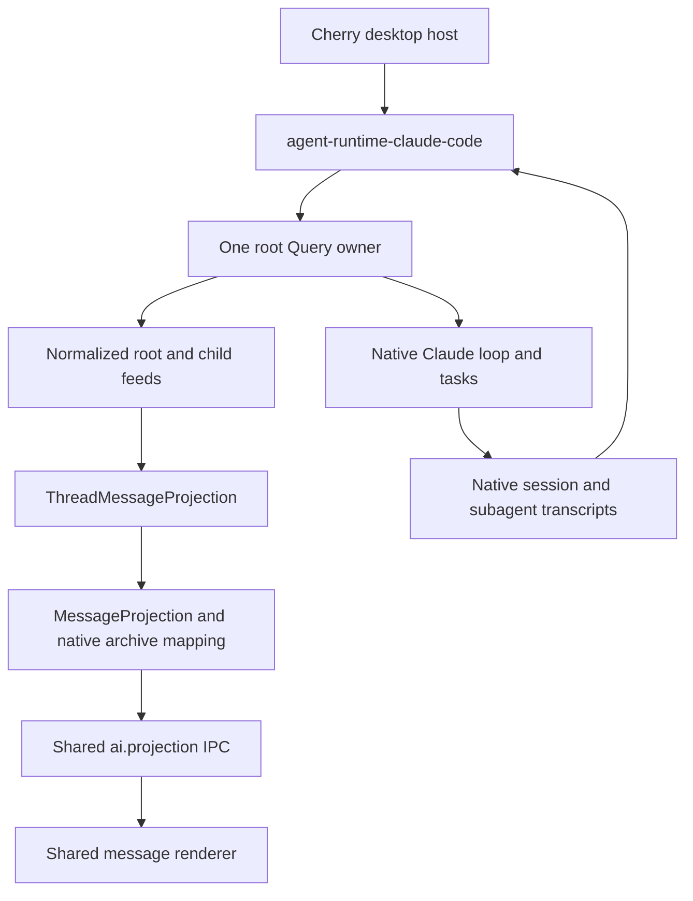

# Agent Note: Claude Code migration to the common runtime

Status: proposed

English | [中文](2026-10-27-agent-runtime-claude-code.zh.md)

## Problem

Claude Code still enters Cherry through [ClaudeCodeRuntimeDriver](../../../../src/main/ai/runtime/claudeCode/ClaudeCodeRuntimeDriver.ts) and its session-scoped [stream adapter](../../../../src/main/ai/runtime/claudeCode/streamAdapter.ts). That adapter combines native execution, input attribution, task discovery, and product message rendering. After a parent turn ends, child content changes sinks and updates an accumulator seeded with the complete parent message. The host then publishes that parent's parts through Shared Cache. Child content, lifetime, and recovery consequently depend on the parent message.

The [runtime contract](2026-10-17-agent-runtime-contract.md) already separates access, input, observation, and ownership. Pi and Pi Durable now use it from the desktop and have independent child projections. Claude Code needs an adapter to that boundary while preserving its native session, tools, task lifecycle, permissions, and model routing. Moving the existing driver into a package would retain the coupling and carry Cherry's database and UI policy into the adapter.

## Proposal

### C0 evidence and its limits

The [native contract probes](../../../../src/main/ai/runtime/claudeCode/__tests__/nativeContract.test.ts) run the installed `@anthropic-ai/claude-agent-sdk` **0.3.284** and its real CLI **2.1.284** against a scripted Anthropic Messages endpoint on an ephemeral loopback port. Each probe has an isolated work directory and `CLAUDE_CONFIG_DIR`, a dummy key, and only the native Agent tool. The SDK, CLI, task scheduler, hooks, and transcript writer are real. The model responses are scripted; these checks do not establish real-model quality, Electron rendering, billing, or packaged-platform acceptance.

Executed on macOS arm64 on 2026-10-27:

| Probe | Observed result | Migration consequence |
| --- | --- | --- |
| Foreground child and history | A child block arrives before the root result. Native task, hook, and structured tool-result identities join to the child archive. Live child UUIDs equal archived UUIDs; the root archive excludes those child bodies. | Observe the child independently and retain native identity. Do not parse the textual tool-result trailer. |
| Multiple content blocks | Two child assistant frames share one API `message.id` but have different transcript UUIDs and distinct content. | Deduplicating only by API message ID would lose a block. |
| Background child | Child output and completion remain observable after the root result while the Query owner stays alive. | Root result cannot close child observation or its writer. |
| Targeted stop | `stopTask(taskId)` stops one child's pending model request; its sibling and parent still complete. | Keep task stop distinct from root interruption and owner shutdown. |
| Root interrupt and queued input | `interrupt()` reports the later-priority input in `still_queued`; that input subsequently runs and its response carries its UUID. | Interruption is not cancellation of the whole queue. |
| Next-priority input | During a foreground child, `priority: 'next'` reaches the next parent request; the result contains both input UUIDs. Without a tool boundary, the queued next-priority input runs as a follow-up. | Native admission can implement steering across the end boundary without `onlyInRun` or an idle check. |

The six tests cover these cases; the foreground test also covers the first two rows. Run them with:

```sh
pnpm exec vitest run --project main src/main/ai/runtime/claudeCode/__tests__/nativeContract.test.ts
```

The exploratory raw event capture additionally showed root partial events and complete child content blocks, with no child token deltas. This agrees with the official [streaming output documentation](https://code.claude.com/docs/en/agent-sdk/streaming-output). C1 must consume the granularity actually emitted and must not promise token-level child streaming. The pinned CLI also emits `command_lifecycle` frames that are absent from its published `SDKMessage` union. The probes use a guarded shape check only as an input-arrival barrier; production input receipts must not require that undeclared frame.

These probes do not establish nested-child routing, resumed-child identity, compaction/replacement behavior, interrupted partial-block recovery, or exactly-once delivery after process failure. Those are explicit implementation gates below, rather than facts inferred from a successful foreground example. Current [subagent](https://code.claude.com/docs/en/agent-sdk/subagents) and [session](https://code.claude.com/docs/en/agent-sdk/sessions) documentation is useful context; the installed types and pinned probes govern version-specific claims.

### One native owner, several thread accesses



A runtime instance owns a configured backend namespace and its root Query owners. Each root owner consumes the SDK iterator once, maintains its routing and source mappings, and serves multiple root/child handles. `open(thread)` validates and attaches an existing context; it does not create an unrelated root session for a child. Archive-only access does not start model work. Root creation, native resume configuration, settings reconciliation, and fork operations remain concrete adapter or host operations.

| Owner | Responsibility |
| --- | --- |
| Native Claude SDK/CLI | Agent loop, built-in tools and subagents, native admission, task results, native history, native fork semantics. |
| `packages/agent-runtime-claude-code` | Query ownership, SDK event routing, common content/input observations, handle lifecycle, typed native controls, and readable native archive access. No Electron, product SQLite, Shared Cache, or renderer imports. |
| `packages/agent-runtime` | Existing `AgentRuntime`, `ThreadHandle`, observation types and feed delivery. No new scheduler, tool registry, task store, or capability string matrix. |
| Desktop host | Product sessions and message trees, backend/context bindings, credentials and provider routes, approval/question UI, tool policy, CLI acquisition/process diagnostics, prewarm policy, billing/tracing, backup/deletion policy, and projections. |
| Renderer | The shared message model and projection transport, plus small task-card metadata. Child bodies have their own message collection. |

The adapter receives materialized typed SDK configuration and callbacks. Existing approval and question callbacks remain native `canUseTool`/hook integration points; introducing a second generic HostPorts family is not required. A prewarmed Query transfers to exactly one adapter owner together with its captured credential/configuration identity. The adapter must not consume it in parallel with the old connection loop.

### Public behavior and native controls

| Entry | Claude Code behavior |
| --- | --- |
| Root `input.submit`, `whenBusy: 'steer'` | Submit an SDK user message with `priority: 'next'`; allow native admission to place it at a boundary or in a later turn. Preserve native slash-command handling. |
| Root `input.submit`, `whenBusy: 'follow-up'` | Submit with `priority: 'later'`. A queued receipt does not mean completion or exclusive ownership of a response. |
| `whenBusy: 'reject'` | Do not advertise it initially: a host idle read cannot provide atomic native rejection, especially with autonomous root turns. |
| Child `input` | Absent initially. Parent-mediated Agent/SendMessage use is not a direct child submission API. Revisit only with a proven public native operation. |
| `observe` / `Observation.stop` | Subscribe to or detach from a normalized thread feed; detaching does not cancel native execution. |
| `ThreadHandle.release` | Release that caller's access. It neither interrupts work nor closes the root Query owned elsewhere. |
| Root `interrupt` | Request native interruption and retain the fact that queued inputs can survive. Do not claim the entire session or its children stopped. |
| Concrete task stop | Route the SDK's `stopTask(taskId)` through the known owner. Its Promise acknowledges the request; task events establish the terminal outcome. |
| `AgentRuntime.shutdown` | Publish the final available source state, close owned Queries and subprocesses, and end feeds. The host coordinates archive flushing; history is not deleted. |

The public `Query.interrupt()` in the pinned SDK has no `cancel_queued` argument, even though its native protocol advertises that capability. Do not reach into private transport to emulate it. Cherry's existing session-close path closes the connection, optionally after interrupting; C2 preserves that ownership boundary. A Stop action that must prevent later work must keep host admission closed and shut down the owner, not substitute bare `interrupt()`.

Assign a fresh native UUID to each immutable logical input and retain its mapping to the host `InputId`; reuse a host UUID when valid. Handing a message into the SDK input iterable proves dispatch started, not native acceptance or durable placement. Correlated output can add stronger `input.changed` evidence. A process loss after dispatch is unknown and must not trigger automatic retry: a UUID is not a proven deduplication key. `user_message_uuids` can associate several inputs with one answer; the adapter must preserve all supported associations and must not fabricate a separate answer per input.

C2 replaces the current root-only hook injection and `steer-undelivered` fallback only after the native-priority path preserves input attribution, turn splitting, and billing in desktop tests. Do not run hook injection and native submission for the same input. Native image/document input and non-text observations stay lossless through a typed Claude-specific extension until a separate cross-harness consumer justifies widening the common text contract.

### Identity, ordering, and observation

| Identity | Meaning |
| --- | --- |
| Backend | Configured storage/authentication namespace; the same native session ID in another backend is not the same context. |
| Root thread | Native session ID within that backend. |
| Child thread and relationship | Native session plus `agentId`; stable across a proven continuation of that child. The adapter encodes its opaque thread ID; consumers do not parse it. |
| Native task | Control and outcome identity from task events. The probes establish `task_id == agentId` for these local-agent executions, not for every task type or future run. |
| Tool invocation | `tool_use_id`, used to associate a spawn/control card with its actual owner and child. It is not the durable child identity. |
| Content | Transcript UUID plus block discrimination where needed. API `message.id` and partial-stream block index are temporary normalization keys, not sufficient archive identities. |

Normalize each SDK event once. Route root/child messages by native structured identity and the observed ownership of tool invocations. Resolve a `local_agent` task from its task event, hook, and structured Agent result; never turn a Bash/MCP task into a child thread merely because it has a task ID. If identity arrives after content, retain a bounded pending mapping and report a gap when it cannot be reconciled. Do not silently attach uncertain content to the root. Nested routing must join each spawning invocation to the thread that produced it; a shared root session ID alone does not establish immediate parentage.

Root partial blocks and committed assistant frames must update the same logical content, with explicit replacements when a provisional identity becomes a native UUID. Repeated frames must not append twice. Distinct blocks sharing an API response ID remain distinct. Honor native replacement/aborted evidence; a lost mapping produces `gap` plus a replacement snapshot. The host's projection revision handles delivery order and resubscription; it is not a native execution sequence.

A root `result` ends the foreground turn, not its Query or child feeds. A task notification updates task state and may lead to a native autonomous root turn; it must not create a duplicate host notification or attribute that new turn to an unrelated input. Shared behavior tools are not installed over native Agent/Bash/question mechanisms in C1. Later reuse of behavior policy needs its own demonstrated native ownership mapping.

### Storage and desktop cutover

Native Claude transcripts remain the continuation authority. Extend the existing backend/context locator union with a Claude Code location and native root/child identity; reuse `agent_session_context` and the existing message tree. No new input-attempt table, task-relation table, or copy of native history into a generic runtime store is required for this migration. Product messages remain display projections with native source mappings.

SDK history functions take a project `dir`, not a configuration-root option. Reading one configured backend must not temporarily mutate the main process's `CLAUDE_CONFIG_DIR`. Keep that environment isolated in a worker, as the existing [fork worker](../../../../src/main/ai/runtime/claudeCode/forkWorker.ts) does. The C0 history probe uses a separate process with the same isolated configuration and reads real native files. Preserve exact native fork boundaries and UUID remapping; editing still preserves the old product branch.

Reuse [ThreadMessageProjection](../../../../src/main/ai/agentSession/ThreadMessageProjection.ts), [ChildThreadProjection](../../../../src/main/ai/agentSession/ChildThreadProjection.ts), and the shared `ai.projection` transport. `readUIMessageStream` remains the message accumulator where useful. Independent child ownership does not require replacing the AI SDK message model or adding child-only IPC. The root's existing append-oriented [ThreadProjection](../../../../src/main/ai/agentSession/ThreadProjection.ts) is not interchangeable with the replacement-aware reducer; C2 must explicitly test root replay and replacement paths.

For newly migrated contexts, one independent child writer persists and publishes the child collection. The parent retains only its tool result, relationship, and small task summary. Removing the Claude background-flow publisher must remove its duplicate body writes and Shared Cache broadcasts together. Existing saved flow bodies stay readable; backfill a child only when native identity and source mapping are established. Do not delete historical parent parts or guess a child identity from prose. Missing native files permit the saved display view but do not authorize a writable replacement session.

Desktop parity includes live permission tightening, AskUserQuestion during background work, native/login/direct-provider/gateway routes, captured warm-query credentials, MCP/skills, multimodal input, native fork/edit, process-exit confirmation, and one billing/tracing path. Keep host policy and UI callbacks in Cherry while moving execution access behind the package.

### Delivery layers

| Layer | Change | Exit evidence |
| --- | --- | --- |
| C0 — this Spec and probes | Freeze ownership and migration rules against the pinned SDK; retain reproducible native probes. No production runtime cutover. | The six C0 probes and bilingual documentation gates pass; limits remain explicit. |
| C1 — adapter package | Implement `agent-runtime-claude-code`, root/child handles, normalized feeds, native-priority input, and isolated archive reads. | Public-contract tests using the real SDK cover access/release, two observers, input races, task stop, replay, replacements, nested or unavailable child access, and source loss. C0 tests alone do not prove the new adapter. |
| C2 — desktop integration | Make the Claude driver a host bridge; connect existing contexts, shared root/child projections and native controls; remove the migrated flow writer. | Populated database/fork tests and Electron acceptance cover stored history, real providers, permissions, parent/child lifetimes, reconnect, and the existing stop policy. |

C0 is the Spec base for subsequent implementation layers. C1 must not advertise a stronger input or child-control contract to make the common interface look uniform. If a pinned SDK limitation blocks an acceptance criterion, record the upstream requirement before changing that contract or adding a fallback. Cross-harness spawn, universal task control, physical unification of topic/session message tables, and replacing native Claude tools remain outside this migration.

## Alternatives considered

- Move the whole desktop driver into the package: retains product-state and rendering dependencies and leaves the parent-owned background accumulator intact.
- Create a Query or product root session for each observed child: changes ownership, input routing, and execution instead of observing the native child.
- Replace native Claude tools with the Pi shared behavior toolset: invents a second scheduler/result-delivery owner and changes user-visible native behavior.
- Read or broadcast the full parent parts repeatedly: preserves the lifetime coupling. Shared independent message projections already provide the needed transport.
- Treat every runtime as a durable scheduler: native session history proves retained conversation, not recovery or deduplication of arbitrary side effects.

## Acceptance criteria

- AC1 — The pinned native probes reproduce input correlation, block/history identity, child output after root completion, sibling-isolated task stop, surviving queued input after interrupt, and next-priority input on both sides of a tool boundary. (verification: unit)
- AC2 — Multiple accesses share one root Query owner; stopping an observation or releasing a handle does not stop another access or native child, and owner shutdown closes its resources without deleting history. (verification: unit)
- AC3 — Public observations preserve distinct content blocks and native source identity across live delivery, replay, replacements and gaps; nested child parentage is proved or reported unavailable without routing it to an unrelated thread. (verification: unit)
- AC4 — Root steering/follow-up preserve immutable logical input and multi-input answer correlation across end and disconnect races; unsupported rejection/direct-child input are not advertised, and unknown delivery is not automatically retried. (verification: unit)
- AC5 — Desktop permissions, questions, MCP/skills, multimodal inputs, model routing, prewarm credentials and billing retain their current behavior through the new adapter, including background interactions after a root turn ends. (verification: Electron)
- AC6 — Native root/child history reopens in the correct backend, legacy saved flows stay readable, editing preserves the old branch, and missing native storage never creates a writable substitute or drops saved messages. (verification: unit)
- AC7 — Migrated child bodies persist and stream through their own shared projection after parent completion and window detach; duplicate parent-body writes and the migrated background-flow broadcasts are removed, with no additional child-only IPC. (verification: Electron)
- AC8 — Real-model Electron acceptance covers foreground/background children, two siblings, available nested children, stop, follow-up, two windows, reconnect and cold reopen; results distinguish retained history from recovered execution, and measured transport/write counts support any performance claim. (verification: Electron)

## Risks

SDK types, native wire events, and current public documentation do not always expose the same surface. C0 verifies one installed SDK/CLI pair; upgrades require rerunning native probes. Complete-block child delivery can still have higher visible latency than token-level root delivery.

Source identity and archive flush boundaries are more consequential than the package move. Compaction, superseded messages, reconnect overlap, native fork remapping, and an unconfirmed process exit must not create a second writer or duplicate product messages. Root and child terminal states must remain separate from observer teardown.

Native-priority steering changes the mechanism used by the current host. Its basic boundary semantics passed C0, but commands, background wakeups, permissions, multimodal input, and per-input billing still require C1/C2 coverage. Native interruption leaves queued work alive; changing the desktop Stop action to use it alone would be a regression. No performance gain, crash-safe task replay, or packaged-platform parity is claimed by this Spec.
