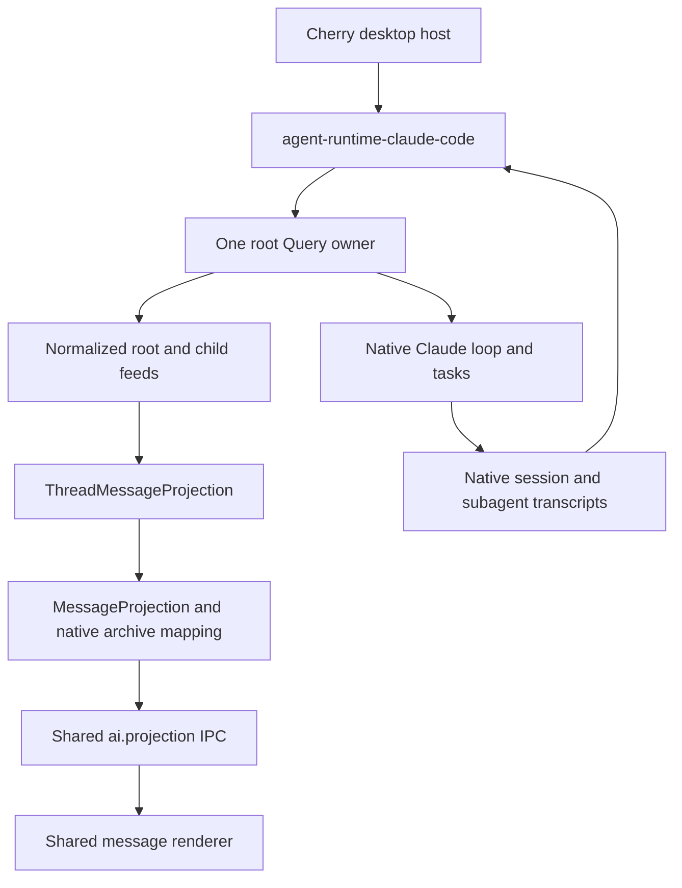

# Agent Note: Claude Code migration to the common runtime

Status: proposed

English | [中文](2026-10-27-agent-runtime-claude-code.zh.md)

## Problem

Before this migration, Claude Code entered Cherry through `ClaudeCodeRuntimeDriver` and a session-scoped chunk adapter. That adapter combined native lifecycle handling and product message rendering. Child content was copied into the parent, and introducing native projections left two producers for root content. The migration removes the chunk adapter and the second body merge while retaining native lifecycle controls and independent child ownership.

The [runtime contract](2026-10-17-agent-runtime-contract.md) already separates access, input, observation, and ownership. Pi and Pi Durable now use it from the desktop and have independent child projections. Claude Code needs an adapter to that boundary while preserving its native session, tools, task lifecycle, permissions, and model routing. Moving the existing driver into a package would retain the coupling and carry Cherry's database and UI policy into the adapter.

The [SDK content protocol](../simplification/2026-10-29-agent-runtime-content-protocol.md) owns the removal of Claude's `ContentItem` conversion and the associated desktop content reconstruction. Its SDK message contract supersedes the older content paths below; native controls, input correlation, gateway routing, and billing evidence remain requirements.

## Proposal

### Target SDK and native evidence

The [native contract probes](../../../../src/main/ai/runtime/claudeCode/__tests__/nativeContract.test.ts) run the installed `@anthropic-ai/claude-agent-sdk` **0.3.311** and its real CLI **2.1.311** against a scripted Anthropic Messages endpoint on an ephemeral loopback port. Each probe has an isolated work directory and `CLAUDE_CONFIG_DIR`, a dummy key, and the native Agent and SendMessage tools. The SDK, CLI, task scheduler, hooks, and transcript writer are real. The model responses are scripted; these checks do not establish real-model quality, Electron rendering, billing, or packaged-platform acceptance.

This migration upgrades the SDK from 0.3.284, including all eight optional native packages and their release-age exceptions. The [upstream changelog](https://github.com/anthropics/claude-agent-sdk-typescript/blob/main/CHANGELOG.md) identifies the relevant additions: explicit child/parent/run identities (0.3.292), interrupted-stream bookends (0.3.290), and fork subagents enabled by default (0.3.302). There is no Cherry patch for this dependency. These are prerequisites for the adapter, not reasons to retain inference code for the older version.

The prerequisite upgrade also preserves Cherry's permission default explicitly. Since 0.3.286, omitting `permissionMode` delegates to CLI settings and can select auto approval. The existing settings builder now supplies `default` when the Agent has no configured mode; explicit choices, including `auto`, remain intact. The settings regression test fails without this compatibility change. This does not switch the production runtime to the proposed adapter.

Native checks run on macOS arm64:

| Probe | Observed result | Migration consequence |
| --- | --- | --- |
| Foreground child and history | A child block arrives before the root result. Native child, task, hook, and structured tool-result identities join to the child archive. Live child UUIDs equal archived UUIDs; the root archive excludes those child bodies. | Observe the child independently and retain native identity. Do not parse the textual tool-result trailer. |
| Multiple content blocks | Two child assistant frames share one API `message.id` but have different transcript UUIDs and distinct content. | Deduplicating only by API message ID would lose a block. |
| Background child | Child output and completion remain observable after the root result while the Query owner stays alive. | Root result cannot close child observation or its writer. |
| Targeted stop | `stopTask(taskId)` stops one child's pending model request; its sibling and parent still complete. | Keep task stop distinct from root interruption and owner shutdown. |
| Root interrupt and queued input | `interrupt()` reports the later-priority input in `still_queued`; that input subsequently runs and its response carries its UUID. | Interruption is not cancellation of the whole queue. |
| Next-priority input | During a foreground child, `priority: 'next'` reaches the next parent request; the result contains both input UUIDs. Without a tool boundary, the queued next-priority input runs as a follow-up. | Native admission can implement steering across the end boundary without `onlyInRun` or an idle check. |
| Nested children | A grandchild's `parent_task_id` and archived `parent_agent_id` identify its immediate parent. Its assistant frames carry its own `agent_id`. | Route by native child identity and preserve the immediate relationship, rather than attaching every task to the root. |
| Hot and cold continuation | Parent SendMessage resumes the same child before and after restarting the root Query; it retains `task_id`/`agent_id`, allocates a later `run_id`, and retains both turns in one child archive. | Separate the stable child from each execution. A continuation tool call is not a new child. |
| Interrupted partial text | Interruption closes the text block and message stream; the aborted assistant's received text and native UUID remain in history. | Preserve truncated content without reporting a successful answer. |
| Native compaction | `/compact` emits a boundary. The history API returns the selected summary view, while the native export retains pre-compaction UUIDs; cold resume uses the summary. | Native continuation context and retained product history are different views. |
| Native clear | `/clear` resets the conversation and emits a new session in init/result. Its `new_conversation_id` differs from that session ID in this probe. Old history survives; the new session resumes with only the new context. | Reset identity is not a resume locator. Bind the new context from authoritative native session evidence. |
| Fork child | A fork child receives the root's existing context, but its answer has its own native child archive and UUID. | Inherited context does not merge root and child message collections. |

The 13 tests cover these cases; the foreground test also covers the first two rows, and continuation runs both with and without a process restart. Run them with:

```sh
pnpm exec vitest run --project main src/main/ai/runtime/claudeCode/__tests__/nativeContract.test.ts
```

The exploratory raw event capture additionally showed root partial events and complete child content blocks, with no child token deltas. This agrees with the official [streaming output documentation](https://code.claude.com/docs/en/agent-sdk/streaming-output). C1 must consume the granularity actually emitted and must not promise token-level child streaming. The pinned CLI also emits `command_lifecycle` frames, described in its changelog but absent from the published `SDKMessage` union. The adapter validates and exposes these through a Claude-specific type. `queued` proves acceptance and queueing; `started` proves acceptance, not model placement. A steer folded into an existing native turn can remain absent from subsequent assistant `user_message_uuids` until the final result. C2 therefore pairs its exact command UUID at `started` with the following root output to roll the product reply; the correlated result settles all consumed inputs. No prompt-text matching or private control transport is used. Upgrades must rerun these pinned native tests.

C0 must determine the native boundary before C1 implements it. The checks below distinguish observed native behavior from adapter acceptance tests that cannot pass before an adapter exists. Exactly-once side effects across process failure are outside the contract: the adapter neither replays uncertain submissions automatically nor treats retained conversation as recovered execution. Current [subagent](https://code.claude.com/docs/en/agent-sdk/subagents) and [session](https://code.claude.com/docs/en/agent-sdk/sessions) documentation provides context; installed types and versioned probes govern native claims.

### One native owner, several thread accesses



A runtime instance owns a configured backend namespace and its root Query owners. Each root owner consumes the SDK iterator once, maintains its routing and source mappings, and serves multiple root/child handles. `open(thread)` validates and attaches an existing context; it does not create an unrelated root session for a child. Archive-only access does not start model work. Root creation, native resume configuration, settings reconciliation, and fork operations remain concrete adapter or host operations.

| Owner | Responsibility |
| --- | --- |
| Native Claude SDK/CLI | Agent loop, built-in tools and subagents, native admission, task results, native history, native fork semantics. |
| `packages/agent-runtime-claude-code` | Query ownership, SDK event routing, common content/input observations, handle lifecycle, typed native controls, and readable native archive access. No Electron, product SQLite, Shared Cache, or renderer imports. |
| `packages/agent-runtime` | Existing `AgentRuntime`, `ThreadHandle`, observation types and feed delivery. No new scheduler, tool registry, task store, or capability string matrix. |
| Desktop host | Product sessions and message trees, backend/context bindings, credentials and provider routes, approval/question UI, tool policy, CLI acquisition/process diagnostics, prewarm policy, billing/tracing, backup/deletion policy, and projections. |
| Renderer | The shared message model and projection transport, plus small task-card metadata. Child bodies have their own message collection. |

The adapter receives materialized SDK `Options` and callbacks. Existing approval and question callbacks remain native `canUseTool`/hook integration points; introducing a second generic HostPorts family is not required. A prewarmed Query transfers to exactly one adapter owner together with its captured credential/configuration identity. The adapter must not consume it in parallel with the old connection loop.

### Public behavior and native controls

| Entry | Claude Code behavior |
| --- | --- |
| Root `input.submit`, `whenBusy: 'steer'` | Submit an SDK user message with `priority: 'next'`; allow native admission to place it at a boundary or in a later turn. Preserve native slash-command handling. |
| Root `input.submit`, `whenBusy: 'follow-up'` | Submit with `priority: 'later'`. A queued receipt does not mean completion or exclusive ownership of a response. |
| `whenBusy: 'reject'` | Do not advertise it initially: a host idle read cannot provide atomic native rejection, especially with autonomous root turns. |
| Child `input` | Absent initially. Parent-mediated Agent/SendMessage use is not a direct child submission API. Revisit only with a proven public native operation. |
| `observe` / `Observation.stop` | Subscribe to or detach from a normalized thread feed; detaching does not cancel native execution. |
| `ThreadHandle.release` | Release that caller's access. It neither interrupts work nor closes the root Query owned elsewhere. |
| Root `interrupt` | Request native interruption and retain the fact that queued inputs can survive. Do not claim the entire session or its children stopped. |
| Concrete task stop | Route the SDK's `stopTask(taskId)` through the known owner. Its Promise acknowledges the request; task events establish the terminal outcome. |
| `AgentRuntime.shutdown` | Publish the final available source state, close owned Queries and subprocesses, and end feeds. The host coordinates archive flushing; history is not deleted. |

The public `Query.interrupt()` in the pinned SDK has no `cancel_queued` argument, even though its native protocol advertises that capability. Do not reach into private transport to emulate it. Cherry's existing session-close path closes the connection, optionally after interrupting; C2 preserves that ownership boundary. A Stop action that must prevent later work must keep host admission closed and shut down the owner, not substitute bare `interrupt()`.

Assign a fresh native UUID to each immutable logical input and retain its mapping to the host `InputId`; reuse a host UUID when valid. Handing a message into the SDK input iterable proves dispatch started, not native acceptance or durable placement. Correlated output can add stronger `input.changed` evidence. A process loss after dispatch is unknown and must not trigger automatic retry: a UUID is not a proven deduplication key. `user_message_uuids` can associate several inputs with one answer; the adapter must preserve all supported associations and must not fabricate a separate answer per input.

Input evidence has explicit thresholds:

| Evidence | Public fact / action |
| --- | --- |
| The adapter has not yielded the input to the SDK | It may reject locally; no native placement is claimed. |
| The SDK consumes the input iterator entry | `dispatch-started`. Keep the logical ID and exact native UUID; do not add `accepted` or `queued` solely from this event. |
| `command_lifecycle: queued` or `interrupt().still_queued` names that UUID | Add `accepted` and `queued`, without marking the input placed or finished. |
| `command_lifecycle: started` names that UUID | Add `accepted`; local commands can start without model placement. C2 waits for the following root output before rolling a steer reply. |
| A correlated assistant/partial frame | Add `placed`; preserve all `user_message_uuids` associations. |
| A matching native history row without consumption evidence | Recover the content and UUID, but do not infer placement or completion: the SDK history also exposes queued inputs. |
| A correlated result | Set the evidenced outcome and shared response identity for every listed input. An error is not successful completion. |
| A correlated result with `local_command` | Add `locally-handled` and its evidenced outcome, without inventing an assistant answer or model placement. |
| A local command has no public correlated completion | Keep its outcome unknown; display its native output without assigning it to the oldest pending input. |
| Process loss without stronger evidence | Keep delivery unknown and require explicit user recovery; do not automatically send the input again. |

The 64-entry native correlation bound is not permission to settle additional host inputs by timing. Input hooks, batched prompts, and autonomous task notifications can prevent a one-input/one-turn mapping. Host billing consumes native usage once, not once per correlated input or once again from child task totals.

C2 replaces the current root-only hook injection and `steer-undelivered` fallback only after the native-priority path preserves input attribution, turn splitting, and billing in desktop tests. Do not run hook injection and native submission for the same input. The concrete extension is scoped to a Claude handle, like `PiThreadHandle.pi`:

| Adapter-specific entry | Contract |
| --- | --- |
| `claude.submit(inputId, content, whenBusy)` | `content` is `SDKUserMessage['message']['content']`; it uses the same admission and receipts as common text input. The host resolves product file references before calling it. |
| `claude.observe(sink)` | One ordered subscription of normalized observation batches with the corresponding typed native payload (`SDKMessage` live, `SessionMessage` archive). The common `observe` omits that payload. Both subscribe to the same owner/reducer, not separate Query iterators. |
| `claude.archive()` | Read the exact root/child archive in its backend, returning canonical source identities and the selected native messages. This does not create a Query or submit a prompt. |
| `claude.stopTask(taskId)` | Control a known task belonging to this owner; return requested/failed evidence, then observe its native outcome. It does not manufacture a child input API. |

The native payload travels with the normalized change, so a delayed consumer cannot fetch metadata from a newer revision. It preserves image/document/tool-result blocks, thinking signatures, citations, usage, local command output and reset information without placing SDK types in `agent-runtime`. The desktop converts this typed payload into the existing Cherry/AI SDK message model. It uses this subscription instead of simultaneously consuming both native and common feeds for the same writer.

### Identity, ordering, and observation

| Identity | Meaning |
| --- | --- |
| Backend | Configured storage/authentication namespace; the same native session ID in another backend is not the same context. |
| Root thread | Native session ID within that backend. |
| Child thread and relationship | Native session plus `agent_id`; the SDK declares it equal to a local-agent `task_id` and stable across continuation. The adapter encodes its opaque thread ID; consumers do not parse it. |
| Native task and run | `task_id` identifies the task; `run_id` identifies one execution. Continuation retains the task ID and allocates a later run ID. Compare run IDs only within that task, using the documented string ordering. |
| Immediate parent | `parent_task_id` in live task events, `parent_agent_id` in archive messages. The original parent does not change when another invocation continues the child. |
| Tool invocation | `tool_use_id`, used to associate a spawn/control card with its actual owner and child. It is not the durable child identity. |
| Content | Transcript UUID plus block discrimination where needed. API `message.id` and partial-stream block index are temporary normalization keys, not sufficient archive identities. |

Normalize each SDK event once. For 0.3.311, route assistant/user child frames by `agent_id`; use `parent_task_id` to build the immediate relationship and `parent_agent_id` to restore it from history. `tool_use_id` only locates the spawn/control card. A parent SendMessage may continue an existing child without creating another relationship. A resumed run's status must not be overwritten by a late terminal event with an older `run_id`. Stop addresses the currently running native task; it has no `onlyInRun` precondition.

Only `local_agent` tasks become child threads. Bash/MCP tasks keep task controls and summaries without becoming agents. A direct root relationship requires a native depth-one declaration or a spawn invocation already attributed to the root; an absent `parent_task_id` alone is insufficient. Otherwise missing parent metadata leaves the relationship unresolved; it does not prevent observing an identified child and does not justify assigning it to the root. The adapter does not implement the old-version inference tree as a compatibility fallback.

Content normalization has separate rules:

1. During root streaming, identify a provisional block by owner generation, API response ID and block index. The committed assistant frame arrives before its block-stop; bind it to that open block and emit `item.upsert` with `replaces` for the provisional identity. A committed item uses thread + transcript UUID + content-block ordinal. Child frames already carry the native UUID; no token stream is invented.
2. Replayed UUIDs update their existing items. Two distinct UUIDs sharing one API response ID stay distinct. Forked children may inherit content; thread scoping prevents their copies from overwriting the root.
3. An `aborted` assistant preserves its received text as truncated content. `message_stop` closes the stream, not a successful input outcome. An interrupted tool-input block without a block-stop remains incomplete and cannot become a completed tool call.
4. `supersedes` and `model_refusal_fallback.retracted_message_uuids` explicitly remove named items, including tool results. Apply the removal idempotently before publishing replacement content. This differs from compaction: absence from a later model-context view alone is not a deletion instruction.
5. `compact_boundary` invalidates the continuation view. Obtain that view through SDK history APIs, which own parent-chain selection and preserved-segment relinking. Product history retains already saved messages; do not delete them because the model now uses a summary. Do not reimplement native compaction or replay old product messages into the model.
6. On observation gaps or restart, select a canonical native baseline and reconcile by source UUID, then drain live changes captured during that read. A source absent from the baseline is not automatically a retraction; only explicit replacement/removal evidence can hide an already saved product row. Source mappings and native retractions must survive restart alongside the projection checkpoint.

C2 extends `ChildThreadProjection` at the shared archive/projection boundary to persist explicit retractions and replacement source mappings alongside saved and live messages. Merely passing a different `ThreadHandle` would resurrect retracted messages. Reuse the shared `MessageProjection` revision/IPC protocol; do not add a Claude-only transport or claim a new native sequence number.

A root `result` ends the foreground turn, not its Query or child feeds. A task notification updates task state and may lead to a native autonomous root turn; it must not create a duplicate host notification or attribute that new turn to an unrelated input. Shared behavior tools are not installed over native Agent/Bash/question mechanisms in C1. Later reuse of behavior policy needs its own demonstrated native ownership mapping.

### Access, reset and process lifetime

`create` reserves a native `sessionId` before dispatch, so the host can save its intended context before the first response. `open` validates a known locator and reads its archive; opening a root or child does not start a model turn. Root input lazily starts or claims the one Query owner. Child access is observation-only. Concurrent opens share an owner keyed by backend and native root session; two windows never consume the SDK iterator separately.

On native `conversation_reset`, close admission on the old root handle and deliver the typed reset through `claude.observe`. The reset's `new_conversation_id` identifies the transcript reset, not a proven native resume locator. Bind the new thread/context only from the subsequent native `system/init.session_id` or a correlated command result's `session_id`. Keep the binding pending if that evidence never arrives. A `/clear` result settles its original input even though its frame names the new session; it does not move the old input or old history into the new context.

The existing process owner changes its active root binding; it does not create a second Query. Old history remains readable; neither the old `Thread.id` nor known child parentage is rewritten. Task identities already discovered under the old root keep that association until native events establish their outcome. A later send through a stale handle fails as closed instead of reaching the new conversation. All native reset triggers invalidate admission this way; only `/clear` is covered by the reset probe, so another trigger lacking a new session identity remains pending rather than guessing one.

Shutdown closes admission first, closes the owned Query, drains its event pump and reconciles available archive data. Publish the final observation before ending feeds and detaching consumers. Process-exit confirmation remains the desktop process manager's barrier before edit/fork or opening another writer on those files; a returned `Query.close()` is not that confirmation. If closure cannot be confirmed, return unknown and retain the ownership lock. A released handle and an ended foreground result never invoke this sequence. Archive reads are permitted after owner closure, until the handle itself is released.

### Storage and desktop cutover

Native Claude transcripts remain the continuation authority. Extend the existing backend locator JSON union with a Claude Code configuration-root location, and store the encoded native root/child identity in `agent_session_context.nativeThreadId`; reuse `agent_session_context` and the existing message tree. No new input-attempt table, task-relation table, or copy of native history into a generic runtime store is required for this migration. Product messages remain display projections with native source mappings.

SDK history functions take a project `dir`, not a configuration-root option. Reading one configured backend must not temporarily mutate the main process's `CLAUDE_CONFIG_DIR`. Keep that environment isolated in a worker, as the existing [fork worker](../../../../src/main/ai/runtime/claudeCode/forkWorker.ts) does. The C0 history probe uses a separate process with the same isolated configuration and reads real native files. Use `getSessionMessages` / `getSubagentMessages` for native view selection and `importSessionToStore` into a temporary capture when raw metadata is required; this is a read/export, not a second persistent store. The SDK public `SessionMessage` projection does not expose all wire replacement/abort metadata, so it cannot by itself prove lossless rich replay. Persist observed source mappings/retractions with the existing context checkpoint and preserve richer saved product parts on incomplete native recovery. Preserve exact native fork boundaries and UUID remapping; editing still preserves the old product branch.

Reuse [ThreadMessageProjection](../../../../src/main/ai/agentSession/ThreadMessageProjection.ts), [ChildThreadProjection](../../../../src/main/ai/agentSession/ChildThreadProjection.ts), and the shared `ai.projection` transport. `readUIMessageStream` remains the message accumulator where useful. Independent child ownership does not require replacing the AI SDK message model or adding child-only IPC. Text/tool normalization can reuse `ThreadMessageProjection`; native rich blocks need the typed conversion above before the shared writer. The root's existing append-oriented [ThreadProjection](../../../../src/main/ai/agentSession/ThreadProjection.ts) is not interchangeable with the replacement-aware reducer; C2 must explicitly test root replay and replacement paths.

Each execution selects one content source through `AiStreamSource`. Claude selects authoritative message views: public observation → `ThreadMessageProjection` → `RootMessageProjection` ownership → `pipeMessageStream` host display state. The manager publishes and persists that same `CherryUIMessage`; it does not merge a second SDK accumulator or accept an external message sink. `ClaudeRuntimeState` handles native lifecycle/usage controls, and `ClaudeMessageMetadata` preserves rich block metadata. Chat/Pi chunk executions still use `readUIMessageStream`. Channel, task and remote consumers must read current/final message views, including replacements and partial output on error.

Content preservation uses frozen real transcript cases before and after migration, with independently checked native fields and SQLite restore. Portable fixtures redact private values. Separate SDK/CLI integration and consumer contracts cover streaming, steer, approvals and terminal ordering; complete transcript replay alone does not establish those behaviors or Electron acceptance.

For newly migrated contexts, one independent child writer persists and publishes the child collection. The parent retains only its tool result, relationship, and small task summary. Removing the Claude background-flow publisher must remove its duplicate body writes and Shared Cache broadcasts together. Existing saved flow bodies stay readable; backfill a child only when native identity and source mapping are established. Do not delete historical parent parts or guess a child identity from prose. Missing native files permit the saved display view but do not authorize a writable replacement session.

Desktop parity includes live permission tightening, AskUserQuestion during background work, explicit CLI subscription login, gateway model routing, captured warm-query credentials, MCP/skills, multimodal input, native fork/edit, process-exit confirmation, and one billing/tracing path. Keep host policy and UI callbacks in Cherry while moving execution access behind the package.

All Cherry-managed Claude models, including same-provider Anthropic root and background models, use the internal gateway. The subprocess receives only the gateway credential and namespaced model IDs; upstream credentials, headers, rotation and billing belong to provider execution. Warm reuse depends on the gateway listener identity, not upstream key/header edits. Explicit external-CLI subscription login retains native authentication. Internal Anthropic requests prefer a declared, configured Anthropic endpoint; other models retain the normal endpoint resolver fallback. The selected provider/model snapshot must reach conversion and execution together without changing stored model configuration.

Gateway attribution freezes credentials, prices and source at request start. The gateway's wire response ID joins the completed invocation to the product message only after native output establishes that owner; usage and ownership may arrive in either order. Root steer and child observations use this same join. Native subscription usage uses the native API response ID too. On connection close, pending or late invocations without an observed owner retain their captured attribution with no message association. Do not guess from the active reply, parse prompt text, or add a relation table. This is an in-memory pending join, not a crash-safe billing journal.

The desktop checks in `src/main/ai/runtime/claudeCode/__tests__/desktopRuntime.integration.test.ts` exercise the real SDK/CLI with a scripted endpoint and migrated SQLite. They cover native steer and end-boundary continuation, warm-owner handoff, foreground/background children, sibling-isolated stop, nested contexts, cold child projection recovery and `/clear`. Separate projection and billing tests cover retractions, checkpoint atomicity, rich content and both usage/ownership arrival orders. These are repeatable integration checks; real-model Electron acceptance remains a separate obligation.

### Delivery layers

| Layer | Change | Exit evidence |
| --- | --- | --- |
| C0 — this Spec and probes | Freeze ownership and migration rules against the pinned SDK; retain reproducible native probes. Include the SDK prerequisite upgrade; no production runtime cutover. | Native experiments resolve identity, continuation, interruption and archive/reset behavior; design decisions above are explicit, and documentation gates pass. |
| C1 — adapter package | Implement `agent-runtime-claude-code`, root/child handles, normalized feeds, native-priority input, and isolated archive reads. | Public-contract tests using the real SDK cover access/release, two observers, input races, task stop, replay, replacements, nested child access and hot/cold continuation, and source loss. C0 tests alone do not prove the new adapter. |
| C2 — desktop integration | Make the Claude driver a host bridge; connect existing contexts, shared root/child projections and native controls; remove the migrated flow writer. | Populated database/fork tests and Electron acceptance cover stored history, real providers, permissions, parent/child lifetimes, reconnect, and the existing stop policy. |

C0 is the Spec base for subsequent implementation layers. C1 must not advertise a stronger input or child-control contract to make the common interface look uniform. If a pinned SDK limitation blocks an acceptance criterion, record the upstream requirement before changing that contract or adding a fallback. Cross-harness spawn, universal task control, physical unification of topic/session message tables, and replacing native Claude tools remain outside this migration.

## Alternatives considered

- Move the whole desktop driver into the package: retains product-state and rendering dependencies and leaves the parent-owned background accumulator intact.
- Create a Query or product root session for each observed child: changes ownership, input routing, and execution instead of observing the native child.
- Replace native Claude tools with the Pi shared behavior toolset: invents a second scheduler/result-delivery owner and changes user-visible native behavior.
- Read or broadcast the full parent parts repeatedly: preserves the lifetime coupling. Shared independent message projections already provide the needed transport.
- Treat every runtime as a durable scheduler: native session history proves retained conversation, not recovery or deduplication of arbitrary side effects.

## Acceptance criteria

- AC1 — The pinned native probes reproduce input correlation, block/history identity, nested/forked children, hot/cold child continuation, child output after root completion, sibling-isolated stop, interrupted partial output, queued input, native compaction/reset, and next-priority input across a tool boundary. (verification: unit)
- AC2 — Multiple accesses share one root Query owner; stopping an observation or releasing a handle does not stop another access or native child, and owner shutdown closes its resources without deleting history. (verification: unit)
- AC3 — Public observations preserve distinct content blocks and native source identity across live delivery, replay, replacements and gaps; nested children retain their immediate parent, resumed runs reject stale status, and absent metadata never routes content to an unrelated thread. (verification: unit)
- AC4 — Root steering/follow-up preserve immutable logical input and multi-input answer correlation across end and disconnect races; unsupported rejection/direct-child input are not advertised, and unknown delivery is not automatically retried. (verification: unit)
- AC5 — Desktop permissions, questions, MCP/skills, multimodal inputs and background interactions remain available; Cherry-managed models use gateway-owned credentials and billing, explicit CLI subscription login stays native, and configured Anthropic endpoints preserve thinking/tool replay through the gateway. (verification: Electron)
- AC6 — Native root/child history reopens in the correct backend, legacy saved flows stay readable, editing preserves the old branch, and missing native storage never creates a writable substitute or drops saved messages. (verification: unit)
- AC7 — Migrated child bodies persist and stream through their own shared projection after parent completion and window detach; duplicate parent-body writes and the migrated background-flow broadcasts are removed, with no additional child-only IPC. (verification: Electron)
- AC8 — Real-model Electron acceptance covers foreground/background children, two siblings, available nested children, stop, follow-up, two windows, reconnect and cold reopen; results distinguish retained history from recovered execution, and measured transport/write counts support any performance claim. (verification: Electron)

## Risks

SDK types, native wire events, and current public documentation do not always expose the same surface. C0 verifies one installed SDK/CLI pair; upgrades require rerunning native probes. Complete-block child delivery can still have higher visible latency than token-level root delivery.

Source identity and archive flush boundaries are more consequential than the package move. Compaction, superseded messages, reconnect overlap, native fork remapping, and an unconfirmed process exit must not create a second writer or duplicate product messages. Root and child terminal states must remain separate from observer teardown.

Native-priority steering changes the mechanism used by the current host. C1 verifies the adapter implements the defined receipts and reset boundaries; C2 verifies existing permissions, background wakeups, multimodal input and billing against that implementation. Those are implementation acceptance checks, not deferred decisions about the native contract. Native interruption leaves queued work alive; changing the desktop Stop action to use it alone would be a regression. No performance gain, crash-safe task replay, or packaged-platform parity is claimed by this Spec.
