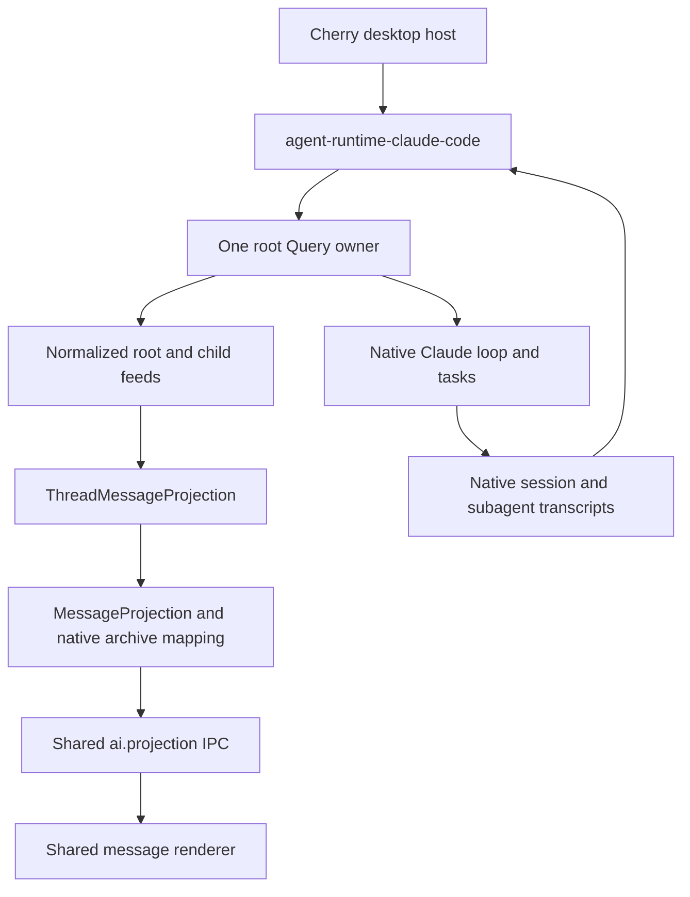

# Agent Note: Claude Code 向公共 Runtime 迁移

Status: proposed

[English](2026-10-27-agent-runtime-claude-code.md) | 中文

## 问题

Claude Code 目前仍通过 [ClaudeCodeRuntimeDriver](../../../../src/main/ai/runtime/claudeCode/ClaudeCodeRuntimeDriver.ts) 及其会话级[流适配器](../../../../src/main/ai/runtime/claudeCode/streamAdapter.ts) 接入 Cherry。该适配器混合了原生执行、输入归属、任务发现和产品消息渲染。父轮次结束后，子内容会切换输出目标，更新一个以完整父消息为初始状态的累加器。随后宿主通过 Shared Cache 发布父消息的 parts。因此，子内容的生命周期和恢复都依赖父消息。

[Runtime 契约](2026-10-17-agent-runtime-contract.md) 已经区分访问、输入、观察和所有权。Pi 与 Pi Durable 现在已在桌面端使用该契约，并拥有独立的子投影。Claude Code 需要适配这条边界，同时保留原生会话、工具、任务生命周期、权限和模型路由。直接把现有 driver 移进包，会保留这些耦合，并把 Cherry 的数据库和 UI 策略一起带入适配器。

## 方案

### C0 证据及其边界

[原生契约探针](../../../../src/main/ai/runtime/claudeCode/__tests__/nativeContract.test.ts) 使用已安装的 `@anthropic-ai/claude-agent-sdk` **0.3.284** 及其真实 CLI **2.1.284**，连接临时回环端口上的脚本化 Anthropic Messages 端点。每个探针都有隔离的工作目录和 `CLAUDE_CONFIG_DIR`，使用占位密钥，只启用原生 Agent 工具。SDK、CLI、任务调度器、hooks 和 transcript 写入器都是真实实现。模型响应由脚本控制；这些检查不能证明真实模型质量、Electron 渲染、计费或打包后的平台验收。

以下验证于 2026-10-27 在 macOS arm64 执行：

| 探针 | 观察结果 | 对迁移的影响 |
| --- | --- | --- |
| 前台子任务与历史 | 子内容块在根结果之前到达。原生任务、hook 和结构化工具结果中的身份可以关联到子归档。实时子消息 UUID 与归档 UUID 一致；根归档不包含这些子正文。 | 独立观察子任务并保留原生身份，不解析工具结果的文本尾注。 |
| 多个内容块 | 两个子 assistant 帧共用一个 API `message.id`，但 transcript UUID 不同，内容也不同。 | 只按 API 消息 ID 去重会丢失内容块。 |
| 后台子任务 | 根结果返回后，只要 Query 所有者仍存活，子输出和完成事件仍可观察。 | 根结果不能关闭子观察或其写入器。 |
| 定向停止 | `stopTask(taskId)` 停止一个子任务尚未结束的模型请求，兄弟任务和父任务仍能完成。 | 区分任务停止、根中断和所有者关闭。 |
| 根中断与排队输入 | `interrupt()` 的 `still_queued` 包含 later 优先级输入；该输入随后仍会执行，响应携带它的 UUID。 | 中断不等于取消整个队列。 |
| next 优先级输入 | 前台子任务运行期间，`priority: 'next'` 会进入父任务的下一次请求；结果包含两个输入 UUID。没有工具边界时，排队的 next 优先级输入作为后续轮次执行。 | 原生接纳可以处理跨结束边界的 steer，无需 `onlyInRun` 或先检查空闲状态。 |

六个测试覆盖这些场景；其中前台测试同时覆盖前两行。运行命令：

```sh
pnpm exec vitest run --project main src/main/ai/runtime/claudeCode/__tests__/nativeContract.test.ts
```

探索阶段的原始事件捕获还显示：根消息有 partial 事件，子消息按完整内容块交付，没有 child token delta。这与官方[流式输出文档](https://code.claude.com/docs/en/agent-sdk/streaming-output) 一致。C1 必须按原生实际交付的粒度消费，不能承诺子任务的 token 级流式输出。固定版本 CLI 还会发出公开 `SDKMessage` 联合类型未包含的 `command_lifecycle` 帧。探针只通过带校验的形状检查将其用作输入到达的同步点；生产输入回执不能依赖这个未声明的帧。

这些探针尚未证明嵌套子任务路由、续接后的子身份、压缩与替换行为、中断后的不完整内容块恢复，或进程故障后的恰好一次交付。下文将它们列为明确的实现验收条件，不能从一次成功的前台示例中推断。当前[子智能体](https://code.claude.com/docs/en/agent-sdk/subagents)和[会话](https://code.claude.com/docs/en/agent-sdk/sessions)文档提供背景；涉及具体版本的结论以已安装类型和固定版本探针为准。

### 一个原生所有者，多个线程访问



一个 runtime 实例拥有配置好的 backend 命名空间及其中的根 Query 所有者。每个根所有者只消费一次 SDK 迭代器，维护路由和来源映射，并服务多个根/子 handle。`open(thread)` 校验并访问已有上下文，不会为子任务创建一个无关的根会话。只读归档访问不启动模型工作。根创建、原生 resume 配置、设置协调及 fork 操作仍属于具体适配器或宿主。

| 所有者 | 职责 |
| --- | --- |
| 原生 Claude SDK/CLI | 智能体循环、内置工具和子智能体、原生输入接纳、任务结果、原生历史及原生 fork 语义。 |
| `packages/agent-runtime-claude-code` | Query 所有权、SDK 事件路由、公共内容/输入观察、handle 生命周期、带类型的原生控制及原生归档读取。不导入 Electron、产品 SQLite、Shared Cache 或 renderer。 |
| `packages/agent-runtime` | 现有 `AgentRuntime`、`ThreadHandle`、观察类型和 feed 交付。不新增调度器、工具注册表、任务存储或字符串能力矩阵。 |
| 桌面宿主 | 产品会话和消息树、backend/context 绑定、凭据和提供商路由、审批/问答 UI、工具策略、CLI 获取与进程诊断、预热策略、计费/追踪、备份/删除策略及投影。 |
| Renderer | 共享消息模型和投影传输，以及少量任务卡片元数据。子正文使用独立消息集合。 |

适配器接收已解析且有类型的 SDK 配置和回调。现有审批与问答回调继续通过原生 `canUseTool`/hook 接入，不需要再引入一套通用 HostPorts。预热 Query 必须连同其捕获的凭据/配置身份一起移交给唯一的适配器所有者；适配器不能与旧 connection 循环并行消费同一个 Query。

### 公共行为与原生控制

| 入口 | Claude Code 行为 |
| --- | --- |
| 根 `input.submit`，`whenBusy: 'steer'` | 提交 `priority: 'next'` 的 SDK 用户消息，由原生接纳放入执行边界或后续轮次。保留原生斜杠命令处理。 |
| 根 `input.submit`，`whenBusy: 'follow-up'` | 以 `priority: 'later'` 提交。排队回执不代表完成，也不代表独占某条响应。 |
| `whenBusy: 'reject'` | 初期不声明支持：宿主读取空闲状态无法提供原子原生拒绝，尤其存在自主根轮次时。 |
| 子 `input` | 初期不提供。经父任务调用 Agent/SendMessage 不等于直接的子输入 API。只有证明存在公共原生操作后才重新评估。 |
| `observe` / `Observation.stop` | 订阅或解除规范化线程 feed；解除观察不取消原生执行。 |
| `ThreadHandle.release` | 释放该调用者的访问；不打断工作，也不关闭由其他所有者持有的根 Query。 |
| 根 `interrupt` | 请求原生中断，同时保留排队输入可能继续执行这一事实。不能宣称整个会话或其子任务都停止。 |
| 具体任务停止 | 经已知所有者调用 SDK 的 `stopTask(taskId)`。其 Promise 确认请求，任务事件证明最终结果。 |
| `AgentRuntime.shutdown` | 发布最后可用的来源状态，关闭其拥有的 Query 和子进程，并结束 feed。宿主负责协调归档刷写；不删除历史。 |

固定版本 SDK 的公共 `Query.interrupt()` 没有 `cancel_queued` 参数，尽管原生协议声明了该能力。不能调用私有传输来模拟它。Cherry 当前的会话关闭路径会关闭 connection，必要时先 interrupt；C2 保留这个所有权边界。需要阻止后续工作的 Stop 操作必须关闭宿主输入接纳并关闭所有者，不能仅替换成 `interrupt()`。

为每个不可变逻辑输入分配新的原生 UUID，并保留它与宿主 `InputId` 的映射；宿主 ID 是有效 UUID 时可以直接复用。把消息交给 SDK 输入迭代器只证明派发开始，不证明原生接纳或持久化放置。关联输出可以补充更强的 `input.changed` 证据。派发后进程丢失属于结果未知，不能自动重试：UUID 不是已证明的去重键。`user_message_uuids` 可以把多个输入关联到同一个回答；适配器必须保留所有有证据的关联，不能为每个输入虚构独立回答。

只有桌面测试证明原生优先级路径保留输入归属、轮次拆分和计费后，C2 才替换当前仅针对根任务的 hook 注入和 `steer-undelivered` 回退。同一输入不能同时经过 hook 注入和原生提交。原生图片/文档输入及非文本观察先通过带类型的 Claude 专用扩展无损传递，直到另一个跨 harness 消费者证明有必要扩大公共文本契约。

### 身份、顺序与观察

| 身份 | 含义 |
| --- | --- |
| Backend | 配置好的存储/认证命名空间；另一个 backend 中相同的原生 session ID 不代表同一上下文。 |
| 根线程 | 该 backend 内的原生 session ID。 |
| 子线程与关系 | 原生 session 加 `agentId`；在已证明的同一子任务续接中保持稳定。适配器编码不透明 thread ID，消费者不解析它。 |
| 原生任务 | 任务事件提供的控制和结果身份。探针证明这些 local-agent 执行满足 `task_id == agentId`，不能推广到所有任务类型或未来运行。 |
| 工具调用 | `tool_use_id`，用于把创建/控制卡片关联到实际所有者和子任务。它不是持久的子身份。 |
| 内容 | Transcript UUID，必要时加内容块区分。API `message.id` 和 partial-stream 块索引是临时规范化键，不足以作为归档身份。 |

每个 SDK 事件只规范化一次。根据原生结构化身份和已观察到的工具调用所有权路由根/子消息。结合任务事件、hook 和结构化 Agent 结果解析 `local_agent` 任务，不能因为 Bash/MCP 任务有 task ID 就把它变成子线程。身份晚于内容到达时，保留有界的待关联映射；无法协调时报告 gap，不能静默把不确定的内容挂到根线程。嵌套路由必须把每次创建调用关联到发出它的线程；共用根 session ID 不足以证明直接父子关系。

根 partial 块和已提交 assistant 帧必须更新同一逻辑内容；临时身份转为原生 UUID 时显式发出 replacement。重复帧不能重复追加。共享 API 响应 ID 的不同块仍须分别保留。遵循原生 replacement/aborted 证据；映射丢失时发出 `gap` 和替换快照。宿主的投影 revision 处理交付顺序和重新订阅，不是原生执行序号。

根 `result` 结束前台轮次，不结束 Query 或子 feed。任务通知更新任务状态，也可能引发原生自主根轮次；不能由此额外发送一次宿主通知，或把新轮次归给无关输入。C1 不在原生 Agent/Bash/问答机制之上安装共享 behavior 工具。以后若复用 behavior 策略，需单独证明其原生所有权映射。

### 存储与桌面切换

原生 Claude transcript 仍是续接的权威来源。在现有 backend/context locator 联合类型中增加 Claude Code 位置及原生根/子身份，复用 `agent_session_context` 和现有消息树。该迁移不需要新增 input-attempt 表、任务关系表，也不需要把原生历史复制进通用 runtime store。产品消息仍是带原生来源映射的显示投影。

SDK 历史函数接收项目 `dir`，没有配置根目录参数。读取某个 backend 时，不能临时修改主进程的 `CLAUDE_CONFIG_DIR`。应像现有 [fork worker](../../../../src/main/ai/runtime/claudeCode/forkWorker.ts) 一样，把环境隔离在 worker 中。C0 历史探针使用相同隔离配置的独立进程读取真实原生文件。保留精确的原生 fork 边界与 UUID 重映射；编辑仍保留原产品分支。

复用 [ThreadMessageProjection](../../../../src/main/ai/agentSession/ThreadMessageProjection.ts)、[ChildThreadProjection](../../../../src/main/ai/agentSession/ChildThreadProjection.ts) 和共享 `ai.projection` 传输。在适合的地方继续使用 `readUIMessageStream` 累加消息。子所有权独立不要求替换 AI SDK 消息模型，也不要求新增 child 专用 IPC。根路径当前面向追加的 [ThreadProjection](../../../../src/main/ai/agentSession/ThreadProjection.ts) 不能直接替代支持 replacement 的 reducer；C2 必须明确验证根重放和替换路径。

对于新迁移的上下文，由唯一的独立子写入器持久化并发布子消息集合。父消息只保留工具结果、关系和少量任务摘要。移除 Claude background-flow 发布器时，要同时移除其重复正文写入和 Shared Cache 广播。已保存的旧 flow 正文继续可读；只有建立原生身份和来源映射后才能回填为子消息。不能删除历史父 parts，也不能从文本猜测子身份。原生文件缺失时允许展示已保存视图，但不能创建可写替代会话。

桌面兼容性包括运行中的权限收紧、后台 AskUserQuestion、原生/login/直接提供商/gateway 路由、预热 Query 捕获的凭据、MCP/skills、多模态输入、原生 fork/edit、进程退出确认，以及唯一的计费/追踪路径。宿主策略和 UI 回调留在 Cherry，执行访问迁移到包后方。

### 交付分层

| 分层 | 改动 | 完成证据 |
| --- | --- | --- |
| C0 — 本 Spec 与探针 | 以固定版本 SDK 为依据确定所有权和迁移规则，保留可重复运行的原生探针。不切换生产 runtime。 | 六个 C0 探针及双语文档检查通过，并明确保留限制。 |
| C1 — 适配器包 | 实现 `agent-runtime-claude-code`、根/子 handle、规范化 feed、原生优先级输入及隔离归档读取。 | 使用真实 SDK 的公共契约测试覆盖访问/释放、两个观察者、输入竞争、任务停止、重放、替换、嵌套或不可访问子任务及来源丢失。仅通过 C0 测试不能证明新适配器。 |
| C2 — 桌面接入 | 把 Claude driver 收敛为宿主桥接，接入现有 context、共享根/子投影及原生控制，移除迁移后的 flow 写入器。 | 带已有数据的数据库/fork 测试与 Electron 验收覆盖已保存历史、真实提供商、权限、父子生命周期、重连及现有停止策略。 |

C0 为后续实现层提供 Spec 基础。C1 不能为了让公共接口看起来统一而声明更强的输入或子控制契约。若固定版本 SDK 的限制阻碍验收，应先记录所需的上游改进，再决定是否改变契约或新增回退。跨 harness spawn、通用任务控制、topic/session 消息表的物理合并，以及替换原生 Claude 工具，都不属于本次迁移。

## 考虑过的替代方案

- 把整个桌面 driver 移入包：保留产品状态与渲染依赖，也保留父消息拥有后台累加器的问题。
- 为每个被观察的子任务创建 Query 或产品根会话：改变所有权、输入路由和执行，而不是观察原生子任务。
- 用 Pi 的共享 behavior 工具集替换原生 Claude 工具：引入第二个调度/结果交付所有者，并改变用户可见的原生行为。
- 反复读取或广播完整父 parts：保留生命周期耦合。现有共享独立消息投影已经提供所需传输。
- 把所有 runtime 都当作 durable 调度器：原生会话历史只能证明对话被保留，不能证明任意副作用的恢复或去重。

## 验收标准

- AC1 — 固定版本原生探针可重复验证输入关联、内容块/历史身份、根完成后的子输出、只停止指定兄弟任务、interrupt 后保留排队输入，以及工具边界两侧的 next 优先级输入。 (verification: unit)
- AC2 — 多个访问共享同一个根 Query 所有者；停止观察或释放 handle 不会停止其他访问或原生子任务；所有者关闭其资源而不删除历史。 (verification: unit)
- AC3 — 公共观察在实时交付、重放、替换和 gap 中保留不同内容块与原生来源身份；嵌套父子关系必须有证据，否则报告不可用，不能路由到无关线程。 (verification: unit)
- AC4 — 根 steer/follow-up 在结束及断连竞争中保留不可变逻辑输入与多输入回答关联；不声明不受支持的 reject/直接子输入，也不自动重试未知交付。 (verification: unit)
- AC5 — 桌面权限、问答、MCP/skills、多模态输入、模型路由、预热凭据和计费在新适配器下保持现有行为，包括根轮次结束后的后台交互。 (verification: Electron)
- AC6 — 原生根/子历史在正确 backend 中重新打开，旧 flow 仍可读，编辑保留旧分支，原生存储缺失不会创建可写替代或丢失已保存消息。 (verification: unit)
- AC7 — 迁移后的子正文在父任务完成和窗口解除访问后，仍通过独立共享投影持久化和流式更新；移除重复父正文写入及已迁移的 background-flow 广播，不增加 child 专用 IPC。 (verification: Electron)
- AC8 — 真实模型 Electron 验收覆盖前台/后台子任务、两个兄弟任务、可用的嵌套子任务、停止、后续输入、双窗口、重连和冷启动恢复；结果区分历史保留与执行恢复，任何性能结论都有实际传输/写入计数支持。 (verification: Electron)

## 风险

SDK 类型、原生线协议事件和当前公开文档并不总是暴露相同能力。C0 只验证一组已安装的 SDK/CLI 版本；升级后必须重跑原生探针。按完整块交付子内容仍可能比根的 token 级交付具有更高的可见延迟。

来源身份与归档刷写边界比移动包本身更重要。压缩、被替换消息、重连重叠、原生 fork 重映射，以及尚未确认的进程退出，都不能创建第二个写入器或重复产品消息。根和子任务的终态必须与观察者解除访问区分。

原生优先级 steer 会改变当前宿主使用的机制。C0 已验证其基本边界语义，但命令、后台唤醒、权限、多模态输入及按输入计费仍需要 C1/C2 覆盖。原生 interrupt 会保留排队工作；如果桌面 Stop 只调用它，将构成回归。本 Spec 不宣称已取得性能提升、崩溃安全的任务重放或打包平台兼容性。
