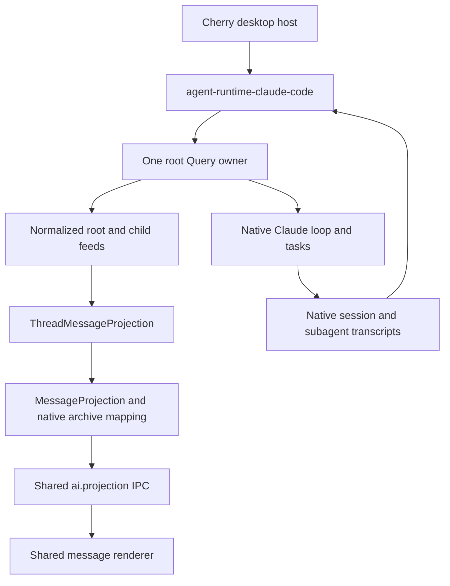

# Agent Note: Claude Code 向公共 Runtime 迁移

Status: proposed

[English](2026-10-27-agent-runtime-claude-code.md) | 中文

## 问题

迁移前，Claude Code 通过 `ClaudeCodeRuntimeDriver` 和会话级 chunk 适配器接入 Cherry。该适配器同时处理原生生命周期和产品消息渲染。子内容被复制到父消息；引入原生 projection 后，根正文又出现了两个生产者。此次迁移删除 chunk 适配器和第二次正文合并，同时保留原生生命周期控制及独立的子线程所有权。

[Runtime 契约](2026-10-17-agent-runtime-contract.md) 已经区分访问、输入、观察和所有权。Pi 与 Pi Durable 现在已在桌面端使用该契约，并拥有独立的子投影。Claude Code 需要适配这条边界，同时保留原生会话、工具、任务生命周期、权限和模型路由。直接把现有 driver 移进包，会保留这些耦合，并把 Cherry 的数据库和 UI 策略一起带入适配器。

[SDK 内容协议](../simplification/2026-10-29-agent-runtime-content-protocol.md)维护 Claude `ContentItem` 转换及桌面内容重建的删除。其 SDK 消息契约取代下文的旧内容路径；原生控制、输入关联、网关路由和计费证据仍是必须保留的要求。

## 方案

### 目标 SDK 与原生证据

[原生契约探针](../../../../src/main/ai/runtime/claudeCode/__tests__/nativeContract.test.ts) 使用已安装的 `@anthropic-ai/claude-agent-sdk` **0.3.311** 及其真实 CLI **2.1.311**，连接临时回环端口上的脚本化 Anthropic Messages 端点。每个探针都有隔离的工作目录和 `CLAUDE_CONFIG_DIR`，使用占位密钥，只启用原生 Agent 与 SendMessage 工具。SDK、CLI、任务调度器、hooks 和 transcript 写入器都是真实实现。模型响应由脚本控制；这些检查不能证明真实模型质量、Electron 渲染、计费或打包后的平台验收。

本次迁移将 SDK 从 0.3.284 升级，同时更新全部八个可选原生包及其发布等待期例外。[上游变更记录](https://github.com/anthropics/claude-agent-sdk-typescript/blob/main/CHANGELOG.md)列出了相关新增能力：显式的子/父/运行身份（0.3.292）、中断流的收尾事件（0.3.290），以及默认启用 fork 子智能体（0.3.302）。该依赖没有 Cherry 补丁。这些能力是适配器的前提，不是继续为旧版本保留推断代码的理由。

此次前置升级也显式保留 Cherry 的权限默认值。自 0.3.286 起，省略 `permissionMode` 会交由 CLI 设置决定，可能启用自动审批。现有 settings builder 在 Agent 未配置模式时明确传入 `default`；包括 `auto` 在内的显式选择继续保留。权限回归测试在缺少该兼容改动时会失败。这并未把生产 runtime 切换到方案中的适配器。

在 macOS arm64 执行的原生验证：

| 探针 | 观察结果 | 对迁移的影响 |
| --- | --- | --- |
| 前台子任务与历史 | 子内容块在根结果之前到达。原生子任务、task、hook 和结构化工具结果中的身份可以关联到子归档。实时子消息 UUID 与归档 UUID 一致；根归档不包含这些子正文。 | 独立观察子任务并保留原生身份，不解析工具结果的文本尾注。 |
| 多个内容块 | 两个子 assistant 帧共用一个 API `message.id`，但 transcript UUID 不同，内容也不同。 | 只按 API 消息 ID 去重会丢失内容块。 |
| 后台子任务 | 根结果返回后，只要 Query 所有者仍存活，子输出和完成事件仍可观察。 | 根结果不能关闭子观察或其写入器。 |
| 定向停止 | `stopTask(taskId)` 停止一个子任务尚未结束的模型请求，兄弟任务和父任务仍能完成。 | 区分任务停止、根中断和所有者关闭。 |
| 根中断与排队输入 | `interrupt()` 的 `still_queued` 包含 later 优先级输入；该输入随后仍会执行，响应携带它的 UUID。 | 中断不等于取消整个队列。 |
| next 优先级输入 | 前台子任务运行期间，`priority: 'next'` 会进入父任务的下一次请求；结果包含两个输入 UUID。没有工具边界时，排队的 next 优先级输入作为后续轮次执行。 | 原生接纳可以处理跨结束边界的 steer，无需 `onlyInRun` 或先检查空闲状态。 |
| 嵌套子任务 | 孙任务的 `parent_task_id` 和归档中的 `parent_agent_id` 指向直接父任务；其 assistant 帧携带自己的 `agent_id`。 | 按原生子身份路由并保留直接关系，不能把所有任务挂到根线程。 |
| 热续接与冷续接 | 无论是否重启根 Query，父任务通过 SendMessage 都会续接同一个子任务；保留 `task_id`/`agent_id`，分配更晚的 `run_id`，并在同一子归档中保留两次对话。 | 区分稳定的子任务与每次执行；续接工具调用不代表新建子任务。 |
| 中断中的部分文本 | 中断会关闭文本块和消息流；被中止 assistant 已接收的文本及原生 UUID 仍保留在历史中。 | 保留截断内容，但不能报告成功回答。 |
| 原生压缩 | `/compact` 发出边界事件。历史 API 返回所选摘要视图，原生导出仍保留压缩前 UUID；冷恢复使用摘要。 | 原生续接上下文与保留的产品历史是不同视图。 |
| 原生清空 | `/clear` 重置对话，并在 init/result 中发出新 session。本探针中，`new_conversation_id` 与该 session ID 不同。旧历史保留，新 session 仅携带新上下文恢复。 | 重置身份不是 resume 定位信息；必须根据权威的原生 session 证据绑定新上下文。 |
| Fork 子任务 | Fork 子任务获得根线程已有的上下文，但回答拥有自己的原生子归档和 UUID。 | 继承上下文不会合并根与子的消息集合。 |

13 个测试覆盖这些场景；其中前台测试同时覆盖前两行，续接分别验证了重启和不重启进程的情况。运行命令：

```sh
pnpm exec vitest run --project main src/main/ai/runtime/claudeCode/__tests__/nativeContract.test.ts
```

探索阶段的原始事件捕获还显示：根消息有 partial 事件，子消息按完整内容块交付，没有 child token delta。这与官方[流式输出文档](https://code.claude.com/docs/en/agent-sdk/streaming-output) 一致。C1 必须按原生实际交付的粒度消费，不能承诺子任务的 token 级流式输出。固定版本 CLI 还会发出变更日志已描述、但公开 `SDKMessage` 联合类型未包含的 `command_lifecycle` 帧。适配器校验后通过 Claude 专用类型暴露这些事件。`queued` 证明已接受并排队；`started` 证明已接受，不证明进入模型上下文。合入现有原生轮次的 steer 可能直到最终 result 才出现在 `user_message_uuids` 中，后续 assistant 事件仍不携带它。因此 C2 通过 `started` 的精确 command UUID 与随后的根输出切换产品回复，再由关联 result 结算所有已消费输入。不匹配提示文本，也不使用私有控制传输。升级后必须重跑这些固定版本的原生测试。

C0 必须在 C1 实现之前确定原生边界。下文区分已经观察到的原生行为，以及适配器存在之后才能通过的实现验收。跨进程故障的副作用恰好一次执行不属于契约：适配器既不自动重放不确定的提交，也不把对话保留视为执行恢复。当前[子智能体](https://code.claude.com/docs/en/agent-sdk/subagents)和[会话](https://code.claude.com/docs/en/agent-sdk/sessions)文档提供背景；涉及具体版本的结论以已安装类型和固定版本探针为准。

### 一个原生所有者，多个线程访问



一个 runtime 实例拥有配置好的 backend 命名空间及其中的根 Query 所有者。每个根所有者只消费一次 SDK 迭代器，维护路由和来源映射，并服务多个根/子 handle。`open(thread)` 校验并访问已有上下文，不会为子任务创建一个无关的根会话。只读归档访问不启动模型工作。根创建、原生 resume 配置、设置协调及 fork 操作仍属于具体适配器或宿主。

| 所有者 | 职责 |
| --- | --- |
| 原生 Claude SDK/CLI | 智能体循环、内置工具和子智能体、原生输入接纳、任务结果、原生历史及原生 fork 语义。 |
| `packages/agent-runtime-claude-code` | Query 所有权、SDK 事件路由、公共内容/输入观察、handle 生命周期、带类型的原生控制及原生归档读取。不导入 Electron、产品 SQLite、Shared Cache 或 renderer。 |
| `packages/agent-runtime` | 现有 `AgentRuntime`、`ThreadHandle`、观察类型和 feed 交付。不新增调度器、工具注册表、任务存储或字符串能力矩阵。 |
| 桌面宿主 | 产品会话和消息树、backend/context 绑定、凭据和提供商路由、审批/问答 UI、工具策略、CLI 获取与进程诊断、预热策略、计费/追踪、备份/删除策略及投影。 |
| Renderer | 共享消息模型和投影传输，以及少量任务卡片元数据。子正文使用独立消息集合。 |

适配器接收已解析的 SDK `Options` 和回调。现有审批与问答回调继续通过原生 `canUseTool`/hook 接入，不需要再引入一套通用 HostPorts。预热 Query 必须连同其捕获的凭据/配置身份一起移交给唯一的适配器所有者；适配器不能与旧 connection 循环并行消费同一个 Query。

### 公共行为与原生控制

| 入口 | Claude Code 行为 |
| --- | --- |
| 根 `input.submit`，`whenBusy: 'steer'` | 提交 `priority: 'next'` 的 SDK 用户消息，由原生接纳放入执行边界或后续轮次。保留原生斜杠命令处理。 |
| 根 `input.submit`，`whenBusy: 'follow-up'` | 以 `priority: 'later'` 提交。排队回执不代表完成，也不代表独占某条响应。 |
| `whenBusy: 'reject'` | 初期不声明支持：宿主读取空闲状态无法提供原子原生拒绝，尤其存在自主根轮次时。 |
| 子 `input` | 初期不提供。经父任务调用 Agent/SendMessage 不等于直接的子输入 API。只有证明存在公共原生操作后才重新评估。 |
| `observe` / `Observation.stop` | 订阅或解除规范化线程 feed；解除观察不取消原生执行。 |
| `ThreadHandle.release` | 释放该调用者的访问；不打断工作，也不关闭由其他所有者持有的根 Query。 |
| 根 `interrupt` | 请求原生中断，同时保留排队输入可能继续执行这一事实。不能宣称整个会话或其子任务都停止。 |
| 具体任务停止 | 经已知所有者调用 SDK 的 `stopTask(taskId)`。其 Promise 确认请求，任务事件证明最终结果。 |
| `AgentRuntime.shutdown` | 发布最后可用的来源状态，关闭其拥有的 Query 和子进程，并结束 feed。宿主负责协调归档刷写；不删除历史。 |

固定版本 SDK 的公共 `Query.interrupt()` 没有 `cancel_queued` 参数，尽管原生协议声明了该能力。不能调用私有传输来模拟它。Cherry 当前的会话关闭路径会关闭 connection，必要时先 interrupt；C2 保留这个所有权边界。需要阻止后续工作的 Stop 操作必须关闭宿主输入接纳并关闭所有者，不能仅替换成 `interrupt()`。

为每个不可变逻辑输入分配新的原生 UUID，并保留它与宿主 `InputId` 的映射；宿主 ID 是有效 UUID 时可以直接复用。把消息交给 SDK 输入迭代器只证明派发开始，不证明原生接纳或持久化放置。关联输出可以补充更强的 `input.changed` 证据。派发后进程丢失属于结果未知，不能自动重试：UUID 不是已证明的去重键。`user_message_uuids` 可以把多个输入关联到同一个回答；适配器必须保留所有有证据的关联，不能为每个输入虚构独立回答。

输入事实必须满足明确的证据门槛：

| 证据 | 公共事实 / 动作 |
| --- | --- |
| 适配器尚未向 SDK yield 输入 | 可以在本地拒绝，不声明原生放置。 |
| SDK 消费输入迭代器条目 | `dispatch-started`。保留逻辑 ID 和精确的原生 UUID，不能仅凭此事件增加 `accepted` 或 `queued`。 |
| `command_lifecycle: queued` 或 `interrupt().still_queued` 指明该 UUID | 增加 `accepted` 和 `queued`，不标记已放置或已完成。 |
| `command_lifecycle: started` 指明该 UUID | 增加 `accepted`；本地命令也能开始而不进入模型上下文。C2 等待随后的根输出才切换 steer 回复。 |
| 有关联的 assistant/partial 帧 | 增加 `placed`，保留全部 `user_message_uuids` 关联。 |
| 匹配的原生历史行，但没有消费证据 | 恢复内容与 UUID，不推断放置或完成；SDK 历史也会呈现排队输入。 |
| 有关联的 result | 为列出的每个输入记录有证据的结果及共享响应身份；错误不代表成功完成。 |
| 有关联且带 `local_command` 的 result | 增加 `locally-handled` 及有证据的结果，不虚构 assistant 回答或模型放置。 |
| 本地命令没有公开的关联完成信号 | 保留未知结果，展示原生输出，不把它分配给最早的待处理输入。 |
| 进程丢失，且没有更强证据 | 保留交付未知状态，由用户显式恢复，不能自动再次发送该输入。 |

原生关联最多包含 64 个条目，并不意味着宿主可以按时间推断其他输入已结束。输入 hook、批量 prompt 和自主任务通知都可能打破一个输入对应一个轮次的映射。宿主只计入一次原生用量，不能按关联输入重复计费，也不能再次叠加子任务总用量。

只有桌面测试证明原生优先级路径保留输入归属、轮次拆分和计费后，C2 才替换当前仅针对根任务的 hook 注入和 `steer-undelivered` 回退。同一输入不能同时经过 hook 注入和原生提交。具体扩展属于 Claude handle，类似 `PiThreadHandle.pi`：

| 适配器专用入口 | 契约 |
| --- | --- |
| `claude.submit(inputId, content, whenBusy)` | `content` 为 `SDKUserMessage['message']['content']`，与公共文本输入使用同一套接纳和回执。宿主在调用前解析产品文件引用。 |
| `claude.observe(sink)` | 一个有序订阅，同时交付规范化观察批次及对应的带类型原生载荷：实时为 `SDKMessage`，归档为 `SessionMessage`。公共 `observe` 省略该载荷；两者订阅同一所有者/reducer，而不是不同 Query 迭代器。 |
| `claude.archive()` | 在所属 backend 内读取精确的根/子归档，返回规范来源身份与所选原生消息。不创建 Query，也不提交 prompt。 |
| `claude.stopTask(taskId)` | 控制属于该所有者的已知任务，返回请求已发出/失败证据，再观察原生结果；不据此虚构子输入 API。 |

原生载荷随规范化变化一起交付，延迟消费者不会读到更新版本的元数据。它保留图片/文档/工具结果块、思考签名、引用、用量、本地命令输出和重置信息，无需把 SDK 类型放进 `agent-runtime`。桌面端将带类型的载荷转换为现有 Cherry/AI SDK 消息模型；同一写入器使用该订阅，不同时消费原生与公共两条 feed。

### 身份、顺序与观察

| 身份 | 含义 |
| --- | --- |
| Backend | 配置好的存储/认证命名空间；另一个 backend 中相同的原生 session ID 不代表同一上下文。 |
| 根线程 | 该 backend 内的原生 session ID。 |
| 子线程与关系 | 原生 session 加 `agent_id`；SDK 声明它等于 local-agent 的 `task_id`，并在续接中保持稳定。适配器编码不透明 thread ID，消费者不解析它。 |
| 原生任务与运行 | `task_id` 标识任务，`run_id` 标识一次执行。续接保留任务 ID，并分配更晚的 run ID。仅在同一任务内按文档声明的字符串顺序比较 run ID。 |
| 直接父任务 | 实时任务事件中的 `parent_task_id`、归档消息中的 `parent_agent_id`。即使另一次调用续接子任务，其原始父任务也不变。 |
| 工具调用 | `tool_use_id`，用于把创建/控制卡片关联到实际所有者和子任务。它不是持久的子身份。 |
| 内容 | Transcript UUID，必要时加内容块区分。API `message.id` 和 partial-stream 块索引是临时规范化键，不足以作为归档身份。 |

每个 SDK 事件只规范化一次。对 0.3.311，按 `agent_id` 路由 assistant/user 子帧，用 `parent_task_id` 构建直接关系，用 `parent_agent_id` 从历史恢复关系。`tool_use_id` 只定位创建/控制卡片。父任务的 SendMessage 可以续接已有子任务，不创建另一条关系。续接运行的状态不能被迟到的旧 `run_id` 终态覆盖。Stop 针对当前运行的原生任务，不附带 `onlyInRun` 前提。

只有 `local_agent` 任务成为子线程。Bash/MCP 任务保留任务控制和摘要，不变成智能体。直接挂到根的关系必须由原生深度为一的声明，或已归属根线程的创建调用证明；仅缺少 `parent_task_id` 不够。否则父元数据缺失时关系保持未解析；这不妨碍观察身份已知的子任务，也不能成为把它挂到根线程的理由。适配器不为旧版本实现身份推断树作为兼容回退。

内容规范化分别遵循以下规则：

1. 根流式输出期间，用所有者代次、API 响应 ID 和块索引标识临时块。已提交 assistant 帧先于块结束事件到达；将其绑定到开放的块，并发出带 `replaces` 的 `item.upsert` 替换临时身份。已提交条目使用线程 + transcript UUID + 内容块序号。子帧已有原生 UUID，不虚构 token 流。
2. 重放 UUID 更新已有条目。不同 UUID 即使共用一个 API 响应 ID，也必须保持独立。Fork 子任务可以继承内容；线程作用域防止副本覆盖根内容。
3. `aborted` assistant 保留已收到的文本，作为截断内容。`message_stop` 表示流关闭，不表示输入成功。中断的工具输入块若没有块结束事件，就仍然不完整，不能变为已完成工具调用。
4. `supersedes` 与 `model_refusal_fallback.retracted_message_uuids` 显式移除指定条目，包括工具结果。在发布替代内容前幂等应用移除。这与压缩不同：后续模型上下文视图中缺少某条内容，本身不是删除指令。
5. `compact_boundary` 使续接视图失效。通过 SDK 历史 API 重新获取该视图，由 SDK 负责父链选择和保留片段的重新连接。产品历史保留已保存消息，不能因为模型改用摘要就删除它们。不能重写原生压缩逻辑，也不能把旧产品消息重新送入模型。
6. 观察 gap 或重启后，选取规范原生基线，按来源 UUID 协调，再排空读取期间捕获的实时变化。基线缺少某来源，不自动等于撤回；只有明确的替换/移除证据才能隐藏已保存产品行。来源映射与原生撤回必须连同投影检查点一起跨重启保留。

C2 在共享归档/投影边界扩展 `ChildThreadProjection`，在合并已保存和实时消息时，同时持久化显式撤回及替换来源映射。仅传入不同 `ThreadHandle` 会让被撤回的消息重新出现。复用共享 `MessageProjection` revision/IPC 协议；不能新增 Claude 专用传输，也不能声称存在新的原生序号。

根 `result` 结束前台轮次，不结束 Query 或子 feed。任务通知更新任务状态，也可能引发原生自主根轮次；不能由此额外发送一次宿主通知，或把新轮次归给无关输入。C1 不在原生 Agent/Bash/问答机制之上安装共享 behavior 工具。以后若复用 behavior 策略，需单独证明其原生所有权映射。

### 访问、重置与进程生命周期

`create` 在派发前预留原生 `sessionId`，使宿主能在首个响应之前保存预期 context。`open` 校验已知定位信息并读取归档；打开根或子线程不启动模型轮次。根输入按需启动或接管唯一的 Query 所有者。子访问仅用于观察。并发打开按 backend 和原生根 session 共享所有者，两个窗口不会分别消费 SDK 迭代器。

收到原生 `conversation_reset` 时，关闭旧根 handle 的输入接纳，并通过 `claude.observe` 交付带类型的重置事件。事件中的 `new_conversation_id` 标识 transcript 重置，不是已证明的原生 resume 定位信息。只有后续原生 `system/init.session_id` 或有命令关联的 result 所携带的 `session_id`，才能建立新线程/context 绑定；如果证据始终未到达，绑定保持待定。`/clear` 的 result 即使携带新 session，也会结束其原来的输入，不会把旧输入或旧历史移入新上下文。

现有进程所有者切换活动根绑定，不创建第二个 Query。旧历史继续可读，不重写旧 `Thread.id` 或已知的子父关系。在旧根下发现的任务身份保留原归属，直到原生事件明确其结果。继续向过期 handle 发送输入应返回已关闭，不能进入新对话。所有原生重置触发方式都按此规则关闭接纳；重置探针只覆盖 `/clear`，其他触发方式若没有新 session 身份，就保持待定，不猜测身份。

Shutdown 首先关闭输入接纳，再关闭拥有的 Query，排空事件消费循环，并协调可用归档数据。在结束 feed 和解除消费者之前发布最后观察。确认进程退出仍由桌面进程管理器负责，是编辑/fork 或对同一文件启动另一写入器的前置屏障；`Query.close()` 返回不等于退出已确认。无法确认关闭时返回 unknown，并保留所有权锁。释放 handle 或前台结果结束都不会触发此流程。所有者关闭后，直到 handle 自身被释放前仍可读取归档。

### 存储与桌面切换

原生 Claude transcript 仍是续接的权威来源。在现有 backend 定位 JSON 联合类型中增加 Claude Code 配置根目录位置，将编码后的原生根/子身份存入 `agent_session_context.nativeThreadId`，复用 `agent_session_context` 和现有消息树。该迁移不需要新增 input-attempt 表、任务关系表，也不需要把原生历史复制进通用 runtime store。产品消息仍是带原生来源映射的显示投影。

SDK 历史函数接收项目 `dir`，没有配置根目录参数。读取某个 backend 时，不能临时修改主进程的 `CLAUDE_CONFIG_DIR`。应像现有 [fork worker](../../../../src/main/ai/runtime/claudeCode/forkWorker.ts) 一样，把环境隔离在 worker 中。C0 历史探针使用相同隔离配置的独立进程读取真实原生文件。使用 `getSessionMessages` / `getSubagentMessages` 选择原生视图，需要原始元数据时用 `importSessionToStore` 做临时捕获；这是读取/导出，不是第二套持久化存储。SDK 公开的 `SessionMessage` 投影不暴露全部线协议替换/中止元数据，不能独自证明富内容的无损重放。将已观察的来源映射/撤回存入现有 context 检查点，原生恢复不完整时保留更丰富的已保存产品 parts。保留精确的原生 fork 边界与 UUID 重映射；编辑仍保留原产品分支。

复用 [ThreadMessageProjection](../../../../src/main/ai/agentSession/ThreadMessageProjection.ts)、[ChildThreadProjection](../../../../src/main/ai/agentSession/ChildThreadProjection.ts) 和共享 `ai.projection` 传输。在适合的地方继续使用 `readUIMessageStream` 累加消息。子所有权独立不要求替换 AI SDK 消息模型，也不要求新增 child 专用 IPC。文本/工具规范化可以复用 `ThreadMessageProjection`；原生富内容块需在共享写入器之前经过上述带类型的转换。根路径当前面向追加的 [ThreadProjection](../../../../src/main/ai/agentSession/ThreadProjection.ts) 不能直接替代支持 replacement 的 reducer；C2 必须明确验证根重放和替换路径。

每次执行通过 `AiStreamSource` 选择唯一正文来源。Claude 使用权威消息视图：公共 observation → `ThreadMessageProjection` → `RootMessageProjection` 归属 → `pipeMessageStream` 宿主显示状态。Manager 发布和持久化同一份 `CherryUIMessage`，不再合并第二个 SDK 累加器，也不接受外部消息 sink。`ClaudeRuntimeState` 处理原生生命周期和用量控制，`ClaudeMessageMetadata` 保留富内容元数据。Chat/Pi 的 chunk 执行仍使用 `readUIMessageStream`。Channel、任务和远程消费者必须读取当前及最终消息视图，支持内容替换和错误前的部分输出。

内容保真使用迁移前后冻结的真实 transcript 用例，独立检查原生字段并验证 SQLite 恢复。可提交的 fixture 替换私有内容。另用 SDK/CLI 集成及消费者契约测试覆盖流式、steer、审批和终结顺序；仅完整 transcript 重放不能证明这些行为或 Electron 验收。

对于新迁移的上下文，由唯一的独立子写入器持久化并发布子消息集合。父消息只保留工具结果、关系和少量任务摘要。移除 Claude background-flow 发布器时，要同时移除其重复正文写入和 Shared Cache 广播。已保存的旧 flow 正文继续可读；只有建立原生身份和来源映射后才能回填为子消息。不能删除历史父 parts，也不能从文本猜测子身份。原生文件缺失时允许展示已保存视图，但不能创建可写替代会话。

桌面兼容性包括运行中的权限收紧、后台 AskUserQuestion、显式 CLI 订阅登录、网关模型路由、预热 Query 捕获的凭据、MCP/skills、多模态输入、原生 fork/edit、进程退出确认，以及唯一的计费/追踪路径。宿主策略和 UI 回调留在 Cherry，执行访问迁移到包后方。

所有由 Cherry 管理的 Claude 模型，包括同一提供商的 Anthropic 根模型和后台模型，都经过内部网关。子进程只接收网关凭据和带提供商命名空间的模型 ID；上游凭据、请求头、密钥轮换和计费由提供商执行层负责。预热复用依赖网关监听地址身份，不依赖上游密钥或请求头修改。显式选择外部 CLI 订阅登录时保留原生认证。内部 Anthropic 请求优先使用模型已声明且提供商已配置的 Anthropic endpoint；其他模型保留正常 endpoint 解析的回退规则。选定的提供商和模型快照必须同时用于转换与执行，不能修改已存储的模型配置。

网关归属在请求开始时冻结凭据、价格和来源。只有原生输出确定所有者后，才通过网关线协议的 response ID 将已完成调用关联到产品消息；用量和所有者可以按任意顺序到达。根 steer 和子观察共用这一关联方式，原生订阅用量也使用原生 API response ID。连接关闭时，没有观察到所有者的待入账或迟到调用保留已捕获的归属信息，不关联消息。不能根据当前回复猜测，不能匹配提示文本，也不增加关系表。这是内存中的待关联记录，不是可抵抗崩溃的计费日志。

`src/main/ai/runtime/claudeCode/__tests__/desktopRuntime.integration.test.ts` 使用真实 SDK/CLI、脚本化端点和经过迁移的 SQLite 验证桌面接线，覆盖原生 steer、结束边界续接、预热所有者移交、前台/后台子任务、单独停止一个兄弟任务、嵌套 context、冷启动子投影恢复和 `/clear`。独立的投影与计费测试覆盖撤回、检查点原子性、富内容，以及用量/所有者的两种到达顺序。这些是可重复的集成检查；真实模型 Electron 验收仍需单独完成。

### 交付分层

| 分层 | 改动 | 完成证据 |
| --- | --- | --- |
| C0 — 本 Spec 与探针 | 以固定版本 SDK 为依据确定所有权和迁移规则，保留可重复运行的原生探针；包含 SDK 前置升级，不切换生产 runtime。 | 原生实验明确身份、续接、中断、归档/重置行为；上述设计决策明确，文档检查通过。 |
| C1 — 适配器包 | 实现 `agent-runtime-claude-code`、根/子 handle、规范化 feed、原生优先级输入及隔离归档读取。 | 使用真实 SDK 的公共契约测试覆盖访问/释放、两个观察者、输入竞争、任务停止、重放、替换、嵌套子访问、热/冷续接及来源丢失。仅通过 C0 测试不能证明新适配器。 |
| C2 — 桌面接入 | 把 Claude driver 收敛为宿主桥接，接入现有 context、共享根/子投影及原生控制，移除迁移后的 flow 写入器。 | 带已有数据的数据库/fork 测试与 Electron 验收覆盖已保存历史、真实提供商、权限、父子生命周期、重连及现有停止策略。 |

C0 为后续实现层提供 Spec 基础。C1 不能为了让公共接口看起来统一而声明更强的输入或子控制契约。若固定版本 SDK 的限制阻碍验收，应先记录所需的上游改进，再决定是否改变契约或新增回退。跨 harness spawn、通用任务控制、topic/session 消息表的物理合并，以及替换原生 Claude 工具，都不属于本次迁移。

## 考虑过的替代方案

- 把整个桌面 driver 移入包：保留产品状态与渲染依赖，也保留父消息拥有后台累加器的问题。
- 为每个被观察的子任务创建 Query 或产品根会话：改变所有权、输入路由和执行，而不是观察原生子任务。
- 用 Pi 的共享 behavior 工具集替换原生 Claude 工具：引入第二个调度/结果交付所有者，并改变用户可见的原生行为。
- 反复读取或广播完整父 parts：保留生命周期耦合。现有共享独立消息投影已经提供所需传输。
- 把所有 runtime 都当作 durable 调度器：原生会话历史只能证明对话被保留，不能证明任意副作用的恢复或去重。

## 验收标准

- AC1 — 固定版本原生探针可重复验证输入关联、内容块/历史身份、嵌套/fork 子任务、热/冷子续接、根完成后的子输出、只停止指定兄弟任务、中断的部分输出、排队输入、原生压缩/重置，以及工具边界两侧的 next 优先级输入。 (verification: unit)
- AC2 — 多个访问共享同一个根 Query 所有者；停止观察或释放 handle 不会停止其他访问或原生子任务；所有者关闭其资源而不删除历史。 (verification: unit)
- AC3 — 公共观察在实时交付、重放、替换和 gap 中保留不同内容块与原生来源身份；嵌套子任务保留直接父关系，续接运行拒绝过期状态，元数据缺失不能把内容路由到无关线程。 (verification: unit)
- AC4 — 根 steer/follow-up 在结束及断连竞争中保留不可变逻辑输入与多输入回答关联；不声明不受支持的 reject/直接子输入，也不自动重试未知交付。 (verification: unit)
- AC5 — 桌面权限、问答、MCP/skills、多模态输入和后台交互继续可用；Cherry 管理的模型使用网关拥有的凭据与计费，显式 CLI 订阅登录保持原生认证，已配置的 Anthropic endpoint 经过网关后仍保留 thinking 和工具重放。 (verification: Electron)
- AC6 — 原生根/子历史在正确 backend 中重新打开，旧 flow 仍可读，编辑保留旧分支，原生存储缺失不会创建可写替代或丢失已保存消息。 (verification: unit)
- AC7 — 迁移后的子正文在父任务完成和窗口解除访问后，仍通过独立共享投影持久化和流式更新；移除重复父正文写入及已迁移的 background-flow 广播，不增加 child 专用 IPC。 (verification: Electron)
- AC8 — 真实模型 Electron 验收覆盖前台/后台子任务、两个兄弟任务、可用的嵌套子任务、停止、后续输入、双窗口、重连和冷启动恢复；结果区分历史保留与执行恢复，任何性能结论都有实际传输/写入计数支持。 (verification: Electron)

## 风险

SDK 类型、原生线协议事件和当前公开文档并不总是暴露相同能力。C0 只验证一组已安装的 SDK/CLI 版本；升级后必须重跑原生探针。按完整块交付子内容仍可能比根的 token 级交付具有更高的可见延迟。

来源身份与归档刷写边界比移动包本身更重要。压缩、被替换消息、重连重叠、原生 fork 重映射，以及尚未确认的进程退出，都不能创建第二个写入器或重复产品消息。根和子任务的终态必须与观察者解除访问区分。

原生优先级 steer 会改变当前宿主使用的机制。C1 验证适配器实现约定的回执和重置边界；C2 对该实现验证现有权限、后台唤醒、多模态输入和计费。这些是实现验收，不是延后决定原生契约。原生 interrupt 会保留排队工作；如果桌面 Stop 只调用它，将构成回归。本 Spec 不宣称已取得性能提升、崩溃安全的任务重放或打包平台兼容性。
