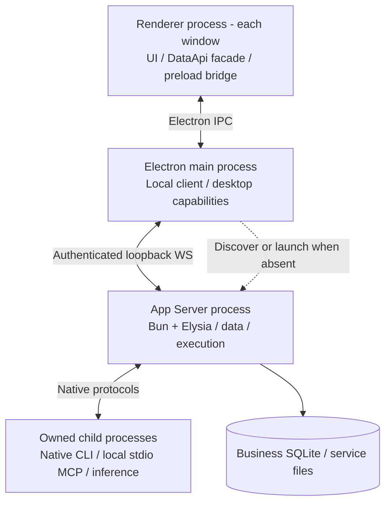
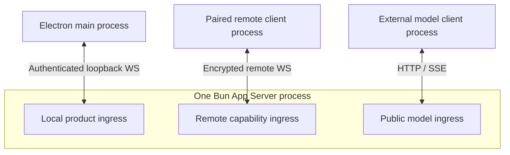
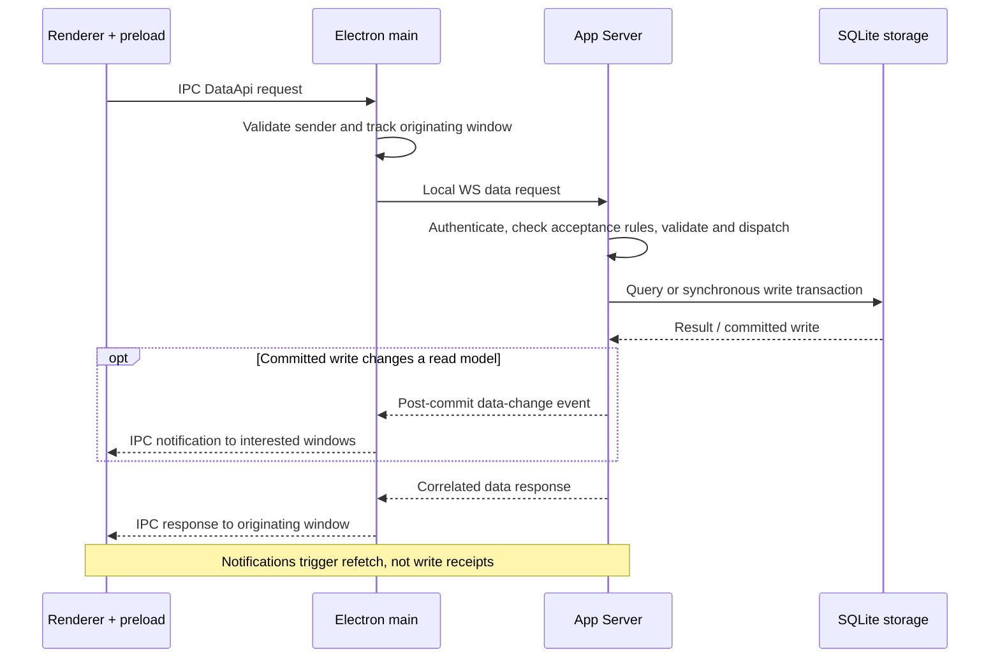
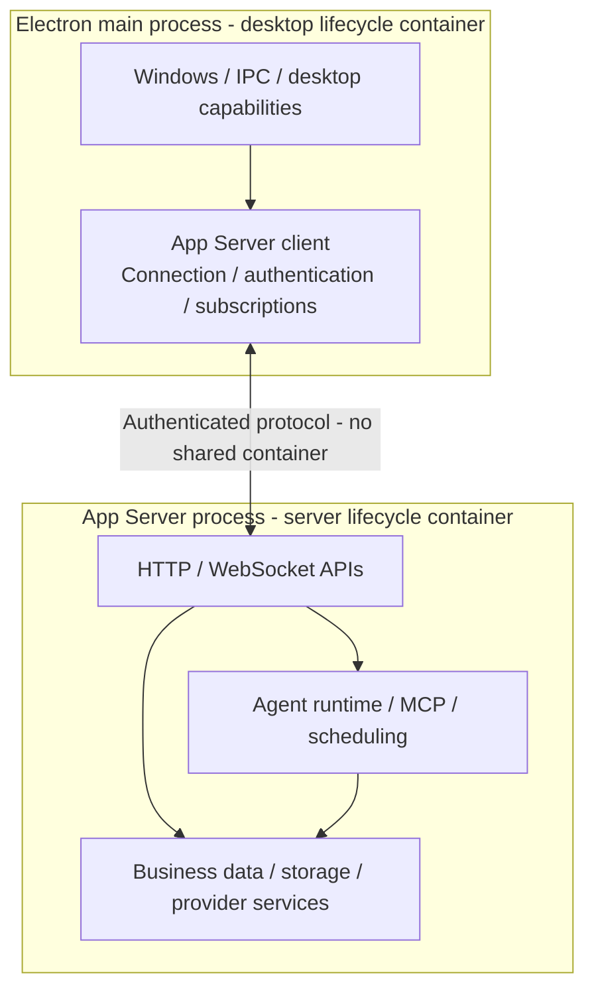
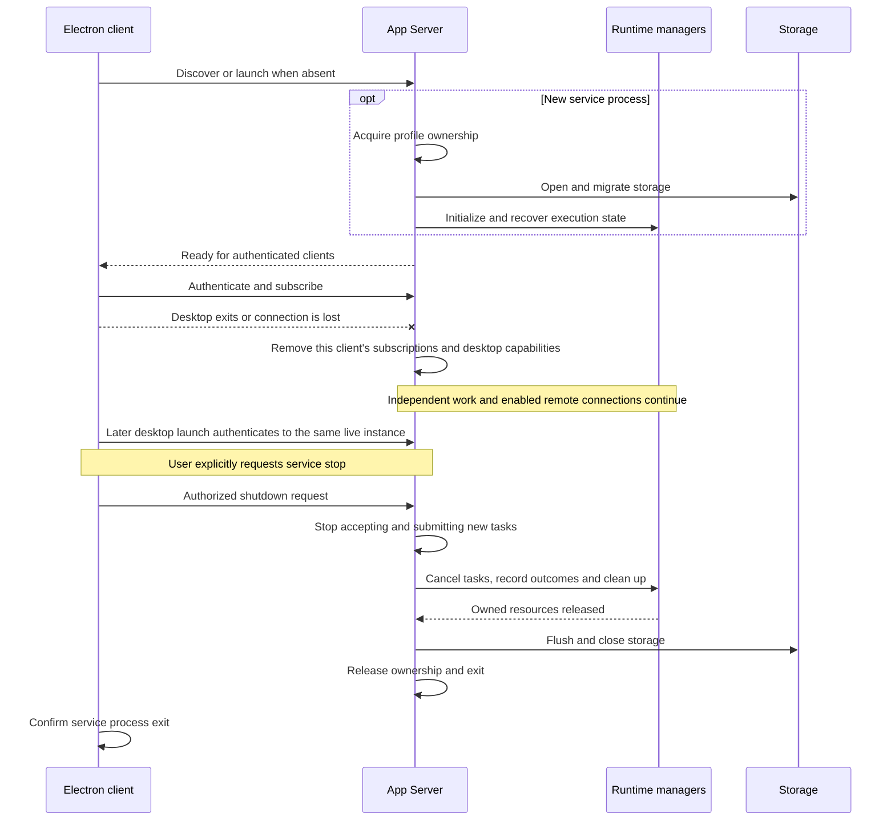
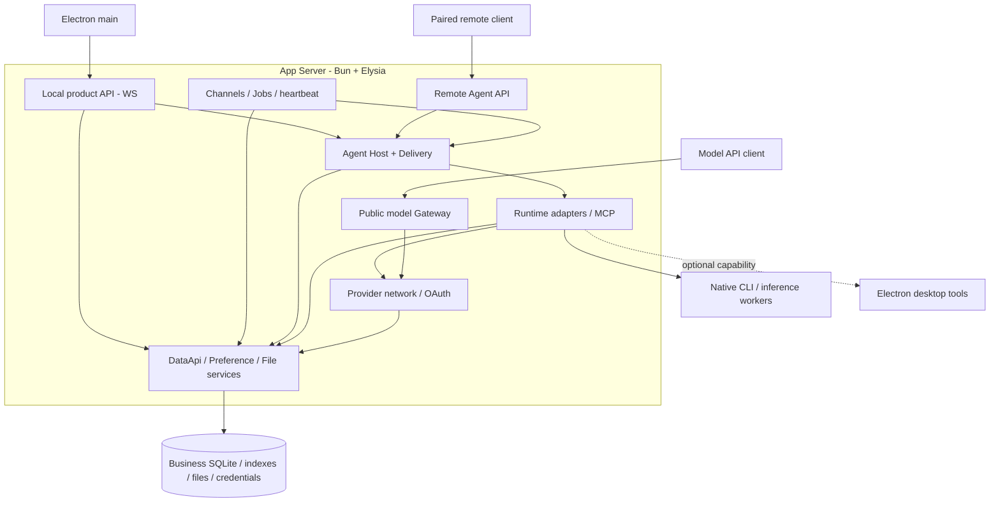
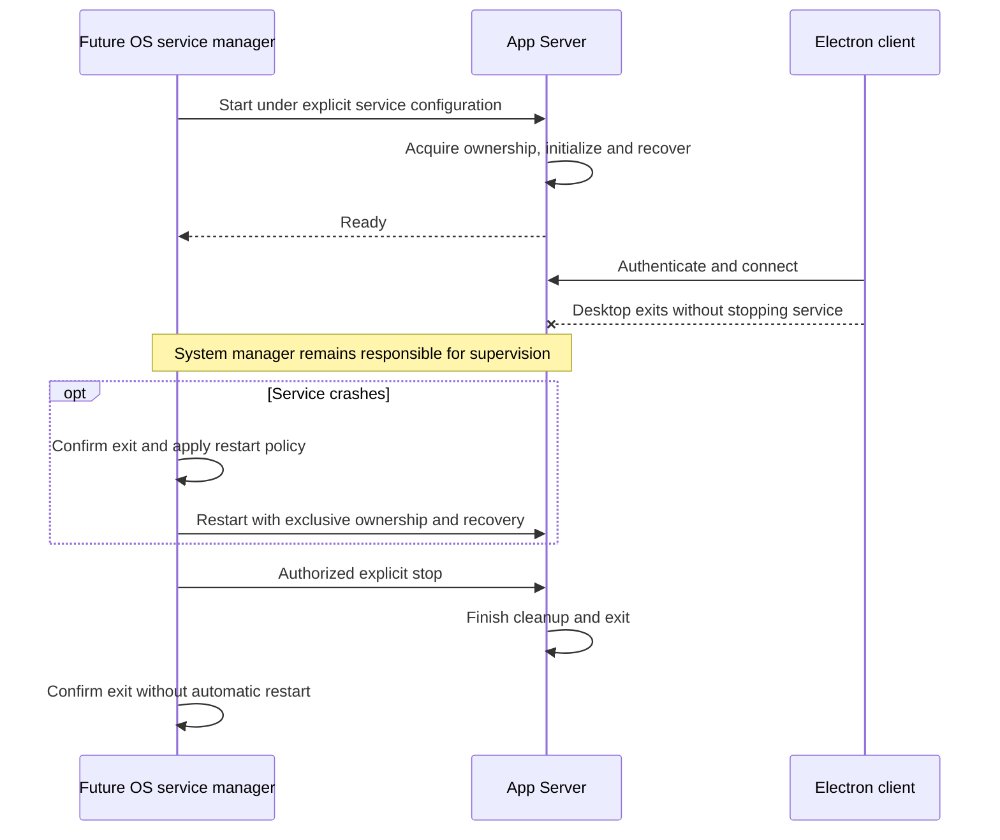

# Agent Note: Standalone App Server and business database ownership

Status: proposed

English | [中文](2026-11-11-app-server.zh.md)

## Problem

Cherry needs an Agent service that starts independently of Electron, following the Codex app-server model. The first product client is Electron, which accesses the service through a protocol. Independent startup is a server capability; it does not require a CLI client product.

The current [session host](../../../../src/main/ai/agentSession/AgentSessionRuntimeService.ts) and [database service](../../../../src/main/data/db/DbService.ts) still depend on the Electron application host. Moving only runtime adapters would leave configuration, product persistence, approval coordination, and recovery dependent on Electron.

## Proposal

### 1. Target architecture and decision status

App Server is Cherry's independently startable backend. The architectural direction below is confirmed in discussion. This note remains proposed: formal Spec approval, implementation, and standalone acceptance are incomplete.

| Confirmed decision | Target |
| --- | --- |
| Process | A Bun + Elysia App Server starts without Electron. Electron becomes its client and desktop capability provider. |
| Data | App Server owns the whole business SQLite database and its data services. Existing data and the shipped migration chain remain usable. |
| Execution | The product Host and runtime adapters initially share the App Server process. Native backends may run in owned child processes. |
| Lifetime | Each process owns its lifecycle container. Electron discovers or starts App Server and connects to it. Desktop exit disconnects the client; stopping the service is a separate authorized operation. |

Evolve the existing [Gateway application](../../../../src/main/features/apiGateway/app.ts) into the service's HTTP/WS host. Reuse its route composition, protocol conversion, streaming responses, and remote-access ingress. Gateway model-protocol routes remain a module of the larger App Server alongside product-data and Agent APIs.

The service owns its entry point, configuration loading, logging, paths, resource cleanup, and recovery. Read sections 1–3 for the process architecture, client communication, and lifecycle. Sections 4–6 cover resource ownership, migration, and open choices; section 7 records the source baseline. Local WS, process-launch and bootstrap APIs, credential adapters, timeout budgets, and database-driver selection still require validation. The first version supports continued service operation after desktop exit. Installing the service with an OS manager, login startup, and OS crash supervision are deferred to the final daemon chapter.

A profile is one user-data directory. The product Host coordinates Agent sessions: it decides whether to accept input, handles approvals, and restores execution state. Runtime adapters connect the Host to native execution backends.

### 2. Process boundaries and client APIs

These diagrams describe the target deployment. The primary local client is Electron main. Renderer calls keep their preload bridge; moving DataApi to WS does not make it a general remote-device API.

#### Local Electron connection

`preload` runs in the renderer process with an isolated context; it is not another process. Renderer code keeps the DataApi facade and hooks, calling the limited preload bridge. Electron main validates the IPC sender, owns the local connection and credential, correlates responses to their originating window, and distributes authorized events. Renderer-supplied IDs must not collide across windows or route another window's response. Window and tray commands remain local to Electron.

App Server owns DataApi handlers, business services, SQLite, and execution. Runtime adapters stay inside that process; native CLIs, local stdio MCP servers, and inference workers may use owned child processes with their native protocols. The database symbol is storage, not another process. Native history remains owned by its runtime.

The same product WS can carry requests for desktop tools registered by Electron main, with results returned to App Server. Main dispatches to a renderer or another Electron-owned desktop process only when the capability needs it. Desktop capabilities disappear with their owning client. A bootstrap channel may pass startup information, but its closure is not a service-stop request. Closing a product WS connection removes that client's registrations without stopping the service.

#### Three entry points with separate authority

The three ingress boxes are logical entry points inside one process, not three servers. The diagram does not require one shared listener or fix port allocation.

| Connection | Authority and scope |
| --- | --- |
| Electron main to local product ingress | Local profile/instance authentication. Carries desktop DataApi, Agent, and other explicitly defined product operations. It does not require remote-device pairing. |
| Paired device to remote capability ingress | Existing device identity and capability grants. Only approved remote APIs are exposed; an Agent grant does not grant general DataApi access. |
| External model client to public model ingress | Model API credentials and protocol-compatible forwarding. It does not grant product administration or desktop lifecycle control. |

The local WebSocket adapter and remote adapters may reuse application handlers within their respective permissions. Sharing a transport does not merge those permissions or impose remote pairing and message limits on local clients. Local message-size limits, buffer limits, and backpressure remain to be specified; backpressure controls sending when the receiver cannot keep up. Public model forwarding continues over HTTP/SSE. The first Electron integration does not require an additional HTTP DataApi adapter.

Public model and remote ingress are optional. Disabling either leaves the local product API running; stopping App Server is a separate operation. Credential checks never fall back to another authority domain. Existing [internal Gateway credentials](../../../../src/main/features/apiGateway/middleware/auth.ts) authorize model consumers, not product administration.

Model forwarding preserves caller-owned context and execution loops. It returns tool calls to that caller without executing client tools locally or creating a managed Agent session. Explicit Agent APIs own session admission, execution, persistence, and recovery. AC7–AC9 verify these lifetime, authorization, and forwarding boundaries.

#### A desktop DataApi round trip

The sequence shows a successful call. Change notifications are sent after commit on a best-effort basis; delivery is not guaranteed, and notification delivery does not determine write success. Consumers must not rely on notification/response arrival order. After reconnecting, clients query their active data again rather than treating data notifications as a replayable Agent execution log.

A disconnected write can have an unknown result; retry needs an explicit idempotency contract, not just a new transport request ID. Main removes the renderer's response associations when its window disappears; this does not imply a database rollback.

DataApi retains its transport-independent business-data contract and remains limited to SQLite-backed data. Electron main delivers window responses and notifications; App Server owns handlers and post-commit publication. Desktop and execution commands retain their own contracts even when they share the local WS.

#### Protocol reuse and missing APIs

Evaluate [remote-protocol](../../../../packages/remote-protocol/README.md) and [remote-transport](../../../../packages/remote-transport/README.md) for send, cancel, approvals, command receipts, subscriptions, checkpoints, and recovery. Receipts record command-processing status; checkpoints support resuming client observation of execution state.

The existing protocol does not yet establish a complete App Server API for configuration, fork, edit, Skills, MCP management, desktop capability registration, and whole-database access. Extend the owning schemas for those capabilities; exact method names and package placement remain to be specified.

Use a local WS adapter for existing DataApi requests. Do not expose arbitrary Electron IPC methods or replace every data operation with a new RPC dialect.

#### Local discovery and authentication

The proposed local listener binds explicitly to `127.0.0.1` with an OS-assigned port, then publishes its endpoint and instance in the profile discovery record. [Bun supports port allocation with `port: 0`](https://bun.sh/docs/runtime/http/server). Prefer one cross-platform transport initially; Unix sockets and Windows named pipes are not prerequisites.

Use a random local credential scoped to the profile and service instance, distributed through an owner-restricted bootstrap channel or file. Protect the directory and file with user-only permissions and Windows ACLs; never place credentials in URLs, command-line arguments, logs, or advertisements.

Loopback is not authentication: require credentials for local business and control calls, validate Host/Origin at the HTTP/WebSocket boundary, and reject unapproved browser origins. This trusts the OS user's protected local environment, not hostile processes already able to read that user's secrets. Remote devices retain Noise identity verification and capability grants. Stopping the service requires separate administrative permission. Starting the process or subscribing to its events does not itself grant that permission.

#### Version negotiation and concurrent clients

Negotiate wire versions and capabilities independently of package and app versions, using the [existing negotiation contract](../../../../packages/remote-protocol/src/negotiation.ts). Handshake returns profile identity, instance identity, run mode, readiness, and supported API capabilities. An incompatible client cannot mutate data or trigger migration. A server restart invalidates instance-bound credentials and observation cursors; clients rediscover, authenticate, and recover snapshots. Preserve durable command identities across that restart rather than resubmitting uncertain work with new IDs.

One App Server instance handles execution and persistence for all clients. It uses the authenticated caller and command identity to detect retries, and rejects conflicting payloads under the same identity. Caller identity must survive token rotation and connection replacement. The Host still decides whether to accept session requests. Approval responses must match the current interaction revision, and each approval can be resolved only once.

Give every connection its own subscriptions, backpressure, and desktop capability registrations. A slow or disconnected client must not stall another client or cancel its work. Preserve existing transaction and mutation semantics; use revision conflicts where overwriting concurrent edits would lose work rather than introducing one global client mutex.

### 3. First-version lifecycle

Electron and App Server have separate lifecycle containers, service registries, and service instances. App Server owns its initialization, execution recovery, shutdown, and resource cleanup. In the first version, normal or unexpected Electron exit leaves the service running. Independently executable work and enabled remote connections continue; capabilities supplied by the departing desktop become unavailable.

#### Two containers with separate responsibilities

Electron's container owns windows, menus, tray integration, shortcuts, notifications, renderer IPC, desktop capabilities, and the App Server client. The client owns its authenticated connection, subscriptions, and reconnection attempts. Its `onStop()` disconnects and releases local resources; it does not request global service shutdown.

App Server's container owns the business database and migrations, data handlers, server configuration, Provider networking and OAuth, Agent execution, MCP, scheduling, and HTTP/WebSocket entry points. It can initialize and stop without Electron or any connected client. Integration tests launch its entry point directly; a CLI client product is not required.

The diagram groups responsibilities rather than prescribing new class names. Container infrastructure may be shared after removing Electron dependencies, but each process creates its own container and registry. Neither process uses the other's mutable application singleton. Electron readiness, IPC registration, and quit hooks stay in the desktop integration; the server has its own bootstrap and termination handling.

`@DependsOn` orders services within one process. Desktop services depend on their local App Server client; service readiness and failures cross the process boundary through the protocol. Electron's `WhenReady` does not establish server readiness, and server services do not wait for that Electron phase.

#### Startup, desktop exit, and service stop

Electron startup discovers or starts the service and establishes a connection. The desktop may show its window before App Server is ready, while business operations wait for readiness or report an unavailable state. Closing a window or quitting Electron only releases the resources owned by that desktop. An explicit stop action is separately authorized and executed by the server's container.

The sequence shows reuse of a live service and a later explicit stop. Desktop exit does not send the stop request. Electron can expose the administrative action and wait for its result while still running. During an explicit stop, it retains the connection and any desktop resources still needed for cleanup; if the client disappears, App Server completes shutdown as far as possible under the capability-loss rules below. Only the server's shutdown procedure closes its database and owned native processes.

#### One App Server instance per profile

1. Resolve the canonical data directory and local discovery information from minimal bootstrap configuration. Electron's existing UI single-instance lock and the service's data-owner lock have separate scopes.
2. Attempt an authenticated handshake with the discovered service. Check data-directory identity, protocol compatibility, readiness, and run mode. A listening port or saved PID alone is insufficient. Attaching does not transfer lifecycle control.
3. Connect to a compatible, ready service. If it is starting or shutting down, observe that transition rather than starting a replacement. Connection failure does not prove the original process exited; a new instance must first acquire exclusive ownership of the profile.
4. If no service owns the directory, launch the independent Bun entry point. Concurrent launch attempts must produce one exclusive owner. Other launchers connect to that instance rather than creating another service instance that opens the business database.
5. Acquire exclusive ownership before processing interrupted restores, running migrations, seeding data, opening the database, or recovering runtimes. Report ready and accept tasks only after initialization and recovery establish consistent data and execution state.

Keep new tasks disabled while initializing storage, credentials, network clients, and runtime managers. Then prepare handlers and check and recover runtime, job, and delivery state. Each API or task source must wait for its own dependencies before accepting or submitting work. Independent services need no fixed startup order.

Startup failures return diagnostics and a retryable unavailable state. Clients do not bypass the service by opening SQLite or repeatedly spawn replacements on connection failure.

#### Process startup does not determine service lifetime

Electron's startup component passes the profile and launch identity and locates the ready service. It must not bind the server to an Electron-only runtime, a desktop process scope, or an inherited handle whose closure automatically terminates it. Bootstrap EOF, ordinary WS closure, and parent-PID changes are not global shutdown requests. A saved PID or ping timeout cannot prove that a live service has exited.

Server operation after desktop exit must not depend on Electron IPC, the launching terminal, or desktop-owned standard streams. Configure process detachment, stdin/stdout/stderr, and independent logs together; `unref()` alone is insufficient. See [Node child-process detachment](https://nodejs.org/api/child_process.html#optionsdetached). Verify packaged Node-to-Bun startup under normal and forced desktop exit on every supported platform. This belongs to the first version and does not require installing an OS service.

The desktop exposes an authenticated service-stop action separate from desktop quit. Its exact UI and protocol method remain to be specified. A connection or bootstrap handle does not confer stop authority; the service checks the administrative credential and target instance.

#### Service readiness is distinct from connection state

Server startup initializes storage, restores execution state, and then accepts work. Its readiness is reported through the protocol independently of the desktop container and of any individual client connection.

| Service state | Allowed operations and resource ownership |
| --- | --- |
| Starting | One owner initializes and recovers. Business commands wait or receive an explicit not-ready result; no second owner starts. |
| Ready | Authorized clients can read data, submit work, and subscribe. Stopping the service requires administrative permission; the number of clients does not determine its lifetime. |
| Shutting down | Reject new tasks and ordinary mutations, including tasks from schedulers and delivery queues. Retain control/status access and writes needed to finish handling accepted tasks. |
| Stopped | Execution and resource cleanup have completed and process exit is confirmed. A successor must still acquire exclusive ownership. |

A connection can be disconnected or incompatible while the service is alive. A new service process has a new instance identity. Clients recheck compatibility and reconstruct current state from snapshots or checkpoints before continuing incremental observation; reconnection does not submit another turn or run startup recovery.

#### Client disconnects and desktop capability loss

Desktop capability registrations belong to their client connection. Graceful disconnection withdraws them; unexpected connection loss invalidates them even if Electron cannot send cleanup. Loss of one desktop leaves independently executable work and other clients running. An explicit service shutdown closes all client connections and completes cancellation and cleanup of active work.

A browser or other desktop tool losing its client receives an explicit capability-lost outcome. Required approval or user input stays pending only where its policy supports that state, otherwise it fails explicitly. Losing a UI never means automatic approval, and reconnecting does not replay an interrupted desktop tool automatically.

Agent subscriptions observe execution state; disconnecting a subscription does not cancel the task. Ordinary Gateway generation requests retain their caller-controlled request-cancellation rules. The two operations must not share one blanket disconnect handler.

#### Finish task handling and resource cleanup before stopping

An authorized shutdown request stops the App Server responsible for the profile, not one client connection. An explicit stop action or coordinated service maintenance uses this operation; Electron quit and ordinary client disconnection do not. Repeated requests wait for the same shutdown procedure rather than repeating cleanup. Process-termination requests use this procedure where the platform permits it; a crash cannot guarantee cleanup.

1. Atomically mark the service as shutting down and stop accepting new work. Reject new tasks from Agent APIs, Gateway requests, schedulers, Channels, and delivery queues while preserving previously accepted tasks and their records.
2. Ask each native runtime manager to cancel its tasks. Within the shutdown deadline, finish handling in-flight tools, approvals, and deliveries, and record their outcomes. Publish interruption or cancellation states; do not mark interrupted tasks as successful.
3. Confirm that managed native processes have exited and their resources have been released. Persist final application state, send change notifications, and close network listeners. Wait for all writes and callbacks to finish before closing the database and logs.
4. Complete shutdown and release exclusive ownership at the end of resource cleanup. The launcher or lifecycle observer confirms process exit; the service cannot confirm its own exit in a response. If native release cannot be confirmed, report incomplete shutdown and prevent a clean successor from reopening those resources.

The stop response distinguishes accepted shutdown from confirmed stopped. A client timeout, closed socket, or missing listener proves neither successful cleanup nor process exit. Forced termination is a separate last resort with an unclean outcome and startup recovery; it must not make unknown external effects appear safe to replay.

The current [lifecycle timeout wrapper](../../../../src/main/core/lifecycle/LifecycleManager.ts) can stop waiting while cleanup continues. Reaching the deadline does not permit closing SQLite during active writes or starting a replacement runtime on the same resources. After abnormal exit, a new service must acquire exclusive profile ownership and check surviving native processes and resource usage before reusing resources or accepting conflicting tasks.

#### Recovery belongs to a service restart

App Server startup owns execution recovery and crash cleanup. Restarting Electron must not classify live server work as crash-orphaned, settle its pending messages, or discard its recovery information. The current Host's startup reconciliation and shutdown cancellation move with execution ownership.

If App Server crashes, clients disconnect and cannot write through a fallback database connection. After acquiring exclusive profile ownership, the restarted service checks command receipts, native execution history, and surviving native processes, and recovers state before accepting replacement tasks. Resume must follow the execution framework's evidence-based recovery rules. Accepted commands and tools with unknown outcomes are not automatically executed again.

#### One restart coordinator

While Electron is running, its service-startup component is the sole coordinator for restarting a crashed service. Confirm that the old process exited, use bounded backoff, and stop retrying permanent configuration, migration, or credential errors. This recovery role does not stop the server when Electron exits. Ordinary clients must not start competing restart loops. An explicit service stop also stops automatic recovery; intentional shutdown must not be treated as a crash and immediately reversed. If the service crashes after Electron exits, it may remain stopped until the next desktop startup or explicit recovery action.

Existing opt-in desktop login startup still launches Electron, which discovers or starts App Server through the same startup path. The first version does not register a separate login service or OS supervisor.

#### Updates, restore, and relocation

A compatible desktop-only update disconnects and later reconnects without stopping App Server. An update that also changes the server, or encounters protocol incompatibility, requires explicit service-maintenance coordination. The desktop must not silently terminate a live service or force a schema downgrade.

Running service code, native binaries, and resources come from a complete versioned installation that an Electron update cannot overwrite or delete. Keep the running version's assets until its resources are released. Updating App Server enters the same maintenance/shutdown barrier, waits for the old owner to stop, then starts the chosen version under exclusive ownership and applies supported forward migrations before readiness. Other clients observe the transition and re-handshake. Server updates may interrupt work; clients must observe the interruption and reconstruct state after reconnecting.

Database restore and data-directory relocation are server-coordinated maintenance operations. All relevant writers must be quiescent before replacing files or changing directory identity. A full-profile operation must also release Electron-owned Chromium and desktop file handles. The existing [restore preboot gate](../../../../src/main/core/preboot/backupRestoreGate.ts) and [relocation execution](../../../../src/main/services/userDataRelocation/execution.ts) cannot continue to replace live server-owned files merely because Electron is restarting. Journal recovery and the new directory's ownership precede normal database startup.

### 4. Service responsibilities and storage management

| App Server | Electron client |
| --- | --- |
| Business SQLite, data services, transactions, change notifications, and recovery | Service API calls, change subscriptions, and UI updates |
| Agent execution, runtime adapters, execution-state publication, and approval-state management | Execution display and collection of user decisions |
| Independent startup, runtime configuration, and resource lifetime | Windows, tray, and system integration |
| Tool access and execution policy | Optional desktop tools, including browser capabilities |

Desktop tools are optional connections. App Server starts and uses its available capabilities without Electron. Client absence grants no extra tool permissions; the execution service applies approval policy.

#### Backend call and resource dependencies

Unlike the process diagrams, this graph shows callers and the resources they use. Arrows point from caller to dependency; the dotted arrow is an optional desktop capability. Grouped nodes name responsibilities, not new service classes or a literal replacement for `@DependsOn`.

#### Product Host, runtime adapters, and native backends

Move the execution-facing parts of `AgentSessionRuntimeService` and the supported runtime adapters into App Server. The service owns product admission, delivery records, execution observation, approvals, and recovery. Window subscriptions, Electron IPC broadcasts, and UI projections belong in client adapters.

Host and runtime adapters initially remain in the same service process. The client protocol carries session commands, turn commands, execution events, and user decisions. Preserve synchronous input acceptance and the association between steer input and its execution when moving the boundary.

Native execution, input queueing, child scheduling, context, and history remain with their harness owners under the [harness boundaries](2026-10-17-agent-harness-boundaries.md). Deployment in App Server does not add a second native scheduler or transfer native storage to the product database. The [runtime contract](2026-10-17-agent-runtime-contract.md) remains the owner of adapter and product-context semantics.

#### App Server manages the business SQLite database

App Server is the authoritative access point for the whole business SQLite database. It owns connections, schema migrations, seed, data services, cross-table transactions, change notifications, and database backup and restore. DataApi operations and SQLite-backed Preference persistence move with that ownership. Electron reads and writes business SQLite data through service APIs and subscribes to changes.

Foreign keys alone do not require moving every table. Shared transactions, cascading deletes, file-reference management, and maintenance ownership make a single database owner the chosen target. The migration therefore includes Cherry's shared data backend, not only the Agent runtime directory.

Prefer retaining the existing database file, schema, foreign keys, and migration chain. Existing populated user databases must remain usable. Published migrations stay intact; any required schema changes use appended migrations under the existing rules.

Keep SQLite and Drizzle. The current connection uses `better-sqlite3`; validate the database driver under the selected Bun version rather than assuming Node native-module compatibility. Bun's `bun:sqlite` and Drizzle's `bun-sqlite` adapter are a candidate if a driver change is needed. Preserve synchronous transactions, foreign keys, migrations, FTS, custom functions and extensions, WAL checkpoints, and backup and restore behavior. Driver selection does not imply a schema rewrite.

#### BootConfig, Cache, files, and native history

The [path registry](../../../../src/main/core/paths/README.md) remains the central access mechanism, initialized from an explicit profile root for App Server rather than Electron `app.getPath()`. Keep physical data locations initially; changing process ownership does not require relocating every file. The standalone service entry point accepts an explicit existing profile and must not infer a different data root merely because its executable differs from Electron's.

| State | Responsible process and migration requirements |
| --- | --- |
| Desktop BootConfig | Chromium acceleration/debug flags and desktop install-to-profile selection stay in Electron. Public `BootConfig.*` settings route to that owner even though SQLite Preference values route to App Server. |
| Server bootstrap and profile discovery | App Server owns minimal non-secret profile/listener/bootstrap metadata outside SQLite. Clients read discovery; only the owner publishes it. Avoid two processes rewriting the same `boot-config.json`. |
| Relocation/restore journal | The maintenance coordinator owns the operation across server and desktop handles. Existing `temp.user_data_relocation` is consumed or migrated explicitly, never copied into normal preferences, backup, or another machine's startup. |
| Memory and shared Cache | Runtime/MCP/Channel/job progress follows the server producer; window and UI state stays local. Clients subscribe to authorized snapshots/events, not a generic write-any-cache-key API. Cache loss cannot erase command receipts, approvals, or execution history. |
| Persist Cache | Split by key into separately owned files during quiesced cutover. Skill catalogs and automatic-backup baselines follow service consumers; `window.bounds` and `browser.favicons` stay desktop-owned. Renderer localStorage stays local. Neither process rewrites the other's file. |
| Native histories and workspaces | Harnesses retain history format, credentials, and resume semantics; App Server owns their launch and path bindings. Preserve native IDs, workspace paths, Pi session files, and external CLI configuration. Do not convert them to product message rows or delete external-owned paths. |
| Managed attachments, skills, indexes, and temporary uploads | Move file services and maintenance ownership with their database references and jobs. Persisted metadata and actual files must remain coherent across restart and restore; moving SQLite alone is insufficient. |

The split follows actual [BootConfig fields](../../../../src/shared/data/bootConfig/bootConfigSchemas.ts) and [Cache schemas](../../../../src/shared/data/cache/cacheSchemas.ts), not the current class names. Preserve TTL/expiry and restart-safe scheduling baselines when migrating persisted entries. Keep a resumable cutover record for split files and retire the old writers together; atomic rename alone does not prevent two full-file writers from losing each other's updates.

#### Provider networking and proxy policy

Move Provider requests, token exchange/refresh, MCP network connections, and Gateway upstream requests into App Server. The current [provider fetch](../../../../src/main/ai/utils/customFetch.ts), [PKCE client](../../../../src/main/services/oauth/runtime/PkceOAuthClient.ts), and [proxy service](../../../../src/main/services/proxy/ProxyService.ts) depend on Electron networking. Separate proxy policy from Chromium application: the service resolves its own proxy, bypass, TLS, headers, redirect, cancellation, and streaming behavior; Electron applies the same stored preferences to browser sessions. Native subprocess proxy environments must come from the service's configuration, not an incidental desktop environment.

Use [Bun's fetch proxy support](https://bun.sh/docs/runtime/networking/fetch) only where it preserves existing network behavior. Verify HTTP/HTTPS/SOCKS proxies, system proxy/PAC support, bypass-rule precedence, custom certificates, and native SDK behavior on the selected runtime version. Configuring a Node global dispatcher does not prove Bun fetch follows it. Unsupported proxy modes must fail explicitly, never silently connect directly. Keep local control traffic independent of the model proxy. Remove Chromium-specific User-Agent workarounds only after inspecting actual requests confirms the required header.

#### The service handles OAuth; clients present authorization

Keep the current [OAuth domain boundaries](../../../../src/main/services/oauth/runtime/README.md). Provider OAuth retains provider-row token persistence and its refresh single-flight/conditional-write semantics; MCP retains SDK-driven authorization and per-server storage; Copilot retains its device flow. App Server owns state, PKCE, callback listeners, token exchange, refresh, and logout. Electron presents the authorization URL/device code and observes the result. The service exposes authorization state through its API without depending on the desktop for token exchange or refresh.

A browser callback targets the server machine; a remote client cannot assume its own localhost reaches the server or exchange the token itself. Preserve provider-approved redirect flows, and report when login requires a browser on the server machine. A desktop popup that returns an API key imports the result through an authenticated credential mutation; it does not become a runtime refresh owner.

#### Existing secrets and credential import

Move existing storage ownership before considering a universal vault or token-schema redesign. SQLite Provider credentials move with SQLite. [MCP encrypted files](../../../../src/main/ai/mcp/oauth/storage.ts), [Copilot tokens](../../../../src/main/services/CopilotService.ts), and the [remote device identity](../../../../src/main/services/remoteAccess/deviceIdentity.ts) require replacement for Electron `safeStorage`. Evaluate an OS-backed secret adapter, including [Bun.secrets](https://bun.sh/docs/runtime/secrets), under the pinned runtime; the documented API is experimental and Linux requires an available Secret Service. Do not assume it decrypts existing Electron ciphertext or works in every unattended login environment.

For existing encrypted data, use a one-time authenticated migration from the old Electron decryptor to the new service-owned store. Verify the imported value and durable migration record before retiring the old writer; an interrupted import is retryable without exposing plaintext in temporary files or logs.

If decryption is unavailable, retain the source and report unlock/import or reauthorization requirements. Never regenerate the remote identity or silently downgrade protected secrets to plaintext. Explicitly configured headless secret injection is a separate deployment path. Other stores, including [Cherry account credentials](../../../../src/main/services/cherryCloud/CherryAccountCredentialStore.ts), keep their domain semantics and move with their background consumer; unrelated account flows are not folded into Provider OAuth.

#### Channels, Jobs, delivery, and heartbeat

Move [SchedulerService](../../../../src/main/core/scheduler/README.md), [JobManager](../../../../src/main/core/job/README.md), all handlers that use the business database, Agent delivery, [AgentJobsService](../../../../src/main/ai/agents/AgentJobsService.ts), and [ChannelManager](../../../../src/main/ai/channels/ChannelManager.ts) into the service ownership graph. This includes backup and knowledge jobs, not only Agent jobs. Desktop-only actions become capability calls; there is no second Electron scheduler writing the same job tables. Replace WindowManager/NotificationService dependencies with client events.

Separate [RuntimeActivityService](../../../../src/main/core/application/RuntimeActivityService.ts) from Electron's PowerService: execution accounting belongs in the service, while sleep inhibition and OS resume detection need an independently usable platform adapter. Independent execution cannot rely on Electron power events.

Prepare all handlers with dispatch paused, recover runtime and job records, establish outbound delivery, and only then admit incoming Channel messages and enable schedules. Heartbeat remains an Agent job with its existing schedule identity and native context, not a process keepalive timer. Preserve JobManager's per-handler recovery and missed-run policies.

The current 60-second Jobs recovery and heartbeat repair windows belong to background scheduling, not the local handshake timeout. Report recovery progress and keep affected work disabled until its state has been checked and recovered. On shutdown, first stop new submissions from every source, then complete cancellation, outcome recording, and cleanup for accepted tasks and deliveries while their dependencies remain available.

### 5. Migration sequence and evidence

Start with an ownership inventory, validate compatibility with an isolated populated profile, then implement through the gates below. Prioritize database/extension compatibility, independent workers, and legacy credential import during validation.

#### One resource ownership inventory across four workstreams

Keep one migration inventory, organized into four workstreams. Assign each finding to its owning workstream and record dependencies on the others.

| Workstream | Question | Scope |
| --- | --- | --- |
| Service startup and operation | How does the service start, connect, stop, and ship independently? | Entry point, lifecycle, protocol, authentication, profile ownership, logging, packaging, and updates |
| Data ownership | Which process owns each persistent resource? | Business SQLite, per-base knowledge indexes, files, credentials, BootConfig, Cache, backup, restore, and initial cutover/rollback |
| Execution capabilities | Which work can run without Electron? | Provider networking, OAuth, Host, drivers, MCP, independent workers, Channels, Jobs, and heartbeat |
| Client integration | How do desktop and other clients use those capabilities? | Client facades, subscriptions, approvals, file/media transfer, desktop capabilities, disconnect, and reconnect |

The immediate deliverable is the ownership inventory. Record modules and resources using the following columns; these rows illustrate the format and do not constitute a completed audit.

| Module/resource | Current owner | Target owner | Migration obstacle | Acceptance evidence |
| --- | --- | --- | --- | --- |
| Business database | Electron | App Server | Application container, migration, notification, and maintenance dependencies | Existing data and cross-table transactions remain usable; Electron does not open the business database |
| Local inference workers | Electron utility processes | Independent workers managed by App Server; runtime choice requires validation | Launch protocol, native libraries, and resource discovery | Complete local inference without Electron |
| File watching and editing | Electron window-bound resources | Service resources bound to client sessions | Window and WebContents identity dependencies | Isolate concurrent clients, release resources on disconnect, and rebuild them on reconnect |
| Windows and tray | Electron | Electron | Replace backend access with client calls | Existing desktop interactions remain usable |

The inventory is complete when every persistent writer and long-lived resource in scope has an owner, retained dependencies have a reason, and user-visible behavior changes are identified. Record new findings in this inventory. Changes to background defaults, permissions, data compatibility, or feature availability require an explicit decision; technical choices are resolved through source evidence and validation.

#### First standalone demonstration

The first demonstrable milestone combines AC1–AC3: an integration test starts App Server directly without Electron, reads existing data through the service API, completes an Agent execution with tool use and approval, and reads persisted history after a service restart. This verifies server independence and does not replace the remaining acceptance criteria.

#### Five implementation stages and acceptance conditions

These stages are implementation slices, not permission to ship two database owners. A profile switches exclusively to App Server at cutover; incomplete desktop callers must be migrated or explicitly unavailable, never served by a fallback Electron database.

1. Prove Bun compatibility for SQLite/migrations, native runtimes, networking, and credential import with an isolated populated profile. Establish the data-root and ownership manifest, local handshake, separate process containers, standalone entry point, independent standard streams/logs, and an authorized stop operation. Gate: concurrent launches produce one service, normal or forced Electron exit preserves independent work, and an explicit service stop completes cleanup without Electron business services.
2. Move the full database/data APIs, Preference persistence, file-backed business state, and required jobs/handlers as one ownership graph; keep autonomous producers paused. Add Electron client facades and split desktop-owned configuration/cache. Gate: existing data and cross-table transactions survive the cutover, interrupted file/credential imports recover, and Electron opens no business database connection.
3. Move Provider networking/auth, MCP, Host, native drivers, and manual execution. Keep Gateway model forwarding and product commands scoped separately. Gate: integration tests call the service API without Electron to complete model/tool execution, approvals, cancellation, credential refresh, and history recovery; two authenticated connections observe one execution.
4. Activate delivery and Channels after recovery, then Jobs schedules and heartbeat under their existing policies. Gate: restart during an accepted Channel message or scheduled task does not duplicate external effects; unknown outcomes are surfaced, pause/restore blocks every producer, and the directly started service schedules work without Electron.
5. Complete desktop cutover, desktop and independently launchable service packaging, and update/maintenance coordination. Gate: packaged normal/forced exits, startup with locked credentials, compatible/incompatible upgrades, and restore/relocation pass on supported platforms. Daemon distribution, login startup, and OS supervision are deferred to the final chapter.

### 6. Open design choices and proposed budgets

- Pinned Bun and Elysia versions, package boundaries, exact launch/control APIs, distribution, and database-driver compatibility results.
- Concrete method schemas, local credential/ACL implementation, and the supported client/server wire-version matrix.
- OS-specific process detachment and standard streams, secret stores, proxy/PAC, power, and restart coordination; the desktop stop-service UI and administrative protocol; validate the proposed time budgets with packaged processes.
- Per-key/file ownership inventory, interrupted-cutover journals, and native-runtime/file backup consistency procedures.
- Formal Spec approval and real-process evidence for each migration gate; the proposals above do not establish implementation completion.

The following values are initial engineering proposals, not measured guarantees:

| Operation | Proposed budget |
| --- | --- |
| Local handshake | 5 seconds |
| Ordinary startup | Report a delayed state after 30 seconds |
| Graceful shutdown | One shared 30-second deadline |
| Administrative caller waits for explicit service stop | 35 seconds, including transport and process-exit overhead |

Startup delay does not kill a live migration or start another owner; migration progress is reported separately. These shutdown budgets apply to explicit service stop, not ordinary desktop exit. The server budget uses the current [30-second application ceiling](../../../../src/main/core/lifecycle/constants.ts) without allocating a fresh budget per service. Deadline expiry reports incomplete shutdown. Any forced termination verifies the target service instance and process identity and records an unclean outcome.

### 7. Source baseline and current coupling

The original research inspected `3942cd2f700082745a80b94a78f3667db2d81887`. This record was reconciled with `origin/main` at `091fa886ef50b9e856c56cbfec83ee66f1aa747e` on 2026-11-11.

Upstream now contains portable runtime packages, including `agent-runtime`, `agent-runtime-pi`, `agent-runtime-pi-durable`, `agent-runtime-claude-code`, and `agent-runtime-acp`. The desktop [driver registry](../../../../src/main/ai/runtime/registerDrivers.ts) registers Claude Code, Pi, and Pi Durable. The earlier DSH inventory describes the old research baseline, not the current runtime set. Package extraction does not by itself establish an independently startable Cherry service.

#### Services currently owned by Electron

The following is a selected source inventory, not the full dependency graph. All listed services still run under Electron's application container. A declared dependency orders same-phase initialization. Cross-phase ordering and ordinary runtime calls are separate relationships.

| Current component | Startup relationship or Electron dependency |
| --- | --- |
| [DbService](../../../../src/main/data/db/DbService.ts), [PreferenceService](../../../../src/main/data/PreferenceService.ts), [DataApiService](../../../../src/main/data/DataApiService.ts) | All are BeforeReady services. PreferenceService and DataApiService declare a dependency on DbService. |
| [AgentSessionRuntimeService](../../../../src/main/ai/agentSession/AgentSessionRuntimeService.ts) | WhenReady. Declares dependencies on ClaudeCodeProcessManager, ClaudeCodeWarmQueryManager, AutomationReplService, and RuntimeActivityService. Runtime code also accesses WindowManager. |
| [AgentSessionDeliveryService](../../../../src/main/ai/agentSession/AgentSessionDeliveryService.ts) | WhenReady. Depends on AgentSessionRuntimeService and AiStreamManager. |
| [ApiGatewayService](../../../../src/main/features/apiGateway/ApiGatewayService.ts) and [RemoteAccessService](../../../../src/main/services/remoteAccess/RemoteAccessService.ts) | Gateway declares a dependency on RemoteAccessService. RemoteAccessService depends on runtime and file services, and queries Gateway endpoints at runtime. That reverse call is not a reverse startup dependency. |
| [AgentJobsService](../../../../src/main/ai/agents/AgentJobsService.ts) and [JobManager](../../../../src/main/core/job/JobManager.ts) | AgentJobsService depends on JobManager and NotificationService. JobManager depends on SchedulerService and RuntimeActivityService. |
| [ChannelManager](../../../../src/main/ai/channels/ChannelManager.ts) | Depends on WindowManager, FileManager, and PowerService. |
| [McpRuntimeService](../../../../src/main/ai/mcp/McpRuntimeService.ts) | Depends on WindowManager, McpPackageService, and BrowserSessionService. |
| [KnowledgeService](../../../../src/main/features/knowledge/KnowledgeService.ts) | Depends on KnowledgeVectorStoreService, JobManager, FileProcessingService, and WebSearchService. |
| [InferenceServiceBase](../../../../src/main/ai/localModel/runtime/InferenceServiceBase.ts) | Local inference services inherit a dependency on Electron's UtilityProcessManager. |

[Application.bootstrap](../../../../src/main/core/application/Application.ts) starts Background work, then awaits BeforeReady together with Electron readiness before starting WhenReady. [LifecycleManager](../../../../src/main/core/lifecycle/LifecycleManager.ts) initiates shutdown in reverse initialization order. Its timeout bounds waiting, not completion of resource cleanup. The independent service must establish the shutdown barriers in this proposal before releasing storage.

Electron's `UtilityProcessManager` requires an Electron parent and cannot provide the standalone entry point. Separate the current [application shutdown](../../../../src/main/core/application/Application.ts), [runtime stop](../../../../src/main/ai/agentSession/AgentSessionRuntimeService.ts), and [remote-access stop](../../../../src/main/services/remoteAccess/RemoteAccessService.ts) chains so Electron does not close the server database or run server recovery.

#### Gateway and DataApi migration entry points

The current application uses `@elysia/node`; its [server](../../../../src/main/features/apiGateway/server.ts) and [remote WebSocket route](../../../../src/main/features/apiGateway/routes/remote.ts) depend on Node-specific listener and socket behavior. Migrate those bindings to Bun while preserving binary transport, backpressure, stream cancellation, and confirmed shutdown. Changing the adapter alone does not remove the routes' dependencies on Electron's application services.

The migration starts from the existing [preload bridge](../../../../src/preload/preload.ts), [renderer DataApi client](../../../../src/renderer/data/DataApiService.ts), [IPC adapter](../../../../src/main/data/api/core/adapters/IpcAdapter.ts), and [ApiServer](../../../../src/main/data/api/core/ApiServer.ts). Today the coordinator and handlers still run in Electron main, and [change notifications](../../../../src/main/data/dataApiDataChange.ts) broadcast directly through WindowManager.

#### Shared database entities and transactions

The current data model shares entities and consistency constraints:

| Relationship | Source |
| --- | --- |
| Agents, ordinary messages, and Agent messages reference `user_model`; models reference Provider | [Agent](../../../../src/main/data/db/schemas/agent.ts), [Message](../../../../src/main/data/db/schemas/message.ts), [Agent Session Message](../../../../src/main/data/db/schemas/agentSessionMessage.ts), [User Model](../../../../src/main/data/db/schemas/userModel.ts) |
| Agents and Assistants use shared MCP and knowledge-base entities | [Assistant Relations](../../../../src/main/data/db/schemas/assistantRelations.ts) |
| Agent attachments and other features share `file_entry` | [File Relations](../../../../src/main/data/db/schemas/fileRelations.ts) |
| Agent sessions and channels reference task schedules | [Agent Session](../../../../src/main/data/db/schemas/agentSession.ts), [Agent Channel](../../../../src/main/data/db/schemas/agentChannel.ts) |
| Data services compose writes in one connection and transaction | [DbService](../../../../src/main/data/db/DbService.ts), [AgentService](../../../../src/main/data/services/AgentService.ts), [transaction contract](../../../../docs/dev/references/data/database-patterns.md#write-serialization-dbservicewithwritetx) |

## Alternatives considered

- Moving only runtime adapters or only Agent tables leaves shared configuration, persistence, and recovery coupled to Electron. Splitting shared tables also requires replacing existing cross-table consistency with coordination protocols.
- Running inside an Electron utility process provides child-process isolation but still requires Electron to start the service.
- Building a second HTTP framework beside Gateway would duplicate route composition and transport infrastructure. Evolving the existing Elysia entry point keeps those responsibilities together.
- Letting Electron and App Server independently manage the same database preserves two application-level authorities for transactions, notifications, migrations, and maintenance.
- Putting the client protocol between Host and every runtime adapter adds serialization to internal admission and correlation paths. The initial protocol boundary is the product session API.
- Binding service lifetime to Electron quit or a parent-control-pipe EOF would simplify child cleanup but interrupt independent tasks and remote clients. The first version instead separates client cleanup from an authorized service-stop action. OS-supervised operation is a later deployment option, not a prerequisite for this separation.

## Acceptance criteria

These criteria cover the first version: separate process containers, an independently startable service, desktop exit without service shutdown, and explicit service stop. They require no CLI client product or OS-managed daemon installation.

- AC1 — With Electron absent, the Elysia App Server runs on Bun and an integration test uses the service API to create a session, send input, call a real model, execute a local tool, and receive streamed output. (verification: real-process integration — implementation author)
- AC2 — The client answers an approval request and cancels execution; the service enforces the decision and persists the terminal outcome without granting permissions because a client is absent. (verification: real-process integration — implementation author)
- AC3 — After service restart, the client reads persisted history and resumes a supported native context; an existing populated business database remains usable. (verification: migrated SQLite and native-runtime integration — implementation author)
- AC4 — Restarting Electron does not invoke crash cleanup on work still owned by App Server, discard its recovery information, or create duplicate execution on reconnect. (verification: Electron and real-process integration — implementation author)
- AC5 — Desktop business-data operations use service APIs, preserve shared-model and file-reference constraints and cross-table atomicity, and retain one owner for migration, seed, change notifications, backup, and restore. (verification: migrated SQLite integration and architecture boundary checks — implementation author)
- AC6 — Existing Gateway protocol responses, streaming, binary remote access, backpressure, cancellation, and confirmed shutdown work under the pinned Bun runtime. Database-driver compatibility is established with populated-database migration, transactions, FTS, custom functions and extensions, checkpoints, and backup and restore; it is not inferred from framework support. (verification: real-process protocol and migrated SQLite integration — implementation author)
- AC7 — Stopping public Gateway exposure during execution leaves local product-data queries and mutations and Agent execution available; service shutdown remains a separate operation. (verification: real-process lifecycle integration — implementation author)
- AC8 — Public model API credentials cannot administer product data or control Agent execution, and rejected credentials or grants cannot fall back across domains; authorized operations within each scope succeed. (verification: real-process authorization integration — implementation author)
- AC9 — Model forwarding preserves caller-owned context and loop behavior, produces no local client-tool execution or managed Agent session, and remains distinct from explicit Agent session operations. (verification: real-process forwarding and Agent integration — implementation author)
- AC10 — Normal or forced Electron exit and last-client disconnection leave the same App Server instance, independently executable tasks, and enabled remote connections running. Desktop capabilities become unavailable under their explicit policies. Relaunching Electron reuses the live service, and an explicit authorized stop ends it. Ordinary subscribers do not acquire administrative permission. (verification: packaged Electron and real-process multi-client integration on supported platforms — implementation author)
- AC11 — Concurrent starts through Electron and the standalone service entry point for one canonical data directory produce one database owner and one recovery/migration pass. Starting, draining, incompatible, and temporarily unreachable services do not cause a competing owner. (verification: real-process concurrent startup and failure injection — implementation author)
- AC12 — An authorized shutdown first stops new task submissions through every entry point, then requests cancellation of existing work. Accepted tasks must finish processing and native resources must be released before the database closes. Distinguish an accepted shutdown request, incomplete shutdown, and confirmed stop. Repeated requests, timeouts, and surviving native processes must not let the original and replacement instances write the same resources concurrently. (verification: real-process shutdown and crash injection with populated SQLite — implementation author)
- AC13 — A compatible desktop-only update preserves the running service. A coordinated server update waits for resource release and exclusive ownership before forward migration, and preserves versioned assets until release. Reconnect restores observation without replaying work, and profile restore or relocation never replaces files still held by a service or desktop process. (verification: packaged update, restart, restore, and relocation integration — implementation author)
- AC14 — Local and remote adapters enforce their respective credentials and negotiated permissions. Retrying the same command identity for the same caller does not admit or execute it again; each approval can be resolved only once. After an instance change, clients reconstruct subscriptions and state while preserving durable command identities. Slow clients do not block other clients. (verification: authenticated multi-client protocol and restart integration — implementation author)
- AC15 — Bootstrap-channel closure, loss of desktop-owned handles, and parent-process exit do not terminate the service or break its independent logs and standard streams. A ping timeout does not replace a live or sleeping service. Only one startup component coordinates recovery after confirmed service exit; timeout never permits active writers to overlap database teardown or replacement. (verification: packaged parent-loss, suspension, crash, and shutdown fault injection — implementation author)
- AC16 — Provider, MCP, and Gateway traffic follows configured proxy/TLS/header/cancellation policy without Electron; OAuth callbacks, refresh, concurrent logout, and re-login retain their domain contracts. Unsupported network modes fail explicitly instead of silently bypassing configuration. (verification: local proxy/TLS fixtures, wire capture, and provider/native-runtime integration — implementation author)
- AC17 — Existing encrypted credentials and remote identity survive a retryable import to service-owned storage; unavailable key storage leaves source data intact and reports the dependency. No background operation depends on Electron decrypting or refreshing credentials after cutover. (verification: populated-profile migration and locked-store/headless restart on supported OSes — implementation author)
- AC18 — Every BootConfig/cache/file writer has one declared owner, split-file migration survives interruption, and desktop cache updates cannot overwrite service state. Native histories, file references, and restart-safe backup baselines remain usable after cutover and restore. (verification: ownership inventory, concurrent-write checks, and populated-profile restart/restore integration — implementation author)
- AC19 — Jobs, Channels, delivery, and heartbeat recover under one service owner and activate only after their prerequisites; reconnect and catch-up do not duplicate accepted work with unknown outcomes. Shutdown/maintenance gates every producer, while independently started execution works without desktop power or notification services. (verification: scheduling, Channel delivery, suspension, and maintenance fault injection — implementation author)

- AC20 — Each process initializes and stops its own service registry. Electron can show a window while the service is unavailable, and stopping its client service closes only the connection and local resources. App Server initialization and shutdown require neither Electron imports nor Electron readiness/quit events; cross-process availability is reported through the protocol rather than `@DependsOn`. (verification: architecture boundary checks and real-process lifecycle integration — implementation author)

## Risks

Whole-database ownership expands the work to shared data services and their Electron dependencies. Network, OAuth, credentials, paths, logging, maintenance, and client notifications need explicit independent implementations or adapters. Preserving the file and schema does not establish native-module packaging compatibility.

Elysia provides a [Bun adapter](https://elysiajs.com/patterns/configuration), and Drizzle supports [Bun SQLite](https://orm.drizzle.team/docs/sqlite/connect-bun-sqlite), but this repository's pinned dependencies and native runtime packages still require real Bun validation. Framework support alone does not establish compatibility for database extensions, SDKs, or the existing Node WebSocket integration.

Portable runtime packages and their native history stores have their own ownership contracts. Product SQLite migration must preserve those contracts, including close confirmation, fork boundaries, background work, and recovery. Process restart and transport reconnect do not prove exactly-once external side effects.

The service remains active and consumes resources after desktop exit, so its status and explicit stop action must be discoverable when the desktop is reopened. Desktop tools become unavailable when their client leaves. Independent logging, process lifetime, and versioned installation assets are first-version requirements. Without an OS supervisor, a service crash after desktop exit may leave it stopped; OS shutdown and service upgrades can also interrupt execution.

## Future phase: daemon, outside the first version

Here daemon means installing and operating App Server through a separate service manager, with optional login startup and crash supervision. First-version process independence, desktop-exit survival, discovery, authentication, and explicit stop are defined above. This chapter adds future deployment and supervision responsibilities; the first version does not implement or package that system integration.

### Additional service-management responsibilities

| Deployment | Startup and recovery responsibility |
| --- | --- |
| First-version independent service | Electron discovers or starts the service and can coordinate recovery while running. Desktop exit leaves the service alive; a later service crash may leave it stopped. |
| Future OS-managed daemon | A separately configured OS service manager starts and supervises the service. Electron connects as a client and does not compete to start or restart it. |

### Login startup and crash supervision

Service login startup must be opt-in and distinct from the existing desktop login setting. Evaluate user-level mechanisms such as macOS LaunchAgent, Windows login tasks, and Linux user services. One profile must not have competing service managers; desktop startup continues to discover and connect to an existing instance.

The selected service manager is the sole crash-restart coordinator. It confirms exit, applies bounded backoff, and stops retrying permanent configuration, migration, or credential errors. An explicit administrative stop must not be mistaken for a crash that requires immediate restart. Changing supervision requires explicit coordination and must not create a second database owner.

### Administrative authority and updates

Connecting remains separate from administrative permission. The service manager must invoke the authenticated stop procedure and wait for actual resource release. Compatible desktop-only updates retain the running service; server updates coordinate with the supervisor so maintenance does not trigger a competing restart. Preserve versioned assets and forward-only schema rules from the first version.

### Acceptance to add in that phase

- Verify opt-in installation, login startup, disabling and removal of the system service on supported platforms without competing with desktop startup.
- Verify startup with locked credential stores, system wake, crash backoff, and explicit-stop behavior; exactly one supervisor coordinates recovery.
- Verify that supervisor-controlled updates preserve running-version assets, wait for cleanup, and never overlap maintenance with automatic restart or schema downgrade.

Service failure, system shutdown, and service upgrades may still interrupt work. System supervision does not promise uninterrupted execution or exactly-once external effects.
