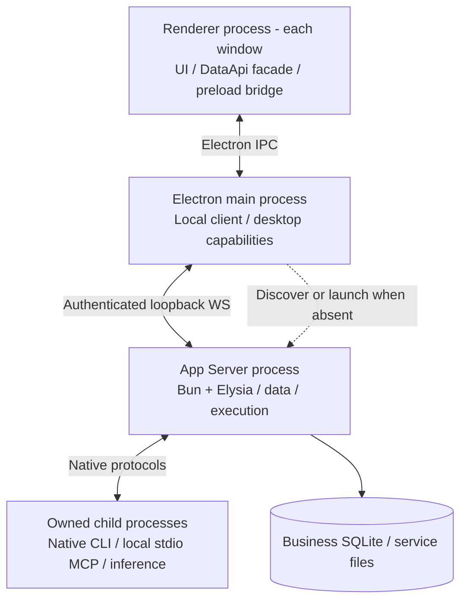
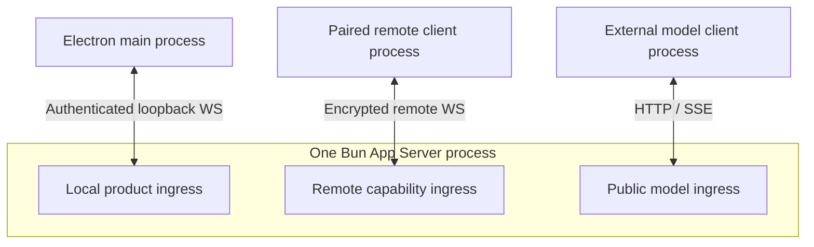
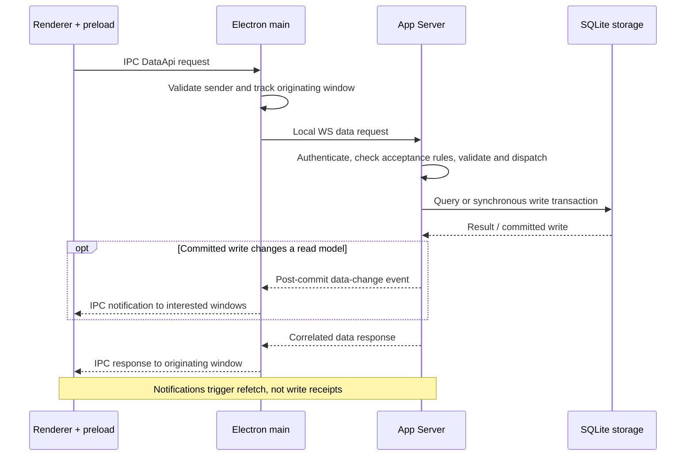
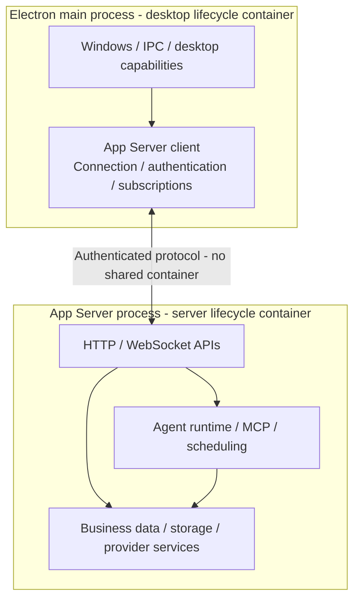
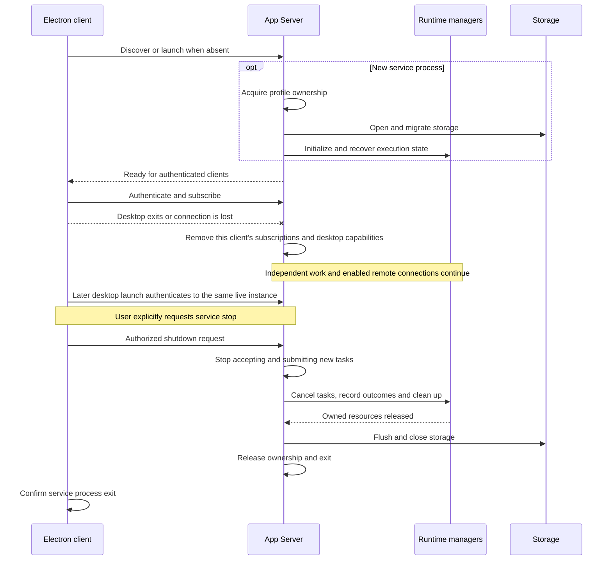
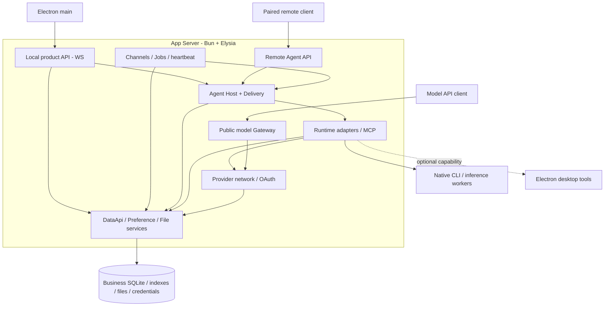
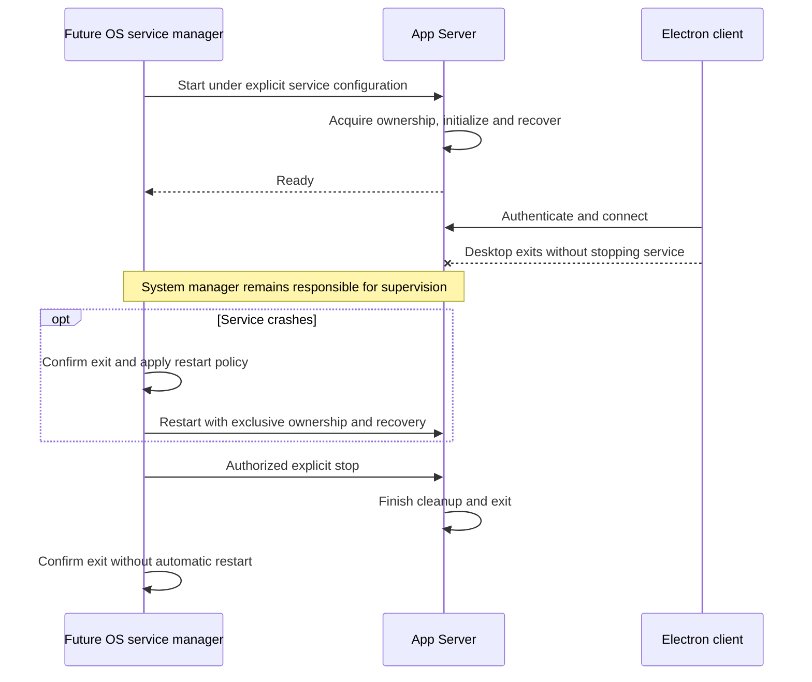

# Agent Note: 独立 App Server 与业务数据库管理职责

Status: proposed

[English](2026-11-11-app-server.md) | 中文

## 问题

Cherry 需要一个能独立于 Electron 启动的智能体服务，采用 Codex app-server 的架构模型。首版产品客户端是 Electron，通过协议访问服务。独立启动是服务端能力，不要求开发 CLI 客户端产品。

当前[会话宿主](../../../../src/main/ai/agentSession/AgentSessionRuntimeService.ts)和[数据库服务](../../../../src/main/data/db/DbService.ts)仍依赖 Electron 应用。只迁移运行时适配器，会让配置、业务数据持久化、审批处理和执行恢复继续依赖 Electron。

## 提案

### 1. 目标架构与决策状态

App Server 是 Cherry 可独立启动的后台服务。下表中的架构方向已在讨论中确认。本文仍是 proposed 提案：正式 Spec 审批、实施和独立运行验收尚未完成。

| 已确认决策 | 目标 |
| --- | --- |
| 进程 | Bun + Elysia App Server 无需 Electron 即可启动。Electron 成为客户端和桌面能力提供方。 |
| 数据 | App Server 拥有整个业务 SQLite 及数据服务，保留已有数据和已发布迁移链。 |
| 执行 | 会话协调组件 Host 与运行时适配器初期留在 App Server 进程内，原生后端可以使用受管理的子进程。 |
| 生命周期 | 两个进程各自拥有生命周期容器。Electron 发现或启动 App Server 后建立连接；桌面退出只断开客户端连接，停止服务是单独授权的操作。 |

将现有 [Gateway 应用](../../../../src/main/features/apiGateway/app.ts)扩展为 App Server 的 HTTP 和 WebSocket 服务，复用路由组合、协议转换、流式响应和远程访问入口。Gateway 模型协议路由是 App Server 的一个模块，与业务数据 API 和智能体 API 共存。

服务自行负责入口、配置加载、日志、路径、资源清理和恢复。先读第 1–3 节，了解进程架构、客户端通信和生命周期；第 4–6 节说明资源归属、迁移顺序与待定事项，第 7 节保留源码核对依据。本机 WS、进程启动和启动信息传递 API、凭证适配器、等待时间及数据库驱动选型仍需验证。首版支持桌面退出后服务继续运行；将服务注册到操作系统、登录时自动启动及系统崩溃监督留到最后的 daemon 章节。

本文用 profile 指一套用户数据目录。Host 是协调智能体会话的组件，负责决定是否接受输入、处理审批和恢复执行。运行时适配器负责连接原生执行后端。

### 2. 进程边界与客户端 API

以下图示描述目标部署。本机连接主要服务于 Electron main，Renderer 继续通过 preload 桥调用。将 DataApi 接入 WS 不等于向远程设备开放通用数据 API。

#### 本机 Electron 连接

`preload` 运行于 Renderer 进程的隔离上下文中，不是另一个进程。Renderer 保留 DataApi 调用接口和 hooks，通过 preload 暴露的受限接口调用服务。Electron main 验证 IPC 调用方，维护本机连接和凭证，将响应返回给发起请求的窗口，并按权限分发事件。不同窗口提供的请求 ID 不能发生冲突，也不能导致响应发送给错误的窗口。窗口和托盘命令由 Electron 本地处理。

App Server 负责运行 DataApi 请求处理器、业务服务、SQLite 数据库和智能体任务。运行时适配器留在该进程内；原生 CLI、本地通过标准输入输出通信的 MCP 服务和推理工作进程可以使用子进程，由 App Server 管理生命周期并保留各自协议。数据库图标表示存储，不是另一个进程。原生执行历史仍由对应运行时管理。

同一条本机 WebSocket 连接也可以传递桌面工具调用请求，并将执行结果返回 App Server。这些工具由 Electron main 注册，只有需要桌面进程执行时，main 才将调用转交给 Renderer 或其他 Electron 管理的进程。客户端断开后，它提供的桌面工具不可用。启动通道可以传递启动信息，但通道关闭不代表请求停止服务。业务 WebSocket 连接关闭时，仅撤销对应客户端的注册，不停止服务。

#### 三个入口，各自授权

三个入口框表示同一进程内的逻辑入口，不是三个服务进程。该图不要求共用一个监听器，也不固定端口分配方式。

| 连接 | 权限与范围 |
| --- | --- |
| Electron main 到本机应用 API 入口 | 本机 profile/实例认证，承载桌面 DataApi、Agent 及其他明确定义的业务操作，不要求远程设备配对。 |
| 配对设备到远程能力入口 | 保留现有设备身份和能力授权，仅开放经过授权的远程 API；Agent 授权不包含通用 DataApi 访问权。 |
| 外部模型客户端到公开模型入口 | 模型 API 凭证及兼容协议转发，不授予产品管理或桌面生命周期控制权。 |

本机 WebSocket 适配器和远程适配器可在各自授权范围内复用业务处理逻辑，但不能因此合并权限。两者都使用 WebSocket，不代表本机连接要沿用远程通道的配对流程或消息大小限制。本机消息大小限制、缓冲区限制和背压策略仍需确定；背压用于在接收方处理不及时的情况下控制发送速度。公开模型转发继续使用 HTTP/SSE，首版 Electron 接入不要求额外实现 HTTP DataApi 适配器。

公开模型和远程入口均为可选入口，关闭任一入口后，本机应用 API 继续运行；停止 App Server 是独立操作。凭证检查失败不能回退到其他权限范围。已有[内部 Gateway 凭证](../../../../src/main/features/apiGateway/middleware/auth.ts)授权模型调用方，不授予产品管理权限。

模型转发仍由调用方管理上下文和执行循环。Gateway 将工具调用返回给调用方，不在本地执行客户端工具，也不创建由 App Server 管理的智能体会话。智能体 API 单独负责接受会话请求、执行任务、持久化和恢复。AC7–AC9 分别验证服务生命周期、权限隔离和模型转发行为。

#### 一次桌面 DataApi 往返

该时序图展示一次成功调用。变更通知在事务提交后发送，采用尽力投递方式，不保证每次都能送达；是否收到通知不影响写入是否成功。接收方不能依赖通知和响应的到达顺序。重新连接后，客户端重新查询当前使用的数据，不能把数据通知当作可回放的智能体执行日志。

写入时连接断开，客户端可能无法确定写入结果。重试必须遵循明确的幂等性规则，不能仅更换传输请求 ID 后重新发送。窗口关闭后，main 清除该窗口对应的响应记录，但不能据此认定数据库已经回滚。

DataApi 的业务数据接口约定与传输方式无关，仍仅覆盖 SQLite 业务数据。Electron main 负责向窗口返回响应和发送通知，App Server 负责处理请求，并在提交事务后发布事件。桌面命令和执行命令即使共用本机 WebSocket 连接，也保留各自的接口约定。

#### 协议复用与尚缺的 API

评估 [remote-protocol](../../../../packages/remote-protocol/README.md) 和 [remote-transport](../../../../packages/remote-transport/README.md)，复用发送、取消、审批、命令回执、订阅、检查点和恢复机制。命令回执记录命令的处理状态；检查点用于恢复客户端对执行状态的订阅。

现有协议尚未覆盖配置、会话分支（fork）、编辑（edit）、Skills、MCP 管理、桌面能力注册及整个数据库的访问。需要扩展对应接口的 schema，具体方法名和包位置仍需确定。

用本机 WebSocket 适配器处理已有 DataApi 请求，不开放任意 Electron IPC 方法，也不为每项数据操作另外设计 RPC 协议。

#### 本机发现与认证

建议本机监听器显式绑定 `127.0.0.1`，由操作系统分配端口，再把实际端点和实例写入 profile 发现记录。[Bun 支持通过 `port: 0` 分配端口](https://bun.sh/docs/runtime/http/server)。首版优先采用一种跨平台传输，不以 Unix socket 或 Windows named pipe 为前置条件。

本机凭证使用随机值，并限定到特定 profile 和服务实例。通过仅所属操作系统用户可访问的启动通道或文件传递凭证，目录和文件也使用用户专属权限或 Windows ACL。凭证不得出现在 URL、命令行参数、日志或广播中。

监听本机回环地址不能代替身份认证。本机业务请求和控制请求都需要凭证；HTTP/WebSocket 接口必须检查 Host/Origin，拒绝未经允许的浏览器来源。这里的信任前提是操作系统能保护当前用户的文件和凭证，不保证隔离已经能读取该用户秘密信息的恶意进程。远程设备继续使用 Noise 身份验证，并按经过授权的能力调用接口。停止服务需要单独的管理权限，启动进程或订阅事件本身不授予该权限。

#### 版本协商与并发客户端

使用[已有协商机制](../../../../packages/remote-protocol/src/negotiation.ts)确定通信协议版本和可用功能，不能直接用软件包版本或应用版本代替协议版本。握手返回 profile 标识、服务实例标识、运行模式、就绪状态和支持的 API 功能。不兼容的客户端不能修改数据或触发迁移。服务重启后，与旧实例绑定的凭证及事件订阅游标失效；客户端重新查找服务、认证并读取状态快照。已持久化的命令标识在重启后仍然有效，不能给结果未知的任务换一个新 ID 后重新提交。

所有客户端的执行请求和持久化请求都由同一个 App Server 实例处理。服务根据已认证的调用方和命令标识检查重复请求；相同标识携带不同参数时，应报告冲突。调用方身份不能因为 token 轮换或连接重建而改变。Host 仍负责决定是否接受会话请求。处理审批响应时必须检查当前交互版本，同一次审批只能确定一次结果。

每个连接分别管理订阅、背压和桌面能力注册。处理缓慢或已经断开的连接不能阻塞其他客户端，也不能取消其他客户端的任务。保留已有事务和修改规则；如果覆盖写入会丢失其他客户端的修改，应报告版本冲突，不用一把全局互斥锁限制所有客户端。

### 3. 首版生命周期

Electron 和 App Server 分别拥有生命周期容器、服务注册表和服务实例。App Server 自行负责初始化、执行恢复、关闭和资源清理。首版中，Electron 正常退出或意外消失都不停止服务；不依赖桌面的工作及已开启的远程连接继续运行，离线桌面提供的能力则变为不可用。

#### 两个容器分别管理各自资源

Electron 容器管理窗口、菜单、托盘、快捷键、系统通知、Renderer IPC、桌面能力和 App Server 客户端。客户端负责认证连接、订阅和重新连接；其 `onStop()` 断开连接并释放本地资源，不请求关闭整个服务。

App Server 容器管理业务数据库及迁移、数据请求处理器、服务配置、提供商网络与 OAuth、智能体执行、MCP、任务调度，以及 HTTP/WebSocket 入口。它能在没有 Electron、没有客户端连接时独立初始化和关闭。集成测试直接启动其服务入口，不要求开发 CLI 客户端产品。

图中的节点表示职责分组，不指定新的服务类名。可以复用去除 Electron 依赖后的容器基础代码，但两个进程分别创建容器和注册表，不访问另一个进程的可变 application 单例。Electron 就绪、IPC 注册和应用退出事件留在桌面集成层，服务端使用自己的启动入口和进程终止处理流程。

`@DependsOn` 只描述同一进程内的服务依赖。桌面服务依赖本地的 App Server 客户端；服务是否就绪以及请求是否失败，通过跨进程协议判断。Electron 的 `WhenReady` 不表示 App Server 已就绪，服务端也不等待该 Electron 阶段。

#### 启动桌面、退出桌面与停止服务

Electron 启动时发现或启动服务，并建立连接。桌面可以先显示窗口，业务操作等待 App Server 就绪或报告不可用状态。关闭窗口或退出 Electron 只释放该桌面管理的资源。明确发起的停止服务操作需要单独授权，由服务端容器执行。

图中展示复用已有服务，以及稍后明确停止服务的过程。桌面退出不发送停止请求。Electron 可以提供管理操作入口，并在仍然运行时等待结果。明确停止服务期间，它保留控制连接及清理仍需要的桌面资源；客户端意外离线时，App Server 按下文的能力失效规则尽可能完成关闭。服务数据库和受管理的原生进程只能由服务自身的关闭流程结束。

#### 每个 profile 只能由一个服务实例管理

1. 从必要的启动配置中读取并规范化用户数据目录路径，读取本机服务发现信息。Electron 现有的应用单实例锁和 App Server 的 profile 独占锁分别解决桌面应用重复启动、业务数据被多个服务进程同时管理的问题。
2. 尝试与发现的服务完成认证握手，检查数据目录身份、协议兼容性、就绪状态和运行模式。端口监听或保存的 PID 都不足以证明这些事实。连接不会转移生命周期控制权。
3. 连接兼容且已就绪的服务。如果服务正在启动或关闭，等待该过程，不启动替代实例。连接失败不能证明原服务进程已经退出；任何新实例都必须先取得 profile 的独占管理权。
4. 如果没有服务实例管理该目录，启动独立的 Bun 服务入口。多个启动请求同时发生时，只允许一个实例取得独占管理权；其他启动方连接该实例，不能再创建一个打开业务数据库的服务实例。
5. 服务进程取得独占管理权后，才能处理未完成的备份恢复、执行数据库迁移、填充初始数据、访问数据库或恢复运行时状态。只有初始化和恢复完成、数据与执行状态一致后，才能报告就绪并开始接受任务。

初始化存储、凭证、网络客户端和运行时管理组件期间，不接受新任务。随后准备请求处理器，核对并恢复运行时、后台任务和消息投递状态。每个 API 或任务来源都要等自身依赖准备好后才能接受或提交任务；互不依赖的服务不必按固定顺序启动。

启动失败返回诊断及可重试的不可用状态。客户端不能自行打开 SQLite 绕过服务，也不能因连接失败反复启动替代进程。

#### 启动服务不决定服务的存续时间

Electron 的启动组件传入 profile 和启动实例标识，并查找已经就绪的服务。不能将 App Server 绑定到只能在 Electron 中运行的入口、桌面进程的资源清理范围，或关闭后自动终止服务的继承句柄。启动通道 EOF、普通 WS 连接关闭和父 PID 变化都不是全局关闭请求。保存的 PID 或 ping 超时也不能证明仍在运行的服务已经退出。

桌面退出后的服务运行不能依赖 Electron IPC、启动终端或桌面持有的标准流。进程脱离、stdin/stdout/stderr 和独立日志需要一起处理，单独调用 `unref()` 不足以保证这一点。参见 [Node 子进程脱离](https://nodejs.org/api/child_process.html#optionsdetached)。在每个支持平台验证打包后的 Node 到 Bun 启动，以及桌面正常退出和被强制终止的情况。这属于首版范围，不要求安装操作系统服务。

桌面提供经过认证的停止服务操作，与退出桌面分开。具体界面和协议方法仍需确定。建立连接或持有启动句柄不授予停止权限，服务必须检查管理凭证和目标实例。

#### 服务就绪与客户端连接状态分开

App Server 按存储初始化、执行状态恢复、开始接受任务三个阶段启动，通过协议报告就绪状态。该状态独立于桌面容器和任何单个客户端连接。

| 服务状态 | 可以接受的操作与资源管理要求 |
| --- | --- |
| 启动中 | 唯一的服务实例执行初始化和恢复。业务命令等待或收到明确的未就绪结果，不能同时启动第二个实例。 |
| 就绪 | 经过授权的客户端可以读取数据、提交工作和订阅。停止服务需要管理权限，服务的存续时间不由客户端数量决定。 |
| 正在关闭 | 停止接受新任务和普通数据修改，包括调度器和投递队列发起的任务。保留控制接口、状态查询，以及结束已接受任务所需的写入。 |
| 已停止 | 任务处理和资源清理已完成，进程退出已得到确认。替代实例仍必须先取得 profile 独占管理权。 |

客户端连接断开或协议不兼容时，服务进程可能仍在运行。新启动的服务有新的实例标识。客户端必须重新检查兼容性，从快照或检查点恢复当前状态，然后继续接收增量事件。重新连接不会提交新的执行回合，也不会触发服务启动时的恢复操作。

#### 客户端连接断开与桌面能力失效

服务按客户端连接管理桌面能力注册。正常断开连接时主动撤销注册；连接意外中断时，即使 Electron 无法发送清理请求，也要使这些注册失效。一个桌面离线不影响可独立执行的工作和其他客户端。明确停止整个服务时，才关闭所有客户端连接，并完成运行中任务的取消和清理。

浏览器工具或其他桌面工具与其客户端失去连接时，服务返回明确的工具不可用结果。如果审批或用户输入的等待策略允许继续等待，则保留等待状态，否则明确报告失败。界面关闭不代表用户同意操作，重新连接也不能自动再次执行被中断的桌面工具。

智能体订阅只用于接收执行状态，断开订阅不取消任务。普通 Gateway 模型生成请求仍由调用方控制取消，其请求取消规则保持不变。两类请求不能共用一种连接断开处理方式。

#### 停止服务前必须完成任务处理和资源清理

经过授权的停止服务操作作用于负责该 profile 的 App Server，而不是单个客户端连接。明确停止服务或协调服务维护时使用该操作，Electron 退出和普通客户端断开都不使用。重复请求停止服务时，应等待同一次关闭流程，不重复执行清理。在平台支持的情况下，服务收到进程终止请求后也执行相同流程；进程崩溃时不能保证完成清理。

1. 原子地将服务状态改为正在关闭，并停止接受新任务，避免状态切换后仍接收任务。拒绝智能体 API、Gateway 请求、调度器、Channels 和投递队列提交的新任务，保留此前已接受的任务及其记录。
2. 通过负责原生运行时的组件请求取消任务。在规定的关闭时间内，结束正在处理的工具调用、审批和消息投递，并记录处理结果。发布中断或取消状态，不能将被中断的任务标为成功。
3. 确认受管理的原生进程已经退出、相关资源已经释放，再保存最终业务状态、发送变更通知并关闭网络监听。必须等所有写入和回调处理结束后，才能关闭数据库和日志。
4. 清理结束后才释放 profile 独占管理权。由启动器或负责监控生命周期的进程确认服务进程已退出；服务自身不能在响应中证明自己已经退出。如果不能确认原生资源已释放，应报告关闭未完成，并阻止替代实例重新打开这些资源。

停止服务的响应必须区分“已接受关闭请求”和“已确认进程退出”。请求超时、socket 关闭或网络监听停止，都不能证明清理完成或进程已经退出。强制终止是最后手段，必须记录为异常退出，并在再次启动时恢复状态；外部操作的结果如果未知，不能据此认定可以安全地重新执行。

当前[生命周期超时处理](../../../../src/main/core/lifecycle/LifecycleManager.ts)可能只停止等待，清理操作仍在继续。即使超过截止时间，也不能关闭仍有写入操作的 SQLite，或启动使用相同资源的替代运行时。异常退出后，新服务必须先取得 profile 独占管理权，并检查原生进程是否仍在运行、是否仍占用资源，才能复用资源或接受可能与其冲突的任务。

#### 执行恢复属于服务重启

App Server 在启动时负责恢复执行状态和清理崩溃遗留状态。Electron 重启不能把服务仍在执行的任务判为崩溃遗留任务，不能擅自结束其 pending 消息状态，也不能丢弃恢复信息。当前 Host 在启动时检查并恢复状态、关闭时取消任务的职责，一并迁入 App Server。

App Server 崩溃后，客户端进入连接断开状态，不能通过备用数据库连接写入。重启后的服务在取得 profile 独占管理权后，核对命令回执、原生执行历史和仍在运行的原生进程，完成状态恢复后才能接受替代任务。执行框架必须有足够记录证明任务可以恢复；已接受的命令或工具调用如果结果未知，不能自动重新执行。

#### 一个重启协调方

Electron 仍在运行时，由其服务启动组件统一协调崩溃后的服务重启。必须先确认旧进程已退出，再按有上限的退避策略安排重试。对于无法通过重试解决的配置、数据库迁移或凭证错误，应停止重试。这项恢复职责不要求在 Electron 退出时停止服务。普通客户端不能分别启动服务恢复循环，造成重复进程。明确停止服务时，启动组件也停止自动恢复，不能将主动关闭当作崩溃并立即重新启动。Electron 退出后如果服务发生崩溃，可以保持停止状态，等待下一次桌面启动或明确的恢复操作。

如果用户已开启桌面应用的登录时自动启动功能，仍启动 Electron，并通过相同流程发现或启动 App Server。首版不注册独立的登录服务或系统监督器。

#### 更新、恢复与目录迁移

兼容的桌面单独更新只断开并重新连接，不停止 App Server。同时更新服务端或发现协议不兼容时，需要明确协调服务维护，桌面不能静默终止正在运行的服务或强制 schema 降级。

运行中的服务代码、原生可执行文件和其他资源来自完整且按版本保留的安装目录，Electron 更新不能覆盖或删除正在使用的文件。更新 App Server 时，执行相同的维护和关闭流程，等旧服务完成清理并退出后，再由新版本取得 profile 独占管理权。新版本完成受支持的数据库前向迁移后才能报告就绪。其他客户端接收服务状态变化并重新握手。更新可能中断任务，客户端需要显示中断状态，并在重新连接后读取当前状态、恢复订阅。

数据库恢复和用户数据目录迁移由 App Server 协调。替换文件或更换目录前，所有相关组件必须停止写入，并等待已开始的写入结束。操作整个用户数据目录时，还要让 Electron 释放 Chromium 和桌面文件句柄。现有[备份恢复启动检查](../../../../src/main/core/preboot/backupRestoreGate.ts)和[目录迁移执行](../../../../src/main/services/userDataRelocation/execution.ts)不能仅因为 Electron 重启，就替换 App Server 仍在使用的文件。正常打开数据库前，必须先处理未完成的维护操作记录，并取得新目录的独占管理权。

### 4. 服务职责与存储管理

| App Server | Electron 客户端 |
| --- | --- |
| 业务 SQLite、数据服务、事务、变更通知和恢复 | 服务 API 调用、变更订阅和 UI 更新 |
| 智能体执行、运行时适配器、执行状态发布和审批状态管理 | 执行状态展示及用户决策收集 |
| 独立启动、运行配置和资源生命周期 | 窗口、托盘和系统集成 |
| 工具访问和执行策略 | 包含浏览器能力的可选桌面工具 |

桌面工具是可选连接。没有 Electron 时，App Server 仍能启动并使用自身可用的能力。客户端未连接不授予额外工具权限，执行服务负责应用审批策略。

#### 后台调用与资源依赖

与前面的进程图不同，下图表示调用方及其依赖的资源。箭头从调用方指向依赖，虚线表示可选桌面能力。分组节点表示职责，不是新建服务类，也不是对 `@DependsOn` 的逐项替换。

#### 会话协调组件 Host、运行时适配器与原生后端

将 `AgentSessionRuntimeService` 中面向执行的部分及受支持的运行时适配器迁入 App Server。App Server 负责接受用户输入、记录消息投递、发布执行状态、处理审批和恢复任务。客户端适配器负责窗口订阅、Electron IPC 广播及用于 UI 展示的数据。

Host 与运行时适配器初期留在同一服务进程。客户端协议传递会话命令、回合命令、执行事件和用户交互结果。迁移时必须保留现有行为：同步判断是否接受输入，并维持 steer 输入与对应执行之间的关联。

原生任务执行、输入队列、子任务调度、上下文和历史记录继续由各自执行框架管理，遵循[执行框架边界](2026-10-17-agent-harness-boundaries.md)。迁入 App Server 后，不增加第二套原生任务调度器，也不把原生存储转交给业务数据库。[运行时契约](2026-10-17-agent-runtime-contract.md)定义的适配器接口和产品上下文规则继续有效。

#### 由 App Server 统一管理业务 SQLite 数据库

App Server 是访问整个业务 SQLite 数据库的唯一服务。它负责数据库连接、schema 迁移、初始数据填充、数据服务、跨表事务、变更通知及数据库备份和恢复。DataApi 操作和基于 SQLite 的 Preference 持久化一并迁入该服务。Electron 通过服务 API 读写业务数据，并订阅变更。

外键关系本身不要求迁移所有表。本方案选择由一个服务统一管理业务数据库，是为了保留跨表事务、级联删除、文件引用管理和备份恢复的一致性。因此迁移范围包括 Cherry 的公共数据后端，不仅是智能体运行时目录。

优先沿用已有数据库文件、数据库结构（schema）、外键和迁移链。已有用户数据必须能继续使用。已发布的数据库迁移文件保持不变；需要调整数据库结构时，按现有规则追加迁移文件。

继续使用 SQLite 和 Drizzle。当前连接使用 `better-sqlite3`，必须在选定的 Bun 版本下验证，不能假定 Node 原生模块可以直接使用。如果需要更换驱动，可以评估 Bun 的 `bun:sqlite` 和 Drizzle 的 `bun-sqlite` 适配器。必须保留同步事务、外键、数据库迁移、全文搜索（FTS）、自定义函数与扩展、WAL checkpoint，以及备份和恢复功能。更换驱动不意味着重写数据库结构。

#### BootConfig、Cache、文件与原生执行历史

[路径注册表](../../../../src/main/core/paths/README.md)继续作为统一访问机制，App Server 使用显式 profile 根目录初始化，不依赖 Electron `app.getPath()`。初期保留物理数据位置，变更进程归属不要求搬动全部文件。独立服务入口接收显式指定的已有 profile，不能仅因其可执行文件与 Electron 不同就推导出另一个数据根目录。

| 数据类型 | 负责管理的进程及迁移要求 |
| --- | --- |
| 桌面 BootConfig | Chromium 加速和调试开关、桌面应用选择哪个 profile 的配置留在 Electron。公共 `BootConfig.*` 设置请求交给 Electron 处理；基于 SQLite 的 Preference 设置请求交给 App Server 处理。 |
| 服务启动配置与 profile 发现 | App Server 在 SQLite 之外维护必要的 profile、监听地址和启动信息，其中不包含凭证。客户端读取服务发现记录，仅当前负责该 profile 的 App Server 实例可以更新记录。两个进程不能同时重写同一份 `boot-config.json`。 |
| 目录迁移和恢复操作记录 | 负责维护操作的组件协调 App Server 和 Electron 释放文件句柄。必须明确处理或迁移已有 `temp.user_data_relocation` 记录，不能将其复制到普通偏好、备份或其他机器的启动配置中。 |
| 内存与共享 Cache | 运行时、MCP、Channel 和后台任务的进度缓存随生成它们的服务组件迁移；窗口和 UI 状态留在客户端。客户端只能订阅权限范围内的快照和事件，不开放任意缓存 key 写入接口。丢失缓存不能丢失命令回执、审批或执行历史。 |
| 持久 Cache | 在切换期间暂停写入，按 key 将缓存拆到由各进程分别管理的文件。Skill 目录和自动备份的历史基准状态随使用它们的服务迁移，`window.bounds` 和 `browser.favicons` 留在 Electron。Renderer localStorage 留在客户端，两个进程不能修改对方的缓存文件。 |
| 原生执行历史与工作区 | 执行框架继续管理原有历史格式、凭证和恢复规则；App Server 负责启动框架并传入对应路径。保留原生 ID、工作区路径、Pi session 文件及外部 CLI 配置，不把原生执行历史转换成产品消息表记录，也不删除外部工具管理的路径。 |
| 托管附件、skills、索引及临时上传 | 数据库引用、关联任务及管理这些文件的服务一起迁移。重启和恢复后，持久化元数据必须与实际文件一致，只迁移 SQLite 不足以满足这一要求。 |

按实际 [BootConfig 字段](../../../../src/shared/data/bootConfig/bootConfigSchemas.ts)和 [Cache schema](../../../../src/shared/data/cache/cacheSchemas.ts)决定每项配置或缓存由哪个进程管理，不能仅按现有类名拆分。迁移持久化条目时，保留 TTL、过期规则，以及重启后计算调度时间所需的历史状态。拆分文件时记录迁移进度，以便中断后恢复，并同步禁止原有组件继续写入。原子 rename 只能保证重命名本身的原子性，不能防止两个进程各自重写完整文件时覆盖对方的更新。

#### 提供商网络与代理策略

将 Provider 请求、token 交换及刷新、MCP 网络连接和 Gateway 上游请求迁入 App Server。当前[提供商 fetch](../../../../src/main/ai/utils/customFetch.ts)、[PKCE 客户端](../../../../src/main/services/oauth/runtime/PkceOAuthClient.ts)及[代理服务](../../../../src/main/services/proxy/ProxyService.ts)依赖 Electron 网络。分开代理策略与 Chromium 应用：服务自行处理代理、绕过规则、TLS、请求头、重定向、取消及流式行为，Electron 将同一份已存偏好应用到浏览器 session。原生子进程的代理环境来自服务配置，不能偶然继承桌面环境。

只有满足现有网络行为要求时，才使用 [Bun 的 fetch 代理支持](https://bun.sh/docs/runtime/networking/fetch)。需要在选定的运行时版本下验证 HTTP/HTTPS/SOCKS 代理、系统代理和 PAC、代理绕过规则的优先级、自定义证书及原生 SDK 行为。配置 Node 全局 dispatcher 不代表 Bun fetch 会遵循该配置。遇到不支持的代理方式必须明确报错，不能自行改为直接连接。本机控制请求不经过模型请求使用的代理。只有通过实际网络请求验证 User-Agent 请求头符合要求后，才能移除针对 Chromium 的兼容处理。

#### OAuth 由服务处理，客户端展示授权流程

保留当前 [OAuth 认证流程之间的边界](../../../../src/main/services/oauth/runtime/README.md)。提供商 OAuth token 仍保存在 provider 表的对应行中；同一凭证的并发刷新合并为一次刷新（single-flight），并保留原有条件写入规则。MCP 仍通过 SDK 授权，按 MCP 服务分别存储凭证；Copilot 仍使用设备码流程。App Server 负责 state、PKCE、回调监听、token 交换、刷新和退出登录。Electron 展示授权 URL 或设备码，并接收授权结果；token 交换和刷新由服务独立完成。

浏览器回调指向 App Server 所在机器。远程客户端不能假设它自己的 localhost 就是 App Server，也不能自行交换 token。保留提供商允许的重定向流程；如果授权必须使用服务所在机器的浏览器，应明确告知用户。桌面弹窗获得 API key 后，通过经过认证的凭证修改接口提交给服务，不能由该弹窗持续负责刷新凭证。

#### 已有安全凭证存储与凭证导入

先将现有凭证存储交给 App Server 管理，再考虑统一凭证库或重新设计 token schema。SQLite 中的提供商凭证随数据库迁移。[MCP 加密文件](../../../../src/main/ai/mcp/oauth/storage.ts)、[Copilot token](../../../../src/main/services/CopilotService.ts)及[远程设备身份](../../../../src/main/services/remoteAccess/deviceIdentity.ts)需要替换 Electron `safeStorage`。在选定运行时版本下，评估基于操作系统安全存储的适配器，包括 [Bun.secrets](https://bun.sh/docs/runtime/secrets)。该 API 仍是实验性功能，Linux 需要可用的 Secret Service。不能假设它能解密已有 Electron 密文，或能在所有无人值守登录环境下使用。

通过一次性、经过认证的迁移流程，将旧 Electron 解密器读取的凭证导入 App Server 管理的新存储。确认导入值正确且迁移记录已经持久化后，才能禁止旧组件继续写入。中断的导入可以重试，临时文件和日志都不能包含明文凭证。

无法解密时保留原数据，并说明用户需要解锁、导入凭证还是重新授权。不能重新生成远程设备身份，也不能把原来受保护的凭证自动改为明文存储。通过部署配置显式提供凭证以支持无界面运行，是另一种部署方式。包括 [Cherry 账号凭证](../../../../src/main/services/cherryCloud/CherryAccountCredentialStore.ts)在内的其他凭证，保留各自业务流程和存储规则，随使用它们的后台组件迁移，不将无关账号流程合并到提供商 OAuth 中。

#### Channels、Jobs、投递与 heartbeat

将 [SchedulerService](../../../../src/main/core/scheduler/README.md)、[JobManager](../../../../src/main/core/job/README.md)、所有访问业务数据库的任务处理器、智能体消息投递、[AgentJobsService](../../../../src/main/ai/agents/AgentJobsService.ts) 和 [ChannelManager](../../../../src/main/ai/channels/ChannelManager.ts) 一并交给 App Server 管理。这包括备份和知识库任务，不只包括智能体任务。需要桌面执行的操作改为调用 Electron 注册的桌面能力。Electron 不再保留另一套向相同任务表写入的调度器；对 WindowManager/NotificationService 的调用改为向客户端发送事件。

从 Electron PowerService 中分开 [RuntimeActivityService](../../../../src/main/core/application/RuntimeActivityService.ts)：执行活动统计归服务，阻止休眠和系统唤醒检测需要可独立使用的平台适配器。独立执行不能依赖 Electron 电源事件。

先暂停任务分发并准备全部任务处理器，再恢复运行时和后台任务记录，初始化消息发送功能，最后开始接收 Channel 消息并启用调度。Heartbeat 仍是智能体任务，保留现有调度标识和原生上下文，不改为维持进程存活的定时器。保留 JobManager 为每个处理器定义的恢复规则，以及错过计划执行时间后的处理规则。

当前 Jobs 恢复和 heartbeat 修复的 60 秒时间窗口属于后台调度策略，不能因此让本机握手等待一分钟。服务需要报告恢复进度；相关任务在状态核对和恢复完成前不能开始执行。关闭服务时，先停止所有入口提交新任务，再在存储和其他依赖仍可用时，完成已接受任务与消息投递的取消、结果记录和清理。

### 5. 迁移顺序与验收证据

先列出各项数据和资源由哪个进程管理，再使用包含已有数据的隔离 profile 验证兼容性，最后按下面的实施阶段迁移。优先验证数据库及其扩展、独立工作进程和旧凭证导入。

#### 四个工作领域，共用一份资源管理清单

维护一份迁移清单，分为以下四个工作领域。每项问题归入相应领域，并记录它依赖其他领域完成的工作。

| 工作领域 | 要解决的问题 | 涉及范围 |
| --- | --- | --- |
| 服务启动与运行 | 服务如何独立启动、连接、停止和发行？ | 入口、生命周期、协议、认证、profile 所有权、日志、打包和更新 |
| 数据归属 | 哪个进程拥有每项持久资源？ | 业务 SQLite、每库知识索引、文件、凭证、BootConfig、Cache、备份、恢复及首次切换/回退 |
| 执行能力 | 哪些任务能在没有 Electron 时运行？ | 提供商网络、OAuth、Host、运行时适配器、MCP、独立工作进程、Channels、Jobs 和 heartbeat |
| 客户端接入 | 桌面及其他客户端如何调用服务？ | 客户端调用接口、订阅、审批、文件和媒体传输、桌面能力、连接断开与重新连接 |

当前需要完成的是资源管理清单。按下表记录模块和资源；各行仅作为填写示例，不代表已经完成检查。

| 模块或资源 | 当前管理进程 | 目标管理进程 | 迁移问题 | 验收证据 |
| --- | --- | --- | --- | --- |
| 业务数据库 | Electron | App Server | 应用容器、迁移、通知和维护依赖 | 已有数据及跨表事务仍可用；Electron 不打开业务数据库 |
| 本地推理工作进程 | Electron utility process | App Server 管理的独立工作进程；具体运行时待验证 | 启动协议、原生库和资源路径 | 无需 Electron 即可完成本地推理 |
| 文件监听与编辑 | Electron 窗口绑定资源 | 绑定客户端会话的服务资源 | 窗口和 WebContents 身份依赖 | 并发客户端隔离，断线释放资源，重新连接重建资源 |
| 窗口与托盘 | Electron | Electron | 将后台访问替换为客户端调用 | 现有桌面交互仍可用 |

完成清单时，必须能说明每项持久化数据和长期占用的资源由哪个进程或组件管理、为何保留某项依赖，以及哪些用户可见行为会发生变化。新发现统一补入这份清单。改变默认后台行为、权限、数据兼容性或功能可用性时，需要明确决策；实现方式则通过源码分析和验证确定。

#### 第一次独立运行演示

第一个可演示里程碑组合 AC1–AC3：集成测试在没有 Electron 时直接启动 App Server，通过服务 API 读取已有数据，完成一次带工具调用和审批的智能体执行，并在服务重启后读取持久化历史。这验证服务的独立运行能力，不替代其余验收标准。

#### 五个实施阶段及其验收条件

以下阶段用于安排实现顺序，不能据此允许两个服务实例同时管理同一业务数据库。切换后，由 App Server 独占管理该 profile 的业务数据。尚未完成迁移的桌面调用必须继续迁移或明确标为不可用，不能改回直接访问 Electron 内的数据库。

1. 使用包含已有数据的隔离 profile，验证 Bun 与 SQLite、数据库迁移、原生运行时、网络和凭证导入的兼容性。确定数据根目录和资源管理清单，完成本机握手、两个进程的独立容器、独立服务入口、标准流和日志，以及经过授权的停止服务操作。验收条件：并发启动只产生一个服务，Electron 正常或强制退出后独立工作继续，明确停止服务时不依赖 Electron 业务服务即可完成清理。
2. 将整个数据库、数据 API、Preference 持久化、保存在文件中的业务状态，以及相关后台任务和处理器一起迁入 App Server。迁移期间暂停自动提交任务的组件。添加 Electron 客户端调用接口，将桌面配置和缓存拆分到 Electron 管理的存储中。验收条件：已有数据和跨表事务保持可用，中断的文件或凭证导入可以恢复，Electron 不打开业务数据库连接。
3. 迁移提供商网络和认证、MCP、Host、原生运行时适配器，以及用户主动发起的任务执行。Gateway 模型转发与业务操作继续使用各自权限。验收条件：集成测试在没有 Electron 时调用服务 API，完成模型调用、工具执行、审批、取消、凭证刷新和历史恢复；两个已认证连接能接收同一次任务执行的状态。
4. 状态恢复完成后，启用消息投递和 Channels，再按现有规则启用 Jobs 调度和 heartbeat。验收条件：服务接受 Channel 消息或定时任务后发生重启时，不重新执行结果未知的外部操作，并明确显示结果未知的状态；暂停或恢复备份时，所有任务来源都停止提交新任务；直接启动的服务无需 Electron 即可调度任务。
5. 完成桌面切换、桌面及可独立启动的服务打包，以及更新和维护协调。验收条件：在支持平台上通过打包后的正常/强制退出、凭证锁定时启动、兼容/不兼容升级及恢复/目录迁移验证。Daemon 发行、登录时自动启动和系统监督留在最后一章的后续范围。

### 6. 待定设计与建议等待时间

- 固定的 Bun 与 Elysia 版本、包边界、具体启动/控制 API、发行方式和数据库驱动兼容性结果。
- 接口数据结构定义、本机凭证和访问控制列表（ACL）的实现，以及支持的客户端与服务端通信协议版本兼容表。
- 各系统的进程脱离与标准流、安全凭证存储、代理/PAC、电源和重启协调；桌面的停止服务界面及管理协议；通过打包进程验证建议等待时间。
- 每个配置项和文件的管理职责清单、记录未完成切换的日志，以及原生运行时和文件备份的一致性流程。
- 正式 Spec 审批，以及通过实际启动进程验证各迁移阶段的记录。本提案不代表实现已经完成。

下列时间是初始工程建议值，不是实测保证：

| 操作 | 建议时间限制 |
| --- | --- |
| 本机握手 | 5 秒 |
| 普通启动 | 30 秒后报告延迟状态 |
| 优雅关闭 | 共用一个 30 秒截止时间 |
| 管理操作调用方等待明确停止服务的结果 | 35 秒，包括传输和等待进程退出的时间 |

启动时间超过预期时，只报告延迟和迁移进度，不能终止正在迁移的进程或再启动一个服务实例。上述关闭时间用于明确停止服务，不用于普通桌面退出。服务关闭时间参考当前[应用 30 秒上限](../../../../src/main/core/lifecycle/constants.ts)，所有服务共用该时间限制，不给每个服务分别分配 30 秒。超时后报告关闭未完成；如果最终必须强制终止，应先核实目标服务实例和进程身份，并记录异常退出。

### 7. 源码核对基线与现有耦合

最初调研基于 `3942cd2f700082745a80b94a78f3667db2d81887`。本记录于 2026-11-11 对照 `origin/main` 的 `091fa886ef50b9e856c56cbfec83ee66f1aa747e` 完成适配。

上游现已包含可移植运行时包，包括 `agent-runtime`、`agent-runtime-pi`、`agent-runtime-pi-durable`、`agent-runtime-claude-code` 和 `agent-runtime-acp`。桌面[驱动注册表](../../../../src/main/ai/runtime/registerDrivers.ts)注册 Claude Code、Pi 和 Pi Durable。早先的 DSH 清单描述旧调研基线，不代表当前运行时集合。包提取本身不能证明 Cherry 已有可独立启动的服务。

#### 当前由 Electron 管理的服务

下表是选定范围的源码清单，不是完整依赖图。所列服务仍由 Electron 应用容器管理。声明依赖决定同阶段的初始化顺序，跨阶段顺序和普通运行时调用是不同关系。

| 当前组件 | 启动关系或 Electron 依赖 |
| --- | --- |
| [DbService](../../../../src/main/data/db/DbService.ts)、[PreferenceService](../../../../src/main/data/PreferenceService.ts)、[DataApiService](../../../../src/main/data/DataApiService.ts) | 均属于 BeforeReady。PreferenceService 和 DataApiService 声明依赖 DbService。 |
| [AgentSessionRuntimeService](../../../../src/main/ai/agentSession/AgentSessionRuntimeService.ts) | 属于 WhenReady。声明依赖 ClaudeCodeProcessManager、ClaudeCodeWarmQueryManager、AutomationReplService 和 RuntimeActivityService。运行时代码还访问 WindowManager。 |
| [AgentSessionDeliveryService](../../../../src/main/ai/agentSession/AgentSessionDeliveryService.ts) | 属于 WhenReady。依赖 AgentSessionRuntimeService 和 AiStreamManager。 |
| [ApiGatewayService](../../../../src/main/features/apiGateway/ApiGatewayService.ts) 和 [RemoteAccessService](../../../../src/main/services/remoteAccess/RemoteAccessService.ts) | Gateway 声明依赖 RemoteAccessService。RemoteAccessService 依赖运行时及文件服务，并在运行时查询 Gateway 端点。这个反向调用不是反向启动依赖。 |
| [AgentJobsService](../../../../src/main/ai/agents/AgentJobsService.ts) 和 [JobManager](../../../../src/main/core/job/JobManager.ts) | AgentJobsService 依赖 JobManager 和 NotificationService。JobManager 依赖 SchedulerService 和 RuntimeActivityService。 |
| [ChannelManager](../../../../src/main/ai/channels/ChannelManager.ts) | 依赖 WindowManager、FileManager 和 PowerService。 |
| [McpRuntimeService](../../../../src/main/ai/mcp/McpRuntimeService.ts) | 依赖 WindowManager、McpPackageService 和 BrowserSessionService。 |
| [KnowledgeService](../../../../src/main/features/knowledge/KnowledgeService.ts) | 依赖 KnowledgeVectorStoreService、JobManager、FileProcessingService 和 WebSearchService。 |
| [InferenceServiceBase](../../../../src/main/ai/localModel/runtime/InferenceServiceBase.ts) | 本地推理服务继承对 Electron UtilityProcessManager 的依赖。 |

[Application.bootstrap](../../../../src/main/core/application/Application.ts) 启动 Background 阶段的服务，等待 BeforeReady 阶段和 Electron 就绪，再启动 WhenReady 阶段。[LifecycleManager](../../../../src/main/core/lifecycle/LifecycleManager.ts) 按初始化的相反顺序发起关闭。超时只限制等待时间，不能证明清理已经完成。独立服务必须确认所有相关任务和资源清理完成后，才能关闭存储。

Electron 的 `UtilityProcessManager` 需要 Electron 父进程，不能提供独立服务入口。现有[应用关闭](../../../../src/main/core/application/Application.ts)、[运行时停止](../../../../src/main/ai/agentSession/AgentSessionRuntimeService.ts)和[远程访问停止](../../../../src/main/services/remoteAccess/RemoteAccessService.ts)调用链需要分开，Electron 不再关闭服务数据库或执行服务恢复。

#### Gateway 与 DataApi 的迁移起点

当前应用使用 `@elysia/node`，[服务端](../../../../src/main/features/apiGateway/server.ts)和[远程 WebSocket 路由](../../../../src/main/features/apiGateway/routes/remote.ts)依赖 Node 特有的监听和 socket 行为。将监听器和 WebSocket 连接实现迁移到 Bun 时，必须保留二进制传输、背压、流式请求取消及关闭完成确认机制。只更换适配器，不能消除路由对 Electron 应用服务的依赖。

迁移涉及现有 [preload 接口](../../../../src/preload/preload.ts)、[Renderer DataApi 客户端](../../../../src/renderer/data/DataApiService.ts)、[IPC 适配器](../../../../src/main/data/api/core/adapters/IpcAdapter.ts) 和 [ApiServer](../../../../src/main/data/api/core/ApiServer.ts)。目前协调请求和处理请求的代码仍在 Electron main 中运行，[变更通知](../../../../src/main/data/dataApiDataChange.ts)也直接通过 WindowManager 广播。

#### 共享数据库实体与事务

当前数据模型共享实体和一致性约束：

| 关联 | 源码 |
| --- | --- |
| 智能体、普通消息和智能体消息引用 `user_model`，模型引用提供商 | [Agent](../../../../src/main/data/db/schemas/agent.ts)、[Message](../../../../src/main/data/db/schemas/message.ts)、[Agent Session Message](../../../../src/main/data/db/schemas/agentSessionMessage.ts)、[User Model](../../../../src/main/data/db/schemas/userModel.ts) |
| 智能体与助手使用公共 MCP 和知识库实体 | [Assistant Relations](../../../../src/main/data/db/schemas/assistantRelations.ts) |
| 智能体附件与其他功能共用 `file_entry` | [File Relations](../../../../src/main/data/db/schemas/fileRelations.ts) |
| 智能体会话和频道引用任务计划 | [Agent Session](../../../../src/main/data/db/schemas/agentSession.ts)、[Agent Channel](../../../../src/main/data/db/schemas/agentChannel.ts) |
| 数据服务在同一连接和事务中组合写入 | [DbService](../../../../src/main/data/db/DbService.ts)、[AgentService](../../../../src/main/data/services/AgentService.ts)、[事务契约](../../../../docs/dev/references/data/database-patterns.md#write-serialization-dbservicewithwritetx) |

## 考虑过的替代方案

- 只迁移运行时适配器或智能体表，会让公共配置、持久化和恢复继续依赖 Electron。拆分公共表还需要用协调协议替代已有跨表一致性。
- 使用 Electron utility process 可以隔离子进程，但仍需 Electron 才能启动服务。
- 在 Gateway 之外再建一套 HTTP 框架会重复路由组合和传输基础设施。演进现有 Elysia 入口可以让这些职责保持统一。
- 让 Electron 和 App Server 分别管理同一业务数据库，会让事务、通知、数据库迁移和维护操作各有两套控制逻辑，无法保证由同一服务统一处理。
- 在 Host 与每个运行时适配器之间引入客户端协议，会使内部输入处理和执行关联也需要经过序列化。初期只在客户端与产品会话 API 之间使用跨进程协议。
- 将服务存续时间绑定到 Electron 退出或父进程控制管道 EOF，可以简化子进程清理，但会中断独立任务和远程客户端。因此首版将客户端清理与经过授权的停止服务操作分开。操作系统监督是后续部署方式，不是生命周期解耦的前提。

## 验收标准

以下标准覆盖首版：独立的进程容器、可独立启动的服务、桌面退出后服务继续运行，以及明确停止服务。不包含 CLI 客户端产品或由操作系统管理的 daemon 安装。

- AC1 — 没有 Electron 时，Elysia App Server 在 Bun 上运行，集成测试通过服务 API 创建会话、发送输入、调用真实模型、执行本地工具并接收流式输出。 (verification: real-process integration — 实施者)
- AC2 — 客户端能回答审批请求并取消执行，服务按决策执行并持久化终态，不因客户端未连接而授予权限。 (verification: real-process integration — 实施者)
- AC3 — 服务重启后，客户端能读取持久化历史并恢复受支持的原生上下文，已有业务数据库仍可使用。 (verification: migrated SQLite and native-runtime integration — 实施者)
- AC4 — Electron 重启不会对 App Server 仍在执行的任务进行崩溃恢复处理，不会丢弃恢复信息，也不会因为重新连接而重复执行任务。 (verification: Electron and real-process integration — 实施者)
- AC5 — 桌面通过服务 API 读写业务数据，保留公共模型和文件引用约束以及跨表事务的原子性。数据库迁移、初始数据填充、变更通知、备份和恢复均由 App Server 统一管理。 (verification: migrated SQLite integration and architecture boundary checks — 实施者)
- AC6 — 现有 Gateway 协议响应、流式传输、二进制远程访问、背压、取消和关闭完成确认机制，在选定的 Bun 版本下正常工作。数据库驱动必须通过已有数据迁移、事务、FTS、自定义函数与扩展、WAL checkpoint 及备份恢复验证，不能仅根据框架宣称支持就认定兼容。 (verification: real-process protocol and migrated SQLite integration — 实施者)
- AC7 — 执行过程中关闭公开 Gateway 后，本机业务数据查询和修改及智能体执行仍可用，服务关闭是独立操作。 (verification: real-process lifecycle integration — 实施者)
- AC8 — 公开模型 API 凭证不能管理业务数据或控制智能体执行。某类凭证或授权检查失败后，不能转而使用另一类权限放行请求；各类接口中获得授权的操作仍能成功。 (verification: real-process authorization integration — 实施者)
- AC9 — 模型转发仍由调用方管理上下文和执行循环，不在本地执行客户端工具或创建由 App Server 管理的智能体会话。创建和执行智能体会话必须使用对应的智能体 API。 (verification: real-process forwarding and Agent integration — 实施者)
- AC10 — Electron 正常退出、被强制终止或最后一个客户端断开后，同一 App Server 实例、可独立执行的任务及已开启的远程连接继续运行。桌面能力按明确规则变为不可用。重新启动 Electron 时复用已有服务，经过授权的明确停止操作会结束服务；普通订阅者不获得管理权限。 (verification: packaged Electron and real-process multi-client integration on supported platforms — 实施者)
- AC11 — 通过 Electron 和独立服务入口同时启动同一个规范化用户数据目录时，只有一个 App Server 实例管理业务数据库，且只执行一次启动恢复和数据库迁移。服务正在启动、正在关闭、协议不兼容或暂时无法连接，都不能导致第二个实例同时管理该目录。 (verification: real-process concurrent startup and failure injection — 实施者)
- AC12 — 经过授权的停止服务请求，先禁止所有入口提交新任务，再请求取消已有任务。服务完成已接受任务的处理并释放原生资源后，才能关闭数据库。必须区分已接受关闭请求、关闭未完成和已确认停止。重复请求、超时或原生进程仍在运行时，不能让原实例与替代实例同时写入同一资源。 (verification: real-process shutdown and crash injection with populated SQLite — 实施者)
- AC13 — 兼容的桌面单独更新保留正在运行的服务。协调服务更新时，必须等旧版本释放资源、新版本取得 profile 独占管理权后才能执行前向迁移，旧版本仍在使用的文件必须保留。重新连接只恢复状态查询和订阅，不重新执行任务；恢复或迁移整个用户数据目录时，不能替换 App Server 或 Electron 仍在使用的文件。 (verification: packaged update, restart, restore, and relocation integration — 实施者)
- AC14 — 本机适配器和远程适配器分别验证凭证及协商后的权限。同一调用方使用相同命令标识重试时，不会重复接受和执行该命令；同一次审批只能确定一次结果。服务实例变化后，客户端重建订阅和状态，但保留持久化的命令标识。处理缓慢的客户端不能阻塞其他客户端。 (verification: authenticated multi-client protocol and restart integration — 实施者)
- AC15 — 启动通道关闭、桌面持有的句柄消失或父进程退出，不会终止服务，也不破坏服务的独立日志和标准流。不能因 ping 超时而替换仍在运行或休眠的服务。确认旧服务退出后，只由一个启动组件协调恢复；超时不能成为关闭仍有写入的数据库或启动使用相同资源的替代实例的理由。 (verification: packaged parent-loss, suspension, crash, and shutdown fault injection — 实施者)
- AC16 — 没有 Electron 时，提供商、MCP 和 Gateway 的网络请求仍遵循配置的代理、TLS、请求头和取消策略。OAuth 回调、token 刷新、并发退出登录及重新登录保留各自既有行为。不支持的网络模式必须明确失败，不能在未报告的情况下绕过配置。 (verification: local proxy/TLS fixtures, wire capture, and provider/native-runtime integration — 实施者)
- AC17 — 通过可重试的导入流程，将已有加密凭证和远程设备身份保留在服务管理的存储中。安全存储不可用时，保留原数据并说明需要解锁或补充的依赖。切换后，后台操作无需 Electron 即可解密或刷新凭证。 (verification: populated-profile migration and locked-store/headless restart on supported OSes — 实施者)
- AC18 — 明确指定每项 BootConfig 配置、缓存和文件由哪个进程或组件写入。拆分文件的迁移在中断后可以恢复，桌面缓存写入不能覆盖服务状态。切换和恢复后，原生执行历史、文件引用以及自动备份在重启后使用的历史基准状态仍然有效。 (verification: ownership inventory, concurrent-write checks, and populated-profile restart/restore integration — 实施者)
- AC19 — Jobs、Channels、消息投递和 heartbeat 均由同一个 App Server 实例恢复，各自依赖准备好后才开始运行。重新连接或补执行错过的任务时，不能重复执行已经接受但结果未知的操作。服务关闭或维护期间，所有来源都停止提交新任务。独立启动后的执行不依赖桌面电源或通知服务。 (verification: scheduling, Channel delivery, suspension, and maintenance fault injection — 实施者)

- AC20 — 两个进程分别初始化和停止各自注册的服务。服务不可用时 Electron 仍能显示窗口；停止其客户端服务只关闭连接和本地资源。App Server 初始化和关闭不依赖 Electron 导入、就绪事件或退出事件，跨进程可用性通过协议报告，不通过 `@DependsOn` 表达。 (verification: architecture boundary checks and real-process lifecycle integration — 实施者)

## 风险

整个业务数据库交给 App Server 管理后，迁移范围也包括公共数据服务及其对 Electron 的依赖。网络、OAuth、凭证、路径、日志、维护和客户端通知都需要能独立运行的实现或适配器。沿用已有数据文件和 schema，不代表原生模块在新的打包方式下也能工作。

Elysia 提供 [Bun 适配器](https://elysiajs.com/patterns/configuration)，Drizzle 支持 [Bun SQLite](https://orm.drizzle.team/docs/sqlite/connect-bun-sqlite)，但仍需使用仓库选定的依赖版本和原生运行时包，在 Bun 中实际运行验证。框架支持这些接口，不代表数据库扩展、SDK 或现有 Node WebSocket 连接实现一定兼容。

可移植运行时包有自己的执行历史存储和资源管理规则。迁移业务数据库时，必须保留这些规则，包括如何确认关闭完成、如何创建会话分支、如何管理后台任务以及如何恢复执行。进程重新启动或客户端重新连接，不能证明外部操作只执行过一次。

桌面退出后服务仍在运行并占用资源，因此重新打开桌面时必须能找到服务状态和明确的停止操作。桌面工具在其客户端离线后不可用。独立日志、进程存续和按版本保留安装资源属于首版要求。没有操作系统监督时，桌面退出后的服务崩溃可能使服务保持停止；系统关闭和服务升级也可能中断执行。

## 后续阶段：Daemon，首版不做

本章用 daemon 指通过独立的服务管理器安装和运行 App Server，并可选择登录时自动启动和崩溃监督。首版的进程独立、桌面退出后继续运行、服务发现、认证和明确停止已在前文规定。本章增加后续部署及监督职责，首版不实现或打包这些系统集成。

### 新增的服务管理职责

| 部署方式 | 启动和恢复职责 |
| --- | --- |
| 首版独立服务 | Electron 发现或启动服务，并可在运行期间协调恢复。桌面退出后服务继续运行，随后发生服务崩溃时可以保持停止状态。 |
| 后续由操作系统管理的 daemon | 单独配置的操作系统服务管理器负责启动和监督。Electron 作为客户端连接，不竞争启动或重启服务。 |

### 登录时自动启动与崩溃监督

服务的登录自动启动必须由用户主动开启，与已有桌面登录设置分开。评估 macOS LaunchAgent、Windows 登录任务或 Linux 用户服务等用户级机制。同一个 profile 不能有多个互相竞争的服务管理器；桌面启动仍先查找并连接已有实例。

选定的服务管理器统一负责崩溃后的重启。必须确认进程退出，采用有上限的退避策略，并停止重试无法通过重启解决的配置、迁移或凭证错误。明确的管理停止操作不能被当作需要立即重启的崩溃。变更监督方式需要显式协调，不能产生第二个数据库管理实例。

### 管理权限与更新

建立连接仍不授予管理权限。服务管理器必须调用经过认证的停止流程，并等待资源实际释放。兼容的桌面单独更新保留运行中的服务；更新服务端时与监督器协调，避免维护过程中竞争重启。沿用首版的版本化资源保留和数据库只向前迁移规则。

### 该阶段再补充的验收

- 在支持平台验证系统服务的主动安装、登录自动启动、禁用和移除，不与桌面启动竞争。
- 验证凭证存储锁定时启动、系统唤醒、崩溃退避及明确停止的行为，只由一个监督器协调恢复。
- 验证监督器管理的更新保留运行版本所需资源、等待清理完成，不让维护操作与自动重启或 schema 降级同时发生。

服务故障、系统关闭和服务升级仍可能中断工作。操作系统监督不保证执行不中断，也不保证外部副作用恰好发生一次。
