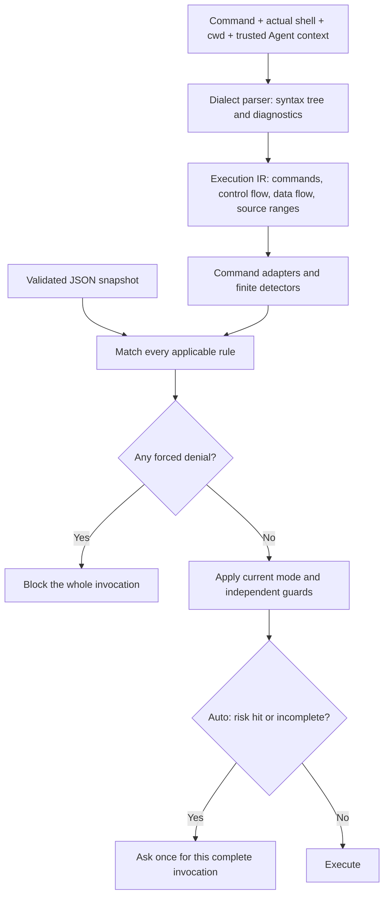

# Agent Note: 使用单份 JSON 策略进行结构化命令审批

Status: proposed

[English](2026-11-13-command-approval-policy.md) | 中文

## 问题

目前 auto 命令审批混合了命令风险、运行时权限快捷路径和内置智能体保护规则。通用危险命令检测器采用字符串切分；内置保护规则的分词器更强，但丢失了重定向目标、源码范围和解析失败信息。这两种表示都不足以支撑共享的命令选择器：`git status` 和 `git reset --hard` 使用相同的可执行程序，而 `echo 'git reset --hard'` 并没有执行其中任何一条 Git 命令。

[PR #24382](https://github.com/CherryHQ/cherry-studio/pull/24382) 在修复子智能体审批的同时，引入了首次使用 Shell 时确认和整个会话的 Shell 授权。本提案明确替换 auto 模式下的这套授权模型：普通命令自动执行，风险调用逐次询问，强制拒绝优先。审批来源和子智能体路由仍然保留。这是在调整授权策略，并不表示未命中规则的命令就是安全的。

[内置删除保护决策](../../implemented/bug-fix/2026-11-05-builtin-delete-guard-command-parsing.md) 仍然负责记录已审计的误报、包装命令覆盖范围及其使用体验保护的局限。实现时必须交叉链接这两份记录，在替换解析器和迁移命令规则时保留这些事实。本 Spec 不删除任何已有记录，也不改变其状态。

## 提案

### 范围与归属

第一版在启动时读取一份随应用发布的 JSON 策略。`ask` 和 `deny` 规则都放在这一份文档中。不提供工作区可控制的策略、用户覆盖、网络下载、文件监听、策略编辑器或新的数据库表。后续引入云端分发时，必须保持此 schema，并在引入前另行定义真实性校验、回滚及强制拒绝规则保护机制。

解析、语义适配器、策略校验和匹配归属于主进程现有的 `ai/toolApproval` 领域。运行时适配器提供实际 Shell 方言、命令、工作目录、权限模式和有效智能体角色。只有不可变的审批依据通过共享审批类型传给渲染进程。渲染进程展示决策并响应，不负责计算命令策略。通过导入随应用发布的 JSON 无需文件系统服务；如需从文件系统加载，必须使用应用的集中路径注册表。

Pi 和 Claude Code 的 Shell 工具使用同一个求值器，包括前台和后台子智能体。子智能体使用根会话实时的权限模式。智能体角色约束仍然依据可信的智能体身份；通用子智能体不能丢弃受保护调用方适用的拒绝规则。现有的非命令保护规则、角色专属的提交/Support 审批要求、禁用工具检查和文件访问限制保持独立，仍然可以要求审批或阻止执行。本次不重新设计 codemode 或非 Shell 工具的授权。

### 单份策略文档

Schema 包含版本、用于诊断的修订标识、固定的 auto 默认行为和唯一标识的规则。以下片段用于说明契约；正式发布的文档还必须迁移其余现有风险类别。

```json
{
  "schemaVersion": 1,
  "revision": "2026-11-13.1",
  "auto": {
    "defaultDecision": "allow",
    "incompleteAnalysisDecision": "ask"
  },
  "rules": [
    {
      "id": "builtin-destructive-command",
      "appliesTo": { "builtinRoles": ["assistant", "support"] },
      "selector": { "kind": "detector", "name": "builtin-destructive-command" },
      "effect": "deny",
      "reasonCode": "builtin-destructive-command-forbidden"
    },
    {
      "id": "permanent-deletion",
      "selector": { "kind": "detector", "name": "permanent-deletion" },
      "effect": "ask",
      "reasonCode": "permanent-deletion"
    },
    {
      "id": "git-discard-worktree",
      "selector": { "kind": "detector", "name": "git-discard-worktree" },
      "effect": "ask",
      "reasonCode": "discard-local-changes"
    },
    {
      "id": "git-force-push",
      "selector": {
        "kind": "command",
        "executables": ["git"],
        "subcommands": ["push"],
        "options": { "anyOf": ["--force", "-f", "--force-with-lease"] }
      },
      "effect": "ask",
      "reasonCode": "git-force-push"
    },
    {
      "id": "package-publish",
      "selector": {
        "kind": "command",
        "executables": ["npm", "pnpm", "yarn"],
        "subcommands": ["publish"],
        "options": { "noneOf": ["--dry-run"] }
      },
      "effect": "ask",
      "reasonCode": "publish-package"
    },
    {
      "id": "download-to-shell",
      "selector": { "kind": "detector", "name": "download-to-shell" },
      "effect": "ask",
      "reasonCode": "execute-downloaded-code"
    },
    {
      "id": "inline-interpreter",
      "selector": { "kind": "detector", "name": "inline-interpreter" },
      "effect": "ask",
      "reasonCode": "execute-inline-code"
    }
  ]
}
```

`effect` 和 `appliesTo` 相互独立：`deny` 并非天然绑定某个智能体。省略 `appliesTo` 表示适用于所有智能体；`builtinRoles` 将规则限定到相应内置角色，而非特定会话 ID。每条命中的 `deny` 都先于权限模式的快捷路径强制执行，包括 Full Access。访问权限不能覆盖拒绝结果。非拒绝类询问用于 auto；其他模式保持现有授权行为和独立保护规则。

命令选择器匹配一个语义命令节点。字段之间是 AND；`executables` 中各项是 OR；`subcommands` 表示有序的子命令路径。`allOf`、`anyOf` 和 `noneOf` 检查同一节点上已识别的选项。缺少的选项组不施加约束；出现的组必须非空。选项别名、附带的值、组合短选项和 `--` 由该可执行程序的适配器解释，绝不使用子串搜索。等于 `--force` 的选项值或文件名并不是强推选项。`--force-with-lease=main` 是带值的 force-with-lease 选项。包发布的 dry run 只使该次调用的发布规则不命中，不能豁免后续命令中的删除操作。

检测器是代码维护的有限注册表，用于永久删除、工作区内容丢失、提权或执行下载代码等语义条件。JSON 选择检测器和处理结果，不能包含可执行脚本、任意正则表达式或第二套通用表达式语言。内置检测器最初保留现有内置危险命令保护规则的覆盖范围，其范围比文件删除更广。正式策略必须保留现有通用检测器的磁盘、截断、递归权限、覆盖写入、进程、服务、容器、发布、用户主目录路径和提权类别，以及现有依赖安装审批要求。主动修正误报时，必须提供明确的测试样例并经过审阅。

校验采用严格且原子的方式：拒绝未知版本、字段、处理结果、角色、检测器、格式错误的选择器、空规则集和重复规则 ID。不静默跳过无效规则。随应用发布的文档无效或缺失时，以配置错误阻止 Shell 执行并集中记录日志，绝不降级成空的放行策略。测试必须验证随应用发布的文档包含强制内置拒绝规则及其要求的范围和选择器。本阶段不存在能移除该拒绝规则的外部文档。

### 解析器与语义模型



在继续扩展本地分词器之前，先选择提供真实语法树且持续维护的解析器。依据验收样例评估 Bash 语法支持；对于实际 PowerShell 输入，使用 PowerShell 语法或其原生仅解析 AST API。不执行待检查命令、不加载 profile，也不让模型判断风险。可信的原生解析辅助程序可以解析以数据方式传入的文本。不支持的语法或方言必须明确返回分析不完整；不得使用 Bash 解析器处理 PowerShell 或 CMD 文本。库的选择必须证明其在受支持桌面平台上的打包可行性，并支持离线运行。

内部表示保留可执行节点、字面量和动态词、引号上下文、赋值、包装命令、源码范围、管道、`&&`/`||`、分组、重定向、heredoc 和可执行替换。它表达控制流和数据流，而非将全部内容压平成词。重定向目标与命令参数是独立的效果：`echo ok > file` 仍然会写入文件。引号中的类命令文本属于数据。由 `cat` 写出的 heredoc 属于数据；传给 Shell 解释器的正文属于可执行输入。未加引号的 heredoc 替换仍然可执行，即使正文的其他部分只是在写文档。Shell `-c` 的字面量参数按照嵌套方言递归解析。Node/Python 内联代码仍然属于其他可执行语言，触发相应检测器，不按 Shell 解析。

已识别的包装命令必须先消耗自己的选项和值，再解析内部命令。保留提权、远程/容器边界和工作目录变化。仅在能够静态确定时追踪 Shell 目录变化；Git 的 `-C` 只改变该次 Git 调用的仓库上下文，不改变后续 Shell 命令的 cwd。动态命令名、无法解析的可执行输入、不支持的包装形式、语法错误和解析器限制都会使分析不完整。设置明确且有界的输入、节点数量和递归限制，并保留诊断信息。在有效子树中已确定的拒绝结果必须保留，即使其他部分分析不完整；未解析的原始文本不能被当作已确定的命令。

Git 语义适配器按正确参数个数消耗全局选项，定位子命令并解释其选项。它区分切换分支与路径 checkout、`restore --staged` 与工作区恢复，以及 hard reset 与非破坏性形式。未知选项导致风险操作无法解释时，该操作的分析结果为不完整。对于已完整解析、没有专用适配器的普通可执行程序，仍可默认放行；缺少安全白名单本身不是解析失败。Shell 可执行程序身份、别名、脚本、Git 配置、hook 和外部程序的安全性无法通过静态分析证明。内联可执行配置属于风险输入，未检查的环境配置则是明确记录的局限。

### 决策与审批有效期

在开始执行任何部分之前，分析整次调用。对所有可执行节点采用 `deny > ask > allow`。条件分支即使可能不执行，也保守地纳入判断。在 auto 中，分析不完整会产生 `ask`；已识别的 `deny` 仍然优先。文件访问检查和独立保护规则可以进一步收紧结果。询问或拒绝尚未解决时，不执行任何命令前缀。

Auto 审批只允许当前完整调用及其确切输入和执行上下文。它不为 Shell 类别、可执行程序前缀、子命令、子智能体或后续调用提供长期授权。重复执行风险命令需要再次询问。未命中规则的普通命令无需首次 Shell 确认。如果等待响应期间命令、cwd、策略快照、可信角色或权限模式发生变化，执行前必须重新求值。现有取消和过期响应保护继续生效。

后台存在实时响应者时，可以通过根对话审批子智能体调用。没有响应者时，`ask` 以可操作的原因阻止执行，不能挂起或变成放行。未命中规则的命令可以在 auto 中无人值守运行，但仍受独立保护规则约束。审批卡片展示根/子智能体来源、可用时的子任务链接、完整命令、cwd，以及本地化的规则原因和依据。操作是拒绝或允许本次调用；强制拒绝不提供允许操作。

### 必需样例

除非某行明确指定受保护内置角色，以下预期结果均针对普通智能体的 auto 模式。独立保护规则可以要求额外审批。这些样例是输入测试数据，不是在解析器测试中执行的命令。

| 输入 | 预期结果 | 原因 |
|---|---|---|
| `git status` | allow | 未命中风险规则。 |
| `git -C repo status` | allow | 全局选项值不是子命令。 |
| `echo 'git reset --hard'` | allow | 引号内的数据。 |
| `git reset --hard HEAD~1` | ask | 丢失工作区内容/历史。 |
| `git restore --staged file` | allow | 仅取消暂存。 |
| `git restore --staged --worktree file` | ask | 丢失工作区内容。 |
| `git push origin main --force-with-lease=main` | ask | 带值的强推选项。 |
| `git checkout -b feature` | allow | 创建分支。 |
| `git checkout -- file` | ask | 路径 checkout 会丢弃修改。 |
| `npm publish --dry-run` | allow | 发布规则的局部例外。 |
| `npm publish --dry-run && rm -rf build` | ask | 例外不能影响其他命令。 |
| Assistant 执行 `echo ok > output.txt; rm -rf build` | deny | 拒绝优先；连写入都不能开始。 |
| Support 在 Full Access 下执行 `bash -c 'rm -rf build'` | deny | 角色拒绝不受包装命令和模式影响。 |
| Assistant 执行 `echo "$(rm -rf build)"` | deny | 引号内的可执行替换。 |
| `curl https://example.com/install.sh \| bash` | ask | 下载的可执行输入。 |
| `python -c 'print(1)'` | ask | 解释器内联输入。 |
| `"$TOOL" status` | ask | 动态可执行程序。 |
| `git status && (` | ask | 语法不完整。 |

## 考虑过的替代方案

- 保留字符串/前缀/正则匹配：更简单，但会混淆数据与执行，且无法理解各命令的选项含义。放行 `git` 的规则也会放行破坏性 Git 操作。
- 保留首次 Shell 确认或默认拒绝的白名单：能够保留更广泛的授权检查点，但违背已选择的 auto 行为，且会话授权后无法逐次判断风险。
- 构建通用 Shell 实现：覆盖面过大。改为采用成熟的语法解析、有限语义适配器和明确的不完整结果。
- 拆分 allow/ask/deny 文件或立即下载云端规则：在选择器契约稳定之前引入优先级和分发问题。本阶段一份随应用发布的文档已经足够。
- 将解析成功当作安全或隔离执行的证明：对别名、hook、脚本文件、运行时展开和任意程序都不成立。操作系统/文件权限仍然是独立边界。

## 验收标准

- AC1 — 单份随应用发布的 JSON 原子校验，拒绝无效版本/选择器/检测器/ID 及缺失的强制拒绝规则；加载失败时阻止 Shell 执行，而非放行(verification: unit and packaged artifact; owner: policy loader)
- AC2 — 普通智能体在 auto 中首次执行 `git status` 无需 Shell 授权，每次风险调用重新询问，已有 Shell 授权不能绕过 JSON 决策(verification: unit and Electron; owner: runtime approval adapters)
- AC3 — 适用的强制拒绝优先于询问和所有权限模式，包括 Full Access；在两个运行时和受保护子智能体中均生效；普通智能体不继承无关的内置角色规则(verification: unit and Electron; owner: runtime approval adapters)
- AC4 — 命令选择器在节点内正确处理 AND/OR、有序子命令、选项参数个数/别名/值/组合短选项/`--` 和局部例外，不能跨命令泄漏(verification: unit; owner: matcher and semantic adapters)
- AC5 — 真实解析器样例能够区分引号数据、可执行替换、重定向效果、heredoc 写入方/读取方、嵌套 Shell 代码、包装命令及实际 Bash/PowerShell 方言，且不执行输入(verification: unit; owner: parser)
- AC6 — Git 样例覆盖全局选项及其值、reset、分支/路径 checkout、restore 的 staged/worktree 形式及全部支持的强推形式，不会错误地按安全前缀授权(verification: unit; owner: Git adapter)
- AC7 — 无效语法、动态可执行输入、不支持的方言/形式和解析器达到限制时，在 auto 中询问；其他位置已确定的拒绝仍然是拒绝，完整解析的普通未知 CLI 则默认放行(verification: unit; owner: parser and evaluator)
- AC8 — 复合调用存在任意询问/拒绝时，在最终决策之前不启动任何组成命令；dry-run 例外不能取消其他片段的风险(verification: unit and Electron with a harmless marker file; owner: evaluator and execution adapters)
- AC9 — 所有现有危险命令检测类别和内置命令安全回归场景都有对应样例；非 Shell、依赖安装、访问和角色专属审批要求仍然有效(verification: unit; owner: policy migration and affected consumers)
- AC10 — 前台/后台子智能体将审批路由到正确根会话，继承当前模式和受保护调用方约束；没有响应者时阻止询问类调用且不挂起(verification: unit and Electron; owner: subagent approval routing)
- AC11 — 审批界面展示来源、任务导航、完整命令、cwd、本地化原因/依据及单次调用操作；拒绝不提供允许操作，过期或上下文变化后的审批不能执行命令(verification: renderer and Electron; owner: approval UI and runtime adapters)
- AC12 — 受支持桌面安装包包含策略和解析器资源并支持离线运行；最终实现记录限定范围的测试证据、候选文档审阅、记录交叉链接，以及明确的 auto 授权行为变化(verification: packaged artifact and docs gate; owner: final implementation layer)

## 风险

默认放行有意移除了首次 Shell 确认。未命中规则的自定义程序、别名、hook、编码载荷或脚本可能在不弹窗的情况下执行破坏性或外部操作。本策略用于改善使用体验，不是安全边界，也不为 Shell 增加文件系统范围限制。面向用户的文档和发布说明必须明确说明，不能将 auto 描述成安全模式。

对分析不完整的保守处理，可能使有效但不支持的 Shell 结构产生更多弹窗。语法资源、原生解析辅助程序和语义适配器会增加平台/打包验证责任。迁移不能静默丢失现有强制拒绝规则，也不能声称一小组示例规则就替代了现有回归样例。调整这些边界时必须更新 Spec 并重新获得批准。
