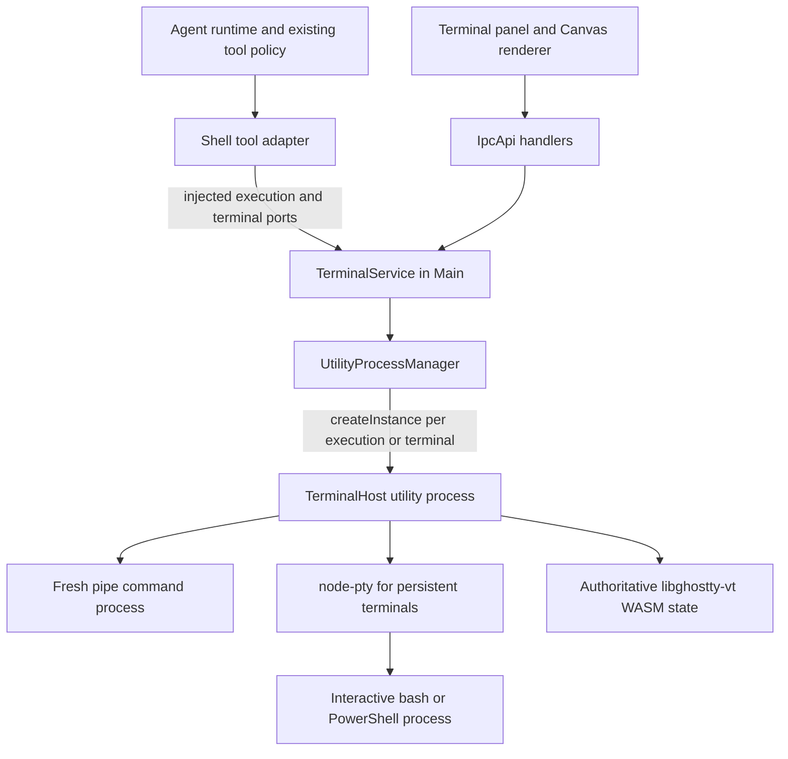

# Agent Note: Shared terminal sessions for Agent shell tools and users

Status: proposed

English | [中文](2026-11-14-shared-agent-terminal.zh.md)

## Problem

Agent shell execution needs a terminal interface that users can open and observe, with explicit takeover for interactive PTYs. Shared UI and process infrastructure must preserve the distinction between a fresh command process and a shell whose state survives across calls. Forwarding output alone does not establish process ownership; replacing every native shell tool with a persistent shell silently changes its working-directory, environment, and completion contracts.

The current desktop adapters install SDK shell tools in [PiRuntimeConnection.ts](../../../../src/main/ai/runtime/pi/PiRuntimeConnection.ts) and [durableDesktop.ts](../../../../src/main/ai/runtime/piDurable/durableDesktop.ts). At local baseline `e282668a2b035656a219e6640611af3601e56195`, both SDKs are pinned to `1.5.2`. Pi exposes replaceable `BashOperations` and `PowerShellOperations`; Pi Durable supplies an `ExecutionEnv` to its tools. Its built-in PowerShell tool passes an executable-and-arguments array to `env.exec()`, starting another PowerShell process rather than selecting a persistent PowerShell session.

This is a new terminal capability. The [runtime ownership Spec](../simplification/2026-11-05-agent-runtime-boundary-ownership.md) continues to own native execution, reply completion, and background Agent behavior. This proposal does not replace those contracts or the existing external-terminal CodeCli launcher.

## Proposal

### Scope and technology

Use `node-pty` for PTY processes and `libghostty-vt` for terminal emulation. Cherry owns session identity, access, command execution, observation, and UI. The first delivery covers local macOS, Linux, and Windows terminals, Pi and Pi Durable shell tools, terminal viewing, explicit user takeover, and cleanup.

Closing or hiding a terminal panel leaves its command or shell running while Cherry remains alive. The first delivery includes explicit Bash background execution and promotion of a running Bash call. Application exit stops owned processes. Keeping programs alive after application exit, SSH terminal hosting, mobile terminal surfaces, and replacing Claude Code or ACP's native shell execution are outside this Spec. Those runtimes retain their existing execution paths and must not be advertised as integrated.

### One-shot commands and persistent terminals

Keep native `bash` and `powershell` as fresh-command tools. Each call starts a new process with its supplied cwd and environment. Foreground completion comes from that process's exit; an explicitly backgrounded Bash call instead returns a running receipt for the same execution. A command's `cd`, exports, functions, or PowerShell variables do not affect later calls. Preserve the SDK's pipe and non-interactive defaults. Showing its output in the terminal UI does not make it interactive or authorize a restart under a PTY. Background support does not turn a new Bash call into a send to an earlier shell.

Expose persistent PTYs separately through `terminal_open`, `terminal_send`, `terminal_read`, `terminal_signal`, `terminal_close`, and `terminal_list`. These are new, explicitly governed tools with their own policy declarations. Use them when the model needs a stateful shell, a REPL, or interactive stdin. Their descriptions must explain that state survives and that input waits need not mean command completion. Native shell tools never acquire persistent-session behavior from an implicit adapter choice.

Both paths share TerminalService's ownership, output subscriptions, access checks, and UI. The command path uses a fresh pipe process; the terminal path uses `node-pty`. A retained long-running command, a persistent interactive shell, and a process surviving application exit are separate capabilities. Background promotion is explicit, not an automatic response to output silence, a wait budget, or an execution deadline. There is no daemon survival guarantee.

### Background execution and retention

Track transport (`pipe` or `pty`), retention (`turn` or `session`), and waiting independently. A normal native command starts with turn retention. Bash started with `run_in_background: true`, or promoted through the running call's background action, has session retention. Persistent terminals and the programs started through their explicit tools have session retention from creation. A panel attachment changes none of these fields. A yielded terminal dev server therefore keeps running after Agent Stop; a normal Bash command merely displayed in a terminal panel remains turn-owned and stops.

Promotion is a host-serialized change on the existing `executionId`, bound to the exact tool call and owner. Retain its PID, pipe streams, capture cursor, and original execution deadline. Transfer cancellation ownership before settling the original tool call once with `status: running`, `executionId`, captured output, and the next output cursor; omit a final exit code. Never append shell `&`, respawn the command, or pretend the receipt is process completion. Repeated promotion returns the same receipt. If exit won the race, return the actual outcome; if Stop was admitted first, promotion cannot revive the execution. A later cancellation from the old foreground wait cannot stop the promoted task.

Expose `shell_task_list`, `shell_task_read`, and `shell_task_stop` for session-owned pipe tasks. They use the existing `executionId`, not a second process registry or an arbitrary PID. Reads return bounded cursor-based output with explicit truncation and actual final status when known. Stop targets that execution's managed process scope. Completion updates the task panel and its original execution record once; it neither emits a second result for the original tool call nor automatically starts a new model turn. The Agent can read the task on a later call. Session retention survives runtime connection replacement while Cherry and the conversation remain alive; conversation deletion/purge or app shutdown stops it. An explicitly supplied execution timeout remains a deadline after promotion, not a yield budget.

The installed Pi `1.5.2` Bash schema exposes only `command` and `timeout`; `BashOperations.exec()` and the tool's structured result require a completed exit result. Durable `1.5.2` likewise requires `ShellExecResult.exitCode` and documents context abort as process cancellation. The background path needs an upstream typed running/completed result, explicit background input/control, and a cancellation-ownership handoff through each native tool. Confirm these hooks before implementing the adapters; do not fake an exit code, throw a running receipt as an execution error, or bypass the existing native tool policy. Unpromoted calls retain their current schemas and completion behavior apart from the additive approved background capability. PowerShell keeps its foreground behavior until an equivalent native background contract is explicitly delivered.

### Command submission and interactive input

`terminal_send` has two distinct input variants. `kind: command` submits one complete shell command or multiline script only when shell integration verifies the managed shell is at a prompt and has no active foreground program. It allocates a `commandId` distinct from the send's `operationId`. `kind: input` writes the supplied data, without adding a newline, to the current foreground program, such as a REPL or password prompt; it carries the expected `commandId`/program revision and never allocates a new shell command. It is an independently authorized raw-input capability, not a command eligible for Bash allow rules or rewriting.

Serialize short write admissions, not the whole output wait. One managed shell command may be active at a time, but a running command may receive explicitly authorized input while an earlier send is waiting or after it yields. A new command while a program is active returns busy; input to that known program is allowed. Reject input if its program revision changed, the shell is back at a prompt, control transferred, or the program identity cannot be established. Unknown state does not become a shell command implicitly. `terminal_read` provides bounded screen text or output since a capture cursor and keeps these representations distinct. Waiting, process execution, shell readiness, and actual command exit remain separate result fields.

### Upstream research recorded on 2026-11-14

These findings come from fixed source snapshots and documentation, not runtime tests performed for Cherry or a claim about every released client.

| Project and snapshot | One-shot execution | Persistent or retained execution | Consequence for Cherry |
| --- | --- | --- | --- |
| OpenCode `dev`, `024a1462f55aa64243b859729b2d0816b42b17e3` | The current `shell` tool constructs a new `-c` command or PowerShell `-Command` process | Separate persistent PTYs and pipe commands share a daemon; planned server handoff can preserve processes | Share infrastructure without merging command and shell-state semantics |
| DSH `master`, `39163dd30f703a79079e2d2446545cff3c453738` | `bash` and `pwsh` each start fresh processes; background jobs retain that command only | Explicit terminal tools keep shell state; a separate sidebar controller supports Agent/user control transfer | Keep distinct tool contracts and distinguish readiness from exit |
| Codex `main`, `b1573f102413e96a6481087922bf425231222dee` | `ExecCommandLifetime::OneShot` exposes completion timeout and no resumable session ID | Interactive `exec_command` retains one process for `write_stdin`; new exec calls do not automatically enter that shell | Model process retention separately from persistent shell state |

OpenCode's [shell tool](https://github.com/anomalyco/opencode/blob/024a1462f55aa64243b859729b2d0816b42b17e3/packages/core/src/tool/plugin/shell.ts) can promote foreground timeouts to background jobs and notify on completion. Its [argument builder](https://github.com/anomalyco/opencode/blob/024a1462f55aa64243b859729b2d0816b42b17e3/packages/core/src/shell/select.ts) still creates a fresh command. The [persistent process interface](https://github.com/anomalyco/opencode/blob/024a1462f55aa64243b859729b2d0816b42b17e3/packages/core/src/persistent-pty/index.ts) and [shell service](https://github.com/anomalyco/opencode/blob/024a1462f55aa64243b859729b2d0816b42b17e3/packages/core/src/shell.ts) distinguish PTY and pipe processes, explicit handoff, and lost processes. Planned server handoff is not machine-reboot recovery.

DSH's [Bash](https://github.com/deepseek-ai/deepseek-harness/blob/39163dd30f703a79079e2d2446545cff3c453738/packages/shell/tool-bash/README.md) and [PowerShell](https://github.com/deepseek-ai/deepseek-harness/blob/39163dd30f703a79079e2d2446545cff3c453738/packages/shell/tool-pwsh/README.md) contracts state that shell state does not survive one-shot calls. Its [terminal tools](https://github.com/deepseek-ai/deepseek-harness/blob/39163dd30f703a79079e2d2446545cff3c453738/packages/experimental/tool-terminal/README.md) explicitly prefer one-shot operations for bounded work. The [line-oriented backend](https://github.com/deepseek-ai/deepseek-harness/blob/39163dd30f703a79079e2d2446545cff3c453738/packages/terminal/terminal-bash/README.md) warns that `inferred_idle` and wait timeout do not prove exit and does not promise full-screen TUI support. The separate [sidebar terminal controller](https://github.com/deepseek-ai/deepseek-harness/blob/39163dd30f703a79079e2d2446545cff3c453738/packages/api/terminal-controller/README.md) transfers control on the person's first typed input: Agent reads remain available, while Agent writes, signals, and close are refused. Browser reload recovery does not preserve processes after Host/owner disposal.

Codex's [lifetime preparation](https://github.com/openai/codex/blob/b1573f102413e96a6481087922bf425231222dee/codex-rs/core/src/tools/handlers/unified_exec/preparation.rs) and [OneShot schema adaptation](https://github.com/openai/codex/blob/b1573f102413e96a6481087922bf425231222dee/codex-rs/core/src/tools/handlers/unified_exec/exec_command.rs) distinguish execution deadline from interactive yield. A returned `session_id` names the retained process, not an automatically shared shell. The [process manager](https://github.com/openai/codex/blob/b1573f102413e96a6481087922bf425231222dee/codex-rs/core/src/unified_exec/process_manager.rs) permits normal stdin only with TTY, apart from special interruption handling. Persistent shell state requires starting an interactive shell and writing to that same process. [Session shutdown](https://github.com/openai/codex/blob/b1573f102413e96a6481087922bf425231222dee/codex-rs/core/src/session/handlers.rs) terminates managed exec processes.

The adopted conclusion is to share execution ownership and terminal presentation while exposing one-shot commands and persistent terminals as separate contracts. This replaces the initial draft's default-persistent interpretation of native `bash` and `powershell`.

### Claude Desktop shipped-artifact findings (2026-11-14)

Static inspection of local Claude Desktop `5.11492.5` examined `Contents/Resources/app.asar` and `ion-dist.asar`. Their SHA-256 hashes were `2c515441d5d0504a96ac3e49bcc4c1244085c0e76ad23ae58ddd8f736100479e` and `1d55d633d14aede748af3cb22c244f4ddc2f795d9b1153b175b993ae5d46aa1b`, respectively. Paths below are logical paths inside those archives, not Cherry source or upstream development-source paths.

- **Background control:** `app.asar/.vite/build/index.chunk-D1yJ0UIX.js` obtains the existing `session.query` and calls `backgroundTasks(toolUseId)`. The SDK wrapper in `index.chunk-fch7zeJ_.js` sends `{ subtype: "background_tasks", tool_use_id }`. This Desktop path neither calls `startShellPty` nor resubmits the command through `run_in_terminal`. Background output is read through `get_task_output(taskId)` or an output file; the renderer periodically refreshes text. This confirms control of an existing invocation, not conversion into an interactive PTY. The inspection did not enter the actual CLI Bash executor or verify PID continuity at runtime.
- **Explicit terminal tools:** `app.asar/.vite/build/index.chunk-Me4G-tma.js` implements `run_in_terminal`, `open_terminal_tab`, `list_terminal_tabs`, `read_terminal`, and `stop_terminal_tab`. Its tool guidance selects Bash for short commands and the terminal tool for long-running or interactive work users should see and control. A new tab follows `nextClaudeTabId → startShellPty → typeWhenShellReady`; a reusable `tab_id` follows `claudeTabReuse → typeWhenShellReady` in the existing shell. Reads return terminal-screen text; stop sends Ctrl-C unless `close: true` ends the shell. Creating or running a tab need not open its panel. Tool availability depends on application, organization, session, and sandbox policy.
- **Input ownership:** reuse requires a Claude-created, idle tab with a verifiable name and no user input. User typing while a call waits produces `user_typed`; later reuse or stopping is refused when the tab may contain user work. Prompt integration and foreground-process checks prevent typing a new shell command into a busy program. Cherry retains its explicit takeover and return-control contract rather than copying Claude's first-input ownership policy implicitly.
- **PTY infrastructure:** `app.asar/.vite/build/index.chunk-hvY9X4w1.js` contains `ShellPtyManager` and a shared `utilityProcess` host reached through `MessageChannelMain`. `pty-host/ptyHostWorker.js` imports `node-pty` and handles spawn, write, resize, kill, data, and exit by `ptyId`. One worker manages multiple PTYs. `ion-dist.asar/assets/v1/c6bf19e8f-Df49HNKY.js` contains the xterm terminal, fit and WebGL addon path, with input forwarded to `writeShellPty`. Cherry's proposed per-instance utility isolation and host-owned Ghostty VT are separate choices, not behavior established by this precedent.
- **Separate Bash mode:** `runBashCommand → ShellPtyManager.runCommand → startBashPty` uses a reusable hidden shell. `bashPtyProcesses` and visible `shellPtyProcesses` are separate maps; reset messages explicitly acknowledge lost cwd/environment state. This entry point does not prove that the model's native Bash tool shares a visible terminal tab.

Apply the separation to Cherry: command execution, waiting, retained background work, persistent shell state, and panel visibility are distinct contracts. Cherry adds explicit Bash background promotion under the task identity, read, stop, and settlement contract above, without automatic promotion. Interactive attachment requires selecting a PTY at process creation; opening the panel never retrofits a pipe process into a PTY or reruns its command.

These findings are static evidence from one installed build, not an Electron interaction test or proof of every enabled feature. REA's application-wide semantic graph had partial coverage; the conclusions came from targeted module inspection. An unpacked `claude-native-binding.node` hash differed from its ASAR declaration and was recorded with `record-and-continue`; this analysis did not rely on that native module or establish the cause of the mismatch. No proprietary implementation is copied into Cherry.

### Technology boundaries

The upstream responsibilities are separate:

| Component | Responsibility | Choice |
| --- | --- | --- |
| `node-pty` | Spawn and control an interactive PTY; transport input, output, resize, and exit facts | Use for persistent terminals in a utility process, including ConPTY on Windows |
| `libghostty-vt` | Parse terminal sequences, maintain terminal state, and encode terminal input/replies | Use one authoritative VT instance per terminal |
| Canvas renderer | Draw cell snapshots and handle browser interaction | Cherry-owned renderer integration |
| `herdr-core` | Persistent sessions, attach, remote machines, and Agent relationships | Reference for lifecycle design; not a runtime dependency |

This follows the separation in [T3 Code's web adapter](https://github.com/pingdotgg/t3code/blob/0a8aaa3ccb944dadb70054ae4ef2e29897b0db03/apps/web/src/terminal/ghostty/README.md), which uses WASM and Canvas 2D. Cherry deliberately places the authoritative VT in the PTY host so terminals remain functional without a mounted renderer. The [Ghostty library](https://github.com/ghostty-org/ghostty/blob/6d9577708a211b0e6c5e6c6886f3cfb7efc47555/README.md), [node-pty](https://github.com/microsoft/node-pty/blob/35c28c7d68a192699e70b1e6a142908bdccd9212/README.md), and [Herdr attach protocol](https://github.com/herdrdev/herdr-core/blob/c84d6e76156a6c2aac1da20efbe800f10acfe897/schema/README.md) are source references, not Cherry performance or compatibility evidence.

### Service dependencies and process ownership



The arrows describe calls and dependencies. PTY output and screen updates return through these connections. Agent tools call the injected host port directly, without renderer IPC. Tool completion never depends on a panel mounting, drawing, or acknowledging an update.

`TerminalService` is the only new lifecycle service. It extends `BaseService`, uses `Phase.WhenReady`, registers in `serviceRegistry.ts`, and declares its same-phase `UtilityProcessManager` dependency. It owns execution/session registrations, admission, input ownership, subscriptions, and independent process clients. The desktop runtime host injects the ports; runtime packages do not import `application` or Cherry services. `TerminalService` does not import Agent runtime implementations, UI, or model code.

Use [independently owned utility-process instances](../../../../src/main/core/utilityProcess/README.md) through `createInstance()`, one per active command or persistent terminal, rather than the manager's shared cached client. TerminalHost owns the selected pipe-process or `node-pty` handle, VT projection, and bounded output capture; only the persistent branch needs shell integration. A completed command releases its process instance while retained output remains observable. Closing a persistent terminal stops only its instance. TerminalHost is an execution module, not another DI service. It uses the utility runtime's supplied logger and init data without importing Main's container, database, or IPC.

### Module placement and transport

| Area | Proposed home | Boundary |
| --- | --- | --- |
| Terminal service and execution contracts | `src/main/services/terminal/` | Main-only state and host APIs |
| PTY entry and handlers | `src/main/services/terminal/utilityEntries/` | Utility runtime and native execution only |
| Pi and Pi Durable adapters | Existing `src/main/ai/runtime/pi/` and `piDurable/` | Translate native tool calls and preserve their policies |
| Command and event schemas | `src/shared/ipc/` | Validated cross-process DTOs without mutable state |
| Renderer commands and events | `src/main/ipc/handlers/` and renderer IPC client | Thin sender/access checks and delegation |
| Terminal UI and rendering | `src/renderer/components/terminal/` with lower-layer helpers in existing renderer buckets | Canvas interaction and `@cherrystudio/ui` controls |

Use existing IpcApi requests for terminal commands and targeted events for subscriptions. Send terminal output only to authorized subscribers, never a global broadcast. Use the utility layer's bounded duplex streams for PTY traffic. A terminal stream is owned by `TerminalService`; a renderer subscription is a separate, shorter-lived resource. Disposing the latter cannot cancel the former.

Declare `node-pty` in production dependencies under the existing native-package rule. Verify its addon, spawn helpers, Electron ABI, and architecture-specific payloads in packaged artifacts. Pin the Ghostty source and WASM build toolchain, ship the WASM as an application resource, and retain licenses. Resolve new resource, integration-script, and output-storage paths through the path registry. Terminal commands use IPC; raw output and transient screen state do not become DataApi records.

### Identities, states, and admission

| Identity | Meaning | Owner |
| --- | --- | --- |
| `terminalId` | One explicitly opened persistent shell and its VT state | TerminalService |
| Process generation | One live utility-process instance | UtilityProcessManager |
| `executionId` | One admitted one-shot command and its output view | TerminalService |
| Terminal operation identity | One send/read/signal operation, distinct from a command exit | TerminalService |
| `commandId` and program revision | A managed command and its current foreground program, used to fence stdin | TerminalHost |
| Control token | The current authorized input holder; replaced on takeover and explicit return | TerminalService |
| Native tool-call identity | Existing runtime context and tool-call identity | Agent runtime |
| Subscription identity | One authorized observer and its revision cursor | TerminalService |

Each one-shot call gets a fresh execution. Persistent sessions are allocated only by explicit terminal open, are owned by the exact Agent context, and are separated by shell kind. Child Agents and forked contexts do not inherit live terminals; a shared workspace path never implies a shared shell. The host records the binding to the exact runtime context. Model arguments cannot choose an arbitrary user's terminal or change its owner.

Track persistent process lifecycle (`starting`, `running`, `closing`, `exited`, `lost`), cleanup confirmation, retention, input control (`agent`, `user`), and readiness evidence separately. A terminal serializes write admission and admits at most one managed shell command at a time; authorized stdin is not a new command and output waiting does not hold the write gate. Busy command submissions fail explicitly rather than entering an invisible input queue. Repeated native calls map to their existing execution or operation within the live generation; they never spawn a second command or write input twice. A deliberate retry requires a new native tool invocation.

One-shot outcomes distinguish completion with an actual process exit code, cancellation, execution timeout, and process loss. Terminal sends report bounded output, process/control state, and why waiting ended: prompt readiness, evidenced input wait, yielded wait budget, session exit, or control transfer. A send returning is not proof that a command exited. Output silence, a prompt-shaped string, stream disconnection, and Agent reply completion cannot establish successful command completion.

### Persistent shell and command boundaries

One-shot tools preserve their per-call cwd, environment, shell discovery, login PATH preparation, and `mergePiShellExecutionEnv` behavior. Fresh command processes remain non-interactive by default. Native tool results come from their actual process exits; no prompt integration is required to detect completion.

Explicit persistent terminals start with controlled shell initialization and Cherry's shell integration. Do not silently add arbitrary interactive profiles to Agent execution. Apply startup environment and workspace directory once when opening the terminal. Subsequent `cd`, exports, PowerShell variables, and user changes persist only in that terminal. Tool guidance must distinguish those sessions from native one-shot tools. A native runtime's default workspace must not reset a live persistent shell on send; explicit reset requires a separate terminal operation.

Within a persistent terminal, use shell-specific integration for readiness, known command boundaries, and current directory. Parse integration frames incrementally across arbitrary PTY chunk boundaries. Input runs in the existing shell scope, including multiline scripts and REPL interaction. Preserve actual command completion separately when integration can prove it; unknown completion stays unknown. Bash and PowerShell need separate quoting, status capture, and cancellation implementations. PowerShell status must account for native exit codes and PowerShell errors without reusing a stale `$LASTEXITCODE`.

Integration frames carry operation correlation and are removed from model-facing output. They provide bookkeeping, not authorization or a security boundary against programs running as the same user. Output cannot create an execution, grant input rights, or cause a retry. If `exec`, a replacement shell, changed integration hooks, or malformed frames lose tracked shell facts, report unknown readiness/completion explicitly and refuse operations that require those facts until a new managed terminal is opened. Raw interaction can continue only within its declared policy. Do not guess success or silently switch between persistent and one-shot modes.

Pipe commands preserve their native stdout/stderr handling; the terminal UI projects the same captured execution without altering native results. PTY output merges stdout and stderr, so persistent-terminal results promise combined output only. Retain ordered output for the terminal model and derive bounded readable tool text from the same capture. Integration frames must not appear in model text; do not present a persistent screen read as pristine per-command stdout. Preserve existing SDK output limits, truncation reporting, and readable output-file references; report capture/storage failure explicitly rather than claiming a partial file is complete.

### VT state, reconnect, and flow control

TerminalHost feeds output into the authoritative `libghostty-vt` projection even with no viewers. For PTYs it also owns terminal-generated replies and input encoding; a renderer never sends independent terminal query replies. Pipe execution views are output-only apart from explicit process stop, and viewing one cannot enable stdin, alter TTY detection, or restart the command. Browser key, paste, pointer, and IME-commit events for interactive PTYs are translated against the host's current terminal modes. React owns controls and lifecycle, while cell updates and drawing remain outside React state.

Send revisioned screen snapshots and bounded patches to viewers. Attach captures a baseline revision and subsequent updates in one ordered subscription. Reconnect obtains a new snapshot when its cursor is missing or too old; it does not re-run commands. Keep persistent scrollback in TerminalHost, with an initial limit of 5,000 lines and 8 MiB of text, whichever is reached first. Evict complete records without splitting UTF-8 text. Completed one-shot views use bounded retained capture after their worker is released. Browser views keep only their bounded viewport data and selection state.

Use at most 64 KiB payloads per terminal transport frame and 1 MiB of pending data per observer. Chunk large snapshots under one snapshot identity; publish a snapshot only when complete. Coalesce screen patches or replace an outdated revision with a new snapshot when a viewer falls behind. A hidden or stalled panel cannot block PTY parsing, terminal replies, command completion, or another viewer. Apply backpressure between capture and the PTY, with explicit storage-failure outcomes, rather than unbounded JavaScript buffering or silent command-output loss. These initial budgets are correctness limits, not performance claims.

Only the current controlling user view may change geometry. Without one, preserve the last size or the creation size. Agent observations, hidden panels, and additional windows do not steal resize ownership. Selection, scrolling, links, fonts, CJK width, emoji, IME, accessible terminal output, keyboard focus, and clipboard behavior belong to the renderer contract; Canvas alone does not satisfy accessibility. Terminal-originated links and clipboard requests still pass through explicit host/UI policy.

### Canvas 2D rendering and browser input

Use a renderer-side Canvas 2D surface receiving cell data, not images rendered in Main. Ghostty owns terminal parsing, grid/wrapping, modes, cursor state, and history in TerminalHost. Start from the fixed T3 [Canvas renderer](https://github.com/pingdotgg/t3code/blob/0a8aaa3ccb944dadb70054ae4ef2e29897b0db03/apps/web/src/terminal/ghostty/renderer.ts) and [snapshot types](https://github.com/pingdotgg/t3code/blob/0a8aaa3ccb944dadb70054ae4ef2e29897b0db03/apps/web/src/terminal/ghostty/core.ts), adapting the drawing helpers to Cherry's serialized frames and retaining the [MIT notice](https://github.com/pingdotgg/t3code/blob/0a8aaa3ccb944dadb70054ae4ef2e29897b0db03/LICENSE). Its browser WASM loader and surface cannot be copied as a second authoritative emulator: Node resource loading, per-view subscriptions, and Cherry input ownership need separate integration. The proposed data flow is:

```text
PTY bytes -> Host Ghostty VT -> revisioned cell snapshot/patch
         -> TerminalService / targeted IPC -> renderer viewport cache
         -> requestAnimationFrame -> Canvas 2D
DOM input -> authorized host input encoder -> the same PTY
```

Frames carry the terminal generation, view identity, screen/geometry epoch, base revision and revision, grid size, viewport position, dirty rows, and cursor state. A cell carries its grapheme text, occupied columns/continuation marker, resolved foreground/background, text styles, and optional link metadata. Serialize values rather than WASM pointers or memory views. Keep only a bounded visible grid in the renderer; host history reads return bounded viewport pages. Each viewer owns its scroll position and selection, so scrolling an observer cannot scroll another view or resize the PTY. Epoch changes invalidate old coordinates. Missing base revisions trigger a fresh snapshot under the existing bounded transport rules.

The drawing helper measures the loaded monospace font once for cell width, line height, and baseline, then paints adjacent background runs, same-style text runs, and decorations in grid coordinates. Ghostty's column occupancy determines placement; browser text measurement never recalculates wrapping or Unicode width. Wide/combining graphemes, fallback fonts, and prompt symbols are clipped/positioned within their allocated cells. Use one opaque content canvas and a transparent cursor/selection overlay. Union dirty rows and paint at most once per animation frame; cursor blinking or selection changes repaint only the overlay. Font, theme, DPR, grid, or viewport changes invalidate the required frame. Hidden views stop drawing and resume from a coherent snapshot; host parsing and PTY replies continue.

Use CSS pixels for layout and device-pixel-scaled backing stores for sharp text. Wait for font loading, measure padding and cell metrics, and let only the controlling view submit coalesced `cols`/`rows` changes from `ResizeObserver`. Render against the geometry epoch acknowledged by the host; do not stretch old cells into a different grid and interpret clicks using new coordinates. Drawing failures are visible view errors with a reattach action; they do not restart or stop the process. These choices follow the browser's [Canvas guidance](https://developer.mozilla.org/en-US/docs/Web/API/Canvas_API/Tutorial/Optimizing_canvas); they are not measured performance claims.

The surface includes a real textarea for keyboard focus, clipboard, and IME. Position composition at the cursor and send committed composition once; do not also send its intermediate key events. Browser handlers send normalized keys, paste, and pointer events through the current control token; the host encodes them using current terminal modes, including bracketed paste and mouse reporting. Selection/copy uses decoded cell text, wrap metadata, and the matching viewport revision rather than pixel OCR. Use DOM controls and a bounded accessible text/live-output layer so Canvas is not the only readable surface. React owns the panel, controls, and lifecycle, not the cell cache or drawing loop.

The first renderer targets text terminals and alternate-screen TUIs, including color, styles, cursor shapes, CJK, emoji, selection, links, paste, and IME. It does not advertise Kitty/Sixel image rendering, a GPU renderer, or an OffscreenCanvas worker. The host proof must validate the pinned ABI's render data, replies, input encoding, and independently projected viewports in Node, followed by real Electron fonts, TUI, and IME scenarios. Missing ABI or rendering support requires a documented upstream improvement or Spec revision, not a second parser hidden in the renderer.

### Tool integration and policy

For Pi, supply fresh-command `operations` to `createBashToolDefinition()` and `createPowerShellToolDefinition()`. Bridge `onData`, abort, timeout, and actual exit status through the injected command-execution port. Preserve foreground output handling, fresh-process semantics, and the existing tool gate. Add the approved Bash background input/running-result path through the upstream hooks described above. `spawnHook` alone only modifies invocation context and is not the execution bridge. Register task-control and terminal tools through the supported SDK tool-extension path.

For Pi Durable, bridge the shell part of `ExecutionEnv` to fresh command execution while retaining `NodeExecutionEnv` for filesystem operations. A string retains native shell-command semantics; an array executes that executable with its exact arguments. Preserve native tool identity, foreground structured output, per-stream information, output windows, spill behavior, and unsafe replay classification. Extend native Bash settlement and cancellation ownership upstream for background receipts; keep ordinary context cancellation stopping turn-owned commands. Register task-control and persistent-terminal tools as separate native extensions. This design does not require changing built-in PowerShell into a persistent executor or reverse-parsing its argv. Resolve the identified SDK result/control limitation before implementing background adapters rather than bypassing the tool gate.

Existing disabled-tool checks, permission modes, destructive-command approval, global-install and SQLite guards continue to run before execution. Bash-only RTK rewriting stays Bash-only. Runtime packages and `agent-behavior` retain their current policy responsibilities; OS process handles stay with the terminal host. User input enters through its own authorized interactive path and is never mislabeled as approved Agent input.

One-shot approval uses that call's exact command, cwd, environment, and process mode. Persistent-terminal operations use the current control and execution-context revision. Recheck the relevant revision at admission; if user input or shell state changed while approval was pending, reject stale admission and require a new tool invocation. Do not apply one-shot command allow rules to arbitrary terminal input, or run relative-path guards against the original workspace after a persistent shell has moved. A shell `cd` does not rebind the Agent workspace or change file-tool path resolution; tool guidance and the terminal display distinguish those directories.

### User takeover, timeout, and cleanup

| Action | Required result |
| --- | --- |
| Open, hide, switch, or close a panel | Attach or detach observation; keep execution and shell state |
| Stop Agent in the conversation | Stop model work and waits; stop that turn's unpromoted native commands; keep session-retained pipe tasks, persistent terminals, and user-owned programs |
| Background a running Bash call | Transfer the same execution to session retention and settle its original wait once with a running receipt |
| Type into an Agent-controlled PTY | Refuse ordinary input until explicit takeover; retain a visible interrupt action |
| Take over a running PTY | Transfer input ownership; resolve the active Agent operation as user-taken-over with captured output; leave the process running for the user |
| Return control | Require explicit transfer and revalidate terminal state before another Agent send; do not infer a completed command from readiness |
| Interrupt or reach a one-shot execution timeout | Stop that command's process scope; await completion or confirmed termination before releasing ownership |
| Reach a terminal send wait budget | Return bounded output and current state; keep the shell/foreground program running and report completion as unknown unless proven |
| Lose a viewer or reach an observation wait timeout | Detach that observer only; preserve the execution |
| Explicitly close a terminal | Stop its managed process scope, confirm closure, and dispose its utility instance |
| Utility crash or application restart | Mark unfinished executions interrupted; never auto-replay shell commands or pretend the old PTY survived |

Preserve the native `timeout` argument as an execution deadline, including after explicit background promotion. The persistent tools use a separately named wait budget, which yields current output without killing the process. Neither a yielded send nor a view subscription timeout proves command completion. Session-retained terminal programs, including yielded dev servers, survive Agent Stop without needing a second background action. The UI distinguishes foreground command, background task, and persistent terminal; attaching a normal command's output view never changes its retention.

Cancelling a persistent `terminal_send` ends that operation's wait, not the shell or foreground program. Use `terminal_signal` to interrupt the current program and `terminal_close` to end the shell and its managed process scope. Cancelling a turn-owned native command stops its scope; a stale foreground cancellation after background promotion does not. Agent Stop is not conversation deletion or terminal close. Provide explicit task/terminal stop controls for retained work.

On interactive PTY takeover, settle affected Agent waits once with control-transfer status; later user output belongs to the terminal rather than a completed operation. Revoke the old write/control token before allowing user input. Agent writes, signals, and close are refused after transfer, while authorized reads may continue. Old Agent cancellation, runtime eviction, connection disposal, or late callbacks cannot kill the user's process. TerminalService keeps the resource under the conversation and user control; a replacement runtime gains no input rights automatically. Explicit return grants a new token to the current authorized runtime after state validation. If a REPL remains active, only input to that program is admissible, not a new shell command. A one-shot pipe view offers stop but no stdin takeover.

Interruption first sends the PTY's Ctrl-C or the pipe scope's supported graceful interrupt and waits up to 2 seconds for command/process evidence. A terminal interrupt does not automatically kill its reusable shell if the program ignores Ctrl-C; show it as still running and offer Force stop. Force stop targets the verified current program scope; if it cannot be isolated from the shell, offer an explicit Force close terminal action instead of silently destroying the shell. Task stop, terminal close, turn-owned command cleanup, and application shutdown escalate their owned scope: graceful termination for up to 3 seconds, then force termination and up to 2 seconds for confirmation. POSIX uses the verified process group/foreground scope and SIGTERM/SIGKILL as appropriate; Windows uses its validated managed-tree/ConPTY implementation, with `taskkill /T /F` or a proven Job Object integration for force termination. Reuse existing [process termination helpers](../../../../src/main/utils/processRunner.ts) where their actual handle/group contracts fit; PTY handles require their own platform proof. These are initial policy budgets, not guarantees that the OS can always finish termination.

Keep stopping/closing resources registered, reject new writes, and retain the process handles, generation, and output needed for confirmation. If force termination cannot be confirmed, set cleanup to `unconfirmed`, show the last failure and Retry force stop, and never report success or reopen the same generation. Repeated stop requests join or retry the same cleanup; target a current verified handle/scope, never a persisted bare PID. A failed host connection reports execution as lost with cleanup unconfirmed until verified independently; it is not proof that descendants exited. Dispose the instance after confirmed managed-scope cleanup; do not kill the host first and discard the only child handles. [Node's kill contract](https://nodejs.org/api/child_process.html#subprocesskillsignal) distinguishes signal delivery from exit; [Windows Job Objects](https://learn.microsoft.com/en-us/windows/win32/procthread/job-objects) provide a grouping mechanism, whose guarantees must be verified in the actual PTY integration rather than assumed from using node-pty.

A runtime observer releasing a connection stops/reconciles its turn-owned commands through the existing runtime close barrier, without closing session-retained tasks or terminal sessions. Conversation deletion/purge and application shutdown stop all of that conversation's retained work, including user-controlled terminals; preserve visible cleanup failures. Terminal state is process-local; tool history retains the execution reference and outcome. Reopening a conversation after application restart creates a new shell only on explicit execution or terminal open. Programs deliberately detached from the managed process scope are not guaranteed to be killed by terminal close; report that boundary rather than claiming all descendants are gone.

### Delivery and verification sequence

| Layer | Deliverable | Required evidence before the next layer |
| --- | --- | --- |
| Spec | This bilingual proposed note | Human approval of the current Spec PR head before implementation |
| SDK background contract | Typed running receipt, native background control, and cancellation handoff in Pi and Durable | No fabricated exit result; promotion/Stop/exit races and replay behavior verified through actual native tool calls |
| Terminal host | Independent command/PTY instances, authoritative VT, integration, state machine, and output capture | Fresh command isolation and persistent shell state in real bash and Windows PowerShell, with no renderer, cancellation, malformed integration, and independent instance failure |
| Runtime adapters | Pi operations bridge, Durable environment bridge, and explicit terminal tools | Actual native tool calls preserve guards, IDs, results, timeout, and replay behavior in both runtimes without acquiring persistent-shell semantics |
| Renderer | Attach/reconnect, snapshots, interaction, explicit takeover, and accessibility | Electron scenarios with real IME, TUI, multiple views, and closed-panel execution |
| Packaged delivery | Native addon, helper, WASM, and integration resources | Packaged macOS, Linux, and Windows artifacts on supported architectures, with no developer tooling installed |

Keep the note proposed through implementation layers. Use scoped affected-consumer tests and explicit test paths, and report local tests, Electron runs, real-provider tool calls, Windows evidence, and packaged-artifact evidence separately. Final transition requires evidence for every criterion below. The first host layer must prove the selected Ghostty WASM build runs headlessly in Node and exposes the render/input/reply APIs this design needs. If it does not, raise the upstream gap and revise the Spec before building a second parser or an invisible fallback.

## Alternatives considered

- Adopt `herdr-core` as the backend: supplies persistent attach and remote-session behavior, but still needs a renderer and adds another session, Agent-relationship, and lifecycle model. Revisit if application-exit survival or remote terminals become required.
- Use `xterm.js` with `node-pty`: offers an established browser terminal and interaction ecosystem. Ghostty is the selected emulation core, with the accepted cost of proving Cherry's renderer, accessibility, and host integration. No speed advantage is claimed without comparable measurements.
- Use [HTML-in-Canvas](https://developer.chrome.com/blog/html-in-canvas) for terminal cells: preserves DOM interaction and accessibility when rendering HTML into Canvas, but adds a DOM representation to synchronize with Ghostty's fixed grid. Use direct cell drawing for the first terminal renderer, ordinary DOM controls, a real textarea, and bounded accessible text. Revisit for interactive HTML content embedded in a transformed canvas; no performance disadvantage is claimed without measurement.
- Keep Ghostty only in the mounted renderer: leaves terminal queries and authoritative screen recovery dependent on a window. Keeping an invisible renderer alive would give UI lifetime ownership over background shell execution.
- Make every native shell call persistent: silently changes cwd, environment, TTY, timeout, and completion assumptions. Keep one-shot calls and explicit persistent tools on shared process infrastructure. Merely mirroring output without shared ownership remains insufficient.
- Let each runtime or panel own its own PTYs: creates competing session registries and cancellation behavior. Use one TerminalService and independent PTY instances instead.
- Reinterpret Durable executable arrays as persistent-shell text: changes direct-executable semantics and hides SDK coupling. Preserve exact argv execution and use separate persistent-terminal tools.

## Acceptance criteria

- AC1 — Real Pi and Pi Durable Bash calls show their actual execution output in the terminal UI once; separate native calls do not inherit a previous call's `cd`, exports, or functions. (verification: native tool integration and Electron; owner: shell adapters)
- AC2 — Real Pi and Pi Durable PowerShell calls remain fresh processes, preserve their supplied cwd/environment and exact argv semantics, and report native failures and PowerShell errors correctly without inheriting stale variables. (verification: Windows native SDK integration and Electron; owner: shell adapters)
- AC3 — A closed or hidden panel does not stop commands, lose terminal query replies, or prevent completion; reopening displays the retained terminal state without rerunning work. (verification: headless PTY and Electron attach scenarios; owner: terminal host)
- AC4 — Explicit Bash and PowerShell terminals preserve cwd, variables, functions, and interactive stdin across sends while contexts, children, forks, and shell kinds remain isolated; repeated admissions never duplicate input or commands, and unauthorized IDs are refused. (verification: ownership and native tool tests with real persistent shells; owner: TerminalService)
- AC5 — Multiline input, REPLs, prompts, echoed input, chunk-split frames, replacement shells, malformed integration, output silence, and yielded sends cannot create false command success; actual process exit and terminal readiness remain distinct. (verification: real shell fixtures and parser boundary tests; owner: shell integration)
- AC6 — PTY takeover prevents interleaved Agent input, settles affected waits once, preserves the user process, and refuses Agent writes/signals/close until explicit control return; a one-shot pipe view never enables stdin or restarts execution. (verification: native runtime and Electron interaction scenarios; owner: terminal input coordination)
- AC7 — Native one-shot timeout stops only its command; a persistent-send wait budget or observation timeout leaves work running, and a signal delivery or unconfirmed stop is never reported as a proven command exit. (verification: real process/PTY cancellation and Windows process tests; owner: terminal host)
- AC8 — Slow or disconnected viewers, history eviction, large snapshots, and continuous output remain within declared budgets; ordered snapshot recovery preserves screen state, and tool truncation/storage failures remain explicit. (verification: bounded transport stress and Electron reconnect scenarios; owner: transport and renderer)
- AC9 — Existing native shell guards and Bash-only rewriting retain their scope; persistent terminal tools declare separate policies, a changed execution/control context invalidates pending admission, and shell cwd changes do not rebind file tools. (verification: affected policy tests and actual tool calls; owner: runtime adapters)
- AC10 — VT handling, alternate-screen TUIs, Unicode, CJK, emoji, selection, links, paste, IME, focus, accessible output, and controlling-view resize work in Electron without duplicate terminal replies. (verification: renderer behavior tests and platform Electron scenarios; owner: terminal renderer)
- AC11 — A utility crash, application restart, runtime observation release, explicit session purge, and shutdown have distinct outcomes; interrupted unsafe commands never replay and sibling terminals survive one instance failing. (verification: fault injection, native Durable reopen, and Electron lifecycle scenarios; owner: runtime and terminal lifecycle)
- AC12 — Supported packaged desktop artifacts load node-pty, its helpers, pinned Ghostty WASM, and shell integration without development paths or tools, and pass real shell input/output/resize/close scenarios. (verification: packaged macOS, Linux, and Windows artifacts; owner: packaging)
- AC13 — Only TerminalService is added as a lifecycle service; runtime packages remain application-independent, IPC targets authorized subscribers, and terminal state stays out of DataApi. (verification: dependency/scope inspection and focused contract tests; owner: architecture)
- AC14 — In each integrated runtime, actual provider-backed native shell calls use fresh execution and explicit terminal calls reuse their selected PTY; both show live output and correct results without mode switching. Evidence is separate from mocked events and unit tests. (verification: provider-backed Electron scenarios; owner: runtime integration)
- AC15 — Explicit Bash background start and in-flight promotion in Pi and Durable return a typed running receipt for the same execution without restart, a fabricated exit code, or a duplicate tool result; background/Stop/exit races settle deterministically and preserve an explicit execution deadline. (verification: native SDK contract tests and real process identity/output capture; owner: shell adapters)
- AC16 — Agent Stop terminates only the turn-owned commands in its scope while promoted pipe tasks and persistent-terminal dev servers keep running; task read/stop/list work after yield and runtime connection replacement without launching an unsolicited model turn. (verification: native runtime and Electron stop/background scenarios; owner: TerminalService)
- AC17 — Busy terminal commands are refused while authorized stdin reaches the expected running REPL even during an output wait; changed program/control revisions reject stale input without interpreting it as a new shell command. (verification: real REPL, concurrent admission, and permission tests; owner: terminal input coordination)
- AC18 — User takeover survives old-runtime cancellation/disposal, a replacement runtime cannot write without explicit return, and failed force termination remains visible and registered with retryable cleanup rather than false success or PID-based misdelivery. (verification: generation races, fault injection, and packaged Windows/POSIX process tests; owner: terminal lifecycle)
- AC19 — Serialized cell frames render in Canvas 2D with correct dirty-row updates, geometry/DPR/font changes, independent viewer scrolling, selection/copy, and single IME commits; closing every view leaves host replies working and reattach restores the same execution. (verification: headless ABI proof and real Electron text/TUI/multi-view scenarios; owner: terminal renderer)

## Risks

- Accidentally routing native tools into persistent shells changes cwd, environment, TTY detection, echo, timeout, and completion. The adapters and tool guidance must preserve the mode boundary; stdout/stderr separation cannot be promised over a PTY.
- Shell integration can be changed by user programs. In-band status is not an authorization mechanism; lost integration and output silence leave completion unknown rather than proving success.
- Host-authoritative screen snapshots add transport and rendering work compared with a renderer-local emulator. Validate headless WASM, input encoding, screen fidelity, accessibility, and actual output workloads before claiming parity or performance.
- Durable's executable-array path must preserve exact argv and native output handling. Resolve a missing SDK hook upstream if encountered; do not reconstruct scripts from argv or use a persistent executor as a fallback.
- Node/Electron ABI, Windows ConPTY startup, process interruption, helper permissions, CJK fonts, and resource packaging require platform evidence. A macOS development run does not establish Windows or packaged compatibility.
- One utility instance per terminal costs memory and processes. Bound session counts and measure representative concurrent sessions during implementation; do not replace isolation with a shared process silently.
- PTY processes run with the user's account access. Utility-process isolation is a crash boundary, not a sandbox, and terminal data may contain secrets. Preserve approval, access, targeted delivery, and existing output-storage controls without logging raw commands, environment values, or terminal content by default.
