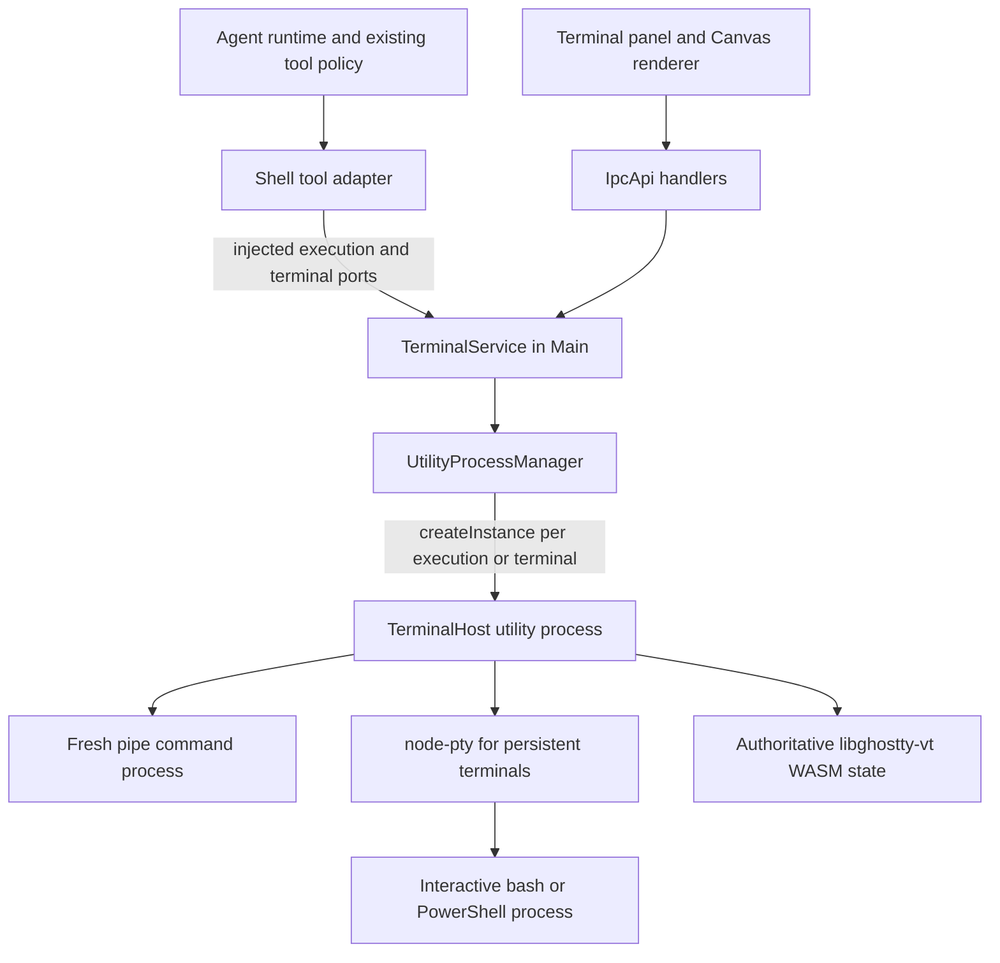

# Agent Note: 智能体 shell 工具与用户共享终端会话

Status: proposed

[English](2026-11-14-shared-agent-terminal.md) | 中文

## 问题

智能体 shell 执行需要用户可以打开和观察的终端界面，并允许显式接管交互式 PTY。共享 UI 和进程基础设施必须保留新命令进程与跨调用保留状态的 shell 之间的区别。只有输出转发无法确立进程所有权；把所有原生 shell 工具替换成持久 shell，会悄悄改变其工作目录、环境和完成契约。

当前桌面适配器在 [PiRuntimeConnection.ts](../../../../src/main/ai/runtime/pi/PiRuntimeConnection.ts) 和 [durableDesktop.ts](../../../../src/main/ai/runtime/piDurable/durableDesktop.ts) 中安装 SDK shell 工具。本地基线 `e282668a2b035656a219e6640611af3601e56195` 将两套 SDK 都固定为 `1.5.2`。Pi 提供可替换的 `BashOperations` 和 `PowerShellOperations`；Pi Durable 向工具提供 `ExecutionEnv`。后者的内置 PowerShell 工具把可执行文件及参数数组传给 `env.exec()`，会启动另一个 PowerShell 进程，而不是选择一个持久 PowerShell 会话。

这是新的终端能力。[运行时所有权 Spec](../simplification/2026-11-05-agent-runtime-boundary-ownership.md) 继续负责原生执行、回复完成和后台智能体行为。本提案不替换这些契约，也不替换现有启动外部终端的 CodeCli 功能。

## 提案

### 范围与选型

使用 `node-pty` 管理 PTY 进程，使用 `libghostty-vt` 实现终端仿真。Cherry 负责会话身份、访问权限、命令执行、观察和界面。首版覆盖本地 macOS、Linux、Windows 终端，Pi 与 Pi Durable shell 工具、终端查看、用户显式接管及资源清理。

关闭或隐藏终端面板后，只要 Cherry 仍在运行，命令或 shell 就继续运行。首版包含显式 Bash 后台执行，以及运行中 Bash 调用的转后台操作。应用退出时停止所属进程。应用退出后保活、SSH 终端托管、移动端终端界面，以及替换 Claude Code 或 ACP 的原生 shell 执行，均不在本 Spec 范围内。这些运行时保留现有执行路径，不得宣称已经接入。

### 一次性命令与持久终端

原生 `bash` 和 `powershell` 保留新命令工具的语义。每次调用都使用传入的 cwd 和环境启动新进程。前台调用根据该进程退出判定完成；显式转后台的 Bash 调用则返回同一次执行仍在运行的回执。命令中的 `cd`、export、函数或 PowerShell 变量不影响后续调用。保留 SDK 的 pipe 和非交互式默认值。把输出显示在终端 UI 中，不代表进程变成交互式，也不授权在 PTY 下重启它。后台能力不会把新的 Bash 调用变成向先前 shell 发送输入。

通过 `terminal_open`、`terminal_send`、`terminal_read`、`terminal_signal`、`terminal_close` 和 `terminal_list` 单独暴露持久 PTY。这些是新增且显式治理的工具，需要各自声明策略。当模型需要有状态 shell、REPL 或交互式 stdin 时使用。工具描述必须说明状态会延续，输入等待结束不一定代表命令完成。原生 shell 工具不能因适配器的隐式选择而获得持久会话语义。

两条路径共享 TerminalService 的所有权、输出订阅、访问校验和 UI。命令路径使用新的 pipe 进程；终端路径使用 `node-pty`。持续运行的长命令、持久交互 shell 和应用退出后存活的进程是独立能力。转后台是显式操作，不因输出静默、等待预算或执行期限而自动发生。不承诺 daemon 保活。

### 后台执行与保留范围

分别记录传输方式（`pipe` 或 `pty`）、保留范围（`turn` 或 `session`）和等待状态。普通原生命令开始时归 turn 保留。Bash 使用 `run_in_background: true` 启动，或通过运行中调用的转后台操作提升后，归 session 保留。持久终端及通过显式终端工具启动的程序从创建起归 session 保留。附着面板不改变这些字段。因此，已 yield 的终端 dev server 在停止智能体后继续运行；只是把普通 Bash 输出显示到终端面板中，该命令仍归 turn 所有，停止智能体时应停止。

转后台是 host 对已有 `executionId` 串行处理的状态变更，绑定精确工具调用和所有者。保留 PID、pipe 流、采集游标和原始执行期限。先转移取消所有权，再把原工具调用结算一次，返回 `status: running`、`executionId`、已采集输出和下一输出游标，不包含最终退出码。不能追加 shell `&`、重新启动命令，或把回执当成进程完成。重复转后台返回同一回执。退出先发生时返回真实结果；Stop 先被准入时，转后台不能复活执行。来自旧前台等待的后续取消不能停止已转后台的任务。

为归 session 所有的 pipe 任务暴露 `shell_task_list`、`shell_task_read` 和 `shell_task_stop`。它们使用已有 `executionId`，不建立第二份进程注册表，也不接受任意 PID。读取返回有界的游标输出、明确的截断信息，以及已知时的真实最终状态。停止只针对该执行的受管理进程范围。完成时只更新一次任务面板和原执行记录，不为原工具调用产生第二个结果，也不自动启动新的模型轮次。智能体可在后续调用中读取任务。只要 Cherry 和对话仍存活，session 保留就跨运行时连接替换继续有效；删除或 purge 对话及应用退出时停止。显式传入的执行 timeout 在转后台后仍是期限，不变成 yield 预算。

已安装的 Pi `1.5.2` Bash schema 只有 `command` 和 `timeout`；`BashOperations.exec()` 及工具结构化结果要求已完成的退出结果。Durable `1.5.2` 同样要求 `ShellExecResult.exitCode`，并规定 context abort 取消进程。后台路径需要在每套原生工具上游增加有类型的运行中／已完成结果、显式后台输入与控制，以及取消所有权交接。实现适配器前先确认这些 hook；不能伪造退出码、把运行回执抛成执行错误，或绕过现有原生工具策略。除已批准的增量后台能力外，未转后台调用保留现有 schema 和完成行为。PowerShell 在明确交付等价的原生后台契约前保留前台行为。

### 命令提交与交互输入

`terminal_send` 使用两种不同的输入。`kind: command` 只在 shell integration 确认受管理 shell 位于提示符、没有活跃前台程序时，提交一条完整 shell 命令或多行脚本。它分配独立于 send 的 `operationId` 的 `commandId`。`kind: input` 将给定数据原样写入当前前台程序，不自动添加换行，例如 REPL 或密码提示；请求携带预期 `commandId`／程序 revision，不分配新的 shell 命令。这是单独授权的原始输入能力，不是可以应用 Bash 放行规则或改写的命令。

串行化短暂的写入准入，不锁住整个输出等待。一个终端最多有一个受管理 shell 命令处于活跃状态，但运行中的命令可以在先前 send 等待期间或 yield 后接收显式授权的输入。程序活跃时提交新命令返回 busy；向该已知程序写入输入则允许。如果程序 revision 变化、shell 已回到提示符、控制权已转移或无法确定程序身份，拒绝输入。未知状态不能隐式转成 shell 命令。`terminal_read` 提供有界屏幕文本或采集游标之后的输出，并区分两种表示。等待、进程执行、shell 就绪及真实命令退出分别返回。

### 2026-11-14 上游调研记录

这些结论来自固定源码快照和文档，不是为 Cherry 执行的运行时测试，也不代表每个已发布客户端的行为。

| 项目与快照 | 一次性执行 | 持久或保留的执行 | 对 Cherry 的影响 |
| --- | --- | --- | --- |
| OpenCode `dev`，`024a1462f55aa64243b859729b2d0816b42b17e3` | 当前 `shell` 工具构造新的 `-c` 命令或 PowerShell `-Command` 进程 | 独立的持久 PTY 与 pipe 命令共享 daemon，计划内服务交接可以保留进程 | 共享基础设施，不合并命令与 shell 状态语义 |
| DSH `master`，`39163dd30f703a79079e2d2446545cff3c453738` | `bash` 和 `pwsh` 每次启动新进程，后台 job 只保留该次命令 | 显式 terminal 工具保留 shell 状态，独立侧栏控制器支持智能体与用户转移控制权 | 保留不同工具契约，区分就绪与退出 |
| Codex `main`，`b1573f102413e96a6481087922bf425231222dee` | `ExecCommandLifetime::OneShot` 提供完成超时，不返回可恢复会话 ID | 交互式 `exec_command` 保留一个进程供 `write_stdin` 使用，新的 exec 调用不自动进入该 shell | 分开建模进程保留与持久 shell 状态 |

OpenCode 的 [shell 工具](https://github.com/anomalyco/opencode/blob/024a1462f55aa64243b859729b2d0816b42b17e3/packages/core/src/tool/plugin/shell.ts) 可以把前台超时转为后台 job，并在完成后通知。[参数构造器](https://github.com/anomalyco/opencode/blob/024a1462f55aa64243b859729b2d0816b42b17e3/packages/core/src/shell/select.ts) 仍会创建新命令。[持久进程接口](https://github.com/anomalyco/opencode/blob/024a1462f55aa64243b859729b2d0816b42b17e3/packages/core/src/persistent-pty/index.ts) 和 [shell 服务](https://github.com/anomalyco/opencode/blob/024a1462f55aa64243b859729b2d0816b42b17e3/packages/core/src/shell.ts) 区分 PTY 与 pipe 进程、显式交接和进程丢失。计划内服务交接不等于机器重启恢复。

DSH 的 [Bash](https://github.com/deepseek-ai/deepseek-harness/blob/39163dd30f703a79079e2d2446545cff3c453738/packages/shell/tool-bash/README.md) 和 [PowerShell](https://github.com/deepseek-ai/deepseek-harness/blob/39163dd30f703a79079e2d2446545cff3c453738/packages/shell/tool-pwsh/README.md) 契约明确说明，一次性调用之间不保留 shell 状态。[终端工具](https://github.com/deepseek-ai/deepseek-harness/blob/39163dd30f703a79079e2d2446545cff3c453738/packages/experimental/tool-terminal/README.md) 明确要求有限工作优先使用一次性操作。[行式后端](https://github.com/deepseek-ai/deepseek-harness/blob/39163dd30f703a79079e2d2446545cff3c453738/packages/terminal/terminal-bash/README.md) 提醒 `inferred_idle` 和等待超时不证明退出，也不承诺全屏 TUI 支持。独立的[侧栏终端控制器](https://github.com/deepseek-ai/deepseek-harness/blob/39163dd30f703a79079e2d2446545cff3c453738/packages/api/terminal-controller/README.md) 在用户首次键入后转移控制权：智能体仍可读取，但写入、发信号和关闭会被拒绝。浏览器刷新恢复不代表进程能在 Host 或所有者释放后保留。

Codex 的[生命周期准备](https://github.com/openai/codex/blob/b1573f102413e96a6481087922bf425231222dee/codex-rs/core/src/tools/handlers/unified_exec/preparation.rs) 和 [OneShot schema 适配](https://github.com/openai/codex/blob/b1573f102413e96a6481087922bf425231222dee/codex-rs/core/src/tools/handlers/unified_exec/exec_command.rs) 区分执行期限与交互式 yield。返回的 `session_id` 指向被保留的进程，不是自动共享的 shell。[进程管理器](https://github.com/openai/codex/blob/b1573f102413e96a6481087922bf425231222dee/codex-rs/core/src/unified_exec/process_manager.rs) 只在 TTY 模式下允许普通 stdin，特殊中断处理除外。要保留 shell 状态，需要启动交互 shell 并向同一个进程写入。[会话关闭](https://github.com/openai/codex/blob/b1573f102413e96a6481087922bf425231222dee/codex-rs/core/src/session/handlers.rs) 会终止所属 exec 进程。

采纳的结论是共享执行所有权和终端呈现，同时将一次性命令与持久终端作为不同契约暴露。这替换初稿对原生 `bash` 和 `powershell` 默认使用持久 shell 的解释。

### Claude Desktop 发布产物调查（2026-11-14）

对本机 Claude Desktop `5.11492.5` 的静态检查覆盖 `Contents/Resources/app.asar` 和 `ion-dist.asar`。两者的 SHA-256 分别为 `2c515441d5d0504a96ac3e49bcc4c1244085c0e76ad23ae58ddd8f736100479e` 和 `1d55d633d14aede748af3cb22c244f4ddc2f795d9b1153b175b993ae5d46aa1b`。下列路径是归档内的逻辑路径，不是 Cherry 源码或上游开发源码路径。

- **后台控制：** `app.asar/.vite/build/index.chunk-D1yJ0UIX.js` 获取已有 `session.query`，调用 `backgroundTasks(toolUseId)`。`index.chunk-fch7zeJ_.js` 中的 SDK 封装发送 `{ subtype: "background_tasks", tool_use_id }`。这条 Desktop 路径既不调用 `startShellPty`，也不通过 `run_in_terminal` 重新提交命令。后台输出通过 `get_task_output(taskId)` 或输出文件读取，renderer 定期刷新文本。这证明它在控制已有调用，不能证明进程转换成了交互式 PTY。本次检查没有进入实际 CLI Bash 执行器，也没有在运行时验证 PID 连续性。
- **显式终端工具：** `app.asar/.vite/build/index.chunk-Me4G-tma.js` 实现了 `run_in_terminal`、`open_terminal_tab`、`list_terminal_tabs`、`read_terminal` 和 `stop_terminal_tab`。工具指引建议短命令用 Bash，用户需要查看和控制的长任务或交互工作用终端工具。新 tab 经过 `nextClaudeTabId → startShellPty → typeWhenShellReady`；可复用的 `tab_id` 经过 `claudeTabReuse → typeWhenShellReady`，向原 shell 写入。读取返回终端屏幕文本；停止默认发送 Ctrl-C，`close: true` 则结束 shell。创建或运行 tab 不必打开面板。工具是否可用取决于应用、组织、会话及沙箱策略。
- **输入所有权：** 复用要求 tab 由 Claude 创建、处于空闲、名称可核验且用户没有输入。等待调用期间用户键入会产生 `user_typed`；tab 可能包含用户工作后，会拒绝后续复用或停止。提示符 integration 和前台进程检查避免把新的 shell 命令输入忙碌程序。Cherry 保留显式接管和归还控制权的契约，不隐式照搬 Claude 的首次输入所有权策略。
- **PTY 基础设施：** `app.asar/.vite/build/index.chunk-hvY9X4w1.js` 包含 `ShellPtyManager`，并通过 `MessageChannelMain` 连接共享的 `utilityProcess` host。`pty-host/ptyHostWorker.js` 导入 `node-pty`，按 `ptyId` 处理 spawn、write、resize、kill、data 和 exit。一个 worker 管理多个 PTY。`ion-dist.asar/assets/v1/c6bf19e8f-Df49HNKY.js` 包含 xterm 终端、fit 和 WebGL addon 路径，输入转给 `writeShellPty`。Cherry 拟定的每实例 utility 隔离和 host 权威 Ghostty VT 是独立选择，不能视为该参考实现已经证明的行为。
- **独立 Bash mode：** `runBashCommand → ShellPtyManager.runCommand → startBashPty` 使用可复用的隐藏 shell。`bashPtyProcesses` 与可见的 `shellPtyProcesses` 是不同 Map；重置提示明确说明 cwd 和环境状态丢失。这个入口不能证明模型原生 Bash 工具共享可见终端 tab。

Cherry 采纳这种区分：命令执行、等待、保留后台工作、持久 shell 状态及面板可见性是不同契约。Cherry 按上述任务身份、读取、停止和结算契约增加显式 Bash 转后台，不自动提升。交互附着要求创建进程时选择 PTY；打开面板不能为 pipe 进程事后补上 PTY，也不能重跑命令。

这些结论是单个安装版本的静态证据，不是 Electron 交互测试，也不证明每项功能都已启用。REA 的全应用语义图覆盖不完整；结论来自定向模块检查。解包的 `claude-native-binding.node` 与 ASAR 声明的 hash 不同，使用 `record-and-continue` 记录了该差异；本次分析不依赖这个原生模块，也没有确定差异原因。Cherry 中未复制专有实现。

### 技术边界

各上游组件的职责不同：

| 组件 | 职责 | 选择 |
| --- | --- | --- |
| `node-pty` | 创建和控制交互式 PTY，传输输入、输出、尺寸变化和退出事实 | 在 utility process 中为持久终端使用，Windows 使用 ConPTY |
| `libghostty-vt` | 解析终端序列、维护终端状态、编码终端输入与回复 | 每个终端使用一个权威 VT 实例 |
| Canvas 渲染器 | 绘制单元格快照并处理浏览器交互 | 由 Cherry 实现 renderer 接入 |
| `herdr-core` | 持久会话、attach、远程机器和智能体关系 | 参考生命周期设计，不作为运行依赖 |

这一职责划分参考了使用 WASM 与 Canvas 2D 的 [T3 Code Web 适配器](https://github.com/pingdotgg/t3code/blob/0a8aaa3ccb944dadb70054ae4ef2e29897b0db03/apps/web/src/terminal/ghostty/README.md)。Cherry 将权威 VT 放在 PTY host，使终端在没有挂载 renderer 时仍能正常工作。[Ghostty 库](https://github.com/ghostty-org/ghostty/blob/6d9577708a211b0e6c5e6c6886f3cfb7efc47555/README.md)、[node-pty](https://github.com/microsoft/node-pty/blob/35c28c7d68a192699e70b1e6a142908bdccd9212/README.md) 和 [Herdr attach 协议](https://github.com/herdrdev/herdr-core/blob/c84d6e76156a6c2aac1da20efbe800f10acfe897/schema/README.md) 是源码参考，不构成 Cherry 的性能或兼容性证据。

### 服务依赖与进程所有权



箭头表示调用与依赖关系。PTY 输出和屏幕更新沿这些连接返回。智能体工具直接调用注入的 host 接口，不经过 renderer IPC。工具完成不依赖面板挂载、绘制或确认更新。

`TerminalService` 是唯一新增的生命周期服务。它继承 `BaseService`，使用 `Phase.WhenReady`，注册到 `serviceRegistry.ts`，并声明同阶段的 `UtilityProcessManager` 依赖。它负责执行及会话注册、准入、输入所有权、订阅和独立进程客户端。桌面运行时 host 注入接口；运行时包不导入 `application` 或 Cherry 服务。`TerminalService` 不导入智能体运行时实现、UI 或模型代码。

通过 `createInstance()` 使用[独立拥有的 utility process 实例](../../../../src/main/core/utilityProcess/README.md)，每个活跃命令或持久终端一个，不使用 manager 的共享缓存客户端。TerminalHost 持有所选 pipe 进程或 `node-pty` 句柄、VT 投影和有界输出采集；只有持久分支需要 shell integration。命令完成后释放进程实例，同时保留可观察的输出。关闭持久终端只停止其自身实例。TerminalHost 是执行模块，不是另一个 DI 服务。它使用 utility runtime 提供的 logger 和初始化数据，不导入 Main 的容器、数据库或 IPC。

### 模块位置与传输

| 区域 | 建议位置 | 边界 |
| --- | --- | --- |
| 终端服务与执行契约 | `src/main/services/terminal/` | 仅供 Main 使用的状态与 host API |
| PTY 入口与处理模块 | `src/main/services/terminal/utilityEntries/` | 仅依赖 utility runtime 与原生执行 |
| Pi 与 Pi Durable 适配器 | 现有 `src/main/ai/runtime/pi/` 和 `piDurable/` | 翻译原生工具调用并保留其策略 |
| 命令和事件 schema | `src/shared/ipc/` | 经校验的跨进程 DTO，不含可变状态 |
| Renderer 命令和事件 | `src/main/ipc/handlers/` 及 renderer IPC 客户端 | 轻量发送方与访问校验，再委派执行 |
| 终端 UI 与渲染 | `src/renderer/components/terminal/`，底层辅助模块放进现有 renderer 分类 | Canvas 交互及 `@cherrystudio/ui` 控件 |

终端命令使用现有 IpcApi 请求，订阅使用定向事件。终端输出只发给有权订阅的调用方，不做全局广播。PTY 流量使用 utility 层的有界双向流。终端流归 `TerminalService` 所有；renderer 订阅是另一个生命周期更短的资源。释放后者不能取消前者。

按现有原生包规则，将 `node-pty` 放入生产依赖。在打包产物中验证其 addon、spawn helper、Electron ABI 和各架构文件。固定 Ghostty 源码及 WASM 构建工具链，将 WASM 作为应用资源发布并保留许可证。新增资源、integration 脚本及输出存储路径统一走路径注册表。终端命令使用 IPC；原始输出和临时屏幕状态不进入 DataApi。

### 身份、状态与准入

| 身份 | 含义 | 所有者 |
| --- | --- | --- |
| `terminalId` | 一个显式打开的持久 shell 及其 VT 状态 | TerminalService |
| 进程 generation | 一个存活的 utility process 实例 | UtilityProcessManager |
| `executionId` | 一条获准执行的一次性命令及其输出视图 | TerminalService |
| 终端操作身份 | 一次 send/read/signal 操作，与命令退出不同 | TerminalService |
| `commandId` 与程序 revision | 受管理命令及其当前前台程序，用于隔离过期 stdin | TerminalHost |
| 控制 token | 当前获授权的输入持有者，接管和显式归还时替换 | TerminalService |
| 原生工具调用身份 | 现有运行时上下文及工具调用身份 | 智能体运行时 |
| 订阅身份 | 一个获授权的观察者及其 revision 游标 | TerminalService |

每次一次性调用创建新的执行。持久会话只在显式打开终端时分配，归精确的智能体上下文所有，并按 shell 类型分开。子智能体和 fork 后的上下文不继承存活终端；共享工作区路径不代表共享 shell。Host 记录与精确运行时上下文的绑定。模型参数不能选择任意用户终端或改变终端所有者。

分别记录持久进程生命周期（`starting`、`running`、`closing`、`exited`、`lost`）、清理确认状态、保留范围、输入控制权（`agent`、`user`）及就绪证据。终端串行准入写入，最多允许一个受管理 shell 命令处于活跃状态；获授权的 stdin 不是新命令，输出等待不占用写入 gate。忙碌时显式拒绝命令提交，不进入不可见的输入队列。在存活 generation 内，重复的原生调用映射到现有执行或操作，不能启动第二份命令或重复写入输入。主动重试需要新的原生工具调用。

一次性执行结果区分完成及真实进程退出码、取消、执行超时和进程丢失。终端 send 报告有界输出、进程及控制状态，以及等待结束的原因：提示符就绪、有证据的输入等待、等待预算 yield、会话退出或控制权转移。Send 返回不证明命令退出。输出静默、形似提示符的字符串、流断开和智能体回复完成，都不能证明命令成功完成。

### 持久 shell 与命令边界

一次性工具保留各次调用的 cwd、环境、shell 查找、login PATH 准备及 `mergePiShellExecutionEnv` 行为。新的命令进程默认保持非交互式。原生工具结果根据真实进程退出产生，无需通过提示符 integration 检测完成。

显式持久终端使用受控的 shell 初始化及 Cherry 的 shell integration。不悄悄向智能体执行加入任意交互式 profile。启动环境与工作区目录只在打开终端时应用一次。后续 `cd`、export、PowerShell 变量和用户修改只保留在该终端中。工具指引必须区分这些会话与原生一次性工具。原生运行时的默认工作区不能在 send 时重置存活的持久 shell；显式重置需要独立终端操作。

在持久终端内，使用各 shell 自己的 integration 报告就绪、已知命令边界和当前目录。解析器必须跨任意 PTY 数据块边界增量解析 integration 帧。输入在现有 shell 作用域中运行，包括多行脚本和 REPL 交互。Integration 能证明真实命令完成时，单独保留该事实；无法确认的完成状态保持未知。Bash 与 PowerShell 分别实现引用、状态采集和取消。PowerShell 状态必须兼顾原生程序退出码与 PowerShell 错误，不能复用陈旧的 `$LASTEXITCODE`。

Integration 帧携带操作关联信息，并从模型可见输出中移除。它们用于记录，不构成对同一用户权限下程序的授权或安全边界。输出不能创建执行、授予输入权限或触发重试。如果 `exec`、替换 shell、修改 integration hooks 或异常帧使受跟踪的 shell 事实丢失，应显式报告就绪或完成状态未知，并在新建受管理终端前拒绝依赖这些事实的操作。原始交互只能在其声明的策略范围内继续。不能猜测成功，也不能静默切换持久与一次性模式。

Pipe 命令保留原生 stdout/stderr 处理；终端 UI 投影同一次执行采集，不改变原生结果。PTY 输出合并 stdout 与 stderr，因此持久终端结果只承诺组合输出。保留有序输出供终端模型使用，并从同一次采集中生成有界、可读的工具文本。Integration 帧不能出现在模型文本中；不能把持久屏幕读取宣称为纯净的逐命令 stdout。保留现有 SDK 的输出限制、截断说明和可读取的输出文件引用；采集或存储失败必须明确报告，不能把部分文件宣称为完整输出。

### VT 状态、重连与流控

即使没有观察者，TerminalHost 也持续将输出送入权威 `libghostty-vt` 投影。对于 PTY，它还负责终端自动回复和输入编码；renderer 不独立回复终端查询。Pipe 执行视图除显式停止进程外仅供观察，查看它不能启用 stdin、改变 TTY 检测或重启命令。交互式 PTY 的浏览器按键、粘贴、指针及 IME 提交事件根据 host 当前终端模式编码。React 负责控件与生命周期；单元格更新和绘制不进入 React state。

向观察者发送带 revision 的屏幕快照与有界补丁。Attach 在同一有序订阅中取得基线 revision 及后续更新。重连时，如果游标不存在或太旧，则获取新快照，不重新执行命令。持久 scrollback 保留在 TerminalHost，初始上限为 5,000 行和 8 MiB 文本，以先达到者为准。按完整记录淘汰，不截断 UTF-8 字符。一次性执行完成并释放 worker 后，视图使用有界保留的采集结果。浏览器视图只保留有界视口数据及选择状态。

每个终端传输帧的 payload 最多为 64 KiB，每个观察者的待处理数据最多为 1 MiB。大快照使用同一快照身份分块，收齐后才能发布。观察者落后时合并屏幕补丁，或用新快照替换过期 revision。隐藏或停滞的面板不能阻塞 PTY 解析、终端回复、命令完成或其他观察者。在采集与 PTY 之间应用背压，并显式报告存储失败，不能使用无界 JavaScript 缓冲或静默丢弃命令输出。这些初始预算是正确性限制，不是性能结论。

只有当前控制终端的用户视图可以改变尺寸。没有控制视图时保留上次尺寸或创建尺寸。智能体观察者、隐藏面板和其他窗口不能抢走 resize 所有权。选择、滚动、链接、字体、CJK 字宽、emoji、IME、无障碍终端输出、键盘焦点和剪贴板行为属于 renderer 契约；只有 Canvas 不满足无障碍要求。终端发起的链接和剪贴板请求仍需经过明确的 host/UI 策略。

### Canvas 2D 绘制与浏览器输入

使用 renderer 内的 Canvas 2D surface 接收单元格数据，不在 Main 中生成图片。Ghostty 在 TerminalHost 中负责终端解析、网格与折行、模式、光标状态和历史。从固定版本 T3 的 [Canvas 绘制器](https://github.com/pingdotgg/t3code/blob/0a8aaa3ccb944dadb70054ae4ef2e29897b0db03/apps/web/src/terminal/ghostty/renderer.ts) 和[快照类型](https://github.com/pingdotgg/t3code/blob/0a8aaa3ccb944dadb70054ae4ef2e29897b0db03/apps/web/src/terminal/ghostty/core.ts) 起步，把绘制辅助函数适配到 Cherry 的序列化帧，并保留 [MIT 声明](https://github.com/pingdotgg/t3code/blob/0a8aaa3ccb944dadb70054ae4ef2e29897b0db03/LICENSE)。不能把其浏览器 WASM loader 和 surface 直接复制成第二套权威仿真器：Node 资源加载、各视图订阅和 Cherry 输入所有权需要独立接入。拟定数据流如下：

```text
PTY bytes -> Host Ghostty VT -> revisioned cell snapshot/patch
         -> TerminalService / targeted IPC -> renderer viewport cache
         -> requestAnimationFrame -> Canvas 2D
DOM input -> authorized host input encoder -> the same PTY
```

帧携带终端 generation、视图身份、屏幕／几何 epoch、基线 revision 与当前 revision、网格尺寸、视口位置、脏行和光标状态。单元格携带字素文本、占用列数／续占标记、解析后的前景与背景色、文本样式及可选链接元数据。序列化值，不发送 WASM 指针或内存视图。Renderer 只保存有界的可见网格；读取 host 历史时返回有界视口页。每个观察者拥有自己的滚动位置和选择，因此滚动某个观察者不能带动其他视图或 resize PTY。Epoch 变化使旧坐标失效。缺少基线 revision 时，按既定有界传输规则请求新快照。

绘制辅助函数在等宽字体加载后测量单元格宽度、行高和基线，随后按网格坐标绘制连续背景块、相同样式的文本段和装饰线。位置由 Ghostty 的列占用决定，浏览器文本测量不重新决定折行或 Unicode 字宽。宽字、组合字素、回退字体和提示符符号在已分配的单元格内定位和裁剪。使用一层不透明内容 Canvas 和一层透明光标／选择覆盖层。合并脏行，每个动画帧最多绘制一次；光标闪烁或选择变化只重绘覆盖层。字体、主题、DPR、网格或视口变化使相应帧失效。隐藏视图停止绘制，恢复时获取一致快照；host 解析与 PTY 回复继续运行。

布局使用 CSS 像素，Canvas backing store 按设备像素缩放以保证文字清晰。等待字体加载，测量 padding 和单元格指标，只允许控制视图通过 `ResizeObserver` 合并提交 `cols`／`rows` 变化。按 host 已确认的几何 epoch 绘制；不能把旧单元格拉伸到不同网格后，再用新坐标解释点击。绘制失败显示视图错误及重新附着操作，不重启或停止进程。这些选择参考浏览器的 [Canvas 指南](https://developer.mozilla.org/en-US/docs/Web/API/Canvas_API/Tutorial/Optimizing_canvas)，不是经过测量的性能结论。

Surface 包含真实 textarea，用于键盘焦点、剪贴板和 IME。输入法组合文本显示在光标位置，只发送一次已提交文本，不重复发送中间按键事件。浏览器处理器通过当前控制 token 发送规范化的按键、粘贴和指针事件；host 按当前终端模式编码，包括 bracketed paste 和鼠标上报。选择与复制使用解码后的单元格文本、折行元数据和匹配的视口 revision，不做像素 OCR。使用 DOM 控件及有界的无障碍文本／实时输出层，让 Canvas 不是唯一可读界面。React 负责面板、控件和生命周期，不拥有单元格缓存或绘制循环。

首版 renderer 面向文本终端和备用屏幕 TUI，覆盖颜色、样式、光标形状、CJK、emoji、选择、链接、粘贴和 IME。不宣称支持 Kitty/Sixel 图片绘制、GPU renderer 或 OffscreenCanvas worker。Host 验证必须覆盖固定 ABI 在 Node 中的渲染数据、回复、输入编码及独立视口投影，再验证真实 Electron 字体、TUI 和 IME 场景。ABI 或绘制支持缺失时，需要明确的上游改进或 Spec 修订，不能在 renderer 中隐藏第二套解析器。

### 工具接入与策略

Pi 通过新命令 `operations` 接入 `createBashToolDefinition()` 和 `createPowerShellToolDefinition()`。将 `onData`、abort、timeout 和真实退出状态桥接到注入的命令执行接口。保留前台输出处理、新进程语义和现有工具 gate。通过上述上游 hook 增加已批准的 Bash 后台输入／运行中结果路径。单独使用 `spawnHook` 只能修改调用上下文，不能完成执行桥接。任务控制及终端工具通过 SDK 支持的工具扩展路径注册。

Pi Durable 将 `ExecutionEnv` 的 shell 部分桥接到新的命令执行，同时保留 `NodeExecutionEnv` 的文件系统操作。字符串保留原生 shell 命令语义；数组按原样执行可执行文件及其精确参数。保留原生工具身份、前台结构化输出、各流来源信息、输出窗口、spill 行为及 unsafe replay 分类。在上游扩展原生 Bash 的结算和取消所有权以支持后台回执；普通 context 取消仍停止归 turn 所有的命令。任务控制及持久终端工具注册为独立的原生扩展。本设计不要求把内置 PowerShell 改为持久执行器，也不要求反向解析其 argv。实现后台适配器前先解决已确认的 SDK 结果／控制限制，不能绕过工具 gate。

现有禁用工具检查、权限模式、破坏性命令审批、全局安装和 SQLite guard 继续在执行前运行。仅适用于 Bash 的 RTK 改写仍只用于 Bash。运行时包与 `agent-behavior` 保持当前策略职责；OS 进程句柄留在终端 host。用户输入经过独立的授权交互路径，不能被错误标记成已获批准的智能体输入。

一次性审批使用该调用的精确命令、cwd、环境及进程模式。持久终端操作使用当前控制权和执行上下文 revision。准入时重新检查相关 revision；如果等待审批期间用户输入或 shell 状态发生变化，拒绝过期准入，要求新的工具调用。不能把一次性命令放行规则应用于任意终端输入，也不能在持久 shell 已移动目录后继续按原始工作区检查相对路径。Shell `cd` 不重新绑定智能体工作区，也不改变文件工具的路径解析；工具指引和终端显示需要区分这些目录。

### 用户接管、超时与清理

| 操作 | 必须产生的结果 |
| --- | --- |
| 打开、隐藏、切换或关闭面板 | 附着或解除观察，保留执行与 shell 状态 |
| 在对话中停止智能体 | 停止模型工作和等待，停止该 turn 未转后台的原生命令；保留归 session 所有的 pipe 任务、持久终端和用户控制的程序 |
| 将运行中的 Bash 转后台 | 将同一次执行改为 session 保留，并以运行回执把原等待结算一次 |
| 在智能体控制的 PTY 中键入 | 显式接管前拒绝普通输入，同时保留可见的中断操作 |
| 接管运行中的 PTY | 转移输入所有权，将活跃智能体操作以用户已接管及已采集输出结算，保留进程供用户操作 |
| 归还控制权 | 显式转移并重新校验终端状态后，才允许下一次智能体 send；不能从就绪推断命令完成 |
| 中断或达到一次性执行超时 | 停止该命令的进程范围，确认完成或终止后才释放所有权 |
| 达到终端 send 等待预算 | 返回有界输出和当前状态，保留 shell 或前台程序运行；没有证据时报告完成状态未知 |
| 观察者丢失或观察等待超时 | 只解除该观察者，保留执行 |
| 显式关闭终端 | 停止其受管理进程范围，确认关闭并释放其 utility 实例 |
| Utility 崩溃或应用重启 | 将未完成执行标为中断，不自动重放 shell 命令，不假装旧 PTY 仍然存在 |

保留原生 `timeout` 参数的执行期限语义，显式转后台后仍有效。持久工具使用名称不同的等待预算，它只返回当前输出，不杀进程。Send yield 或视图订阅超时都不证明命令完成。归 session 保留的终端程序，包括已 yield 的 dev server，在停止智能体后继续运行，不需要再次执行转后台操作。UI 区分前台命令、后台任务和持久终端；附着普通命令的输出视图不改变其保留范围。

取消持久 `terminal_send` 只结束该操作的等待，不停止 shell 或前台程序。`terminal_signal` 用于中断当前程序，`terminal_close` 用于结束 shell 及其受管理进程范围。取消归 turn 所有的原生命令会停止其进程范围；转后台后来自旧前台的取消则不会。停止智能体不等于删除对话或关闭终端。为保留的工作提供明确的任务／终端停止控件。

交互式 PTY 接管时，以控制权转移状态把受影响的智能体等待各结算一次；后续用户输出属于终端，不再写入已完成的操作。允许用户输入前先撤销旧写入／控制 token。转移后拒绝智能体写入、发信号和关闭，获授权的读取可以继续。旧智能体取消、运行时回收、连接释放及延迟回调都不能杀死用户进程。TerminalService 在对话及用户控制下保留资源；替换后的运行时不会自动获得输入权。显式归还时，校验状态后向当前获授权运行时授予新 token。如果 REPL 仍活跃，只能向该程序输入，不能提交新的 shell 命令。一次性 pipe 视图提供停止，不提供 stdin 接管。

中断首先发送 PTY 的 Ctrl-C，或 pipe 进程范围支持的优雅中断，最多等待 2 秒以获取命令／进程证据。程序忽略 Ctrl-C 时，终端中断不自动杀死可复用 shell；显示仍在运行，并提供强制停止。强制停止针对已验证的当前程序范围；无法将其与 shell 隔离时，应提供明确的强制关闭终端操作，不能静默销毁 shell。任务停止、终端关闭、归 turn 所有命令的清理及应用退出会对其所属范围升级处理：优雅终止最多等待 3 秒，然后强制终止并最多等待 2 秒确认。POSIX 根据目标使用已验证的进程组／前台范围及 SIGTERM/SIGKILL；Windows 使用经过验证的受管理进程树／ConPTY 实现，强制终止使用 `taskkill /T /F` 或已验证的 Job Object 接入。已有[进程终止辅助函数](../../../../src/main/utils/processRunner.ts)的真实句柄／进程组契约适用时应复用；PTY 句柄需要独立的平台验证。这些是初始策略预算，不保证 OS 总能完成终止。

停止中／关闭中的资源继续保留注册，拒绝新写入，并保留确认所需的进程句柄、generation 和输出。强制终止仍无法确认时，把清理状态置为 `unconfirmed`，显示最后错误及重试强制停止，不能报告成功或重开同一 generation。重复停止请求合并到同次清理或重试；目标必须是当前已验证的句柄／进程范围，不能使用持久化的裸 PID。Host 连接失败时，执行报告为 lost，清理在独立验证前保持 unconfirmed；这不证明后代进程已退出。确认受管理范围清理后才释放实例，不能先杀 host 并丢弃唯一的子进程句柄。[Node 的 kill 契约](https://nodejs.org/api/child_process.html#subprocesskillsignal) 区分信号送达和退出；[Windows Job Objects](https://learn.microsoft.com/en-us/windows/win32/procthread/job-objects) 提供进程分组机制，其保证必须在实际 PTY 接入中验证，不能因使用 node-pty 就作出假设。

运行时观察者释放连接时，通过现有运行时关闭屏障停止或协调其归 turn 所有的命令，不关闭归 session 保留的任务和终端会话。删除或 purge 对话及应用退出时，停止该对话所有保留工作，包括用户控制的终端，并保留可见的清理失败。终端状态仅存在于当前进程生命周期；工具历史保留执行引用和结果。应用重启后重新打开对话时，只有显式执行或打开终端才创建新 shell。主动脱离受管理进程范围的程序，不保证被终端关闭操作杀死；应明确报告这一边界，不能声称所有后代进程都已消失。

### 交付与验证顺序

| 层次 | 交付内容 | 进入下一层前需要的证据 |
| --- | --- | --- |
| Spec | 本双语 proposed 文档 | 实现前，当前 Spec PR head 获得人工批准 |
| SDK 后台契约 | Pi 与 Durable 的有类型运行回执、原生后台控制及取消交接 | 不伪造退出结果；通过真实原生工具调用验证转后台／Stop／退出竞争及 replay 行为 |
| 终端 host | 独立命令与 PTY 实例、权威 VT、integration、状态机与输出采集 | 无 renderer 时真实 bash 与 Windows PowerShell 的新命令隔离及持久 shell 状态、取消、异常 integration 和独立实例故障 |
| 运行时适配器 | Pi operations 桥接、Durable environment 桥接及显式终端工具 | 两套运行时的真实原生工具调用保留 guard、ID、结果、timeout 和 replay 行为，不获得持久 shell 语义 |
| Renderer | Attach/重连、快照、交互、显式接管与无障碍 | Electron 中真实 IME、TUI、多视图和关闭面板后执行场景 |
| 打包交付 | 原生 addon、helper、WASM 和 integration 资源 | 支持架构上的 macOS、Linux、Windows 打包产物，不依赖开发工具 |

实现各层期间保持文档为 proposed。使用覆盖受影响消费者的定向测试和明确测试路径，分别报告本地测试、Electron 运行、真实提供商工具调用、Windows 证据及打包产物证据。最终状态迁移需要覆盖下面每条验收标准。第一层 host 必须证明所选 Ghostty WASM 能在 Node 中无界面运行，并暴露本设计需要的渲染、输入及回复 API。如果不满足，应提出上游缺口并修订 Spec，不能另写第二套解析器或不可见的回退执行器。

## 考虑过的替代方案

- 使用 `herdr-core` 作为后端：提供持久 attach 和远程会话行为，但仍需要渲染器，并引入另一套会话、智能体关系和生命周期模型。应用退出后保活或远程终端成为必需时再评估。
- 使用 `xterm.js` 加 `node-pty`：拥有成熟的浏览器终端与交互生态。本方案选择 Ghostty 仿真内核，并接受验证 Cherry 渲染器、无障碍和 host 接入的成本。没有可比测量前，不声称速度优势。
- 使用 [HTML-in-Canvas](https://developer.chrome.com/blog/html-in-canvas) 绘制终端单元格：把 HTML 绘入 Canvas 时可保留 DOM 交互和无障碍能力，但增加了一份需要与 Ghostty 固定网格同步的 DOM 表示。首版终端 renderer 使用直接单元格绘制、普通 DOM 控件、真实 textarea 和有界无障碍文本。需要把可交互 HTML 嵌入变换画布时再评估；未测量前不声称其性能更差。
- 只在挂载的 renderer 中保留 Ghostty：终端查询和权威屏幕恢复仍依赖窗口。保留不可见 renderer 会让 UI 生命周期拥有后台 shell 执行。
- 让所有原生 shell 调用持久化：悄悄改变 cwd、环境、TTY、timeout 和完成假设。在共享进程基础设施上保留一次性调用及显式持久工具。只有输出镜像、没有共享所有权仍然不足。
- 让每个运行时或面板各自拥有 PTY：产生多套会话注册与取消行为。改用一个 TerminalService 及独立 PTY 实例。
- 将 Durable 可执行参数数组重新解释为持久 shell 文本：改变直接执行可执行文件的语义，并隐藏 SDK 耦合。应保留精确 argv 执行，并使用独立持久终端工具。

## 验收标准

- AC1 — 真实 Pi 与 Pi Durable Bash 调用只在终端 UI 中显示一次其实际执行输出；独立原生调用不继承先前调用的 `cd`、export 或函数。（验证：原生工具集成与 Electron；负责人：shell 适配器）
- AC2 — 真实 Pi 与 Pi Durable PowerShell 调用保持新进程，保留传入的 cwd、环境和精确 argv 语义，正确报告原生程序失败与 PowerShell 错误，不继承陈旧变量。（验证：Windows 原生 SDK 集成与 Electron；负责人：shell 适配器）
- AC3 — 关闭或隐藏面板不停止命令、不丢失终端查询回复、不阻止完成；重新打开后显示保留的终端状态，不重跑工作。（验证：无界面 PTY 与 Electron attach 场景；负责人：终端 host）
- AC4 — 显式 Bash 与 PowerShell 终端跨 send 保留 cwd、变量、函数和交互式 stdin，同时上下文、子智能体、fork 及 shell 类型保持隔离；重复准入不重复输入或命令，未经授权的 ID 被拒绝。（验证：所有权与使用真实持久 shell 的原生工具测试；负责人：TerminalService）
- AC5 — 多行输入、REPL、提示符、输入回显、跨块帧、替换 shell、异常 integration、输出静默和 send yield 都不能造成虚假的命令成功；真实进程退出与终端就绪保持不同。（验证：真实 shell 场景与解析边界测试；负责人：shell integration）
- AC6 — PTY 接管阻止智能体交错输入，将受影响等待各结算一次，保留用户进程，并在显式归还控制权前拒绝智能体写入、发信号和关闭；一次性 pipe 视图不启用 stdin 或重启执行。（验证：原生运行时与 Electron 交互场景；负责人：终端输入协调）
- AC7 — 原生一次性 timeout 只停止该命令；持久 send 的等待预算和观察超时保留工作运行，信号发送或未经确认的停止不能被报告为已证明的命令退出。（验证：真实进程和 PTY 取消及 Windows 进程测试；负责人：终端 host）
- AC8 — 缓慢或断开的观察者、历史淘汰、大快照和持续输出均不突破声明的预算；有序快照恢复保留屏幕状态，工具截断和存储失败始终显式报告。（验证：有界传输压力与 Electron 重连场景；负责人：传输与 renderer）
- AC9 — 原生 shell 的现有 guard 与 Bash 专属改写保留作用范围；持久终端工具声明独立策略，执行或控制上下文变化使待准入请求失效，shell cwd 变化不重新绑定文件工具。（验证：受影响策略测试与实际工具调用；负责人：运行时适配器）
- AC10 — VT 处理、备用屏幕 TUI、Unicode、CJK、emoji、选择、链接、粘贴、IME、焦点、无障碍输出及控制视图 resize 在 Electron 中正常工作，不产生重复终端回复。（验证：renderer 行为测试与各平台 Electron 场景；负责人：终端 renderer）
- AC11 — Utility 崩溃、应用重启、运行时观察释放、显式会话 purge 和退出各自具有不同结果；中断的 unsafe 命令不重放，单个实例故障不影响其他终端存活。（验证：故障注入、原生 Durable 重开与 Electron 生命周期场景；负责人：运行时与终端生命周期）
- AC12 — 支持的桌面打包产物不依赖开发路径或工具即可加载 node-pty、其 helper、固定版本的 Ghostty WASM 和 shell integration，并通过真实 shell 输入、输出、resize 与关闭场景。（验证：macOS、Linux、Windows 打包产物；负责人：打包）
- AC13 — 只新增 TerminalService 一个生命周期服务；运行时包保持不依赖应用，IPC 只面向授权订阅者，终端状态不进入 DataApi。（验证：依赖与范围审查及定向契约测试；负责人：架构）
- AC14 — 在每个已接入运行时中，真实提供商触发的原生 shell 调用使用新的执行，显式终端调用复用所选 PTY；两者均显示实时输出、返回正确结果且不切换模式。证据与模拟事件和单元测试分开记录。（验证：真实提供商支持的 Electron 场景；负责人：运行时集成）
- AC15 — Pi 与 Durable 的显式 Bash 后台启动和运行中转后台，为同一次执行返回有类型的运行回执，不重启、不伪造退出码、不重复工具结果；后台／Stop／退出竞争确定结算，并保留显式执行期限。（验证：原生 SDK 契约测试及真实进程身份／输出采集；负责人：shell 适配器）
- AC16 — 停止智能体只终止其范围内归 turn 所有的命令，已转后台 pipe 任务和持久终端 dev server 继续运行；yield 和运行时连接替换后，任务读取／停止／列表仍可使用，不擅自启动模型轮次。（验证：原生运行时与 Electron 停止／后台场景；负责人：TerminalService）
- AC17 — 终端忙碌时拒绝新命令，获授权的 stdin 即使在输出等待期间也能到达预期运行中的 REPL；程序／控制 revision 改变会拒绝过期输入，不将其解释成新 shell 命令。（验证：真实 REPL、并发准入及权限测试；负责人：终端输入协调）
- AC18 — 用户接管不受旧运行时取消／释放影响，替换后的运行时未经显式归还不能写入；强制终止失败保持可见、保留注册且清理可重试，不报告虚假成功或按裸 PID 误发。（验证：generation 竞争、故障注入及 Windows/POSIX 打包进程测试；负责人：终端生命周期）
- AC19 — 序列化单元格帧通过 Canvas 2D 正确处理脏行更新、几何／DPR／字体变化、各视图独立滚动、选择／复制及单次 IME 提交；关闭所有视图后 host 回复仍工作，重新附着恢复同一次执行。（验证：无界面 ABI 验证及真实 Electron 文本／TUI／多视图场景；负责人：终端 renderer）

## 风险

- 把原生工具误接入持久 shell 会改变 cwd、环境、TTY 检测、回显、timeout 和完成语义。适配器与工具指引必须保留模式边界；不能承诺在 PTY 上区分 stdout 与 stderr。
- 用户程序可以修改 shell integration。带内状态不是授权机制；integration 丢失和输出静默使完成状态保持未知，而不是证明成功。
- 与 renderer 内的仿真器相比，host 权威屏幕快照增加传输和渲染工作。宣称功能或性能相当前，必须验证无界面 WASM、输入编码、屏幕保真、无障碍及实际输出负载。
- Durable 的可执行参数数组路径必须保留精确 argv 和原生输出处理。如果遇到缺少的 SDK hook，应在上游解决；不能从 argv 重建脚本或回退到持久执行器。
- Node/Electron ABI、Windows ConPTY 启动、进程中断、helper 权限、CJK 字体和资源打包需要各平台证据。macOS 开发运行不能证明 Windows 或打包兼容性。
- 每个终端一个 utility 实例会消耗内存与进程。实现时限制会话数量并测量有代表性的并发会话，不能悄悄换成共享进程来取消隔离。
- PTY 进程以用户账户权限运行。Utility process 隔离是崩溃边界，不是沙箱；终端数据可能含有秘密。保留审批、访问控制、定向发送和现有输出存储控制，默认不记录原始命令、环境值或终端内容。
