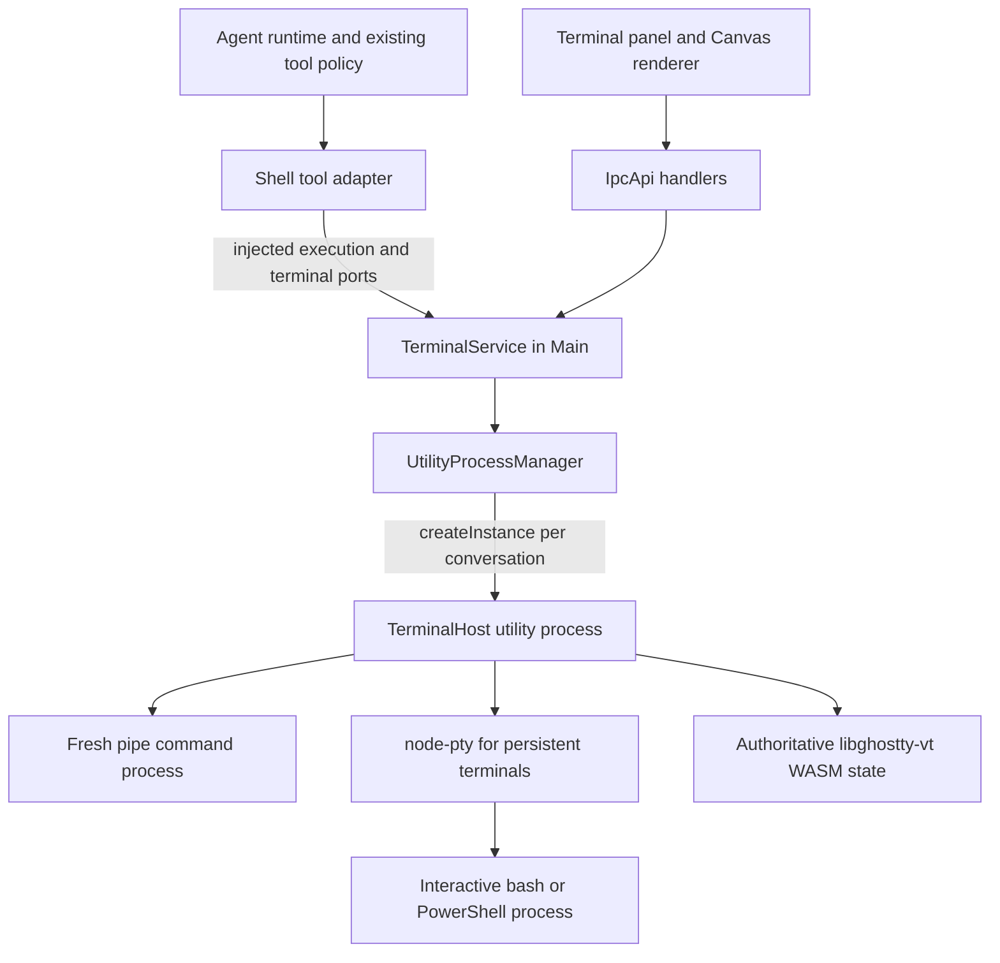

# Agent Note: 智能体 shell 工具与用户共享终端会话

Status: proposed

[English](2026-11-14-shared-agent-terminal.md) | 中文

## 问题

智能体 shell 执行需要用户可以打开和观察的终端界面，并允许显式接管交互式 PTY。共享 UI 和进程基础设施必须保留新命令进程与跨调用保留状态的 shell 之间的区别。只有输出转发无法确立进程所有权；把所有原生 shell 工具替换成持久 shell，会悄悄改变其工作目录、环境和完成契约。

当前桌面适配器在 [PiRuntimeConnection.ts](../../../../src/main/ai/runtime/pi/PiRuntimeConnection.ts) 和 [durableDesktop.ts](../../../../src/main/ai/runtime/piDurable/durableDesktop.ts) 中安装 SDK shell 工具。本地基线 `e282668a2b035656a219e6640611af3601e56195` 将两套 SDK 都固定为 `1.5.2`。Pi 提供可替换的 `BashOperations` 和 `PowerShellOperations`；Pi Durable 向工具提供 `ExecutionEnv`。后者的内置 PowerShell 工具把可执行文件及参数数组传给 `env.exec()`，会启动另一个 PowerShell 进程，而不是选择一个持久 PowerShell 会话。

这是新的终端能力。[运行时所有权 Spec](../simplification/2026-11-05-agent-runtime-boundary-ownership.md) 继续负责原生执行、回复完成和后台智能体行为。本提案不替换这些契约，也不替换现有启动外部终端的 CodeCli 功能。

## 提案

### 范围与选型

使用 `node-pty` 管理 PTY 进程，使用 `libghostty-vt` 实现终端仿真。Cherry 负责会话身份、访问权限、命令执行、观察和界面。首版覆盖本地 macOS、Linux、Windows 终端，Pi 与 Pi Durable shell 工具、终端查看、用户显式接管及资源清理。

关闭或隐藏终端面板后，只要 Cherry 仍在运行，命令或 shell 就继续运行。首版包含显式 Bash 后台执行，以及运行中 Bash 调用的转后台操作。应用退出时停止所属进程。应用退出后保活、SSH 终端托管、移动端终端界面，以及替换 Claude Code 或 ACP 的原生 shell 执行，均不在本 Spec 范围内。这些运行时保留现有执行路径，不得宣称已经接入。

### 一次性命令与持久终端

原生 `bash` 和 `powershell` 保留新命令工具的语义。每次调用都使用传入的 cwd 和环境启动新进程。前台调用根据该进程退出判定完成；显式转后台的 Bash 调用则返回同一次执行仍在运行的回执。命令中的 `cd`、export、函数或 PowerShell 变量不影响后续调用。保留 SDK 的 pipe 和非交互式默认值。把输出显示在终端 UI 中，不代表进程变成交互式，也不授权在 PTY 下重启它。后台能力不会把新的 Bash 调用变成向先前 shell 发送输入。

通过 `terminal_open`、`terminal_send`、`terminal_read`、`terminal_signal`、`terminal_close` 和 `terminal_list` 单独暴露持久 PTY。这些是新增且显式治理的工具，需要各自声明策略。当模型需要有状态 shell、REPL 或交互式 stdin 时使用。工具描述必须说明状态会延续，输入等待结束不一定代表命令完成。原生 shell 工具不能因适配器的隐式选择而获得持久会话语义。

两条路径共享 TerminalService 的所有权、输出订阅、访问校验和 UI。命令路径使用新的 pipe 进程；终端路径使用 `node-pty`。持续运行的长命令、持久交互 shell 和应用退出后存活的进程是独立能力。转后台是显式操作，不因输出静默、等待预算或执行期限而自动发生。不承诺 daemon 保活。

### 后台执行与保留范围

分别记录传输方式（`pipe` 或 `pty`）、保留范围（`turn` 或 `session`）和等待状态。普通原生命令开始时归 turn 保留。Bash 使用 `run_in_background: true` 启动，或通过运行中调用的转后台操作提升后，归 session 保留。持久终端及通过显式终端工具启动的程序从创建起归 session 保留。附着面板不改变这些字段。因此，已 yield 的终端 dev server 在停止智能体后继续运行；只是把普通 Bash 输出显示到终端面板中，该命令仍归 turn 所有，停止智能体时应停止。

转后台是 host 对已有 `executionId` 串行处理的状态变更，绑定精确工具调用和所有者。保留 PID、pipe 流、采集游标和原始执行期限。先转移取消所有权，再把原工具调用结算一次，返回 `status: running`、`executionId`、已采集输出和下一输出游标，不包含最终退出码。不能追加 shell `&`、重新启动命令，或把回执当成进程完成。重复转后台返回同一回执。退出先发生时返回真实结果；Stop 先被准入时，转后台不能复活执行。来自旧前台等待的后续取消不能停止已转后台的任务。

为归 session 所有的 pipe 任务暴露 `shell_task_list`、`shell_task_read` 和 `shell_task_stop`。它们使用已有 `executionId`，不建立第二份进程注册表，也不接受任意 PID。读取返回有界的游标输出、明确的截断信息，以及已知时的真实最终状态。停止只针对该执行的受管理进程范围。完成时只更新一次任务面板和原执行记录，不为原工具调用产生第二个结果，也不自动启动新的模型轮次。智能体可在后续调用中读取任务。只要 Cherry 和对话仍存活，session 保留就跨运行时连接替换继续有效；删除或 purge 对话及应用退出时停止。显式传入的执行 timeout 在转后台后仍是期限，不变成 yield 预算。

已安装的 Pi `1.5.2` Bash schema 只有 `command` 和 `timeout`；`BashOperations.exec()` 及工具结构化结果要求已完成的退出结果。Durable `1.5.2` 同样要求 `ShellExecResult.exitCode`，并规定 context abort 取消进程。后台路径需要在每套原生工具上游增加有类型的运行中／已完成结果、显式后台输入与控制，以及取消所有权交接。实现适配器前先确认这些 hook；不能伪造退出码、把运行回执抛成执行错误，或绕过现有原生工具策略。除已批准的增量后台能力外，未转后台调用保留现有 schema 和完成行为。PowerShell 在明确交付等价的原生后台契约前保留前台行为。

### 命令提交与交互输入

`terminal_send` 使用两种不同的输入。`kind: command` 只在 shell integration 确认受管理 shell 位于提示符、没有活跃前台程序时，提交一条完整 shell 命令或多行脚本。它分配独立于 send 的 `operationId` 的 `commandId`。`kind: input` 将给定数据原样写入当前前台程序，不自动添加换行，例如 REPL 或密码提示；请求携带预期 `commandId`／程序 revision，不分配新的 shell 命令。这是单独授权的原始输入能力，不是可以应用 Bash 放行规则或改写的命令。

串行化短暂的写入准入，不锁住整个输出等待。一个终端最多有一个受管理 shell 命令处于活跃状态，但运行中的命令可以在先前 send 等待期间或 yield 后接收显式授权的输入。程序活跃时提交新命令返回 busy；向该已知程序写入输入则允许。如果程序 revision 变化、shell 已回到提示符、控制权已转移或无法确定程序身份，拒绝输入。未知状态不能隐式转成 shell 命令。`terminal_read` 提供有界屏幕文本或采集游标之后的输出，并区分两种表示。等待、进程执行、shell 就绪及真实命令退出分别返回。

### 2026-11-14 上游调研记录

这些结论来自固定源码快照和文档，不是为 Cherry 执行的运行时测试，也不代表每个已发布客户端的行为。

| 项目与快照 | 一次性执行 | 持久或保留的执行 | 对 Cherry 的影响 |
| --- | --- | --- | --- |
| OpenCode `dev`，`024a1462f55aa64243b859729b2d0816b42b17e3` | 当前 `shell` 工具构造新的 `-c` 命令或 PowerShell `-Command` 进程 | 独立的持久 PTY 与 pipe 命令共享 daemon，计划内服务交接可以保留进程 | 共享基础设施，不合并命令与 shell 状态语义 |
| DSH `master`，`39163dd30f703a79079e2d2446545cff3c453738` | `bash` 和 `pwsh` 每次启动新进程，后台 job 只保留该次命令 | 显式 terminal 工具保留 shell 状态，独立侧栏控制器支持智能体与用户转移控制权 | 保留不同工具契约，区分就绪与退出 |
| Codex `main`，`b1573f102413e96a6481087922bf425231222dee` | `ExecCommandLifetime::OneShot` 提供完成超时，不返回可恢复会话 ID | 交互式 `exec_command` 保留一个进程供 `write_stdin` 使用，新的 exec 调用不自动进入该 shell | 分开建模进程保留与持久 shell 状态 |

OpenCode 的 [shell 工具](https://github.com/anomalyco/opencode/blob/024a1462f55aa64243b859729b2d0816b42b17e3/packages/core/src/tool/plugin/shell.ts) 可以把前台超时转为后台 job，并在完成后通知。[参数构造器](https://github.com/anomalyco/opencode/blob/024a1462f55aa64243b859729b2d0816b42b17e3/packages/core/src/shell/select.ts) 仍会创建新命令。[持久进程接口](https://github.com/anomalyco/opencode/blob/024a1462f55aa64243b859729b2d0816b42b17e3/packages/core/src/persistent-pty/index.ts) 和 [shell 服务](https://github.com/anomalyco/opencode/blob/024a1462f55aa64243b859729b2d0816b42b17e3/packages/core/src/shell.ts) 区分 PTY 与 pipe 进程、显式交接和进程丢失。计划内服务交接不等于机器重启恢复。

DSH 的 [Bash](https://github.com/deepseek-ai/deepseek-harness/blob/39163dd30f703a79079e2d2446545cff3c453738/packages/shell/tool-bash/README.md) 和 [PowerShell](https://github.com/deepseek-ai/deepseek-harness/blob/39163dd30f703a79079e2d2446545cff3c453738/packages/shell/tool-pwsh/README.md) 契约明确说明，一次性调用之间不保留 shell 状态。[终端工具](https://github.com/deepseek-ai/deepseek-harness/blob/39163dd30f703a79079e2d2446545cff3c453738/packages/experimental/tool-terminal/README.md) 明确要求有限工作优先使用一次性操作。[行式后端](https://github.com/deepseek-ai/deepseek-harness/blob/39163dd30f703a79079e2d2446545cff3c453738/packages/terminal/terminal-bash/README.md) 提醒 `inferred_idle` 和等待超时不证明退出，也不承诺全屏 TUI 支持。独立的[侧栏终端控制器](https://github.com/deepseek-ai/deepseek-harness/blob/39163dd30f703a79079e2d2446545cff3c453738/packages/api/terminal-controller/README.md) 在用户首次键入后转移控制权：智能体仍可读取，但写入、发信号和关闭会被拒绝。浏览器刷新恢复不代表进程能在 Host 或所有者释放后保留。

Codex 的[生命周期准备](https://github.com/openai/codex/blob/b1573f102413e96a6481087922bf425231222dee/codex-rs/core/src/tools/handlers/unified_exec/preparation.rs) 和 [OneShot schema 适配](https://github.com/openai/codex/blob/b1573f102413e96a6481087922bf425231222dee/codex-rs/core/src/tools/handlers/unified_exec/exec_command.rs) 区分执行期限与交互式 yield。返回的 `session_id` 指向被保留的进程，不是自动共享的 shell。[进程管理器](https://github.com/openai/codex/blob/b1573f102413e96a6481087922bf425231222dee/codex-rs/core/src/unified_exec/process_manager.rs) 只在 TTY 模式下允许普通 stdin，特殊中断处理除外。要保留 shell 状态，需要启动交互 shell 并向同一个进程写入。[会话关闭](https://github.com/openai/codex/blob/b1573f102413e96a6481087922bf425231222dee/codex-rs/core/src/session/handlers.rs) 会终止所属 exec 进程。

采纳的结论是共享执行所有权和终端呈现，同时将一次性命令与持久终端作为不同契约暴露。这替换初稿对原生 `bash` 和 `powershell` 默认使用持久 shell 的解释。

### Claude Desktop 发布产物调查（2026-11-14）

对本机 Claude Desktop `5.11492.5` 的静态检查覆盖 `Contents/Resources/app.asar` 和 `ion-dist.asar`。两者的 SHA-256 分别为 `2c515441d5d0504a96ac3e49bcc4c1244085c0e76ad23ae58ddd8f736100479e` 和 `1d55d633d14aede748af3cb22c244f4ddc2f795d9b1153b175b993ae5d46aa1b`。下列路径是归档内的逻辑路径，不是 Cherry 源码或上游开发源码路径。

- **后台控制：** `app.asar/.vite/build/index.chunk-D1yJ0UIX.js` 获取已有 `session.query`，调用 `backgroundTasks(toolUseId)`。`index.chunk-fch7zeJ_.js` 中的 SDK 封装发送 `{ subtype: "background_tasks", tool_use_id }`。这条 Desktop 路径既不调用 `startShellPty`，也不通过 `run_in_terminal` 重新提交命令。后台输出通过 `get_task_output(taskId)` 或输出文件读取，renderer 定期刷新文本。这证明它在控制已有调用，不能证明进程转换成了交互式 PTY。本次检查没有进入实际 CLI Bash 执行器，也没有在运行时验证 PID 连续性。
- **显式终端工具：** `app.asar/.vite/build/index.chunk-Me4G-tma.js` 实现了 `run_in_terminal`、`open_terminal_tab`、`list_terminal_tabs`、`read_terminal` 和 `stop_terminal_tab`。工具指引建议短命令用 Bash，用户需要查看和控制的长任务或交互工作用终端工具。新 tab 经过 `nextClaudeTabId → startShellPty → typeWhenShellReady`；可复用的 `tab_id` 经过 `claudeTabReuse → typeWhenShellReady`，向原 shell 写入。读取返回终端屏幕文本；停止默认发送 Ctrl-C，`close: true` 则结束 shell。创建或运行 tab 不必打开面板。工具是否可用取决于应用、组织、会话及沙箱策略。
- **输入所有权：** 复用要求 tab 由 Claude 创建、处于空闲、名称可核验且用户没有输入。等待调用期间用户键入会产生 `user_typed`；tab 可能包含用户工作后，会拒绝后续复用或停止。提示符 integration 和前台进程检查避免把新的 shell 命令输入忙碌程序。Cherry 保留显式接管和归还控制权的契约，不隐式照搬 Claude 的首次输入所有权策略。
- **PTY 基础设施：** `app.asar/.vite/build/index.chunk-hvY9X4w1.js` 包含 `ShellPtyManager`，并通过 `MessageChannelMain` 连接共享的 `utilityProcess` host。`pty-host/ptyHostWorker.js` 导入 `node-pty`，按 `ptyId` 处理 spawn、write、resize、kill、data 和 exit。一个 worker 管理多个 PTY。`ion-dist.asar/assets/v1/c6bf19e8f-Df49HNKY.js` 包含 xterm 终端、fit 和 WebGL addon 路径，输入转给 `writeShellPty`。Cherry 拟定的每对话 utility 隔离和 host 权威 Ghostty VT 是独立选择，不能视为该参考实现已经证明的行为。
- **独立 Bash mode：** `runBashCommand → ShellPtyManager.runCommand → startBashPty` 使用可复用的隐藏 shell。`bashPtyProcesses` 与可见的 `shellPtyProcesses` 是不同 Map；重置提示明确说明 cwd 和环境状态丢失。这个入口不能证明模型原生 Bash 工具共享可见终端 tab。

Cherry 采纳这种区分：命令执行、等待、保留后台工作、持久 shell 状态及面板可见性是不同契约。Cherry 按上述任务身份、读取、停止和结算契约增加显式 Bash 转后台，不自动提升。交互附着要求创建进程时选择 PTY；打开面板不能为 pipe 进程事后补上 PTY，也不能重跑命令。

这些结论是单个安装版本的静态证据，不是 Electron 交互测试，也不证明每项功能都已启用。REA 的全应用语义图覆盖不完整；结论来自定向模块检查。解包的 `claude-native-binding.node` 与 ASAR 声明的 hash 不同，使用 `record-and-continue` 记录了该差异；本次分析不依赖这个原生模块，也没有确定差异原因。Cherry 中未复制专有实现。

### 技术边界

各上游组件的职责不同：

| 组件 | 职责 | 选择 |
| --- | --- | --- |
| `node-pty` | 创建和控制交互式 PTY，传输输入、输出、尺寸变化和退出事实 | 在 utility process 中为持久终端使用，Windows 使用 ConPTY |
| `libghostty-vt` | 解析终端序列、维护终端状态、编码终端输入与回复 | 每个终端使用一个权威 VT 实例 |
| Canvas 渲染器 | 绘制单元格快照并处理浏览器交互 | 由 Cherry 实现 renderer 接入 |
| `herdr-core` | 持久会话、attach、远程机器和智能体关系 | 参考生命周期设计，不作为运行依赖 |

这一职责划分参考了使用 WASM 与 Canvas 2D 的 [T3 Code Web 适配器](https://github.com/pingdotgg/t3code/blob/0a8aaa3ccb944dadb70054ae4ef2e29897b0db03/apps/web/src/terminal/ghostty/README.md)。Cherry 将权威 VT 放在 PTY host，使终端在没有挂载 renderer 时仍能正常工作。[Ghostty 库](https://github.com/ghostty-org/ghostty/blob/6d9577708a211b0e6c5e6c6886f3cfb7efc47555/README.md)、[node-pty](https://github.com/microsoft/node-pty/blob/35c28c7d68a192699e70b1e6a142908bdccd9212/README.md) 和 [Herdr attach 协议](https://github.com/herdrdev/herdr-core/blob/c84d6e76156a6c2aac1da20efbe800f10acfe897/schema/README.md) 是源码参考，不构成 Cherry 的性能或兼容性证据。

### 服务依赖与进程所有权



箭头表示调用与依赖关系。PTY 输出和屏幕更新沿这些连接返回。智能体工具直接调用注入的 host 接口，不经过 renderer IPC。工具完成不依赖面板挂载、绘制或确认更新。

`TerminalService` 是执行资源的生命周期所有者。它继承 `BaseService`，使用 `Phase.WhenReady`，注册到 `serviceRegistry.ts`，并声明同阶段的 `UtilityProcessManager` 依赖。它负责执行及会话注册、准入、输入所有权、订阅，以及按既有稳定产品对话身份管理的进程客户端。桌面运行时 host 注入接口；运行时包不导入 `application` 或 Cherry 服务。`TerminalService` 不导入智能体运行时实现、UI 或模型代码。

通过 `createInstance()` 使用[独立拥有的 utility process 实例](../../../../src/main/core/utilityProcess/README.md)，每个对话惰性创建一个 TerminalHost，不按命令／终端创建，也不使用全局缓存客户端。并发首次准入合并到该对话唯一的 host generation。键不是工作区路径、智能体定义、turn、运行时连接 generation 或 renderer 窗口；不同产品对话，包括子智能体／fork 对话，使用不同 host。Host 内每个资源仍校验精确运行时上下文和输入控制权。共享 host 不授予访问其他上下文终端的权限。

TerminalHost 管理该对话的多个新 pipe 进程和持久 PTY。每个执行／终端独立持有进程句柄、VT 状态、输出采集、取消范围及输入所有者；只有持久分支需要 shell integration。一个命令完成或停止，只释放其自身资源。关闭或强制关闭某个终端，只停止其受管理范围，不停止共享 host 或兄弟资源。不能为清理一条超时命令而杀 host。保留的后台任务及用户控制终端使 host 在停止智能体和替换运行时连接后继续存活。

只有最后一个命令和终端都完成清理，且没有待处理的资源准入或清理时，才回收 host。最终释放与新准入串行处理；已经进入 closing 的 generation 释放完后，才能创建下一个，不能迁移存活 PTY。已完成输出保留在 host 外，打开旧输出视图不启动新 host。面板订阅不算进程所有权。TerminalHost 仍是执行模块，不是另一个 DI 服务；它使用 utility runtime 提供的 logger 和初始化数据，不导入 Main 的容器、数据库或 IPC。

崩溃边界是对话。普通命令／shell 退出或资源范围内的错误只影响该资源。Host 致命故障或 watchdog 重启可能丢失该对话的所有活跃命令和终端；将其标为 lost、等待只结算一次，并保留清理不确定性，不重放。其他对话的 host 不受影响。确认 Host 已退出后，退役其死亡 generation，Main 保留未解决的子进程清理记录。只有新的显式资源准入才能创建替代 Host；旧资源句柄及输出视图不能作为存活工作附着到新 generation。逐资源缓冲、输出配额和有界解析工作避免普通输出洪泛独占兄弟资源，但不承诺原生崩溃或解析器卡死时同 host 资源仍存活。限制活跃 host 和每 host 资源数量，并在作出资源消耗结论前测量有代表性的并发对话与终端。

### 工作区切换与存储所有权

会话工作区为后续文件操作、一次性命令和新建终端提供默认目录。每个持久 shell 独立拥有当前目录、环境、前台程序和输入控制权。一次性执行固定其启动目录与环境。修改默认工作区不发送 `cd`、不重启进程、不转移控制权，也不替换对话 Host。将来显式提供的切换目录操作需要当前控制 token 和已确认的空闲 shell；shell integration 不是授权边界。

本次交付保留仅无消息对话可切换工作区的既有规则。活跃智能体轮次必须结束或停止后，才能改变其工作区上下文；保留的后台任务或忙碌持久终端本身不阻止切换。`AgentLifecycleService` 协调工作区变更、运行时上下文边界及存储占用。`AgentSessionService` 拥有数据库绑定及事务；终端与运行时状态不进入 DataApi 记录。新智能体轮次按新工作区协调或重建运行时，不继承保留终端的写入权限。

异步准备终端前，预留目标工作区 revision 及托管目录占用。实际执行准入时，重新检查已提交的绑定 revision。面向旧默认目录的待处理请求，要么在切换前已提交并保留原启动参数与占用，要么因过期被拒绝并释放尚未提交的预留；不静默改到新目录启动，也不自行重放。工作区检查与新资源准入共享对话边界。校验失败或数据库回滚保留原默认工作区和已有资源。

将现有 `AgentWorkspaceStorageService` 纳入生命周期容器，拥有有界、进程内的目录占用注册。终端与运行时所有者向它登记托管启动目录／上下文目录；同阶段依赖声明保证存储服务存活至这些所有者释放占用。在终端／运行时所有者依赖存储前，将其现有的运行时／终端静止化调用移到 `AgentLifecycleService`。存储不导入或调用这两个进程所有者。不新增协调服务或通用资源注册中心。

终端的目录占用覆盖整个受管理进程范围，包括待完成启动、后台工作、Host 丢失和未确认清理。运行时上下文占用保留至上下文释放。shell 上报 `cd` 不能释放占用。删除系统工作区数据库绑定不会使仍被占用的目录变为可回收。回收仍遵守既有存储声明及保留／新鲜度规则；释放占用不等于请求删除文件。普通孤儿清理跳过被占用目录，不依据旧目录名称关闭对话。显式归档／删除对话仍由 `AgentLifecycleService` 封闭准入并静止化所有者，再执行存储操作。

### 模块位置与传输

| 区域 | 建议位置 | 边界 |
| --- | --- | --- |
| 终端服务与执行契约 | `src/main/services/terminal/` | 仅供 Main 使用的状态与 host API |
| PTY 入口与处理模块 | `src/main/services/terminal/utilityEntries/` | 仅依赖 utility runtime 与原生执行 |
| Pi 与 Pi Durable 适配器 | 现有 `src/main/ai/runtime/pi/` 和 `piDurable/` | 翻译原生工具调用并保留其策略 |
| 命令和事件 schema | `src/shared/ipc/` | 经校验的跨进程 DTO，不含可变状态 |
| Renderer 命令和事件 | `src/main/ipc/handlers/` 及 renderer IPC 客户端 | 轻量发送方与访问校验，再委派执行 |
| 终端 UI 与渲染 | `src/renderer/components/terminal/`，底层辅助模块放进现有 renderer 分类 | Canvas 交互及 `@cherrystudio/ui` 控件 |

终端命令使用现有 IpcApi 请求，订阅使用定向事件。终端输出只发给有权订阅的调用方，不做全局广播。PTY 流量使用 utility 层的有界双向流。终端流归 `TerminalService` 所有；renderer 订阅是另一个生命周期更短的资源。释放后者不能取消前者。

按现有原生包规则，将 `node-pty` 放入生产依赖。在打包产物中验证其 addon、spawn helper、Electron ABI 和各架构文件。固定 Ghostty 源码及 WASM 构建工具链，将 WASM 作为应用资源发布并保留许可证。新增资源、integration 脚本及输出存储路径统一走路径注册表。终端命令使用 IPC；原始输出和临时屏幕状态不进入 DataApi。

### 身份、状态与准入

| 身份 | 含义 | 所有者 |
| --- | --- | --- |
| `terminalId` | 一个显式打开的持久 shell 及其 VT 状态 | TerminalService |
| 进程 generation | 一个归对话所有的存活 TerminalHost 实例，由其资源句柄共享 | UtilityProcessManager |
| `executionId` | 一条获准执行的一次性命令及其输出视图 | TerminalService |
| 终端操作身份 | 一次 send/read/signal 操作，与命令退出不同 | TerminalService |
| `commandId` 与程序 revision | 受管理命令及其当前前台程序，用于隔离过期 stdin | TerminalHost |
| 控制 token | 当前获授权的输入持有者，接管和显式归还时替换 | TerminalService |
| 原生工具调用身份 | 现有运行时上下文及工具调用身份 | 智能体运行时 |
| 订阅身份 | 一个获授权的观察者及其 revision 游标 | TerminalService |

每次一次性调用创建新的执行。持久会话只在显式打开终端时分配，归精确的智能体上下文所有，并按 shell 类型分开。子智能体和 fork 后的上下文不继承存活终端；共享工作区路径不代表共享 shell。Host 记录与精确运行时上下文的绑定。模型参数不能选择任意用户终端或改变终端所有者。

分别记录持久进程生命周期（`starting`、`running`、`closing`、`exited`、`lost`）、清理确认状态、保留范围、输入控制权（`unassigned`、`agent`、`user`）及就绪证据。终端串行准入写入，最多允许一个受管理 shell 命令处于活跃状态；获授权的 stdin 不是新命令，输出等待不占用写入 gate。忙碌时显式拒绝命令提交，不进入不可见的输入队列。在存活 generation 内，重复的原生调用映射到现有执行或操作，不能启动第二份命令或重复写入输入。主动重试需要新的原生工具调用。

一次性执行结果区分完成及真实进程退出码、取消、执行超时和进程丢失。终端 send 报告有界输出、进程及控制状态，以及等待结束的原因：提示符就绪、有证据的输入等待、等待预算 yield、会话退出或控制权转移。Send 返回不证明命令退出。输出静默、形似提示符的字符串、流断开和智能体回复完成，都不能证明命令成功完成。

### 状态维度与合法组合

分别使用独立状态维度；工具结果、输入持有者和进程退出是不同事实。Main 负责资源注册、授权、操作结算及 generation 退役。Host 负责真实进程与 shell 事实，并在 I/O 前立即校验控制 revision。

| 维度 | 值或证据 | 必须满足的关系 |
| --- | --- | --- |
| 对话准入 | `open`、`sealed` | 删除、purge 和退出在清理任何资源前封闭准入；迟到的审批不能重新开放准入 |
| Host | `absent`、`starting`、`ready`、`closing`、`lost`；generation | 每对话最多一个未退役 Host；`closing` 不向该 generation 接纳资源 |
| 进程 | `starting`、`running`、`closing`、`exited`、`lost` | `closing`、`exited` 和 `lost` 拒绝普通写入；运行中的 shell 可以没有活跃命令 |
| 清理 | `none`、`pending`、`confirmed`、`unconfirmed` | `lost` 与 `unconfirmed` 可以同时存在；仅 shell 退出不证明其受管理后代已清理 |
| 保留范围 | `turn`、`session`；取消 revision | 附着面板不改变保留范围；转后台使旧 turn 取消失效 |
| 控制权 | `unassigned`、`agent(runtimeBinding)`、`user`；控制 revision | `unassigned` 允许授权读取，但不允许程序输入；替换运行时不隐式分配控制权 |
| Shell 事实 | `prompt`、`program(commandId, programRevision)`、`unknown` | 只有已验证提示符允许 `command`；`input` 要求同一个已知程序及当前控制权 |
| 操作 | `pending`、`settled`；原因与回执 | 每个操作最多结算一次；进程／命令结果仍可单独读取 |

用户视图断开后，逻辑控制权仍归用户，撤销该视图的 resize 权并保留最后几何尺寸。运行时释放会撤销其智能体控制权，使保留的终端进入 `unassigned`，但用户已经控制的终端保持用户控制。后续运行时 claim 是显式授权操作。回到提示符或附着面板都不授予控制权。停止请求及其原因与真实退出证据分开记录；退出与 Stop 竞争时，保留真实退出码及停止请求的结果，不虚构 kill 成功。

### 有序决策与确认

Main 使用短暂的对话级准入决策，Host 使用短暂的逐资源变更决策。不能在等待输出、审批、进程退出或清理期间持有这两类 gate。发给 Host 的请求携带对话准入 revision、generation、资源身份及适用的控制／程序／取消 revision。Main 在发送对话关闭屏障前封闭准入并使授权失效；先前已经获准的启动继续注册并纳入屏障清理，迟到的审批则不能创建启动。Host 确认描述已提交的决策，而非仅表示收到消息。

| 事件 | 决策生效点 | 竞争或迟到事件 |
| --- | --- | --- |
| 首次资源准入 | Main 在启动前预留唯一 Host generation 及资源槽位 | 并发请求加入同一次启动；取消只释放尚未使用的预留 |
| 命令或 stdin 写入 | Host 在资源 gate 内校验 revision 并提交写入 | 过期请求在 I/O 前拒绝；等待输出不阻塞其他获授权输入 |
| Bash 转后台 | Host 在确认前提交 session 保留并递增取消 revision | 拒绝旧 turn 取消；已提交的 Stop 阻止转后台；已记录退出则返回真实结果 |
| 停止智能体 | Host 在停止决策时检查每个请求的 turn 归属与取消 revision | Main 先前取得的 turn 归属快照不能授权杀死已转后台任务 |
| 控制权转移 | Host 在确认前提交下一控制 revision，并使旧控制权失效 | 旧 revision 下排队且尚未写入的操作被拒绝；已写入字节无法撤回 |
| 最终回收 Host | Main 确认无资源、预留或清理后，把 generation 标为 closing | 新准入等待确认释放后取得新 generation，不能重新开放 closing generation |
| 进程退出或清理确认 | 只应用于匹配 generation 和资源句柄 | 重复退出幂等；旧 generation 回调不能结算、释放新资源或递减其计数 |

确认丢失时，先查询原操作，再决定是否重传。没有收到确认不能证明输入或启动尚未发生。控制转移只在 Host 确认后成功；此前显示转移中，不开放新持有者的输入。没有当前确认就没有新授予的控制权，包括 Host 无响应时。

### 请求身份、结果与重放

原生调用键由所属运行时上下文及其原生工具调用身份组成，包含运行时的 replay 身份，而不只是连接 generation。Main 将其映射到一个操作及不可变的规范化参数。重传使用同一 `operationId`；在该身份下改变命令、cwd、环境、输入字节、目标或预期 revision，返回 `identity_conflict`。有意发起的新尝试需要新的原生调用并重新评估策略。Host 在 spawn、write 或 signal 前独立对变更操作去重。在允许重试投递前记录待处理决策与回执；重复消息返回同一决策，不重复副作用。

| 请求或结果 | 必需信息 | 含义 |
| --- | --- | --- |
| 变更请求 | 所有者上下文、原生调用键、`operationId`、资源／generation、适用的预期 revision、不可变 payload | 从调用方推导授权；模型提供的 ID 不能选择其他上下文的资源 |
| 新执行准入 | `executionId`、generation、精确执行参数及可选期限 | 一个新 pipe 进程；不继承 shell 状态 |
| 持久 send | `terminalId`、generation、`kind`、控制 revision；`input` 的预期程序身份 | `command` 创建 `commandId`；`input` 不创建，也不隐式追加换行 |
| 操作回执 | 操作身份、决策、等待结束原因、有界输出／游标、当前状态与 revision | 等待 yield 或控制权转移是操作结果，不证明命令完成 |
| 执行／命令结果 | 已知时的真实退出证据／退出码、停止意图、丢失与清理状态 | `running` 没有最终退出码；`lost` 或 `unconfirmed` 不能报告成功 |
| 观察帧 | 订阅／视图、generation、快照身份或基线 revision、epoch 与 revision | 帧身份不授权输入，也不复活已退役进程 |

使用明确结果 `busy`、`stale_control`、`stale_program`、`stale_context`、`stale_generation`、`closing`、`capacity_exceeded`、`identity_conflict` 和 `outcome_unknown`。变更前的拒绝保证该请求没有副作用。确认缺失的请求在协调前保持 pending 或 `outcome_unknown`；这一标记不授权再次执行。存活 generation 内查询操作可恢复其决策。generation 丢失后保留执行引用与已知结果，不在替代 Host 中重放。

不能为接纳更多工作而淘汰待处理操作或清理。已完成输出可以按预算淘汰，但其 replay 保护必须以紧凑回执／tombstone 或既有原生历史执行引用保留。缓存淘汰或运行时替换后，已退役身份不能变成新准入。适配器无法恢复原 replay 绑定时，以 `outcome_unknown` 拒绝，不能猜测旧调用是新调用。限制内存回执索引，必要时查询既有历史引用；不引入终端状态 DataApi 记录，也不承诺跨应用重启的持久 exactly-once 执行。

### 控制权转移协议

接管先在 Main 中标记转移 pending。Host 在写入／signal／close 共用的 gate 内推进控制 revision，拒绝排队的旧控制操作，并确认新持有者。Main 随后发布用户控制状态，以已采集输出和 `control_transferred` 把受影响智能体等待各结算一次。后续输出仍属于终端。Host 已确认但响应丢失时，查询同一次转移，不发起第二次所有权变更。显式用户 Stop／Close 使用自己的授权路径，旧智能体取消不能借用该路径。

归还和 claim 使用相同协议，采用新 revision 及当前获授权的运行时绑定。准入下一次 send 时重新检查 shell／程序事实；活跃 REPL 只接受匹配程序输入。没有附着视图的用户控制仍是用户控制。Resize 属于独立视图 lease，在 detach 或转移时撤销；替代运行时及其他观察窗口都不继承它。转移前开始的 IME 组合不能使用新持有者 token 提交。

### 启动、清理与资源预算

启动 Host 或进程前先预留容量。调用方在启动期间取消时，取消其预留；启动已经提交时，注册并清理产生的资源，不能丢弃迟到句柄。Host 启动失败或超时会拒绝待处理准入，并保留任何不确定的进程清理。确认旧 generation 死亡前不创建另一 Host。删除／purge 在封闭对话后协调进行中的准入和清理，避免报告完成后再出现孤儿资源。

| 初始限制 | 预算 | 耗尽或到期时 |
| --- | --- | --- |
| 未退役 Host | 全应用 8 个，包含 starting／closing／lost 且未确认死亡的实例 | 以 `capacity_exceeded` 拒绝新对话 Host，不合并多个对话到一个 Host |
| 进程资源 | 每对话 4 个持久 PTY、4 个活跃 pipe 执行；全应用 16 个活跃 pipe 执行 | 预留和未确认清理继续占槽，不使用隐形命令队列 |
| 待处理资源准入 | 每对话 8 个，全应用 32 个 | 拒绝超额请求；仅获审批不无限期预留进程 |
| 计入预算的采集与 VT 缓冲 | 每 Host 合计 64 MiB，同时受已有逐终端／逐视图限制约束 | 分配前预留；淘汰可淘汰历史或应用有界背压，明确报告截断／存储错误 |
| 内存中的已完成回执索引 | 每对话 1,024 项，全应用 4,096 项 | 仅当 tombstone 或历史引用仍保护 replay 身份时淘汰 payload／索引项，否则拒绝新准入 |
| Host 启动／等待最终释放 | 每次准入 10 秒／8 秒 | 明确返回超时或不确定结果，协调完成前保留句柄和容量，不重叠 Host generation |
| 控制转移确认 | 2 秒后显示转移未确认 | 禁止新输入并协调原转移；超时不授予控制权，也不杀共享 Host |

这些是待验证的初始策略默认值，不是已测容量或 RSS 上限。原生进程与 WASM 开销需要单独测量。已确认死亡 Host 的未解决子进程清理仍在 Main 注册并占用资源槽位；只能退役死亡 Host 槽位。清理重试重新验证原范围和身份，不能指向复用了 PID 的新进程。释放 Host 不能抹去该记录。普通资源清理不杀兄弟资源；强制关闭共享 Host 仅限 Host 级故障处理，或其全部资源范围已确认清理之后。

### 持久 shell 与命令边界

一次性工具保留各次调用的 cwd、环境、shell 查找、login PATH 准备及 `mergePiShellExecutionEnv` 行为。新的命令进程默认保持非交互式。原生工具结果根据真实进程退出产生，无需通过提示符 integration 检测完成。

显式持久终端使用受控的 shell 初始化及 Cherry 的 shell integration。不悄悄向智能体执行加入任意交互式 profile。启动环境与工作区目录只在打开终端时应用一次。后续 `cd`、export、PowerShell 变量和用户修改只保留在该终端中。工具指引必须区分这些会话与原生一次性工具。原生运行时的默认工作区不能在 send 时重置存活的持久 shell；显式重置需要独立终端操作。

在持久终端内，使用各 shell 自己的 integration 报告就绪、已知命令边界和当前目录。解析器必须跨任意 PTY 数据块边界增量解析 integration 帧。输入在现有 shell 作用域中运行，包括多行脚本和 REPL 交互。Integration 能证明真实命令完成时，单独保留该事实；无法确认的完成状态保持未知。Bash 与 PowerShell 分别实现引用、状态采集和取消。PowerShell 状态必须兼顾原生程序退出码与 PowerShell 错误，不能复用陈旧的 `$LASTEXITCODE`。

Integration 帧携带操作关联信息，并从模型可见输出中移除。它们用于记录，不构成对同一用户权限下程序的授权或安全边界。输出不能创建执行、授予输入权限或触发重试。如果 `exec`、替换 shell、修改 integration hooks 或异常帧使受跟踪的 shell 事实丢失，应显式报告就绪或完成状态未知，并在新建受管理终端前拒绝依赖这些事实的操作。原始交互只能在其声明的策略范围内继续。不能猜测成功，也不能静默切换持久与一次性模式。

Pipe 命令保留原生 stdout/stderr 处理；终端 UI 投影同一次执行采集，不改变原生结果。PTY 输出合并 stdout 与 stderr，因此持久终端结果只承诺组合输出。保留有序输出供终端模型使用，并从同一次采集中生成有界、可读的工具文本。Integration 帧不能出现在模型文本中；不能把持久屏幕读取宣称为纯净的逐命令 stdout。保留现有 SDK 的输出限制、截断说明和可读取的输出文件引用；采集或存储失败必须明确报告，不能把部分文件宣称为完整输出。

### VT 状态、重连与流控

即使没有观察者，TerminalHost 也持续将输出送入权威 `libghostty-vt` 投影。对于 PTY，它还负责终端自动回复和输入编码；renderer 不独立回复终端查询。Pipe 执行视图除显式停止进程外仅供观察，查看它不能启用 stdin、改变 TTY 检测或重启命令。交互式 PTY 的浏览器按键、粘贴、指针及 IME 提交事件根据 host 当前终端模式编码。React 负责控件与生命周期；单元格更新和绘制不进入 React state。

向观察者发送带 revision 的屏幕快照与有界补丁。Attach 在同一有序订阅中取得基线 revision 及后续更新。重连时，如果游标不存在或太旧，则获取新快照，不重新执行命令。持久 scrollback 保留在 TerminalHost，初始上限为 5,000 行和 8 MiB 文本，以先达到者为准。按完整记录淘汰，不截断 UTF-8 字符。一次性执行完成并释放 worker 后，视图使用有界保留的采集结果。浏览器视图只保留有界视口数据及选择状态。

每个终端传输帧的 payload 最多为 64 KiB，每个观察者的待处理数据最多为 1 MiB。大快照使用同一快照身份分块，收齐后才能发布。观察者落后时合并屏幕补丁，或用新快照替换过期 revision。隐藏或停滞的面板不能阻塞 PTY 解析、终端回复、命令完成或其他观察者。在采集与 PTY 之间应用背压，并显式报告存储失败，不能使用无界 JavaScript 缓冲或静默丢弃命令输出。这些初始预算是正确性限制，不是性能结论。

只有当前控制终端的用户视图可以改变尺寸。没有控制视图时保留上次尺寸或创建尺寸。智能体观察者、隐藏面板和其他窗口不能抢走 resize 所有权。选择、滚动、链接、字体、CJK 字宽、emoji、IME、无障碍终端输出、键盘焦点和剪贴板行为属于 renderer 契约；只有 Canvas 不满足无障碍要求。终端发起的链接和剪贴板请求仍需经过明确的 host/UI 策略。

### Canvas 2D 绘制与浏览器输入

使用 renderer 内的 Canvas 2D surface 接收单元格数据，不在 Main 中生成图片。Ghostty 在 TerminalHost 中负责终端解析、网格与折行、模式、光标状态和历史。从固定版本 T3 的 [Canvas 绘制器](https://github.com/pingdotgg/t3code/blob/0a8aaa3ccb944dadb70054ae4ef2e29897b0db03/apps/web/src/terminal/ghostty/renderer.ts) 和[快照类型](https://github.com/pingdotgg/t3code/blob/0a8aaa3ccb944dadb70054ae4ef2e29897b0db03/apps/web/src/terminal/ghostty/core.ts) 起步，把绘制辅助函数适配到 Cherry 的序列化帧，并保留 [MIT 声明](https://github.com/pingdotgg/t3code/blob/0a8aaa3ccb944dadb70054ae4ef2e29897b0db03/LICENSE)。不能把其浏览器 WASM loader 和 surface 直接复制成第二套权威仿真器：Node 资源加载、各视图订阅和 Cherry 输入所有权需要独立接入。拟定数据流如下：

```text
PTY bytes -> Host Ghostty VT -> revisioned cell snapshot/patch
         -> TerminalService / targeted IPC -> renderer viewport cache
         -> requestAnimationFrame -> Canvas 2D
DOM input -> authorized host input encoder -> the same PTY
```

帧携带终端 generation、视图身份、屏幕／几何 epoch、基线 revision 与当前 revision、网格尺寸、视口位置、脏行和光标状态。单元格携带字素文本、占用列数／续占标记、解析后的前景与背景色、文本样式及可选链接元数据。序列化值，不发送 WASM 指针或内存视图。Renderer 只保存有界的可见网格；读取 host 历史时返回有界视口页。每个观察者拥有自己的滚动位置和选择，因此滚动某个观察者不能带动其他视图或 resize PTY。Epoch 变化使旧坐标失效。缺少基线 revision 时，按既定有界传输规则请求新快照。

绘制辅助函数在等宽字体加载后测量单元格宽度、行高和基线，随后按网格坐标绘制连续背景块、相同样式的文本段和装饰线。位置由 Ghostty 的列占用决定，浏览器文本测量不重新决定折行或 Unicode 字宽。宽字、组合字素、回退字体和提示符符号在已分配的单元格内定位和裁剪。使用一层不透明内容 Canvas 和一层透明光标／选择覆盖层。合并脏行，每个动画帧最多绘制一次；光标闪烁或选择变化只重绘覆盖层。字体、主题、DPR、网格或视口变化使相应帧失效。隐藏视图停止绘制，恢复时获取一致快照；host 解析与 PTY 回复继续运行。

布局使用 CSS 像素，Canvas backing store 按设备像素缩放以保证文字清晰。等待字体加载，测量 padding 和单元格指标，只允许控制视图通过 `ResizeObserver` 合并提交 `cols`／`rows` 变化。按 host 已确认的几何 epoch 绘制；不能把旧单元格拉伸到不同网格后，再用新坐标解释点击。绘制失败显示视图错误及重新附着操作，不重启或停止进程。这些选择参考浏览器的 [Canvas 指南](https://developer.mozilla.org/en-US/docs/Web/API/Canvas_API/Tutorial/Optimizing_canvas)，不是经过测量的性能结论。

Surface 包含真实 textarea，用于键盘焦点、剪贴板和 IME。输入法组合文本显示在光标位置，只发送一次已提交文本，不重复发送中间按键事件。浏览器处理器通过当前控制 token 发送规范化的按键、粘贴和指针事件；host 按当前终端模式编码，包括 bracketed paste 和鼠标上报。选择与复制使用解码后的单元格文本、折行元数据和匹配的视口 revision，不做像素 OCR。使用 DOM 控件及有界的无障碍文本／实时输出层，让 Canvas 不是唯一可读界面。React 负责面板、控件和生命周期，不拥有单元格缓存或绘制循环。

首版 renderer 面向文本终端和备用屏幕 TUI，覆盖颜色、样式、光标形状、CJK、emoji、选择、链接、粘贴和 IME。不宣称支持 Kitty/Sixel 图片绘制、GPU renderer 或 OffscreenCanvas worker。Host 验证必须覆盖固定 ABI 在 Node 中的渲染数据、回复、输入编码及独立视口投影，再验证真实 Electron 字体、TUI 和 IME 场景。ABI 或绘制支持缺失时，需要明确的上游改进或 Spec 修订，不能在 renderer 中隐藏第二套解析器。

### 统一资源标签

文件、网页和每个终端资源通过现有 `RightPaneTabs` 与面板外壳共用右侧标签栏。外壳拥有展示顺序及所选资源；现有领域所有者继续拥有文件状态、浏览器页面、终端注册及各自关闭语义。保留资源身份和逐对话视图状态，不增加终端 DataApi 行或第二套终端注册。复用共享 `@cherrystudio/ui` 控件及既有文件变更保护、页面生命周期、面板调整大小和最大化行为。移除终端内部重复标签栏及多层标题／状态／操作行。

公共加号菜单提供新建终端、打开网页和打开文件，并列出仍存活但已解除视图附着的终端供重新打开。用户新建终端使用已配置的 shell；可用的替代 shell 放在子菜单中。智能体创建的持久终端可以出现，但不抢走当前文件／网页的焦点。每次原生一次性调用不自动创建标签；输出可从工具结果打开。关闭终端标签只解除视图附着，保留资源、目录占用和逻辑控制权；文件与浏览器关闭动作委派给原有所有者。隐藏整个面板也保留进程。

终端标签显示可读名称及有证据支持的智能体使用／命令状态，不显示原始资源 ID 或泛化的进程运行徽标。选择或重新打开时只观察，不取得输入控制权。接管、归还控制权、中断、终端设置和显式关闭终端，放在该终端底部状态菜单或上下文菜单中，不放在公共标签栏头部。公共头部动作只负责导航、打开资源及面板布局。丢失资源和未确认清理保留可见状态与重试操作；将控件移入菜单不能隐藏这些失败。

### 帧 epoch 与输入提交

有序订阅由订阅 revision、视图、终端 generation 及屏幕／几何 epoch 标识。每份快照另有 `snapshotId`、固定基线 revision、分块索引和总块数。在观察者预算内暂存分块，忽略完全相同的重复分块；内容冲突、订阅／generation／epoch 改变或替代快照出现时，放弃该快照。不能混合不同身份的分块。完整视口快照无法放入观察者预算时，明确返回视图容量错误并要求缩小视口，不能循环重新同步或发布残缺网格。原子发布后，只应用同一 epoch 内基线匹配已安装 revision 的补丁。缺口触发重新同步，旧 generation 帧直接丢弃。视图错误或重新同步不能重新创建执行。

控制视图使用当前 resize lease 发送合并的尺寸请求。Host 提交尺寸并推进几何 epoch，随后返回已确认几何及匹配基线。其他视图投影也携带各自的视口 revision。视图尚无匹配基线时，禁止依赖坐标的鼠标上报，并使选择坐标失效；键盘／文本输入只有在控制权和程序身份仍有效时才能继续。主题、字体和 DPR 变化使本地绘制指标失效；只有实际获准的终端尺寸变化才推进 Host 几何。复制使用保留的匹配视口文本，或请求新视图，不能混用旧单元格与新坐标。

在发送前，为每次规范化浏览器提交分配输入 `operationId`；传输重试保持该身份及字节／事件 payload。组合输入期间，中间 key／input 事件不产生 Host 写入。组合结束及浏览器为同一次提交产生的后续事件归并为一个规范化输入操作。Host 在真实写入 gate 去重，并在该处重新校验控制／程序 revision；控制转移使未完成组合失效，不能把它重新绑定到新 token。指针事件额外携带几何和视口 revision。普通重复按键仍是不同操作，去重不能吞掉用户有意重复的字符。通过 Electron 验证这些浏览器事件规则，不能假设抽象输入事件已经正确模拟浏览器。

### 工具接入与策略

Pi 通过新命令 `operations` 接入 `createBashToolDefinition()` 和 `createPowerShellToolDefinition()`。将 `onData`、abort、timeout 和真实退出状态桥接到注入的命令执行接口。保留前台输出处理、新进程语义和现有工具 gate。通过上述上游 hook 增加已批准的 Bash 后台输入／运行中结果路径。单独使用 `spawnHook` 只能修改调用上下文，不能完成执行桥接。任务控制及终端工具通过 SDK 支持的工具扩展路径注册。

Pi Durable 将 `ExecutionEnv` 的 shell 部分桥接到新的命令执行，同时保留 `NodeExecutionEnv` 的文件系统操作。字符串保留原生 shell 命令语义；数组按原样执行可执行文件及其精确参数。保留原生工具身份、前台结构化输出、各流来源信息、输出窗口、spill 行为及 unsafe replay 分类。在上游扩展原生 Bash 的结算和取消所有权以支持后台回执；普通 context 取消仍停止归 turn 所有的命令。任务控制及持久终端工具注册为独立的原生扩展。本设计不要求把内置 PowerShell 改为持久执行器，也不要求反向解析其 argv。实现后台适配器前先解决已确认的 SDK 结果／控制限制，不能绕过工具 gate。

现有禁用工具检查、权限模式、破坏性命令审批、全局安装和 SQLite guard 继续在执行前运行。仅适用于 Bash 的 RTK 改写仍只用于 Bash。运行时包与 `agent-behavior` 保持当前策略职责；OS 进程句柄留在终端 host。用户输入经过独立的授权交互路径，不能被错误标记成已获批准的智能体输入。

一次性审批使用该调用的精确命令、cwd、环境及进程模式。持久终端操作使用当前控制权和执行上下文 revision。准入时重新检查相关 revision；如果等待审批期间用户输入或 shell 状态发生变化，拒绝过期准入，要求新的工具调用。不能把一次性命令放行规则应用于任意终端输入，也不能在持久 shell 已移动目录后继续按原始工作区检查相对路径。Shell `cd` 不重新绑定智能体工作区，也不改变文件工具的路径解析；工具指引和终端显示需要区分这些目录。

### 用户接管、超时与清理

| 操作 | 必须产生的结果 |
| --- | --- |
| 打开、隐藏、切换或关闭面板 | 附着或解除观察，保留执行与 shell 状态 |
| 在对话中停止智能体 | 停止模型工作和等待，停止该 turn 未转后台的原生命令；保留归 session 所有的 pipe 任务、持久终端和用户控制的程序 |
| 将运行中的 Bash 转后台 | 将同一次执行改为 session 保留，并以运行回执把原等待结算一次 |
| 在智能体控制的 PTY 中键入 | 显式接管前拒绝普通输入，同时保留可见的中断操作 |
| 接管运行中的 PTY | 转移输入所有权，将活跃智能体操作以用户已接管及已采集输出结算，保留进程供用户操作 |
| 归还控制权 | 显式转移并重新校验终端状态后，才允许下一次智能体 send；不能从就绪推断命令完成 |
| 中断或达到一次性执行超时 | 停止该命令的进程范围，确认完成或终止后才释放所有权 |
| 达到终端 send 等待预算 | 返回有界输出和当前状态，保留 shell 或前台程序运行；没有证据时报告完成状态未知 |
| 观察者丢失或观察等待超时 | 只解除该观察者，保留执行 |
| 显式关闭终端 | 只停止并确认其受管理进程范围；没有资源或待处理清理时才回收对话 host |
| Utility 崩溃或应用重启 | 将受影响 host generation 的未完成执行／终端标为 lost；不自动重放命令，不假装旧 PTY 仍存活；单个 host 故障不停止其他对话 |

保留原生 `timeout` 参数的执行期限语义，显式转后台后仍有效。持久工具使用名称不同的等待预算，它只返回当前输出，不杀进程。Send yield 或视图订阅超时都不证明命令完成。归 session 保留的终端程序，包括已 yield 的 dev server，在停止智能体后继续运行，不需要再次执行转后台操作。UI 区分前台命令、后台任务和持久终端；附着普通命令的输出视图不改变其保留范围。

取消持久 `terminal_send` 只结束该操作的等待，不停止 shell 或前台程序。`terminal_signal` 用于中断当前程序，`terminal_close` 用于结束 shell 及其受管理进程范围。取消归 turn 所有的原生命令会停止其进程范围；转后台后来自旧前台的取消则不会。停止智能体不等于删除对话或关闭终端。为保留的工作提供明确的任务／终端停止控件。

交互式 PTY 接管时，以控制权转移状态把受影响的智能体等待各结算一次；后续用户输出属于终端，不再写入已完成的操作。允许用户输入前先撤销旧写入／控制 token。转移后拒绝智能体写入、发信号和关闭，获授权的读取可以继续。旧智能体取消、运行时回收、连接释放及延迟回调都不能杀死用户进程。TerminalService 在对话及用户控制下保留资源；替换后的运行时不会自动获得输入权。显式归还时，校验状态后向当前获授权运行时授予新 token。如果 REPL 仍活跃，只能向该程序输入，不能提交新的 shell 命令。一次性 pipe 视图提供停止，不提供 stdin 接管。

中断首先发送 PTY 的 Ctrl-C，或 pipe 进程范围支持的优雅中断，最多等待 2 秒以获取命令／进程证据。程序忽略 Ctrl-C 时，终端中断不自动杀死可复用 shell；显示仍在运行，并提供强制停止。强制停止针对已验证的当前程序范围；无法将其与 shell 隔离时，应提供明确的强制关闭终端操作，不能静默销毁 shell。任务停止、终端关闭、归 turn 所有命令的清理及应用退出会对其所属范围升级处理：优雅终止最多等待 3 秒，然后强制终止并最多等待 2 秒确认。POSIX 根据目标使用已验证的进程组／前台范围及 SIGTERM/SIGKILL；Windows 使用经过验证的受管理进程树／ConPTY 实现，强制终止使用 `taskkill /T /F` 或已验证的 Job Object 接入。已有[进程终止辅助函数](../../../../src/main/utils/processRunner.ts)的真实句柄／进程组契约适用时应复用；PTY 句柄需要独立的平台验证。这些是初始策略预算，不保证 OS 总能完成终止。

停止中／关闭中的资源继续保留注册，拒绝对这些资源的新写入，并保留确认所需的进程句柄、generation 和输出。强制终止仍无法确认时，把清理状态置为 `unconfirmed`，显示最后错误及重试强制停止，不能报告成功或把该资源作为新执行重开。重复停止请求合并到同次清理或重试；目标必须是当前已验证的句柄／进程范围，不能使用持久化的裸 PID。Host 连接失败时，将该 generation 的全部活跃资源标为 lost，清理在独立验证前保持 unconfirmed；这不证明后代进程已退出。Host 仍存活时，每个资源的受管理范围都确认清理后，才释放共享实例；不能为一条命令杀 host 或丢弃兄弟资源句柄。已确认退出的 Host 按上述 generation 退役规则处理，不抹去未解决的子进程清理。关闭整个对话时，先封闭全部资源准入，再清理。[Node 的 kill 契约](https://nodejs.org/api/child_process.html#subprocesskillsignal) 区分信号送达和退出；[Windows Job Objects](https://learn.microsoft.com/en-us/windows/win32/procthread/job-objects) 提供进程分组机制，其保证必须在实际 PTY 接入中验证，不能因使用 node-pty 就作出假设。

运行时观察者释放连接时，通过现有运行时关闭屏障停止或协调其归 turn 所有的命令，不关闭归 session 保留的任务和终端会话。删除或 purge 对话及应用退出时，停止该对话所有保留工作，包括用户控制的终端，并保留可见的清理失败。终端状态仅存在于当前进程生命周期；工具历史保留执行引用和结果。应用重启后重新打开对话时，只有显式执行或打开终端才创建新 shell。主动脱离受管理进程范围的程序，不保证被终端关闭操作杀死；应明确报告这一边界，不能声称所有后代进程都已消失。

### 联合竞争验收与模型边界

验证跨状态维度的交接，而不只分别验证每张图。以下场景 ID 在模型探索、定向实现测试和集成证据之间共用。每个场景都排列排队投递与确认的顺序、重复消息，并模拟确认丢失，不能静默创建新操作。

| 场景 | 竞争事件 | 必须可观察的结果 | AC 覆盖 |
| --- | --- | --- | --- |
| R1 | Bash 转后台、投递旧 turn abort、Stop 及进程退出 | Host 提交顺序决定保留范围／Stop；旧 abort 不杀已转后台任务；只有一个工具结果并保留真实已知退出结果 | AC15、AC16、AC21、AC22 |
| R2 | 智能体输入排队、接管、释放／替换运行时、投递旧 input／signal／close | 转移确认后旧控制权不能变更 PTY；用户进程跨运行时释放保留；等待结算一次 | AC6、AC18、AC20、AC21 |
| R3 | 清理最后资源、预留新工作、开始释放、取消启动及投递迟到启动句柄 | 只有一个未退役 Host；不准入 closing generation；已提交的迟到资源在清理前持续注册；预留不泄漏 | AC11、AC13、AC23 |
| R4 | Host 丢失、确认死亡、创建替代 Host、投递旧退出／清理／回执 | 新 generation 保持不变；旧清理独立注册；不重放，也不错误释放新容量 | AC11、AC18、AC22、AC23 |
| R5 | 等待审批、封闭／purge 对话、随后批准或投递启动 | 迟到审批不授权执行；先前已提交启动在 purge 报告完成前纳入清理 | AC9、AC21、AC23 |
| R6 | 确认丢失后重试变更操作、改变其参数、随后退役其回执索引项 | 同身份最多一次副作用；拒绝改变 payload；淘汰／丢失不能把 replay 变成新启动 | AC4、AC17、AC22 |
| R7 | 交错快照分块、resize、旧补丁、组合提交／重试及控制转移 | 不混合基线／epoch，不上报过期坐标；每个已提交输入身份最多一次写入；有意重复字符保持独立 | AC8、AC19、AC24 |
| R8 | 准入／采集预算耗尽，同时停止资源并断开缓慢视图 | 明确且有界的准入／输出结果；观察不能阻塞清理／控制；不确定资源继续占槽 | AC8、AC23、AC25 |
| R9 | 切换工作区、完成旧终端准备、回收旧系统目录及确认迟到清理 | 旧已准入资源保留目录／控制权，过期启动被拒绝，被占用目录跳过回收，回收不停止新工作区兄弟资源 | AC27、AC28 |

有限模型必须包含真实排队消息、操作记录、递增的写入／启动／结算计数、按 generation 隔离的清理，以及在断言隔离时使用的第二个独立资源或对话。把旧回调直接定义为无条件无操作、让兄弟资源永久不变，或把结算计数赋为 `1`，都不能验证目标拒绝、隔离或最多一次规则。分别移除控制／generation／去重／取消检查，要求对应不变量出现反例后，才能信任该检查的模型覆盖。模型反例在实现中复现之前，只描述拟议协议错误；本提案不交付运行时实现。

进展性与无死锁分开检查。在明确声明最终消息处理及进程／Host 证据假设的前提下，每个获准操作最终都必须得到回执或明确的超时／丢失／不确定结果；取消预留最终必须移除，或成为已注册的清理义务。不能先假设 OS 总能终止进程，再宣称清理总会成功。稳定的 `unconfirmed` 记录是明确的未解决结果，不允许复用其槽位。小规模有界模型及其投影不是全系统证明；分别报告检查边界、公平性假设、缺陷注入及尚待完成的 SDK／OS／浏览器验证。

### 交付与验证顺序

| 层次 | 交付内容 | 进入下一层前需要的证据 |
| --- | --- | --- |
| Spec | 本双语 proposed 文档 | 实现前，当前 Spec PR head 获得人工批准 |
| SDK 后台契约 | Pi 与 Durable 的有类型运行回执、原生后台控制及取消交接 | 不伪造退出结果；通过真实原生工具调用验证转后台／Stop／退出竞争及 replay 行为 |
| 终端 host | 每对话一个惰性 Host，内含独立命令／PTY 资源、权威 VT、integration、状态机及输出采集 | 无 renderer 时真实 bash／Windows PowerShell 的隔离和持久状态；兄弟资源清理、并发准入／最终释放及对话范围的 Host 故障 |
| 运行时适配器 | Pi operations 桥接、Durable environment 桥接及显式终端工具 | 两套运行时的真实原生工具调用保留 guard、ID、结果、timeout 和 replay 行为，不获得持久 shell 语义 |
| Renderer | Attach/重连、快照、交互、显式接管与无障碍 | Electron 中真实 IME、TUI、多视图和关闭面板后执行场景 |
| 打包交付 | 原生 addon、helper、WASM 和 integration 资源 | 支持架构上的 macOS、Linux、Windows 打包产物，不依赖开发工具 |

实现各层期间保持文档为 proposed。使用覆盖受影响消费者的定向测试和明确测试路径，分别报告本地测试、Electron 运行、真实提供商工具调用、Windows 证据及打包产物证据。最终状态迁移需要覆盖下面每条验收标准。第一层 host 必须证明所选 Ghostty WASM 能在 Node 中无界面运行，并暴露本设计需要的渲染、输入及回复 API。如果不满足，应提出上游缺口并修订 Spec，不能另写第二套解析器或不可见的回退执行器。

## 考虑过的替代方案

- 使用 `herdr-core` 作为后端：提供持久 attach 和远程会话行为，但仍需要渲染器，并引入另一套会话、智能体关系和生命周期模型。应用退出后保活或远程终端成为必需时再评估。
- 使用 `xterm.js` 加 `node-pty`：拥有成熟的浏览器终端与交互生态。本方案选择 Ghostty 仿真内核，并接受验证 Cherry 渲染器、无障碍和 host 接入的成本。没有可比测量前，不声称速度优势。
- 使用 [HTML-in-Canvas](https://developer.chrome.com/blog/html-in-canvas) 绘制终端单元格：把 HTML 绘入 Canvas 时可保留 DOM 交互和无障碍能力，但增加了一份需要与 Ghostty 固定网格同步的 DOM 表示。首版终端 renderer 使用直接单元格绘制、普通 DOM 控件、真实 textarea 和有界无障碍文本。需要把可交互 HTML 嵌入变换画布时再评估；未测量前不声称其性能更差。
- 只在挂载的 renderer 中保留 Ghostty：终端查询和权威屏幕恢复仍依赖窗口。保留不可见 renderer 会让 UI 生命周期拥有后台 shell 执行。
- 让所有原生 shell 调用持久化：悄悄改变 cwd、环境、TTY、timeout 和完成假设。在共享进程基础设施上保留一次性调用及显式持久工具。只有输出镜像、没有共享所有权仍然不足。
- 让每个运行时或面板各自拥有 PTY：产生多套会话注册与取消行为。改用一个 TerminalService 及独立 PTY 实例。
- 每个命令／终端使用一个 utility：Host 崩溃隔离更细，但每个资源都增加一个 Node utility 进程，包括短命令。选择每对话一个 Host，接受同一对话内共享致命故障范围。整个应用共享一个 Host 则会丢失已选择的跨对话崩溃边界。
- 将 Durable 可执行参数数组重新解释为持久 shell 文本：改变直接执行可执行文件的语义，并隐藏 SDK 耦合。应保留精确 argv 执行，并使用独立持久终端工具。
- 选择工作区时用自动 `cd` 改变所有保留终端：无法改变运行中程序的目录，还可能把 shell 文本发送给 REPL／TUI。保留存活终端状态，仅让后续工作使用新默认目录。
- 存储回收根据孤儿目录名称推断并关闭对话：可能终止新工作区的兄弟资源。跟踪托管目录占用，将显式对话关闭保留在生命周期编排中。

## 验收标准

- AC1 — 真实 Pi 与 Pi Durable Bash 调用只在终端 UI 中显示一次其实际执行输出；独立原生调用不继承先前调用的 `cd`、export 或函数。（验证：原生工具集成与 Electron；负责人：shell 适配器）
- AC2 — 真实 Pi 与 Pi Durable PowerShell 调用保持新进程，保留传入的 cwd、环境和精确 argv 语义，正确报告原生程序失败与 PowerShell 错误，不继承陈旧变量。（验证：Windows 原生 SDK 集成与 Electron；负责人：shell 适配器）
- AC3 — 关闭或隐藏面板不停止命令、不丢失终端查询回复、不阻止完成；重新打开后显示保留的终端状态，不重跑工作。（验证：无界面 PTY 与 Electron attach 场景；负责人：终端 host）
- AC4 — 显式 Bash 与 PowerShell 终端跨 send 保留 cwd、变量、函数和交互式 stdin，同时上下文、子智能体、fork 及 shell 类型保持隔离；重复准入不重复输入或命令，未经授权的 ID 被拒绝。（验证：所有权与使用真实持久 shell 的原生工具测试；负责人：TerminalService）
- AC5 — 多行输入、REPL、提示符、输入回显、跨块帧、替换 shell、异常 integration、输出静默和 send yield 都不能造成虚假的命令成功；真实进程退出与终端就绪保持不同。（验证：真实 shell 场景与解析边界测试；负责人：shell integration）
- AC6 — PTY 接管阻止智能体交错输入，将受影响等待各结算一次，保留用户进程，并在显式归还控制权前拒绝智能体写入、发信号和关闭；一次性 pipe 视图不启用 stdin 或重启执行。（验证：原生运行时与 Electron 交互场景；负责人：终端输入协调）
- AC7 — 原生一次性 timeout 只停止该命令；持久 send 的等待预算和观察超时保留工作运行，信号发送或未经确认的停止不能被报告为已证明的命令退出。（验证：真实进程和 PTY 取消及 Windows 进程测试；负责人：终端 host）
- AC8 — 缓慢或断开的观察者、历史淘汰、大快照和持续输出均不突破声明的预算；有序快照恢复保留屏幕状态，工具截断和存储失败始终显式报告。（验证：有界传输压力与 Electron 重连场景；负责人：传输与 renderer）
- AC9 — 原生 shell 的现有 guard 与 Bash 专属改写保留作用范围；持久终端工具声明独立策略，执行或控制上下文变化使待准入请求失效，shell cwd 变化不重新绑定文件工具。（验证：受影响策略测试与实际工具调用；负责人：运行时适配器）
- AC10 — VT 处理、备用屏幕 TUI、Unicode、CJK、emoji、选择、链接、粘贴、IME、焦点、无障碍输出及控制视图 resize 在 Electron 中正常工作，不产生重复终端回复。（验证：renderer 行为测试与各平台 Electron 场景；负责人：终端 renderer）
- AC11 — 普通命令退出、终端关闭或资源清理保留同 Host 的兄弟资源；Host 致命故障只丢失该对话的活跃资源，等待结算一次且不重放，其他对话继续运行。重启、运行时释放、purge 和退出保留各自契约。（验证：双对话故障注入、兄弟资源清理、原生 Durable 重开及 Electron 生命周期场景；负责人：运行时与终端生命周期）
- AC12 — 支持的桌面打包产物不依赖开发路径或工具即可加载 node-pty、其 helper、固定版本的 Ghostty WASM 和 shell integration，并通过真实 shell 输入、输出、resize 与关闭场景。（验证：macOS、Linux、Windows 打包产物；负责人：打包）
- AC13 — TerminalService 拥有执行生命周期，按对话惰性拥有一个 Host；并发首次准入只创建一个实例，最终清理后的回收不与新准入竞争，面板／运行时释放不能销毁保留资源。运行时包不依赖应用，IPC 定向发送，终端状态不进入 DataApi。（验证：依赖／范围审查及定向所有权／准入生命周期测试；负责人：架构）
- AC14 — 在每个已接入运行时中，真实提供商触发的原生 shell 调用使用新的执行，显式终端调用复用所选 PTY；两者均显示实时输出、返回正确结果且不切换模式。证据与模拟事件和单元测试分开记录。（验证：真实提供商支持的 Electron 场景；负责人：运行时集成）
- AC15 — Pi 与 Durable 的显式 Bash 后台启动和运行中转后台，为同一次执行返回有类型的运行回执，不重启、不伪造退出码、不重复工具结果；后台／Stop／退出竞争确定结算，并保留显式执行期限。（验证：原生 SDK 契约测试及真实进程身份／输出采集；负责人：shell 适配器）
- AC16 — 停止智能体只终止其范围内归 turn 所有的命令，已转后台 pipe 任务和持久终端 dev server 继续运行；yield 和运行时连接替换后，任务读取／停止／列表仍可使用，不擅自启动模型轮次。（验证：原生运行时与 Electron 停止／后台场景；负责人：TerminalService）
- AC17 — 终端忙碌时拒绝新命令，获授权的 stdin 即使在输出等待期间也能到达预期运行中的 REPL；程序／控制 revision 改变会拒绝过期输入，不将其解释成新 shell 命令。（验证：真实 REPL、并发准入及权限测试；负责人：终端输入协调）
- AC18 — 用户接管不受旧运行时取消／释放影响，替换后的运行时未经显式归还不能写入；强制终止失败保持可见、保留注册且清理可重试，不报告虚假成功或按裸 PID 误发。（验证：generation 竞争、故障注入及 Windows/POSIX 打包进程测试；负责人：终端生命周期）
- AC19 — 序列化单元格帧通过 Canvas 2D 正确处理脏行更新、几何／DPR／字体变化、各视图独立滚动、选择／复制及单次 IME 提交；关闭所有视图后 host 回复仍工作，重新附着恢复同一次执行。（验证：无界面 ABI 验证及真实 Electron 文本／TUI／多视图场景；负责人：终端 renderer）
- AC20 — 运行时释放后，保留终端可以显式处于无人持有控制权的状态；视图解除附着不授予智能体控制权，进程、清理、控制、shell 事实和操作状态保持合法组合。（验证：状态转换及原生运行时生命周期场景；负责人：TerminalService）
- AC21 — Host 确认对写入、控制转移、转后台和取消建立屏障；旧排队请求不能在对应 revision 提交后变更资源，迟到审批不能绕过已封闭对话准入。（验证：R1／R2／R5 消息重排测试及真实工具调用；负责人：终端准入）
- AC22 — 重复操作投递和确认丢失最多产生一次副作用与结算；改变 payload 被拒绝，已退役 replay 身份不再启动，未知结果不伪造退出成功。（验证：R1／R4／R6 身份／回执测试及原生 SDK replay 集成；负责人：运行时适配器与终端协议）
- AC23 — 启动取消、最终释放、purge 和 generation 退役保留所有已提交资源／清理义务及容量预留；限制拒绝超额工作，旧回调不能释放替代资源。（验证：R3／R4／R5／R8 生命周期故障注入及打包进程测试；负责人：TerminalService）
- AC24 — 快照分块、补丁、resize、指针坐标和 IME 提交遵守各自 generation／epoch／操作身份；重新同步不重放执行，有意重复字符得到保留。（验证：R7 协议测试及真实 Electron 多视图／IME 场景；负责人：终端 renderer）
- AC25 — 初始 Host／资源／准入／缓冲／回执预算在并发对话、输出和未确认清理下保持有界，耗尽结果明确，并在容量声明前完成有代表性的内存／进程测量。（验证：R8 有界负载场景及支持平台测量；负责人：终端 host 与传输）
- AC26 — 联合协议模型使用真实计数器探索排队／迟到／重复事件，能够发现刻意移除的屏障，并将条件进展性与无死锁分开检查；明确边界及尚未证明的 SDK／OS／浏览器行为。（验证：有限模型基线、缺陷注入反例、进展性检查及后续实现复现；负责人：终端协议）
- AC27 — 空对话将默认工作区从 A 切到 B 时，已有终端或保留任务仍处于原范围，保留 cwd、环境、程序、控制权及 Host 身份；新命令／终端使用 B，绑定 revision 变化后旧待创建请求不能启动，切换失败保留 A。活跃智能体轮次保持已固定的上下文。（验证：工作区／准入竞争测试及真实 Electron A 到 B 场景；负责人：智能体生命周期与终端准入）
- AC28 — 托管目录占用跨工作区重新绑定、待准入、Host 丢失及未确认清理保持有效；回收跳过被占用的 A，不关闭该对话的 B 资源，释放占用后仍受既有保留规则约束。显式归档／删除对话仍在存储操作前关闭正确范围。（验证：R9 真实资源存储／生命周期测试、过期回调、清理故障注入及 Electron；负责人：工作区存储）
- AC29 — 单一右侧标签栏展示文件、网页及每个终端；加号菜单打开各类资源并重新打开存活终端视图，关闭终端标签保留执行／控制权，后台智能体终端不抢选择，也不让每次一次性调用都变成标签。既有文件／浏览器关闭保护和面板布局继续有效。（验证：受影响共享标签／领域 renderer 测试及真实 Electron 混合资源场景；负责人：右侧面板外壳）
- AC30 — 终端标签显示智能体使用及命令事实，接管／归还和终端专属操作位于终端底部／上下文菜单；选择或重新打开仍为观察，显式接管后才能输入，丢失／未确认清理保持可见且可重试。（验证：终端控制 renderer 测试及 Electron 键盘／接管／重新打开／失败场景；负责人：终端 renderer）

## 风险

- 工作区预留在启动被拒绝时必须释放，在启动已提交或清理不确定时必须保留；泄漏会阻止回收，过早释放则可能删除进程仍在使用的文件。shell integration 的目录事实不能代替占用。
- 统一标签展示不能成为第二个资源所有者，也不能改变文件／浏览器的关闭行为。终端视图可以消失，资源及逻辑输入所有者仍然存活。
- 把原生工具误接入持久 shell 会改变 cwd、环境、TTY 检测、回显、timeout 和完成语义。适配器与工具指引必须保留模式边界；不能承诺在 PTY 上区分 stdout 与 stderr。
- 用户程序可以修改 shell integration。带内状态不是授权机制；integration 丢失和输出静默使完成状态保持未知，而不是证明成功。
- 与 renderer 内的仿真器相比，host 权威屏幕快照增加传输和渲染工作。宣称功能或性能相当前，必须验证无界面 WASM、输入编码、屏幕保真、无障碍及实际输出负载。
- Durable 的可执行参数数组路径必须保留精确 argv 和原生输出处理。如果遇到缺少的 SDK hook，应在上游解决；不能从 argv 重建脚本或回退到持久执行器。
- Node/Electron ABI、Windows ConPTY 启动、进程中断、helper 权限、CJK 字体和资源打包需要各平台证据。macOS 开发运行不能证明 Windows 或打包兼容性。
- 每个活跃对话增加一个 utility 进程，其命令和终端共享该 Host 的致命故障范围。限制活跃对话、并发命令、终端及每 Host 的采集／VT 总内存；同时测量多对话和单对话多终端场景。不能静默合并为全应用共享进程，也不能承诺同对话内的 Host 崩溃隔离。
- PTY 进程以用户账户权限运行。Utility process 隔离是崩溃边界，不是沙箱；终端数据可能含有秘密。保留审批、访问控制、定向发送和现有输出存储控制，默认不记录原始命令、环境值或终端内容。
