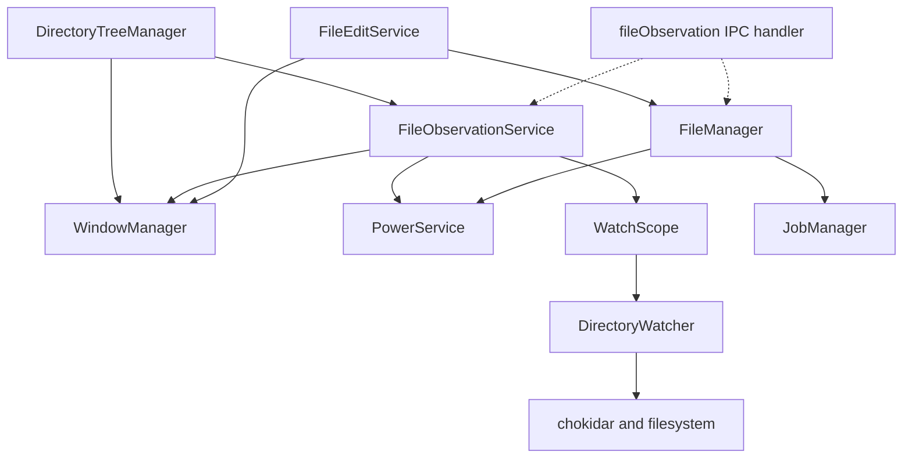
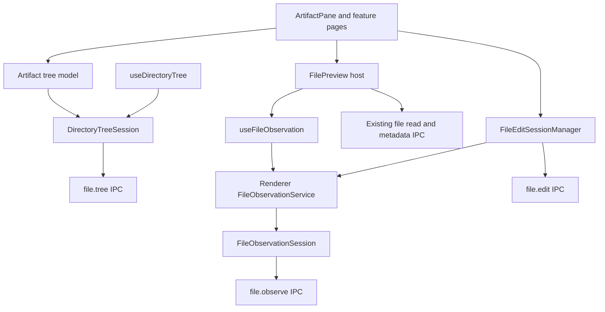

# Agent Note: File observation ownership and view consistency

Status: proposed

English | [中文](2026-11-17-file-observation-and-view-consistency.zh.md)

## Problem

An external writer, an Agent, and an editor can change the same filesystem independently. Directory membership, file content, local drafts, and view state have different owners and lifetimes. A view cannot infer current content from an unchanged filename or byte count, and reconnecting a watcher does not validate an old cache.

The current code exhibits two independently reproduced failures: an expanded directory reuses its pre-collapse listing after external creates/deletes; an open preview keeps old content after both same-length and different-length external writes. The first divergence is in [the artifact tree model](../../../../src/renderer/components/chat/panes/useArtifactFileTreeModel.ts), which maintains a listing cache separately from its subscriptions. The second is in [the preview host](../../../../src/renderer/components/chat/panes/ArtifactPane.tsx), which has no complete content-observation path; [the tree builder](../../../../src/main/services/file/tree/builder.ts) emits content updates only with `withStats` enabled. Reports [#23347](https://github.com/CherryHQ/cherry-studio/issues/23347) and [#24151](https://github.com/CherryHQ/cherry-studio/issues/24151) motivated the investigation; the latter's broad symptom is not fully explained by these reproductions.

A bounded TLA+ model exposes both failures and checks a candidate target's safety invariants. Its finite versions, abstract reads, and lack of fairness do not prove implementation correctness, timing, or eventual convergence. The concrete filesystem/IPC replay is evidence for the current defects, not acceptance evidence for this proposal.

This is a new owner for observation and projection consistency. It partially supersedes the observation deferral in [independent editing instances](2026-10-23-independent-file-edit-lifecycle.md), while retaining independent drafts, existing write leases, conditional saves, and recovery. The [earlier lifecycle proposal](2026-10-22-file-edit-session-lifecycle.md) remains a source of alternatives, not an additional delivery checklist. This proposal does not reinstate shared drafts, alias merging, writer election, or a window-close coordinator.

## Proposal

### State ownership and scope

| State | Owner | Contract |
|---|---|---|
| Physical watch coverage and health | Main `FileObservationService` | Own native resources and report invalidation or lost coverage; never claim that a notification contains current bytes |
| Directory membership projection | Main builder and one renderer `DirectoryTreeSession` per requested projection | Install a complete baseline before consuming its ordered updates; replace a directory's children rather than unioning stale entries |
| Loaded file content | Preview source or editing instance | Bind a read to its resource and observation revision; reject a superseded result |
| Local draft and save baseline | Independent `FileEditSessionManager` session | Observation may request revalidation but cannot replace dirty content or acknowledge a save |
| Expansion, selection, tabs, zoom and scroll | Feature/view | Change presentation demand without deciding another consumer's observation lifetime |

Delivery covers directory trees, the canonical `FilePreview` host, and existing Notes/Skills/Agent editing consumers. Existing file references and read/write authorization remain in use. Observation is runtime state, with no new database table, DataApi endpoint, Preference, or persistent cache. Search remains an explicit bounded query; search hits are not a second authoritative directory listing.

### File organization

The following is the target layout. Unlisted files remain in their current homes; the implementation removes replaced logic instead of leaving two observation paths active.

```text
src/main/services/file/
├── index.ts
├── observation/
│   ├── FileObservationService.ts
│   └── WatchScope.ts
├── watcher.ts
├── tree/
│   ├── DirectoryTreeManager.ts
│   └── builder.ts
├── FileManager.ts
└── FileEditService.ts

src/main/ipc/handlers/
├── file.ts
└── fileObservation.ts

src/shared/ipc/schemas/
├── file.ts
├── fileObservation.ts
└── ipcSchemas.ts
src/shared/utils/file/tree.ts

src/renderer/services/
├── DirectoryTreeSession.ts
├── fileObservation/
│   ├── index.ts
│   ├── FileObservationService.ts
│   └── FileObservationSession.ts
└── fileEdit/FileEditSessionManager.ts
src/renderer/hooks/
├── useDirectoryTree.ts
├── useFileObservation.ts
└── useFileEditSession.ts
src/renderer/components/FilePreview/
├── FilePreview.tsx
├── ElectronFilePreview.tsx
└── plugins/
src/renderer/components/chat/panes/
├── useArtifactFileTreeModel.ts
└── ArtifactPane.tsx
```

| File or group | Required change |
|---|---|
| Main `observation/FileObservationService.ts` | New lifecycle service owning physical scopes, internal leases, renderer subscriptions, invalidation revisions, and observation health |
| Main `observation/WatchScope.ts` | Private per-scope instance wrapping `DirectoryWatcher`, readiness, reference counting, and closure; not another service/singleton |
| Main `watcher.ts` | Keep the chokidar adapter and existing dangling-presence wiring; remove direct builder ownership of its instances after migration |
| Main `tree/builder.ts` and `tree/DirectoryTreeManager.ts` | Acquire observation leases; retain scan/index/projection and the existing renderer handoff; propagate loss of freshness and baseline resets |
| Main `ipc/handlers/fileObservation.ts` | Thin owner/handle adapter; resolve entry/path requests through existing file boundaries and delegate to the observation service |
| Shared `ipc/schemas/fileObservation.ts` | Own request/event schemas and inferred transport types; compose through `ipcSchemas.ts` and `src/main/ipc/handlers/ipcHandlers.ts`, without a second preload API |
| Shared `utils/file/tree.ts` | Extend projection updates for baseline replacement and stale/unavailable status; do not encode local drafts here |
| Renderer `services/DirectoryTreeSession.ts` | Extract the existing private session from `useDirectoryTree`; one reusable baseline/update implementation for ordinary and lazy directory consumers |
| Renderer `services/fileObservation/*` | A window-local registry and per-resource subscription sessions, shared by compatible observers; no draft, undo, or file-byte cache |
| Renderer hooks | Bind React demand to headless sessions; hooks do not own a second IPC protocol or native resource |
| `FilePreview`, its Electron adapter, and local plugins | Acquire current-file observation at the canonical host, invalidate metadata and content together, and guard the source's read/commit against obsolete results |
| Artifact tree/pane and existing edit consumers | Consume those capabilities; delete duplicate lazy-list caches/handshakes and file-size-based preview invalidation |

Keep all new runtime code inside existing process categories. Main's existing file barrel is the public boundary; `observation/` has no nested barrel. The renderer observation topic exposes one explicit re-export barrel with an enforced deep-import boundary. `DirectoryTreeSession.ts` remains a flat multi-instance class. Cross-process types derive from shared schemas; scope bookkeeping stays Main-only, and renderer read state stays renderer-only.

### Why a separate observation service

The required boundary is independent observation demand: collapsing or disposing a tree must not stop observation needed by an open preview or editor. That boundary does not require an additional lifecycle service. Two organizations can satisfy it:

| Decision | Extract `FileObservationService` | Evolve the existing `DirectoryTreeManager` |
|---|---|---|
| Runtime entry points | Keep the tree manager and add one observation service | Broaden and rename the existing service; no additional registration |
| Resource ownership | Observation service owns native scopes; tree manager owns shared projections | One service owns both scope and projection registries, with separate internal lifetimes |
| File-only consumers | Acquire observation without constructing a tree | Add a file subscription API that bypasses tree construction |
| Existing behavior | Retain tree consumers and handoff; move native resource ownership below them | Retain existing lifecycle machinery while separating tree-specific state internally |
| Accepted cost | One more service dependency and an explicit lease boundary to clean up | A broader public API and one lifecycle owner coordinating both kinds of resource |

This proposal chooses extraction because both kinds of consumer already exist and their resource lifetimes differ. A physical scope remains alive while any compatible tree, preview, or editor needs it; a tree projection remains alive only while tree consumers need it. Keeping those owners separate lets a file-only consumer avoid tree snapshots, filtering and mutation state, while the tree manager retains its cohesive projection API. Evolving the existing manager is a valid alternative and could provide the same external behavior; service count alone does not decide the boundary. Lifecycle rules govern how the chosen owner is managed, not whether another owner must be introduced. No performance improvement is claimed from adding a service.

Extraction migrates ownership rather than adding a second native-watch manager:

| Existing responsibility | Target owner and reuse |
|---|---|
| Builder creates, awaits and closes `DirectoryWatcher` | `WatchScope` under `FileObservationService`; builder consumes and releases a lease and no longer creates native watchers |
| Manager deduplicates builders, counts tree consumers and applies release grace | Retain in `DirectoryTreeManager` for projection lifetime; physical-scope sharing and final closure belong only to the observation service |
| Tree IDs, window ownership, snapshot activation and mutation revisions | Retain the existing tree protocol in `DirectoryTreeManager`; file subscriptions have their own IDs and invalidation revisions over the same IPC infrastructure |
| Acquisition, owner checks, handoff and cleanup behavior | Reuse the existing contracts and relevant implementation; extract shared helpers only where both paths need them, without a second transport or speculative generic registry |

Both services can observe window destruction because they release different owned subscriptions. Releasing a tree consumer can dispose its projection and release that projection's lease; only the observation service decides whether the underlying scope still has other leases. The migration must verify that a surviving preview keeps observing after the tree closes and that the final release closes the native resource exactly once, as covered by AC7 and AC8.

### Main service dependencies

Arrows below mean dependency, not event delivery. Dashed arrows are the IPC boundary's dispatch calls. Existing core and persistence dependencies are summarized rather than redefined.



| Lifecycle service | Phase and explicit same-phase dependencies | Reason |
|---|---|---|
| `FileObservationService` | `WhenReady`; `@DependsOn(['WindowManager', 'PowerService'])` | Release renderer-owned subscriptions when the owning window is destroyed; invalidate active coverage after system resume |
| `DirectoryTreeManager` | `WhenReady`; `@DependsOn(['WindowManager', 'FileObservationService'])` | Own tree consumers while using a lower-level observation lease |
| `FileEditService` | Keep `WhenReady`; `@DependsOn(['FileManager', 'WindowManager'])` | Pinned reads/writes and owner cleanup remain independent of notification availability |
| `FileManager` | Keep `WhenReady`; `@DependsOn(['PowerService', 'JobManager'])` | Entry lifecycle, storage and cleanup retain existing ownership |

Register only `FileObservationService` as a new service in `src/main/core/application/serviceRegistry.ts`, exporting its class through the existing file barrel. Runtime callers resolve it with `application.get('FileObservationService')`. The helper scope and renderer sessions are ordinary instances, not lifecycle services.

The observation service accepts validated filesystem scopes internally. It does not resolve `FileEntry` records, import `@main/data`, depend on `FileManager`/`DirectoryTreeManager`/`FileEditService`, or use `IpcApiService` as a startup dependency. The IPC adapter resolves an entry handle through `FileManager` before acquiring its scope; path handles use existing path policy. This call edge does not become a hidden service dependency. Directed pushes use the existing owned-WebContents event transport, as the tree manager already does. Core services acquire no reverse dependency on file services.

`DirectoryTreeManager` acquires one internal observation lease per shared builder and passes that lease into `createDirectoryTree`/the builder. The builder receives its source explicitly; it neither queries the service container nor creates a native watcher. The lease is ready before the initial scan; invalidations received during baseline construction are retained and reconciled before that baseline is considered current. Builder disposal releases the lease. Physical scope sharing and projection sharing remain separate: the observation service never constructs a directory tree.

The new service uses lifecycle disposal and typed events. Shutdown stops admission and releases all scopes; tree teardown runs before observation teardown by dependency order. Closing a window releases its subscriptions, while another window's/internal consumer keeps its scope alive. File writes still drain under the existing edit service even if observation is unavailable.

### Scope and identity

A directory observation covers the directory projection's explicit depth and pruning policy. A file observation covers the requested file's effective address and the parent/alias paths needed to detect replacement; it survives collapsing the directory tree. Watch the parent relationship so atomic replacement is observed rather than pinning only the old inode.

Share physical resources only for equivalent coverage and compatible native filtering. Do not widen an explicit-file watch into an unbounded workspace watch, and do not remove dependency/build exclusions from a recursive tree merely to share resources. A separately scoped file observer can observe an explicitly opened hidden or gitignored file even when the tree omits it. `withStats` controls metadata collection, not eligibility for content invalidation.

Retain the original locator and existing resolution policy. A subscription ID is not a persistent file identity, read permission, or write lease. Symlink/entry retargeting causes revalidation and explicit rebinding; observation cannot silently move an editing instance to a new target. Owner-initiated rename/move/delete continues to use the existing preparation/finish contract, which invalidates the old binding even if a filesystem event is absent.

### Renderer dependencies and demand



The renderer registry is a named window-local singleton, `fileObservationService`, not a React Provider. It keys subscriptions by the exact supported locator and observation policy; it does not merge aliases or draft owners. `useFileObservation` is its external-store adapter. A file-edit session acquires the same headless capability directly; a service never imports a hook/component.

| Consumer demand | Subscription lifetime | Return/recovery contract |
|---|---|---|
| Visible tree root and expanded directories | Hold projection sessions; collapsing releases that directory's demand with bounded reuse grace | Reacquire a baseline after release; cached children alone never certify freshness |
| Active preview | Hold current-file observation regardless of tree expansion; a hidden view may reuse it during bounded grace | Revalidate on visibility return, and retake the baseline after release |
| Attached editor or pending save | The editing instance holds observation independently of the tree/component attachment | Guard reads against current draft/session generations |
| Detached retained draft/failure/conflict | Release observation after bounded grace; retain the independent draft/recovery instance | Revalidate on reattachment; conditional saving remains authoritative without continuous observation |

The extracted `DirectoryTreeSession` owns baseline installation, activation, revision validation and reset handling. The artifact model owns only expansion demand and projection into `FileTreeNode`. Each expanded directory uses this session implementation; its latest snapshot replaces that directory's children. Remove `LazyDirectoryWatcher`, the independent `listDirectoryEntries` expansion path, and additive merging of obsolete child lists. `loadFolder` acquires the required directory sessions without expanding UI rows. Explicit search can keep its current bounded listing API.

The canonical `FilePreview` host observes its current resource, including previews outside an Agent workspace. Plugins consume the host's source/refresh generation and do not install their own watchers. Reload metadata and bytes for that generation; a metadata response alone cannot mark old content fresh. Local text/Markdown/HTML plugins and the existing portable preview adapter must reject superseded source results. Preserve view state where the format supports in-place replacement. Keep the portable package free of Electron/IPC/service dependencies; reuse its existing source and refresh contracts.

An attached editor observes its bound resource independently of the tree. Saving sessions retain observation until their pending work settles. A detached dirty/failed/conflicted session releases observation after bounded grace while retaining its draft and existing recovery state; reattachment revalidates before adopting disk content, and every save still validates its baseline. A settled detached session releases its lease. A failed acquisition releases both partial subscriptions and existing edit leases. Observation callbacks invoke guarded revalidation: clean sessions may adopt new bytes; dirty sessions retain their draft and compare disk baselines. Remove Notes/Skills tree-to-editor notification forwarding when these consumers migrate, so one event does not trigger two reads. Save confirmation remains the write reply, never a watcher echo.

### Protocol, freshness and recovery

| Boundary | Contract |
|---|---|
| `file.observe.open` | Accept a `FileHandle`; validate the managed sender and existing resolution policy; return an owned subscription ID, baseline revision and coverage status without reading file bodies |
| `file.observe.activate` | Install the renderer listener before activation; flush buffered invalidations, including changes during setup |
| `file.observe.changed` | Send ordered invalidation or coverage-status updates only to the owner; a content change invalidates knowledge even when size/mtime appear unchanged |
| `file.observe.close` | Idempotently release one subscription; a closed or replaced generation cannot publish into its successor |
| Existing `file.tree.*` | Preserve its snapshot/listener/activation contract; extend updates to carry full baseline resets and explicit stale/unavailable status |
| Existing read/write routes | Remain authoritative for bytes, metadata, target validation and save outcomes; observation does not replace them |

A subscription ID identifies its lifetime, and a monotonic stream revision detects duplicate/gap and read obsolescence within that lifetime. Disk versions/hashes and draft revisions remain separate. Reuse the existing identity when it already prevents stale application instead of adding another counter for the same fact.

A trusted initial read starts only after observation is ready and its listener/activation handoff is established. A consumer may display an older cached snapshot during setup, but must revalidate it after readiness. Each consumer captures its resource, subscription and read revision before reading. If any changes before commit, the result is obsolete; keep the latest invalidation pending and read again. Coalesce invalidations with at most one reconciliation read in flight per consumer. The returned versioned read result, not an earlier metadata preflight, supplies the stamp of the adopted content. Keep coherent/bounded read checks in the existing file-read helpers and source adapter, not in the observation service. This is an invalidation state machine, not a queue that reads a large document once for every raw event.

Starting, interrupted and resumed subscriptions do not certify cached content. Explicit observation states distinguish starting, live coverage, stale coverage and unavailable coverage; live coverage does not itself mean that a consumer has read the latest content. Missing files stay distinct from empty content or observation failure. On startup/resume, a stream gap, watcher failure, focus/visibility return, or explicit retry, mark the relevant consumer stale and reconcile. A tree's baseline reset replaces its projection; losing observation must not silently leave a permanently healthy-looking mirror.

Use the existing bounded setup/retry behavior and retain an actionable stale/error state after retries are exhausted. This proposal guarantees reconciliation after delivered invalidations and explicit recovery triggers when reads succeed. It does not claim a fixed latency or autonomous recovery from indefinitely silent OS-event loss; adding periodic integrity scans requires a separate cost/guarantee decision. Never hash every file after every event or scan an inactive whole workspace.

### Implementation sequence and removal

| Layer | Deliverable and removals | Verification owner |
|---|---|---|
| 1. Main observation | Service registration, scope leases, owner-directed protocol and failure/resume delivery; migrate the builder's native watcher ownership | Main filesystem/protocol tests; AC1, AC2, AC6, AC7 |
| 2. Directory projection | Extract the reusable renderer session, add resets/status and migrate lazy folders; delete duplicate caches and handshakes | Renderer and Electron; AC1, AC5, AC6 |
| 3. File consumers | Connect the preview host and independent edit sessions; remove size-based invalidation and duplicate feature forwarding | Renderer, file-preview adapter and Electron; AC2, AC3, AC4, AC5, AC7 |
| 4. Acceptance | Replay actual event/read races and Windows reports; align file-domain reference docs with shipped ownership | Main, renderer, Electron and docs; AC1–AC8 |

Each layer keeps its affected consumers working; a migrated consumer uses one path, and the final implementation removes unused exports, listeners and protocol branches. Follow the existing Spec-first stack process. This document remains proposed until the approved acceptance criteria have actual evidence; model success is not implementation acceptance.

## Alternatives considered

- Evolve and rename `DirectoryTreeManager` into the combined observation entry point: can satisfy the same behavior without another service registration, provided file-only observation bypasses tree construction. The comparison above accepts the extra service boundary to keep native coverage ownership separate from directory projection ownership.
- Add refresh calls on reopen and enable `withStats` on tree watchers: repairs selected paths but keeps content freshness coupled to tree visibility/metadata policy and preserves duplicate directory state.
- Keep one recursive watcher permanently active for every workspace: avoids some visibility gaps at the cost of hidden-workspace I/O and native handles; the scope should follow consumer demand.
- Let each preview plugin and editor create a watcher: repeats ownership, error recovery and handoff logic, and allows collapsing/teardown behavior to diverge again.
- Merge content observation, shared drafts and writes into a universal file-resource service: expands this decision into identity, writer election and persistence semantics already separated by the editing design.
- Treat native events or ordered IPC revisions as a lossless filesystem journal: neither guarantees complete history, coherent bytes, or save confirmation; they trigger reconciliation instead.

## Acceptance criteria

- AC1 — After a deep directory is collapsed, modified externally and reopened, its listing converges without another filesystem event, including deletion of cached descendants (verification: renderer and Electron; owner: directory projection)
- AC2 — An opened file refreshes after same-length writes, atomic replacement and delete/recreate while the directory tree is collapsed, including explicitly opened hidden/ignored and out-of-workspace files (verification: Main filesystem tests and Electron; owner: file observation and preview)
- AC3 — External changes refresh clean editors but preserve independent dirty/failed drafts and expose confirmed conflicts; another feature's draft and undo state remain independent (verification: renderer and Electron; owner: file edit sessions)
- AC4 — A read invalidated during loading or superseded by another file/workspace cannot commit stale content or mismatched source metadata; the last successful current read becomes visible (verification: renderer and real-source adapter tests; owner: preview source and edit sessions)
- AC5 — Changes between baseline acquisition and activation, duplicate pushes and revision gaps do not create a silently stale mirror; recovery installs a new baseline before declaring the projection ready (verification: Main protocol and renderer tests; owner: observation transport and directory sessions)
- AC6 — A watcher error or system resume invalidates affected views, distinguishes missing/stale/unavailable from empty content, and permits recovery without restarting the app (verification: Main fault injection and Electron; owner: observation lifecycle)
- AC7 — Equivalent scope consumers share native resources; closing/collapsing one consumer leaves other observers functional, and releasing the final consumer or owner window frees resources after bounded grace without expanding the recursive watch scope (verification: Main lifecycle/resource tests and Electron; owner: observation service)
- AC8 — The final tree has one native-watch owner and one renderer directory handoff implementation, obsolete artifact caches/notification forwarding are removed, dependencies remain acyclic, and paired file-domain reference docs describe the delivered contracts (verification: scoped imports/change review and docs gate; owner: integration)

## Risks

- Splitting scope and projection lifetimes can strand a lease or close a watcher while another consumer still needs it. Migrate the existing native ownership, retain explicit lease disposal, and verify tree/preview release order and window teardown; do not leave the builder's original watcher path active.
- Physical watch sharing can accidentally broaden recursion or change filtering. Share only compatible scopes and measure native handle/scan behavior on a real code workspace.
- Initial-read/activation/recovery races can publish stale content. Preserve the existing handoff protocol and prove the concrete race paths rather than relying on callback-count mocks.
- Revalidation can repeatedly parse large files. Coalesce demand, retain stale content during an allowed reload, and keep format-specific byte/range limits; do not introduce an unbounded shared content cache.
- This reopens a previously deferred observation responsibility. Keep that change isolated from draft identity, persistence, close coordination and crash recovery, and update the prior owner link together with this Spec.
- Cross-platform watcher behavior and silent event loss bound the guarantee. macOS evidence and the bounded model do not replace Windows acceptance or establish network-filesystem timing.
