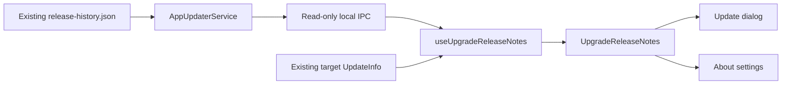

# Agent Note: Aggregate release notes across an upgrade

Status: proposed

English | [中文](2026-10-31-upgrade-release-notes.zh.md)

## Problem

`AppUpdaterService` dynamically retrieves stable release history for the standalone release-notes page, but the update dialog and About settings consume only the updater's target-version notes. Skipping versions hides intermediate changes. Concatenating every release would restore content but overload the interface: the repository's 2.1.7, 2.1.8, and 2.1.9 Chinese notes contain 86 top-level list items in total.

The interface collects the upgrade range in a version timeline, with releases collapsed initially when more than one version is available. A single version is displayed directly. Expanding a version reveals its complete original notes. This bounds the initial reading load without a second category hierarchy or a separate original-notes mode.

## Proposal

### Scope

Support upgrades between stable semantic versions `x < y` in the update dialog and About settings. Select published records in `(x, y]`; do not assume every intervening numeric patch or minor version was released. Use the existing managed `release-history.json` without a new server endpoint, file format, or release workflow.

Keep the standalone history page's existing behavior. Post-install first-launch presentation and complete RC/Beta history are outside this iteration; prerelease upgrades retain their existing target notes rather than claiming complete history. No model call, automatic semantic summary, persistent setting, or database migration is needed.

### Ownership and data flow

| Owner | Responsibility |
| --- | --- |
| `src/main/services/AppUpdaterService.ts` | Fetch and validate managed history using the existing URL, headers, timeout, and size limit; derive the installed version from Electron; filter the requested stable range. |
| `src/shared/ipc/schemas/app.ts` and `src/main/ipc/handlers/app.ts` | Define and delegate a read-only local IPC route. Cross-process payloads contain versions, source Markdown, and retrieval status, not UI groups. |
| `src/renderer/hooks/useUpgradeReleaseNotes.ts` | Own request, retry, and stale-response handling for the displayed upgrade; combine history with the target-note fallback. |
| `src/renderer/utils/upgradeReleaseNotes.ts` | Pure renderer-only range filtering, semantic ordering, and source selection per version. Preserve each complete Markdown document. |
| `src/renderer/components/UpgradeReleaseNotes.tsx` | Shared collapsible version timeline composed by the update dialog and About settings, using `@cherrystudio/ui` and the existing `ReleaseNotes` renderer. |

Add `app.updater.upgrade_notes.get` with input `{ targetVersion }`. Main validates a stable target greater than the installed stable version; unsupported ranges fail as invalid input. The response is `{ fromVersion, toVersion, historyStatus, releases }`, where `historyStatus` is `available` or `unavailable`, and each release retains `{ version, releaseNotes }`. An unavailable history request returns an empty list with `unavailable`; a successful response with no matching records remains `available` with an empty list. Renderer loading is local state, not an IPC status.

This route calls the existing history fetch directly. It must not call `getLatestReleaseNotes()`, check for updates, start a download, or use a newly advertised version as its upper bound. The existing `app.updater.release_notes.get` contract and updater event payloads stay unchanged. History requests never gate update availability, download progress, or installation.

The hook accepts the target `UpdateInfo`. Validated dynamic history owns each version's content; use the event's target notes only when history lacks usable notes for `y`. For an array fallback, retain only valid versions in `(x, y]`; never relabel unrelated array entries as `y`. A successful fetch does not prove that the publisher recorded every historical release; the interface reports known retrieval gaps without adding a loaded-version count. Target notes absent from both sources produce an explicit no-notes state without disabling installation.

Discard responses after unmount or target change, and prevent an earlier attempt from replacing a later retry. Re-localize documents when the UI language changes, using the existing localization rules. Raw history remains multilingual; already-localized fallback text keeps the event's language until a multilingual record is available. Keep fetched data in the mounted hook; no persistent cache or new service is required.

### Complete version documents

Render each release as one complete localized document through the existing `ReleaseNotes` renderer. Preserve publisher order, headings, notices, nested lists, code, and unknown sections. Reference links and footnotes remain scoped to their originating release; shared Markdown footnote navigation must focus the corresponding note and return to its reference without opening an external-link prompt.

Do not classify or deduplicate entries across releases. Repeated text belongs to each original version, and differing links or reference definitions cannot collide. Deduplicate only version records when choosing history over the event fallback. The Markdown renderer continues to own link and HTML safety.

### Presentation and states

When more than one version is available, display a descending version timeline with a subtle line and dots, without a separate range summary or loaded-version count. Each full version row is an accordion trigger; all versions start collapsed, and multiple versions may be expanded independently. The installed version x is a muted terminal marker without release content. Do not invent dates that the feed does not provide.

With one available version, display its complete localized notes directly, without the range summary, count, timeline, version trigger, or installed-version marker. With no available notes, show only the applicable loading or unavailable state. Loading and failure notices and retry remain available regardless of version count. If history adds a second version, switch to the initially collapsed timeline.

Expanded rows show complete localized notes with no item limit, synthetic categories, source-version labels on individual entries, or overview/original toggle. Keep open versions across retries and language changes; reset expansion when the target changes. Let the collapsed dialog fit its content and keep installation actions outside the scrolling notes. Both update surfaces use the same timeline.

While loading, retain available target notes in the single-version or timeline layout described above and show a quiet loading status. On retrieval failure, show the available fallback with “History could not be loaded”, a retry action, and no claim of complete coverage. A loaded history missing the target uses the target fallback when available; otherwise explain that target notes are unavailable while preserving intermediate notes. Unknown formats remain readable. No log-fetch state disables install, changes downloaded state, or triggers an update-error dialog.

Use shared controls with accessible names, visible keyboard focus, and expanded-state semantics. Announce loading/failure status politely without announcing the entire document or moving focus. Preserve readable wrapping at narrow widths and 200% zoom; do not clamp entry text or shrink the font to fit. Reuse semantic color and typography tokens in both themes. Add all interface labels through i18next and translate every new catalog key.

### Implementation and verification boundary

After approval of this Spec head, implement one focused layer covering the local IPC route, range selection, shared component, both consumers, translations, and regression tests. Keep the standalone release-notes page and updater scheduling behavior covered by their existing focused tests. Test range boundaries and complete Markdown documents, including independent reference and footnote scopes. Run Electron E2E against the actual update dialog and About settings, including retrieval failure, initially collapsed rows, independent expansion, and complete notes; renderer tests alone do not establish the user-visible outcome.

## Alternatives considered

- Expanding all version documents initially preserves source text but leaves the first reading load unbounded.
- Category aggregation with exact deduplication and three-item previews introduces a second hierarchy, repeated provenance labels, and an original-notes toggle. The version timeline removes this complexity while preserving the source documents.
- Model-generated summaries or similarity deduplication can omit caveats or conflate successive fixes and require configuration or nondeterministic output.
- Fetching history inside update-event processing couples a secondary read to download timing and risks reordering available, progress, and downloaded states.
- Reusing the standalone history getter would query a moving latest version and cannot distinguish failed history from its latest-only fallback; a narrow local IPC route preserves that existing contract.
- Changing the server format to structured changelog entries would improve metadata but exceeds the client-only scope and is unnecessary for a version timeline with original-source access.

## Acceptance criteria

- AC1 — For stable `x < y`, all returned history records in `(x, y]` are included once, in semantic version order; records at or below x or above y never appear, and unsupported ranges do not claim an aggregate (verification: main and renderer unit tests)
- AC2 — A history request cannot trigger another update check, download, or install, and delayed or failed history cannot reorder updater states or disable installation (verification: main tests and Electron)
- AC3 — Expanded releases preserve complete localized Markdown, including notices, unknown sections, links, code, nested items, and reference context (verification: renderer unit tests and Electron)
- AC4 — Identical text in different releases remains in both documents; links and footnote IDs stay isolated per release, and footnote navigation and return target the originating document (verification: renderer and shared Markdown tests, Electron)
- AC5 — Both update surfaces show the same descending version timeline; multiple versions start collapsed with an installed-version endpoint and no separate range summary or loaded-version count, while a single version shows complete notes directly without timeline or version metadata (verification: renderer tests and Electron E2E)
- AC6 — Multiple versions expand independently to expose complete notes; collapsing one leaves others open, retry and language changes preserve expansion, and a new upgrade target resets it (verification: renderer tests and Electron E2E)
- AC7 — Loading, unavailable history, missing target notes, and retry are explicit; target fallback stays usable, stale responses cannot replace a new target or retry, and language changes recompute multilingual content (verification: renderer tests and Electron E2E)
- AC8 — Controls work by keyboard with visible focus and expanded-state semantics; install remains reachable in narrow windows and at 200% zoom, and both themes retain readable content (verification: Electron keyboard, zoom, and theme checks)
- AC9 — New UI strings are translated, the bilingual Spec pair passes repository checks, and existing standalone-history and updater-state consumers retain their contracts (verification: i18n check, docs gate, and focused existing tests)

## Risks

Collapsed notes require an explicit expansion before notices become visible. This is the accepted cost of the uniformly collapsed timeline; the UI does not infer severity from free-form prose or force selected releases open. Expanding a large document can still require scrolling, while installation remains reachable. Repeated entries across versions remain intentionally visible in their original context.

The stable-only history contract cannot supply skipped RC/Beta releases. The existing history size limit and network availability can force fallback. Even a valid history response cannot prove publisher completeness, so the UI displays available records and reports known retrieval gaps rather than promising a complete audit. Each mounted surface may issue its own read; introduce request sharing only if measured behavior justifies it.
