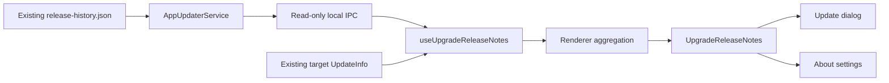

# Agent Note: Aggregate release notes across an upgrade

Status: proposed

English | [中文](2026-10-31-upgrade-release-notes.zh.md)

## Problem

`AppUpdaterService` dynamically retrieves stable release history for the standalone release-notes page, but the update dialog and About settings consume only the updater's target-version notes. Skipping versions hides intermediate changes. Concatenating every release would restore content but overload the interface: the repository's 2.1.7, 2.1.8, and 2.1.9 Chinese notes contain 86 top-level list items in total.

The user accepted client-side aggregation by category, exact deduplication, three initially visible items per ordinary category, prominent explicit notices, and access to the original versioned notes. This Spec defines the ownership and failure contracts needed to implement that design.

## Proposal

### Scope

Support upgrades between stable semantic versions `x < y` in the update dialog and About settings. Select published records in `(x, y]`; do not assume every intervening numeric patch or minor version was released. Use the existing managed `release-history.json` without a new server endpoint, file format, or release workflow.

Keep the standalone history page's existing behavior. Post-install first-launch presentation and complete RC/Beta history are outside this iteration; prerelease upgrades retain their existing target notes rather than claiming complete history. No model call, automatic semantic summary, persistent setting, or database migration is needed.

### Ownership and data flow

| Owner | Responsibility |
| --- | --- |
| `src/main/services/AppUpdaterService.ts` | Fetch and validate managed history using the existing URL, headers, timeout, and size limit; derive the installed version from Electron; filter the requested stable range. |
| `src/shared/ipc/schemas/app.ts` and `src/main/ipc/handlers/app.ts` | Define and delegate a read-only local IPC route. Cross-process payloads contain versions, source Markdown, and retrieval status, not UI groups. |
| `src/renderer/hooks/useUpgradeReleaseNotes.ts` | Own request, retry, and stale-response handling for the displayed upgrade; combine history with the target-note fallback. |
| `src/renderer/utils/upgradeReleaseNotes.ts` | Pure renderer-only localization, Markdown classification, ordering, and exact deduplication. Do not put presentation-only logic in `src/shared/`. |
| `src/renderer/components/UpgradeReleaseNotes.tsx` | Shared aggregate/versioned view composed by the update dialog and About settings, using `@cherrystudio/ui` and the existing `ReleaseNotes` renderer. |

Add `app.updater.upgrade_notes.get` with input `{ targetVersion }`. Main validates a stable target greater than the installed stable version; unsupported ranges fail as invalid input. The response is `{ fromVersion, toVersion, historyStatus, releases }`, where `historyStatus` is `available` or `unavailable`, and each release retains `{ version, releaseNotes }`. An unavailable history request returns an empty list with `unavailable`; a successful response with no matching records remains `available` with an empty list. Renderer loading is local state, not an IPC status.

This route calls the existing history fetch directly. It must not call `getLatestReleaseNotes()`, check for updates, start a download, or use a newly advertised version as its upper bound. The existing `app.updater.release_notes.get` contract and updater event payloads stay unchanged. History requests never gate update availability, download progress, or installation.

The hook accepts the target `UpdateInfo`. Validated dynamic history owns each version's content; use the event's target notes only when history lacks usable notes for `y`. For an array fallback, retain only valid versions in `(x, y]`; never relabel unrelated array entries as `y`. The count is the number of distinct loaded versions, not `y - x`. Display “Loaded updates from N versions”; a successful fetch does not prove that the publisher recorded every historical release. Target notes absent from both sources produce an explicit no-notes state without disabling installation.

Discard responses after unmount or target change, and prevent an earlier attempt from replacing a later retry. Recompute aggregation when the UI language changes, using the existing localization rules. Raw history remains multilingual; already-localized fallback text keeps the event's language until a multilingual record is available. Keep fetched data in the mounted hook; no persistent cache or new service is required.

### Lossless aggregation

Use the already-installed `unified`, `remark-parse`, and `remark-gfm` packages to identify Markdown blocks and source positions. Parse structure instead of splitting on newline or matching every bullet with a regular expression. The existing Markdown renderer continues to own link and HTML safety; aggregation must not introduce raw HTML rendering.

Recognize exact English and Chinese category labels in top-level headings or standalone paragraph lines, allowing their published decorative emoji. Map features to “New features”, improvements/performance to “Improvements”, and fixes to “Fixes”. Place explicitly labelled security, breaking changes, important notices, action-required sections, and tips in a leading “Important” group. Match labels and explicit item prefixes, not keywords buried in prose. Do not infer severity from a module tag such as `[Security]` alone.

A top-level list item is one complete entry, including nested lists, continuation paragraphs, links, and code. Reference-link and footnote definitions stay scoped to their originating release so identical labels from different releases cannot change their destinations. Preserve non-list blocks and unknown sections in “Other updates”, with their original context. If a release cannot be partitioned safely, retain its complete localized document as one entry instead of dropping content. The versioned view always retains the complete localized source, including titles.

Deduplicate only within the same group when complete source content matches after normalizing line endings and trimming outer blank lines. Do not collapse internal whitespace, erase URLs, strip module tags, equate different reference destinations, or merge similar sentences. Retain every source version on the surviving entry. Code, nested content, and resolved reference context participate in equality. Sort source releases by semantic version descending and preserve publisher order within each release.

### Presentation and states

Show `x → y` with the loaded-version count. Render the non-empty groups in this order: Important, New features, Improvements, Fixes, Other updates. Important is fully expanded and excluded from ordinary preview limits. Each ordinary group initially shows at most three complete entries, a total count, and “Show N more” when needed; expansion reveals every remaining entry and offers collapse. Do not call the first three entries “highlights”, since no editorial ranking occurred.

“View original notes by version” switches the same component to descending version sections over the same records and range. “Back to overview” restores the aggregate view. This local switch avoids a new route parameter or page dependency and cannot silently jump to a later release. Preserve expansion state while switching views; reset it when the target changes. Keep installation actions outside the scrolling content.

While loading, retain available target notes and show a quiet loading status. On retrieval failure, show the available fallback with “History could not be loaded”, a retry action, and no claim of complete coverage. A loaded history missing the target uses the target fallback when available; otherwise explain that target notes are unavailable while preserving intermediate notes. Unknown formats remain readable. No log-fetch state disables install, changes downloaded state, or triggers an update-error dialog.

Use shared controls with accessible names, visible keyboard focus, and expanded-state semantics. Announce loading/failure status politely without announcing the entire document or moving focus. Preserve readable wrapping at narrow widths and 200% zoom; do not clamp entry text or shrink the font to fit. Reuse semantic color and typography tokens in both themes. Add all interface labels through i18next and translate every new catalog key.

### Implementation and verification boundary

After approval of this Spec head, implement one focused layer covering the local IPC route, pure aggregation, shared component, both consumers, translations, and regression tests. Keep the standalone release-notes page and updater scheduling behavior covered by their existing focused tests. Test the parser against representative published history and adversarial Markdown fixtures before connecting the UI. Run Electron E2E against the actual update dialog and About settings, including retrieval failure and more than three entries in a group; renderer tests alone do not establish the user-visible outcome.

## Alternatives considered

- Concatenating version documents preserves source text but repeats headings and leaves the initial reading load unbounded.
- Model-generated summaries or similarity deduplication can omit caveats or conflate successive fixes and require configuration or nondeterministic output.
- Fetching history inside update-event processing couples a secondary read to download timing and risks reordering available, progress, and downloaded states.
- Reusing the standalone history getter would query a moving latest version and cannot distinguish failed history from its latest-only fallback; a narrow local IPC route preserves that existing contract.
- Changing the server format to structured changelog entries would improve metadata but exceeds the client-only scope and is unnecessary for conservative grouping with original-source access.

## Acceptance criteria

- AC1 — For stable `x < y`, all returned history records in `(x, y]` are included once, in semantic version order; records at or below x or above y never appear, and unsupported ranges do not claim an aggregate (verification: main and renderer unit tests)
- AC2 — A history request cannot trigger another update check, download, or install, and delayed or failed history cannot reorder updater states or disable installation (verification: main tests and Electron)
- AC3 — English and Chinese published sections map to the intended groups, explicit important notices stay visible, and unrecognized or unsafe-to-partition Markdown remains accessible without lost links, code, nested items, or reference context (verification: renderer unit tests and Electron)
- AC4 — Only exact entries within one group are deduplicated; all source versions survive, and differences in URLs, code, nested content, or reference destinations prevent merging (verification: renderer unit tests)
- AC5 — Both update surfaces show the same range and groups; ordinary groups initially show at most three complete entries, counts match distinct loaded records and entries, and expansion exposes every remaining entry (verification: renderer tests and Electron E2E)
- AC6 — Original-version mode shows the complete localized documents for the same `(x, y]` range, returns to the aggregate without losing expansion state, and never displays a newly published version above y (verification: renderer tests and Electron E2E)
- AC7 — Loading, unavailable history, missing target notes, and retry are explicit; target fallback stays usable, stale responses cannot replace a new target or retry, and language changes recompute multilingual content (verification: renderer tests and Electron E2E)
- AC8 — Controls work by keyboard with visible focus and expanded-state semantics; install remains reachable in narrow windows and at 200% zoom, and both themes retain readable content (verification: Electron keyboard, zoom, and theme checks)
- AC9 — New UI strings are translated, the bilingual Spec pair passes repository checks, and existing standalone-history and updater-state consumers retain their contracts (verification: i18n check, docs gate, and focused existing tests)

## Risks

Free-form release prose cannot reliably identify semantic duplicates, changes later reverted, or unmarked critical instructions. Conservative equality and explicit labels intentionally leave some repetition; versioned originals remain the authority. A long Important section or one very large entry can exceed the usual preview length because hiding necessary content is worse than scrolling.

The stable-only history contract cannot supply skipped RC/Beta releases. The existing history size limit and network availability can force fallback. Even a valid history response cannot prove publisher completeness, so the UI describes loaded records and reports known retrieval gaps rather than promising a complete audit. Each mounted surface may issue its own read; introduce request sharing only if measured behavior justifies it.
