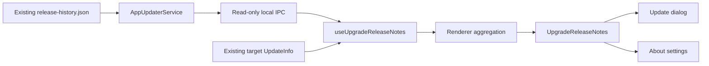

# Agent Note: 聚合跨版本升级日志

Status: proposed

[English](2026-10-31-upgrade-release-notes.md) | 中文

## Problem

`AppUpdaterService` 会为独立更新日志页动态获取稳定版历史，但更新弹窗和关于设置只使用更新器提供的目标版本日志。跳版本升级会遗漏中间改动。拼接所有版本虽能补回内容，却会让界面过长：仓库中 2.1.7、2.1.8 和 2.1.9 的中文日志合计有 86 个顶层列表项。

用户已认可客户端按类别聚合、精确去重、普通分类默认展示三条、突出明确的重要提示，以及保留逐版本原文的方案。本 Spec 定义实现该设计所需的职责归属和失败契约。

## Proposal

### 范围

支持更新弹窗和关于设置中的稳定语义版本升级 `x < y`。选择 `(x, y]` 内已发布的记录；不假定数字上相邻的每个补丁版本或次版本都曾发布。使用现有托管 `release-history.json`，不新增服务端接口、文件格式或发布流程。

独立历史页保持现有行为。本轮不包含安装后首次启动展示和完整 RC/Beta 历史；预发布版本升级保留现有目标版本日志，不声称覆盖完整历史。无需模型调用、自动语义摘要、持久化设置或数据库迁移。

### 职责与数据流

| 归属 | 职责 |
| --- | --- |
| `src/main/services/AppUpdaterService.ts` | 使用现有 URL、请求头、超时和体积限制获取并校验托管历史；从 Electron 获取已安装版本；筛选请求的稳定版本区间。 |
| `src/shared/ipc/schemas/app.ts` 与 `src/main/ipc/handlers/app.ts` | 定义并委派只读本地 IPC 路由。跨进程载荷包含版本、原始 Markdown 和获取状态，不包含 UI 分组。 |
| `src/renderer/hooks/useUpgradeReleaseNotes.ts` | 管理当前升级的请求、重试和过期响应；组合历史与目标版本日志回退。 |
| `src/renderer/utils/upgradeReleaseNotes.ts` | 仅供 renderer 使用的纯函数，负责本地化、Markdown 分类、排序和精确去重。不将纯展示逻辑放入 `src/shared/`。 |
| `src/renderer/components/UpgradeReleaseNotes.tsx` | 更新弹窗和关于设置共用的聚合／逐版本视图，使用 `@cherrystudio/ui` 和现有 `ReleaseNotes` 渲染器。 |

新增 `app.updater.upgrade_notes.get`，输入为 `{ targetVersion }`。Main 校验目标是高于已安装稳定版本的稳定版本；不支持的区间按无效输入处理。响应为 `{ fromVersion, toVersion, historyStatus, releases }`，其中 `historyStatus` 为 `available` 或 `unavailable`，每条日志保留 `{ version, releaseNotes }`。历史请求不可用时返回空列表和 `unavailable`；请求成功但没有匹配记录时仍返回 `available` 和空列表。renderer 的加载中状态由本地管理，不属于 IPC 状态。

该路由直接调用现有历史获取方法，不得调用 `getLatestReleaseNotes()`、检查更新、开始下载，也不得将刚发现的新版本作为区间上界。现有 `app.updater.release_notes.get` 契约和更新器事件载荷保持不变。历史请求不阻塞更新可用通知、下载进度或安装。

hook 接收目标 `UpdateInfo`。每个版本的内容优先采用校验后的动态历史；只有历史缺少 `y` 的可用日志时才使用事件中的目标版本日志。数组回退仅保留 `(x, y]` 内的有效版本，不得把无关数组条目改标为 `y`。数量为实际加载的不同版本数，而非 `y - x`。展示“已加载 N 个版本的更新”；获取成功不能证明发布者记录了所有历史版本。两处来源均无目标日志时显示明确的无日志状态，不禁用安装。

卸载或目标变化后丢弃响应，较早的请求不得覆盖较晚的重试。UI 语言变化时使用现有本地化规则重新聚合。原始历史保持多语言；已经本地化的回退文本在获得多语言记录前保留事件语言。获取的数据保存在已挂载 hook 内，无需持久化缓存或新服务。

### 无损聚合

使用已安装的 `unified`、`remark-parse` 和 `remark-gfm` 识别 Markdown 块及其源位置。解析结构，不通过换行拆分或用正则逐条匹配所有列表。现有 Markdown 渲染器继续负责链接与 HTML 安全；聚合不得引入原始 HTML 渲染。

识别顶层标题或独立段落行中的精确中英文分类名称，允许其发布时使用的装饰性 emoji。将功能归为“新功能”，改进／性能归为“改进”，修复归为“问题修复”。明确标为安全、破坏性变更、重要提示、需要操作的章节及提示归入最前面的“重要提示”组。匹配分类名称和明确的条目前缀，不匹配正文中零散的关键词。不得仅凭 `[Security]` 这样的模块标签推断严重性。

一个顶层列表项是一个完整条目，包含嵌套列表、续接段落、链接和代码。引用式链接和脚注定义保持在所属版本的作用域内，避免不同版本的相同标签改变链接目标。非列表块和未知章节连同原有上下文保留在“其他更新”。某个版本无法安全切分时，将完整本地化文档作为一个条目保留，不丢弃内容。逐版本视图始终保留完整本地化原文，包括标题。

仅在同组中，对统一换行符并去除首尾空行后完整源内容相同的条目去重。不压缩内部空白、不删除 URL、不去掉模块标签、不把不同引用目标视为相同，也不合并相似句子。保留被合并条目的所有来源版本。代码、嵌套内容和解析后的引用上下文参与相等判断。源版本按语义版本倒序排列，同版本内保留发布者顺序。

### 展示与状态

显示 `x → y` 和已加载版本数。按顺序展示非空分组：重要提示、新功能、改进、问题修复、其他更新。重要提示全部展开，不计入普通预览额度。普通分组默认最多显示三个完整条目、总数，以及需要时的“展开其余 N 条”；展开后显示所有剩余条目，并提供收起操作。不将前三条称为“重点”，因为没有进行编辑排序。

“按版本查看完整日志”将同一组件切换为同一数据与区间的版本倒序列表。“返回概览”恢复聚合视图。此本地切换不新增路由参数或页面依赖，也不会静默跳到更晚的版本。切换视图时保留展开状态，目标变化时重置。安装操作保持在滚动内容之外。

加载时保留已有目标日志并显示低干扰的加载状态。获取失败时展示可用回退、提示“历史更新暂时无法加载”、提供重试，且不声称完整覆盖。历史加载成功但缺少目标时，在可用情况下使用目标回退；否则保留中间版本日志并说明目标日志不可用。未知格式保持可读。任何日志获取状态都不禁用安装、不改变下载完成状态，也不触发更新错误弹窗。

使用具有可访问名称、可见键盘焦点和展开状态语义的共享控件。以温和方式播报加载／失败状态，不播报整篇文档，也不移动焦点。在窄窗口和 200% 缩放下保持可读换行，不截断条目文本或缩小字号来容纳内容。两种主题复用语义颜色和字体 token。所有界面标签通过 i18next 添加，并翻译每个新增翻译键。

### 实现与验证边界

本 Spec head 获批后，以一个聚焦的实现层覆盖本地 IPC 路由、纯聚合逻辑、共享组件、两个消费者、翻译与回归测试。通过现有聚焦测试覆盖独立日志页和更新调度行为。连接 UI 前，先用有代表性的已发布历史及复杂 Markdown fixture 测试解析器。Electron E2E 必须覆盖实际更新弹窗与关于设置，包括获取失败和某组超过三条的情况；renderer 测试本身不能证明用户可见结果。

## Alternatives considered

- 拼接逐版本文档可保留原文，但会重复标题，且无法限制初始阅读量。
- 模型生成摘要或相似度去重可能遗漏限制条件、混淆连续修复，并引入配置或不确定输出。
- 在更新事件处理期间获取历史，会将次要读取与下载时序耦合，并可能打乱可用、进度和完成状态。
- 复用独立历史 getter 会查询不断变化的最新版本，且无法区分历史获取失败与仅含最新版本的回退；新增窄范围本地 IPC 路由可以保留该现有契约。
- 将服务端格式改为结构化 changelog 条目可以改善元数据，但超出纯客户端范围；保守归组并保留原文入口无需这样做。

## Acceptance criteria

- AC1 — 对稳定版 `x < y`，返回历史中所有位于 `(x, y]` 的记录均纳入一次并按语义版本排序；不显示小于等于 x 或大于 y 的记录，不支持的区间不声称已聚合(verification: main and renderer unit tests)
- AC2 — 历史请求不能触发额外更新检查、下载或安装；历史延迟或失败不打乱更新器状态，也不禁用安装(verification: main tests and Electron)
- AC3 — 已发布的中英文章节映射到正确分组，明确的重要提示保持可见；未知或无法安全切分的 Markdown 保持可访问，不丢失链接、代码、嵌套项或引用上下文(verification: renderer unit tests and Electron)
- AC4 — 仅对同组的精确相同条目去重；保留全部来源版本，URL、代码、嵌套内容或引用目标不同则不合并(verification: renderer unit tests)
- AC5 — 两个更新界面展示相同区间和分组；普通组默认最多显示三个完整条目，数量符合实际加载的不同版本及条目，展开后能读取所有剩余条目(verification: renderer tests and Electron E2E)
- AC6 — 逐版本模式显示同一 `(x, y]` 区间的完整本地化原文，返回聚合时不丢失展开状态，也不显示刚发布且高于 y 的版本(verification: renderer tests and Electron E2E)
- AC7 — 加载、历史不可用、目标日志缺失与重试状态明确；目标回退保持可用，过期响应不能覆盖新目标或重试，语言变化会重新计算多语言内容(verification: renderer tests and Electron E2E)
- AC8 — 控件支持键盘操作、可见焦点和展开状态语义；窄窗口及 200% 缩放下仍可操作安装，两种主题保持内容可读(verification: Electron keyboard, zoom, and theme checks)
- AC9 — 新增 UI 字符串已翻译，双语 Spec 通过仓库检查，现有独立历史页与更新状态消费者保持其契约(verification: i18n check, docs gate, and focused existing tests)

## Risks

自由格式的发布说明无法可靠识别语义重复、随后撤销的改动或未标注的关键操作。保守的相等判断和明确标签有意保留部分重复；逐版本原文仍是依据。较长的重要提示章节或单个大条目可能超出普通预览长度，因为隐藏必要内容比滚动更糟。

仅含稳定版的历史契约不能提供跳过的 RC/Beta 日志。现有历史体积限制和网络可用性可能导致回退。即使历史响应有效，也不能证明发布者记录完整，因此界面描述已加载记录并提示已知获取缺口，而不承诺完整审计。每个已挂载界面可能各发起一次读取；只有测量结果证明有必要时才引入请求共享。
