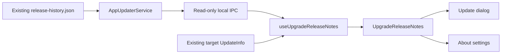

# Agent Note: 聚合跨版本升级日志

Status: proposed

[English](2026-10-31-upgrade-release-notes.md) | 中文

## Problem

`AppUpdaterService` 会为独立更新日志页动态获取稳定版历史，但更新弹窗和关于设置只使用更新器提供的目标版本日志。跳版本升级会遗漏中间改动。拼接所有版本虽能补回内容，却会让界面过长：仓库中 2.1.7、2.1.8 和 2.1.9 的中文日志合计有 86 个顶层列表项。

界面通过版本时间轴集中展示升级区间，多个版本时默认折叠，只有一个版本时直接展示。展开版本后展示完整原文，以此限制初始阅读量，无需第二层分类或独立原文模式。

## Proposal

### 范围

支持更新弹窗和关于设置中的稳定语义版本升级 `x < y`。选择 `(x, y]` 内已发布的记录；不假定数字上相邻的每个补丁版本或次版本都曾发布。使用现有托管 `release-history.json`，不新增服务端接口、文件格式或发布流程。

独立历史页保持现有行为。本轮不包含安装后首次启动展示和完整 RC/Beta 历史；预发布版本升级保留现有目标版本日志，不声称覆盖完整历史。无需模型调用、自动语义摘要、持久化设置或数据库迁移。

### 职责与数据流

| 归属 | 职责 |
| --- | --- |
| `src/main/services/AppUpdaterService.ts` | 使用现有 URL、请求头、超时和体积限制获取并校验托管历史；从 Electron 获取已安装版本；筛选请求的稳定版本区间。 |
| `src/shared/ipc/schemas/app.ts` 与 `src/main/ipc/handlers/app.ts` | 定义并委派只读本地 IPC 路由。跨进程载荷包含版本、原始 Markdown 和获取状态，不包含 UI 分组。 |
| `src/renderer/hooks/useUpgradeReleaseNotes.ts` | 管理当前升级的请求、重试和过期响应；组合历史与目标版本日志回退。 |
| `src/renderer/utils/upgradeReleaseNotes.ts` | 仅供 renderer 使用的纯函数，负责区间筛选、语义版本排序和逐版本来源选择，保留完整 Markdown 文档。 |
| `src/renderer/components/UpgradeReleaseNotes.tsx` | 更新弹窗和关于设置共用的可折叠版本时间轴，使用 `@cherrystudio/ui` 和现有 `ReleaseNotes` 渲染器。 |

新增 `app.updater.upgrade_notes.get`，输入为 `{ targetVersion }`。Main 校验目标是高于已安装稳定版本的稳定版本；不支持的区间按无效输入处理。响应为 `{ fromVersion, toVersion, historyStatus, releases }`，其中 `historyStatus` 为 `available` 或 `unavailable`，每条日志保留 `{ version, releaseNotes }`。历史请求不可用时返回空列表和 `unavailable`；请求成功但没有匹配记录时仍返回 `available` 和空列表。renderer 的加载中状态由本地管理，不属于 IPC 状态。

该路由直接调用现有历史获取方法，不得调用 `getLatestReleaseNotes()`、检查更新、开始下载，也不得将刚发现的新版本作为区间上界。现有 `app.updater.release_notes.get` 契约和更新器事件载荷保持不变。历史请求不阻塞更新可用通知、下载进度或安装。

hook 接收目标 `UpdateInfo`。每个版本的内容优先采用校验后的动态历史；只有历史缺少 `y` 的可用日志时才使用事件中的目标版本日志。数组回退仅保留 `(x, y]` 内的有效版本，不得把无关数组条目改标为 `y`。获取成功不能证明发布者记录了所有历史版本；界面提示已知获取缺口，不额外显示已加载版本数。两处来源均无目标日志时显示明确的无日志状态，不禁用安装。

卸载或目标变化后丢弃响应，较早的请求不得覆盖较晚的重试。UI 语言变化时使用现有规则重新本地化文档。原始历史保持多语言；已经本地化的回退文本在获得多语言记录前保留事件语言。获取的数据保存在已挂载 hook 内，无需持久化缓存或新服务。

### 完整版本文档

每个版本作为一篇完整本地化文档交给现有 `ReleaseNotes` 渲染器。保留发布者顺序、标题、提示、嵌套列表、代码和未知章节。引用式链接与脚注限定于来源版本；共享 Markdown 脚注跳转应聚焦对应脚注并能返回引用处，不弹出外链确认。

不跨版本分类或去重条目。重复文本保留在各自版本中，不同链接和引用定义不能冲突。仅在历史优先于事件回退的来源选择中对版本记录去重。Markdown 渲染器继续负责链接与 HTML 安全。

### 展示与状态

有多个可用版本时，直接展示版本倒序时间轴，使用低干扰的细线和圆点，不显示独立的区间摘要或已加载版本数。整个版本行作为折叠控件触发器；所有版本初始折叠，允许同时独立展开多个版本。已安装版本 x 作为弱化的终点标记，不显示其日志。不虚构数据源未提供的日期。

只有一个可用版本时直接显示其完整本地化日志，不显示区间摘要、数量、时间轴、版本触发器或当前版本标记。没有可用日志时只显示适用的加载或不可用状态。无论版本数量多少，都保留加载、失败提示和重试。历史补齐第二个版本时，切换为初始折叠的时间轴。

展开后展示完整本地化日志，不限制条目数、不生成分类、不逐条标注来源版本，也不提供概览／原文切换。重试和语言变化保留已展开版本，目标变化重置展开状态。折叠弹窗随内容收紧，安装操作保持在日志滚动区之外。两个更新界面共用同一时间轴。

加载时按上述单版本或时间轴布局保留已有目标日志，并显示低干扰的加载状态。获取失败时展示可用回退、提示“历史更新暂时无法加载”、提供重试，且不声称完整覆盖。历史加载成功但缺少目标时，在可用情况下使用目标回退；否则保留中间版本日志并说明目标日志不可用。未知格式保持可读。任何日志获取状态都不禁用安装、不改变下载完成状态，也不触发更新错误弹窗。

使用具有可访问名称、可见键盘焦点和展开状态语义的共享控件。以温和方式播报加载／失败状态，不播报整篇文档，也不移动焦点。在窄窗口和 200% 缩放下保持可读换行，不截断条目文本或缩小字号来容纳内容。两种主题复用语义颜色和字体 token。所有界面标签通过 i18next 添加，并翻译每个新增翻译键。

### 实现与验证边界

本 Spec head 获批后，以一个聚焦的实现层覆盖本地 IPC 路由、区间选择、共享组件、两个消费者、翻译与回归测试。通过现有聚焦测试覆盖独立日志页和更新调度行为。测试区间边界与完整 Markdown 文档，包括独立的引用和脚注作用域。Electron E2E 必须覆盖实际更新弹窗与关于设置，包括获取失败、初始折叠、独立展开及完整日志；renderer 测试本身不能证明用户可见结果。

## Alternatives considered

- 默认展开所有版本文档可保留原文，但无法限制初始阅读量。
- 按类别聚合、精确去重并预览三条会引入第二层导航、重复的来源标签及原文切换。版本时间轴移除这些复杂交互，同时保留完整原文。
- 模型生成摘要或相似度去重可能遗漏限制条件、混淆连续修复，并引入配置或不确定输出。
- 在更新事件处理期间获取历史，会将次要读取与下载时序耦合，并可能打乱可用、进度和完成状态。
- 复用独立历史 getter 会查询不断变化的最新版本，且无法区分历史获取失败与仅含最新版本的回退；新增窄范围本地 IPC 路由可以保留该现有契约。
- 将服务端格式改为结构化 changelog 条目可以改善元数据，但超出纯客户端范围；版本时间轴和原文访问无需这样做。

## Acceptance criteria

- AC1 — 对稳定版 `x < y`，返回历史中所有位于 `(x, y]` 的记录均纳入一次并按语义版本排序；不显示小于等于 x 或大于 y 的记录，不支持的区间不声称已聚合(verification: main and renderer unit tests)
- AC2 — 历史请求不能触发额外更新检查、下载或安装；历史延迟或失败不打乱更新器状态，也不禁用安装(verification: main tests and Electron)
- AC3 — 展开的版本保留完整本地化 Markdown，包括提示、未知章节、链接、代码、嵌套项和引用上下文(verification: renderer unit tests and Electron)
- AC4 — 不同版本的相同文本分别保留；链接与脚注 ID 按版本隔离，脚注跳转及返回始终指向来源文档(verification: renderer and shared Markdown tests, Electron)
- AC5 — 两个更新界面展示相同的倒序版本时间轴；多个版本初始折叠，包含已安装版本终点，不显示独立的区间摘要或已加载版本数；只有一个版本时直接显示完整日志，不显示时间轴及版本元信息(verification: renderer tests and Electron E2E)
- AC6 — 多个版本可独立展开以阅读完整日志；收起一个不影响其他版本，重试和语言变化保留展开状态，新升级目标重置状态(verification: renderer tests and Electron E2E)
- AC7 — 加载、历史不可用、目标日志缺失与重试状态明确；目标回退保持可用，过期响应不能覆盖新目标或重试，语言变化会重新计算多语言内容(verification: renderer tests and Electron E2E)
- AC8 — 控件支持键盘操作、可见焦点和展开状态语义；窄窗口及 200% 缩放下仍可操作安装，两种主题保持内容可读(verification: Electron keyboard, zoom, and theme checks)
- AC9 — 新增 UI 字符串已翻译，双语 Spec 通过仓库检查，现有独立历史页与更新状态消费者保持其契约(verification: i18n check, docs gate, and focused existing tests)

## Risks

用户需要主动展开日志才能看到提示。这是统一默认折叠的时间轴所接受的代价；界面不从自由文本推断严重性，也不强制展开选定版本。展开长文档仍可能需要滚动，但安装始终可操作。跨版本重复条目有意保留在各自原始上下文中。

仅含稳定版的历史契约不能提供跳过的 RC/Beta 日志。现有历史体积限制和网络可用性可能导致回退。即使历史响应有效，也不能证明发布者记录完整，因此界面显示可用记录并提示已知获取缺口，而不承诺完整审计。每个已挂载界面可能各发起一次读取；只有测量结果证明有必要时才引入请求共享。
