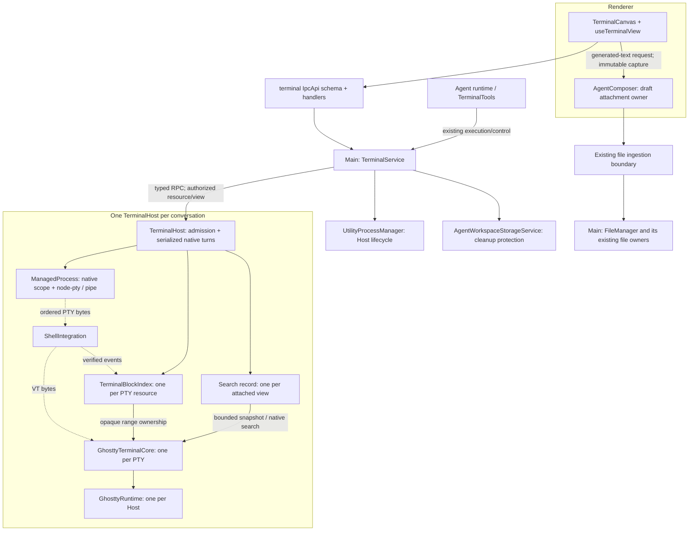
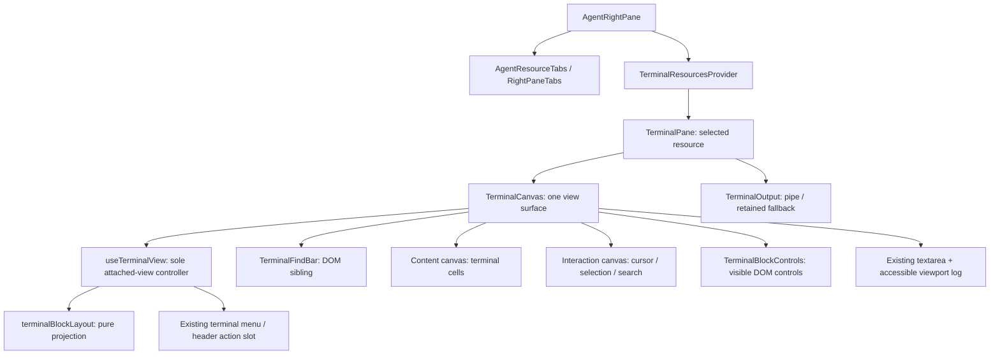

# Agent Note: Terminal command blocks and output actions

Status: proposed

English | [中文](2026-11-22-terminal-command-blocks.zh.md)

## Problem

A continuous terminal makes it difficult to select one command's output, collapse a long result, attach that result to a conversation, or repeat a command. These are interactions over existing terminal content. The [shared terminal Spec](../architecture/2026-11-14-shared-agent-terminal.md) continues to own execution, input control, resource lifetime, cleanup and the unified right-pane tabs. This additive feature owns command grouping, content-range access and block interaction; it does not supersede those decisions.

The current integration reports prompt/cwd and program transitions, but does not provide complete command text and prompt/input/output ranges. `TerminalCanvas` copies its visible selected cells. The Ghostty wrapper already exposes word/line selection and selection formatting; the pinned WASM also exports output selection and tracked grid references. The current Composer attachment action accepts a file path. Reliable blocks therefore need content-boundary and attachment-owner extensions as well as UI work.

## Proposal

### Ghostty upgrade prerequisite

Upgrade the pinned Ghostty as part of this feature, before wiring block or terminal search. The current [asset manifest](../../../../resources/terminal/ghostty/manifest.json) uses `9f62873bf195e4d8a762d768a1405a5f2f7b1697` and Zig `0.15.2`; its WASM exports no `ghostty_search_*` functions. The proposed source target is [`6d244209978e599277904ff3ced7b8a2ebcc528d`](https://github.com/ghostty-org/ghostty/tree/6d244209978e599277904ff3ced7b8a2ebcc528d), whose [build metadata](https://github.com/ghostty-org/ghostty/blob/6d244209978e599277904ff3ced7b8a2ebcc528d/build.zig.zon) requires at least Zig `0.17.1`; pin that exact toolchain for the first build attempt. This is a source-audited target, not a built or validated replacement. A different target requires updating this Spec; never track a moving branch.

The upgrade is one coherent change to the source/toolchain pin, both WASM artifacts, hashes, bindings, callback trampoline and provenance. Keep T3 adaptation provenance separate from the new Ghostty build identity. Audit numeric enums, hard-coded structure sizes, generated type layouts, memory growth and callback-table conventions against the new ABI. Require real-WASM search creation/feed/tick/navigation/free tests as well as existing render, input, selection, terminal-reply, resize/reflow and sibling-core disposal tests. A symbol's presence is insufficient when its feature was compiled out. Missing capabilities or mixed assets produce an explicit terminal-engine error before a new PTY starts; fresh pipe execution does not acquire a Ghostty dependency. Running Hosts are not hot-swapped or recreated to adopt new bytes.

The [search header at that exact revision](https://github.com/ghostty-org/ghostty/blob/6d244209978e599277904ff3ced7b8a2ebcc528d/include/ghostty/vt/search.h) provides incremental terminal search, but no block-range filter, result pagination or match-count limit. Do not invent these options in the TypeScript wrapper. The upgrade gate includes bounded search allocation with recoverable exhaustion: if this pin cannot enforce a per-search budget without trapping or damaging sibling cores, improve the upstream allocator/search failure contract before enabling terminal search. A JavaScript response limit alone does not bound native search memory.

### Scope and default behavior

Present one command group with a command area and an output area in the existing terminal tab. Preserve the user's rendered prompt, shell highlighting, multiline input and active textarea. A quiet disclosure control identifies each group; command state, exit code and duration appear when known. Utility actions appear on hover or keyboard focus, remain visible while their menu is open, and move into the same More menu when space is limited. Use `@cherrystudio/ui` controls and the existing semantic tokens, without adding a card border around every command.

Output starts expanded. In the first delivery only a completed, reliably bounded output area can collapse; its command remains visible, with an Expand output placeholder and retained line count. Running, unknown and current-input areas remain expanded. Empty output has no disclosure control. Collapsing does not delete output, stop a process, change input ownership or resize the PTY. Collapse, selection intent and query text/scope are per view and survive tab/pane detach in renderer memory for the same resource generation; native query handles, counts and old coordinate mappings do not. Revalidate retained presentation against fresh source/geometry before restoring it; reset it after application restart. Key that presentation state by window/pane and resource generation, not the transient IPC attachment ID.

Native pipe executions may present one output-only group associated with their existing execution identity. The actions available there remain read/copy/attach/search; this feature does not add pipe stdin or a new native-command rerun contract. Persistent PTYs group ordinary shell commands when their boundaries are reliable. Unsupported shells, uncertain regions and fullscreen interaction retain continuous terminal rendering.

### Layout reference and interactive prototype

The [interactive layout prototype](2026-11-22-terminal-command-blocks.html) records the agreed arrangement. Open the HTML file directly in a browser; it needs no server, installation or network access. It uses the preview host's semantic theme tokens when supplied, with system-color fallbacks for standalone viewing. The bilingual Spec owns behavior and acceptance; the prototype demonstrates placement and interaction.

| Area | Layout and interaction |
| --- | --- |
| Conversation and resources | Keep the conversation and Composer beside the shared resource pane. Files, browser pages and terminals occupy the same tab strip; command blocks live inside the active terminal. |
| Group metadata | Place disclosure, known status/exit code and duration at the leading edge, with block actions at the trailing edge. Keep the block More menu distinct from the terminal-level More menu in the tab strip. |
| Command | Keep the original prompt, cwd context and submitted command visible. Align content to shared edges and separate groups with space rather than individual cards. |
| Expanded output | Show output below its command with a subtle leading guide. Reveal Copy output on hover or focus. |
| Collapsed output | Replace only the completed output with an Expand output control and retained line count. Leave command and result metadata visible. |
| Live input and Agent control | Keep the native input position in the terminal content, without a persistent status footer. Indicate Agent usage in the terminal tab and place the read-only notice and explicit takeover beside the active program. Taking over a running program exposes its stdin; it does not create an idle shell prompt or stop the program. Ordinary user terminals have neither an observation mode nor a fabricated Return to Agent action. |
| Block search and narrow panes | Put the scoped search control below the shared tab strip. At narrow widths move secondary block actions into More, preserve access to other resource tabs through overflow and allow the search scope to wrap. Adapt the existing application layout rather than adding a second resource layout. |

The prototype's outer layout/scenario switches, explanatory captions and forced-visible actions in the first example are review aids, not product controls or a terminal footer. Its file/browser placeholders, draft attachment chip, rerun and takeover are local simulations. Production controls use `@cherrystudio/ui`, production strings use i18next, and the terminal still uses the single Canvas surface and Host APIs specified below; the prototype's DOM text rendering is not an implementation template.

Prototype verification covered folding, menus, command/output search, a draft attachment chip, Agent ownership, takeover stdin, narrow overflow, draft rejection and a new block on simulated rerun. Checks at 390 px and 728 px found no page-level horizontal overflow or page errors; light and dark previews were visually inspected. This is layout evidence only. Real PTY boundaries, Canvas selection/IME, attachment ingestion, process behavior and the acceptance criteria below remain to be implemented and verified.

The [rendering comparison prototype](2026-11-22-terminal-command-blocks-comparison.html) compares DOM overlay controls with native HTML-in-Canvas controls over the same Canvas terminal-text renderer. It records runtime capability checks, repeated synthetic measurements and their limits; the experiment does not change the execution model or select a production renderer. The default Electron runtime must expose the required API before HTML-in-Canvas can be adopted.

### Service dependencies and state ownership

The target below extends the existing [Main owner](../../../../src/main/services/terminal/README.md), [child runtime](../../../../src/main/services/terminal/utilityEntries/README.md) and [renderer](../../../../src/renderer/components/terminal/README.md). Solid arrows are calls/dependencies; dashed arrows are ordered output/events. These are proposed extensions, not a description of completed implementation.



`TerminalService` remains the only Main lifecycle service for terminal resources. Its existing `WhenReady` dependencies remain `UtilityProcessManager` and `AgentWorkspaceStorageService`. IpcApi handlers resolve it through `application`; Agent adapters call the same execution owner. The existing `terminal.create` orchestration still enters through `AgentLifecycleService`. This feature adds no lifecycle registration or `@DependsOn` edge, including no dependency from `TerminalService` to Composer, FileManager or IpcApi delivery. Read/search progress returns through the existing view-frame request path.

The Host is a child entry managed by `UtilityProcessManager`, not a Main container service. One Host owns one `GhosttyRuntime`, one `GhosttyTerminalCore` and one planned private `TerminalBlockIndex` per PTY, and search records under its existing attached-view records. Pipe resources have no core/index; their output-only group uses existing capture/execution identity. Do not introduce `TerminalBlockService`, `TerminalSearchService`, a search worker, per-block PTYs, or another VT parser. Child modules never import `application`, Electron, Main services or Composer; Main and renderer never dereference native handles.

| Owner / planned location | Authoritative state; permitted dependencies |
| --- | --- |
| `TerminalService.ts` | Window/view/resource-generation ownership, existing quotas, Host connection and final retained projection. Authorize and forward; do not interpret block boundaries, run native search or store per-view collapse state. |
| `utilityEntries/TerminalHost.ts` | Resource admission, write/reply ordering, verified shell facts/editor evidence, block-index lifetime, view-query state and bounded pump. Calls ManagedProcess, ShellIntegration, the index and core; no UI or attachment logic. |
| Planned `utilityEntries/TerminalBlockIndex.ts` | Block sequence, exact submitted command/cwd metadata, outcome/availability, content/index revisions and opaque tracked-range leases. Uses the core's range API; no process launch, IPC, timers, capture transcript or independent native allocation. Eviction releases its leases through the core. |
| `utilityEntries/ShellIntegration.ts` | Bounded nonce/sequence-verified boundary, submission and editor-proof events. Events are applied in order with preceding VT bytes; screen appearance cannot establish shell readiness. |
| `ghostty/GhosttyTerminalCore.ts` | All per-PTY native terminal, tracked-range, formatter and per-view search handles; source/screen mutation and geometry. Allocate, resolve and free handles here; native pointers never leave this module. The index/query records hold only opaque identities. |
| `ghostty/GhosttyRuntime.ts` | Host-wide WASM instance, ABI/memory/callback bindings and allocator accounting. The core uses this runtime; disposing a core/query cannot free a sibling's handles or the runtime. |
| Renderer view and presentation owners | Presentation intent and coherent frame/layout consumption, as defined in the component design below. Resource execution/control state is acknowledged Host data, not a second renderer state machine. |
| Existing Composer / file owners | Draft identity, attachment intent, generated-text ingestion and cleanup. Composer calls the existing file boundary; terminal services neither create files nor depend on these owners. |

### Service contracts and ordered work

Extend `src/shared/ipc/schemas/terminal.ts`, its Main handlers, `src/shared/types/terminal.ts` and `src/main/services/terminal/contracts.ts` together. The following route names and Host methods are the planned surface. Main resolves the resource from its owned `viewId`, supplies the exact Host generation/resource identity and uses an already connected Host. These routes never call `ensureHost` or create execution receipts.

| Renderer IpcApi → Main → Host | Request and result contract |
| --- | --- |
| Existing `terminal.attach` → `openView` | One attachment for the active surface. Main binds its real sender window and exact resource reference; no extra attachment per block, search or toolbar. |
| Planned `terminal.blocks.list` → `listBlocks` → `listBlocks` | View ID, cursor, expected index revision and limit. Return bounded summaries and next cursor. Membership/order invalidation restarts listing; visible summaries refresh with frames when only content changes. |
| Planned `terminal.blocks.read` → `readBlock` → `readBlock` | View ID, opaque block ID, part and discriminated consistency mode. Return an immutable bounded snapshot, completeness and source mapping; distinguish stale/unavailable/limited. Apply both the 64 KiB semantic text cap and encoded response budget before returning, with omissions explicit. |
| Existing `terminal.frame` → `viewFrame` → `view` | Extend with projection intent, bounded visible source spans and search result revision. Return one coherent baseline/chunk set containing cells, source geometry, visible summaries and current search projection. A changed index revision tells the view to relist; it does not ship the whole index on every frame. |
| Planned `terminal.search.set` → `setSearch` → `setSearch` | View ID, query revision, scope and bounded needle. Acknowledge allocation/admission or explicit rejection; progress/count/highlight changes are coalesced into that view's normal frames. |
| Planned `terminal.search.navigate` → `navigateSearch` → `navigateSearch` | View ID, query/result revisions and direction. Return a revisioned reveal target or stale/limited/unavailable; resolve its geometry through a matching frame before painting. |
| Planned `terminal.search.close` → `closeSearch` → `closeSearch` | Close only the exact query revision. Repetition is harmless; a late close cannot cancel its replacement. |
| Existing `terminal.detach` → `closeView` → `detachView` | Cancel the view's queued query work, release search handles/baselines and remove attachment ownership. This does not stop the process. |

A block summary includes its resource-scoped block ID, content revision, screen identity, submitted-command/cwd completeness, outcome, opaque command/output range identities and revisioned retained-row counts. Outcome is running, completed with known exit facts, or unknown; each content part independently reports complete, partial with a cause, or unavailable with a reason. UI action availability is derived from these values plus acknowledged control/editor facts. Summaries do not contain output text or native pointers. List pages stop at 32 records or the encoded reply budget, whichever comes first. These view-bound block/search routes serve live PTYs; pipe/retained fallback controls consume the existing bounded capture path locally and do not fabricate a PTY view.

Block listing, reads and search results are schema-backed discriminated values; schema parsing stays at process boundaries. Renderer-only row/layout types stay in `components/terminal/`; native layouts stay in `ghostty/`. No database table, DataApi endpoint, Preference key, global search singleton or new observation stream is needed. Search progress is included in the existing frame pull, capped at ten publications per second; it does not increment resource execution revisions, broadcast output events, or invalidate SWR resource lists. Query state stays under the attached view and is removed on detach.

A serialized native turn means a synchronous read/write/index/format/search step on the Host event loop, not a promise queue held until a command, PTY write or stop finishes. Apply VT bytes and verified boundary events in source order; resolve ranges and copy the requested result before yielding. Resume asynchronous process work only after rechecking resource/control/admission fences. Never retain a borrowed grid selection across `await`. The incremental search pump yields between bounded turns, with input/replies/control/close ahead of more search work; a long-running process cannot hold a search lock or delay its own stop.

Frame assembly reuses the existing bounded per-view snapshot/baseline and chunk path. Freeze the source values for one baseline; all chunks carry the same attachment, baseline, native mutation, geometry and layout identities. Commit only a complete matching set. A superseded layout, mutation without a retained baseline, or missing chunk discards the set and requests a fresh baseline; never combine cells from one frame with controls/highlights from another. Offscreen summaries/anchors are metadata, not eagerly formatted text or an all-history React tree.

### Component hierarchy and contracts

Keep the shared resource strip and the existing terminal surface. Extract the attached-view coordination already inside `TerminalCanvas` into one planned `useTerminalView` hook as it gains block/search behavior; migrate those responsibilities rather than leaving a second attach/input/frame loop behind. The new block/find components are controlled UI, not service clients.



The drawing describes composition and ownership, not literal DOM nesting: both Canvas layers, the textarea, the visible block-control layer and the find bar share one positioned terminal viewport. Menus portal through the existing UI library. `TerminalOutput` is an alternative to the live PTY surface, not another VT surface underneath it.

| Component / module | Inputs and owned state | Output / actions |
| --- | --- | --- |
| Existing `AgentRightPane`, `AgentResourceTabs` / `RightPaneTabs` | Existing shared file/browser/terminal tab model and domain close contracts. | Existing terminal header action slot and a generated-text attachment action passed to TerminalPane. No nested terminal tabs, file tree or persistent terminal footer. |
| Existing `TerminalResourcesProvider` | Existing resource projection, tab order/selection, creation and joined confirmed-close intents. Add only an in-memory presentation map keyed by window/pane instance + exact resource generation/ID. | Supply/save presentation intent on hide/reattach; discard on confirmed tab closure, session/pane disposal or generation replacement. Do not store frame cells, search handles or attachment content here. |
| Existing `TerminalPane` | Selected resource, `active`, `renderHeader`, attachment action, provider presentation state and closing status. | Select live PTY Canvas, pipe/retained fallback or cleanup/error state. Pass `onResource`, presentation callbacks and the existing provider `close` action; never create a second close flow. |
| Existing `TerminalCanvas` | DOM/canvas/textarea refs, controller result, measured metrics/theme and existing `renderHeader` slot. Own the single RAF paint and its content/interaction layers. | Compose controls with the existing context menu; draw coherent frames; forward pointer/keyboard/composition/resize events to the controller. It does not run native search or ingest attachments. |
| Planned `useTerminalView.ts` | Resource/active/closing props, viewport/input refs, presentation callbacks, `onResource` and attachment action. Own one attachment/frame loop, input queue, IME/control/geometry fences, selection, block pages, find state and pending block actions. | Return the coherent frame/layout, visible block models, find model, event bindings and intent callbacks. It is the sole terminal IpcApi caller for this surface; no new context/provider or global store. |
| Planned `terminalBlockLayout.ts` | Revisioned source ranges, collapse set, anchor/scroll, cell metrics and viewport. Pure renderer code; no hooks, IPC or native handles. | Return ordered runs, visible spans/control rectangles and shared visual↔source mapping. Canvas rendering, hit testing, links, selection, cursor and textarea positioning all use it. |
| Planned `TerminalBlockControls.tsx` | Only visible block IDs/metadata, rectangles, acknowledged action availability and busy state; callbacks for fold/select/copy/attach/rerun/search. Own only transient menu-open UI state. | Render disclosure, result metadata, collapsed placeholder and contextual actions using `@cherrystudio/ui`. No duplicate prompt/command/output DOM, resource fetch or control acquisition. |
| Planned `TerminalFindBar.tsx` | Controlled open/text/scope/progress/count/selected/partial/error model; callbacks for change, next/previous and close. | One find bar per view below the tab strip. It consumes its own keyboard events and never directly calls IPC or sends PTY input. |
| Existing `TerminalContextMenu` / header controls | Existing terminal-wide actions plus shared block action descriptors when invoked for a valid block. | Preserve terminal takeover/interrupt/close/cursor settings and the shared tab menu. Block More targets its block; terminal More remains resource-wide. |
| Existing `TerminalOutput` | Existing pipe or retained capture, revisioned read result and generated-text attachment action. | Reuse read-only copy/attach/bounded-snapshot search models. Do not mount `useTerminalView`, attach a PTY view or create a Ghostty core for this branch. |

The intended renderer-only value shapes and attachment action contract are:

```text
TerminalPresentationKey = window + paneInstance + resourceRef(hostGeneration, resourceId)
TerminalPresentation = collapsedBlockIds + topSourceAnchor/pixelOffset + followBottom
                     + selectionIntent + findText/scope
TerminalViewLayout = layoutRevision + screenIdentity + geometryEpoch + cellMetrics
                   + orderedRuns + visibleSourceSpans + visibleControls
LayoutRun = terminalSpan(opaqueSourceRange, visualRect)
          | blockControls(blockId, visualRect)
          | collapsedOutput(blockId, visualRect, retainedLineCount)
GeneratedTextRequest = intentId + targetConversationId
                     + capture(AbortSignal) -> Promise<immutable text + completeness>
GeneratedTextResult = attached(existingAttachmentId) | cancelled | unavailable | failed
```

`TerminalPresentation` contains bounded intent only. Saving a source anchor/selection intent does not make old cell geometry valid; restore only after resolving it against fresh source data. A transient attachment ID, native count, copied text snapshot or old frame is never cached as presentation. Pending Copy/Attach/Run again keeps its original identity and cannot retarget when selection changes.

### Surface layout, input and focus

The viewport has one scroll owner and one row projection. Block control rows and collapsed placeholders have measured CSS heights; source cells keep their cell height. Recompute the shared projection when font/DPR, control wrapping or viewport width changes, preserve the top source anchor, and paint both Canvas layers from that revision. Use visible controls plus a small bounded overscan; if a menu/focused control's block leaves the retained/virtualized region, close it and restore focus rather than mounting all historical controls.

The find bar is a DOM overlay at the top of the terminal viewport below the shared tabs, with content-sized wrapping in a narrow pane. Its obstruction rectangle participates in reveal/scroll calculations, so the selected match and live cursor can be scrolled clear. Opening search does not change the grid-sizing box or PTY rows. Transient block actions stay in their control row/More menu; their visibility changes neither block height nor PTY size. Folding changes projected history height only. Terminal geometry is still derived from the stable viewport/cell metrics by the existing controlling-view resize path.

`terminalBlockLayout` provides the single mapping used by drawing and events. Terminal spans map to revisioned source cells; controls/placeholders map to UI only. Stop pointer/key propagation at the controls and find bar before the terminal input handler; never focus the textarea, begin terminal drag selection or emit PTY mouse reports for those gestures. Cursor/IME candidate positioning uses the same projection as cells and clamps to the visible viewport; revealing input does not expand completed history unnecessarily. In continuous/alternate-screen mode bypass block decoration and use the existing grid mapping.

Ctrl/Cmd+F inside the active terminal opens its find bar. Find-bar Enter/Shift+Enter navigate; Esc closes and restores the prior focus target. A block's Search action sets that block scope before focusing the same bar. Menus/disclosure use ordinary keyboard focus and `aria-expanded`/labels; actions appear on focus as well as hover and stay visible while open. Closing a block menu returns to its still-visible trigger; close/cancel of a detached view never steals focus from the newly selected file/browser/terminal. Keep the existing bounded accessible viewport log and real textarea; add concise result/progress announcements rather than replaying the entire transcript. Fold/search changes do not animate every row or trigger per-cell React updates.

### Attachment coordination and resource disposal

The existing path-only `ATTACH_AGENT_COMPOSER_PATH` event cannot acknowledge an asynchronous generated-text insertion. Extend that renderer-local attachment boundary with a typed request/reply action, exposed as `attachGeneratedText(request): Promise<GeneratedTextResult>` through the right-pane actions. Its request carries an immutable-source capture callback, not a terminal handle or a fake filesystem path. The active `AgentComposer` accepts synchronously, binds the conversation and its own mount/draft generation, then invokes capture. If there is no matching active Composer, return unavailable before reading the block. This keeps terminal RPC in `useTerminalView` and all draft/attachment mutation in Composer.

```mermaid
sequenceDiagram
  participant UI as useTerminalView
  participant Composer as AgentComposer
  participant Host as Existing terminal read path
  participant File as Existing file ingestion
  UI->>Composer: attachGeneratedText(intentId, conversationId, capture)
  Composer->>Composer: Accept once; bind mount/draft generation
  Composer->>UI: Invoke capture(signal)
  UI->>Host: readBlock(viewId, blockId, consistency)
  Host-->>UI: Immutable bounded snapshot or explicit failure
  UI-->>Composer: Captured text and completeness
  Composer->>File: Ingest generated text under attachment intent
  File-->>Composer: Existing file/attachment identity
  Composer->>Composer: Recheck target draft; commit or clean up
  Composer-->>UI: Attached / cancelled / unavailable / failed
```

The Composer owner maintains an ephemeral mount identity and draft generation for attachment fencing. A new mount, submit, clear, draft replacement or conversation change invalidates unfinished intents; ordinary text edits within that draft do not. One intent ID joins duplicate requests; a deliberate second Attach uses a new ID. The callback captures the original authorized view/resource/block identity. Terminal detach before snapshot capture makes it unavailable; after capture, ingestion may finish for that same live draft even if the terminal closes. A cancelled intent aborts capture/ingestion and disposes any uncommitted file through the file owner's cleanup path. The terminal does not wait for or own that cleanup.

Current long-text paste uses `createTempFile` / `write` / `get` and ordinary pasted-text metadata; this is not an existing generated-text or draft-fenced FileIntake RPC. Put generated-text creation in the Composer/file attachment owner and reuse its actual ingestion/removal contracts. If these contracts cannot dispose a cancelled uncommitted file, fix that owner before enabling Attach; do not add file deletion or a parallel store to TerminalService. The request/reply bridge and draft-generation wiring are planned work, not already available APIs.

| Transition | Owner and required ordering |
| --- | --- |
| First active view | Provider supplies intent → Canvas controller attaches once → fetch bounded summaries and coherent frame → resolve projection → restore valid selection/focus/find intent. No action uses cached coordinates before this completes. |
| New output / boundary | Host applies ordered bytes/events → updates source/index/content state → next view frame carries bounded visible changes → controller commits one coherent layout → one RAF paints. Search progress uses the same pull. |
| Fold / reveal search match | Controller changes only local projection intent, requests missing visible spans and preserves its source anchor. It does not send resize, shell command or control changes. |
| Hide / switch tab / component unmount | Save bounded presentation intent; cancel view reads/pump, detach and free native query/frame state. Ignore late replies. Keep execution, Host/core and managed scope alive. |
| Run again | Controller submits the recorded block identity and current fences through existing `terminal.action` → Main `userAction` → Host `mutate` new command variant. Host resolves text and checks shared whole-command admission before any PTY write; one normal operation receipt and a new block result. No automatic takeover, `cd` or replay. |
| Confirmed terminal-tab close | Existing provider confirmation/stop flow first; after stop admission cancel view queries, reject new/queued mutations and continue cleanup observation. Free native queries and range leases before core disposal; confirm scope cleanup before removing the tab/presentation. Dispose the Host runtime only after all sibling cores/resources are released. |
| Rejected / unconfirmed close or Host loss | Preserve the original tab/resource identity, cleanup protection and retry path. A live core may provide bounded read-only frames; a retired/lost Host serves only existing retained data. Never recreate a Host/core/query to make old block actions work. |

### Actions and their scope

| Action | Behavior |
| --- | --- |
| Copy command | Copy the complete recorded command, preserving multiline text and excluding the prompt and output. Disable when complete command text is unavailable. |
| Copy output | Read the output's rendered plain text, excluding command echo, prompt, ANSI sequences and UI labels. Preserve logical newlines, Unicode graphemes and wide characters. |
| Copy block | Copy command text followed by output. A menu distinguishes it from Copy command and Copy output. |
| Select command / output / block | Select that semantic scope without taking input control. Selecting a collapsed output expands it before highlighting. Ordinary pointer selection remains available. |
| Attach to conversation | Capture command/known cwd/status and output at one read revision as a removable ordinary text attachment in the matching conversation's draft. It does not send a message or start an Agent turn. |
| Run again | Submit the complete recorded command as a new operation in this same persistent terminal, using its current cwd/environment. Keep the original block. Require user control, a verified idle prompt, proven empty shell-editor state and no pending input writes. Busy, dirty/unknown, Agent-controlled, disconnected or stale states do not submit. |
| Search this block | Open the shared find control on the block's bounded command/output snapshot. A result reveals and highlights its valid source range; revealed output remains expanded after search closes. Keep query keys out of the PTY; Esc closes and restores a still-valid trigger. |
| Search entire terminal | Switch that same find control to native search over the existing PTY's active screen and retained scrollback. Show incremental counts and limits, without acquiring input or resize ownership. |

The menu keeps copy variants together, then Attach/Search, then Run again. Command and output areas expose their corresponding copy action. Run again rechecks the existing resource, generation, context, control and prompt revisions at write admission. Every deliberate run has a new operation/command identity; a transport retry reuses it. A different recorded cwd is displayed as context, not restored through an implicit `cd`. A nonempty draft must be handled by the user before Run again becomes available. Agent takeover remains the existing explicit action.

Copy/Attach default to a maximum 64 KiB UTF-8 text snapshot, including attachment metadata. Preserve complete command/metadata first, then fit the newest output suffix at UTF-8 boundaries when the full result exceeds that budget. Distinguish size-limit omission from source-history eviction. A partial result is labeled as partial in the action feedback and attachment content; unavailable command/output parts are identified instead of silently substituting another range. No action describes a retained suffix as complete output. The encoded response budget may reduce the returned suffix further, with the same explicit partial-content feedback. Block search uses that same bounded snapshot and explicitly reports partial scope. Entire terminal is a separate native search scope over retained VT contents, not a claim to unlimited or already-evicted history; it does not inherit the Copy/Attach text cap.

### One terminal surface and a projection of visible rows

Keep one authoritative Ghostty Core for each existing PTY and one terminal surface per attached view. Canvas renders terminal cells; DOM siblings render block controls and collapsed placeholders. The command area uses the original rendered prompt/input cells, so shell themes and multiline commands are not replaced by a second command editor. DOM headers carry metadata/actions rather than duplicating the command text. This does not require HTML-in-Canvas.

The renderer derives a virtual row layout from current block ranges and its collapsed-block set. Layout rows identify terminal-row spans, control rows or collapsed placeholders. Drawing, hit testing, links, cursor placement, IME and selection use the same mapping. Header/placeholder gestures are handled by UI and never become PTY mouse reports. Batch-read only the visible source spans through the existing frame path under one screen/layout revision and its existing transport budgets; do not read every cell through individual grid-reference calls. Derive PTY dimensions from the terminal viewport and stable cell metrics, independently of folded history and transient hover controls.

Preserve the top visible source anchor and its pixel offset when folding above the viewport. Follow the live cursor only while the user was already following the bottom. Scrolling an observer, folding history or opening a menu does not change another view or acquire resize authority. Resize/reflow, reset, screen switching and history eviction invalidate old coordinate mappings; obtain a matching revision before coordinate-dependent actions resume.

Ordinary linear drag selection can cross visible blocks; it copies visible terminal text in display order, excluding hidden output and UI controls. Explicit Copy block includes retained hidden output. Rectangular selection is limited to one contiguous visible terminal span; crossing a header or placeholder ends that rectangle at the span boundary. A new layout invalidates stale drag coordinates. Copy/Attach through range APIs do not modify the user's existing selection.

### Boundaries, identity and history

TerminalHost updates a bounded block index in the same serialized order as Ghostty writes and shell-integration events. Record prompt/input/output boundaries only after parsing all preceding bytes. Extend the supported integration hooks with complete command text, cwd and reliable region transitions. Preserve the user's startup files, prompt theme and line editor. The [OSC 133 semantic boundaries](https://lib.ghostty.org/vt/guide-selection.html) and Ghostty output selection can supply range information; existing nonce/revision checks remain the authority for shell readiness and command admission. Arbitrary program-emitted semantic markers cannot grant write ownership or authorize Run again.

A prompt redraw is not a new execution. Each admitted shell command or reliably observed user submission gets one block identity scoped by the existing resource reference, Host generation and a monotonic block sequence. Record command text as submitted, not reconstructed expanded argv. Terminal command status, content availability and per-view collapse state are separate. Command loss or missing completion evidence produces an unknown outcome, never an invented success. If command text, boundaries or history are incomplete, expose that fact and disable affected actions; never infer executable text by scraping a prompt-shaped line.

Keep tracked grid anchors inside the Host. A [plain grid reference](https://lib.ghostty.org/vt/guide-grid.html) becomes invalid after terminal mutation; it is not a durable block boundary. Resolve fresh positions when publishing a frame or reading content. Send opaque block IDs and revisioned values, never WASM pointers. If later cursor movement overwrites a recorded region so that isolation is no longer reliable, invalidate that range and render it continuously rather than attributing new cells to the old command. Output includes the bytes displayed in a terminal region; a shared PTY cannot promise exact attribution of interleaved background-process output or separate stdout/stderr.

Initially retain at most 256 block records and 256 KiB of decoded command/cwd metadata per PTY, with command text and cwd each capped at 8 KiB; mark an over-limit value incomplete rather than treating a prefix as the full command/path. These are logical correctness budgets, not RSS measurements. Preserve the active record. When cells disappear or the metadata budget is exhausted, retire oldest inactive metadata and tracked anchors; an unknown outcome can be retired without relabeling it completed. If no record can be retired within the budget, new unindexed content stays continuous. Older cells may remain visible as continuous history. A range that was partly pruned returns partial content; one with no surviving range returns unavailable. Block metadata does not retain a second unbounded transcript or keep a process/Host alive.

### Search scopes, scheduling and budgets

One find bar exposes Current block and Entire terminal. Both initially use literal UTF-8 matching with ASCII case insensitivity; there is no regex, locale-aware case folding or Unicode normalization promise. Reject a needle over 4 KiB UTF-8 without silently shortening it. Empty input clears the query immediately. Coalesce typing for 100 ms, flush on an explicit navigation action, and advance a monotonic query revision on a changed scope/needle. An unchanged revision with the same payload joins the same query; a conflicting payload is rejected. An old response, navigation request or close cannot affect a newer query. Replacement first cancels and releases the old query, then allocates its successor; allocation failure leaves an explicit failed new query, not silently restored old results. Query revisions track user intent; refreshed source snapshots advance result revisions, not the query revision.

Current block uses the exact bounded semantic snapshot from `readBlock`: command text excludes its prompt, output excludes command echo, and partial-history/size omissions remain visible. The native API has no block-range filter and does not search separately recorded submitted-command metadata, so do not search the whole terminal and pretend the results are block-scoped. A small Host-owned literal matcher over at most 64 KiB is sufficient; keep the same text/source mapping as Copy/Attach. Refresh on that block's content revision, coalesced with progress delivery; discard old navigation/highlights. Unmapped or evicted source text may still appear in a captured snapshot, but cannot produce a highlight at a guessed cell.

Entire terminal uses one native `GhosttySearch` for that view and existing PTY core. It covers the active screen and its retained scrollback, independently of block-metadata retention and the 64 KiB Copy/Attach limit. Screen switching changes which screen's counts/results are presented; it does not concatenate primary and alternate screens into one log. Preserve the native search across a screen switch and re-read its current results. A completed scan is caught up to its last feed revision, not complete forever; later output schedules another feed. Display searching/caught-up state, counts found so far, and explicit limits. Navigation follows Ghostty's newest-to-oldest Next ordering, with Previous in the opposite direction, and wraps over the known result set; do not label that set final while scanning.

All calls on a core/search run serially in its Host, including `tick`; no shared WASM memory is accessed from another worker. Use `feed` when required or after terminal mutation, then bounded `tick` steps. Never call blocking `ghostty_search_run()` in the interactive path. A round-robin pump runs at most one feed and four ticks per query per turn, yields through the event loop and stops starting work after a 2 ms soft budget. Individual native calls are not preemptible: measure dense-hit, long-line and maximum-history calls, and improve upstream chunking if a call defeats input/reply/close responsiveness. Process output, control/stop and native terminal replies take priority over search. At most one query pump is queued per view; progress delivery coalesces to at most ten updates per second.

A view has at most one active query, with at most four per PTY and thirty-two application-wide, within the existing view quotas. Initial search allocation limits are 4 MiB per query and 16 MiB per Host, including native-owned copies/results, matching buffers, anchors, block snapshots and additional history retention caused by search pins. These are additional correctness budgets, not RSS estimates or permission to exceed other terminal budgets. Budget enforcement must fail a query with a typed capacity result, release its state and leave every PTY/core usable. Native allocation exhaustion, a missing capability or an ABI failure cannot be hidden behind an empty result. The upgrade must prove this isolation; enabling a feature that traps the shared runtime on ordinary budget exhaustion is not an accepted fallback.

Set native selection scrolling to `GHOSTTY_SEARCH_SCROLL_NONE`. Keep match navigation separate from the core's interactive selection and apply reveal/scroll only to the requesting view. Native match values expire after terminal mutation: resolve/copy them into bounded revisioned values during the same serialized turn, and never cache raw selections or pointers in Main/renderer. `VIEWPORT_MATCHES` is cached for the viewport of its last feed. While building each visible source span, temporarily apply that span's core viewport, feed/read/project its matches and restore the live viewport in `finally`; never use another view's cache or count hidden rows as visible. Re-read selected geometry after writes/reflow even if an older block's semantic text is unchanged.

Return at most 2,000 highlight spans and at most 60 KiB of serialized search data per frame, leaving room for the existing 64 KiB transport envelope. The native buffer getters are all-or-nothing, not paginated: query capacity first. If its required size exceeds the budget, do not allocate the requested full buffer. Return the scalar count and freshly resolved selected match when available, omit dense background highlights and set `highlightsLimited`. Block matching stops retaining results at the same match cap and identifies a limited count. Never silently discard matches while claiming a complete highlight set. Richer range/paged native reads require an upstream API extension, not a second unbounded transcript or repeated full-history copies.

Hide/detach closes native handles and cancels the queued pump; retain only query text/scope and presentation intent in renderer memory. Reopening the same resource generation creates fresh read-only query state and fresh counts, without starting a Host. An accepted terminal close or Host loss cancels searches before core disposal. Free searches and tracked anchors before their core, then free the shared runtime only after all sibling cores are gone. Search handles never keep a resource or Host alive. Pipe resources have no VT search; retained output can use only the bounded block snapshot path. After Host retirement, final-screen/capture data does not acquire a replacement core merely to enable Entire terminal.

### Content and attachment interfaces

Reuse `TerminalService` for access checks and targeted IpcApi delivery. Keep content indexing/formatting with TerminalHost and Ghostty; keep collapse, layout and selection presentation in the renderer. Wire types belong in `src/shared/types/terminal.ts`, and renderer-only layout types remain in the renderer. The intended public surface reuses view ownership and the existing frame path:

```text
listBlocks(viewId, cursor, expectedIndexRevision, limit)
  -> index revision, bounded block summaries, next cursor
readBlock(viewId, blockId, part, consistency)
  -> bounded immutable snapshot, source mapping, content revision, completeness, metadata
viewFrame(viewId, visibleSpans, expectedLayoutRevision)
  -> bounded cells, block/search geometry, native mutation and layout revisions
setSearch(viewId, queryRevision, scope, needle)
  -> query acknowledgement; targeted, coalesced progress updates
navigateSearch(viewId, queryRevision, resultRevision, direction)
  -> current selected result and reveal mapping, or a stale/limited result
closeSearch(viewId, queryRevision)
  -> release only that exact query; repeated closure is harmless
```

`part` is command, output or block. `consistency` is latest-at-admission or one exact content revision; `scope` is a terminal query or a block identity; its result separately carries the block content revision or native mutation/screen revision. Represent these as schema-backed discriminated unions. Index revisions track membership/order while each summary carries its own content revision. List cursors bind resource generation and index revision; an evicted/stale cursor requests a fresh index instead of skipping to another block. No-match, canceled, limited, stale and unavailable are distinct results, never all an empty array. Results distinguish complete, partial and unavailable content from a rejected stale/unauthorized request. Text/source spans map logical text offsets back to retained source cells at that revision, so search highlights do not guess byte-to-column positions. Content revisions are scoped to a block, while layout revisions belong to a view projection; output in another block does not expire an unchanged text snapshot. Reflow requires fresh geometry mappings before highlighting even when text remains unchanged. User selection is renderer state, so it does not need an independent Select block RPC. Block reads are read-only, do not acquire control and use an already authorized resource; stale IDs never start a Host or attach to a replacement generation. Format offscreen content in the Host with the upgraded [formatter selection option](https://github.com/ghostty-org/ghostty/blob/6d244209978e599277904ff3ced7b8a2ebcc528d/include/ghostty/vt/formatter.h): set a freshly resolved range on that formatter, format it and clear/free its borrowed range before the terminal can mutate. Do not install it as the terminal's global interactive selection. Range extraction must itself honor the snapshot budget; do not format an unbounded selection and truncate it in the renderer. The renderer retains only bounded current action snapshots and view search projections; a result revision never permits use of expired native geometry.

The current `attachPathToContext` entry in `AgentRightPane` / `AgentComposer` needs an adjacent generated-text attachment action in its existing attachment owner; the current path event alone cannot bind an asynchronous insertion to one draft. That operation accepts the captured text snapshot, creates a real managed text attachment through normal ingestion and returns its existing attachment identity. The terminal panel does not invent a path-only token or own another attachment store. Guard asynchronous completion by conversation/draft identity. Once attached, the immutable content follows normal attachment lifetime and remains readable after terminal history is evicted or the terminal closes. Cancelling attachment creation follows the existing ingestion cleanup path. New temporary paths, if needed, use the central path registry. No database terminal-history table is introduced.

### Revisions and action admission

| Fence | Meaning and invalidation |
| --- | --- |
| Resource reference / Host generation | Existing execution identity; no read, retry or late response may bind an old action to a replacement Host/resource. |
| Window / attached view ID | Main derives the owner from IPC context and checks the current attachment. A client-supplied conversation ID is not authorization. |
| Block content revision | Changes with that block's text/metadata/availability; output elsewhere alone does not expire stable semantic text. |
| Native mutation revision | Advances on grid mutation; invalidates untracked native match/selection values even when the block content revision stays unchanged. |
| View layout revision / screen identity | Changes with row projection, collapse, view scrolling, font/DPR metrics, reflow or screen changes. Coordinate operations require current geometry derived from matching source values. |
| Existing geometry epoch | Fences authoritative PTY geometry and program input; folding or searching does not advance it or acquire resize control. |
| Query / result revision | Identifies the latest scope/needle and published result set. A new query replaces the old one; navigation references the current result revision. |
| Control / prompt / draft revision | Execution guards, independent of read/search revisions. A result being readable never grants execution authority. |

The layout revision is a renderer-owned projection token. Host echoes it but independently validates native source and geometry; the token grants no authority. Visible spans use opaque source anchors or revision-bound ranges. Resolve them in one serialized Host turn and return cells, source/block geometry and search highlights coherently. Reject stale raw coordinates and request a fresh baseline. Renderer commits the frame only for its current attachment/projection intent, recomputing positions from the returned source geometry. Do not hold untracked native values across an `await`.

Read/search requests do not call `ensureHost`, create execution-operation sequence entries or enter Agent execution. Only Run again creates a normal execution operation; search cancellation cannot become command cancellation.

Run again uses a new variant of the existing user-action/Host command path, carrying block identity/content revision and the current admission fences. Host resolves the complete recorded command itself and reuses normal operation receipts; it does not trust a renderer-supplied replacement string or create another executor. There must be no pending composition, queued paste/key write or unacknowledged write before admission.

An empty textarea is not proof that the shell editor's buffer is empty: the textarea drains committed keys to the PTY. Track empty/dirty/unknown line state and a draft revision at the Host. User key/paste/history-edit input after a verified empty primary prompt marks it dirty or unknown before queuing the write. Only supported integration evidence of a fresh empty editable prompt clears it; a prompt repaint, Ctrl-L, cursor position, backspaces or an assumed Ctrl-U cannot do so. Run again is unavailable until emptiness is proven. Recheck the draft/prompt/control revisions in the same serialized admission turn so a racing keystroke wins rejection instead of being concatenated with the repeated command. This proof belongs in shared whole-command admission, including `terminal_send` command submissions, rather than a Run again-only renderer guard. Publish editor state/draft revision through the existing resource projections and carry fences through the adapters without a provider-specific shell path. Transfer of ownership alone does not clear dirty editor state. Ordinary program stdin remains available under its existing rules.

Copy/Attach capture the latest available snapshot atomically at read admission, or request an exact content revision when acting on a revisioned result. Distinguish those modes in the wire type. Never retry a stale read indefinitely or turn it into an execution. A captured snapshot can finish copying/ingestion after source expiry; an uncaptured action reports stale/unavailable. Attach carries a separate intent ID plus conversation/draft identity; transport retries join that intent, while a deliberate second attachment is a new intent. Draft submission, cancellation or conversation replacement cancels an unfinished insertion through ordinary file-ingestion cleanup. Edits within the same live draft may continue. Generate a safe display filename through the attachment owner, not from executable command text as a filesystem path.

### Continuous-mode compatibility

Enter continuous rendering for alternate-screen/fullscreen applications or an unreliable boundary region. Suspend folding and block hit testing there; preserve the existing keyboard, mouse, selection and IME paths. Leaving the alternate screen restores surviving normal-screen blocks and view collapse state after matching geometry is available. A fullscreen command may keep its command/status summary, but does not export the alternate screen as a complete command log. A program that stays on the normal screen can also invalidate earlier ranges by cursor-addressed rewriting; continuity takes precedence over block decoration.

On resource exit/loss, final read-only blocks can use only retained verified data within existing final-screen/capture budgets. Missing ranges remain unavailable. Closing the terminal still follows the existing stop/cleanup contract, and this feature must not retain an active Host merely to serve block controls. In-progress Copy/Attach either finishes with its captured immutable snapshot or reports that its source expired; it never reads a replacement terminal.

### Boundary matrix

| Situation | Required behavior |
| --- | --- |
| Split/malformed integration markers, unsupported shell or missing command text | Buffer only within existing parser limits; mark facts/ranges unknown, keep continuous input/output usable and disable only actions needing the missing evidence. Untrusted OSC markers never change control. |
| Prompt redraw, multiline continuation or empty submission | Redraw/continuation does not create another execution or clear dirty input. An empty submission with no reliable command has no fabricated executable block. |
| Ctrl-C, failed command or shell exit before completion marker | Keep actual exit information when proven; otherwise preserve unknown outcome. Interrupt targets the existing foreground program; closing targets the existing managed scope. Neither is inferred from output silence. |
| Normal-screen overwrite, reset or history pruning | Invalidate affected anchors/mappings; keep still-valid command metadata separately, mark partial/unavailable parts and use continuous rendering for overwritten regions. Search re-feeds; old highlights cannot point at replacement text. |
| Block/metadata quota or an overlong command/cwd | Retire oldest inactive records/anchors, including unknown outcomes without inventing completion; preserve the active record. Cap individual command and cwd metadata at 8 KiB each and expose incompleteness. If indexing still cannot fit, render the new region continuously; never block shell input/output to save UI metadata. |
| Empty output, ANSI-only output, wide graphemes or wrapping | No empty disclosure; Copy/Search operate on rendered logical text, not ANSI bytes or wide-cell spacer duplicates. A multibyte/grapheme boundary is not split to fit a snapshot or highlight. |
| Primary/alternate screen switch or fullscreen TUI | Suspend block layout as specified; native terminal search changes active-screen results and restores primary search on return. Search keys and Esc stay in the find bar; no command log is synthesized from the alternate screen. |
| Reflow, font/DPR change or IME while a menu/find bar is open | Invalidate geometry before new hit tests/highlights. Restore input focus only to the still-current authorized view; stale composition never commits into another resource or program. |
| New output, new query or a late frame during search | Progress refers to its feed/query/result revisions; replace stale work, refresh live results incrementally and distinguish caught-up from a permanently final result. Never install stale geometry because its text happens to match. |
| Two windows search/fold/scroll the same PTY | Independent query handles and presentation state; no shared interactive selection, scroll or resize takeover. Release the detached view's handles without touching its sibling. |
| Dense matches, allocation failure or search cancellation | Enforce native and wire budgets, disclose limited coverage/highlights and release query-owned state. Cancellation stops observation work only. A recoverable search error leaves execution and sibling cores usable. |
| Busy program, dirty/unknown line or concurrent user write during Run again | Refuse the new command, retaining the draft and old block. Program stdin is a separate existing action; no implicit takeover, prompt reset, newline or cwd change is sent. |
| Workspace switch, Agent Stop or old-runtime release | Keep existing resource cwd/ownership and parent-Spec stop/retention semantics. A read/search is not Agent work and cannot widen Stop's scope; user takeover survives release of the former Agent association. |
| Closing confirmation is canceled versus close is admitted | Cancel changes no resource/query state. Admission disables new execution/search, cancels query pumps and joins existing process cleanup. Hidden panes only detach observation. Unconfirmed cleanup keeps its tab, retry identity and workspace protection. |
| Natural exit, Host crash, stale generation or reattach | Serve only retained bounded verified data. Dead terminals cannot rerun; a fresh terminal is an explicit new resource. Reattach restores presentation intent, never execution or old native handles. No search keeps a Host alive. |
| Async Copy/Attach versus history loss, conversation switch or terminal close | A captured immutable snapshot completes under its original draft intent or is canceled by that draft's owner. Otherwise return expired/unavailable; never attach to a new draft or read a replacement terminal. |
| Pipe output, interleaved background output or stdout/stderr | Pipes retain their read-only output-only group and native execution contract. No VT search or persistent rerun is invented for them; a PTY region does not promise per-process attribution or stream separation. |

### Delivery and verification order

1. Upgrade and reproducibly rebuild the pinned Ghostty/toolchain/artifacts and bindings. Verify search capability and recoverable budgets, formatter ranges, callback replies, existing real-WASM consumers and sibling-core isolation before enabling the new APIs. Fix upstream gaps here rather than adding a second engine.
2. Extend boundary and empty-editor evidence, bounded block identity and read-only range APIs. Verify real WASM/Shell fixtures for multiline input, redraw, input races, overwrite, reflow and pruning; preserve execution/process contracts.
3. Add the shared row projection, lightweight controls, completed-output folding and both find scopes. Verify incremental scheduling, quotas, native geometry lifetime, multi-view caches, viewport anchoring, focus, selection, Unicode/IME and TUI transitions in renderer tests and real Electron.
4. Connect Copy/Attach/Run again through existing owners. Verify immutable draft attachments, partial-content feedback, busy/control/editor-state rejection, duplicate-operation receipts and stale conversation/generation races. Run scoped affected-consumer checks; keep this note proposed until every AC has actual acceptance evidence.

## Alternatives considered

- Independent DOM command cards with captured output strings: straightforward folding, but duplicate the terminal text model and make cursor rewriting, cross-block selection, shell styling and fullscreen transitions diverge. Choose one Canvas surface with a shared row projection and DOM controls.
- Frontend-only row numbers or text-pattern boundaries: smaller initial change, but resize, history eviction, prompt redraw and offscreen reads can select a different command. Use Host-owned semantic identity and tracked anchors.
- One PTY/Ghostty Core per block: gives isolated output widgets but loses persistent shell state and changes the resource/process model. All blocks remain views over their existing terminal.
- Keep the old Ghostty and provide only extracted-text search: avoids an engine/toolchain upgrade, but leaves retained-screen search, mutation recovery and source geometry outside the native owner. Reject that deferral; upgrade Ghostty as a prerequisite, keeping bounded block-semantic search distinct from native terminal search.
- Copy by temporarily replacing Ghostty's global selection: reuses one formatting path but disturbs other viewers. Read explicit ranges without changing interactive selection.

## Acceptance criteria

- AC1 — One ordinary terminal presents distinct command/output areas with the user's prompt, multiline input, colors and live textarea preserved; unsupported or uncertain regions remain usable as continuous terminals. (verification: renderer and real zsh/Bash/PowerShell Electron scenarios; owner: terminal surface)
- AC2 — Completed output folds without changing PID, Host generation, control, PTY geometry or output content; running/input regions stay expanded, two views fold independently, and reopening the same resource restores local collapse state. (verification: renderer and Electron; owner: terminal surface)
- AC3 — Copy command/output/block and semantic selection address the correct retained region, including offscreen/collapsed content, CJK, emoji, wrapped and multiline text; copying does not alter another view's selection or include UI labels/ANSI. (verification: real WASM and renderer; owner: terminal content)
- AC4 — Folding and resize/reflow preserve viewport anchors and correct cursor, link, mouse and IME hit testing; linear cross-block selection excludes hidden output, rectangular selection stops at nonterminal layout rows, and stale coordinates cannot act on a different cell. (verification: renderer and real Electron interaction; owner: terminal layout)
- AC5 — Prompt redraw, chunk-split/malformed markers, command loss and normal-screen rewriting cannot invent a command, a completed outcome or an executable command string; new block identity remains scoped to its exact resource/generation. (verification: shell/parser and real WASM fixtures; owner: shell integration)
- AC6 — Run again creates exactly one new command only under current user control with a verified idle prompt, proven empty shell-editor state and no pending input writes; busy/dirty/Agent-owned/stale/unknown states reject it, current cwd/environment apply, and the old block remains unchanged. (verification: Main admission races and Electron; owner: terminal input)
- AC7 — Attach adds a removable immutable text attachment to the correct conversation draft without sending or waking the Agent; later output changes, eviction and terminal close do not alter it, and conversation switching/cancellation cannot attach to another draft or leak unfinished ingestion. (verification: attachment/composer integration and Electron; owner: Composer attachments)
- AC8 — The shared find bar distinguishes bounded block snapshots from native retained-terminal search, reports progress/partial/limited coverage, reveals valid matches and drops stale geometry; keys and Esc do not reach the PTY, and searching never changes another view's selection or scroll. (verification: real WASM, renderer and Electron; owner: terminal search UI)
- AC9 — Metadata/text/frame budgets remain bounded during large output and many commands; prune/cap/reset/Host-loss paths expose partial or unavailable data, release tracked anchors and never recreate execution to serve a read. (verification: real WASM/Host limit and failure scenarios; owner: terminal content)
- AC10 — Fullscreen entry/exit retains functional keyboard/mouse/IME and restores valid normal-screen blocks; interleaved PTY output and stdout/stderr are not mislabeled as isolated per-command logs. (verification: real interactive shell/TUI Electron scenarios; owner: terminal compatibility)
- AC11 — Keyboard-only users can discover, invoke and dismiss block controls with visible focus and accessible state; both themes, a narrow right pane and the native/Cherry menu paths preserve the same actions. (verification: renderer and Electron accessibility/interaction; owner: terminal UI)
- AC12 — Existing native pipe completion/background behavior, ordinary interactive stdin, unified tabs, pane detach and confirmed terminal shutdown retain their contracts; each visible PTY surface retains one attachment/frame/input owner, hidden views release queries without stopping execution, and search progress does not invalidate resource lists. No extra process, terminal-history persistence or input-control mode is introduced by a block action. (verification: scoped existing terminal/domain consumer tests and Electron; owner: terminal integration)

- AC13 — The exact upgraded source/toolchain and both artifact hashes reproduce; required features work in real WASM, all affected existing ABI consumers retain behavior, missing/mixed capabilities fail before PTY launch, and sibling cores survive individual resource disposal. (verification: reproducible build, manifest/callback and real-WASM tests; owner: terminal engine)
- AC14 — Incremental search remains responsive to PTY writes, terminal replies, control/stop and close at maximum retained history and dense-hit limits; query/native/transport quotas return explicit limits or recoverable failures without corrupting execution or retaining pages/handles after detach. (verification: Host scheduling/allocator pressure, real WASM and measured Electron scenarios; owner: terminal search runtime)
- AC15 — A prompt redraw or an empty textarea cannot authorize Run again after user line editing; queued paste, composition, an unacknowledged write and a racing keystroke reject admission while ordinary stdin remains usable. (verification: shell integration, Host admission races and Electron; owner: terminal input)

## Risks

- Prompt plugins and asynchronous redraw can make boundaries incomplete. Continuous fallback and explicit unavailable content are accepted; platform-specific shell evidence is required before advertising support.
- A folded display has different row positions from the VT grid. One shared mapping and revision fencing must cover every coordinate-dependent operation; isolated drawing-only fixes are insufficient.
- Tracked anchors and command metadata add per-resource cost. The initial budgets and eviction checks establish boundedness, not a performance claim; large-output and representative history workloads require measurement during implementation.
- Attachments intentionally outlive terminal scrollback and may contain sensitive command/output text. Use explicit user attachment and ordinary attachment ownership; avoid raw-content logging or automatic attachment.
- Block snapshots, native scan progress, dense-highlight limits and interleaved PTY output have different completeness meanings. Keep each explicit; a search over retained cells does not recover evicted history or prove per-process attribution.
- The proposed Ghostty target raises the Zig requirement and may require ABI/callback and upstream allocation-failure work. Source inspection is not build evidence; the upgrade and budget-isolation gates must pass before native search is enabled.
- An input-buffer proof that works in one shell configuration may not survive custom editor hooks. Unknown evidence disables Run again while leaving the user's normal shell usable; screen scraping is not a substitute.
