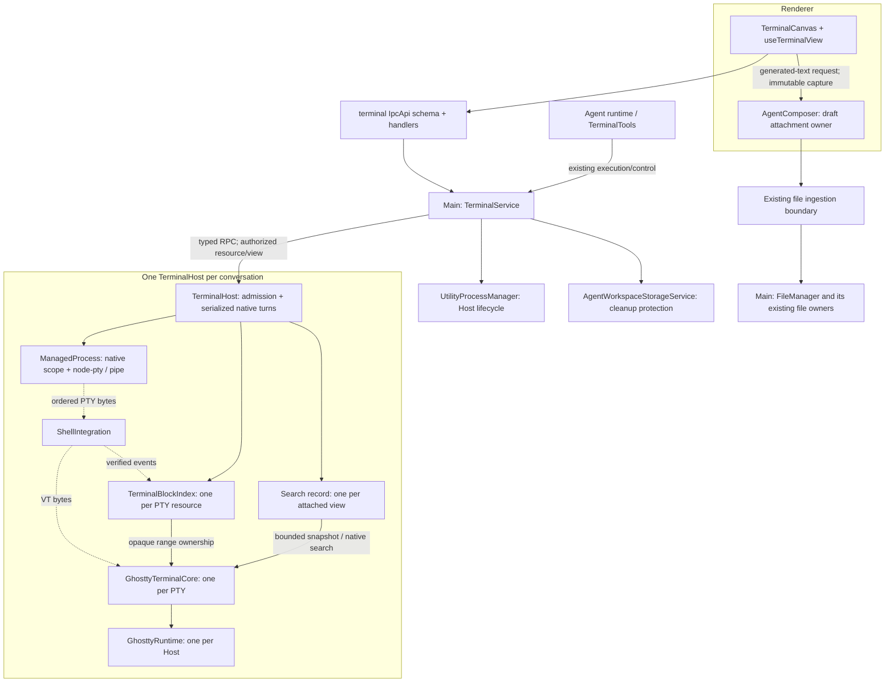
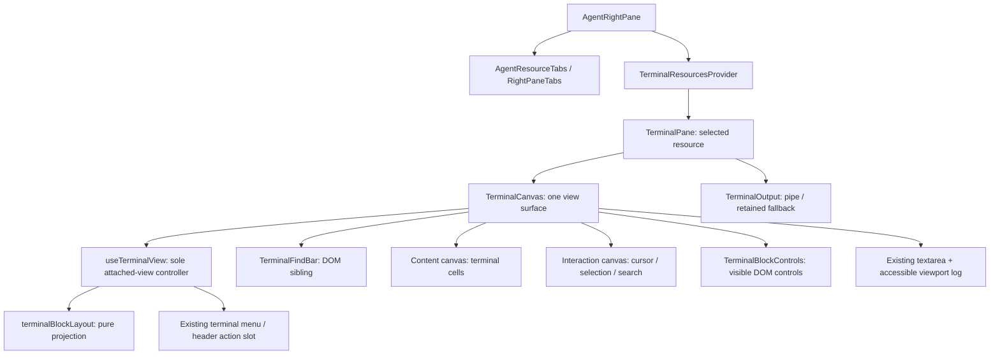

# Agent Note: 终端命令块与输出操作

Status: proposed

[English](2026-11-22-terminal-command-blocks.md) | 中文

## 问题

连续终端不便于选取某条命令的输出、折叠较长结果、将结果附加到对话或重新执行命令。这些都是针对现有终端内容的交互。[共享终端 Spec](../architecture/2026-11-14-shared-agent-terminal.md) 继续负责执行、输入控制、资源生命周期、清理和统一右侧标签栏。本新增功能负责命令分组、内容范围访问和块交互，不取代已有决策。

现有集成会上报提示符/cwd 和程序状态变化，但不提供完整命令文本与提示符、输入、输出范围。`TerminalCanvas` 复制当前可见的选中单元格。Ghostty 包装层已有选词、选行和选区格式化能力；固定版本的 WASM 也导出了输出选区和可跟踪网格引用。目前 Composer 的附件操作接受文件路径。因此，可靠的命令块除了 UI 工作，还需要补齐内容边界和附件所有者的接口。

## 提议

### Ghostty 升级前置

将固定版本 Ghostty 的升级纳入本功能，在接通块搜索或终端搜索前完成。当前[产物清单](../../../../resources/terminal/ghostty/manifest.json)使用 `9f62873bf195e4d8a762d768a1405a5f2f7b1697` 和 Zig `0.15.2`，其 WASM 未导出 `ghostty_search_*` 函数。拟升级源码目标为 [`6d244209978e599277904ff3ced7b8a2ebcc528d`](https://github.com/ghostty-org/ghostty/tree/6d244209978e599277904ff3ced7b8a2ebcc528d)，该版本的[构建元数据](https://github.com/ghostty-org/ghostty/blob/6d244209978e599277904ff3ced7b8a2ebcc528d/build.zig.zon)要求至少 Zig `0.17.1`，首次构建尝试固定使用这个工具链版本。这是已核对源码的目标，不代表替换产物已经构建或验证；变更目标需更新本 Spec，不跟随浮动分支。

升级应作为同一组变更更新源码/工具链固定版本、两份 WASM、哈希、绑定、回调跳板和来源记录。T3 适配代码的来源与新的 Ghostty 构建身份分别保留。对照新 ABI 审核数字枚举、硬编码结构大小、生成的类型布局、内存增长和回调表约定。除真实 WASM 的搜索创建/feed/tick/导航/释放测试外，还需通过已有绘制、输入、选区、终端回复、尺寸调整/重排与兄弟 core 释放测试。编译时关闭的功能即使导出了符号，也不能视为可用。缺少能力或产物混用时，在启动新 PTY 前明确报告终端引擎错误；一次性 pipe 执行不因此增加 Ghostty 依赖。不对运行中的 Host 热替换 WASM，也不为采用新产物重建它。

[该准确修订的搜索头文件](https://github.com/ghostty-org/ghostty/blob/6d244209978e599277904ff3ced7b8a2ebcc528d/include/ghostty/vt/search.h)提供增量终端搜索，但没有块范围过滤、结果分页或匹配数上限。TypeScript 包装层不能虚构这些选项。升级门槛包括有界搜索分配和可恢复的耗尽处理：若该版本无法在不触发 trap 或损坏兄弟 core 的前提下执行单次搜索预算，须先改进上游分配器/搜索失败契约，再启用终端搜索。仅限制 JavaScript 返回数组，不能限制原生搜索内存。

### 范围与默认行为

在现有终端标签中，将一次命令显示为包含命令区和输出区的一组内容。保留用户原有提示符绘制、Shell 高亮、多行输入和活动 textarea。使用低强调的展开控件标识分组；有可靠信息时显示命令状态、退出码和耗时。辅助操作在悬停或键盘聚焦时显示，菜单打开期间保持可见，空间不足时收进同一个更多菜单。使用 `@cherrystudio/ui` 控件和现有语义 token，不给每条命令套卡片边框。

输出默认展开。首版仅允许折叠已完成且边界可靠的输出区；命令保持可见，并显示展开输出入口和保留内容的行数。运行中、状态未知和当前输入区保持展开。空输出不显示折叠控件。折叠不会删除输出、停止进程、改变输入权或调整 PTY 尺寸。折叠、选区意图与查询文本/范围按视图保存在 renderer 内存中，同一资源代次在切换标签或隐藏面板后保留；原生查询句柄、计数和旧坐标映射不保留。恢复展示前按新来源/几何信息重新验证，应用重启后重置。展示状态按窗口/面板和资源代次标识，不使用临时 IPC 挂载 ID。

原生 pipe 执行可以使用既有执行身份呈现一个只读输出组，操作限于读取、复制、Attach 和搜索；本功能不增加 pipe stdin 或新的原生命令重跑契约。持久 PTY 在边界可靠时对普通 Shell 命令分组。不支持的 Shell、边界不确定的区域和全屏交互保持连续终端绘制。

### 布局参考与交互原型

[交互布局原型](2026-11-22-terminal-command-blocks.html)记录已确认的界面安排。可直接用浏览器打开 HTML 文件，无需服务器、安装或网络访问。预览宿主提供语义主题 token 时优先使用；独立打开时回退到系统颜色。行为和验收以双语 Spec 为准，原型用于展示位置与交互。

| 区域 | 布局与交互 |
| --- | --- |
| 对话与资源 | 对话和 Composer 位于共享资源窗格旁。文件、网页和终端使用同一标签栏；命令块位于活动终端内部。 |
| 分组元数据 | 起始侧放置折叠控件、已知状态/退出码和耗时，末尾放置块操作。块的更多菜单与标签栏中的终端级更多菜单保持不同作用范围。 |
| 命令 | 原始提示符、cwd 上下文和提交命令保持可见。内容沿共同边缘对齐，分组以留白分隔，不给每块套独立卡片。 |
| 展开输出 | 输出位于命令下方，起始侧使用低强调引导线。悬停或聚焦时显示复制输出。 |
| 折叠输出 | 仅将已完成输出替换为展开输出入口和保留内容的行数，命令与结果元数据继续可见。 |
| 活动输入与 Agent 控制 | 原生输入位置保留在终端内容中，不增加常驻状态页脚。终端标签提示 Agent 占用，在活动程序旁显示只读提示和显式接管入口。接管运行中程序后暴露其 stdin，不创建空闲 Shell 提示符或停止程序。普通用户终端没有观察模式或虚构的交还 Agent 操作。 |
| 块搜索与窄面板 | 带作用范围的搜索控件位于共享标签栏下方。宽度不足时，次要块操作收进更多菜单，其他资源标签通过溢出入口访问，搜索范围允许换行。适配现有应用布局，不增加第二套资源布局。 |

原型外部的布局/场景切换、说明文字，以及首个示例中强制可见的操作，仅供评审，不是产品控件或终端页脚。文件/网页占位、草稿附件 chip、重跑和接管均为本地模拟。正式控件使用 `@cherrystudio/ui`，正式文案使用 i18next；终端仍采用下文规定的单一 Canvas 表面与 Host API，原型用 DOM 展示文本不代表实现方式。

原型验证覆盖折叠、菜单、命令/输出搜索、草稿附件 chip、Agent 占用、接管后的 stdin、窄面板溢出入口、非空草稿拒绝重跑，以及模拟重跑创建新块。390 px 和 728 px 检查未发现页面横向溢出或页面错误，并已目视检查浅色/深色预览。这些仅是布局证据；真实 PTY 边界、Canvas 选区/IME、附件导入、进程行为及下方验收标准仍待实现和验证。

[绘制方式对照原型](2026-11-22-terminal-command-blocks-comparison.html)在同一 Canvas 终端文字绘制之上，对比 DOM overlay 控件与原生 HTML-in-Canvas 控件。原型记录运行时能力检查、重复的合成测量及其限制；实验不改变执行模型，也不直接决定正式绘制方案。采用 HTML-in-Canvas 前，默认 Electron 运行时必须提供所需 API。

### 服务依赖与状态所有权

以下目标设计扩展现有[Main 所有者](../../../../src/main/services/terminal/README.md)、[子进程运行时](../../../../src/main/services/terminal/utilityEntries/README.md)和[renderer](../../../../src/renderer/components/terminal/README.md)。实线表示调用或依赖，虚线表示有序输出或事件。这些是拟增加的能力，不代表实现已经完成。



`TerminalService` 继续作为终端资源唯一的 Main 生命周期服务，现有 `WhenReady` 依赖仍为 `UtilityProcessManager` 和 `AgentWorkspaceStorageService`。IpcApi handler 通过 `application` 获取它，Agent 适配器调用同一个执行所有者。现有 `terminal.create` 编排仍经过 `AgentLifecycleService`。本功能不增加生命周期注册或 `@DependsOn` 边，包括不让 `TerminalService` 依赖 Composer、FileManager 或 IpcApi 投递服务。读取和搜索进度通过现有视图帧请求返回。

Host 是 `UtilityProcessManager` 管理的子进程入口，不是 Main 容器服务。每个 Host 持有一个 `GhosttyRuntime`；每个 PTY 持有一个 `GhosttyTerminalCore` 和一个拟新增的私有 `TerminalBlockIndex`；搜索记录放在现有 attached-view 记录下。pipe 资源没有 core/index，其仅输出分组使用已有 capture/执行身份。不引入 `TerminalBlockService`、`TerminalSearchService`、搜索 worker、每块独立 PTY 或另一套 VT parser。子模块不导入 `application`、Electron、Main 服务或 Composer；Main 和 renderer 不解引用原生句柄。

| 所有者 / 拟放置位置 | 权威状态与允许依赖 |
| --- | --- |
| `TerminalService.ts` | 窗口/视图/资源代次所有权、已有配额、Host 连接和最终保留投影。负责鉴权和转发，不解释块边界、不运行原生搜索、不保存视图折叠状态。 |
| `utilityEntries/TerminalHost.ts` | 资源准入、写入/回复顺序、已验证 Shell 事实/编辑器证据、块索引生命周期、视图查询状态和有界 pump。调用 ManagedProcess、ShellIntegration、索引和 core；不包含 UI 或附件逻辑。 |
| 拟新增 `utilityEntries/TerminalBlockIndex.ts` | 块序号、完整提交的命令/cwd 元数据、结果/可用性、内容/索引修订，以及不透明可跟踪范围租约。使用 core 的范围 API；不启动进程、不持有 IPC/计时器/输出副本，也不自行分配原生内存。淘汰时通过 core 释放租约。 |
| `utilityEntries/ShellIntegration.ts` | 有界且通过 nonce/序列验证的边界、提交和编辑器证据事件。事件与此前 VT 字节按顺序应用；不能根据屏幕外观判断 Shell 就绪。 |
| `ghostty/GhosttyTerminalCore.ts` | 所有每 PTY 的原生 terminal、可跟踪范围、formatter、每视图搜索句柄，以及来源/屏幕变更与几何。分配、解析、释放均在这里完成，原生指针不离开本模块。索引/查询记录只持有不透明身份。 |
| `ghostty/GhosttyRuntime.ts` | Host 级 WASM 实例、ABI/内存/回调绑定和分配器记账。core 使用这个 runtime；释放某个 core/query 不能释放兄弟句柄或整个 runtime。 |
| Renderer 视图与展示所有者 | 展示意图与一致的帧/布局消费，详见后续组件设计。资源执行/控制状态来自已确认的 Host 数据，不再建立 renderer 执行状态机。 |
| 现有 Composer / 文件所有者 | 草稿身份、附件意图、生成文本摄取和清理。Composer 调用现有文件边界；终端服务既不创建文件，也不依赖这些所有者。 |

### 服务契约与有序执行

同步扩展 `src/shared/ipc/schemas/terminal.ts`、对应 Main handler、`src/shared/types/terminal.ts` 和 `src/main/services/terminal/contracts.ts`。下表路由名和 Host 方法为拟定接口。Main 从自己持有的 `viewId` 解析资源，补入准确 Host 代次/资源身份，使用已经连接的 Host。这些路由不调用 `ensureHost`，也不创建执行回执。

| Renderer IpcApi → Main → Host | 请求与结果契约 |
| --- | --- |
| 现有 `terminal.attach` → `openView` | 活动表面仅一个 attachment。Main 绑定真实发送窗口和准确资源引用，不为每个块、搜索或工具栏再 attach。 |
| 拟新增 `terminal.blocks.list` → `listBlocks` → `listBlocks` | 视图 ID、游标、预期索引修订和 limit。返回有界摘要和下一游标。成员/顺序失效时重新列举；只有内容变化时，通过帧刷新可见摘要。 |
| 拟新增 `terminal.blocks.read` → `readBlock` → `readBlock` | 视图 ID、不透明块 ID、part 和可区分的一致性模式。返回不可变有界快照、完整性和来源映射，区分 stale/unavailable/limited。返回前同时执行 64 KiB 语义文本上限和编码后的响应预算，明确标记省略。 |
| 现有 `terminal.frame` → `viewFrame` → `view` | 扩展投影意图、有界可见来源 span 和搜索结果修订。返回一致的 baseline/chunk 集合，包括单元格、来源几何、可见摘要和当前搜索投影。索引修订变化通知视图重新列举，不在每帧发送整个索引。 |
| 拟新增 `terminal.search.set` → `setSearch` → `setSearch` | 视图 ID、查询修订、范围和有界 needle。确认分配/准入或明确拒绝；进度/计数/高亮变化合并进这个视图的普通帧。 |
| 拟新增 `terminal.search.navigate` → `navigateSearch` → `navigateSearch` | 视图 ID、查询/结果修订和方向。返回带修订的 reveal 目标或 stale/limited/unavailable；绘制前通过匹配帧解析其几何。 |
| 拟新增 `terminal.search.close` → `closeSearch` → `closeSearch` | 仅关闭准确查询修订。重复关闭无副作用，迟到关闭不能取消替代它的新查询。 |
| 现有 `terminal.detach` → `closeView` → `detachView` | 取消这个视图排队的查询工作、释放搜索句柄/baseline，再删除 attachment 所有权。不停止进程。 |

块摘要包含资源内块 ID、内容修订、屏幕身份、提交命令/cwd 的完整性、结果、不透明 command/output 范围身份和带修订的保留行数。结果区分 running、带已知退出事实的 completed、unknown；每个内容部分独立标记 complete、带原因的 partial 或带原因的 unavailable。UI 根据这些值和已确认的控制/编辑器事实推导操作可用性。摘要不包含输出文本或原生指针。列表每页最多 32 条，或先达到编码后的响应预算即停止。这些 view-bound 块/搜索路由服务 live PTY；pipe/保留输出 fallback 控件在本地消费已有有界 capture 路径，不伪造 PTY view。

块列表、读取和搜索结果使用有 schema 的可区分值，在进程边界解析。仅 renderer 使用的行/布局类型留在 `components/terminal/`，原生布局留在 `ghostty/`。不需要数据库表、DataApi 端点、Preference key、全局搜索单例或新的观察流。搜索进度放进已有帧拉取，每秒最多发布十次；不增加资源执行修订、不广播输出事件、不使 SWR 资源列表失效。查询状态从属于 attached view，detach 时删除。

串行原生 turn 指 Host 事件循环上一次同步的读/写/索引/格式化/搜索步骤，不是等待整条命令、PTY 写入或停止结束才放行的 Promise 队列。按来源顺序应用 VT 字节和已验证边界事件；让出执行前解析范围并复制请求结果。异步进程工作恢复时重新核对资源/控制/准入 fence。不能跨 `await` 持有借用的 grid selection。增量搜索 pump 在有界 turn 之间让出执行，优先处理输入/回复/控制/关闭；长进程不能持有搜索锁或延迟自身停止。

帧组装沿用已有每视图有界 snapshot/baseline 和分块路径。为一个 baseline 固定来源值，全部 chunk 携带相同 attachment、baseline、原生变更、几何和布局身份。只提交完整且匹配的一组。布局已被替换、来源变更且无保留 baseline、或 chunk 缺失时，丢弃整组并请求新 baseline；不把一帧单元格与另一帧控件/高亮混用。屏外摘要/锚点只是元数据，不提前格式化为文本，也不建立覆盖全部历史的 React 树。

### 组件层级与契约

保留统一资源标签栏和已有终端表面。增加 block/search 能力时，将 `TerminalCanvas` 内已有的 attached-view 协调逻辑提取到一个拟新增的 `useTerminalView` hook；迁移这些职责，不能留下第二条 attach/input/frame 循环。新增块控件和查找栏均为受控 UI，不直接调用服务。



图示表达组合和所有权，不是字面 DOM 嵌套：两层 Canvas、textarea、可见块控件层和查找栏共用一个定位终端 viewport。菜单沿用 UI 库的 portal。`TerminalOutput` 是 live PTY 表面的替代分支，不是在下方再叠一个 VT 表面。

| 组件 / 模块 | 输入与持有状态 | 输出 / 操作 |
| --- | --- | --- |
| 现有 `AgentRightPane`、`AgentResourceTabs` / `RightPaneTabs` | 现有统一文件/网页/终端标签模型和各领域关闭契约。 | 已有终端 header action slot，以及传给 TerminalPane 的生成文本附件 action。不新增内层终端标签栏、文件树或常驻终端底栏。 |
| 现有 `TerminalResourcesProvider` | 现有资源投影、标签顺序/选择、创建和合并的确认关闭意图。仅增加以内存保存的展示 map，key 为窗口/窗格实例 + 准确资源代次/ID。 | 隐藏/重新 attach 时提供或保存展示意图；确认关闭标签、会话/窗格销毁或代次替换时删除。不存帧单元格、搜索句柄或附件内容。 |
| 现有 `TerminalPane` | 选中资源、`active`、`renderHeader`、附件 action、provider 展示状态和 closing 状态。 | 选择 live PTY Canvas、pipe/保留输出 fallback 或清理/错误状态。传递 `onResource`、展示回调和已有 provider `close` action，不再创建一套关闭流程。 |
| 现有 `TerminalCanvas` | DOM/canvas/textarea ref、controller 结果、测量后的 metrics/theme 和已有 `renderHeader` slot。持有唯一 RAF 绘制及内容/交互两层。 | 与已有上下文菜单组合控件、绘制一致帧，将 pointer/键盘/composition/resize 事件传给 controller。不运行原生搜索或摄取附件。 |
| 拟新增 `useTerminalView.ts` | resource/active/closing prop、viewport/input ref、展示回调、`onResource` 和附件 action。持有一条 attachment/frame 循环、输入队列、IME/控制/几何 fence、选区、块分页、查找状态和待处理块操作。 | 返回一致的 frame/layout、可见块模型、查找模型、事件绑定和意图回调。它是本表面唯一的终端 IpcApi 调用者，不新增 context/provider 或全局 store。 |
| 拟新增 `terminalBlockLayout.ts` | 带修订的来源范围、折叠集合、锚点/滚动、单元格 metrics 和 viewport。纯 renderer 代码，不含 hook、IPC 或原生句柄。 | 返回有序 run、可见 span/控件矩形和共用的视觉↔来源映射。Canvas 绘制、命中测试、链接、选区、光标、textarea 定位均使用它。 |
| 拟新增 `TerminalBlockControls.tsx` | 仅可见块 ID/元数据、矩形、已确认的操作可用性和 busy 状态，以及 fold/select/copy/attach/rerun/search 回调。仅持有短暂的菜单打开状态。 | 用 `@cherrystudio/ui` 绘制展开控件、结果元数据、折叠占位和上下文操作。不重复绘制 prompt/command/output DOM，不获取资源或获取输入权。 |
| 拟新增 `TerminalFindBar.tsx` | 受控的 open/text/scope/progress/count/selected/partial/error 模型，以及 change、next/previous、close 回调。 | 每视图一个查找栏，位于标签栏下方。自行消费键盘事件，不直接调用 IPC 或向 PTY 输入。 |
| 现有 `TerminalContextMenu` / header controls | 已有终端级操作，以及在有效块上调用时共用的块操作描述。 | 保留终端接管/中断/关闭/光标设置和统一标签菜单。块 More 只针对该块，终端 More 仍针对整个资源。 |
| 现有 `TerminalOutput` | 已有 pipe 或保留 capture、带修订的读取结果和生成文本附件 action。 | 复用只读 copy/attach/有界快照搜索模型。不挂载 `useTerminalView`，不 attach PTY view，也不为该分支创建 Ghostty core。 |

拟定的 renderer 私有值结构和附件 action 契约如下：

```text
TerminalPresentationKey = window + paneInstance + resourceRef(hostGeneration, resourceId)
TerminalPresentation = collapsedBlockIds + topSourceAnchor/pixelOffset + followBottom
                     + selectionIntent + findText/scope
TerminalViewLayout = layoutRevision + screenIdentity + geometryEpoch + cellMetrics
                   + orderedRuns + visibleSourceSpans + visibleControls
LayoutRun = terminalSpan(opaqueSourceRange, visualRect)
          | blockControls(blockId, visualRect)
          | collapsedOutput(blockId, visualRect, retainedLineCount)
GeneratedTextRequest = intentId + targetConversationId
                     + capture(AbortSignal) -> Promise<immutable text + completeness>
GeneratedTextResult = attached(existingAttachmentId) | cancelled | unavailable | failed
```

`TerminalPresentation` 只保存有界意图。保存来源锚点/选区意图不代表旧单元格几何仍有效，必须根据新来源数据解析后恢复。临时 attachment ID、原生计数、复制文本快照或旧帧均不作为展示缓存。待处理 Copy/Attach/Run again 保留原身份，选择切换时不能改指向新资源。

### 表面布局、输入与焦点

viewport 仅一个滚动所有者和一套行投影。块控件行/折叠占位使用测得的 CSS 高度，来源单元格保持 cell height。字体/DPR、控件换行或 viewport 宽度改变时，重算共用投影、保持顶部来源锚点，再按该修订绘制两层 Canvas。仅挂载可见控件和少量有界 overscan；若菜单/焦点控件所属块离开保留/虚拟化区域，关闭菜单并恢复焦点，不挂载全部历史控件。

查找栏为终端 viewport 顶部、统一标签栏下方的 DOM overlay，窄窗格中按内容换行。其遮挡矩形参与 reveal/滚动计算，使选中匹配和活动光标可滚动到无遮挡处。打开搜索不改变网格尺寸测量盒或 PTY 行数。短暂块操作留在控件行/More 菜单中，显隐不改变块高度或 PTY 尺寸。折叠仅改变投影后的历史高度。终端几何仍通过已有控制视图 resize 路径，从稳定 viewport/单元格 metrics 推导。

`terminalBlockLayout` 提供绘制和事件使用的唯一映射。terminal span 映射到带修订的来源单元格，控件/占位仅映射到 UI。在控件和查找栏处先阻止 pointer/key 传播，不能让这些手势触发 textarea 聚焦、终端拖拽选区或 PTY mouse report。光标/IME 候选框定位使用与单元格相同的投影，并限制在可见 viewport 内；显露输入位置不应无故展开已完成历史。continuous/alternate-screen 模式绕过块装饰，使用现有 grid 映射。

活动终端内 Ctrl/Cmd+F 打开其查找栏；查找栏内 Enter/Shift+Enter 导航，Esc 关闭并恢复此前焦点目标。块的 Search action 先设定该块范围，再聚焦同一查找栏。菜单/展开控件使用普通键盘焦点和 `aria-expanded`/label，操作在聚焦时与悬停时同样可见，打开期间保持显示。关闭块菜单回到仍可见的触发按钮；已 detach 视图的关闭/取消不能抢走新选中文件/网页/终端的焦点。保留已有有界无障碍 viewport log 和真实 textarea，增加简短结果/进度通知，不重播整个输出。折叠/搜索不逐行做动画，也不触发逐单元格 React 更新。

### 附件协调与资源释放

已有仅路径的 `ATTACH_AGENT_COMPOSER_PATH` 事件不能确认异步生成文本插入。在这个 renderer 本地附件边界增加有类型的请求/回执 action，通过 right-pane actions 暴露 `attachGeneratedText(request): Promise<GeneratedTextResult>`。请求携带不可变来源的 capture 回调，不传终端句柄或伪文件路径。活动 `AgentComposer` 同步接受请求，绑定会话及自己的挂载/草稿代次，再调用 capture。没有匹配的活动 Composer 时，在读取块前返回 unavailable。这样终端 RPC 仍在 `useTerminalView`，草稿/附件修改全部留在 Composer。

```mermaid
sequenceDiagram
  participant UI as useTerminalView
  participant Composer as AgentComposer
  participant Host as Existing terminal read path
  participant File as Existing file ingestion
  UI->>Composer: attachGeneratedText(intentId, conversationId, capture)
  Composer->>Composer: Accept once; bind mount/draft generation
  Composer->>UI: Invoke capture(signal)
  UI->>Host: readBlock(viewId, blockId, consistency)
  Host-->>UI: Immutable bounded snapshot or explicit failure
  UI-->>Composer: Captured text and completeness
  Composer->>File: Ingest generated text under attachment intent
  File-->>Composer: Existing file/attachment identity
  Composer->>Composer: Recheck target draft; commit or clean up
  Composer-->>UI: Attached / cancelled / unavailable / failed
```

Composer 所有者维护临时挂载身份和草稿代次，作为附件 fence。新挂载、提交、清空、草稿替换或会话切换使未完成意图失效；同一草稿中的普通文本编辑不使其失效。同一 intent ID 合并重复请求，有意再次 Attach 使用新 ID。回调捕获原已授权 view/resource/block 身份；快照捕获前终端 detach 则不可用，捕获后即使终端关闭，也可为同一个有效草稿完成摄取。取消意图会中止 capture/摄取，并通过文件所有者的清理路径释放未提交文件。终端不等待也不持有这些清理工作。

当前长文本粘贴使用 `createTempFile` / `write` / `get` 和普通 pasted-text 元数据；这并不是已经存在的生成文本或带草稿 fence 的 FileIntake RPC。生成文本创建应放在 Composer/文件附件所有者，复用其真实摄取/移除契约。若这些契约无法释放已取消且未提交的文件，先改进该所有者再启用 Attach，不在 TerminalService 中增加文件删除或平行存储。请求/回执桥和草稿代次接线均为待实现工作，不是已有 API。

| 转换 | 所有者与必要顺序 |
| --- | --- |
| 首次活动视图 | Provider 提供意图 → Canvas controller attach 一次 → 获取有界摘要与一致帧 → 解析投影 → 恢复有效选区/焦点/查找意图。完成前不使用缓存坐标执行操作。 |
| 新输出 / 边界 | Host 应用有序字节/事件 → 更新来源/索引/内容状态 → 下一视图帧携带有界可见变化 → controller 提交一致布局 → 一次 RAF 绘制。搜索进度使用同一拉取。 |
| 折叠 / 显露搜索匹配 | Controller 只改变本地投影意图，请求缺少的可见 span 并保持自己的来源锚点。不发送 resize、Shell 命令或控制权变更。 |
| 隐藏 / 切换标签 / 组件卸载 | 保存有界展示意图，取消视图读取/pump、detach 并释放原生查询/帧状态，忽略迟到回复。保留执行、Host/core 和托管 scope。 |
| Run again | Controller 经现有 `terminal.action` 提交原块身份和当前 fence → Main `userAction` → Host `mutate` 的新命令 variant。Host 在写入 PTY 前解析文本并核对共用整命令准入；产生一份普通操作回执和一个新块。不自动接管、`cd` 或重放。 |
| 确认关闭终端标签 | 先走已有 provider 确认/停止流程；停止准入后取消视图查询、拒绝新/排队修改，并继续观察清理。core 释放前先释放原生查询和范围租约；确认 scope 清理后再移除标签/展示状态。所有兄弟 core/资源释放后才释放 Host runtime。 |
| 关闭被拒绝 / 未确认，或 Host 丢失 | 保留原标签/资源身份、清理保护和重试路径。live core 可提供有界只读帧；已退出/丢失 Host 仅提供已有保留数据。不重建 Host/core/query 来恢复旧块操作。 |

### 操作与作用范围

| 操作 | 行为 |
| --- | --- |
| 复制命令 | 复制记录的完整命令，保留多行文本，不包含提示符和输出。完整命令文本不可用时禁用。 |
| 复制输出 | 读取输出绘制后的纯文本，不包含命令回显、提示符、ANSI 序列和 UI 标签。保留逻辑换行、Unicode 字素和宽字符。 |
| 复制整块 | 复制命令文本及其后的输出。菜单明确区分复制命令、复制输出和复制整块。 |
| 选中命令／输出／整块 | 选中对应语义范围，不获取输入权。选中已折叠输出时先展开再高亮。保留普通指针选区。 |
| 附加到对话 | 在同一读取修订下，捕获命令、已知 cwd/状态和输出，作为可移除的普通文本附件加入对应对话草稿。不发送消息或启动 Agent 轮次。 |
| 重新运行 | 在同一个持久终端中，使用当前 cwd/环境将完整命令作为新操作提交，保留旧块。要求用户持有输入权、已验证空闲提示符、Shell 编辑器已证实为空且没有待处理输入写入。忙碌、行已编辑/未知、Agent 控制、断开或过期状态均不提交。 |
| 在此块中搜索 | 将共用查找栏限定到本块的有界命令/输出快照，展开并高亮有效来源范围，关闭搜索后保持已展开输出。查询按键不写入 PTY，Esc 关闭并将焦点还给仍有效的触发控件。 |
| 搜索整个终端 | 将同一查找栏切换为现有 PTY 活动屏幕及保留 scrollback 的原生搜索，显示增量计数与限制，不获取输入或尺寸控制权。 |

菜单先分组展示复制操作，再展示 Attach/搜索，最后展示重新运行。命令区和输出区分别提供对应的复制操作。重新运行在写入准入时再次核对既有资源、代次、上下文、控制和提示符修订。每次用户明确重跑使用新的操作/命令身份，传输重试复用该身份。记录的 cwd 与当前不同，只作为上下文显示，不通过隐式 `cd` 恢复。输入草稿非空时，由用户处理后才能重新运行。Agent 接管仍使用既有显式操作。

复制和 Attach 默认读取最多 64 KiB 的 UTF-8 文本快照，附件元数据也计入其中。完整结果超过预算时，优先保留完整命令/元数据，再按 UTF-8 边界容纳最新输出后缀，区分大小限制省略和来源历史淘汰。部分结果在操作反馈和附件内容中明确标注；命令或输出的某部分不可用时直接说明，不静默替换为其他范围。任何操作都不能将保留后缀描述为完整输出。编码后的响应预算可能进一步缩短返回后缀，使用同样明确的不完整内容反馈。块内搜索使用同一份有界快照，范围不完整时明确提示。整个终端是针对保留 VT 内容的另一原生搜索范围，不承诺无限或已淘汰的历史，也不继承复制/Attach 的文本上限。

### 单一终端表面与可见行投影

每个现有 PTY 继续使用一个权威 Ghostty Core，每个挂载视图使用一个终端表面。Canvas 绘制终端单元格，相邻 DOM 绘制块控件和折叠占位。命令区使用原始提示符/输入单元格，保留 Shell 主题和多行命令，不替换为第二套命令编辑器。DOM 头部承载元数据和操作，不重复绘制命令文本。此方案不需要 HTML-in-Canvas。

renderer 根据当前块范围和本视图折叠集合生成虚拟行布局。布局行区分终端行片段、控件行和折叠占位。绘制、命中测试、链接、光标定位、IME 和选区使用同一映射。头部与占位上的手势由 UI 处理，不转换为 PTY 鼠标报告。仅通过现有帧通路，在同一屏幕/布局修订和既有传输预算内批量读取可见来源片段，不按单元格逐个查询网格引用。PTY 尺寸从终端视口与稳定的单元格度量计算，不随历史折叠或临时悬停控件改变。

折叠视口上方内容时，保留顶部可见来源锚点及其像素偏移。仅在用户原本跟随底部时继续跟随活动光标。观察者滚动、折叠历史或打开菜单，不改变其他视图或获取尺寸控制权。调整尺寸/重排、reset、切换屏幕和历史淘汰使旧坐标映射失效；获得匹配修订后才能恢复依赖坐标的操作。

普通线性拖选可以跨越可见块，按显示顺序复制可见终端文本，不包含隐藏输出和 UI 控件。显式复制整块包含仍保留的隐藏输出。矩形选区限于一个连续可见终端片段；跨越头部或占位时在片段边界结束。新布局使旧拖选坐标失效。通过范围 API 复制或 Attach 不修改用户现有选区。

### 边界、身份与历史

TerminalHost 按照 Ghostty 写入和 Shell Integration 事件的同一串行顺序更新有界块索引。先解析前面的所有字节，再记录提示符/输入/输出边界。为受支持的集成钩子补充完整命令文本、cwd 和可靠的区域转换，同时保留用户启动文件、提示符主题和行编辑器。[OSC 133 语义边界](https://lib.ghostty.org/vt/guide-selection.html) 与 Ghostty 输出选区可以提供范围信息；Shell 就绪与命令准入的权威仍是现有 nonce/修订检查。任意程序输出的语义标记不能授予写入权或授权重新运行。

提示符重绘不是新执行。每个获准的 Shell 命令或可靠观测到的用户提交，获得一个由现有资源引用、Host 代次和单调递增块序号限定的块身份。记录提交时的命令文本，不从展开后的 argv 重建。命令状态、内容可用性和视图折叠状态彼此分离。命令丢失或缺少完成证据时结果为未知，不伪造成功。命令文本、边界或历史不完整时显式说明并禁用受影响操作，不从类似提示符的文本行中猜测可执行命令。

可跟踪网格锚点保留在 Host 内。[普通网格引用](https://lib.ghostty.org/vt/guide-grid.html) 在终端变化后失效，不能充当持久块边界。发布帧或读取内容时重新解析位置。跨进程仅传不透明块 ID 和带修订的值，不传 WASM 指针。如果后续光标移动覆写了已记录区域，使其无法可靠隔离，则让该范围失效并连续绘制，不把新单元格归给旧命令。输出表示终端区域内显示的内容；共享 PTY 无法承诺交错后台进程输出的精确归属，也无法分离 stdout/stderr。

初始每个 PTY 最多保留 256 个块记录和 256 KiB 解码后命令/cwd 元数据，命令文本与 cwd 各上限 8 KiB；超限值标为不完整，不将前缀当作完整命令/路径。这些是逻辑正确性预算，不是 RSS 测量。保留活动记录。来源单元格消失或元数据预算耗尽时，淘汰最早的非活动元数据及可跟踪锚点；未知结果也可淘汰，但不将其改称完成。在预算内没有可淘汰记录时，新产生的未索引内容保持连续。更早的单元格仍可作为连续历史显示。部分被清理的范围返回部分内容，没有剩余范围时返回不可用。块元数据不保留第二份无界转录，也不让进程或 Host 为其继续存活。

### 搜索范围、调度与预算

同一个查找栏提供当前块与整个终端。首版均使用 UTF-8 字面匹配和 ASCII 不区分大小写，不承诺正则、按区域设置的大小写折叠或 Unicode 规范化。查询超过 4 KiB UTF-8 时拒绝，不静默截短；清空输入立即清除查询。输入合并等待 100 ms，显式导航时立即提交；范围/查询词变化时推进单调查询修订。同一修订与相同载荷合并到同一查询，载荷冲突则拒绝。旧响应、导航或关闭请求不能影响新查询。替换时先取消并释放旧查询，再分配新查询；分配失败后明确显示新查询失败，不静默恢复旧结果。查询修订跟踪用户意图，来源快照刷新推进结果修订，不推进查询修订。

当前块使用 `readBlock` 的准确有界语义快照：命令不含提示符，输出不含命令回显，历史缺失/大小限制仍明确显示。原生 API 没有块范围过滤，也不搜索单独记录的提交命令元数据，因此不能先搜索整个终端，再将结果冒充为块内结果。Host 内对最多 64 KiB 的快照使用小型字面匹配器即可，复用复制/Attach 的文本到来源映射。该块内容修订变化时刷新，并合并进度推送，丢弃旧导航/高亮。没有映射或已被淘汰的来源文本仍可能存在于已捕获快照中，但不能猜测单元格位置来高亮。

整个终端使用该视图及现有 PTY core 的一个原生 `GhosttySearch`，覆盖活动屏幕及其保留 scrollback，不依赖块元数据是否仍保留，也不受复制/Attach 的 64 KiB 限制。屏幕切换改变当前展示的计数/结果所属屏幕，不将主屏幕和备用屏幕拼成一份日志。跨屏幕切换保留原生搜索，再读取当前结果。扫描完成只表示追上最后一次 feed 的修订，不代表永远完成；后续输出安排新的 feed。显示搜索中/已追上、当前已找到计数和明确限制。Next 遵循 Ghostty 从新到旧的顺序，Previous 方向相反，在已知结果集合中循环；扫描中不能把该集合标为最终结果。

同一 core/搜索的所有调用均在 Host 中串行执行，包括 `tick`，不从另一 worker 访问共享 WASM 内存。需要更多数据或终端变化后调用 `feed`，再分步 `tick`；交互通路不调用阻塞式 `ghostty_search_run()`。轮转调度每轮对单个查询最多执行一次 feed 和四次 tick，通过事件循环让出执行；达到 2 ms 软预算后不再启动新工作。单次原生调用不可抢占：需测量密集匹配、超长行和最大历史下的调用，若单次调用破坏输入/回复/关闭响应，应改进上游分块。进程输出、控制/停止和原生终端回复优先于搜索。每视图最多排队一个查询调度任务；进度推送合并为每秒最多十次。

每视图最多一个活动查询，每 PTY 最多四个，全应用最多三十二个，均受现有视图配额约束。初始搜索分配预算为每查询 4 MiB、每 Host 16 MiB，包含原生持有的副本/结果、匹配缓冲、锚点、块快照及搜索 pin 导致的额外历史保留。这些是额外正确性预算，不是 RSS 估算，也不允许突破其他终端预算。预算耗尽须使查询返回带类型的容量结果、释放其状态，并保持所有 PTY/core 可用。原生分配耗尽、能力缺失或 ABI 错误，不能伪装成零结果。升级须证明这种隔离；正常预算耗尽会使共享运行时 trap 的功能，不可作为已接受的回退启用。

将原生选中滚动策略设为 `GHOSTTY_SEARCH_SCROLL_NONE`。匹配导航与 core 的交互选区分离，只对发起视图执行展开/滚动。原生匹配值在终端变化后失效，必须在同一次串行处理内解析/复制成有界、带修订的值，不在 Main/renderer 缓存原始选区或指针。`VIEWPORT_MATCHES` 缓存的是最后一次 feed 时的 viewport。构建每个可见来源片段时，临时设置该片段对应的 core viewport，feed/读取/投影其匹配，并在 `finally` 恢复活动 viewport；不使用其他视图的缓存，也不把隐藏行当作可见行。写入/重排后重新读取选中几何信息，即使某个旧块的语义文本未变化也一样。

每帧最多返回 2,000 个高亮片段和 60 KiB 序列化搜索数据，为既有 64 KiB 传输封装留出空间。原生缓冲读取是全有或全无，不支持分页，需先查询容量。要求容量超过预算时，不分配整块缓冲；有可用值时返回标量计数和新解析的选中匹配，省略密集背景高亮并设置 `highlightsLimited`。块匹配在相同匹配上限停止保留结果，说明计数受限。不能静默丢弃匹配，却声称高亮集合完整。更丰富的原生范围/分页读取需要上游 API 扩展，不通过第二份无界转录或反复复制全部历史绕开。

隐藏/分离视图时关闭原生句柄并取消排队调度，只在 renderer 内存保留查询文本/范围和展示意图。重新打开同一资源代次时创建新的只读查询状态与计数，不启动 Host。终端关闭获准或 Host 丢失后，在释放 core 前取消搜索；先释放搜索与跟踪锚点，再释放其 core，所有兄弟 core 结束后才释放共享 runtime。搜索句柄不能延长资源或 Host 生命周期。pipe 资源没有 VT 搜索，仅可对保留输出使用有界块快照通路。Host 回收后，不为整个终端搜索给最终屏幕/捕获数据创建替换 core。

### 内容与附件接口

复用 `TerminalService` 的访问检查和定向 IpcApi 传递。内容索引/格式化由 TerminalHost 和 Ghostty 负责，折叠、布局与选区展示由 renderer 负责。跨进程类型放在 `src/shared/types/terminal.ts`，仅 renderer 使用的布局类型保留在 renderer。预期公共接口复用视图所有权与既有帧通路：

```text
listBlocks(viewId, cursor, expectedIndexRevision, limit)
  -> index revision, bounded block summaries, next cursor
readBlock(viewId, blockId, part, consistency)
  -> bounded immutable snapshot, source mapping, content revision, completeness, metadata
viewFrame(viewId, visibleSpans, expectedLayoutRevision)
  -> bounded cells, block/search geometry, native mutation and layout revisions
setSearch(viewId, queryRevision, scope, needle)
  -> query acknowledgement; targeted, coalesced progress updates
navigateSearch(viewId, queryRevision, resultRevision, direction)
  -> current selected result and reveal mapping, or a stale/limited result
closeSearch(viewId, queryRevision)
  -> release only that exact query; repeated closure is harmless
```

`part` 为命令、输出或整块。`consistency` 区分准入时最新内容与一个准确内容修订；`scope` 区分终端查询与块身份，结果另外携带块内容修订或原生变更/屏幕修订，使用基于 schema 的可辨识联合表示。索引修订跟踪成员/顺序，每条摘要携带自己的内容修订。列表游标绑定资源代次和索引修订，游标淘汰/过期时请求新索引，不跳到另一块。无匹配、取消、受限、过期和不可用分别返回，不能统一变为空数组。结果区分完整、部分和不可用内容，以及过期/未授权请求的拒绝。文本/来源片段将逻辑文本偏移映射回同一修订的保留来源单元格，搜索高亮不猜测字节到列的位置。内容修订属于单个块，布局修订属于视图投影；其他块产生输出不会使未变化的文本快照过期。即使文本未变，重排后也必须先刷新几何映射再高亮。用户选区属于 renderer 状态，无需独立的选中块 RPC。块读取是只读操作，不获取控制权，只使用已授权资源；过期 ID 不启动 Host 或连接替换代次。在 Host 中使用升级后的[格式化器选区选项](https://github.com/ghostty-org/ghostty/blob/6d244209978e599277904ff3ced7b8a2ebcc528d/include/ghostty/vt/formatter.h)读取屏幕外内容：给该格式化器设置新解析的范围，完成格式化，并在终端可再次变化前清除/释放其借用范围，不把它安装成终端的全局交互选区。范围提取本身也必须遵守快照预算，不先格式化无界选区再到 renderer 截短。renderer 仅保留有界的当前操作快照与视图搜索投影，结果修订不能授权使用过期原生几何信息。

现有 `AgentRightPane` / `AgentComposer` 的 `attachPathToContext` 入口，需要在既有附件所有者中补充相邻的生成文本附件操作；仅靠当前路径事件无法将异步插入绑定到一个草稿。该操作接收捕获的文本快照，经正常导入创建真实托管文本附件，并返回已有附件身份。终端面板不伪造只有路径的 token，也不拥有另一套附件存储。异步完成受对话/草稿身份约束。附加完成后，不可变内容遵循普通附件生命周期，在终端历史淘汰或关闭后仍可读取。取消附件创建遵循现有导入清理路径。需要新临时路径时使用中央路径注册表。不增加终端历史数据库表。

### 修订与操作准入

| 隔离条件 | 含义与失效规则 |
| --- | --- |
| 资源引用 / Host 代次 | 沿用执行身份，读取、重试或迟到响应均不能将旧操作绑定到替换 Host/资源。 |
| 窗口 / 挂载视图 ID | Main 从 IPC 上下文取得所有者并核对当前挂载，客户端传入对话 ID 不构成授权。 |
| 块内容修订 | 该块文本/元数据/可用性变化时推进；仅其他区域产生输出，不使稳定的语义文本过期。 |
| 原生变更修订 | 网格变化时推进，即使块内容修订未变，也使未跟踪的原生匹配/选区值失效。 |
| 视图布局修订 / 屏幕身份 | 行投影、折叠、视图滚动、字体/DPR 度量、重排或屏幕变化时推进；坐标操作要求由匹配来源值生成的当前几何信息。 |
| 既有几何代次 | 约束权威 PTY 几何与程序输入，折叠或搜索不推进它，也不获取尺寸控制权。 |
| 查询 / 结果修订 | 标识最新范围/查询词及已发布结果集。新查询替换旧查询，导航必须指向当前结果修订。 |
| 控制 / 提示符 / 草稿修订 | 与读取/搜索修订独立的执行准入条件。结果可读不代表获得执行权限。 |

布局修订由 renderer 作为投影 token 持有。Host 回传该 token，但独立验证原生来源与几何信息，token 本身不授予权限。可见片段使用不透明来源锚点或带修订范围，在同一次 Host 串行处理中解析，并一致地返回单元格、来源/块几何信息及搜索高亮。旧原始坐标被拒绝，需重新请求基线。renderer 仅向当前挂载/投影意图提交帧，并根据返回的来源几何重新计算位置。不跨 `await` 持有未跟踪原生值。

读取/搜索请求不调用 `ensureHost`，不创建执行操作序号记录，也不进入 Agent 执行。只有重新运行才创建普通执行操作，取消搜索不能转为取消命令。

重新运行在现有用户操作/Host 命令通路增加一个变体，携带块身份/内容修订及当前准入条件。Host 自行读取完整记录命令并复用普通操作回执，不信任 renderer 传入的替换命令字符串，也不创建另一执行器。准入前不能存在待完成组合输入、排队的粘贴/按键写入或未确认写入。

textarea 为空不证明 Shell 编辑器缓冲为空，因为 textarea 会将已提交按键发送给 PTY。在 Host 中跟踪空/已编辑/未知的行状态及草稿修订。在已验证的空主提示符之后，用户按键/粘贴/历史编辑输入在写入排队前将其标为已编辑或未知。只有受支持集成提供的新空可编辑提示符证据才能清除；提示符重绘、Ctrl-L、光标位置、退格或假定的 Ctrl-U 均不能清除。无法证明为空时禁用重新运行。在同一串行准入处理中再次检查草稿/提示符/控制修订，让竞态按键触发拒绝，而非与重跑命令拼接。该证据应落实到共享的整条命令准入，包括 `terminal_send` 的命令提交，不是仅供重新运行使用的 renderer 检查。在既有资源投影中发布编辑器状态/草稿修订，由适配器携带约束，不增加 provider 专有 Shell 通路。仅转移所有权不清除已编辑的行状态。普通程序 stdin 继续按既有规则可用。

复制/Attach 在读取准入时原子捕获最新可用快照；针对带修订结果操作时，也可要求准确内容修订，在跨进程类型中区分两种模式。不无限重试过期读取，也不将其转为执行。已捕获快照可在来源失效后完成复制/导入，尚未捕获的操作返回过期/不可用。Attach 另带意图 ID 与对话/草稿身份；传输重试合并到同一意图，用户明确再次附加则使用新意图。草稿提交、取消或对话替换，经普通文件导入清理取消未完成插入；同一活动草稿内可继续编辑。安全展示文件名由附件所有者生成，不把可执行命令文本用作文件系统路径。

### 连续模式兼容

进入备用屏幕/全屏应用或边界不可靠区域时，使用连续绘制，暂停折叠和块命中测试，保留现有键盘、鼠标、选区和 IME 通路。退出备用屏幕后，等待匹配几何信息再恢复仍有效的普通屏幕块及视图折叠状态。全屏命令可以保留命令/状态摘要，但不将备用屏幕导出为完整命令日志。保持在普通屏幕的程序也可能通过光标寻址覆写旧范围；连续终端正确性优先于块装饰。

资源退出或丢失后，只能在既有最终屏幕/捕获预算内使用保留的已验证数据提供只读块，缺失范围仍为不可用。关闭终端继续遵循既有停止/清理契约，不能只为块控件保留活动 Host。进行中的复制/Attach 要么用已捕获的不可变快照完成，要么报告来源过期，不能读取替换终端。

### 边界矩阵

| 场景 | 必须行为 |
| --- | --- |
| 集成标记跨 chunk/格式错误、不支持的 Shell 或缺失命令文本 | 仅在既有解析预算内缓存，将事实/范围标为未知，保持连续输入/输出可用，只禁用依赖缺失证据的操作。不可信 OSC 标记不能改变控制权。 |
| 提示符重绘、多行续行或空提交 | 重绘/续行不创建另一执行，也不清除已编辑输入。空提交没有可靠命令时，不伪造可执行块。 |
| Ctrl-C、命令失败或完成标记前 Shell 退出 | 有证据时保留真实退出信息，否则结果保持未知。中断作用于既有前台程序，关闭作用于既有托管进程作用域，均不从输出静默推断。 |
| 普通屏幕覆写、reset 或历史清理 | 让受影响锚点/映射失效，单独保留仍有效的命令元数据，标注部分/不可用范围；覆写区域连续绘制。搜索重新 feed，旧高亮不能指向替换文本。 |
| 块/元数据配额或命令/cwd 超长 | 淘汰最早的非活动记录/锚点，未知结果也可淘汰但不伪造成完成，保留活动记录。命令与 cwd 元数据各上限 8 KiB，显式说明不完整。仍无法容纳索引时，新区域连续绘制，不为保留 UI 元数据阻塞 Shell 输入/输出。 |
| 空输出、仅 ANSI 输出、宽字素或换行重排 | 空输出不提供折叠；复制/搜索使用绘制后的逻辑文本，不包含 ANSI 字节或宽字符占位重复。快照/高亮不能为适配预算切断多字节字符/字素边界。 |
| 主/备用屏幕切换或全屏 TUI | 按约定暂停块布局；原生终端搜索切换活动屏幕结果，返回时恢复主屏幕搜索。搜索输入与 Esc 留在查找栏，不从备用屏幕合成命令日志。 |
| 菜单/查找栏打开时重排、字体/DPR 变化或 IME | 在新命中测试/高亮前让旧几何失效，仅向仍有效且获准的视图恢复输入焦点，旧组合输入不能提交到另一资源或程序。 |
| 搜索期间新输出、新查询或迟到帧 | 进度带 feed/查询/结果修订，替换过期工作，增量刷新活动结果，区分追上当前内容与永远完成。不能仅因文本相同就安装旧几何信息。 |
| 两个窗口搜索/折叠/滚动同一 PTY | 查询句柄与展示状态独立，不共享交互选区、滚动或获取尺寸控制权。释放分离视图的句柄，不影响兄弟视图。 |
| 密集匹配、分配失败或取消搜索 | 执行原生与传输预算，明确范围/高亮受限并释放查询状态。取消只停止观察工作，可恢复搜索错误不影响执行和兄弟 core。 |
| 重新运行时程序忙碌、行已编辑/未知或用户写入竞态 | 拒绝新命令，保留草稿和旧块。程序 stdin 属于另一既有操作，不隐式接管、重置提示符、发送换行或更改 cwd。 |
| 切换工作区、停止 Agent 或旧运行时释放 | 保留已有资源 cwd/所有权及父 Spec 的停止/保留语义。读取/搜索不是 Agent 工作，不能扩大 Stop 范围；用户接管不随旧 Agent 关联释放而撤销。 |
| 取消关闭确认与关闭已获准 | 取消不改变资源/查询状态。关闭获准后禁用新执行/搜索，取消查询调度并合并到既有进程清理。隐藏面板只分离观察；未确认清理保留标签、重试身份与工作区保护。 |
| 自然退出、Host 崩溃、旧代次或重新挂载 | 只提供保留预算内的已验证数据。死亡终端不能重跑，新终端必须显式创建新资源。重新挂载只恢复展示意图，不恢复执行或旧原生句柄。搜索不能维持 Host 存活。 |
| 异步复制/Attach 与历史丢失、对话切换或终端关闭竞态 | 已捕获的不可变快照按原草稿意图完成，或由该草稿所有者取消；否则返回失效/不可用，不附加到新草稿或读取替换终端。 |
| pipe 输出、交错后台输出或 stdout/stderr | pipe 保持只读输出组及原生执行契约，不为其虚构 VT 搜索或持久终端重跑；PTY 区域不承诺逐进程归属或流分离。 |

### 交付与验证顺序

1. 升级并可复现构建固定的 Ghostty/工具链/产物与绑定。启用新 API 前验证搜索能力、可恢复预算、格式化范围、回调回复、既有真实 WASM 消费者和兄弟 core 隔离；在此阶段补齐上游缺口，不增加第二个引擎。
2. 补齐边界与空编辑器证据、有界块身份和只读范围 API。使用真实 WASM/Shell fixture 验证多行输入、重绘、输入竞态、覆写、重排和历史清理，保持执行/进程契约。
3. 增加共享行投影、轻量控件、已完成输出折叠与两种查找范围。通过 renderer 测试和真实 Electron 验证增量调度、配额、原生几何生命周期、多视图缓存、视口锚定、焦点、选区、Unicode/IME 和 TUI 切换。
4. 通过既有所有者接通复制/Attach/重新运行。验证不可变草稿附件、部分内容反馈、忙碌/控制/编辑器状态拒绝、重复操作回执及过期对话/代次竞态。执行显式限定文件的受影响消费者检查，每个 AC 有实际验收证据前保持本说明为 proposed。

## 考虑过的替代方案

- 独立 DOM 命令卡片配合捕获的输出字符串：折叠直接，但复制了终端文本模型，使光标覆写、跨块选区、Shell 样式和全屏切换逐渐分歧。选择单一 Canvas 表面、共享行投影和 DOM 控件。
- 只在前端使用行号或文本模式判断边界：初始改动小，但调整尺寸、历史淘汰、提示符重绘和屏幕外读取可能选到另一条命令。采用 Host 拥有的语义身份和可跟踪锚点。
- 每个块创建 PTY/Ghostty Core：输出控件相互隔离，但丢失持久 Shell 状态并改变资源/进程模型。所有块仍是现有终端上的视图。
- 保留旧 Ghostty，仅搜索提取出的文本：避免引擎/工具链升级，但使保留屏幕搜索、变更恢复与来源几何信息脱离原生所有者。拒绝继续推迟升级，将其作为前置，同时区分有界块语义搜索与原生终端搜索。
- 临时替换 Ghostty 全局选区来复制：可以复用一条格式化通路，但会干扰其他观察者。直接读取范围，不改变交互选区。

## 验收标准

- AC1 — 普通终端显示独立命令/输出区域，同时保留用户提示符、多行输入、颜色和活动 textarea；不支持或不确定的区域仍可作为连续终端使用。 (verification: renderer and real zsh/Bash/PowerShell Electron scenarios; owner: terminal surface)
- AC2 — 已完成输出折叠不改变 PID、Host 代次、控制权、PTY 几何或输出内容；运行中/输入区保持展开，两个视图独立折叠，重新打开同一资源恢复本地折叠状态。 (verification: renderer and Electron; owner: terminal surface)
- AC3 — 复制命令/输出/整块和语义选区定位正确保留范围，涵盖屏幕外/折叠内容、中日韩字符、emoji、换行重排及多行文本；复制不改变其他视图选区或包含 UI 标签/ANSI。 (verification: real WASM and renderer; owner: terminal content)
- AC4 — 折叠和调整尺寸/重排保留视口锚点及正确光标、链接、鼠标与 IME 命中映射；线性跨块选区排除隐藏输出，矩形选区在非终端布局行前结束，过期坐标不能操作另一单元格。 (verification: renderer and real Electron interaction; owner: terminal layout)
- AC5 — 提示符重绘、跨 chunk/格式错误标记、命令丢失及普通屏幕覆写，不伪造命令、完成结果或可执行命令文本；新块身份始终限定在准确资源/代次中。 (verification: shell/parser and real WASM fixtures; owner: shell integration)
- AC6 — 仅在当前用户持有控制权、已验证空闲提示符、Shell 编辑器已证实为空且没有待处理输入写入时，重新运行才恰好创建一个新命令；忙碌/行已编辑/Agent 控制/过期/未知状态拒绝，使用当前 cwd/环境，旧块不变。 (verification: Main admission races and Electron; owner: terminal input)
- AC7 — Attach 将可移除、不可变的文本附件加入正确对话草稿，不发送或唤醒 Agent；后续输出变化、淘汰和终端关闭不改变它，对话切换/取消不会附加到另一草稿或泄漏未完成导入。 (verification: attachment/composer integration and Electron; owner: Composer attachments)
- AC8 — 共用查找栏区分有界块快照与原生保留终端搜索，说明进度/部分/受限范围，展开有效匹配并丢弃过期几何信息；输入和 Esc 不写入 PTY，搜索不改变其他视图的选区或滚动。 (verification: real WASM, renderer and Electron; owner: terminal search UI)
- AC9 — 大量输出和命令下，元数据/文本/帧预算保持有界；历史清理/上限/reset/Host 丢失显式提供部分或不可用结果，释放可跟踪锚点，不为读取重新创建执行。 (verification: real WASM/Host limit and failure scenarios; owner: terminal content)
- AC10 — 进入/退出全屏保持键盘/鼠标/IME 可用并恢复有效普通屏幕块；交错 PTY 输出和 stdout/stderr 不被误称为隔离的逐命令日志。 (verification: real interactive shell/TUI Electron scenarios; owner: terminal compatibility)
- AC11 — 仅使用键盘也能发现、调用和关闭块控件，具有可见焦点和可访问状态；两种主题、较窄右侧面板及 native/Cherry 菜单路径保留相同操作。 (verification: renderer and Electron accessibility/interaction; owner: terminal UI)
- AC12 — 现有原生 pipe 完成/后台行为、普通交互 stdin、统一标签、面板分离及已确认终端关闭保持契约；每个可见 PTY 表面保持一个 attachment/frame/input 所有者，隐藏视图释放查询但不停止执行，搜索进度不使资源列表失效。块操作不引入额外进程、终端历史持久化或输入控制模式。 (verification: scoped existing terminal/domain consumer tests and Electron; owner: terminal integration)

- AC13 — 升级后的准确源码/工具链与两份产物哈希可复现；所需能力在真实 WASM 可用，所有受影响既有 ABI 消费者保持行为；能力缺失/混用在 PTY 启动前失败，单资源释放后兄弟 core 仍可用。 (verification: reproducible build, manifest/callback and real-WASM tests; owner: terminal engine)
- AC14 — 最大保留历史和密集匹配限制下，增量搜索仍及时响应 PTY 写入、终端回复、控制/停止与关闭；查询/原生/传输配额明确报告受限或可恢复失败，不损坏执行，也不在分离后保留历史页/句柄。 (verification: Host scheduling/allocator pressure, real WASM and measured Electron scenarios; owner: terminal search runtime)
- AC15 — 用户编辑行后，提示符重绘或空 textarea 不能授权重新运行；排队粘贴、组合输入、未确认写入和按键竞态均拒绝准入，普通 stdin 保持可用。 (verification: shell integration, Host admission races and Electron; owner: terminal input)

## 风险

- 提示符插件和异步重绘可能使边界不完整。接受连续回退和显式内容不可用；宣称支持某平台前必须有对应 Shell 证据。
- 折叠后的显示行位置不同于 VT 网格。共享映射与修订隔离必须覆盖每个依赖坐标的操作，仅修补绘制不足以保证正确。
- 可跟踪锚点和命令元数据增加每资源成本。初始预算与淘汰检查只证明有界，不是性能结论；实现时需要测量大量输出和有代表性的历史负载。
- 附件按设计比终端 scrollback 存活更久，可能包含敏感命令/输出文本。遵循显式用户附加和普通附件所有权，避免原始内容日志和自动附加。
- 块快照、原生扫描进度、密集高亮限制和交错 PTY 输出的完整性含义不同，均需明确说明；搜索保留单元格既不能恢复已淘汰历史，也不能证明逐进程归属。
- 拟升级 Ghostty 目标提高了 Zig 要求，可能需要调整 ABI/回调并补齐上游分配失败处理。源码核对不等于构建证据，启用原生搜索前必须通过升级和预算隔离门槛。
- 在一种 Shell 配置成立的输入缓冲证据，可能受自定义编辑器钩子影响。证据未知时禁用重新运行，保留用户普通 Shell 可用，不用屏幕文本猜测代替。
