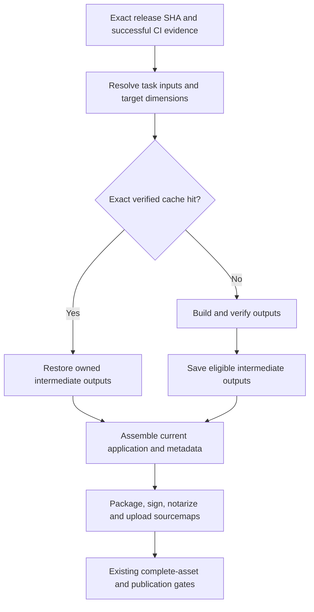

# Agent Note: Incremental release builds

Status: proposed

English | [中文](2026-10-30-incremental-release-builds.zh.md)

## Problem

A small hotfix should rebuild its affected inputs, then produce complete, newly signed installers. Today the release matrix repeats type checking, application bundling, native preparation, and packaging for each OS and edition. The pnpm store cache does not reuse application build results.

This plan covers release-build computation and its integration with the existing publication contract. It does not replace that contract, change application delivery to hot patching, or change release approval requirements. The [CI and local validation proposal](2026-10-01-ci-and-local-validation.md) owns check selection; this note adds release-output reuse without superseding that owner.

### Verified baseline

The inspected checkout is release commit `c3b1a786f0258c910aece7662adb1c2c887b784e`, containing the AiHubMix backport [#23123](https://github.com/CherryHQ/cherry-studio/pull/23123). At investigation time, the local `release.yml` blob `8e21c8639284d094a08549b1e8b4f3b0a88c99ac` also matched the workflow on `main`.

| Observation | Consequence |
| --- | --- |
| [Release](../../../../.github/workflows/release.yml) runs three OS jobs for each of `global` and `cn`; each job builds x64 and arm64. | Six jobs repeat preparation and bundling; there are twelve OS/architecture/edition combinations to preserve. |
| [Root build scripts](../../../../package.json) run typecheck, `electron-vite build`, and the utility-process build before electron-builder. | Packaging cannot currently request already-prepared application output without bypassing the aggregate command. |
| [Build configuration](../../../../electron.vite.config.ts) injects release notes/history into Renderer and compiles the macOS selection panel from a Main build hook. | A release-note change invalidates Renderer; the JS build is not a platform-independent pure task. |
| [Native preparation](../../../../scripts/packaging/before-pack.js) forces macOS/Windows SQLite source rebuilds. [Linux packaging](../../../../docs/contrib/linux-packaging.md) already uses pinned, verified prebuilds. | Cache the missing native work; preserve the existing Linux checksum, ABI, and libc checks. |
| Sentry upload runs inside bundling and deletes sourcemaps afterward. | Restoring only JS cannot silently count as completing source-map publication. |
| [Automatic dispatch](../../../../.github/workflows/auto-release-build.yml) checks the current release head, then requests `platform=all`. | New shared application code still needs installers for every supported target. |

One successful [v2.1.8 run](https://github.com/CherryHQ/cherry-studio/actions/runs/40266306505), queried on 2026-10-30, provides a starting sample: Build Linux took 13.0/14.8 minutes, Build Mac 17.1/22.2 minutes, and Build Windows 21.6/23.0 minutes for global/cn. Some post-job pnpm cache saves took 2.8–5.2 minutes. These are combined step durations, not compiler-only timings or representative medians. Queueing, approval wait, signing, notarization, and GitCode transfer must be measured separately.

## Proposal

### Scope and operating contract

Keep pnpm, electron-vite, electron-builder, and the current release gates. Start with explicit task inputs and GitHub Actions cache restore/save; do not add a general task scheduler or migrate the application into new packages. Use separate electron-vite configurations for independently owned outputs; `--rendererOnly` is a development option, not a production incremental-build switch.

Cache only reusable intermediate results. Each release attempt assembles from its requested SHA, generates its current metadata, packages every affected target, signs/notarizes as required, and validates the complete asset set. Existing same-SHA platform retry behavior remains unchanged. Do not present an older installer as a build of a new SHA.

Automatic release dispatches enable eligible caches with `incremental=true`, including rebuilds after backports; manual Release and Preview dispatches remain opt-in. Full platform acceptance and benchmark evidence remain outstanding. Implementation belongs on `main`; a release-derived planning checkout must not become the source of a release-to-main PR. Any later backport is a separate reviewed change. A trusted control workflow must detect whether the selected release tree supports the new build contract and use the existing full path when it does not.

### Phase 0: Establish a measurable baseline

Split timing observations into checkout, dependency restore/install, required package preparation, typecheck, each JS output, each native target, packing/compression, signing, notarization, artifact transfer, and cache save. Record run/attempt, source SHA, workflow SHA, runner image/toolchain, edition, architecture, input digest, cache outcome, output size, and elapsed time. Never put credentials or their raw values in reports.

Use the existing CI performance-observation approach where applicable. Record queue delay and approval wait separately from execution. Preserve the six-job matrix initially; do not infer that adding Windows signing runners or more architecture jobs will reduce the actual critical path.

Verification: collect an uncached baseline and comparable warm runs before claiming savings. Keep timing instrumentation passive; it must not change required results or publication state.

### Phase 1: Remove repeated preparation and cache native outputs

Separate validation, required package preparation, compilation, and packaging entry points while preserving the existing full local build command. `scripts/validation/run.mjs` currently builds `@cherrystudio/ai-sdk-provider` before type checks: removing a repeated check must not remove a required package build.

A release may reuse successful exact-SHA push CI validation only when the planned checks and their successful aggregation can be established. If the evidence is absent or incompatible, run validation once in a shared release preparation job; do not run it independently in all six packaging jobs. A bare successful workflow with unexplained skipped checks is insufficient.

Use `actions/cache/restore` for consumers and one designated successful writer per pnpm-store key, initially the global job per OS. An absent writer leaves a cold cache, not an invalid release. Retain `pnpm install --frozen-lockfile`; do not persist mutable `node_modules`. Persist suitable Electron/download caches separately from task outputs.

For macOS/Windows SQLite, the selection panel, and system-speech helpers, restore a verified target binary or compile it once per exact native input key. Share across editions only after proving the binary has no edition-specific inputs. Move native compilation out of Main's Vite hook into explicit preparation; keep packaging-time verification. Do not globally disable electron-builder rebuild behavior: determine which native modules it still owns and retain its checks until equivalence is proven. Preserve `patches/app-builder-lib@26.15.6.patch`.

Verification: cache miss, hit, corruption, wrong ABI/architecture, changed source/header/compiler/patch, and concurrent target builds. A target Electron process must load SQLite and execute a real database operation; inspect each cross-built architecture and run the matching packaged smoke coverage on compatible runners. Existing Linux prebuild verification must continue to fail on incompatible artifacts.

### Phase 2: Remove release-note invalidation of Renderer

Generate one packaged release-information resource from the current version, `electron-builder.yml`, and release history. It contains the current release even for prereleases that are absent from stable history. Validate consistency before packaging and include its digest in assembly, not in the reusable Renderer bundle.

Expose the local bundled information through an additive, typed IpcApi route owned by `AppUpdaterService`; resolve its file through `application.getPath`. Keep the existing remote history request separate so the local first render never waits for the network. Adapt `ReleaseNotesPage` to load local information, then merge remote updates using the existing semantics. Preserve current-version notes, English/Chinese localization, newest-version expansion, offline use, and development preview. Do not move this file-backed operation into DataApi.

Remove the three `__APP_RELEASE_*` globals only after their consumers have migrated. A version change may still invalidate JS through package metadata or Sentry identity; the guaranteed optimization is a notes-only change within the same version, not reuse across arbitrary versions.

Verification: offline and delayed-network rendering, malformed/unavailable remote history, prerelease current entry, older remote data, both editions/languages, and the development resource path. Packaged checks must prove that updated notes display when Renderer output is reused. Update the owning app-upgrade/IPC references with the implementation, not as already-shipped behavior in this Spec.

### Phase 3: Add bounded JS task caching

Split `main`, `renderer`, `preload`, and `utility-process` into independently owned output directories. Audit config-import side effects first: utility entries currently import the main build configuration. Shared aliases and dependency rules must have one owner without loading unrelated metadata or native preparation during a task.

Use a small, versioned release-task input/output manifest under `scripts/release/`, with conservative source and configuration sets, rather than a second general dependency engine. Include imported workspace packages, shared types/runtime code, generated assets, filesystem-read resources, build-plugin sources, and resolver inputs. Unknown or unclassified build inputs invalidate the relevant tasks conservatively. False misses are acceptable; undocumented false hits are not. Changes to a shared manifest initially invalidate all tasks.

Start with OS- and edition-scoped JS caches. Include the actual Node version and host architecture; pinned dependencies, patches and build configuration remain task inputs. Record the runner image label for diagnostics, but do not invalidate JS solely because that label changes. Native tasks retain their compiler/SDK/ABI identities; include target architecture when output depends on it. Do not share across OSes or claim a pure cross-platform JS build until a separate equivalence investigation supports it.

Separate source-map upload from compilation. A cache hit must either restore the exact JS/map/debug-ID pair and perform the required upload, or bypass caching for that task when no approved map store is available. Delete maps only from packaging staging after upload, not from a reusable input. Authentication tokens belong to the upload step; output-affecting Sentry identity belongs to the task key.

Verification: real fixture builds must change observable output after an input change, and a clean restore must reproduce the intended runtime output. Test deletion, rename, a new import, missing files, changed shared/package inputs, build flags, edition, lockfile, patch, and toolchain. Assert output content and runtime behavior, not merely that a cache function was called.

The approved follow-up uses authenticated encryption in GitHub Actions cache rather than a new storage service. Cache JS, source maps and injected Debug IDs together as AES-256-GCM ciphertext in a separate namespace. A random 32-byte `RELEASE_BUILD_CACHE_KEY` GitHub Secret is exposed only to trusted release builds as `CHERRY_BUILD_CACHE_KEY`; it is never passed to compilation or stored in manifests. Authenticate the task identity before extracting an archive, then verify the output inventory. Missing/invalid keys or damaged entries cause clean compilation. Only the encrypted namespace and existing native cache are uploaded; temporary plaintext cache records are removed.

Resolve each task's Vite environment with Vite's own loader and namespace rules, including dotenv expansion and process overrides. A keyed digest captures effective values without recording them. Sentry upload credentials are not compilation inputs. The release builder produces hidden source maps, injects Debug IDs with the pinned Sentry CLI before caching, uploads on both hits and misses, and deletes maps only from packaging output after successful upload. Failed uploads fail the release. Ordinary build aliases keep their existing Sentry plugin path. Validate encryption tampering/key rotation, environment invalidation, credential exclusion, map/JS identity and failure propagation using real fixtures before enabling reuse.

The same opt-in runner is available through Preview Release for online acceptance before formal rollout. Detect support in the selected same-repository source tree and retain the existing full preview path when disabled or unsupported. Run preview type checks before cached compilation, package with explicit `--publish never`, and remove cache/upload credentials before the packager. Use independent preview native/encrypted namespaces and upload only installer and timing artifacts. A maintainer testing workflow changes before merge selects a reviewed workflow branch separately from the source branch. Compare an unchanged source SHA because preview versions embed that SHA; no release branch, tag, draft or approval state is created by this trial.

### Cache contract

| Layer | Required identity and invalidation inputs | Restore rule |
| --- | --- | --- |
| Dependency/download caches | OS, relevant runtime/package-manager versions, lockfile or pinned download identity | Partial pnpm restore may seed a frozen install; it never proves compilation is current. Verify downloaded binary checksums. |
| Native outputs | OS, target architecture, Electron version/ABI or applicable N-API contract, dependency/source/header/patch digests, compiler/SDK and flags | Exact key and validated target metadata/checksum only; reject mismatched outputs before packaging. |
| JS tasks | Task/schema version, complete declared inputs, dependency/config/plugin digests, Node/pnpm/bundler versions, OS/edition and applicable architecture, output-affecting build values | Exact key and complete output manifest only; no prefix restore may skip compilation. |
| Final installation assets | Current release SHA, edition, OS/architecture, package metadata, asset hashes and signing evidence | Follow existing release gates; excluded from cross-SHA build-result reuse. |

A cache record contains producing source/workflow/run identifiers, input digest, target dimensions, and an output file/hash inventory. The consumer computes expected inputs from the current target and validates the inventory in a clean task directory. The producer SHA may differ when inputs are identical; the final assembly records both provenance and the current release SHA without claiming fresh compilation on a hit.

Only trusted release-build producers may populate reusable release-output namespaces. Validate access boundaries against the configured Actions version; namespace text alone is not access control. Never store signing material, upload tokens, or plaintext secret-bearing bundles/maps in broadly readable caches. Public-repository Actions caches are not a private secret store. The encrypted-cache follow-up above supplies the approved confidentiality boundary; without its key, sensitive tasks remain uncached. Do not weaken current secret-handling rules to obtain a hit.

Missing, evicted, incomplete, or invalid cache entries fall back to rebuilding that task from clean output. A failed rebuild fails the release. Cache-service unavailability may reduce performance but must not substitute stale output. Use an explicit cache-schema version to invalidate immutable bad entries.

### Phase 4: Enable gradually and preserve recovery

First compare uncached output with candidate cached output without using the candidate for a release. Then enable native reuse, followed by one JS task at a time. Reuse is accepted only after its correctness matrix passes and paired warm-run measurements show lower execution time after restore/save overhead.

Provide a release-only cache bypass for all task-result caches; it must not change signing, CI requirements, or publication checks. Disable a problematic task and rebuild cleanly when output validation fails. Revert Phase 2's runtime change separately if necessary. Existing `clean` dependency cleanup is a different operation and must not silently acquire a new meaning.

Do not cancel `release-state` mutation jobs. Existing dispatch already discards stale CI heads. Debouncing multiple hotfixes, cancelling obsolete read-only compilation, direct per-platform draft uploads, and reducing archive round trips remain follow-up proposals after timing data shows their value; they change scheduling/publication boundaries and are not prerequisites for this cache rollout.

### Implementation and verification sequence

| Layer | Primary files/owners | Completion evidence |
| --- | --- | --- |
| 0: measurement and command boundaries | `release.yml`, `package.json`, `scripts/release/`, existing validation preparation | Per-stage timing and unchanged full-build behavior; CI evidence reuse fails closed. |
| 1: dependency/native reuse | `release.yml`, `scripts/packaging/before-pack.js`, `native/darwin/build.js`, system-speech build helper, Linux native tooling | Target-key invalidation, concurrent target isolation, native load checks; no global rebuild suppression. |
| 2: bundled release information | `electron.vite.config.ts`, `AppUpdaterService`, IPC schemas/handler, path registry, `ReleaseNotesPage` and env declarations | Both editions retain offline and remote behavior; notes-only change does not alter Renderer compile inputs. |
| 3: JS cache and source maps | Vite configurations, `scripts/release/` task manifest, `release.yml` | Exact input/output validation, current source-map delivery, reproducible task fixtures and clean fallback. |
| 4: rollout and runbook | `release.yml`, `docs/contrib/release-workflow.md`, relevant packaging docs | Comparable cold/warm reports, complete signed assets, unchanged release rejection cases, tested bypass. |

Use separate reviewable PRs in dependency order after Spec approval. Layers 1 and 2 are logically independent after layer 0, but a linear stack keeps rollout review straightforward. Keep the note proposed until the final layer verifies every AC. The user authorized implementation on 2026-10-30. The first implementation adds task boundaries, conservative caches, bundled release information and workflow integration. The user authorized automatic release dispatches to enable caching by default on 2026-10-31; manual dispatches retain the cache-off default and Windows native reuse remains deferred; Sentry/secret-bearing JS tasks require the approved encrypted cache for reuse. Full signed platform acceptance and paired benchmark evidence are still required.

Existing focused suites to extend/run include `scripts/__tests__/before-pack.test.ts`, `linux-native.test.ts`, `edition-packaging.test.ts`, `sentry-build.test.ts`, `release-workflow.test.ts`, `release-baseline.test.ts`, and `backport-release-fixes.test.ts`; the latter filenames share `scripts/__tests__/`. Include `src/renderer/pages/releaseNotes/__tests__/ReleaseNotesPage.test.tsx`, `src/shared/utils/__tests__/releaseNotes.test.ts`, affected AppUpdaterService/IPC consumers, and new task-cache fixtures. Use explicit test file paths with the repository project wrappers. Full signed matrix builds are controlled CI acceptance work, not the default local test command.

Benchmark three scenarios: same inputs on a new commit, AiHubMix-style Main-only hotfix plus release notes, and a lockfile/native-toolchain change. Compare at least three paired cold/warm attempts on equivalent runners per evaluated scenario, reporting medians/ranges, total runner minutes, queue delay, stage times, cache bytes, and failures. Compare unsigned payload inventories and observable behavior; signatures/timestamps and installer hashes are not expected to be byte-identical. Investigate nondeterministic compiler output before permitting it as a reusable task.

## Alternatives considered

- **Add Turborepo/Nx immediately.** Defer: their input-fingerprint caching is useful, but the current blockers are mixed side effects, missing task boundaries, and release-note coupling. A fixed set of tasks can initially use existing Actions capabilities. Reconsider an orchestrator if maintaining those contracts becomes the measured bottleneck.
- **Cache `out/`, `dist/`, or `node_modules` wholesale by SHA/lockfile.** Reject: a SHA prevents useful cross-commit reuse, while a lockfile alone misses application changes; mutable native binaries and mixed editions can leak between targets.
- **Build only one platform for a shared Main fix.** Reject: all shipped platforms contain the changed code. Preserve complete delivery while reusing valid intermediates.
- **Patch a previously signed app or reuse its notarization for modified contents.** Reject: regenerate the application package and required signatures/notarization; differential client downloads do not establish incremental build correctness.
- **Remove packaging guards or skip all checks because CI is green.** Reject: retain artifact/runtime checks and establish exact-SHA validation coverage before removing repeated work.
- **Combine cache rollout with direct draft uploads or a new remote cache service.** Defer: separate publication/storage contracts from the first computation optimization.

## Acceptance criteria

- AC1 — Every supported release target reports separate preparation, compilation, native, packaging/signing, transfer, and cache timings; queue and approval delay are distinguishable, and no speedup is inferred from the single historical sample. (verification: CI metrics artifacts and paired benchmark reports)
- AC2 — Required preparation still runs, repeated type validation is reused only with valid exact-SHA coverage or executes once, and each eligible dependency-cache key has one writer without making cache availability a release requirement. (verification: workflow contract fixtures and cold-cache CI)
- AC3 — Unchanged native inputs reuse compatible binaries; source/header/ABI/architecture/compiler/patch changes invalidate them; wrong or corrupted binaries cannot reach an accepted package. (verification: scripts fixtures, native inspection and target Electron smoke tests)
- AC4 — A same-version notes-only update leaves Renderer compilation inputs unchanged while the packaged app displays the new bilingual current notes offline and retains remote-history merge behavior in both editions. (verification: renderer and IPC tests plus packaged artifact checks)
- AC5 — Exact task-input matches restore complete valid outputs; dependency/configuration/edition/environment changes, deletions and new imports invalidate affected tasks; cache misses or invalid entries rebuild without stale output. (verification: task-cache fixture builds and cold/warm payload comparisons)
- AC6 — Restored JS retains its matching source-map/debug identity and required upload; cache storage/producer boundaries exclude credentials and unapproved sensitive output. (verification: Sentry integration fixtures and CI cache access/output inspection)
- AC7 — All final assets remain bound to the current release SHA and target set, and stale-head, published-tag, pending-hotfix, failed-job and wrong-baseline cases remain rejected; cache bypass restores the normal build path. (verification: release workflow/state tests and full signed CI acceptance)
- AC8 — After correctness passes, at least three paired attempts per evaluated scenario establish whether reuse reduces execution time and runner minutes after cache overhead; report tasks with no demonstrated benefit for a decision on disabling their caches. (verification: controlled benchmark reports)

## Risks

Undeclared filesystem/configuration inputs can create false hits. Large caches can cost more than rebuilding. Actual toolchain changes invalidate affected tasks; a runner image label change alone does not invalidate JS. Native ABI switches within mutable installations can race; target staging must be isolated. Existing source-map plugins have side effects, and cached output may contain injected build values. Local release information becomes asynchronous at the UI boundary and needs an explicit loading/error contract without a network dependency.

Cross-version reuse, cross-OS JS reuse, broader concurrency, private cache infrastructure, publication transfer changes, and automatic hotfix batching are outside this proposal. This plan promises correct reuse and measured adoption, not a fixed end-to-end release duration. Packaging, signing, notarization, runner queueing and asset transfer remain possible lower bounds.

## References

- [Release workflow operations](../../../../docs/contrib/release-workflow.md) and [packaging hooks](../../../../scripts/packaging/README.md) remain the current operational contract.
- [GitHub Actions cache](https://github.com/actions/cache) supplies separate restore/save actions; [cache access and matching](https://docs.github.com/en/actions/reference/workflows-and-actions/dependency-caching) constrain safe reuse and storage.
- [electron-vite CLI](https://electron-vite.org/guide/cli) documents production build/configuration options; [Turborepo caching](https://turborepo.dev/docs/crafting-your-repository/caching) describes the deterministic-input requirement behind the deferred alternative.
