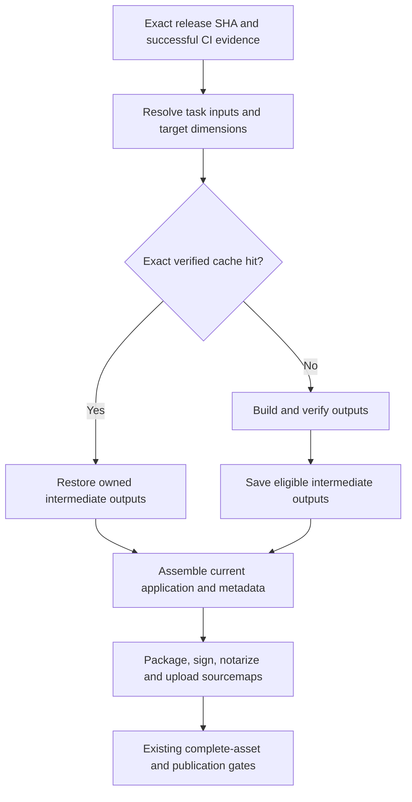

# Agent Note: 发布增量构建

Status: proposed

[English](2026-10-30-incremental-release-builds.md) | 中文

## Problem

小范围 hotfix 应当只重建受影响的输入，然后生成完整、重新签名的安装包。目前发布矩阵会按操作系统和发行版重复执行类型检查、应用打包编译、原生模块准备和安装包制作。pnpm store 缓存不能复用应用构建结果。

本计划覆盖发布构建的计算工作，以及它与现有发布契约的衔接。不替换发布契约，不将应用交付改为热补丁，也不改变发布审批要求。[CI 与本地验证提案](2026-10-01-ci-and-local-validation.md)负责检查选择；本文新增发布产物复用，不取代该文档的职责。

### Verified baseline

检查的工作树位于发布提交 `c3b1a786f0258c910aece7662adb1c2c887b784e`，包含 AiHubMix 回补 [#23123](https://github.com/CherryHQ/cherry-studio/pull/23123)。调研时，本地 `release.yml` 的 blob `8e21c8639284d094a08549b1e8b4f3b0a88c99ac` 与 `main` 上的工作流一致。

| 观察 | 影响 |
| --- | --- |
| [Release](../../../../.github/workflows/release.yml) 为 `global` 和 `cn` 分别运行三个操作系统任务；每个任务构建 x64 和 arm64。 | 六个任务重复准备和编译；必须保留十二种操作系统、架构、发行版组合。 |
| [根构建脚本](../../../../package.json) 在 electron-builder 前执行 typecheck、`electron-vite build` 和 utility-process 构建。 | 打包步骤目前无法通过聚合命令直接使用已经准备好的应用产物。 |
| [构建配置](../../../../electron.vite.config.ts) 将发布说明和历史注入 Renderer，并通过 Main 构建钩子编译 macOS 选区面板。 | 发布说明变化会使 Renderer 失效；JS 构建也不是与平台无关的纯任务。 |
| [原生模块准备](../../../../scripts/packaging/before-pack.js) 强制从源码重建 macOS/Windows SQLite。[Linux 打包](../../../../docs/contrib/linux-packaging.md)已经使用固定版本、经过验证的预构建产物。 | 缓存尚未复用的原生工作；保留现有 Linux 校验和、ABI 和 libc 检查。 |
| Sentry 上传发生在编译过程中，随后删除 sourcemap。 | 只恢复 JS 不能被默认为已经完成 source-map 发布。 |
| [自动触发](../../../../.github/workflows/auto-release-build.yml)检查当前发布分支 head，然后请求 `platform=all`。 | 共享应用代码变化后，所有支持的目标仍需安装包。 |

2026-10-30 查询的一次成功 [v2.1.8 运行](https://github.com/CherryHQ/cherry-studio/actions/runs/40266306505)提供了初始样本：global/cn 的 Build Linux 分别耗时 13.0/14.8 分钟，Build Mac 为 17.1/22.2 分钟，Build Windows 为 21.6/23.0 分钟。部分任务结束时的 pnpm 缓存保存耗时 2.8–5.2 分钟。这是混合步骤耗时，不是纯编译时间，也不是有代表性的中位数。排队、审批等待、签名、公证和 GitCode 传输必须分别测量。

## Proposal

### Scope and operating contract

保留 pnpm、electron-vite、electron-builder 和现有发布门禁。先使用明确的任务输入与 GitHub Actions 缓存恢复、保存能力；不新增通用任务调度器，也不为了构建而将应用迁入新 package。使用独立的 electron-vite 配置管理各自产物；`--rendererOnly` 是开发选项，不是生产增量构建开关。

只缓存可复用的中间产物。每次发布尝试都从请求的 SHA 组装应用，生成当前元数据，为所有受影响目标打包，按要求签名、公证，并验证完整资产集合。保留现有同一 SHA 的单平台重试行为。不能把旧安装包当作新 SHA 的构建结果。

自动发布触发时传入 `incremental=true`，启用符合条件的缓存，也适用于 backport 后重建；手动 Release 和 Preview 仍需显式开启。完整平台验收和基准数据仍待完成。实现应进入 `main`；从发布分支创建的计划工作树不能直接成为 release-to-main PR 的来源。后续如需回补，应作为单独改动接受评审。可信控制工作流必须识别选定发布工作树是否支持新构建契约；不支持时使用现有完整构建路径。

### Phase 0: Establish a measurable baseline

分别记录 checkout、依赖恢复与安装、必要 package 准备、typecheck、各 JS 产物、各原生目标、打包压缩、签名、公证、资产传输和缓存保存的时间。记录 run/attempt、源码 SHA、工作流 SHA、runner 镜像和工具链、发行版、架构、输入摘要、缓存结果、产物大小及耗时。报告中不得出现凭据或其原始值。

适用时复用现有 CI 性能观测方式。排队延迟和审批等待与执行时间分开记录。初期保留六任务矩阵；不能假设增加 Windows 签名 runner 或拆出更多架构任务就能缩短真正的关键路径。

验证：在宣称收益前，取得无缓存基线及可比较的热缓存运行。计时只做被动观测，不能改变必需结果或发布状态。

### Phase 1: Remove repeated preparation and cache native outputs

拆分验证、必要 package 准备、编译和打包入口，同时保留现有本地完整构建命令。`scripts/validation/run.mjs` 目前会在类型检查前构建 `@cherrystudio/ai-sdk-provider`：删除重复检查不能连带删除必要的 package 构建。

只有能确认计划检查及其成功汇总结果时，发布构建才可复用精确 SHA 的成功 push CI 验证。证据缺失或不兼容时，在共享发布准备任务中执行一次验证，不在六个打包任务中分别执行。仅工作流成功、但存在无法解释的跳过项，不足以复用。

消费者使用 `actions/cache/restore`；每个 pnpm-store key 指定一个成功的写入者，初期为各操作系统的 global 任务。写入者缺席只会留下冷缓存，不会让发布无效。保留 `pnpm install --frozen-lockfile`，不持久化可变的 `node_modules`。合适的 Electron 与下载缓存应与任务输出分开持久化。

对于 macOS/Windows SQLite、选区面板和 system-speech helper，恢复经过验证的目标二进制，或按精确的原生输入 key 编译一次。只有证明二进制不受发行版输入影响后，才可在两个发行版间共享。将原生编译从 Main 的 Vite 钩子移到显式准备步骤，保留打包时验证。不全局关闭 electron-builder 的 rebuild：先确认它仍负责哪些原生模块，在证明等价前保留其检查。保留 `patches/app-builder-lib@26.15.6.patch`。

验证：缓存未命中、命中、损坏、错误 ABI/架构、源码/头文件/编译器/patch 变化及并发目标构建。目标 Electron 进程必须能加载 SQLite 并执行真实数据库操作；检查各交叉构建架构，并在兼容 runner 上运行对应的打包产物冒烟验证。现有 Linux 预构建验证仍须拒绝不兼容产物。

### Phase 2: Remove release-note invalidation of Renderer

根据当前版本、`electron-builder.yml` 和发布历史生成一份随包发布的信息资源。即使预发布版本不在稳定版历史中，也包含当前版本。打包前验证一致性，将其摘要纳入组装输入，而不是可复用的 Renderer bundle。

通过 `AppUpdaterService` 管理的新增强类型 IpcApi 路由提供本地内置信息；使用 `application.getPath` 解析文件路径。保留独立的远程历史请求，使本地首次展示无需等待网络。调整 `ReleaseNotesPage`，先加载本地信息，再按现有语义合并远程更新。保留当前版本说明、中英文选择、最新版本展开、离线使用和开发预览。不把该文件读取操作放入 DataApi。

消费者迁移完成后再移除三个 `__APP_RELEASE_*` 全局量。版本变化仍可能通过 package 元数据或 Sentry 标识使 JS 失效；保证优化的是同一版本内仅发布说明变化的情况，不保证任意版本之间的复用。

验证：离线和网络延迟下的展示、远程历史无效或不可用、预发布当前条目、较旧远程数据、两个发行版与两种语言，以及开发环境资源路径。打包产物验证必须证明复用 Renderer 后仍展示更新的说明。随实现更新 app-upgrade/IPC 所属文档，不在本 Spec 中把提议描述为已上线行为。

### Phase 3: Add bounded JS task caching

将 `main`、`renderer`、`preload`、`utility-process` 拆成各自拥有输出目录的任务。首先审计配置导入副作用：utility 入口目前会导入主构建配置。共享 alias 和依赖规则应只有一个归属，任务加载它们时不应读取无关元数据或准备原生模块。

在 `scripts/release/` 下使用小型、带版本的发布任务输入/输出清单，保守声明源码与配置集合，不另写通用依赖引擎。纳入导入的 workspace package、共享类型与运行时代码、生成资源、文件系统读取的资源、构建插件源码及模块解析输入。未知或未分类的构建输入应保守地使相关任务失效。可以接受多构建，不能接受没有依据的错误命中。共享清单变化初期使全部任务失效。

JS 缓存初期按操作系统和发行版隔离。纳入实际 Node 版本和宿主架构；锁定的依赖、patch 和构建配置仍是任务输入。记录 runner 镜像标签用于诊断，但不因标签变化单独使 JS 缓存失效。原生任务保留编译器、SDK 和 ABI 身份校验；产物受目标架构影响时也必须纳入。不跨操作系统共享；在独立等价性调研支持之前，不宣称 JS 构建完全跨平台。

将 source-map 上传从编译中拆出。缓存命中时，必须恢复精确匹配的 JS/map/debug-ID 组合并执行要求的上传；如果没有获准的 map 存储，则该任务绕过缓存。上传后只删除打包暂存目录中的 map，不从可复用输入中删除。认证 token 属于上传步骤；影响产物的 Sentry 标识属于任务 key。

验证：真实 fixture 构建在输入变化后必须产生可观察的输出变化，干净恢复必须重现预期的运行时输出。覆盖删除、重命名、新增 import、文件缺失、共享/package 输入变化、构建标志、发行版、lockfile、patch 和工具链。断言输出内容和运行行为，不能只断言缓存函数被调用。

获准的后续方案在 GitHub Actions cache 中使用认证加密，不引入新存储服务。JS、source map 和已注入的 Debug ID 作为一个整体，以 AES-256-GCM 密文存入独立命名空间。随机 32 字节的 GitHub Secret `RELEASE_BUILD_CACHE_KEY` 仅以 `CHERRY_BUILD_CACHE_KEY` 提供给可信发布构建；不传入编译过程，也不写入清单。解压前先认证任务身份，再验证输出清单。密钥缺失或无效、条目损坏均回退为干净编译。只上传密文命名空间和现有原生缓存；临时明文缓存记录会被删除。

使用 Vite 自身的加载器和命名空间规则解析各任务的有效环境，包括 dotenv 展开和进程覆盖。用带密钥的摘要记录有效值的变化，不记录值本身。Sentry 上传凭据不属于编译输入。发布构建器生成隐藏 source map，通过固定版本的 Sentry CLI 注入 Debug ID 后再缓存；命中和未命中均执行上传，上传成功后只删除打包输出中的 map。上传失败则发布失败。普通构建别名保留原有 Sentry 插件路径。启用复用前，用真实 fixture 验证密文篡改、密钥轮换、环境失效、凭据隔离、map/JS 身份及失败传播。

Preview Release 也接入同一套可选 runner，用于正式启用前的线上验收。检测选定的同仓库源码树是否支持新入口；关闭开关或不支持时保留原有完整预览构建。缓存编译前运行预览类型检查，打包时显式使用 `--publish never`，并在调用打包器前移除缓存与上传凭据。预览原生及加密缓存使用独立命名空间，只上传安装包和耗时产物。维护者在合并前测试工作流改动时，单独选择经过审查的工作流分支与源码分支。由于预览版本包含源码 SHA，应使用不变的源码 SHA 对比；本次试验不会创建发布分支、标签、草稿或审批状态。

### Cache contract

| 层 | 必须纳入的身份和失效输入 | 恢复规则 |
| --- | --- | --- |
| 依赖/下载缓存 | 操作系统、相关运行时/package-manager 版本、lockfile 或固定下载身份 | pnpm 部分命中只可作为 frozen install 的种子，不能证明编译结果有效。验证下载二进制的校验和。 |
| 原生输出 | 操作系统、目标架构、Electron 版本/ABI 或适用的 N-API 契约、依赖/源码/头文件/patch 摘要、编译器/SDK 与标志 | 只接受精确 key，以及通过验证的目标元数据和校验和；打包前拒绝不匹配产物。 |
| JS 任务 | 任务/schema 版本、完整声明输入、依赖/配置/插件摘要、Node/pnpm/bundler 版本、操作系统/发行版及适用架构、影响输出的构建值 | 只接受精确 key 和完整输出清单；前缀命中不能跳过编译。 |
| 最终安装资产 | 当前发布 SHA、发行版、操作系统/架构、包元数据、资产哈希和签名证据 | 遵循现有发布门禁，不跨 SHA 复用最终构建结果。 |

缓存记录包含生产方的源码、工作流和运行标识，输入摘要、目标维度，以及输出文件和哈希清单。消费者根据当前目标计算预期输入，并在干净的任务目录中验证清单。输入相同时，生产方 SHA 可以不同；最终组装同时记录产物来源和当前发布 SHA，不能把命中缓存描述成重新编译。

只有可信发布构建生产方能填充可复用发布产物的命名空间。根据配置的 Actions 版本验证访问边界；命名空间字符串本身不是访问控制。不得将签名材料、上传 token 或含敏感信息的明文 bundle/map 放入广泛可读的缓存。公开仓库的 Actions 缓存不是私有凭据存储。上述加密缓存后续方案提供获准的保密边界；没有密钥时，敏感任务仍不缓存。不能为了命中缓存而削弱现有敏感信息处理规则。

缓存缺失、被驱逐、不完整或无效时，从干净输出重新构建该任务。重建失败则发布失败。缓存服务不可用可以降低性能，但不能换用过期产物。使用显式 cache-schema 版本使不可变的错误条目失效。

### Phase 4: Enable gradually and preserve recovery

先对比无缓存输出和候选缓存输出，不将候选用于发布。然后启用原生复用，再逐项启用 JS 任务。只有正确性矩阵通过，且成对热缓存测量在计入恢复、保存开销后仍降低执行时间，才接受复用。

提供仅用于发布的任务结果缓存总旁路开关；不能改变签名、CI 要求或发布检查。输出验证出错时禁用相应任务缓存并干净重建。必要时单独回退 Phase 2 的运行时改动。现有 `clean` 依赖清理是另一项操作，不得悄悄赋予新含义。

不取消 `release-state` 写入任务。现有自动触发已经丢弃过期 CI head。聚合多个 hotfix、取消过期的只读编译、按平台直接上传草稿和减少归档往返，都留作计时数据证明价值后的后续提案；它们会改变调度或发布边界，不是本次缓存落地的前提。

### Implementation and verification sequence

| 层 | 主要文件/归属 | 完成证据 |
| --- | --- | --- |
| 0：测量与命令边界 | `release.yml`、`package.json`、`scripts/release/`、现有验证准备 | 分阶段耗时、完整构建行为不变；CI 证据复用在条件不满足时拒绝跳过验证。 |
| 1：依赖/原生复用 | `release.yml`、`scripts/packaging/before-pack.js`、`native/darwin/build.js`、system-speech 构建 helper、Linux 原生工具 | 目标 key 失效、并发目标隔离、原生加载检查；不全局压制 rebuild。 |
| 2：内置发布信息 | `electron.vite.config.ts`、`AppUpdaterService`、IPC schema/handler、路径注册表、`ReleaseNotesPage` 和 env 声明 | 两个发行版保留离线与远程行为；仅说明变化不改变 Renderer 编译输入。 |
| 3：JS 缓存与 source map | Vite 配置、`scripts/release/` 任务清单、`release.yml` | 精确输入/输出验证、当前 source-map 交付、可复现任务 fixture 和干净回退。 |
| 4：启用与操作指南 | `release.yml`、`docs/contrib/release-workflow.md`、相关打包文档 | 可比较的冷/热报告、完整签名资产、发布拒绝条件不变、旁路验证。 |

Spec 批准后，按依赖顺序拆成可独立评审的 PR。第 1、2 层在第 0 层后逻辑上独立，但线性 stack 更便于审核启用顺序。最终一层验证全部 AC 前，本文保持 proposed。用户于 2026-10-30 授权开始实现。首版加入任务边界、保守缓存、内置发布信息和工作流接入。用户于 2026-10-31 授权自动发布触发时默认开启缓存；手动触发仍默认关闭缓存，Windows 原生复用仍暂缓；涉及 Sentry 或密钥的 JS 任务需要获准的加密缓存才能复用。完整签名的平台验收和成对基准数据仍是后续要求。

需要扩展或运行的现有聚焦测试包括 `scripts/__tests__/before-pack.test.ts`、`linux-native.test.ts`、`edition-packaging.test.ts`、`sentry-build.test.ts`、`release-workflow.test.ts`、`release-baseline.test.ts` 和 `backport-release-fixes.test.ts`；后几个文件同属 `scripts/__tests__/`。还应包含 `src/renderer/pages/releaseNotes/__tests__/ReleaseNotesPage.test.tsx`、`src/shared/utils/__tests__/releaseNotes.test.ts`、受影响的 AppUpdaterService/IPC 消费者以及新增任务缓存 fixture。使用仓库 project wrapper 并给出明确测试文件路径。完整签名矩阵构建属于受控 CI 验收，不是默认本地测试命令。

基准覆盖三种场景：输入相同但提交不同、AiHubMix 式 Main-only hotfix 加发布说明、lockfile/原生工具链变化。对每个评估场景，在等价 runner 上比较至少三组成对冷/热尝试，报告中位数和范围、总 runner 分钟数、排队延迟、各阶段时间、缓存字节数及失败情况。比较未签名有效负载清单和可观察行为；不要求签名、时间戳或安装包哈希逐字节一致。编译输出存在非确定性时，先查明原因再允许缓存该任务。

## Alternatives considered

- **立即引入 Turborepo/Nx。** 暂缓：其输入指纹缓存有用，但当前阻碍是混合副作用、缺失任务边界和发布说明耦合。固定数量任务可以先使用现有 Actions 能力。如果维护这些契约成为测量确认的瓶颈，再考虑编排工具。
- **按 SHA/lockfile 整体缓存 `out/`、`dist/` 或 `node_modules`。** 拒绝：SHA 阻止有价值的跨提交复用，只用 lockfile 则遗漏应用变化；可变原生二进制和混合发行版可能串入其他目标。
- **共享 Main 修复只构建一个平台。** 拒绝：所有交付平台都包含改动代码。应复用有效中间产物，同时保留完整交付。
- **修改已签名应用，或对改动后的内容复用公证。** 拒绝：重新生成应用包和要求的签名、公证；客户端差分下载不能证明增量构建正确。
- **删除打包保护，或因 CI 绿色跳过全部检查。** 拒绝：保留产物和运行时检查，去除重复工作前必须确认精确 SHA 的验证覆盖。
- **将缓存落地与直接上传草稿或新远程缓存服务合并。** 暂缓：首轮计算优化与发布、存储契约分开。

## Acceptance criteria

- AC1 — 所有受支持发布目标分别报告准备、编译、原生、打包/签名、传输与缓存时间；能够区分排队和审批延迟，不以单次历史样本推断提速。 (verification: CI 指标产物及成对基准报告)
- AC2 — 必要准备仍然执行；只有存在有效的精确 SHA 覆盖时才复用类型验证，否则执行一次；每个合适的依赖缓存 key 只有一个写入者，且发布不依赖缓存可用性。 (verification: 工作流契约 fixture 和冷缓存 CI)
- AC3 — 原生输入不变时复用兼容二进制；源码/头文件/ABI/架构/编译器/patch 变化使其失效；错误或损坏二进制无法进入验收通过的安装包。 (verification: scripts fixture、原生检查及目标 Electron 冒烟测试)
- AC4 — 同版本内仅说明变化不改变 Renderer 编译输入，而打包应用在离线时展示最新双语当前说明，并在两个发行版中保留远程历史合并行为。 (verification: renderer 与 IPC 测试及打包产物检查)
- AC5 — 任务输入精确匹配时恢复完整有效输出；依赖/配置/发行版/环境变化、删除及新增 import 使受影响任务失效；未命中或无效条目会重建，不使用过期输出。 (verification: 任务缓存 fixture 构建及冷/热有效负载比较)
- AC6 — 恢复的 JS 保留匹配的 source-map/debug 标识并完成要求的上传；缓存存储和生产方边界排除凭据及未经批准的敏感输出。 (verification: Sentry 集成 fixture 及 CI 缓存访问/输出检查)
- AC7 — 所有最终资产仍绑定当前发布 SHA 和目标集合，过期 head、已发布 tag、待回补 hotfix、失败任务与错误基线仍被拒绝；缓存旁路恢复正常构建路径。 (verification: 发布工作流/状态测试及完整签名 CI 验收)
- AC8 — 正确性通过后，每个评估场景至少三组成对尝试证明复用在计入缓存开销后是否降低执行时间和 runner 分钟数；报告未证明收益的任务，以便决定是否关闭其缓存。 (verification: 受控基准报告)

## Risks

未声明的文件系统或配置输入可能造成错误命中。大型缓存的成本可能高于重建。实际工具链变化会使受影响任务失效；仅 runner 镜像标签变化不会使 JS 缓存失效。可变安装目录内的原生 ABI 切换可能竞争，目标暂存目录必须隔离。现有 source-map 插件有副作用，缓存输出可能包含注入的构建值。本地发布信息在 UI 边界上变为异步，需要明确的加载、失败契约，且不能依赖网络。

跨版本复用、跨操作系统 JS 复用、更大并发、私有缓存基础设施、发布传输改动及自动聚合 hotfix 不在本提案范围内。本文承诺正确复用和按测量启用，不承诺固定的发布总耗时。打包、签名、公证、runner 排队和资产传输仍可能决定耗时下限。

## References

- [发布操作流程](../../../../docs/contrib/release-workflow.md)及[打包钩子](../../../../scripts/packaging/README.md)仍是当前操作契约。
- [GitHub Actions cache](https://github.com/actions/cache)提供分开的恢复、保存 action；[缓存访问与匹配规则](https://docs.github.com/en/actions/reference/workflows-and-actions/dependency-caching)约束安全复用和存储。
- [electron-vite CLI](https://electron-vite.org/guide/cli)描述生产构建和配置选项；[Turborepo 缓存](https://turborepo.dev/docs/crafting-your-repository/caching)说明暂缓方案背后的确定性输入要求。
