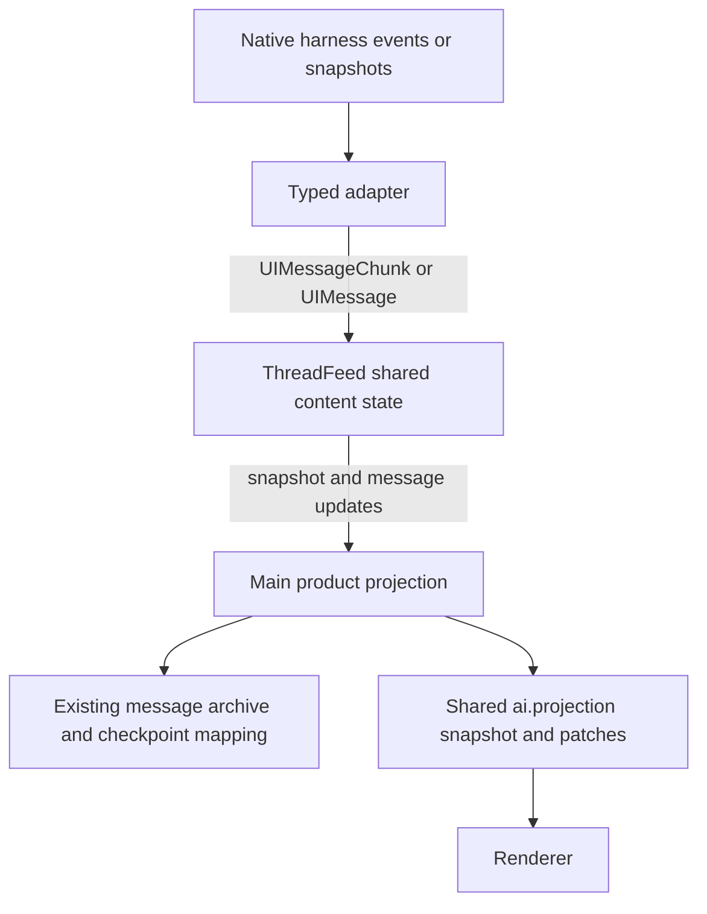

# Agent Note: Use AI SDK content across runtime observations

Status: proposed

English | [中文](2026-10-29-agent-runtime-content-protocol.zh.md)

## Problem

Runtime adapters currently translate native content into `ContentItem`; Main translates those items back into AI SDK chunks and messages. `MessageItem`, `ToolCallItem`, and `ToolResultItem` duplicate a content model that Cherry already consumes. This also loses native block order: Pi collects text separately from tool calls, while Claude emits a separate item per block. A child projection then treats those source items as separate displayed messages.

The resulting defects have different causes. Repeated assistant headers come from source-to-message granularity. Missing tool progress comes from preliminary-output handling and archive/live precedence. A child appearing finished while it continues comes from using the parent's activity. Replacing the content types addresses the first conversion boundary; it must preserve the independently verified fixes for the other two.

This proposal partially supersedes the content representation and reader placement in the [runtime contract](../architecture/2026-10-17-agent-runtime-contract.md), the AI SDK exclusion in the [harness boundaries](../architecture/2026-10-17-agent-harness-boundaries.md), and the content conversion in the [Claude migration](https://github.com/CherryHQ/cherry-studio/pull/22766). Their execution, admission, native storage, child ownership, and product delivery contracts remain active. The approved migration is implemented in the working tree; this note remains proposed until the remaining acceptance evidence and owning stack layers are complete.

## Proposal

### 1. Reuse the SDK model and retain the observation contract

Use `UIMessageChunk` for standard content changes and `UIMessage` for materialized content. Harness neutrality means independence from Pi, Claude SDK, Electron, and Cherry product entities; it does not require independence from a reusable content protocol. Depend explicitly on the repository's pinned `ai@6.0.185`, including the runtime dependency where the SDK reader executes. Do not copy its types into another local content union or introduce React into these packages.

The [SDK stream protocol](https://ai-sdk.dev/docs/ai-sdk-ui/stream-protocol) and [reader documentation](https://ai-sdk.dev/docs/ai-sdk-ui/reading-ui-message-streams) explain the reusable model. Their current pages describe a newer SDK, so implementation compatibility must be checked against the installed `6.0.185` sources, especially `ui-message-chunks.ts`, `ui-messages.ts`, and `read-ui-message-stream.ts`.

The proposed content portion of the existing observation contract is:

```typescript
import type { UIMessage, UIMessageChunk } from 'ai'

type RuntimeMessage = UIMessage<{
  completeness: Completeness
  inputId?: InputId
}>

type ContentObservation =
  | { type: 'message.upsert'; message: RuntimeMessage; replaces?: readonly ItemRef[] }
  | { type: 'message.remove'; ref: ItemRef }

// ThreadSnapshot.messages: readonly RuntimeMessage[]
// Adapter content input: UIMessageChunk or an authoritative RuntimeMessage.
```

`RuntimeMessage` is an SDK generic specialization, not another definition of text, reasoning, or tools. The existing `completeness` fact describes native message completeness, not execution success. `inputId` still identifies an evidenced placed user input; it is not an exclusive assistant-response owner. Keep `InputState`, `Activity`, `Subagent`, coverage, gaps, and observation closure outside content parts.

The first migration deliberately keeps `observe()` as a snapshot/upsert interface. Adapters with native deltas feed SDK chunks into the shared content accumulator; subscribers receive SDK messages. It does not add a second public raw-chunk subscription. Thus “use the SDK protocol” does not mean “send SSE over Electron IPC” or “make every observer run another parser.” This content dependency does not restore the removed AI SDK model-call port: model execution continues through the native harness and its gateway binding.

### 2. Accumulate content once at the shared source

Evolve the existing `ThreadFeed` source, rather than creating a second stream manager. Its content helper uses `readUIMessageStream` for each streaming native assistant message before observer fan-out. Pi and Claude adapters map native deltas to standard chunks. Durable may publish authoritative SDK message values from its native watch; a snapshot producer does not need to manufacture token deltas.



The source owns SDK reader lifecycle and normalized message state; it never owns native execution scheduling, input admission, retries, or task completion. Main retains product message identity, grouping, presentation metadata, persistence, and the shared publication service. Renderer consumes the projected messages and does not infer native grouping again.

`ThreadMessageProjection` loses its `ContentItem` parser, tool-result join, prefix differ, and per-item SDK readers. Retain only responsibilities still required by its callers, folding trivial subscription plumbing into those callers when practical. `ThreadProjection`'s accumulated-item-to-chunk conversion is removed when Pi root and Durable root consume authoritative message views. `RootMessageProjection` still has a real responsibility: several native messages can belong to one product reply, and native replacement must preserve that ownership.

### 3. Separate native messages, parts, and product replies

An observed SDK message corresponds to a native conversation message, not a token, content block, tool result, entire thread, or arbitrary run. Text, reasoning, and tool calls retain their original order within its `parts`. A tool result updates the tool part on the assistant message that owns the call. Tool progress uses `tool-output-available` with `preliminary: true`; a final result clears that condition. A tool ending does not finish the whole assistant reply.

| Identity | Rule |
| --- | --- |
| `Thread` | Owns an independent content view, including a background child after its parent ends. |
| `UIMessage.id` | Stable identity of the normalized native message within the Thread; not a block index. |
| SDK text/reasoning part ID and `toolCallId` | Address parts within their valid message/thread scope. Preserve native call identity or an explicitly mapped identity; do not derive it from visible text. |
| `InputState.response` | Continues to reference the evidenced terminal native message. Several inputs can share it. Resolve through the same alias mapping as content. |
| Product message ID | Owned by Main and retained across reconnects. Multiple native messages may map to one product reply. |
| Native entry/UUID/task identity | Remains in typed adapter source mappings and existing checkpoints when needed for recovery, retraction, or billing. |

`ItemId` and `ItemRef` are not deleted indiscriminately: behavior history, fork anchors, and response association still use source identity. Remove the custom content variants and their exports, not unrelated identity contracts. SDK content also does not replace `agent-behavior`'s execution/history facts or native model context.

Main must use the same reply-ownership rules for root and child views. A placed visible user input establishes a conversation boundary; a newly received but queued input does not. Tool steps remain with their established reply. Steer placement can split the visible reply according to the existing input-boundary behavior; follow-up creates a subsequent reply. Retain recorded ownership across snapshot refresh, compaction, and reconnection. Do not merge all adjacent assistant rows solely because they have the same role: hidden inputs, retries, and separately completed replies need their evidenced boundaries. When historical ownership cannot be recovered, retain separate existing messages and surface the recovery limit rather than inventing a merge.

Move `buildAgentChildFlowProjection`'s temporary renderer grouping into this Main-owned composition, then remove its source-item regrouping. The renderer still owns layout. It must receive the same reply boundaries when live, reopened, or shown in another window.

### 4. Map each installed harness without recreating its scheduler

| Adapter | Native evidence and proposed mapping | Recovery and limits |
| --- | --- | --- |
| Pi | `runtimeProjection.ts` receives native message start/update/end and `input_placed` / `input_settled`. Preserve one message's ordered blocks; bind tool results to their calls and use SDK chunks for actual deltas. A model message ending does not imply the agent's tool loop ended. | Keep native entry-to-live aliases and the child-origin filter. Rebinding/compaction can invalidate live identities; use an explicit mapping reset when equivalence is not proven. |
| Pi Durable | `projection.ts` reads `ConversationView`, `pi.live`, generation attempts, tool slots, and committed entries. Produce SDK message snapshots directly; preserve preliminary tool output even when its call is already committed. | Use task/entry evidence to replace previews. Repeated watch snapshots are idempotent. A retry or ambiguous preview-to-entry match cannot reuse identity by matching text. Native run metadata remains for behavior and result/usage attribution. |
| Claude Code | `projection.ts` receives `message_start`, indexed content blocks, assistant/user UUIDs, results, and explicit retractions. Keep blocks in one SDK message; map native tool-result blocks back to their owning calls. | Retain live-to-committed aliases, UUID retractions, partial abort facts, command/input correlation, and native response IDs used by gateway billing. A native API message ID is not the product reply ID. |

Preserve files, images, citations, reasoning metadata, structured results, tool output details, and error content using SDK parts and typed metadata. The portable native-to-SDK mapping belongs in the adapter. Cherry-specific MCP labels, task cards, business error presentation, and gateway accounting stay in Main. `ClaudeMessageMetadata` must no longer reconstruct content discarded by the public model; reduce it to genuine product decoration and controls. A missing tool call outside the observed coverage is not permission to invent a call: recover through native history where supported, otherwise retain existing evidence and report the gap.

These three installed adapters are the implementation scope. The broader harness comparison remains in the [evidence note](../testing/2026-10-17-agent-harness-evidence.md); this proposal adds no universal run, spawn, or stop interface and does not claim Codex/ACP/DSH acceptance from Pi or Claude tests.

### 5. Preserve ordering and recovery without broadcasting raw token streams

All source mutations, SDK reader results, native snapshot replacements, and terminal facts must cross one serialized publication boundary. A published snapshot covers all source mutations before its attachment barrier; later messages follow it. Terminal input facts cannot overtake the corresponding content update. Stopping a subscription detaches that subscriber; it does not cancel execution or another observer's reader.

On source replacement, fence the previous reader before accepting the new value. The installed SDK's `UIMessage` seed does not restore active text IDs or partial tool-argument buffers. Therefore reopening or replacing a partial native message must either rebuild a valid start/delta sequence from native evidence or continue publishing authoritative SDK message values. Never feed bare remaining deltas into a newly seeded reader. Rebuilding may keep the last published view visible until the replacement is complete; it must not publish a transient empty message.

Observer overflow retains the existing bounded `gap` followed by snapshot behavior, after content has been accumulated. Window reconnect subscribes to the retained Main view; it does not create another native subscription or reader. Process restart uses native storage plus persisted product mappings; display messages are not a native execution checkpoint. Explicit source removal is distinguished from absence in a compacted/current-view snapshot, which cannot delete retained product history.

Keep the current `ai.projection` snapshot/patch transport, revision checks, batching, and independent child target. Main diffs SDK message values into the existing window updates. SDK snapshot cloning has a cost, but there is no measurement establishing it as the main bottleneck; measure before replacing the parser or transport. Root completion must not flush, close, or finalize a still-running child's source.

### 6. Cut over content and storage without losing existing history

The native stores remain authoritative for native recovery. `agent_session_message` continues to store Cherry message content; existing context checkpoints retain native-to-product associations. This migration adds no input ledger, subagent relation table, or second transcript store.

Before changing writers, replay representative native transcripts and populated product archives through both paths. Compare visible content/order, calls and results, rich parts, input outcomes, source retractions, and reply ownership. Compare canonical outcomes, not raw event counts or incidental provisional IDs. Record intentional differences separately: consolidated assistant presentation and restored in-progress output are expected; missing text or changed failure states are not.

Existing checkpoints contain block/item identities and, for root messages, part offsets. They cannot simply be reinterpreted as whole-message identities. Read them with their current meaning, convert only associations proven by native entry/UUID/block evidence, and version the new checkpoint payload. Retain existing product row IDs, branch edges, submission links, and saved content. Legacy split rows may be composed into one Main view without destructively merging database rows; a physical row-consolidation migration is outside this change. If native history is unavailable, the existing archive stays readable and uncertain associations are not rewritten. Checkpoint and changed-message writes remain atomic through `DbService.withWriteTx`.

Cut over one content producer per native thread. A differential replay harness may run both converters in tests, but production must not dual-publish old items and new SDK messages. Root and child must reach the same Main view and the same persisted content after reattachment. Remove obsolete converters and the temporary renderer regrouping only when their consuming layer has migrated. No source-store rewrite or dependency patch is required merely to adopt the SDK content model.

### 7. Place changes in their owning stack layers

Remote PR bases and heads were checked on 2026-10-29. All layers below remain open; the checked-out desktop head was `63eb7c3777dc`. The stack is rooted at `main`, with replay fix #22413 and Pi dependency upgrade #21743 below #21910. Recheck live heads before any rewrite.

| Layer | Change owned here | Verification responsibility |
| --- | --- | --- |
| [#21910](https://github.com/CherryHQ/cherry-studio/pull/21910), `feature/agent-runtime-harness-adapters` | The content-contract decision, explicit SDK dependency, `ThreadFeed` accumulation, Pi/Durable package mappings, exports, and package READMEs. This is the first implementation layer to change. Publish the proposed Spec through the Spec-first process before implementation; do not bury the decision in the desktop PR. | Package build/typecheck; common observation and native adapter contract tests. |
| [#22010](https://github.com/CherryHQ/cherry-studio/pull/22010), `feature/agent-runtime-input-correlation` | Rebind `InputState.response` and alias handling to message identity without changing admission or success semantics. | Shared-response, steer/follow-up, terminal-content ordering, and restart association tests. |
| [#22107](https://github.com/CherryHQ/cherry-studio/pull/22107), `feature/agent-runtime-pi-root` | Pi desktop consumes SDK message views; retire its old `ThreadProjection` content conversion. | Pi root stream, tools, errors, and input-boundary consumers. |
| [#22689](https://github.com/CherryHQ/cherry-studio/pull/22689), `feature/agent-runtime-child-projection` | Simplify `ThreadMessageProjection`; integrate Main-owned child reply composition, archive/checkpoint compatibility, and independent progress. Place the already developed Pi child-rendering repair here according to file ownership. | Child projection, populated archive, parent/child lifecycle, and renderer consumers. |
| [#22698](https://github.com/CherryHQ/cherry-studio/pull/22698), `feature/agent-runtime-shared-projection` | Reuse the shared delivery route for the new message values. Keep existing IPC/revision semantics; change production code only when an actual consumer mismatch requires it. | Reconnect, duplicate/missing revisions, slow subscribers, and multiple windows. |
| [#22755](https://github.com/CherryHQ/cherry-studio/pull/22755), `feature/agent-runtime-durable-behavior` | Durable desktop root/child wiring and the local preliminary-output repair. Preserve native run metadata and shared behavior. | Watch snapshots, tools, background continuation, native restart, and real-model desktop behavior. |
| [#22809](https://github.com/CherryHQ/cherry-studio/pull/22809), `feature/agent-runtime-claude-code` | Claude package content mapping, archive sources, retractions, and ordered native metadata. | Partial/live/archive equivalence, abort, rich content, and input/response association. |
| [#22856](https://github.com/CherryHQ/cherry-studio/pull/22856), `feature/agent-runtime-claude-code-desktop` | Reduce `ClaudeMessageMetadata`, adapt product reply ownership, and remove remaining ContentItem consumers. Align the migration note owned by [#22766](https://github.com/CherryHQ/cherry-studio/pull/22766). | Transcript replay, root/child desktop consumers, and gateway response/billing attribution. |

Dependency upgrades, gateway execution, behavior scheduling, and message-tree schema layers do not need unrelated redesign. Rebase intermediate consumers mechanically when the lower contract changes. Each resulting PR must build against its own verified parent; do not rely on the stack tip to repair an invalid intermediate layer. Use `gh-stack` to restack and re-run explicit change scope plus affected checks for every rewritten layer. The current implementation is uncommitted on the desktop stack tip. It has not rewritten branches or remote PRs; distribute changes to these owners before publishing.

### 8. Verification sequence

Start with package-level proof: real SDK readers, deterministic native adapters, repeated snapshots, observer overflow, and live-to-archive identity changes. Then run the existing Main projection tests and affected renderer tests with explicit file filters. Use populated SQLite fixtures for checkpoint compatibility and atomic writes. Replay sanitized fixtures for text/reasoning interleaving, multiple tools, tool errors/denials, image/file/citation content, aborts, retractions, compaction, and steer boundaries.

Finally validate Pi, Pi Durable, and Claude in an isolated Electron instance with real models: foreground child; parent completes first; two concurrent children; user continues a child; preliminary Bash output; partial text; child failure; close/reopen window; native restart with incomplete work. Confirm the child has one consistent product reply composition across live and recovered views, independent status, and no duplicated parent content. Measure IPC bytes, message writes, and publication frequency for one and ten children against the current path; report measurements without assuming linear cost or a predetermined bottleneck. Earlier successful child-streaming checks cover the local bug repair; repeat them against this protocol migration before counting them as acceptance.

### Implementation evidence (2026-10-29)

- The common SDK accumulator, all three adapter mappings, root message sources, Main child composition, and version 2 source checkpoints are implemented. The old Pi item-to-chunk adapter and renderer regrouping are removed. Native persistence and the shared projection IPC remain unchanged.
- Targeted content migration package, Main/SQLite, renderer, and delivery tests pass. Replay passes for 21 portable cases and 83 local transcript cases; local transcript content is not committed. Native Claude desktop integration also verifies response ownership and billing. Node/web and all four runtime package typechecks pass.
- The first real-model Durable check exposed a missing driver `messageSource: 'projection'` declaration: model output existed, but the host selected the old chunk consumer and dropped message projections. Pi and Durable now declare their source before connection; registry regressions cover all three runtimes. The renderer's existing empty-success fallback generated the misleading “no response” error and is a separate `main` concern.
- Real-model checks also exposed missing initial-input boundaries. Pi now retains behavior child inputs from native custom-message entries; Claude reads the native child archive once at attachment because its live SDK feed omits the initial prompt. Subsequent updates remain observation-driven.
- Pi background activity no longer holds the parent's reply open. Pi and Durable local `/goal` answers use host message projections, preserving command replies when the old content chunk consumer is removed. Three regressions failed before these repairs; the 39 affected desktop and root projection tests then passed.
- A real DeepSeek model through the gateway passed the background-child scenario for Pi, Durable and Claude: the parent completed first, child output remained independent, and one composed assistant reply kept the same IDs and content after window reload. Pi and Durable also exposed partial text and preliminary Bash output. The installed Claude SDK forwarded complete child blocks; this run did not observe child token deltas or preliminary Bash output.
- The broader Electron scenario matrix and stack publication remain outstanding. Do not infer crash recovery, cross-platform acceptance, or a performance improvement from the checks above. The one-versus-ten-child measurement remains outstanding.

## Alternatives considered

- Keep `ContentItem` to avoid every SDK dependency: rejected because it duplicates a working portable content model and requires lossy conversions. A declared SDK protocol dependency is compatible with harness neutrality.
- Change only renderer grouping: useful as a local repair, but leaves source granularity, duplicated conversion, and recovery ownership inconsistent across consumers.
- Deliver raw chunks to every observer and renderer: not selected for this migration because it duplicates accumulation and complicates snapshot/replay boundaries. Add such a transport only for a measured consumer need, with an explicit recovery contract.
- Treat the entire Thread as one SDK message: rejected because follow-up, steer boundaries, native retractions, and retained history require multiple messages.
- Replace native storage with SDK messages or drop aliases/checkpoints: rejected because display content does not preserve native execution state, source retractions, or billing association.

## Acceptance criteria

- AC1 — Public content uses SDK message/part types; `ContentPart`, `MessageItem`, `ToolCallItem`, `ToolResultItem`, and `ContentItem` no longer serve runtime content consumers, while native SDK/Electron/Cherry dependencies do not enter the common package. (verification: unit — package builds, typechecks, and dependency/source-consumer checks)
- AC2 — Text, reasoning, and tools preserve native order within a message; deltas update that message rather than creating rows, and preliminary output remains visible until a final tool outcome. (verification: unit — SDK reader plus Pi/Durable/Claude adapter fixtures)
- AC3 — Snapshot-first ordered observation, overflow recovery, replacement/removal, and retired-reader fencing converge to the correct view without a second parser per subscriber or stale updates overwriting a replacement. (verification: unit — common observation and recovery tests)
- AC4 — Root and child share evidenced product reply boundaries across live output, steer/follow-up, reopening, and multiple windows; a queued input does not move existing output to a different reply. (verification: renderer — Main-produced root/child view fixtures and message consumers)
- AC5 — Several inputs can share an evidenced response; failed, aborted, or unanswered outcomes remain distinct, and terminal facts never precede their persisted response content. (verification: unit — input-correlation and desktop persistence tests)
- AC6 — Populated archives retain content, product IDs, branch edges, and submission relationships across checkpoint conversion; absent native evidence leaves readable history without fabricated mappings or destructive row merging. (verification: unit — production-migration SQLite fixtures and native transcript replay)
- AC7 — Parent completion, window detachment, another observer failing, and another child's failure do not stop or finalize a running child's output. (verification: Electron — isolated real-model parent/child scenario matrix)
- AC8 — Rich content, tool identity, signatures, native retractions, and gateway response/billing associations survive the Claude cutover; errors retain partial content. (verification: unit — sanitized transcript replay and gateway attribution consumers)
- AC9 — Each native thread has one production content writer; item-to-chunk conversion and renderer source-item regrouping are removed after their owners migrate, while shared IPC/revision recovery remains functional. (verification: unit — consumer inventory and shared projection tests)
- AC10 — Every rewritten PR has a verified base and scoped checks, and the final report distinguishes package tests, replay, Electron acceptance, restart evidence, and measured costs. (verification: docs gate — stack scope and acceptance evidence review)

## Risks

Moving the shared SDK accumulator below Main changes resource ownership and makes SDK upgrades part of the runtime protocol's compatibility boundary. Slow or failed decoding must not block native execution indefinitely or leave a subscriber with falsely successful content. Existing SDK messages do not serialize an active reader's internal state, so partial restart requires native evidence rather than blind seeding.

Changing granularity can corrupt saved source mappings or billing association even when the text looks correct. Verify those relationships independently of visual equivalence. Unknown historical reply boundaries remain an explicit limitation; this proposal does not authorize text-based deduplication, database deletion, or inventing native lifecycle facts. Broad stack rewriting also invalidates earlier review evidence, so layer-specific validation must follow the actual rewritten scope.
