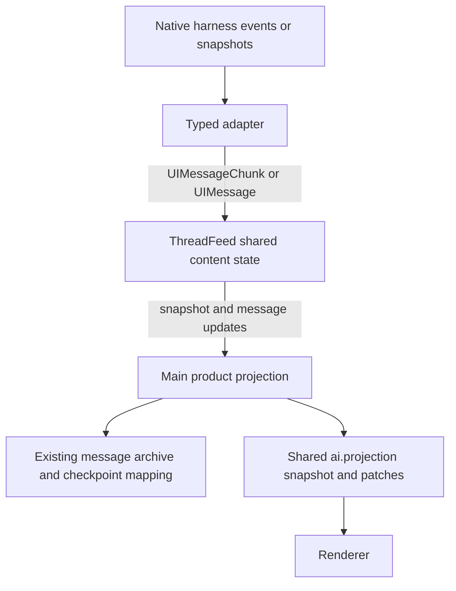

# Agent Note: Runtime 观察统一使用 AI SDK 内容协议

Status: proposed

[English](2026-10-29-agent-runtime-content-protocol.md) | 中文

## 问题

目前 Runtime 适配器先把原生内容转换为 `ContentItem`，Main 再将这些 item 转回 AI SDK chunk 和消息。`MessageItem`、`ToolCallItem`、`ToolResultItem` 重复定义了 Cherry 已经使用的内容模型。这还会丢失原生 block 顺序：Pi 分别收集文本和工具调用，Claude 则为每个 block 生成一个 item。子会话投影随后把这些来源 item 当成独立的显示消息。

由此暴露的问题有不同根因。重复显示助手标题源于来源与消息的粒度不一致；工具进度不显示源于 preliminary 输出处理和存档/实时数据的优先级；子任务仍运行却显示结束源于使用了父任务的活动状态。替换内容类型解决第一处转换边界，同时必须保留另外两类问题已经单独验证的修复。

本方案部分取代[公共 Runtime 契约](../architecture/2026-10-17-agent-runtime-contract.md)中的内容表达和 reader 位置、[harness 边界](../architecture/2026-10-17-agent-harness-boundaries.md)中排除 AI SDK 的约束，以及 [Claude 迁移](https://github.com/CherryHQ/cherry-studio/pull/22766)中的内容转换。原有执行、输入接纳、原生存储、子任务所有权和产品交付契约继续有效。已批准的迁移已在工作区实现；剩余验收证据和所属栈层完成之前，本文继续保留 proposed 状态。

## 方案

### 1. 复用 SDK 模型，保留观察契约

标准内容变化使用 `UIMessageChunk`，累积后的内容使用 `UIMessage`。Harness 中立意味着不依赖 Pi、Claude SDK、Electron 和 Cherry 产品实体，并不要求排除可复用的内容协议。显式依赖仓库固定的 `ai@6.0.185`，执行 SDK reader 的包需要声明运行时依赖。不要把 SDK 类型复制成另一套本地内容 union，也不要给这些包引入 React。

[SDK 流协议](https://ai-sdk.dev/docs/ai-sdk-ui/stream-protocol)和 [reader 文档](https://ai-sdk.dev/docs/ai-sdk-ui/reading-ui-message-streams)说明了这种模型的复用方式。其当前页面描述的是更新版本，因此实现兼容性必须核对已安装的 `6.0.185` 源码，尤其是 `ui-message-chunks.ts`、`ui-messages.ts` 和 `read-ui-message-stream.ts`。

现有观察契约中的内容部分拟调整为：

```typescript
import type { UIMessage, UIMessageChunk } from 'ai'

type RuntimeMessage = UIMessage<{
  completeness: Completeness
  inputId?: InputId
}>

type ContentObservation =
  | { type: 'message.upsert'; message: RuntimeMessage; replaces?: readonly ItemRef[] }
  | { type: 'message.remove'; ref: ItemRef }

// ThreadSnapshot.messages: readonly RuntimeMessage[]
// Adapter content input: UIMessageChunk or an authoritative RuntimeMessage.
```

`RuntimeMessage` 只是 SDK 泛型的具体化，不再重新定义文本、推理或工具。现有 `completeness` 事实表示原生消息是否完整，不表示执行成功。`inputId` 仍然表示有证据支持的、已放入上下文的用户输入，不是助手回复的唯一所有者。`InputState`、`Activity`、`Subagent`、覆盖范围、gap 和观察关闭状态继续放在内容 parts 之外。

第一轮迁移明确保留 `observe()` 的 snapshot/upsert 形式。具有原生 delta 的适配器向共享内容累积器输入 SDK chunk，订阅者接收 SDK 消息；不另加一个公开的原始 chunk 订阅。因此，“使用 SDK 协议”不等于“通过 Electron IPC 发送 SSE”，也不等于“每个观察者都运行一个 parser”。这项内容依赖不会恢复已删除的 AI SDK model-call port：模型执行继续经过原生 harness 及其网关绑定。

### 2. 在共享来源处累积一次内容

演进现有 `ThreadFeed` 来源，不再新建第二个流管理器。其内容辅助实现对每条流式原生助手消息使用 `readUIMessageStream`，随后才向观察者分发。Pi 和 Claude 适配器将原生 delta 映射为标准 chunk。Durable 可以直接从原生 watch 发布权威 SDK 消息值；快照生产者不必人为制造 token delta。



来源拥有 SDK reader 生命周期和标准化消息状态，但不拥有原生执行调度、输入接纳、重试或任务完成逻辑。Main 继续拥有产品消息身份、分组、展示元数据、持久化和共享发布服务。Renderer 消费投影后的消息，不再推断原生消息分组。

`ThreadMessageProjection` 删除 `ContentItem` 解析、工具结果关联、文本前缀差分和每个 item 的 SDK reader。仅保留调用者仍需要的职责；简单的订阅转接可以直接收回调用者。Pi root 和 Durable root 改为消费权威消息视图后，删除 `ThreadProjection` 的“累积 item 转 chunk”逻辑。`RootMessageProjection` 仍有真实职责：多条原生消息可以属于一条产品回复，原生内容替换后也必须保留这个归属。

### 3. 区分原生消息、part 和产品回复

一条观察到的 SDK 消息对应一条原生会话消息，不对应 token、content block、工具结果、整个 Thread 或任意一次 run。文本、推理和工具调用在 `parts` 中保留原始顺序。工具结果更新拥有该调用的助手消息中的工具 part。工具进度使用带 `preliminary: true` 的 `tool-output-available`，最终结果清除此条件。一个工具结束不代表整条助手回复结束。

| 身份 | 规则 |
| --- | --- |
| `Thread` | 拥有独立内容视图，包括父任务结束后继续运行的后台子任务。 |
| `UIMessage.id` | Thread 内标准化原生消息的稳定身份，不是 block 下标。 |
| SDK 文本/推理 part ID 和 `toolCallId` | 在有效的消息/线程范围内定位 part。保留原生调用身份或显式映射后的身份，不能从显示文本推导。 |
| `InputState.response` | 继续引用有证据支持的终态原生消息。多个输入可以共享它；其定位使用与内容相同的别名映射。 |
| 产品消息 ID | 由 Main 拥有，重连后保留。多条原生消息可以映射到同一条产品回复。 |
| 原生 entry/UUID/task 身份 | 恢复、撤回或计费需要时，继续保留在类型化的适配器来源映射和现有 checkpoint 中。 |

不能一并删除 `ItemId` 和 `ItemRef`：behavior 历史、fork 锚点和回复关联仍在使用来源身份。应删除自定义内容分支及其导出，不删除无关的身份契约。SDK 内容也不替代 `agent-behavior` 的执行/历史事实或原生模型上下文。

Main 必须对 root 和 child 使用相同的回复归属规则。已经放入上下文的可见用户输入建立会话边界，刚收到但仍排队的输入不会建立边界。工具步骤留在已确定的回复中。Steer 放入上下文后可以按现有输入边界行为拆分可见回复；follow-up 创建后续回复。快照刷新、压缩和重连必须保留已记录的归属。不能只因为 role 相同就合并所有相邻助手行：隐藏输入、重试和分别完成的回复都需要有证据的边界。无法恢复历史归属时，保留原有的独立消息并明确恢复限制，不虚构合并关系。

将 `buildAgentChildFlowProjection` 临时放在 Renderer 的分组逻辑迁入 Main 的统一组合流程，然后删除 Renderer 对来源 item 的重新分组。Renderer 仍然负责布局，但实时、重新打开和另一个窗口看到的回复边界必须一致。

### 4. 映射已接入的 harness，不重建它们的调度器

| 适配器 | 原生证据与拟采用的映射 | 恢复及限制 |
| --- | --- | --- |
| Pi | `runtimeProjection.ts` 接收原生消息 start/update/end 和 `input_placed` / `input_settled`。保留一条消息中 block 的顺序；将工具结果关联到调用，真正的 delta 使用 SDK chunk。模型消息结束不代表智能体工具循环结束。 | 保留原生 entry 到 live 的别名和 child-origin 过滤。重新绑定/压缩可能使 live 身份失效；不能证明等价时明确发出 mapping reset。 |
| Pi Durable | `projection.ts` 读取 `ConversationView`、`pi.live`、generation attempt、tool slot 和已提交 entry。直接生成 SDK 消息快照；即使调用已经提交，也继续展示 preliminary 工具输出。 | 用 task/entry 证据替换预览。重复 watch 快照保持幂等。重试或有歧义的 preview-to-entry 关联不能通过文本匹配复用身份。原生 run 元数据继续用于 behavior 和结果/用量归属。 |
| Claude Code | `projection.ts` 接收 `message_start`、带下标的 content block、assistant/user UUID、result 和显式撤回。将 block 保留在同一条 SDK 消息中；把原生 tool-result block 映射回拥有调用的消息。 | 保留 live-to-committed 别名、UUID 撤回、部分输出中止事实、command/input 关联，以及网关计费使用的原生回复 ID。原生 API 消息 ID 不等于产品回复 ID。 |

通过 SDK part 和类型化元数据保留文件、图片、引用、推理元数据、结构化结果、工具输出详情和错误内容。可移植的 native-to-SDK 映射属于适配器。Cherry 特有的 MCP 展示名称、任务卡片、业务错误展示和网关记账留在 Main。`ClaudeMessageMetadata` 不应再重建公共模型丢弃的内容，应收敛到真实的产品装饰和控制职责。观察范围之外缺失的工具调用不意味着可以虚构调用：支持时从原生历史恢复，否则保留已有证据并报告 gap。

实现范围是这三个已经接入的适配器。更广的 harness 对比仍由[证据文档](../testing/2026-10-17-agent-harness-evidence.md)维护；本方案不新增通用 run、spawn 或 stop 接口，也不以 Pi 或 Claude 测试声称 Codex/ACP/DSH 已验收。

### 5. 保留顺序与恢复语义，不广播原始 token 流

来源状态变化、SDK reader 结果、原生快照替换和终态事实都必须经过同一个串行发布边界。发布的快照覆盖订阅交接屏障之前的全部来源变化，后续消息在其后交付。输入终态事实不能越过对应内容更新。停止一个订阅只解除该订阅者，不取消执行或其他观察者的 reader。

替换来源时，先隔离旧 reader 的回调，再接受新值。已安装 SDK 的 `UIMessage` seed 不会恢复活动文本 ID 或部分工具参数缓冲区。因此，重新打开或替换部分原生消息后，必须根据原生证据重建合法的 start/delta 序列，或者继续发布权威 SDK 消息值。不能向刚 seed 的 reader 直接发送剩余 delta。重建时可以保留上次发布的视图，直到替换完成；不能发布一条瞬时空消息。

观察者溢出沿用有界的 `gap` 后接 snapshot 机制，发生在内容累积之后。窗口重连订阅 Main 已保留的视图，不创建新的原生订阅或 reader。进程重启使用原生存储和已持久化的产品映射，显示消息不是原生执行 checkpoint。必须区分显式来源删除与压缩/current-view 快照中的缺席；后者不能删除保留的产品历史。

保留当前 `ai.projection` snapshot/patch 传输、revision 检查、批处理和独立 child target。Main 将 SDK 消息值差分为已有窗口更新。SDK 快照复制存在成本，但目前没有测量证明它是主要瓶颈；替换 parser 或传输前先测量。Root 结束不能 flush、关闭或完成仍在运行的 child 来源。

### 6. 切换内容与存储时保留已有历史

原生存储继续作为原生恢复的权威来源。`agent_session_message` 继续存储 Cherry 消息内容，现有 context checkpoint 保留原生到产品的关联。本迁移不新增 input ledger、subagent 关系表或第二套 transcript 存储。

修改 writer 前，使用有代表性的原生 transcript 和已有数据的产品存档分别重放新旧路径。比较可见内容及顺序、调用与结果、富内容 part、输入结果、来源撤回和回复归属。比较规范化结果，不比较原始事件数或偶然生成的临时 ID。单独记录预期差异：合并助手展示和恢复进行中的输出是预期改进；丢失文本或改变失败状态不是。

现有 checkpoint 包含 block/item 身份，root 消息还包含 part offset，不能直接解释成整条消息的身份。按现有含义读取，仅转换有原生 entry/UUID/block 证据支持的关联，并为新的 checkpoint payload 标明版本。保留已有产品行 ID、分支边、submission 链接和存档内容。旧的拆分行可以在 Main 视图中组合，不破坏性合并数据库行；物理行合并迁移不在本次范围内。原生历史不可用时，已有存档仍可读取，不改写不确定的关联。Checkpoint 和变更消息继续通过 `DbService.withWriteTx` 原子写入。

每条原生线程只切换一个内容生产者。差分重放测试可以同时运行两个转换器，生产环境不能同时发布旧 item 和新 SDK 消息。Root 和 child 重新订阅后应得到相同的 Main 视图和持久化内容。所属消费者完成迁移后，再删除过时转换器和 Renderer 临时分组。采用 SDK 内容模型本身不需要重写原生存储或修改依赖补丁。

### 7. 放回各自所属的栈层

已于 2026-10-29 核对远程 PR 的 base 和 head。下表中的各层均未合并；当前检出的桌面端 head 为 `63eb7c3777dc`。整个栈以 `main` 为根，#21910 下方是重放修复 #22413 和 Pi 依赖升级 #21743。真正改写栈前需重新核对远程 head。

| 栈层 | 本层负责的修改 | 验证责任 |
| --- | --- | --- |
| [#21910](https://github.com/CherryHQ/cherry-studio/pull/21910)，`feature/agent-runtime-harness-adapters` | 内容契约决策、显式 SDK 依赖、`ThreadFeed` 累积、Pi/Durable 包映射、导出和包 README。这是最先调整的实现层。实现前按 Spec-first 流程发布 proposed Spec，不把决策藏在桌面端 PR。 | 包 build/typecheck；公共观察和原生适配器契约测试。 |
| [#22010](https://github.com/CherryHQ/cherry-studio/pull/22010)，`feature/agent-runtime-input-correlation` | 将 `InputState.response` 和别名处理关联到消息身份，不改变输入接纳或成功语义。 | 共享回复、steer/follow-up、终态与内容顺序、重启关联测试。 |
| [#22107](https://github.com/CherryHQ/cherry-studio/pull/22107)，`feature/agent-runtime-pi-root` | Pi 桌面端消费 SDK 消息视图，退役旧 `ThreadProjection` 内容转换。 | Pi root 流式、工具、错误和输入边界消费者。 |
| [#22689](https://github.com/CherryHQ/cherry-studio/pull/22689)，`feature/agent-runtime-child-projection` | 简化 `ThreadMessageProjection`；接入 Main 的 child 回复组合、存档/checkpoint 兼容和独立进度。已完成的 Pi child 渲染修复按文件所有权放在本层。 | Child 投影、已有数据的存档、父子生命周期和 Renderer 消费者。 |
| [#22698](https://github.com/CherryHQ/cherry-studio/pull/22698)，`feature/agent-runtime-shared-projection` | 新消息值复用共享交付路径。保留现有 IPC/revision 语义，只有真实消费者不匹配时才修改生产代码。 | 重连、重复/缺失 revision、慢订阅者和多个窗口。 |
| [#22755](https://github.com/CherryHQ/cherry-studio/pull/22755)，`feature/agent-runtime-durable-behavior` | Durable 桌面端 root/child 接线和本地 preliminary 输出修复。保留原生 run 元数据和共享 behavior。 | Watch 快照、工具、后台续接、原生重启和真实模型桌面行为。 |
| [#22809](https://github.com/CherryHQ/cherry-studio/pull/22809)，`feature/agent-runtime-claude-code` | Claude 包内容映射、archive 来源、撤回和有序原生元数据。 | Partial/live/archive 等价、中止、富内容和输入/回复关联。 |
| [#22856](https://github.com/CherryHQ/cherry-studio/pull/22856)，`feature/agent-runtime-claude-code-desktop` | 收敛 `ClaudeMessageMetadata`，适配产品回复归属，删除剩余 ContentItem 消费者。对齐由 [#22766](https://github.com/CherryHQ/cherry-studio/pull/22766) 拥有的迁移文档。 | Transcript 重放、root/child 桌面消费者和网关回复/计费归属。 |

依赖升级、网关执行、behavior 调度和消息树 schema 层不需要顺带重设计。下层契约变化时，对中间消费者做必要的机械迁移。每个生成后的 PR 都必须能基于各自验证过的父层构建，不能依赖栈顶修好无效的中间层。使用 `gh-stack` 重排，并为每个改写层重新运行显式变更范围和受影响检查。当前实现尚未提交，位于桌面栈顶；尚未改写分支或远程 PR，发布前需要按上述所有权拆入各层。

### 8. 验证顺序

先验证包层：真实 SDK reader、确定性的原生适配器、重复快照、观察者溢出和 live-to-archive 身份变化。随后使用明确的测试文件过滤，运行现有 Main 投影及受影响 Renderer 测试。Checkpoint 兼容和原子写入使用已有数据的 SQLite fixture。脱敏重放样本覆盖文本/推理交错、多个工具、工具错误/拒绝、图片/文件/引用、中止、撤回、压缩和 steer 边界。

最后在隔离 Electron 实例中使用真实模型验收 Pi、Pi Durable 和 Claude：前台 child、父任务先结束、两个并行 child、用户续接 child、preliminary Bash 输出、部分文本、child 失败、关闭/重新打开窗口，以及工作未完成时的原生重启。确认 child 在实时和恢复视图中具有一致的产品回复组合、独立状态，且没有重复写入父消息的内容。针对一个和十个 child，测量 IPC 字节数、消息写入和发布频率，并与当前路径比较；不能预设线性成本或瓶颈。此前的 child 流式验收属于本地 bug 修复证据；需要针对本次协议迁移重新执行，才能计入验收。

### 实现证据（2026-10-29）

- 已实现公共 SDK 累积器、三个适配器的内容映射、root 消息来源、Main child 回复组合和第二版来源 checkpoint。旧 Pi item-to-chunk 适配器及 Renderer 重新分组已删除。原生持久化和共享 projection IPC 保持原有契约。
- 针对内容迁移的包、Main/SQLite、Renderer 和投影交付测试通过；21 个可移植 fixture 和 83 个本机 transcript 重放案例通过，本机内容未提交。原生 Claude 桌面集成还验证了回复归属和计费。Node/web 及四个 Runtime 包的类型检查通过。
- 首轮 Durable 真实模型检查发现驱动漏声明 `messageSource: 'projection'`：模型已有输出，但宿主选用了旧 chunk 消费者，丢弃了消息投影。Pi 和 Durable 现在均在连接前声明内容来源，注册回归覆盖三种 Runtime。Renderer 现有的空成功消息兜底生成了误导性的“无响应”错误，这是独立的 `main` 问题。
- 真实模型检查还发现了起始输入边界遗漏：Pi 现从原生 custom-message 条目保留 behavior 子任务输入；Claude 的实时 SDK feed 不转发起始 prompt，因此首次接入时读取一次原生 child 存档，后续仍由观察事件驱动。
- Pi 后台活动不再保持父回复流打开。Pi 和 Durable 的本地 `/goal` 回答使用宿主消息投影，在移除旧内容 chunk 消费者后仍保留命令回复。修复前复现了三项回归；修复后，相关桌面与 root 投影的 39 项测试通过。
- 通过网关调用真实 DeepSeek 模型，Pi、Durable 和 Claude 均通过后台子任务场景：父任务先结束，child 输出保持独立，组合后的一条 assistant 回复在窗口刷新后保留相同 ID 和内容。Pi 与 Durable 还呈现了部分文本和 preliminary Bash 输出；当前安装的 Claude SDK 转发完整 child 内容块，本轮未观察到 child 逐 token 增量或 preliminary Bash 输出。
- 更完整的 Electron 场景矩阵和栈发布仍待完成。不能从上述检查推导崩溃恢复、跨平台验收或性能提升；一个与十个 child 的对比测量仍待完成。

## 考虑过的替代方案

- 为避免所有 SDK 依赖而保留 `ContentItem`：不采用，因为它重复定义了可用的通用内容模型，并引入有损转换。显式依赖 SDK 协议与 harness 中立并不冲突。
- 仅修改 Renderer 分组：适合作为局部修复，但来源粒度、重复转换和恢复所有权在不同消费者之间仍不一致。
- 向每个观察者和 Renderer 交付原始 chunk：本次不采用，因为会重复累积并使 snapshot/replay 交接更复杂。只有测量证明消费者需要时，再加入具有明确恢复契约的传输。
- 将整个 Thread 作为一条 SDK 消息：不采用，因为 follow-up、steer 边界、原生撤回和保留历史都需要多条消息。
- 用 SDK 消息取代原生存储，或删除别名/checkpoint：不采用，因为显示内容不保留原生执行状态、来源撤回或计费关联。

## 验收标准

- AC1 — 公共内容使用 SDK 消息/part 类型；`ContentPart`、`MessageItem`、`ToolCallItem`、`ToolResultItem` 和 `ContentItem` 不再服务于 Runtime 内容消费者，同时原生 SDK/Electron/Cherry 依赖不进入公共包。(verification: unit — 包构建、类型检查和依赖/来源消费者检查)
- AC2 — 文本、推理和工具在消息内保留原生顺序；delta 更新该消息而非创建新行，preliminary 输出在工具给出最终结果前持续可见。(verification: unit — SDK reader 及 Pi/Durable/Claude 适配器 fixture)
- AC3 — Snapshot-first 有序观察、溢出恢复、替换/删除和旧 reader 隔离收敛到正确视图，不为每个订阅者创建 parser，也不允许旧更新覆盖替换结果。(verification: unit — 公共观察及恢复测试)
- AC4 — Root 和 child 在实时输出、steer/follow-up、重新打开和多窗口场景中共享有证据的产品回复边界；排队输入不会把已有输出转移到另一条回复。(verification: renderer — Main 生成的 root/child 视图 fixture 与消息消费者)
- AC5 — 多个输入可以共享有证据的回复；失败、中止和未回答结果保持区别，终态事实不早于对应回复内容的持久化。(verification: unit — 输入关联和桌面持久化测试)
- AC6 — 已有存档在 checkpoint 转换前后保留内容、产品 ID、分支边和 submission 关系；缺少原生证据时仍可读取历史，不虚构映射或破坏性合并行。(verification: unit — 使用生产迁移的 SQLite fixture 和原生 transcript 重放)
- AC7 — 父任务结束、窗口解除订阅、另一个观察者失败或另一个 child 失败，都不会停止或完成仍在运行的 child 输出。(verification: Electron — 隔离实例中的真实模型父子场景矩阵)
- AC8 — Claude 切换后保留富内容、工具身份、签名、原生撤回和网关回复/计费关联；错误仍保留部分内容。(verification: unit — 脱敏 transcript 重放和网关归属消费者)
- AC9 — 每条原生线程只有一个生产内容 writer；所属消费者迁移后删除 item-to-chunk 转换和 Renderer 来源 item 分组，共享 IPC/revision 恢复继续正常工作。(verification: unit — 消费者清单和共享投影测试)
- AC10 — 每个改写 PR 都有核实过的 base 和限定范围检查，最终报告区分包测试、重放、Electron 验收、重启证据和实测成本。(verification: docs gate — 栈范围和验收证据审阅)

## 风险

将共享 SDK 累积器移到 Main 下方会改变资源所有权，SDK 升级也会成为 Runtime 协议兼容边界的一部分。缓慢或失败的解码不能无限阻塞原生执行，也不能留下被误判为成功的内容。现有 SDK 消息不会序列化活动 reader 的内部状态，因此部分输出的重启需要原生证据，不能盲目 seed。

改变粒度时，即使文本看起来正确，也可能破坏已保存的来源映射或计费关联。这些关系必须独立于视觉等价单独验证。未知的历史回复边界仍是明确限制；本方案不授权基于文本去重、删除数据库数据或虚构原生生命周期事实。大范围栈改写也会使先前的 review 证据失效，因此各层验证必须跟随真正改写后的范围。
