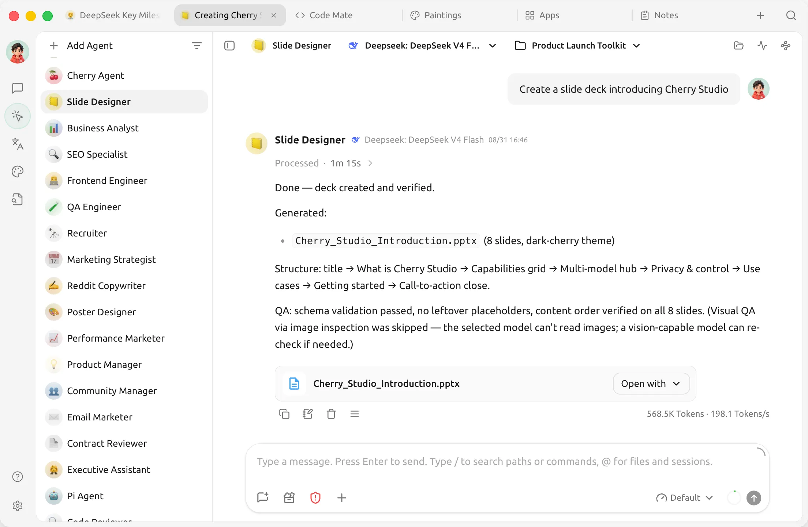
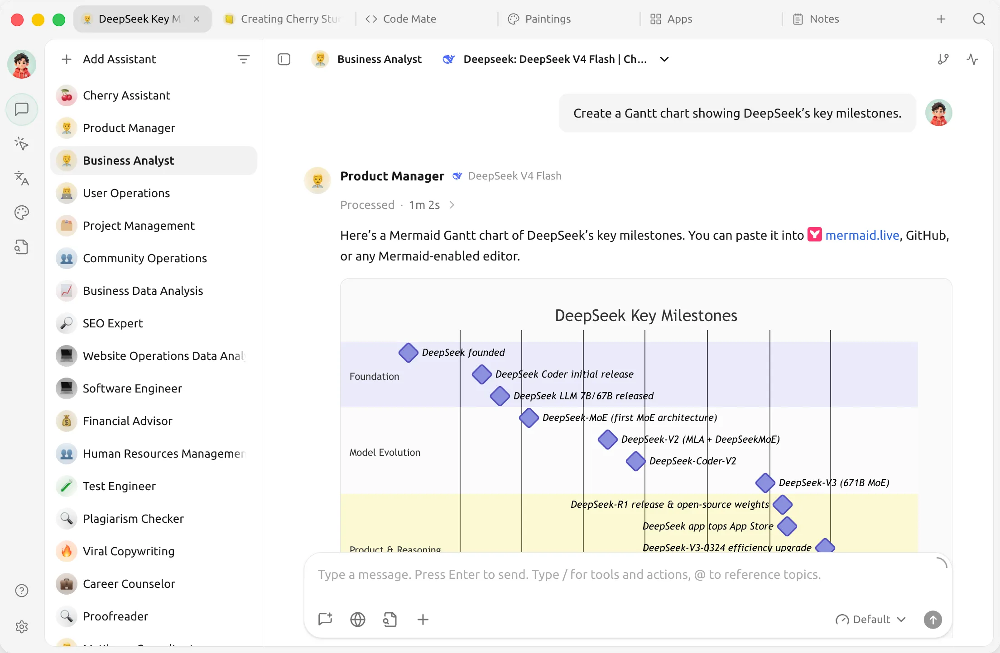
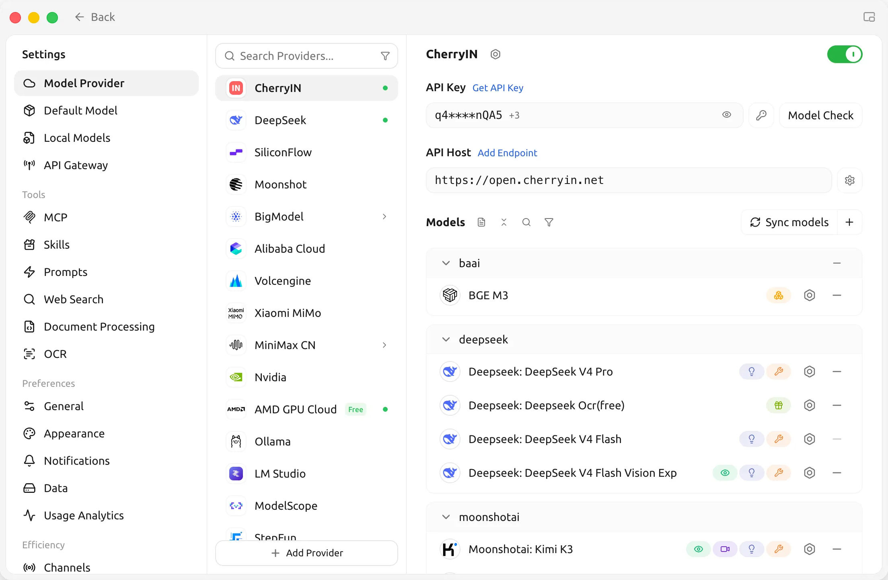
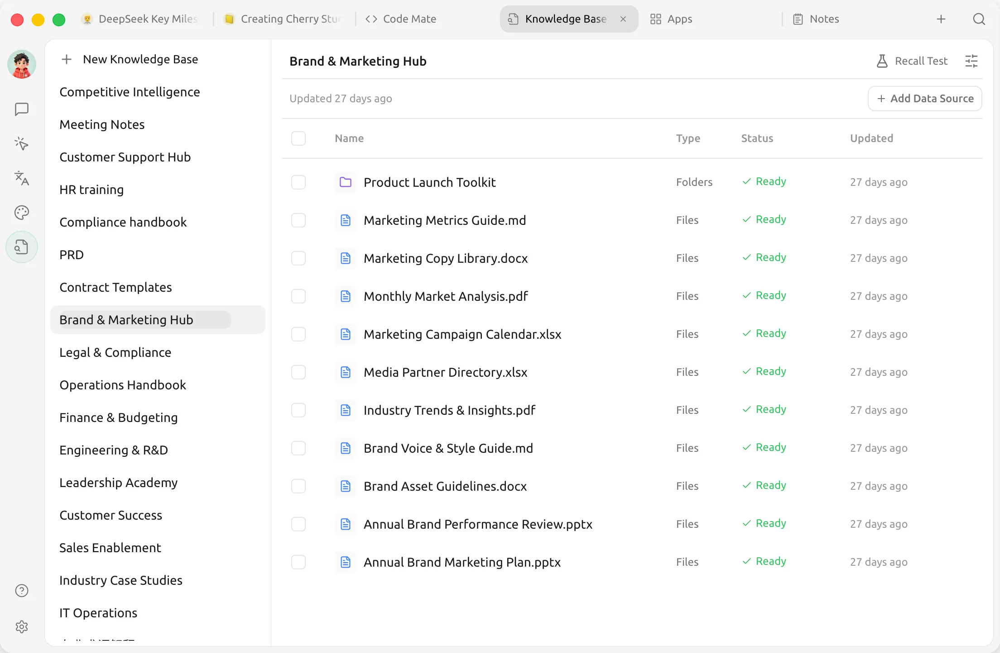
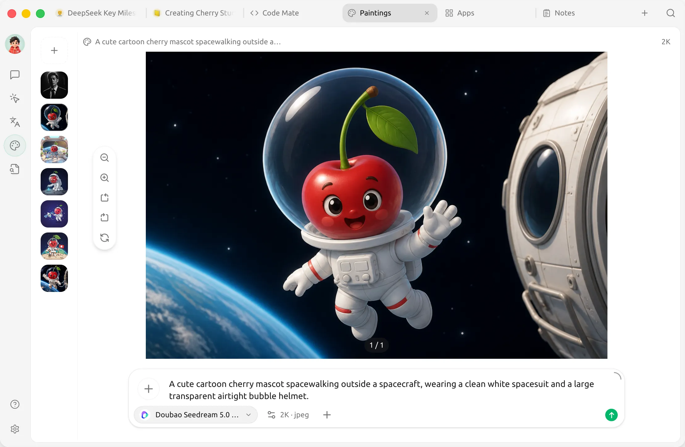

<h1 align="center">
  <a href="https://github.com/CherryHQ/cherry-studio/releases">
     
  </a>
</h1>

English | <a href="https://cherryai.com">Official Site</a> | <a href="https://cherryai.com/docs/en/">Documentation</a> | <a href="./docs/contrib/development.md">Development</a> | <a href="https://github.com/CherryHQ/cherry-studio/issues">Feedback</a> 

[![][deepwiki-shield]][deepwiki-link]
[![][twitter-shield]][twitter-link]
[![][discord-shield]][discord-link]
[![][telegram-shield]][telegram-link]

[![][github-release-shield]][github-release-link]
[![][github-nightly-shield]][github-nightly-link]
[![][github-contributors-shield]][github-contributors-link]
[![][license-shield]][license-link]
[![][commercial-shield]][commercial-link]
[![][sponsor-shield]][sponsor-link]

 
 
 

# 🍒 Cherry Studio

Cherry Studio is an AI workstation for Windows, macOS, and Linux. Chat with multiple models, work with agents, build knowledge bases, create images, and automate everyday tasks in one place.

**[Download Desktop](https://cherryai.com/download)** · **[Getting Started](https://cherryai.com/docs/en/getting-started/quick-start/)**

📱 **Cherry Studio Mobile is now available for iOS and Android!** [Download](https://cherryai.com/mobile) · [GitHub repository](https://github.com/CherryHQ/cherry-studio-app).

👏 Join [Telegram Group](https://t.me/CherryStudioAI)｜[Discord](https://discord.gg/wez8HtpxqQ) | [QQ Group(575014769)](https://qm.qq.com/q/lo0D4qVZKi)

❤️ Like Cherry Studio? Give it a star 🌟 or [Sponsor](docs/sponsor.md) to support the development!

# 🌠 Screenshots

**Agents — work with files, tools, and multi-step tasks.**

**Conversations — explore ideas with your models and assistants.**

**Model providers — configure services, API keys, and models in one place.**

**Knowledge bases — organize sources for retrieval and agent workflows.**

**Image creation — turn prompts into images and refine your work.**

# 🌟 Key Features

## Agents & Automation

- 🤖 Create agents with their own instructions, workspaces, models, and tool permissions.
- 🛠️ Work with files, run commands, and use browser and computer automation tools.
- 🔌 Extend capabilities with Skills and MCP (Model Context Protocol) servers.
- ⏰ Run scheduled tasks and connect agents to messaging platforms through Channels.

## Models & Conversations

- ☁️ Connect OpenAI, Anthropic, Gemini, and other cloud providers, or add custom compatible services.
- 💻 Use local models through Ollama and LM Studio.
- 💬 Customize assistants and compare responses from multiple models in one conversation.
- 📝 Read and share rich responses with Markdown, code highlighting, formulas, Mermaid charts, and conversation exports.

## Knowledge & Documents

- 📚 Build local knowledge bases from files, folders, and web pages, then use them in conversations and agents.
- 📄 Process PDF, Office documents, images, and text, with OCR and document processing options.
- ✍️ Organize ideas in Markdown notes and manage attachments and generated files in the file library.

## Creative & Everyday Tools

- 🎨 Generate and edit images with supported image models.
- 🔤 Translate text and documents, and use quick translation from other apps.
- 🔍 Search the web, read pages, and find content across your conversations and knowledge bases.
- 🧩 Open web-based tools through Mini Apps, or use the API Gateway to connect other applications to your configured models.

## Voice & Workspace

- 🎙️ Dictate messages and listen to responses with speech recognition and text-to-speech options, including local models.
- 🪟 Work across tabs and detached windows, with window pinning, Quick Assistant, and text selection tools.
- 🌈 Customize your workspace with light and dark themes, layouts, and custom CSS.
- 💾 Keep conversation history and knowledge bases on your device, with local and WebDAV backup options.

Model and tool availability depends on your provider, operating system, and configuration. Some features require API credentials, downloaded models, additional dependencies, or system permissions. See the [user documentation](https://cherryai.com/docs/en/) for setup.

# 📝 Roadmap

Follow upcoming work on our [project board](https://github.com/orgs/CherryHQ/projects/7) and [GitHub Issues](https://github.com/CherryHQ/cherry-studio/issues). See [Releases](https://github.com/CherryHQ/cherry-studio/releases) for features and fixes already shipped.

Share ideas and discuss priorities in [GitHub Discussions](https://github.com/CherryHQ/cherry-studio/discussions).

# 🌈 Theme

- Theme Gallery: <https://cherrycss.com>
- Aero Theme: <https://github.com/hakadao/CherryStudio-Aero>
- PaperMaterial Theme: <https://github.com/rainoffallingstar/CherryStudio-PaperMaterial>
- Claude dynamic-style: <https://github.com/bjl101501/CherryStudio-Claudestyle-dynamic>
- Maple Neon Theme: <https://github.com/Cle2ment/maple_neon>

Check each community theme's supported Cherry Studio version before installing. Themes written for v1 need adaptation for the v2 interface.

Contributions of compatible themes are welcome.

# 🤝 Contributing

Contributions of code, bug reports, documentation, translations, product ideas, and community support are welcome. Browse [good first issues](https://github.com/CherryHQ/cherry-studio/labels/good%20first%20issue) to find a place to start.

## Getting Started

1. Read the [Contributing Guide](CONTRIBUTING.md) and [Development Guide](docs/contrib/development.md).
2. Fork the repository and create a focused branch from `main`.
3. Validate your changes, sign and sign off your commits, and open a pull request targeting `main` using the repository template.

See the [Branching Strategy](docs/contrib/branching-strategy.md) for branch and release conventions.

# 🏢 Enterprise Edition

Cherry Studio Enterprise Edition brings centralized model management, shared knowledge bases, employee access controls, and private deployment options to teams and organizations.

Visit the [Enterprise website](https://enterprise.cherryai.com) for current capabilities and deployment information. For purchasing, pricing, or a demo, contact [bd@cherry-ai.com](mailto:bd@cherry-ai.com).

# 🔗 Related Projects

- [Cherry Studio Mobile](https://github.com/CherryHQ/cherry-studio-app): The mobile version of Cherry Studio for iOS and Android.

- [Cherry Studio Website](https://github.com/CherryHQ/cherry-studio-website): The official website and user documentation.

- [new-api](https://github.com/QuantumNous/new-api): The next-generation LLM gateway and AI asset management system supports multiple languages.

- [one-api](https://github.com/songquanpeng/one-api): LLM API management and distribution system supporting mainstream models like OpenAI, Azure, and Anthropic. Features a unified API interface, suitable for key management and secondary distribution.

- [Poe](https://poe.com/): A platform for exploring AI models and community-created bots.

- [ublacklist](https://github.com/iorate/ublacklist): Blocks specific sites from appearing in Google search results

# 🚀 Contributors

  

# 📊 GitHub Stats

# ⭐️ Star History

<a href="https://star-history.dera.page/#CherryHQ/cherry-studio&Date">
 <picture>
   <source media="(prefers-color-scheme: dark)" srcset="https://star-history.dera.page/svg?repos=CherryHQ/cherry-studio&type=Date&theme=dark" />
   <source media="(prefers-color-scheme: light)" srcset="https://star-history.dera.page/svg?repos=CherryHQ/cherry-studio&type=Date" />
   
 </picture>
</a>

# 📜 License

The Cherry Studio Community Edition is governed by the standard GNU Affero General Public License v3.0 (AGPL-3.0), available at https://www.gnu.org/licenses/agpl-3.0.html.

Use of the Cherry Studio Community Edition for commercial purposes is permitted, subject to full compliance with the terms and conditions of the AGPL-3.0 license.

Should you require a commercial license that provides an exemption from the AGPL-3.0 requirements, please contact us at bd@cherry-ai.com.

<!-- Links & Images -->

[deepwiki-shield]: https://img.shields.io/badge/Deepwiki-CherryHQ-0088CC?logo=data:image/svg+xml;base64,PHN2ZyB4bWxucz0iaHR0cDovL3d3dy53My5vcmcvMjAwMC9zdmciIHZpZXdCb3g9IjAgMCAyNy45MyAzMiI+PHBhdGggZD0iTTE5LjMzIDE0LjEyYy42Ny0uMzkgMS41LS4zOSAyLjE4IDBsMS43NCAxYy4wNi4wMy4xMS4wNi4xOC4wN2guMDRjLjA2LjAzLjEyLjAzLjE4LjAzaC4wMmMuMDYgMCAuMTEgMCAuMTctLjAyaC4wM2MuMDYtLjAyLjEyLS4wNS4xNy0uMDhoLjAybDMuNDgtMi4wMWMuMjUtLjE0LjQtLjQxLjQtLjdWOC40YS44MS44MSAwIDAgMC0uNC0uN2wtMy40OC0yLjAxYS44My44MyAwIDAgMC0uODEgMEwxOS43NyA3LjdoLS4wMWwtLjE1LjEyLS4wMi4wMnMtLjA3LjA5LS4xLjE0VjhhLjQuNCAwIDAgMC0uMDguMTd2LjA0Yy0uMDMuMDYtLjAzLjEyLS4wMy4xOXYyLjAxYzAgLjc4LS40MSAxLjQ5LTEuMDkgMS44OC0uNjcuMzktMS41LjM5LTIuMTggMGwtMS43NC0xYS42LjYgMCAwIDAtLjIxLS4wOGMtLjA2LS4wMS0uMTItLjAyLS4xOC0uMDJoLS4wM2MtLjA2IDAtLjExLjAxLS4xNy4wMmgtLjAzYy0uMDYuMDItLjEyLjA0LS4xNy4wN2gtLjAybC0zLjQ3IDIuMDFjLS4yNS4xNC0uNC40MS0uNC43VjE4YzAgLjI5LjE1LjU1LjQuN2wzLjQ4IDIuMDFoLjAyYy4wNi4wNC4xMS4wNi4xNy4wOGguMDNjLjA1LjAyLjExLjAzLjE3LjAzaC4wMmMuMDYgMCAuMTIgMCAuMTgtLjAyaC4wNGMuMDYtLjAzLjEyLS4wNS4xOC0uMDhsMS43NC0xYy42Ny0uMzkgMS41LS4zOSAyLjE3IDBzMS4wOSAxLjExIDEuMDkgMS44OHYyLjAxYzAgLjA3IDAgLjEzLjAyLjE5di4wNGMuMDMuMDYuMDUuMTIuMDguMTd2LjAycy4wOC4wOS4xMi4xM2wuMDIuMDJzLjA5LjA4LjE1LjExYzAgMCAuMDEgMCAuMDEuMDFsMy40OCAyLjAxYy4yNS4xNC41Ni4xNC44MSAwbDMuNDgtMi4wMWMuMjUtLjE0LjQtLjQxLjQtLjd2LTQuMDFhLjgxLjgxIDAgMCAwLS40LS43bC0zLjQ4LTIuMDFoLS4wMmMtLjA1LS4wNC0uMTEtLjA2LS4xNy0uMDhoLS4wM2EuNS41IDAgMCAwLS4xNy0uMDNoLS4wM2MtLjA2IDAtLjEyIDAtLjE4LjAyLS4wNy4wMi0uMTUuMDUtLjIxLjA4bC0xLjc0IDFjLS42Ny4zOS0xLjUuMzktMi4xNyAwYTIuMTkgMi4xOSAwIDAgMS0xLjA5LTEuODhjMC0uNzguNDItMS40OSAxLjA5LTEuODhaIiBzdHlsZT0iZmlsbDojNWRiZjlkIi8+PHBhdGggZD0ibS40IDEzLjExIDMuNDcgMi4wMWMuMjUuMTQuNTYuMTQuOCAwbDMuNDctMi4wMWguMDFsLjE1LS4xMi4wMi0uMDJzLjA3LS4wOS4xLS4xNGwuMDItLjAyYy4wMy0uMDUuMDUtLjExLjA3LS4xN3YtLjA0Yy4wMy0uMDYuMDMtLjEyLjAzLS4xOVYxMC40YzAtLjc4LjQyLTEuNDkgMS4wOS0xLjg4czEuNS0uMzkgMi4xOCAwbDEuNzQgMWMuMDcuMDQuMTQuMDcuMjEuMDguMDYuMDEuMTIuMDIuMTguMDJoLjAzYy4wNiAwIC4xMS0uMDEuMTctLjAyaC4wM2MuMDYtLjAyLjEyLS4wNC4xNy0uMDdoLjAybDMuNDctMi4wMmMuMjUtLjE0LjQtLjQxLjQtLjd2LTRhLjgxLjgxIDAgMCAwLS40LS43bC0zLjQ2LTJhLjgzLjgzIDAgMCAwLS44MSAwbC0zLjQ4IDIuMDFoLS4wMWwtLjE1LjEyLS4wMi4wMi0uMS4xMy0uMDIuMDJjLS4wMy4wNS0uMDUuMTEtLjA3LjE3di4wNGMtLjAzLjA2LS4wMy4xMi0uMDMuMTl2Mi4wMWMwIC43OC0uNDIgMS40OS0xLjA5IDEuODhzLTEuNS4zOS0yLjE4IDBsLTEuNzQtMWEuNi42IDAgMCAwLS4yMS0uMDhjLS4wNi0uMDEtLjEyLS4wMi0uMTgtLjAyaC0uMDNjLS4wNiAwLS4xMS4wMS0uMTcuMDJoLS4wM2MtLjA2LjAyLS4xMi4wNS0uMTcuMDhoLS4wMkwuNCA3LjcxYy0uMjUuMTQtLjQuNDEtLjQuNjl2NC4wMWMwIC4yOS4xNS41Ni40LjciIHN0eWxlPSJmaWxsOiM0NDY4YzQiLz48cGF0aCBkPSJtMTcuODQgMjQuNDgtMy40OC0yLjAxaC0uMDJjLS4wNS0uMDQtLjExLS4wNi0uMTctLjA4aC0uMDNhLjUuNSAwIDAgMC0uMTctLjAzaC0uMDNjLS4wNiAwLS4xMiAwLS4xOC4wMmgtLjA0Yy0uMDYuMDMtLjEyLjA1LS4xOC4wOGwtMS43NCAxYy0uNjcuMzktMS41LjM5LTIuMTggMGEyLjE5IDIuMTkgMCAwIDEtMS4wOS0xLjg4di0yLjAxYzAtLjA2IDAtLjEzLS4wMi0uMTl2LS4wNGMtLjAzLS4wNi0uMDUtLjExLS4wOC0uMTdsLS4wMi0uMDJzLS4wNi0uMDktLjEtLjEzTDguMjkgMTlzLS4wOS0uMDgtLjE1LS4xMWgtLjAxbC0zLjQ3LTIuMDJhLjgzLjgzIDAgMCAwLS44MSAwTC4zNyAxOC44OGEuODcuODcgMCAwIDAtLjM3LjcxdjQuMDFjMCAuMjkuMTUuNTUuNC43bDMuNDcgMi4wMWguMDJjLjA1LjA0LjExLjA2LjE3LjA4aC4wM2MuMDUuMDIuMTEuMDMuMTYuMDNoLjAzYy4wNiAwIC4xMiAwIC4xOC0uMDJoLjA0Yy4wNi0uMDMuMTItLjA1LjE4LS4wOGwxLjc0LTFjLjY3LS4zOSAxLjUtLjM5IDIuMTcgMHMxLjA5IDEuMTEgMS4wOSAxLjg4djIuMDFjMCAuMDcgMCAuMTMuMDIuMTl2LjA0Yy4wMy4wNi4wNS4xMS4wOC4xN2wuMDIuMDJzLjA2LjA5LjEuMTRsLjAyLjAycy4wOS4wOC4xNS4xMWguMDFsMy40OCAyLjAyYy4yNS4xNC41Ni4xNC44MSAwbDMuNDgtMi4wMWMuMjUtLjE0LjQtLjQxLjQtLjdWMjUuMmEuODEuODEgMCAwIDAtLjQtLjdaIiBzdHlsZT0iZmlsbDojNDI5M2Q5Ii8+PC9zdmc+
[deepwiki-link]: https://deepwiki.com/CherryHQ/cherry-studio
[twitter-shield]: https://img.shields.io/badge/Twitter-CherryStudioApp-0088CC?logo=x
[twitter-link]: https://twitter.com/CherryStudioHQ
[discord-shield]: https://img.shields.io/badge/Discord-@CherryStudio-0088CC?logo=discord
[discord-link]: https://discord.gg/wez8HtpxqQ
[telegram-shield]: https://img.shields.io/badge/Telegram-@CherryStudioAI-0088CC?logo=telegram
[telegram-link]: https://t.me/CherryStudioAI

<!-- Links & Images -->

[github-release-shield]: https://img.shields.io/github/v/release/CherryHQ/cherry-studio?logo=github
[github-release-link]: https://github.com/CherryHQ/cherry-studio/releases
[github-nightly-shield]: https://img.shields.io/github/actions/workflow/status/CherryHQ/cherry-studio/nightly-build.yml?label=nightly%20build&logo=github
[github-nightly-link]: https://github.com/CherryHQ/cherry-studio/actions/workflows/nightly-build.yml
[github-contributors-shield]: https://img.shields.io/github/contributors/CherryHQ/cherry-studio?logo=github
[github-contributors-link]: https://github.com/CherryHQ/cherry-studio/graphs/contributors

<!-- Links & Images -->

[license-shield]: https://img.shields.io/badge/License-AGPLv3-important.svg?logo=gnu
[license-link]: https://www.gnu.org/licenses/agpl-3.0
[commercial-shield]: https://img.shields.io/badge/License-Contact-white.svg?logoColor=white&logo=telegram&color=blue
[commercial-link]: mailto:license@cherry-ai.com?subject=Commercial%20License%20Inquiry
[sponsor-shield]: https://img.shields.io/badge/Sponsor-FF6699.svg?logo=githubsponsors&logoColor=white
[sponsor-link]: https://github.com/CherryHQ/cherry-studio/blob/main/docs/sponsor.md
