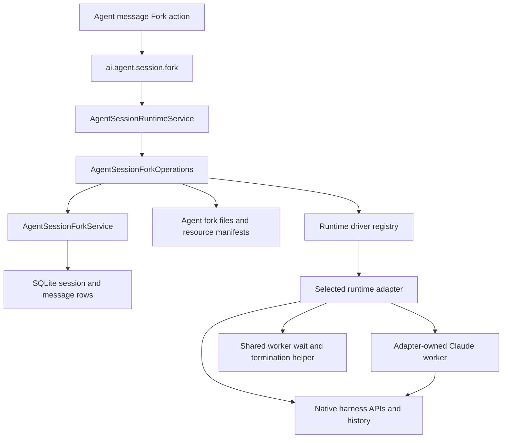

# Agent Session Fork

## Behavior

Pi, Claude Code and Pi Durable support **Fork** on successful assistant messages with valid native checkpoints. Legacy replies without a native checkpoint remain ineligible; the operation never rebuilds native history from product messages.
The operation creates an independent Agent session containing the visible
history through the selected turn and a native runtime resume reference.
It does not start or interrupt the source connection. The source can continue
appending later turns, and deleting it does not invalidate a published child.

The last copied message carries a `data-agent-session-fork` part containing only
`sourceSessionId`. Its link opens the direct parent after checking it still exists;
missing or trashed parents produce a frontend error. Forking again replaces inherited
markers. The link stays at the copied boundary, with no backfill for existing forks.

The new name uses the next available suffix for the Agent, such as `Session (1)`.
Forking a numbered session advances that suffix instead of nesting it. Queued
deliveries, live tasks, approval authority, and usage statistics are not inherited.
Copied unfinished tool calls become terminal errors; they do not resume execution.

User workspaces remain shared. System workspaces copy their **current** files into
the child's workspace; selecting an earlier turn does not restore historical file
versions. Copying detects file changes and can fail with `workspace_changed`.
Shared-workspace editing remains the responsibility of the sessions using it.

Pi Durable forks keep the source backend ID and use the SDK's ownerless same-storage fork. One Harness owns that backend, with separate root model, approval, extension and environment routing. A connection release cannot close a peer's owner. Checkpoints include backend identity because native conversation and entry IDs are local to a store. Prefix grouping delegates binding validation to the adapter, so equal conversation IDs across `/clear` contexts are not ambiguous.

The operation journal records the intended native context before preparation. The native fork and its context marker share one commit, so an uncertain receipt can be reconciled. Product publication remains a separate atomic transaction. A failed or cancelled publication leaves no visible product fork; its prepared native conversation remains inert and identifiable. The SDK has no public conversation deletion API, so rollback retains it and never deletes or truncates the shared store. Source deletion also retains the ancestry required by surviving forks.

## Edit and resend within a session

**Edit and resend** replaces the selected input and removes its descendant subtree
in one product transaction. It does not retain a new history version. The common
prefix, existing sibling branches outside that subtree, and independent fork sessions remain unchanged.
Desktop asks for confirmation when saving an edit, before changing displayed history or dispatching the replacement. Cancelling keeps the draft and original messages.
Native fork starts at the checkpoint before the edited input. Each new branch
has a native binding in `agent_session_context`; remapped checkpoints belong to
that binding and do not overwrite the original prefix rows.

For the first input, an empty prefix records a fresh intended native identity;
Pi creates that context on dispatch. A nonempty prefix requires a valid native
checkpoint immediately before the edited input. Editing is rejected while the session has unsettled work,
including outgoing cross-session deliveries. Failed preparation or publication preserves the original tree.
Pi Durable noninitial edits publish the native fork's allocated product context identity and remapped checkpoints in the replacement input transaction. First-input edits reserve a fresh empty backend/context and create native storage only on dispatch. Native numeric IDs are local to a store, so publication and recovery check the exact context rather than matching an unrelated backend's token.
Neither edit/resend nor branch selection restores workspace files.

The sibling navigator selects the chosen sibling's latest descendant. Selection
only changes the stored view; it does not run the harness. The next send resolves
that branch's native context. An idle connection on another branch is closed
before connecting; an active connection prevents a cross-branch send.

Claude Code **Edit and resend** reserves the replacement's native identity in the same
transaction as its input. Editing the first input starts an empty native
session under that reserved identity. Startup resumes only a verified native
history token from the captured branch; an allocated identity alone is not proof
that native history exists. Other edits publish their verified native fork before
startup, and switching the UI selection does not change the captured branch.

The additive schema migration supplies parent/selection and binding fields.
`AgentSessionMessageTreeSeeder` converts old flat archives into one selected
path, preserving existing IDs and message facts. Previously deleted tails cannot
be recovered.

## Ownership and dependencies

| Owner | Responsibility |
|---|---|
| `AgentSessionRuntimeService` | Lifecycle and admission: owns the operation coordinator, includes pending forks in drain, and cancels work on shutdown |
| `AgentSessionForkOperations` | Coordinates message selection, workspace preparation, adapter invocation, artifact publication, database commit, and failed-operation cleanup |
| `AgentSessionForkService` in `data/services` | Batch-reads message/parent boundary facts, reads a consistent source prefix, and commits child session/message rows in a synchronous database transaction |
| `agentSession/fork/historyActions.ts` | Shares static fork/edit eligibility between list projection, edit preparation, and execution using the selected adapter's checkpoint validator |
| `agentSession/fork/files.ts` and `resources.ts` | Copy/publish files and record the resources owned by an operation |
| Each runtime adapter | Defines and validates its native checkpoint, reads native history, calls the harness fork API, and maps child resume references |
| `runtime/fork` | Common request/result envelope, errors, native-file read helpers, and worker waiting; no runtime-specific checkpoint union or worker dispatch |
| Harness | Native history semantics, context management, summaries, compaction, and persistence |

`AgentSessionForkOperations` is owned by the existing runtime lifecycle service;
it is not an additional container service. The data service does not perform
filesystem work or call runtime adapters. The fork command uses IpcApi because it
coordinates runtime and filesystem operations in addition to SQLite writes.

## Checkpoints and the read/write path

1. At turn completion, the adapter validates its native checkpoint and attaches
   it to the `turn-complete` event. The host records queued message IDs to exclude.
2. `AgentSessionMessageBackend` validates the common envelope and saves it in the
   existing message's private `data.runtimeAnchor`. If checkpoint validation or
   checkpoint persistence fails, the completed answer is still saved without it.
3. Fork reads the selected product prefix and its context bindings. The selected
   message must be a successful assistant turn with an anchor matching the Agent's
   runtime. Pending deliveries and excluded message IDs are omitted. Checkpoints
   are grouped by their evidenced native context; a prefix can span several contexts
   after `/clear`.
4. The coordinator prepares the workspace and a staging directory per context.
   The existing adapter forks each context at its last retained checkpoint and returns
   that context's independent resume reference, remapped checkpoints, and artifacts.
   Every context is prepared before any native artifact is published.
5. The coordinator clones visible messages with new IDs, remaps their anchors,
   strips execution state and statistics, and publishes the native artifacts.
6. `DbService.withWriteTx` rechecks the source prefix, captured context bindings,
   backend locators, Agent, and workspace, then creates the child, messages and
   per-segment context bindings atomically. Later source appends are allowed;
   changes to the selected prefix fail with `source_changed`. A read-model change
   notification follows the commit, and IPC returns the child session ID.

Copied contexts retain separate native histories. Only the context at the selected
boundary resumes on the next send; earlier model context is not reintroduced after
`/clear`. Historical edits and further forks remain available in either segment,
including after the source conversation and its native files are removed. An in-place
edit forks only the predecessor's context and maps only that context's checkpoints;
earlier contexts stay with the same product session. A later failure compensates
all artifacts prepared or published by the operation.

The public checkpoint envelope knows only `runtime`; all other checkpoint fields
are opaque to the host and data layer. Native schemas live in each adapter's
`forkCheckpoint.ts` and validate capture, fork input, and remapped results. Public
message reads strip `runtimeAnchor`. The child uses the existing
`runtimeResumeToken` persistence and normal runtime resume path.

The message-list API composes Main-authored `historyActions` alongside the visible rows.
`AgentSessionRuntimeService` obtains current-page boundary facts from `AgentSessionForkService`,
including parents outside the page, and applies the shared fork-domain rules. Ordinary
`AgentSessionMessageService.listSessionMessages()` reads neither compute these actions nor
accept runtime callbacks. Raw anchors stay in Main.
Fork requires a successful native-backed assistant boundary; editing requires either
the first input or such a boundary immediately before the input. The renderer
uses these decisions without receiving the private anchor. Missing edit parents and
delivery inputs are ineligible. Listing opens no native
files or runtime connections. A file removed after listing still causes an explicit
execution-time failure.

When Claude resets its native session, Main prepares the successor binding from
the current product head before switching the active handle and context. Old
session controls and results cannot replace the successor checkpoint.

Fork publication uses existing session/message tables and native context bindings,
without an `app_state` fork record. Cherry does not
generate a summary, reconstruct model context from UI messages, or apply Chat
compression settings to Agent forks.

## Native adapter paths

| Adapter | Native boundary | Fork implementation |
|---|---|---|
| Pi | Runtime session ID and leaf ID | Stages the newest matching native file, then branches with `SessionManager` and maps checkpoints to the child session ID |
| Claude Code | Runtime session ID, main assistant UUID, and config directory | Its private worker calls the SDK fork API and maps assistant UUIDs into the child's transcript |

Claude creates its own worker and pass them to `runForkWorker`. The
shared helper returns an opaque result and waits for termination on success,
failure, cancellation, or timeout before the coordinator can clean up files.
Adapters validate the returned native result before publication.

## Publication and failure cleanup

The operation writes a resource manifest at
`application.getPath('feature.agents.forks', '<operationId>.json')` before creating
resources. It records staging paths, published artifacts, and filesystem identities
needed to establish ownership. This manifest describes file ownership, not runtime
context or a separate session recovery state machine.

Native files are published before the child database transaction. A failed or
interrupted operation can therefore leave files without a child row. Recovery
checks whether the target session exists: published children are preserved, while
unpublished operations clean up only resources whose ownership can be established.
For an in-session edit, a retained native context binding also proves publication.
An adopted workspace is retained; unreadable manifests or changed file identities
remain available for later investigation rather than authorizing deletion.

Successful forks currently retain their staging resources and manifests, including
Pi lineage snapshots. These are not discarded as temporary files on success.
Normal session resume uses the persisted native resume token; startup resource
recovery handles incomplete publication, not missing harness history.

Missing anchors (`legacy_history`), unsupported checkpoints, missing or corrupt
native history, and changed source/workspace data produce explicit fork errors.
For an unflushed Claude transcript, retry after the runtime writes it. There is no
UI-history import or empty-session fallback when native history is unavailable.

## Related references

- [Agent Session Runtime](./agent-session-runtime.md) — host lifecycle, follow-ups, and resume
- [Adding an Agent Runtime](./adding-a-runtime.md) — driver registration and capability boundaries
- [Data Layer](../data/README.md) — SQLite service and transaction conventions
