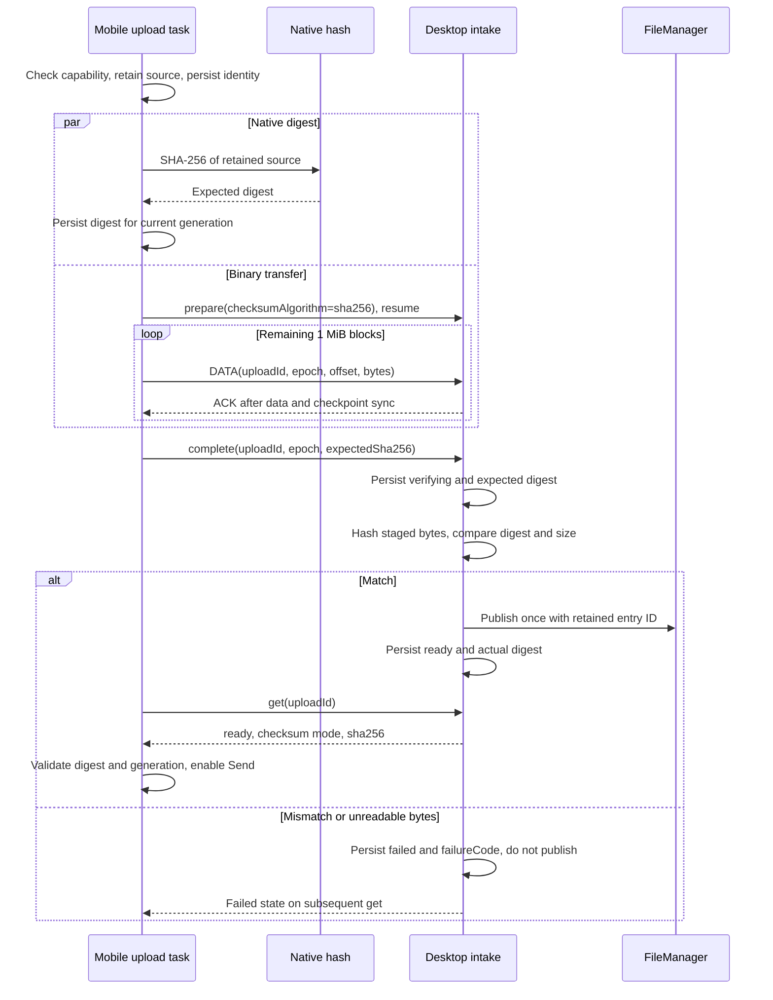
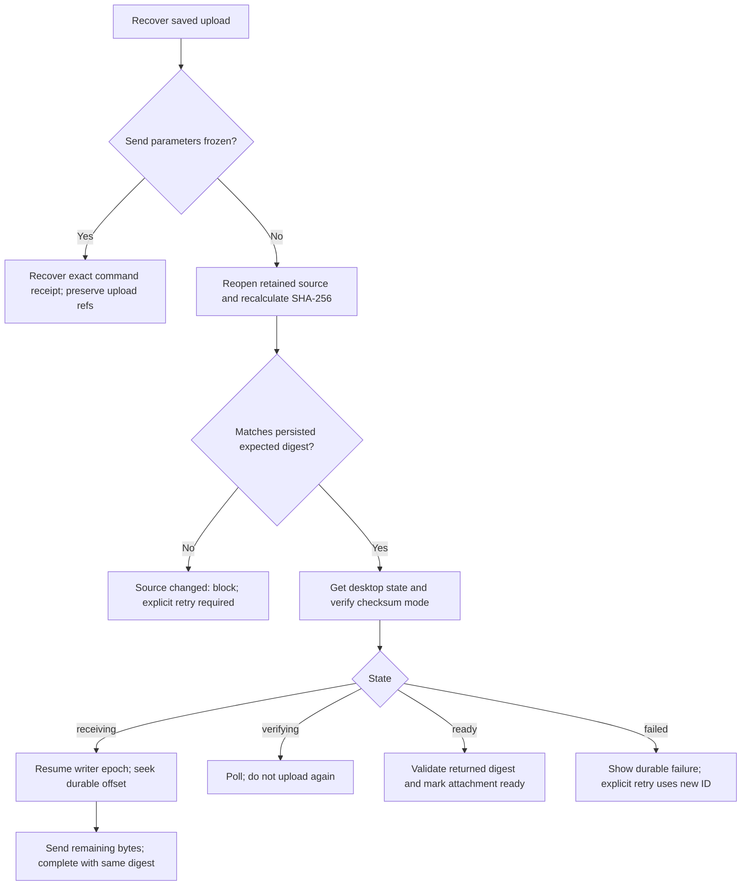

# Upload Integrity

Status: **implemented in the paired working trees; release and device acceptance pending**, 2026-10-12.
Shared schemas, desktop verification, the mobile native adapter, recovery and UI are implemented.
Published protocol 0.4.0 and transport 0.2.0 remain the release baseline. The additive protocol
changeset has not been published. Mobile validation currently uses an ignored local build of the
shared package; its manifest still names 0.4.0 and must be updated after publication. A clean
mobile install does not yet provide the new contract. No native-device result is claimed.

## Scope and invariant

For a checksum-required upload, `ready` means all declared bytes are durable, the desktop's
computed SHA-256 equals the phone's expected SHA-256, and managed publication succeeded.
The phone enables Send only after observing that result for its current attachment generation.

Keep 1 MiB DATA blocks, the two-block window, durable prefix ACKs, writer epochs, existing quotas,
checkpoint files, and message/command ownership. No new database table, per-block business hash,
chunk-file merge, hash-based instant upload, Agent tool, or workspace copy is needed.
Agent tools continue editing the same desktop managed file. Refreshing preview revisions after
those edits is separate work: this plan guarantees upload-time integrity, not immutable history.

The published baseline accepted only upload ID/epoch at `complete`, computed a desktop digest
without a source value, and checked only source size during mobile recovery. This change closes those gaps. Noise
frame authentication and durable offsets remain necessary but do not replace this comparison.

## Native dependency and ownership

Use `@preeternal/react-native-file-hash@3.0.1`, default native engine, SHA-256 only. Its published
source is commit `c0f799a456b80850d9d355842fb13003ac5c5f57`. Native streaming avoids whole-file JS
buffers and supports cooperative cancellation. Hashing adds a source-file read, not a file copy.
Parallel readers can compete for disk bandwidth; measure throughput on devices.

The mobile file module exposes `fileContent.hashFile(fileEntryId, signal): Promise<string>`.
It resolves the managed ID, calls `fileHash(uri, { algorithm: 'SHA-256', signal })`, and validates
64 lowercase hex characters. Extend the existing injected `RemoteUploadFiles` dependency; no
new lifecycle service or generic algorithm framework. Keep URI resolution/vendor errors in the
file module, not React or the remote protocol.

`prepareUploadSource` remains authoritative: reuse imported immutable files; retain the existing
snapshot for mutable/generated entries. Persist `sourceFileEntryId` before starting either task.
Both readers use that same retained source; neither substitutes the original on failure. Retain
source ownership until both readers settle, including cancellation. This feature does not remove
existing picker imports or mutable-source snapshots. Library support for `content://` does not
itself establish persistent permission or immutability. A hash is not an atomic filesystem snapshot.

Add the Expo plugin with the default engine and rebuild Android/iOS development clients; Metro
reload cannot install a native module. Missing native support fails explicitly. Hash only one
file per active upload task; preserve the existing attachment queue rather than starting eight
whole-file readers together.

## Shared protocol and compatibility

Keep `agentUploadsVersion: 1` and binary framing unchanged. Add
`agentUploadChecksum?: 'sha256'` to hello. New mobile requires both capabilities before starting
new attachments. Without checksum support, text chat remains available and attachments show an
upgrade-required state; do not silently downgrade integrity.

| Contract | Addition | Rule |
|---|---|---|
| `agent.uploads.prepare` | `checksumAlgorithm?: 'sha256'` | New mobile always sends it; persist mode and freeze it for this upload ID |
| `agent.uploads.complete` | `expectedSha256?: string` | Required for checksum-mode uploads; validate 64 lowercase hex characters |
| Upload state | `checksumAlgorithm?: 'sha256'`, `sha256?: string`, `failureCode?: 'CHECKSUM_MISMATCH' \| 'VERIFICATION_FAILED'` | Verified ready returns mode and actual digest; no digest before ready; failed records retain the reason |

Optional fields preserve already-published clients. New desktop accepts absent-mode uploads
with the existing behavior; new mobile must never interpret their `ready` as checksum-verified.
Reject a digest supplied to a legacy-mode upload with `CONFLICT`; prepare a fresh verified upload.
Changing mode on repeated prepare is `IDEMPOTENCY_CONFLICT`.

Complete checks owner, epoch, durable size and required digest before transitioning state.
Same expected digest is idempotent; replacing a recorded digest is `IDEMPOTENCY_CONFLICT`, even
for verifying/ready/failed records. Missing required digest is `CONFLICT`; malformed input fails
schema validation. Async verification failure is returned by durable failed state, not a one-off
error notification that disappears on reconnect.

Desktop checkpoint gains `checksumAlgorithm`, `expectedSha256`, and `failureCode`. Existing
`sha256` remains the computed result: never fill it from the client's expected value. Mobile
saved upload gains `expectedSha256`; saved metadata carries mode. Persist no hash-engine state.
Existing checkpoint decoding accepts absent fields as legacy mode; never retroactively mark it verified.

## Normal upload

`uploadAttachments` starts hashing and transfer after source persistence, observes both promises
immediately, and calls complete only after both succeed. Failure aborts the sibling and awaits
both settlements before surfacing the error or releasing resources. Avoid detached hash rejections.
Network failure preserves staging and resume identity. Explicit removal records cancellation
first, aborts readers and then uses existing remote cancellation/cleanup. Late callbacks cannot
write into a replaced generation or re-enable Send.

## Resume, restart and races

| Event | Required behavior |
|---|---|
| Phone dies before saving digest | Hash again; resume only if the same retained immutable source is still guaranteed, otherwise fail. Size/mtime alone cannot prove identity |
| Saved digest exists; same-size source changes | Reject before resumed writes with local `UPLOAD_SOURCE_CHANGED` |
| Source missing or permission lost | `RESOURCE_UNAVAILABLE`; never substitute another source |
| Desktop record expired before send admission | Use retained source/digest with fresh checksum-mode upload ID; transfer from zero |
| Complete reply lost | Get state; poll verifying, validate ready, or repeat identical complete if receiving |
| Desktop restarts while verifying | Reload expected value and re-read staged bytes; cached actual digest alone is not proof of current bytes |
| Crash around publication | Reuse checkpoint entry ID and existing FileManager publication recovery; validate surviving candidate bytes against expected digest, without a second entry |
| Cancel/revoke/expire during verification | Recheck current record and owner eligibility before publication under upload serialization; no resurrection from a late completion |
| Writer/generation replaced | Keep epoch fencing and generation checks on digest persistence, progress and ready callbacks |
| Unsent legacy draft | Retain source, clear ready, cancel legacy staging through existing cleanup, create a checksum-mode upload; never relabel legacy ready |
| Admitted or uncertain legacy send | Preserve command ID/body and receipt recovery exactly; never rewrite its references for this upgrade |

Hash computation restarts at byte zero after a process restart; network transfer resumes at the
durable prefix. This intentionally avoids serialized native hash states. Source stability is still
required during parallel reads; size/digest checks do not turn a mutable path into a snapshot.
Capability checks run before draft preparation. An unsent draft may probe existing state to
replace expired identities before presenting its manifest; source digest validation still precedes
all resumed DATA writes.

## Errors, UI and observability

Use durable `CHECKSUM_MISMATCH` for unequal digests and `VERIFICATION_FAILED` for disk/read or
publication errors. Keep filesystem paths/native diagnostics in the central logger; send bounded
codes to mobile. Source change, mismatch and missing native support do not retry indefinitely.
Connection failures retain existing retry behavior; explicit Retry after terminal failure uses
new upload identity. Native cancellation uses the existing cancelled path, not an error toast.

Backend tasks own native work; React subscribes to existing draft snapshots. Expose only phase,
durable sent/total bytes, ready and failure. Card-border progress remains acknowledged bytes.
At 100% while hashing or desktop verification is pending, show verification activity and keep Send
disabled. The library provides no byte-progress callback: do not invent hash percentages. Desktop
pending-message cards reuse intake receiving/verifying/failed states. Add localized errors to all
catalogs; reuse shared attachment components. Never start hashing from a render or component effect.

Record preparation, native-hash, first-DATA, last-ACK, desktop-verification and ready durations
with upload identity, size and resumed offset. Do not log file bytes, full paths or full digests.

## Files, functions and dependency direction

Desktop paths are relative to the repository; mobile service names refer to existing modules in
`src/backend/services/`. These are edits to current owners, not new layers.

| Owner | Changes |
|---|---|
| `packages/remote-protocol/src/connection.ts`, `agent/uploads.ts`, `agent/methods.ts`, `agent.ts` | Capability, prepare/complete/state schemas, exported types, changeset |
| `src/main/services/remoteAccess/RemoteConnection.ts`, `RemoteUploads.ts`, `agentHandlers.ts` | Advertise support and forward typed input while preserving grant enforcement |
| `src/main/services/file/intakeTypes.ts`, `internal/IntakeStore.ts` | Types, checkpoint fields and recovery validation |
| `src/main/services/file/FileIntakeService.ts` | `prepare` freezes mode; `complete` binds expected digest; `verify` compares before publication; snapshot returns durable verification outcome |
| `src/main/services/file/internal/entry/publishIntake.ts` | Reuse existing final-file size/hash verification and entry-ID recovery; no new publication API or second entry |
| Mobile package manifest, workspace policy, lockfile, Expo config | Pin native module/plugin; consume new published shared contract; dedupe and rebuild |
| Mobile `file/fileContent.ts` plus file-local adapter | `hashFile(fileEntryId, signal)` and native error mapping |
| Mobile `remoteAgent/remoteUploads.ts` | Saved digest, parallel task settlement, recovery comparison, typed complete and ready checks |
| Mobile `RemoteAttachmentDrafts.ts`, `RemoteAgentActions.ts` | Generation-safe journal writes, source retention and legacy pending-work handling; exact command identity remains unchanged |
| Mobile `desktopConnections/DesktopSession.ts`, `RemoteAgentScope.ts`, conversation adapters | Check capability, project attachment availability and verification state |
| Existing mobile cards and locales | Verification activity and localized errors; preserve common layout |

`publishIntake` already rehashes the final managed candidate before creating or returning its
entry, including recovery of an existing physical file. Preserve that check; the intake layer
adds the independent expected-versus-computed comparison before invoking it.

File intake depends on FileManager; neither depends on the remote adapter. Mobile runtime receives
file operations through its existing injection. No new service registry entries, database APIs,
private wire schemas, or absolute cross-workspace imports.

## Implementation sequence and acceptance

1. **Shared contract and desktop:** schemas, checkpoints, digest comparison, recovery. Verify that
   mismatch never publishes; mode/digest changes conflict; same completion replays; owner/epoch
   rejection remains intact; crashes while verifying/publishing preserve one entry.
2. **Native file adapter:** plugin, pin and cancellable SHA-256. Compare empty, Unicode-named,
   few-MiB and 1 GiB sources against Node SHA-256 on Android/iOS; check unreadable files and native
   module absence. Jest mocks alone cannot establish native compatibility.
3. **Mobile task and UI:** hash/upload parallelism, journal digest, recovery and capability policy.
   Cover hash-first/upload-first, failure of either task, cancellation, replaced generation,
   same-size source mutation, lost complete reply, restart of either endpoint and old/new peers.
4. **Release/integration:** publish the additive protocol release; update transport's matching
   protocol dependency only as needed, with unchanged framing. Consume actual published versions
   in mobile, with no temporary tarballs or guessed release versions.
5. **Device acceptance:** rebuild both clients. Measure few-MiB and 1 GiB readiness, memory and
   copy count; interrupt at mid-transfer, kill/relaunch phone, restart desktop and revoke access.
   Assert no whole-file JS allocation or new source copy caused by hashing. No fixed subsecond
   performance promise and no continuous iOS background transfer promise.

Extend existing desktop tests with explicit paths: `packages/remote-protocol/tests/uploads.test.ts`,
`src/main/services/file/__tests__/fileIntake.test.ts`,
`src/main/services/remoteAccess/__tests__/RemoteUploads.test.ts`,
`src/main/services/remoteAccess/__tests__/agent.test.ts`.
Mobile targets `remoteTransfers.test.ts`, `RemoteAgentActions.test.ts`, `DesktopSession.test.ts`
and the draft/adapter suites owning readiness and cancellation. Run scoped lint/format, docs
checks and relevant types; leave broader suites to CI. Track shared release, mobile dependency integration and real-device acceptance separately from
local contract/consumer validation.

## Dependency evidence

- [Published package](https://www.npmjs.com/package/@preeternal/react-native-file-hash)
- [API and Expo setup](https://github.com/Preeternal/react-native-file-hash/blob/c0f799a456b80850d9d355842fb13003ac5c5f57/README.md)
- [Android streaming implementation](https://github.com/Preeternal/react-native-file-hash/blob/c0f799a456b80850d9d355842fb13003ac5c5f57/android/src/main/java/com/preeternal/filehash/NativeHashEngine.kt)
- [Request and abort API](https://github.com/Preeternal/react-native-file-hash/blob/c0f799a456b80850d9d355842fb13003ac5c5f57/src/index.tsx)

## Release decision (2026-10-12)

Retain the implementation and use the PR/Changesets release workflow; do not publish directly
to npm from this workspace. Review and merge the desktop contract/receiver PR first, then let
the package release workflow publish the approved Changeset. Update the mobile dependency to
that actual published version in its PR, remove the local integration override, and rerun clean
installation and native-device acceptance before marking mobile ready for merge.

## Implementation validation (2026-10-12)

- Desktop tests exercise independent digest matching, durable mismatch with no publication,
  repeated completion/mode conflicts, restart rehashing, managed publication recovery, ownership,
  writer fencing and existing message admission.
- Mobile tests exercise concurrent hashing and DATA, the completion barrier, same-size source
  mutation before resumed writes, lost ACK recovery, native cancellation settlement, rejected
  ready digests and current draft-generation removal. Native calls are mocked in Jest.
- Native module 3.0.1 and the default Expo plugin are installed; Expo prebuild config resolves.
  No Android/iOS native compilation or physical-device SHA-256 test has run for this change.
- The local shared-package override lives only under mobile `.context`/`node_modules`. Do not
  commit it, publish mobile with protocol 0.4.0, or treat this as a reproducible released build.
  Publish the desktop changeset, update the mobile manifest/lockfile to that actual version,
  remove the local override, then rerun clean-install gates and build development clients.
