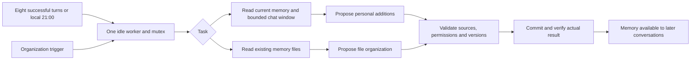

# Memory Feature Overview

This reference describes the current implementation. See the [shared-memory Spec](../../../../.agents/notes/proposed/feature/2026-10-29-shared-memory.md) for the target design.

## Comparison

| Mechanism | Content and storage | Scope | How it reaches the model |
|---|---|---|---|
| Managed file memory | `MEMORY.md` and `.memories/*.md` | Shared personal context; separate private knowledge for each Agent | Entry snapshot in the prompt; supported tools read topics |
| Conversation recall | Existing chat messages and FTS5 indexes | The same Assistant or Agent, on selected conversation branches | The model calls `memory_search` |
| Knowledge Base | Imported documents and retrieval indexes | Selected knowledge bases | Knowledge lookup tools |
| Graph memory MCP | Entities, relations and observations in `memory.json` | Defined by the independent `@cherry/memory` server | MCP tool calls |

## Managed files and access

Shared files live under `{userData}/Data/Memory/`. Private files live directly under the current Agent data directory. Both use the same layout:

```text
MEMORY.md
.memories/
  preferences.md
  details.md
```

Topic names can vary. The entry contains complete common facts and selected topic links. A topic groups related details and conditions. The active set includes the entry and all topics, including unlinked ones.

Private memory follows the Agent across sessions and working directories. Project and customer knowledge belongs in this Agent-wide private scope.

| Caller | Shared memory | Private memory |
|---|---|---|
| Desktop Agent conversation | Enabled unless `configuration.shared_memory_enabled` is false | Its own Agent |
| Persistent Assistant conversation | Requires `settings.enableSharedMemory === true` | None |
| Temporary, auxiliary or headless Assistant request | None | None |
| Channel or headless Agent execution | No shared grant | Only its existing Agent scope, where the runtime integrates memory |
| Shared-memory settings | Main-window authority for shared management | No managed private-file editor |

Main derives identity and scope from the live conversation and stored entity configuration. Disabling access invalidates existing grants and pending work. Re-enabling access requires fresh grants.

Pi and Claude Code have explicit entry-loading and runtime-guard integrations. Both support controlled native file reads and writes.

## Settings and the existing Agent memory tab

Open **Settings → Tools → Shared memory**, alongside MCP and Skills.

- **Generate memory in chats** and **Automatically organize memory** are independent global switches, both enabled by default. They use the configured default model and can consume its quota.
- Disabling generation stops automatic conversation extraction and invalidates its pending output. Existing-file organization remains available.
- Disabling automatic organization leaves generation and **Organize now** available.
- The page shows the last completed, failed or cancelled result. **Restore backup** and **Clear global memory** require confirmation.
- Agent and Assistant **Basic** forms label their access switch **Shared memory**. The Agent switch precedes Heartbeat and defaults on; the Assistant switch defaults off. Presets carry this switch setting.

The Agent configuration dialog also has a **Memory** tab for identity and legacy files. It displays `SOUL.md`, `USER.md`, `memory/FACT.md` and `memory/JOURNAL.jsonl` through `agent.memory.*` IPC.

Its three Markdown files have explicit Save/Cancel, version-conflict checks, and a 1 MiB read/write limit. Truncated files and JOURNAL are read-only. Leaving an unsaved draft requires confirmation. These operations use the legacy editor's own protection.

After successful migration, FACT becomes retained history; later edits in this tab affect only that legacy file. `SOUL.md` and `USER.md` retain their separate identity roles.

## Entry snapshots in model requests

The first authorized request loads the eligible shared entry and, for an Agent, its private entry. `MemoryService.entrySnapshot()` caches them by product conversation and scope until application restart. Later turns, steps, reconnects and compaction reuse that snapshot. Ordinary memory writes appear automatically in a new conversation.

Pi replaces the `cherry_memory` system section before model requests. Claude Code supplies the reference through prompt-submit and session-start hooks. Persistent Assistant chat reuses it in `prepareStep` after compaction. Each path rechecks authorization and memory safety. An empty reference withdraws earlier memory guidance.

Entries are reference data. Current user instructions take precedence. Topic contents require a separate tool read. A truncated entry is marked incomplete; edits require a full read.

## Automatic conversation extraction

`MemoryDreamingService` receives main-owned successful desktop completion events. It checks the source owner, successful persisted reply, message versions, and the entity's shared-access switch. It excludes channels, background/child work, temporary requests, synthetic input and cross-session deliveries. Assistant replies can provide context; only user text can support a saved fact.

A conversation becomes due after eight new successful user/assistant turns, or at 21:00 local system time for the remaining admitted turns. Each batch freezes its endpoint. Read up to sixteen messages on that branch, including the final successful reply, retaining complete turns within 32,000 UTF-8 bytes and 8,000 bytes per message. Drop oldest complete turns when the budget is exceeded and record the budget skips. An oversized individual turn is skipped explicitly. Missing context is marked incomplete; existing shared memory supplies background, without automatic retrieval of earlier chat.

The extraction engine:

1. Reads the shared entry and topics, up to 40 files and 32,000 UTF-8 bytes in total.
2. Splits conversation text into batches of at most 16,000 bytes, overlapping up to two complete messages.
3. Requests at most eight candidates per batch. Each candidate carries one independently useful fact, its subject, conditions, time, intended future use, action, and exact user-text evidence.
4. Verifies quoted text and references against the input snapshots, then binds message/file versions.
5. When multiple batches produce multiple candidates, makes one additional model call to reconcile duplicates and conflicts across batches.
6. Appends only validated personal `add` candidates through the managed store. Existing facts remain unchanged.

Selection is based on concrete future value. Supported personal experiences, plans, decisions and constraints may qualify, including one-time events and temporary circumstances. Candidates preserve the original timing, conditions and certainty. Secrets, unsupported guesses and project/customer information are excluded from personal shared memory.

`exists`, `conflict`, `insufficient`, `omit` and `out_of_scope` are separate outcomes. Compatible fields narrow duplicate checks, and the model judges semantic equivalence. Conflicting additions are withheld and existing facts remain unchanged.

Saved additions are ordinary Markdown list content. Evidence and source versions are used during validation. A full entry stops saving and preserves existing content.

### Scheduling, cancellation and limits

Extraction and organization share one physical mutex and the `memory.dreaming` worker. The minute wake waits for foreground conversations to finish. `memoryExtractionState` persists pending message references, frozen endpoints, compact completion positions, retry timing and commit hashes in `app_state`, without message or candidate bodies. Ordinary restart resumes admitted pending work and catches up a missed daily deadline without scanning unregistered history. Legacy admission cursors establish a fresh boundary on upgrade.

Explicit cancellation, clear, recovery and generation-switch changes discard affected pending work and establish durable admission boundaries. Relevant revocation is durable even if no task existed yet. Ordinary owner name, model and prompt updates preserve admitted messages; revocation and ownership changes still establish durable boundaries. Source edits, deletion, owner changes or revocation invalidate uncommitted output; topic/session renaming preserves pending work. Foreground interruption defers the batch without consuming an attempt. Model, network or output failures allow two retries ten minutes apart, then wait for the next local 21:00. Successful evaluation, including no eligible facts, completes a batch; budget skips are counted separately. Before/after hashes reconcile a committed file after a crash without appending twice. Already-saved memory remains after source deletion.

Extraction and reconciliation use the default model with tools and automatic model-call retries disabled. Output tokens follow the model and provider limits. Preflight estimates reserve room for output; byte limits and schema validation also apply.

The automatic window is bounded to sixteen visible messages before filtering whole successful turns. Stopped or failed turns supply no evidence. Their gap positions are included in model input and its fingerprint; older messages are not fetched to replace them. Definitively invalid pending references are retired separately from budget skips, and the remaining part of an already-due batch continues.

Known pre-write rejection or confirmed unchanged output clears the previous intent for a fresh proposal. Confirmed applied output advances progress, retaining any save warning. An uncertain intent whose current file matches neither the before version nor a verified after version is conflict-skipped for its original batch only. Later admitted turns continue, and the current file is preserved. These skips are recorded separately from successful extraction. A source-time boundary with same-time message IDs also excludes that uncertain evidence from later automatic windows.



### Explicit range preview

The main-window-only `memory.dreaming.preview_extraction` endpoint uses the same candidate engine for a caller-selected recent range. It accepts up to 64 messages and 64,000 bytes, within the same admission and authorization boundaries. It checks source/file versions again before returning.

This API-only preview returns candidates for the current call and leaves files and the automatic cursor unchanged. Interrupted previews require a new request. Automatic extraction uses the same engine with a guarded save path.

## Historical conversation recall

When `memory_search` is available, the prompt asks the model to search if past context is needed and the current conversation and entry snapshot are insufficient. The model chooses keywords or expands a returned message.

Recall uses existing FTS5 indexes. It stays within the same Assistant's topics or the same Agent's desktop main conversations and their selected branches. It excludes deleted conversations, failed messages, channels, background/child sessions and cross-session deliveries.

The currently answered user message is excluded by its message ID, derived from the reply's parent. This exclusion applies to search hits, surrounding context and explicit expansion. Earlier messages in the same conversation and identical historical questions remain eligible.

| Limit | Current behavior |
|---|---|
| Calls per answer | Four, shared by search and message expansion |
| Query | Focused keywords, up to 512 characters |
| Ranking | Any keyword can match. Long-only queries use trigram MATCH/BM25. Queries containing short terms combine MATCH and escaped LIKE, rank by distinct matched terms, then prefer shorter messages and recency |
| Candidates and hits | Up to 64 candidates from successful user messages; first six eligible matches |
| Automatic context | Only the first hit: up to five messages before/after it, plus first/last three messages of its branch |
| Returned excerpts | Deduplicated by message ID, at most 22, including successful user and Assistant text |
| Long messages | Above 2,000 characters, return a marked search snippet; ID expansion can still be truncated |

The model may change keywords or pass `conversationId` and `messageId` to expand another result. There is no body-offset pagination for a truncated message. Assistants remove the tool after the budget is exhausted; Agents receive a stop-searching result. The next answer starts a new budget.

Results carry roles, message/conversation IDs, message dates, match ranks where applicable, and truncation flags. Assistant text provides context; user messages supply factual evidence. Event dates come from the message content. If a search misses relevant context, the model can try alternative keywords within the call budget.

## Organization (Dreaming)

Organization reads the existing entry and topics in one scope, then reorganizes their facts and links.

Automatic triggers are ten successful controlled content edits, seven days since the first pending change, or changed content reaching a capacity warning. A manual request also triggers a check. No-op, failed, metadata-only, Dreaming and recovery writes do not increase the edit count. External edits are detected by hash; their historical edit count is not reconstructed.

A shared schedule wakes every minute while the app runs. Missed intervals are not replayed. Each scan considers the entry and up to nine topics, prioritizing eligible changed files and rotating through remaining work. A model batch contains at most ten complete files and 50,000 UTF-8 bytes, reduced to fit the selected model. A topic that cannot fit even with only the entry is marked blocked so smaller topics can proceed.

Each batch makes one model call with tools disabled and no automatic call retry. Unchanged input has at most two attempts, ten minutes apart. New input, a manual request or a changed default model can provide another opportunity. Foreground preemption consumes no organization attempt and retains manual requests; retry after about one minute when idle. Counter restoration checks file versions and task generation so concurrent changes are preserved. Processed hashes and pending state live in module-owned `app_state`, independently of removable job history.

Inference runs outside the write lock. Commit rechecks all input receipts, versions, authorization and cancellation. Topic deletion requires the complete active file set, distinct source/destination topics, verbatim source preservation and updated Markdown/wiki links. Transfers for deletion operate between topics, leaving `MEMORY.md` as the entry. Targets and links save before sources are removed. Partial outcomes remain recoverable.

## Controlled writes, backups and recovery

Pi's native `read`, `write` and `edit` route managed targets through `MemoryService`. A full read produces a caller-bound receipt. Saving binds that receipt to the exact approved proposal and checks for concurrent changes. A new file requires a confirmed missing-file baseline.

Claude Code keeps its native `Read`, `Write` and `Edit` tools and their parameters. Authorized calls operate on session-owned working copies; `MemoryService` commits the final content after approval and version checks. Existing files require a complete read in the current turn. New files bind a missing-file baseline internally. Overlapping operations on one file return a retryable conflict. Working copies are removed when the turn or session ends.

The SDK's post-tool output rewrite preserves native output schemas. If the managed save is unconfirmed, the native result remains attributed to the working copy, an explicit failure notice stops the turn, and Cherry displays the call as failed. Replay also recognizes these scratch-only results. Only confirmed saves rewrite the result to the managed path. A failed read validation replaces the returned body instead of exposing invalidated content.

Other uncontrolled Claude Code file operations, the identity-free filesystem MCP, and Pi's optional grep/find/ls continue to reject managed targets and related directory operations.

Before a controlled change, the store validates paths and versions, creates a backup, writes a complete temporary file and replaces the target. Backup failure prevents the change. Shell, scripts, external editors and other direct disk access are outside this protection.

| Limit | Value |
|---|---|
| Entry save | 200 lines and 25,000 UTF-8 bytes |
| Topic save | 25,000 UTF-8 bytes |
| Capacity warning | Entry: 160 lines or 20,000 bytes; topic: 20,000 bytes |
| Full-scope model-read/state check | 20 MiB |
| Recovery storage per scope | At most five batches and 20 MiB, including manifest/encoding overhead |

Oversized originals are retained, and replacement requires a complete read. The backup root is `{userData}/Data/MemoryBackups/`, outside active memory. Protected or partial recovery batches are retained. Writing stops when required backups exceed the available quota.

Recovery applies only when current files still match the recorded operation result. Later edits or a new same-name file cause conflicts. Multi-file operations can partially succeed; report each result. File replacement and SQLite state are not one transaction, so interrupted work is reconciled from actual hashes instead of replayed.

### Clear, forgotten state and runtime blocking

Shared clear binds the exact file set and versions before confirmation. It leaves private, legacy and unknown files alone. The dialog hides filenames; recovery retains a file preview. Backups remain after clear.

Clearing nonempty content persists empty `forgotten` markers rather than merely deleting all memory state. The store also understands structured `active`, `expired` and `forgotten` entries. Model views exclude forgotten content, matching source-message copies and known derivatives. Current views exclude expired entries; historical views can retain their status and dates. Source-version changes do not lift suppression.

The runtime records each conversation's initial protection-state fingerprint. A later change to expired or forgotten state blocks that conversation's old context, even after restart or disabling shared access. A new conversation without prior history can establish a fresh boundary and use filtered memory. Existing history without a recorded boundary remains blocked when protected state exists. Invalid memory state always blocks requests. Conversation recall retains strict scope checks so a fresh conversation cannot retrieve protected history. Temporary requests without memory remain separate.

Structured scopes pause automatic append and ordinary organization because these operations require whole-file overwrite receipts. Recovery preserves forgotten markers and returns a conflict when restoring protected plaintext would violate them.

## Legacy FACT and JOURNAL

Private migration backs up FACT and preserves its content, conditions and references before enabling the Agent's private `MEMORY.md` and topics. Unsafe splitting, ambiguous links or partial results leave the original recoverable and the new private scope inactive. Read-only legacy FACT remains available until migration succeeds. Runtime safety checks inspect the inactive private scope without requiring successful migration; protected or invalid state still blocks unsafe history.

After migration, FACT and JOURNAL are retained history. Active memory changes use `MEMORY.md` and topics. The identity/legacy editor operates on its original files independently.

## Choosing a mechanism

- Personal context that eligible callers can share: shared file memory.
- Project or customer knowledge owned by one Agent: private file memory.
- A past detail not present in the entry snapshot: bounded conversation recall.
- Documents you curate and search: [Knowledge Base](../knowledge/README.md).
- Explicit entity/relation operations: the independent graph-memory MCP.

See [the module contract](../../../../src/main/ai/memory/README.md) for implementation-specific failure and lifecycle rules. Service-level tests and historical model evaluations do not establish complete desktop, native-platform or packaged-build acceptance.
