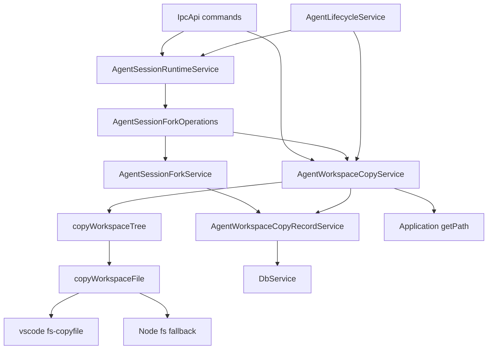
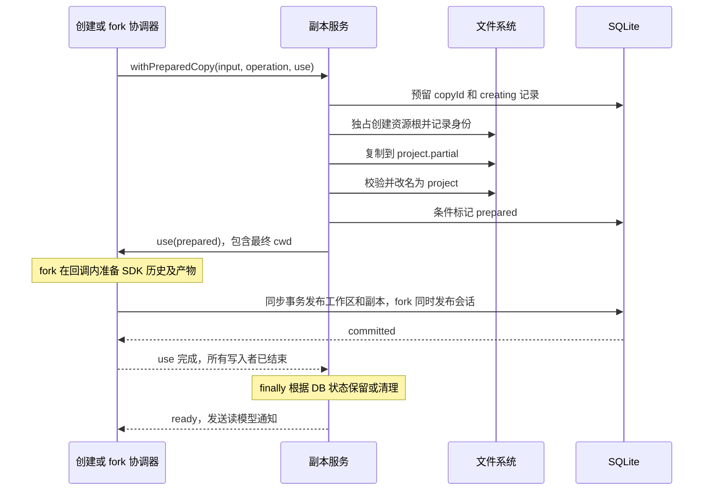

# Agent Workspace Copy Design

状态：首版实现随本 PR 提供，跨平台原生构建和实际 CoW 验证仍需各平台环境完成。本文采用 `@vscode/fs-copyfile@3.0.0`，为 Cherry Studio 增加可直接作为 Agent cwd 的独立项目目录。优先使用文件系统 CoW，不支持时按明确策略退回普通复制。

核心决策：**工作区负责引用，副本记录负责目录所有权，复制服务负责文件生命周期，现有 fork 协调器负责会话和运行时历史。** 副本成功发布后独立存在，删除源项目、源会话或最后一个引用均不自动删除副本文件。

首版实现入口：工作区选择器的复制按钮和“工作区副本”管理窗口；用户工作区的会话 fork 会提供共用目录和创建副本两个选项。`agent.workspace_copy.storage_parent` Preference 只影响后续创建，已创建记录的 location 不随设置改变。管理窗口展示最终位置、文件统计、存储降级、失败与清理状态，可取消创建、显式删除无引用副本和重试清理。原生库加载失败仍可使用普通复制，并记录 `native_unavailable`；这不能视为原生构建验证通过。

当前实现边界：Windows 无法仅凭 Node 文件 API 可靠区分所有 reparse tag，首版拒绝链接和 junction，不做 dereference 降级；Unix 支持经过内部目标校验的符号链接。控制目录额外保存有身份记录的 `copy-index.jsonl`，逐行完成元数据清点和复核，避免把整棵文件树保存在内存。删除控制文件后、`rmdir` 前发生崩溃或出现未知文件时，可能保留 blocked 的空容器或残留控制目录，由人工核验，绝不扩大递归删除范围。

## 1 交付范围与行为

第一阶段实现创建、查询、取消、会话 fork 接入、显式删除、重启恢复和打包验证。支持两种入口：从已有项目创建独立副本；在 fork 会话时选择使用独立副本。两者共用同一套文件复制和所有权协议。新副本固定采用优先 CoW、明确降级和 metadata 校验，不向客户端提供复制或校验策略开关。

| 场景 | 目标行为 |
| --- | --- |
| 用户工作区的现有会话 fork | 未传新选项时继续共用原目录，保证兼容；选择 `copy` 才创建副本 |
| 系统工作区的现有会话 fork | 保持现有按会话创建系统目录的行为及严格校验；可以复用底层复制函数，不迁移所有权模型 |
| 单独复制项目 | 创建可复用的工作区，成功后可给一个或多个会话使用 |
| 副本再复制 | 创建新的独立目录；来源关系仅用于展示，不构成删除级联 |
| 从历史消息 fork | 对话历史取该消息边界，项目文件取本次复制期间的当前内容；不恢复历史文件 |
| 删除或归档会话 | 只移除或保留引用，副本目录继续保留 |
| 显式删除副本文件 | 无任何引用且没有运行中的操作时才允许；完成后保留操作结果以支持重试 |

本阶段不实现自动回写源目录、三方合并、Git 分支管理、跨设备同步、OS 快照、自动 TTL 回收或操作恢复后续传。复制出的目录可运行命令，但 **cwd 和 CoW 都不是安全沙箱**；Agent 的文件与命令权限仍由现有权限系统负责。

## 2 现有代码与接入点

当前 [Agent Session Fork](./agent-session-fork.md) 已有运行时原生历史 fork、文件资源清单、失败回收和同步数据库发布事务。用户项目当前共用目录；只有系统工作区调用 `copyForkWorkspace()`。

| 现有位置 | 所承担的职责 | 本方案的变化 |
| --- | --- | --- |
| `AgentSessionRuntimeService` | fork 准入、取消、关闭时 drain | 将副本准备纳入同一个 fork 的生命周期 |
| `AgentSessionForkOperations` | 工作区准备、driver fork、SDK 产物发布、数据库提交 | 增加用户工作区 `copy` 分支；只记录 `copyId`，不负责删除副本目录 |
| `agentSession/fork/files.ts` | 系统目录复制和 SDK 文件发布 | 抽取可复用的单文件复制；保留原有 SDK 发布语义与系统目录内容校验 |
| `AgentSessionForkService.commitTx()` | 验证源消息和工作区并原子创建子会话 | 接受已准备的目标工作区，在同一事务中发布副本和子会话 |
| `AgentWorkspaceService` | 工作区表、用户目录注册、引用判断 | 识别副本关联；禁止绕过状态门禁注册或使用未发布、删除中的目录 |
| `AgentLifecycleService` | 会话、Agent 和工作区删除的协调 | 区分移除工作区记录与删除副本文件；不把副本当成系统目录回收 |
| `agentSessionWorkspace.ts` | 启动 cwd 校验 | 副本必须处于 `ready`，容器根和项目树身份均匹配；目录丢失时不自动创建空目录 |

不能只替换 `copyFile()` 就算完成集成：数据发布、运行时 cwd、删除语义和恢复所有者必须一起接入。

## 3 原生库的使用契约

本节针对已检查的 npm 3.0.0 发布包。升级时重新审核 `lib/native.js`、`lib/cp.js`、`src/copyfile.cc`、`src/copyfile_win.cc` 和打包产物，不推断未来版本行为。[发布包](https://registry.npmjs.org/@vscode/fs-copyfile/-/fs-copyfile-3.0.0.tgz)

| 平台 | `COPYFILE_FICLONE_FORCE` 路径 | 方案中的处理 |
| --- | --- | --- |
| macOS | 原生绑定调用 `fclonefileat` | APFS 等支持条件由实际调用决定；不靠平台名称宣称可用 |
| Linux | 包转交 Node `copyFile`，由 libuv 请求 `FICLONE` | 文件系统和挂载配置决定支持情况；包的 `isCloneSupported()` 在 Linux 返回 false，不能据此禁用 |
| Windows | 原生绑定使用 `FSCTL_DUPLICATE_EXTENTS_TO_FILE`，检查块引用计数能力 | ReFS 支持仍受卷与文件条件限制；普通 NTFS 按策略退回普通复制 |

`FICLONE` 是文件系统能力请求，不是所有文件系统都实现的通用快速复制。Linux VFS 将克隆交给文件系统的 `remap_file_range`；不支持时由调用方处理失败。[Linux VFS](https://docs.kernel.org/filesystems/vfs.html)

Cherry 使用库的 `copyFile()`，不直接使用 `cp()` 作为业务引擎，理由是本功能需要全局并发限制、取消后 drain、逐项策略、所有权清理与可观测结果，而包的目录复制没有本方案所需的完整契约。第一版也不启用 macOS 整树快路径，以免两条路径的排除、链接和校验语义不一致。

单文件算法：

1. 目标路径位于本次操作独占且尚未发布的树中；不接受覆盖已有文件。
2. 调用 `copyFile(src, dst, COPYFILE_FICLONE_FORCE | COPYFILE_EXCL)`。
3. 成功记为 `cloned`。
4. 仅对明确的能力限制退回 Node `copyFile(src, dst, COPYFILE_EXCL)`；成功记为 `copied`，保留降级原因。
5. 任一阶段发现 `dst` 意外存在或身份不明，停止整个操作。不得为了重试先删除未知目标。

Node 文档定义 `EXCL` 和克隆标志，但不保证整个复制操作原子；因此目录对外发布必须由 Cherry 单独控制。[Node copyFile](https://nodejs.org/api/fs.html#fspromisescopyfilesrc-dest-mode)

不使用硬链接替代 CoW。目标必须有独立文件身份，任一侧后续写入不改变另一侧。普通复制可能仍被 OS 优化，统计只描述调用路径，不宣称精确节省了多少物理空间。

## 4 存储位置与路径管理

默认放在源项目之外、尽量同一文件系统的隐藏目录：

```text
/projects/demo/                         用户源项目
/projects/.cherry-workspaces/
  <sourceWorkspaceId>/
    <copyId>/                          本副本唯一资源根
      manifest.json                    目录身份与恢复凭据
      project.partial/                 未完成文件树
      project/                         发布前准备完成，发布后用作 cwd
      project.disposal/                已脱离使用路径、等待删除
```

`sourceWorkspaceId` 和 `copyId` 均为稳定 UUID；项目名称不参与路径。副本再复制沿用其已选择的存储父目录，不在副本的 `project/` 内嵌套新存储。默认候选为源目录父级；如果源目录位于 Git 仓库子目录，选择可识别的最外层包含仓库之外的父级，避免副本落入祖先仓库。发现该候选不可用时使用注册的应用数据根。

路径选择顺序：明确配置的存储父目录、上述同文件系统候选、`feature.agents.workspace_copies` 对应的应用数据目录。明确配置的目录不可写时直接报错，不悄悄改到另一处；默认候选不可用可以降级，但最终位置和降级原因必须进入记录与结果。

同盘符或同物理磁盘不等于支持 CoW；卷、挂载和单文件状态仍以实际克隆结果为准。拒绝文件系统根、源目录本身、源的后代，以及通过路径别名解析后落回源树的目标。所有存储候选，包括自定义位置，都应位于可识别的 Git 仓库之外，避免没有 `.git` 的副本意外沿用祖先仓库。第一版不提供源项目内 `.cherry/` 模式，避免递归复制和构建、Git、索引器扫描副本。

### 路径职责

按[路径模块](../../../src/main/core/paths/README.md)的动态目录约定，只增加静态 fallback 根 `feature.agents.workspace_copies`，并加入 `NO_ENSURE`。路径查询不创建目录，物化由副本服务负责；不增加副本专用的 `Application.getPath` 重载或动态注册表。

`workspaceCopyPaths.ts` 内的纯函数统一构造业务布局：

```ts
buildWorkspaceCopyPaths({
  storageRoot,
  sourceWorkspaceId,
  copyId
})
```

`storageRoot` 来自同一领域的路径选择函数：对经过验证的配置或源项目父级追加 `.cherry-workspaces`，fallback 则直接使用 `application.getPath('feature.agents.workspace_copies')`。这些运行时业务输入不注册为 core key。布局函数校验 UUID，在选定根下生成 root、manifest、staging、project、disposal 路径；调用方不散落拼接，core 不理解副本状态或目录角色。

记录创建时的完整 location；设置以后修改只影响新副本。删除旧副本必须用该记录的 location 和身份，不能按当前设置重新推算。所有存储位置使用同一目录布局。

## 5 抽象与依赖方向

只新增一个拥有运行中任务的生命周期服务。不建立通用存储 provider、跨进程复制引擎、文件系统策略类层次或替代现有 DbService 的 repository 框架。



| 模块 | 形态与责任 | 不承担的责任 |
| --- | --- | --- |
| `AgentWorkspaceCopyService` | WhenReady 生命周期服务；任务与租约、限流、恢复、文件清理、受管路径注册协调 | 不理解 SDK 历史，不直接修改会话消息；fork 的取消控制器仍归协调器 |
| `AgentWorkspaceCopyRecordService` | `data/services` 直接导入 singleton；表约束、事务状态转换、幂等请求、读模型 | 不遍历文件、不启动任务、不调用生命周期服务 |
| `copyWorkspaceTree()` | 请求级函数；遍历、排除、文件复制、校验、统计 | 不读数据库、不知会话、不决定最终删除权限 |
| `copyWorkspaceFile()` | 薄函数；原生加载、单文件克隆与明确降级 | 不隐藏权限和磁盘错误，不维护目录状态机 |
| `workspaceCopyOwnership.ts` | 领域内文件函数；清单、身份检查、受控改名与清理 | 不扫描任意磁盘，不把路径前缀当所有权证据 |
| `workspaceCopyPaths.ts` | 领域内路径选择与纯布局函数；静态 fallback 根从 Application 获取 | 不扩展 core 的业务知识，不创建目录 |
| 原有 fork 协调器 | 组合副本与 SDK 产物，在同一事务中发布会话 | 不重复维护另一套副本恢复状态 |

新代码建议放在 `src/main/ai/workspaceCopy/`。这些函数有文件写入副作用，且只服务此业务，留在领域目录；不放进全局 `utils`。类型和纯策略与消费者同目录，跨进程 DTO 才放 `src/shared`。不为本目录创建未经 lint 封闭的 barrel。

`AgentWorkspaceCopyService` 使用 `@Injectable`、`@ServicePhase(Phase.WhenReady)`、`BaseService` 和 service registry。Runtime 与 AgentLifecycle 在同阶段显式依赖它，确保先初始化、后停止。它不反向依赖 Runtime 或 AgentLifecycle，也不声明对 BeforeReady 的 DbService、PreferenceService 的冗余 `@DependsOn`。

`onInit()` 建立恢复门禁和待处理清单；只做有限的元数据协调，不阻塞启动去递归删除大目录。后台恢复 Promise 必须被服务追踪。`onStop()` 关闭准入、发出取消、等待运行任务；超时仍有原生 I/O 时保留日志，不能并行清理它正在写入的目录。

## 6 数据模型与 ownership

### 工作区与副本记录

保留 `agent_workspace.type = user | system` 的现有分组语义。新副本作为可选择、可共享的 `user` 工作区存在；**`user` 不再被任何新代码当成“用户拥有目录”的证明**。目录所有权通过关联副本表显式判断。

增加 `agent_workspace_copy` 表，而不把用户成果及删除凭据塞进 Cache 或可丢弃的 `app_state`。一个副本记录同时保存一次创建操作和成功后的资源身份，不另建一张通用任务表。

| 字段组 | 内容与约束 |
| --- | --- |
| 身份 | `id` 为 copyId；`requestId` 唯一；`requestDigest` 为规范化创建输入摘要；`revision` 用于条件状态转换 |
| 来源 | `sourceWorkspaceId` 可空 FK，源被删除时 `SET NULL`；`sourcePathAtCreation`、来源身份和父 copyId 的历史值仅用于溯源 |
| 消费者 | `consumer: standalone \| session-fork`、`forkOperationId`、`intendedSessionId`；创建时固定 |
| 目标 | `reservedWorkspaceId` 为非 FK 的预留 UUID；`targetWorkspaceId` 可空、唯一、FK `SET NULL`，只在发布事务创建目标工作区行后赋值 |
| 位置 | 原始 `storageParent`、路径布局版本、资源根绝对路径和最终 cwd；之后不随设置修改 |
| 所有权 | 随机 `ownershipToken`、父目录身份、`containerIdentity`、`projectIdentity`、清单版本；身份未捕获时可空，但不得发布或自动删除身份不明的对象 |
| 创建状态 | `creating \| prepared \| ready \| failed \| cancelled \| deleting \| removed` |
| 清理状态 | `none \| pending \| blocked` 与 `cleanupReason`；与创建失败原因分开，避免覆盖原始错误 |
| 契约 | 固定复制策略的版本、排除项、创建统计、结构化失败原因；不持久化用户可选的 mode/validation |
| 时间 | 创建、更新、准备完成、发布时间；遵循现有毫秒时间和 schema helper 规范 |

`prepared` 是内部状态，不作为可选工作区对外暴露。`ready` 表示创建事务已发布，不承诺目录永远存在；丢失、外部移动或身份改变作为可用性诊断展示并阻止启动，不能伪装成成功的空目录。

工作区实体增加只读 `storage` 投影：`external`、`system` 或 `managed-copy`，后者带 `copyId`。旧用户工作区回填为 external 的投影，旧系统目录仍按原逻辑处理。renderer 不得写入 `storage`。

约束包括 requestId 和非空 targetWorkspaceId 唯一索引、状态枚举 CHECK，以及来源、状态查询索引。存储 location 中保留原始路径分组 UUID，不因 sourceWorkspaceId 的 FK 被置空而丢失。`requestDigest` 对规范化后的业务输入计算；由服务选择的位置与策略快照在首次预留时冻结，重试不会因当前设置变化生成另一套结果。

### 唯一所有者

| 资源 | 唯一所有者 | 借用者 |
| --- | --- | --- |
| 用户源项目 | 用户 | 复制操作只读借用 |
| `project.partial` 和尚未发布的 `project` | 副本服务对应 copyId | fork 协调器持有准备租约 |
| 已发布的副本目录 | 副本记录所代表的用户成果，由副本服务管理文件生命周期 | 会话、计划任务、渠道、终端等持有引用或使用租约 |
| SDK fork 产物 | 原有 fork 资源协议 | 子会话 runtime |
| 会话与消息行 | 原有数据服务 | 副本服务不接管 |

创建时拥有目录，不意味着可以在引用归零时自动删除。发布前失败允许回滚；发布后只能通过明确的删除命令处理。源 FK、目标 FK 解除后副本记录仍保留，因而数据库清理不会丢失磁盘所有权信息。

`containerIdentity` 标识 `<copyId>/`，`projectIdentity` 在独占创建 `project.partial` 时捕获，标识实际项目树；同父级改名为 project、disposal 后身份不变。使用稳定的 dev/ino 或平台等价文件标识，不把随内容变化的 mtime 当目录身份。启动、发布、脱离、清理和恢复都验证相应身份；外层根和清单不变但 project 被替换，也必须阻止使用与删除。

`manifest.json` 只保存版本、copyId、ownershipToken、固定 location 和上述所有权身份。初始创建后不随业务阶段改写，不存进度或校验摘要。SQLite 独占业务状态和删除授权；恢复结合 DB、清单和磁盘上的目录身份判断，不续传复制、不修补清单阶段。仅发现同名目录或一份清单，不能自动接管。复制校验清单是本次操作的临时产物，由副本服务清理。

## 7 接口与类设计

以下是目标契约草图，具体 DTO 用 Zod 单点定义并推导类型；不会手写一套重复的 TS/Zod 类型。

```ts
interface CreateWorkspaceCopyInput {
  requestId: string
  sourceWorkspaceId: string
  name?: string
}

interface PreparedWorkspaceCopy {
  readonly copyId: string
  readonly reservedWorkspaceId: string
  readonly cwd: string
  readonly revision: number
}

interface CopyStatistics {
  files: number
  directories: number
  links: number
  logicalBytes: number
  clonedFiles: number
  copiedFiles: number
  excludedEntries: number
  fallbackReasons: Record<string, number>
}
```

源必须由工作区 ID 解析。客户端不能提交 copyId 对应的根目录、ownershipToken、任意目标路径或 prepared 句柄。存储位置读取已经验证的设置；新增位置通过独立的目录选择流程写设置。

| 内部方法 | 契约 |
| --- | --- |
| `startCreate(input)` | 同步完成准入及数据库预留后返回 copyId，服务持有后台 Promise；重试同 requestId 返回同结果 |
| `withPreparedCopy(input, operation, use)` | 内部作用域入口；准备后调用 `use(prepared)`，服务在 finally 中 drain 并收尾；根据 DB 是否已发布决定保留或清理，调用方不传 success、不手动释放准备租约 |
| `cancel(copyId)` | 停止派发，发 abort，等待原生任务结束后回收；ready 时返回 `already-published`，不删除成果 |
| `registerWorkspacePath(input)` | 路径注册命令的业务入口；规范化、身份校验和临时租约在此协调，再调用工作区数据事务；不在 DataApi 内执行文件 I/O |
| `remove(copyId, expectedRevision)` | 条件进入 deleting，检查完整引用，脱离 cwd 后删除；幂等；busy 时返回引用信息 |
| `recoverPending()` | 处理本表记录的未完成创建、删除及 failed/cancelled 的 pending 清理；可重复执行；身份或存储状态不明则保留并标记 blocked |
| `assertPreparedCopy()` | 消费者在最后一次异步工作结束后核对项目身份，随后同步执行发布事务；standalone 和 fork 共用 |
| `retryCleanup()` | 对 failed/cancelled/deleting 的清理待办重新核验后重试，不改变原始创建结果 |
| `pauseAdmission()` / `drain()` | 为关闭和备份提供持有式门禁与有界等待；不得只检查一次 Map 长度 |
| `copyWorkspaceTree(input, context)` | 输入已验证路径、策略、signal、全局限流器和进度回调；返回统计及校验清单；失败前等待已派发 I/O 全部 settle |
| `copyWorkspaceFile(src, dst)` | 固定优先克隆并按白名单降级；返回 `cloned` 或 `copied` 及原因，不提供业务策略开关 |

数据服务公开 `reserveTx`、`recordOwnershipTx`、`markPreparedTx`、`publishTx`、`beginDeleteTx`、`finishDeleteTx`、`recordFailureTx`、`recordCleanupTx`、`get`、`list`。所有 Tx 方法同步、接收 `DbOrTx`，返回条件更新结果；状态不符不能无条件覆盖。`recordOwnershipTx` 只在 creating 时首次填充目录身份，不覆盖已有值；`publishTx` 自己验证 prepared 状态、revision、身份字段完整和预留目标，外部不能直接 UPDATE 该表。

`startCreate` 的“同步准入”指进入后台任务前先完成数据库预留，方法仍可返回 Promise；调用方收到 copyId 时必须已经可以查询记录。状态只沿 creating → prepared → ready → deleting → removed 前进，creating/prepared 可进入 failed/cancelled。失败资源的清理通过 cleanup 状态追踪，不把失败操作改成一次成功创建。

未发布操作失败或取消且有资源待回收时，`recordFailureTx` 必须在首次文件清理前原子写入 failed/cancelled 与 `cleanup=pending`；只有确认未创建资源时才可直接记录 `cleanup=none`。写入者全部结束后才能清理；清理成功通过 `recordCleanupTx` 条件更新为 none，可重试的清理失败保留 pending，身份或存储状态不明则 blocked。该方法只更新 cleanup、cleanupReason 及 revision，保留原来的 failed/cancelled 状态和首次业务错误。

cancel 对 failed/cancelled 幂等返回原结果；对 ready 返回 already-published；对 deleting/removed 返回当前状态且不撤销删除。取消创建和中止删除是不同的产品操作，首版不提供后者。

standalone 创建由副本服务调用工作区数据服务和记录数据服务发布。fork 创建由 `AgentSessionForkService.commitTx()` 调用同一组数据方法，在既有源校验之后创建目标工作区、关联副本、创建子会话与消息。数据服务若形成真实相互依赖，遵循现有 `dataServiceRegistry` 解环，不使用动态 import 绕过边界。

`operation` 是内部的操作级参数，包含所属创建请求的身份、`signal` 和同步幂等的 `requestCancel(): void`；它不等待任务结束。standalone 的 AbortController 由副本服务持有，fork 的由现有协调器持有，同一次操作只用一个取消源。`use` 的 Promise 必须覆盖本次准备启动且仍可能写入目录的 worker；无法确认退出时作用域保持未完成，关闭时的有界等待只记录待处理，不绕过租约清理目录。不引入通用任务或租约管理框架。

### IpcApi 与 DataApi

| 接口 | 用途 |
| --- | --- |
| `ai.agent.workspace.copy.start` | 创建命令，返回 `{copyId}`；固定 prefer-clone + metadata |
| `ai.agent.workspace.register` | 路径注册命令，接收 path/name，返回 `{workspace, created}`；主进程执行文件校验与数据发布 |
| `ai.agent.workspace.copy.cancel` | 取消命令，返回最终创建状态和清理是否待办 |
| `ai.agent.workspace.copy.remove` | 显式删除文件命令，输入 copyId 与 expectedRevision |
| `ai.agent.workspace.copy.progress` | 限频进度事件，含 copyId、递增序号、阶段、已处理项；无完整源路径 |
| `/agent-workspace-copies` 与 `/:id` GET | SQLite 持久读模型，重新打开窗口后可重建状态；不提供绕过文件生命周期的 POST/DELETE |
| `ai.agent.session.fork` 扩展 | 用户工作区选项 `workspace: {mode: 'shared'} \| {mode: 'copy', requestId}`；未提供时保持 shared |

现有 fork 返回 `{sessionId}` 的契约保留；renderer 用已知 requestId 从 GET 列表关联副本状态。fork 的单次请求丢失响应后重试，由副本记录中的 intendedSessionId 返回已发布会话，不再次创建 SDK 历史。相同 requestId 配不同输入、源消息边界或 consumer，报 `request_conflict`。同进程的并发重复请求加入首次协调器的 Promise，只允许一个协调器调用 driver；首次预留的 forkOperationId 和 targetSessionId 不能被重试替换。对失败请求返回原终态；主动重试应使用新 requestId。

必须同步修改 `AgentSessionForkOperations.pending` 的去重入口：shared 使用带模式前缀的源会话/消息键，copy 使用带模式前缀的 requestId 键；加入已有 Promise 前校验规范化请求摘要。摘要覆盖源会话、消息边界、显式工作区选项及其他业务输入，不依赖重试时源记录仍存在。shared 与 copy、两个不同 requestId 的 copy 均不合并；`sourceSessionId` 另存用于取消与 drain。副本表的唯一约束不能代替协调器入口的请求区分。

进度不是业务真相，可以丢失或重排，UI 只接受更大序号；完成后重新查询持久读模型。copy.start 在退出门禁关闭后拒绝新请求。创建不绑定某个窗口的存活，关闭窗口不隐式取消。

## 8 创建与发布协议



1. 准入时捕获源工作区 ID、规范路径、根身份、策略版本、来源关系和完整请求摘要。验证源可读、目标不重叠；落盘前先提交 creating 记录。
2. 在可信父级中独占创建资源根和 `project.partial`，捕获父级、容器根和项目树身份，写入 creating 记录，再以 `wx` 写所有权清单。若进程在身份及清单完整落盘前退出，证据不全的目录保留；恢复不得猜测所有权来强行清理。
3. 在已确认身份的 `project.partial` 内进行有界遍历、复制和校验。源工作区无论是否来自副本，都只读使用。
4. 全部文件就绪且通过校验后，确认目标不存在、树身份匹配，将 partial 改名为同一资源根内的 `project`，并验证仍是同一项目树。不更新清单；对外仍不可见。
5. 条件进入 prepared。fork driver 得到最终 cwd，避免 SDK 持久化临时路径后又被改名。driver 若合法写入 prepared 工作区，其新增文件同样属于本次准备资源。
6. 发布前重新检查源业务关系、取消状态、容器根及项目树身份。在一个同步 `withWriteTx` 中创建目标工作区并把副本改为 ready；fork 额外创建子会话与消息。事务中不 await、不执行文件 I/O。
7. 提交是唯一发布线性化点。之后取消不再回滚；通知失败也不回滚。客户端重试读取已提交结果。
8. 发布失败才进入未发布资源清理。原有 fork 清理只管 SDK 产物，副本服务只管副本资源根；两者互不递归删除对方路径。

文件系统改名和 SQLite 不能组成一个原子事务。设计以“先准备文件、后提交可见引用”的顺序与恢复记录弥合窗口，接受短暂的不可见孤儿，不接受指向半成品的可用会话。

初始所有权清单写入后同步文件，目录项同步在平台支持时执行；初始写入中断而留下的不完整清单按身份不明处理。这是进程崩溃恢复协议，不承诺无条件抵抗突然断电、控制器故障或不遵守持久化语义的网络存储。发布后启动仍需检查磁盘资源存在和身份匹配。

## 9 复制策略与一致性

### 文件选择

策略是带版本的普通数据，由纯函数判断每个相对路径；不引入可执行用户 filter 回调。首版冻结以下默认行为，结果明确列出排除项：

| 内容 | 行为 |
| --- | --- |
| 常规文件、空目录、隐藏文件、未跟踪与未提交文件 | 复制；不调用 Git checkout，也不按 `.gitignore` 自动丢弃 |
| `.git` 文件或目录，含嵌套仓库入口 | 排除；避免 `.git` 指向原 worktree、对象库或公共 Git 元数据 |
| `node_modules`、`.cherry-workspaces` | 排除；依赖由副本内后续安装，不软链接回原项目 |
| `dist`、`build`、数据集、缓存等其他目录 | 默认保留；不能仅凭名称断言可重新生成；以后可增加明确的可选排除预设 |
| 普通相对软链接，解析后全程位于保留的源树内 | 保留内部指向；验证重定位后仍落在目标树内 |
| 指向源树内部的绝对软链接 | 转换为目标树内部的相对链接；记录转换；不能保留绝对路径指回源目录 |
| 外部、断裂、循环或指向已排除目标的链接 | 报 `unsupported_link`，提供相对路径；不默默解引用，也不静默删掉 |
| Windows junction 和其他不可可靠识别的 reparse point | 第一版拒绝；普通软链接创建权限不足也明确失败 |
| socket、FIFO、设备等特殊文件 | 报 `unsupported_entry`，不读取其内容 |
| 源内部 hardlink | 每个目录项复制成独立文件，不与源共享可写 inode |

路径大小写、Unicode 和命名规则不同可能在目标卷产生冲突。通过排他创建发现并报 `path_collision`，不得覆盖前一个文件。拒绝遍历中出现的非预期挂载边界；Node 无法可靠识别的 bind mount 或恶意 reparse 竞态不纳入安全隔离保证。

副本是项目文件目录，默认没有 Git 历史和分支，UI 不宣称它是独立 Git checkout。若后续需要 Git 状态，单独设计独立仓库初始化或安全的 Git 元数据复制，不能简单取消 `.git` 的排除就算完成。

### 固定校验契约

新副本固定使用 `metadata`：遍历清单记录相对路径、类型、稳定文件身份、大小、高精度 mtime/ctime 和权限；单文件复制前后重新 stat，复制结束重扫源树，比对新增、删除、替换及元数据变化，检查目标清单和尺寸。发现差异整次失败为 `source_changed`，不无限自动重试。

现有系统工作区 fork 保留原有内容哈希校验，不因复用单文件复制函数而降级；不把这项既有内部契约推广成新副本的公开选项。原生适配测试直接验证 `COPYFILE_FICLONE_FORCE` 成功或失败，不通过新增 `require-clone` 产品模式获得覆盖。

metadata 可能漏掉某些时间戳未反映的修改；即使增加内容哈希，也不能证明所有文件在同一时刻共存。强一致项目快照需要所有写者配合冻结或文件系统快照，不由 `fs-copyfile` 提供。

仅在主进程中持锁不能阻止编辑器、编译器和外部进程写源目录。复制期间不强行终止源会话；发生变化明确失败，让调用者在合适时机重试。源文件可能在路径校验与原生打开之间被替换，因此后置检测用于发现常规并发，不构成对恶意同用户进程的 TOCTOU 防护。

### 元数据与性能

契约保证常规文件内容、目录结构、内部链接语义及支持平台上的 executable 等必要 mode 位；不承诺完整备份 ACL、xattr、Windows ADS、稀疏布局、压缩和所有文件系统特有属性。所有权使用当前用户；必要 mode 设置失败应失败，时间戳保留失败可以作为明确警告，不能掩盖内容失败。

初始预算为同时运行最多 2 个目录复制，每份目录逐文件处理，全服务最多 2 个文件复制作业；这些是待基准验证的内部默认值，不承诺性能指标。遍历使用背压和可迭代目录读取，不能 `Promise.all` 整棵树；大型临时校验清单可落在本次资源根下，避免无限占用内存，清单保留为受管控制文件，删除副本时按已记录身份清理。事件最多约 5 次每秒，并在阶段变化和终态立即发送。

不通过全局缓存的“文件系统支持”跳过所有克隆请求。不同挂载点、文件属性和跨卷关系可能不同；首版以实际调用结果为准，避免维护一张文件系统白名单。

## 10 竞态与引用门禁

| 竞争场景 | 处理与线性化点 |
| --- | --- |
| 同请求重复创建 | requestId 唯一索引加请求摘要；先完成预留者获胜，其他读取同一记录 |
| 不同请求复制同一项目 | 各自独占资源根并受全局限流；不相互覆盖，也不承诺相同时间点 |
| 源目录被替换或文件改变 | 根身份和逐项校验；失败不发布；不能靠字符串路径相等判断没变 |
| 源会话或工作区被删除 | 复制源持临时使用租约；删除入口取消或等待相关操作，发布事务再检查源仍符合契约 |
| 取消与数据库提交同时发生 | 提交前检查取消；单主进程同步事务成功后 ready 获胜；不能收到迟到取消后删掉已发布目录 |
| 删除副本与新会话注册 | 同步事务把副本从 ready 改为 deleting；所有引用创建事务检查 ready；二者只能有一方先成功 |
| 删除副本与正在复制该副本 | 源租约计入 busy；引用计数为零仍不能删除 |
| 删除与外部重新创建同名路径 | 删除前将已验证目标改名到固定 disposal 路径，后续只清理身份匹配的 disposal；不再次 rm 原 cwd |
| UI 关闭、IPC 超时或进度丢失 | 主进程继续持有任务；查询 DB 重建状态；不能把断连当取消 |
| 原生复制取消后仍继续写 | 停止派发并等待所有已提交原生 Promise settle，再清理；不能用 `Promise.race` 提前回收目录 |

使用现有 `KeyedMutex` 按 copyId 保护短的任务注册、租约计数及状态协调。取消流程在锁内检查状态并捕获取消句柄和作用域 Promise，释放锁后发取消、等待 drain，完成后再进入短临界区收尾；不持有 copy 锁等待 native I/O、use 回调、租约释放或整个 fork Promise。准备租约是使用计数，不是长期持有的 mutex。文件改名与删除由该 copyId 已登记的唯一任务执行，重试加入已有 Promise。多 copyId 必须排序取锁；长期操作不持 SQLite 事务或会话锁。引用授权以同步数据库事务中的条件更新为准。

引用检查必须包含：普通、归档及回收站会话；Agent tasks 的工作区配置；渠道配置；正在 fork/复制的临时租约；已注册的其他工作区对同一目录、其祖先或后代的别名引用。若终端功能可持有 cwd，也必须参加租约。不能只统计当前活跃会话。

副本自己的 targetWorkspaceId 行是被管理的资源登记，不算阻止删除的额外引用；其他别名工作区仍然阻止删除。完成文件删除后，在同一个最终事务中通过工作区数据服务移除该目标行并标记副本 removed。deleting 期间保留记录用于 UI 和恢复，且禁止所有新使用者进入。

上游把 `AgentSessionService.createTx`、复用/切换工作区、恢复入口、`AgentChannelService` 的绑定和 `AgentJobsService` 的任务创建/更新事务接入工作区数据域的同一份 `assertUsableTx` 规则：只有 ready 的副本可引用，其他状态均拒绝。检查与写入位于同一同步事务。通用 `JobScheduleService` 不解析 Agent 工作区；目前所有用户可达的任务绑定由 `AgentJobsService` 负责，心跳配置只创建系统任务。DataApi 不调用 AI 生命周期服务。纯配置引用按 workspaceId 检查；按路径注册由业务命令先识别规范路径、受管根和祖先后代重叠。

现有 `POST /agent-workspaces` 直接调用 `findOrCreateByPathResult`，实现时将路径注册消费者迁移到 `ai.agent.workspace.register`，移除该 POST 及其 schema；GET、元数据 PATCH 和引用查询仍留在 DataApi。命令由 `AgentWorkspaceCopyService.registerWorkspacePath` 协调 canonicalize、受管路径分类、临时租约和身份校验，最后调用纯 SQLite 的工作区数据方法。`findOrCreateByPathTx` 只接受命令层验证后的主进程输入，不能继续作为接收客户端任意路径的入口；数据库事务内不 await 或执行文件 I/O。

注册受管路径时，先规范化和分类，再在确认 ready 的同时取得 copyId 使用租约；若删除已经开始则拒绝。持租约重新检查路径解析结果、容器根及项目树身份，再事务登记，finally 释放；不依赖第一次异步 canonicalize 后状态仍未改变。partial/project/disposal 子路径不得注册成 external，无法确认的路径别名拒绝注册并阻止相关自动清理。

对于已移除工作区记录、文件仍保留的 ready 副本，只允许精确的 project 路径在身份验证后重新关联：事务创建工作区行并更新 targetWorkspaceId，继续投影为 managed-copy。资源根、partial、disposal 及 project 子路径均不能注册为另一个 external 工作区。copy.start 的 creating/prepared 来源记录也作为持久化临时引用参与数据层检查；内存租约补足注册、校验到预留之间的窗口。引用门禁必须在所有写入口闭合后才开启文件删除能力。

单主进程是本方案的写入前提。SQLite 条件状态更新跨窗口有效；仅本地 mutex 不协调第二个应用进程。受管根用每副本 UUID 隔离；如果同一用户数据目录被两个进程同时打开，必须由现有实例机制阻止，不能据此设计一个不完整的分布式锁。

## 11 错误模型与降级

内部错误类 `WorkspaceCopyError` 包含 `code`、`phase`、`copyId`、可选相对路径、原始 errno 和 cause。IpcError 暴露稳定 code 与可本地化参数；详细绝对路径与堆栈仅进入受控日志。清理错误追加记录，不替换首次业务失败。

| 错误 | 行为 |
| --- | --- |
| `EXDEV`、`ENOTSUP` / `EOPNOTSUPP`、`ENOSYS` 来自原生克隆 | 允许普通复制并记录降级原因 |
| `EINVAL`、`EIO`、未知错误 | 不泛化为“不支持”；默认失败，只有明确文档与平台测试确认的条件才可加入降级集合 |
| `EACCES` / `EPERM`、`ENOSPC` / `EDQUOT` | `permission_denied` 或 `storage_full`；不换目录重做、不盲目重试 |
| `ENOENT` 来自源文件 | `source_missing` 或 `source_changed`，结合所处阶段；目标父级丢失归为 storage/unowned 错误 |
| `EEXIST`、大小写冲突 | `path_collision` 或 `ownership_mismatch`；不覆盖、不 unlink 未知对象 |
| 原生模块缺失或加载失败 | 可退回 Node 普通复制并明确记录 `native_unavailable`；发布构建仍将此视为打包缺陷 |
| DB 源校验不通过或 revision 改变 | `source_changed` / `state_conflict`；未发布资源按所有权清理 |
| 副本仍被引用 | `workspace_in_use`，返回引用种类及数量；不级联删除会话、任务或渠道 |
| 目录身份不匹配、清单损坏 | `ownership_mismatch`；清理 blocked，保留证据，不自行接管 |
| 重复 requestId 输入不同 | `request_conflict`；不重用已有结果执行新工作 |
| 取消 | `cancelled`；可以同时存在 cleanup pending，终态如实显示 |

原生模块采用主进程惰性加载，在能力适配层捕获 import 失败，不能使整个应用启动失败。可缓存本进程的模块加载结果，不缓存所有卷的克隆能力。

若克隆失败留下目标：仅当包契约和记录能确认是当前独占 staging 内本次创建的对象，才允许清理该对象后降级。否则中止并交给整次操作的所有权清理。第一版宁可保留待处理对象，也不写 `catch { rm(dst); copyAgain() }`。

## 12 删除、恢复与生命周期

### 两种删除语义

现有“移除工作区”仍处理会话与数据库关系，不顺带删项目文件；如果涉及副本，文件记录保留为可查询成果。新增“删除副本文件”明确显示目标目录与不可恢复后果，只有用户显式请求才调用 copy.remove。它不增加默认自动删除或按天回收。

删除协议：检查记录、manifest、父级、容器根与项目树身份 → 事务检查所有引用，并在同一同步准入步骤检查租约、条件进入 deleting → 改名前重新验证 project 身份，将其改名为 project.disposal → 确认 disposal 仍匹配 projectIdentity → 递归删除 disposal → 检查剩余内容并逐项核验、删除本次创建的控制文件 → 非递归 `rmdir` 资源根 → 事务标记 removed。deleting 是持久删除授权，改名进度由实际路径和身份确认，不再双写清单阶段。ready → deleting 要求 expectedRevision 匹配；已 deleting 的重试加入同一清理，已 removed 返回原成功结果，不创建新的删除任务。

资源根始终禁止递归删除，发布前失败回滚和启动恢复也遵守同一规则；递归删除仅限身份已核验、获准回收的项目树。如果发现未知对象，或检查后有新文件进入导致 `rmdir` 返回 `ENOTEMPTY`，保留资源根并标记 blocked，不能改用递归 rm 或扩大删除范围。删除部分完成可重试，仍保持 deleting 并禁止新引用。对只读属性和短暂 Windows sharing violation 只做有界、可取消重试；无法处理则持久化 pending，不阻塞应用退出。已有 source/user/system 根永不成为本服务的 rm 目标。

路径字符串、token 和 `lstat` 组合能处理常规误移动、替换和恢复错误；不能阻止具有同等文件权限的恶意进程在检查后改名。父级为当前用户控制的目录，关键阶段重新验证身份，歧义时停止；需要抵抗恶意重解析竞态时，应先扩展原生层的句柄相对操作，本阶段不做该安全承诺。

### 启动恢复矩阵

| 持久状态与证据 | 恢复动作 |
| --- | --- |
| creating/prepared，目标业务未发布，目录身份可信 | 不恢复源复制；原子记录 failed/cancelled 与 cleanup=pending，再回收本次资源 |
| failed/cancelled，cleanup=pending | 确认写入者已结束并核验所有权后继续清理；成功只将 cleanup 改为 none，保留原终态与错误。资源根已不存在时，必须确认父级可访问、卷在线且路径确实不存在才能完成清理 |
| fork 消费者且发布事务已提交 | ready 与会话原子存在，保留项目；fork 自己恢复 SDK 资源 |
| ready，容器根、project 与所有权清单匹配 | 保留成果；清单无业务阶段，不需要发布后的修补 |
| ready，目录丢失或磁盘离线 | 展示不可用；不自动新建、迁移或删除记录，等待存储恢复 |
| deleting，project 仍在 | 核对删除授权、容器根、projectIdentity 和引用后继续脱离；异常则 blocked |
| deleting，只有可信 disposal | 验证其匹配 projectIdentity 后继续清理；重新出现的 project 不被删除，并阻止资源根清理 |
| deleting，容器根可信且 project/disposal 均已不存在 | 在父级可访问且卷在线时逐项核验、删除剩余控制文件，再非递归 rmdir 资源根；未知对象或 ENOTEMPTY 使清理 blocked |
| deleting，整个资源根不在 | 只有确认父级可访问、卷在线且路径确实不存在才完成 removed；离线不能当删除成功 |
| DB 与 manifest/token/身份冲突 | 保留全部对象，标记 blocked，提供诊断和显式人工处理入口 |
| 磁盘有目录但本 DB 没有对应记录 | 不扫盘自动导入或删除；这是未知资源 |

恢复查询必须包含 creating/prepared、deleting，以及 failed/cancelled 且 cleanup=pending 的记录，不能仅按创建状态排除终态。cleanup=blocked 的记录保留诊断；只有阻塞原因解除并重新核验后才重试清理。恢复只访问记录中的确切资源根，不递归扫描整个用户项目或应用数据目录。多个恢复请求串行或合并，同一 copyId 与正常操作共用门禁。已有 ready 工作区可先使用，待恢复副本则在该副本门禁完成前拒绝访问；路径重叠检查读取完整记录，不能忽略正在恢复的行。

备份与数据目录迁移需扩展现有 quiesce 协议：阻止新复制、fork 和删除，等待当前任务 settle，再快照数据库。放在项目旁的副本默认不在 userData 备份范围内；备份必须明确列为外部文件资源。还原到新机器时先标记位置待验证，旧路径不能自动授权删除新机器的同名目录。

## 13 与会话 fork 的具体组合

1. 按第 7 节区分 shared 与 copy 的去重键。mode=copy 先按原始业务输入核对 requestId 和摘要；命中已提交结果即返回，即使源后来已删除也不重新验证源。新请求才进行源消息验证并预留 copyId 与 targetSessionId，重复请求加入同一个协调器 Promise。
2. fork 资源清单新增版本化的 `workspaceCopyId`，不记录一个“由 fork 可以删除”的副本路径。旧清单读取与旧系统目录清理保持兼容；格式不匹配保留而非猜测。
3. 协调器调用 `withPreparedCopy()`，在 `use(prepared)` 内使用最终 cwd 创建 driver 历史和 resumeToken，再发布 SDK 产物及业务数据。消息边界依旧由各 runtime 自己验证，不能用复制文件代替原生历史 fork。
4. SDK 产物按现有协议发布；`commitTx()` 校验源消息前缀、原 workspace 与副本 prepared revision，然后一次提交工作区、副本、子会话和消息。
5. `use` 完成后由作用域内部 finally 收尾；副本已 ready 则保留并释放临时租约，未发布则在写入者全部结束后清理。调用方不显式 finish，后续通知失败不撤销已提交结果。
6. 删除源会话、Agent 或工作区时，现有 lifecycle drain 必须覆盖这个准备调用；副本服务不能另起一个脱离 runtime 的 fork 任务。独立创建的 copy 任务由副本服务自行管理。

prepared 阶段仍可能被 driver 写入，copy.cancel 只通过 operation.requestCancel 发出取消，并在 copy 锁外等待作用域完成。协调器在 use 内负责中止 driver、等待其 worker 退出；作用域 finally 不等待包含自身的整个 fork Promise，也不回调等待它的 cancel。这个操作级取消入口不形成副本服务对 Runtime 的容器依赖。无法确认 worker 已结束时，作用域与准备租约继续占用，记录待处理并禁止文件清理。

用于新 cwd 的 resume 必须逐 runtime 验证：Pi、Claude Code、DSH 是否把绝对路径、工具状态或权限绑定在原 cwd。若某 driver 不支持用户项目 cwd 变化，应返回明确的 `unsupported_workspace_copy`，不能共享原目录却向用户显示“已隔离”。现有系统目录 fork 能改变 cwd 是接入依据，但不是所有用户项目情况已经被验证的证据。

## 14 依赖、构建与发布前置条件

锁定运行时依赖 `@vscode/fs-copyfile@3.0.0` 并更新 lockfile。该发布包包含源代码和 node-gyp 构建脚本，不自带所有目标的预编译 `.node`。按实际平台配置 `pnpm-workspace.yaml` 的构建许可，明确接入原生依赖构建和打包，不只在开发机器上装一次。

`pnpm rebuild:electron` 和 `before-pack.js` 在 Windows/macOS 显式构建该包，Linux 使用其 Node 实现；`.node` 文件列入 `asarUnpack`。Windows 的上游 `binding.gyp` 要求与目标架构及 MSVC toolset 匹配的 Spectre-mitigated libraries。缺少它们会报 MSB8040，应在 Visual Studio Installer 的“单个组件”中安装匹配版本和架构的 MSVC Spectre 库，不在项目中关闭 SpectreMitigation。安装后可运行 `pnpm exec electron-rebuild --force --only @vscode/fs-copyfile` 重建，并重启 Electron 验证加载。

| 项目 | 必须完成的工作 |
| --- | --- |
| macOS / Windows | 为发布目标架构构建并打包绑定；主进程 externalize 包，确保 ESM `createRequire` 的相对 native 路径成立 |
| Electron | 以当前 Electron 与各架构进行加载和真实复制测试；不能仅因使用 N-API 就省掉验证，包也使用 libuv 接口 |
| ASAR | 将绑定放进 unpacked 区，检查安装包内加载路径；不把 native 模块带进 renderer 或 preload bundle |
| Linux | 运行路径使用 Node copyFile；仍验证安装脚本、glibc/musl 发布目标与生产打包，不让无用 native 构建成为安装障碍 |
| Windows 工具链 | 3.0.0 binding.gyp 启用了 Spectre mitigation，CI 工具链需有对应 MSVC 库；不能靠静默关闭编译选项绕开 |
| Windows 长路径 | 原生实现使用 `GetTempFileNameW` 和固定长度缓冲；应向上游修复长路径，再验证长源/目标、UNC 和深目录 |

本机 Windows x64 已补齐 MSVC 14.43 对应 Spectre 库，原生重建成功，并在 Electron 44.4.0 开发实例中验证绑定加载。通过实际 IPC 创建副本时，NTFS 上 FORCE 返回 `ENOTSUP`，两份文件均回退普通复制，统计为 `clonedFiles=0`、`copiedFiles=2`，无 `native_unavailable`。同时通过隐藏文件保留、`.git`/`node_modules` 排除、双向独立写入、显式删除副本及保留源文件检查。此结果覆盖开发环境的原生加载与 NTFS 降级；ReFS/APFS/Linux reflink 的真实克隆、发布安装包内加载及三种 runtime 的用户项目新 cwd 验证仍待完成。

上游暂未解决长路径时，可以在准确识别这项限制后绕过原生克隆使用普通复制，并显式记录原因。不能把所有 EINVAL 归为长路径。发布前应优先补上游修复或可追踪的包补丁，并测试其余路径不受影响。

Electron 原生模块必须针对运行环境正确构建与打包；Node 下的单元测试不能代替安装包内验证。[Electron 原生模块文档](https://www.electronjs.org/docs/latest/tutorial/using-native-node-modules) Windows 临时文件 API 自身也规定路径长度限制。[GetTempFileNameW](https://learn.microsoft.com/en-us/windows/win32/api/fileapi/nf-fileapi-gettempfilenamew)

## 15 测试与验收

每组测试验证用户可观察契约，不以 mock 调用次数作为通过依据。数据库测试使用 `setupTestDatabase()` 和生产迁移；生命周期与 application 使用仓库统一 mock。原生测试分平台标记，跳过不能计为通过。

| 测试组 | 必须捕获的错误 |
| --- | --- |
| 文件独立性 | 修改源后副本不变；修改副本后源不变；包含截断、追加、原地覆盖与 rename 替换 |
| 强制 CoW | APFS、启用 reflink 的 XFS/Btrfs、合适 ReFS 上 FORCE 成功；ext4/普通 NTFS 不伪报克隆成功；用平台工具辅助观察共享区段 |
| 明确降级 | unsupported 可以复制，权限/空间/I/O 错误不能被吞；FORCE 原生测试不通过降级伪报成功；统计符合实际路径 |
| 文件策略 | 隐藏与未提交文件保留；.git/node_modules 排除；内部链接重定位不指回源；外部链接、junction、特殊文件和大小写冲突失败 |
| 源并发修改 | 添加、删除、替换、同大小写入、根目录换位；校验失败不产生可用目标会话 |
| 取消与 drain | 延迟中的 native/driver 调用结束前不清理；prepared 阶段 cancel 与 use/finally 交错不死锁；提交后不回滚 ready 目录 |
| 幂等性 | 同 requestId 并发/响应丢失重试只出现一个副本和目标会话；不同输入拒绝；同源同消息的 shared/copy 及不同 requestId 的 copy 不被合并 |
| 发布事务 | SDK 失败、源消息变化、DB 提交失败不会留下可选的半成品工作区；提交后通知失败仍能查询成功 |
| 删除门禁 | 回收站会话、任务、渠道、别名工作区、源复制租约均阻止删除；异步路径注册与 deleting 只能一方成功；旧 DataApi POST 无法绕过命令层 |
| 所有权 | 外层根与 manifest 不变而 project 被替换时阻止使用和删除；partial/project/disposal 改名身份连续；未知对象、清单损坏和离线卷不触发错误删除；资源根外哨兵文件始终不变 |
| 资源根收尾 | 显式删除、失败回滚和恢复时，在目录检查后、rmdir 前插入未知文件；必须保留该文件和资源根并标记 blocked，不递归兜底 |
| 崩溃恢复 | 在预留、mkdir、清单写、复制、rename、prepared、DB commit、detach、rm 后逐点中断；重启结果符合恢复矩阵 |
| 终态清理恢复 | 原子写入 failed/cancelled 与 cleanup=pending 后、清理过程中及文件清理完成但尚未更新 cleanup 时中断；重启继续清理或核实已清理，原终态与首次业务错误不变；离线、身份不明或未知文件仍保留资源 |
| 数据迁移 | 已有 user/system 工作区行为不变；新表只追加迁移；解除 FK 不丢所有权记录，不级联删目录 |
| Runtime | 三种 runtime 从新 cwd 继续对话，原 cwd 不被错误沿用；旧 shared 和系统 fork 现有测试继续通过 |
| 安装包 | macOS/Windows x64/arm64 及产品实际 Linux 目标内加载、FORCE/fallback、长路径和跨卷；不能只测开发 Node |

性能记录分别覆盖“小量大文件”和“大量小文件”，比较空闲与并发两份项目：扫描、克隆/复制、校验、发布各阶段耗时，峰值内存、主进程事件循环延迟、取消 drain 时间、逻辑字节与可观测分配空间。先基准再定产品阈值；不承诺任意项目都瞬时复制。

## 16 实施顺序与完成标准

| 阶段 | 范围 | 完成证据 |
| --- | --- | --- |
| 1 依赖与底层契约 | 原生构建链、静态 fallback 根与领域路径函数、单文件适配 | 目标 Electron 加载及 FORCE/fallback 测试；长路径问题有明确处理 |
| 2 数据与所有权 | 追加表迁移、storage 投影、注册命令与引用准入、固定所有权清单 | 实库迁移、注册/删除竞争、容器与项目树身份测试 |
| 3 创建与恢复 | 生命周期服务、目录复制、作用域准备、幂等、取消与清理恢复 | 崩溃矩阵、native drain、取消/收尾无死锁 |
| 4 会话接入 | fork 去重与 copy 选项、原子发布、SDK cwd 验证、现有删除入口审计 | 三 runtime 的目标场景、并发请求区分及旧 fork 回归通过 |
| 5 产品入口 | 创建/进度/保留/显式删除交互，终态查询和降级展示 | 实际 Electron 操作、窗口关闭重开、取消及存储不可用验证 |

上线门槛是生命周期闭环，而非“能复制一次”：创建失败可解释，取消不竞态删除，提交成功可重查，旧会话行为兼容，磁盘资源始终能找到唯一所有者，无法证明所有权时保留文件。

以后增加变更比较可以复用副本的来源信息，但内容摘要不足以做三方合并。自动回写必须另存可信基线内容、定义冲突与覆盖协议，并获得明确操作授权；本设计不预先增加一份基线目录或将源项目当成永远不变的 base。

## 相关规范

- [Agent Session Fork](./agent-session-fork.md)：现有 fork 行为与原生历史协议。
- [Agent Lifecycle](./agent-lifecycle.md)：归档、删除、备份 quiesce 的现有所有者。
- [Main Process Architecture](../architecture/main-process.md)：代码放置和依赖方向。
- [Lifecycle Decision Guide](../lifecycle/lifecycle-decision-guide.md)：生命周期与普通数据服务的区别。
- [Paths Module](../../../src/main/core/paths/README.md)：集中式路径与显式物化规则。
- [Data Services](../../../src/main/data/services/README.md)：表所有权、同步事务与真实依赖环处理。
- [IpcApi](../ipc/README.md)：命令、事件和错误的跨进程契约。
