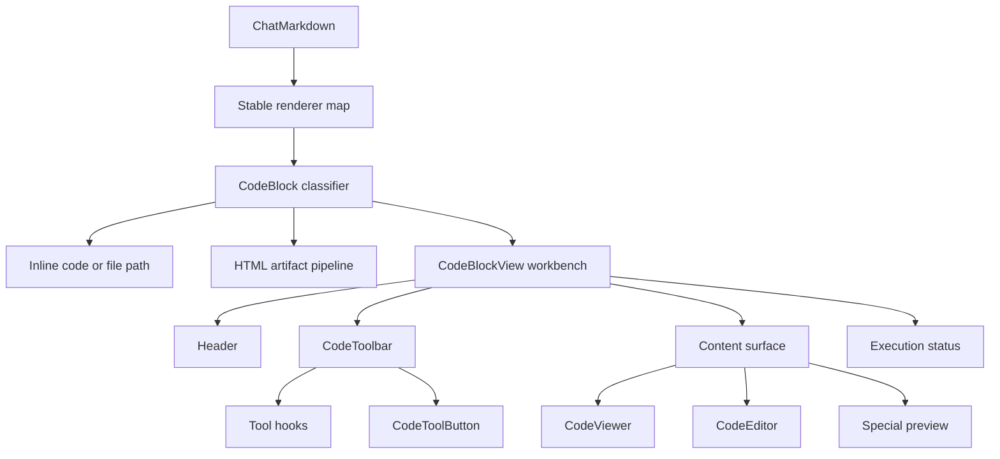

# Code Block Rendering

## Overview

Code block rendering has two separate responsibilities:

- `CodeBlock` classifies Markdown content and routes inline code, file paths, HTML artifacts, and ordinary fenced code.
- `CodeBlockView` owns the workbench for ordinary fenced code and special-language previews.

HTML artifacts keep their own preview, security, and consent pipeline. They are not modes of `CodeBlockView`.

## Component Structure

## Stable Markdown Renderers

The chat Markdown component map is defined at module scope. Renderer functions read the current block ID, citation
registry, inline HTML mode, and streaming state from one memoized render context.

Changing streaming state therefore updates renderer props without creating new React component types. Existing code,
table, link, and image nodes keep their identity across stream updates.

## View State

`ViewMode` represents user-visible content selection:

- `source`: read-only source in `CodeViewer`
- `edit`: editable source in `CodeEditor`
- `special`: Mermaid, PlantUML, SVG, or Graphviz preview
- `split`: special preview and source side by side

Initial behavior:

- Ordinary code starts in `source`; the edit action lazily opens CodeMirror when editing is enabled.
- Ordinary code that starts streaming uses `source` and stays on the same Viewer when the stream settles.
- Special languages start in `special`.

Entering split mode remembers the previous mode. A split entered from edit keeps the Editor on the source side; other
split paths use the Viewer.

## Streaming Behavior

`isStreaming` controls only streaming-specific behavior:

| State | Viewer highlighting | Collapsed auto-scroll | Enter edit |
|---|---|---|---|
| streaming | incremental range jobs | enabled while pinned to the bottom | unavailable |
| settled | incremental range jobs | disabled | available when editing is enabled |

Changing `isStreaming` must not select a different content component. A Viewer created for a stream receives the final
content in place.

Special previews retain an enabled source/preview toggle while streaming. After settling, editable code can enter edit
mode without requiring the preview component to change during the stream transition.

## Tool System

The existing tool hooks register copy, download, edit/source, split, run, expand, wrap, and save actions with
`CodeToolbar`. `CodeToolbar` owns only its overflow state, and `CodeToolButton` owns only its child-menu state.

Copy, download, and run callbacks read the mounted editor or the latest displayed source from a ref. Their identities therefore remain stable
as source chunks arrive, so the registration effects do not cycle for every chunk. Copy actions return an explicit
success result so failed clipboard operations do not show success feedback.

## Content Surfaces

### CodeViewer

`CodeViewer` is the default source surface, including active streams. It retains its caller ID, TanStack viewport,
selection state and DOM while content grows. Existing worker sessions parse the shared code-block language with
Lezer/StreamLanguage and return semantic classes for requested lines. Pending or failed syntax work leaves complete
plain source readable. Tiptap decorations and snapshot/HTML/Markdown worker jobs use the same parser classification.

### CodeEditor

The edit action loads `CodeEditor`, showing the same Viewer while loading. CodeBlockView retains local EditorState
across reading/editing switches, including draft, selection, history and folds. A parent save echo accepts that state;
a different external source begins a fresh document epoch. Newly attached editors install current callbacks.

The viewer and adopted editor share language loading, semantic HighlightStyle and palette variables from
`chat.code.viewer.theme_*`. Theme changes update colors without resetting the document or parsing it again.
`auto` resolves to the Cherry default theme, a transparent CSS-variable palette that follows the application
appearance, so a light/dark switch only recolors ([Agent Note](../../../.agents/notes/implemented/feature/2026-10-28-cherry-default-code-theme.md)).
The shared loader preserves directly supported grammars and caller-configured extensions, then resolves missing
names and aliases through the existing compatibility catalog and installed grammar keys. This covers `jsonc`,
`shellscript`, and canonical names such as `clojure` and `latex` in
document highlighting and HTML/Markdown exports.
Both modes use two-column tab stops and preserve a full line of height for empty lines. Switching modes preserves
text and line-number alignment, wrapped line heights and the code surface background. In both modes line numbers
scroll horizontally with the code instead of staying pinned.
Integer vertical padding keeps CodeMirror's gutter baseline aligned with the viewer. The lazy editor waits for
its language before mounting; returning to reading seeds visible syntax from the retained editor's parsed tree
until Worker results arrive. Unparsed ranges retain the normal plain-source fallback.
Generic Notes, prompt and configuration editors retain CodeMirror themes from `chat.code.editor.theme_*`, with a separate editor theme selector; `auto` uses the Cherry chrome theme with the same palette. The renderer entry applies shared syntax only when the adopted message or HTML-artifact host explicitly supplies it. Copy/save preserve source whitespace;
CodeMirror uses `sliceDoc` and the source line separator rather than implicitly converting CRLF.
Initial content and external replacements normalize incoming LF, CRLF and CR into document lines before computing
positions. A shared transaction filter normalizes inserted text from editing commands, search replacements, paste,
drop and extension transactions. Corrections compose into the original transaction, mapping selection and effects
while preserving undo history. Syntax styling does not select the document's serialization separator.
The Markdown adapter removes exactly the structural LF appended by mdast-to-HAST conversion; the code document
uses the AST code value, preserving authored trailing spaces and blank lines. Saving matches that exact value,
so rendering the save echo does not add a newline or reset the retained history.
The standalone HTML fast path marks its input as raw source, so the adapter does not remove another LF.

The HTML artifact popup uses the same syntax/palette and retains its own local EditorState across code, preview
and split layouts. The preview and capture use the accepted parent HTML; layout switches do not save the draft.
Matching save echoes preserve selection/history, while an external replacement or closing/reopening begins a fresh
session. Popup hosts key different artifacts separately. The source fallback can reuse the retained parsed range.

File source sessions remain owned by FileEditor/FileEditSession and use Pierre; message code blocks do not acquire
file persistence or permissions.

### Special Previews

The special-language map lazy-loads Mermaid, PlantUML, SVG, and Graphviz previews. Preview selection and split mode are
user-driven and do not depend on streaming completion.
