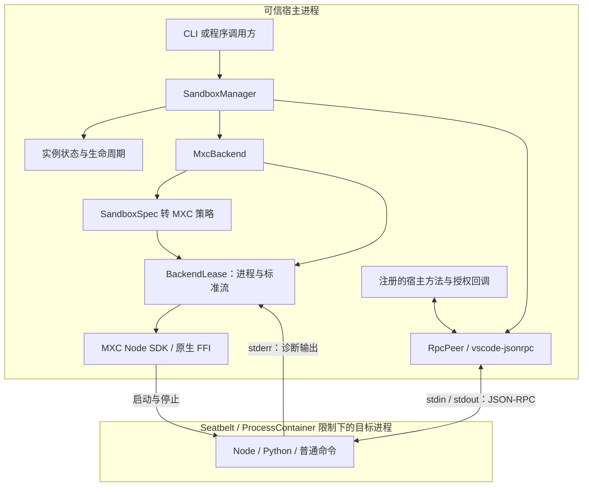
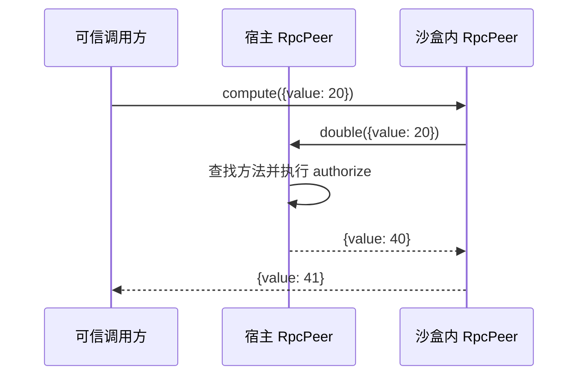

# Sandbox 当前架构

本文描述 2026-10-12 的实际代码：**Cherry 管理实例、权限映射、生命周期和双向 RPC；MXC 负责操作系统隔离。** 独立包 `@cherrystudio/sandbox` 已接通 macOS Seatbelt 和 Windows ProcessContainer，CLI 与程序调用使用同一实现。Windows 不接受上游尚未可靠执行的显式 deny 覆盖策略。自研 Seatbelt 后端、C supervisor 和对应构建脚本已删除。

包仍为 private `0.0.1`，已由 Cherry Electron 主进程的 `SandboxService` 托管。设置 → 关于中的沙箱诊断入口通过类型化 IPC 提供环境检测、JavaScript 执行和停止。Electron 44.7.0 内置 Node 24.21.0，满足 Windows 标准流要求。本文是当前实现说明；[design](./design.md)、[api](./api.md)保留更完整的设计目标，不代表这些目标已经实现。运行命令与示例见[包 README](../../packages/sandbox/README.md)。

应用 IPC 固定使用内置 Electron 的 Node 模式，禁止网络，只授予运行时文件读取和单次临时目录写入，限制 30 秒及 64 KiB 输出。调用窗口身份来自主进程，不接受 renderer 指定权限、命令或 owner。每个窗口最多一个实例；停止、窗口销毁和应用退出均会取消运行。后端完成清理后删除临时目录，状态未知时保留并记录日志。当前后端不执行内存和进程数配额。SDK 与 Koffi 在打包时解包，通过 `MXC_FFI_DIR` 指向真实原生库目录。应用入口暂不提供 Python 或 RPC；双向 RPC 继续由独立包提供。

## 1. 进程与依赖边界

`@microsoft/mxc-sdk@1.0.1` 在宿主内加载原生库并启动目标进程；Cherry 没有再启动一个自研沙盒管理进程，也不通过上游 MXC CLI 执行命令。目标必须是独立进程，OS 隔离约束施加在该进程上，宿主保留管理及执行授权方法的能力。

RPC 使用 `vscode-jsonrpc@9.0.3`，通过 MXC 暴露的标准流传输。图中的 RPC 连线表示消息路径；实际字节经过 lease、输出队列和 Node 流适配。它不要求目标加载 MXC SDK，也不通过后端控制 API 分派业务方法。

## 2. 模块职责

| 模块 | 当前职责 |
| --- | --- |
| [SandboxManager](../../packages/sandbox/src/host/SandboxManager.ts) | 验证并冻结启动描述、分配实例 ID、持有实例、绑定宿主授权上下文、连接 RPC；`dispose()` 停止所持实例 |
| [instance](../../packages/sandbox/src/host/instance.ts) | 管理 ready/completion、运行时长、取消、停止及清理重试 |
| [MxcBackend](../../packages/sandbox/src/backends/mxc/MxcBackend.ts) | 探测 macOS Seatbelt / Windows ProcessContainer、Node 运行时和 Windows 初始化要求，编译策略并创建 lease |
| [policy](../../packages/sandbox/src/backends/mxc/policy.ts) | 将公共 `SandboxSpec` 映射为 MXC `ContainerRequest`，拒绝不支持的配置，报告有效策略和限制 |
| [lease](../../packages/sandbox/src/backends/mxc/lease.ts) | 持有 `MxcProcess`，适配 spawn/wait/kill/dispose、标准流、启动期限与 I/O 预算 |
| [RpcPeer](../../packages/sandbox/src/rpc/peer.ts) | 双向请求、显式方法注册、授权、取消、超时与断线结算；复用 JSON-RPC 协议库 |
| [CLI](../../packages/sandbox/src/cli/lab.ts) | 解析参数、调用公共 manager、转发标准流并映射退出码 |

公共入口只有包根的 `SandboxManager`、`/types` 的契约和 `/rpc` 的 `createRpcPeer`。后端、策略编译与 lease 都是包内实现。宿主业务方法由调用方注册，包本身不包含插件加载、Agent 编排或业务持久化。

## 3. 启动与策略映射

可信调用方构造 `SandboxSpec`，指定 `ownerId`、命令、目录、环境、文件权限、通道和预算。manager 校验结构并冻结副本；`ownerId` 是资源归属，实例 ID 由宿主生成，不接受目标自行声明身份。

`probe(spec)` 只检查配置及 SDK 后端可用性，返回策略预览，不执行目标。`start(spec)` 可独立调用，在启动时重新编译策略。加载、策略或启动失败时返回失败结果，不降级为普通进程执行。

当前支持 `environmentId: native`、`runtimeProfileId: mxc-command-v1`、`network.mode: deny`：

| 公共描述 | MXC 映射与效果 |
| --- | --- |
| executable + args | macOS 使用 POSIX 引用和 `exec`；Windows 使用 CRT 参数引用并直接启动目标；保留字面参数语义 |
| cwd / env | 显式传入；cwd 本身不授予文件权限，env 不复制宿主环境；Windows 补充 SYSTEMROOT 与指向 cwd 的 LOCALAPPDATA |
| read / write | 解析实际路径，映射 readonlyPaths / readwritePaths；直接操作原文件，不创建隔离副本 |
| denyRead | macOS 映射 deniedPaths，同时禁止该路径写入；Windows 拒绝 |
| denyWrite | macOS 映射 readonlyPaths，必须处于已有 read/write 授权内；Windows 拒绝 |
| network deny | ingress 与 egress 默认拒绝；可写目录内 Unix socket 是已接受的例外 |

MXC 还提供运行所需的系统资源基线。`effectivePolicy.runtimeAccess` 当前概括报告该基线，并未逐文件列举所有额外访问。`limitations` 明示路径硬链接、Unix socket、进程组回收差异；2026-10-12 决策接受这些差异，不把它们作为启动阻断条件。

Windows 根据 SDK 探测选择隔离层；本机使用 AppContainer/DACL，授权期间会修改目标路径 ACL，停止后回收。Node/Python 初始化需要 Win32k，因此请求 `ui.disable: false`，剪贴板和输入注入仍请求禁止；UI 隔离未专项验收，23H2 缺少新的 Job 输入注入限制。Windows SDK 1.0.0 实测未执行可写父目录内的 deny 覆盖；适配器对所有显式 denyRead/denyWrite 返回 POLICY_UNSUPPORTED，要求使用分开的授权目录。

Tier 3 AppContainer/DACL 的 setup:windows 脚本保留为早期实验工具，不再维护或用于 CI。其 Null 设备初始化每次重启后需重新执行；probe 缺少初始化时仍返回 setup-required。原生验收改用 GitHub 托管的 windows-11-arm，要求 Windows 11 24H2+、实际 BaseContainer 隔离层及 public probe 就绪；Windows Server 只运行普通契约测试。该原生任务纳入必需 CI gate，环境不支持时失败，不回落到 Tier 3。23H2 x64 历史结果与新的 ARM64 验收不能互相替代。

## 4. 原始标准流与双向 RPC

两种模式使用同一个后端：

| 模式 | 调用方得到什么 | 目标要求 |
| --- | --- | --- |
| `channel: none` | stdin、stdout、stderr；rpc 为 null | 普通可执行程序，无需实现协议；CLI 使用此模式 |
| `channel: stdio` | RpcPeer、stderr；原始 stdin/stdout 为 null | stdin/stdout 专用于 JSON-RPC 2.0 + Content-Length，日志写 stderr |

RPC 模式必须提供同步 `configure(peer)` 注册方法，以及异步 `authorize({ instanceId, ownerId, method, params })`。每个进入宿主的请求只分派给明确注册的方法，授权使用宿主绑定的实例身份；业务参数和结果的运行时校验由方法实现承担，不能只依靠 TypeScript 类型。

当前 Node/Python 示例的调用闭环如下：

主请求等待期间，宿主仍可处理目标发起的回调。Node 目标复用 `/rpc` 入口；Python 示例直接实现相同分帧，无需为每种语言提供完整 SDK。Python 当前只演示一次嵌套回调，不是通用并发 RPC 客户端。

当前 peer 限制 32 个待返回请求、32 个活动 handler，默认请求期限 5 秒，出站参数上限 32 KiB；断线会拒绝待完成请求。入站 handler 的 5 秒期限和取消信号是协作式的，不能强制中断忽略信号的业务代码。后端还有累计输出及队列预算，但这些不等同于完整的逐帧大小校验。通知、版本握手、schema 绑定方法和完整协议配额仍未实现。

出站请求超时或取消后，底层尚未收到响应的请求继续占用配额，直到响应到达或连接释放；达到上限后拒绝新请求。`timeoutMs` 只接受 `1..2147483647` 的整数，避免 Node 将过大的延迟转换为约 1ms。

## 5. 生命周期与完成语义

`start()` 返回实例句柄；调用方等待 `ready` 后发起 RPC。当前 ready 表示 MXC 已返回目标进程且标准流可用，不包含 guest 协议握手或业务初始化完成的保证。

实例由 `starting` 进入 `running`；目标退出、取消、超时或显式 `stop()` 汇入 `stopping`，依次执行后端 terminate 与 cleanup。清理成功进入 `stopped`；停止结果未知或清理未完成进入 `failed`，manager 保留所有权以便重试。`completion` 保留首次完成报告，重试后的结果通过 `stop()` 返回值和 `snapshot().lastCompletion` 获取。

准备或启动失败时，`target: not-started` 不触发正常退出处理，`ready` 保留启动错误，完成原因是 `startup-error`。清理未完成时，后端仍关闭输出队列并报告 `OUTPUT_TRUNCATED`：已缓冲的输出可继续读取，后续输出不再收集，避免调用方一直等待流结束。此时进程和清理责任仍由 manager 持有。处理依据见[失败后的资源归属决策](../../.agents/notes/implemented/bug-fix/2026-10-18-sandbox-pending-resources.md)。

正常退出也不等于输出 EOF。后端继续收集 stdout/stderr，直到管道 EOF 且队列被消费，等待上限取 `ioDrainTimeoutMs` 与 `cleanupTimeoutMs` 的较小值，再释放 SDK 流。提前关闭、输出预算丢弃或超时未排空均报告 `OUTPUT_TRUNCATED`。

| 完成字段 | 含义 |
| --- | --- |
| target | 根目标是否启动、是否退出及其退出码 |
| tree | `gone` 用于未启动等情况；目标退出后当前 MXC 后端返回 `unverified`，不保证脱离进程组的后代已退出；`unknown` 表示停止未确认 |
| cleanup | 当前适配器和 SDK 资源是否完成处理，独立于整棵进程树的保证 |
| issues | 启动失败、预算超限、未消费输出被丢弃等诊断 |

`tree: unverified` 与 `cleanup: complete` 可以正常完成当前实例。已执行的预算包括启动期限、运行时长、停止等待、I/O 队列、累计输出和输出排空期限。`stopGraceMs` 尚未对应独立的优雅退出阶段；`cleanupTimeoutMs` 限制输出排空等待，但不能中断同步的 SDK `dispose()`。

## 6. 支持范围与验证入口

| 能力 | 当前状态 |
| --- | --- |
| macOS 原生命令、授权目录直接读写、网络 deny | 已接通 MXC Seatbelt |
| CLI 与程序 API 共用实现 | 已完成；CLI 黑盒测试覆盖允许读、原文件即时写入、禁止目录外读取 |
| Node / Python 双向回调 | 已有示例及回归测试；另覆盖授权拒绝、超时、断线与合并帧读取 |
| Windows 原生命令与 RPC | 已接通 ProcessContainer；实测允许读写、越界拒绝、只读保护、loopback 拒绝、ACL 回收；早期本机 detached 子进程停止结果不能代表托管 BaseContainer，后者的子进程启动与后代回收尚未验收，不纳入当前 demo 必需门槛 |
| Linux | 当前 adapter 明确拒绝 |
| 内存/进程数配额、挂载映射、专用通道、其他网络模式 | 当前拒绝请求，不声称已强制执行 |
| Electron 集成 | Electron 44.7.0 / Node 24.21.0；主进程服务与开发者诊断入口已接通，Windows 原生库在 ASAR 外加载；签名分发另行验证 |
| 插件加载、编排、Durable API | 不属于本包职责 |

复现方式、平台前置条件和测试命令见[包 README](../../packages/sandbox/README.md#tests)。[后端调研](./backend-options.md)保留机制和历史实验；本机功能测试不代表三平台或打包后的验收。
