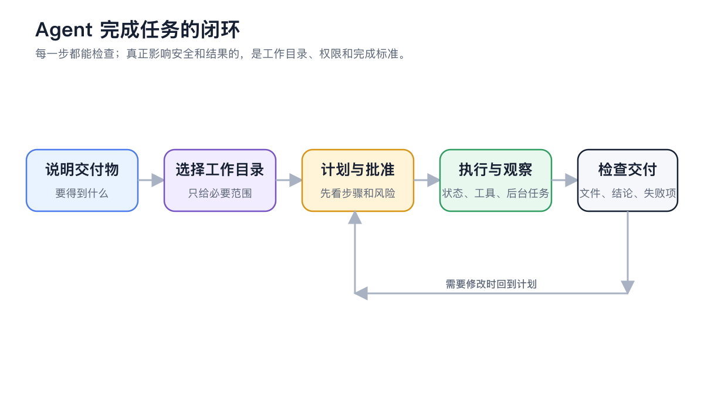

<a id="agent-gong-zuo-qu"></a>

# 智能体工作区

智能体适合处理有明确目标、需要使用工具或文件、可能持续多个步骤的任务。入口是左侧导航【工作】，不是旧版教程中的顶部标签。


最省事的配置方式，是先告诉智能体你想完成什么，再让它检查缺少的模型、工具、知识库或频道。需要精确控制时，再打开智能体编辑窗口或【设置】手动调整。


<figure><figcaption></figcaption></figure>

<figure><figcaption></figcaption></figure>

### 工作区由什么组成

| 部分 | 作用 | 何时需要关注 |
| ----- | ----------------- | ----------------- |
| 智能体 | 保存角色、模型、提示词与能力 | 同一类工作要重复进行时 |
| 任务 | 一次连续的工作记录 | 每个目标单独开任务，便于保留上下文 |
| 工作目录 | 智能体可以直接处理的文件范围 | 代码、资料整理、文档生成等文件任务 |
| 输入区 | 发送目标、附件并调用工具 | 发起任务或追加要求 |
| 右侧面板 | 查看状态、文件、子任务和消息流 | 跟踪长任务、检查产物或排错 |

### 开始一个任务



<a id="1-da-kai--gong-zuo--bing-xuan-ze-agent"></a>
<a id="1-打开工作并选择-agent"></a>

#### 1. 打开【工作】并选择智能体

已有合适的智能体时直接选择；没有时点击【添加智能体】，在【基础信息】中先选择运行模式，再完成系统提示词、技能和知识库四步创建。运行模式创建后不能切换。



#### 2. 选择工作目录

需要处理本地文件时，选择本次任务所在目录；不涉及文件时可以使用应用创建的默认工作区。一个任务对应一个工作区，避免让智能体在不相关目录间来回查找。



#### 3. 用结果描述任务

告诉智能体要交付什么、可以使用哪些资料、有哪些限制以及怎样算完成。例如：

```
阅读当前目录中的会议记录，整理出决策、负责人和截止时间，生成 action-items.md。不要修改原始文件。
```



#### 4. 在右侧面板检查过程与产物

【状态】展示活动任务、子智能体、工作流和后台命令；【文件】可预览并编辑文本产物；开启开发者模式后还能查看【调用链】。



### API 网关提示

智能体运行依赖 Cherry Studio 的 API 网关。网关未启用时，应用会提示【启用并启动】；也可以到【设置】→【API 网关】检查端口、运行状态和本机安全软件拦截。


API 网关是智能体的运行依赖，但不等于要把接口公开到网络。保持默认本机使用即可；只有明确要让其他程序调用时，才需要复制 URL 和 API 密钥。


<a id="yi-ge-agent-hai-shi-duo-ge-agent"></a>
<a id="一个-agent-还是多个-agent"></a>

### 一个智能体还是多个智能体

* 同一角色、同一套能力但任务不同：复用一个智能体，新建多个任务。
* 角色、资料范围或权限不同：拆成多个智能体。
* 一个目标需要并行研究或多个步骤协作：先让一个智能体使用子智能体或工作流，不必立刻手工创建很多智能体。

### 用户案例：整理项目资料

产品经理把需求说明、访谈记录和竞品资料放在同一目录，创建“需求整理”智能体，绑定产品知识库并使用【逐次确认】权限。智能体先读取资料，再将需求清单和待确认问题写入新文件。产品经理在右侧【文件】中直接修订文字，原始资料保持不变。

<details>

<summary>为什么智能体看不到刚绑定的能力？</summary>

智能体编辑内容会自动保存。正在生成的回复不会被中断；模型、技能、MCP 和知识库等变化会从下一条消息开始生效。若仍未出现，先确认能力已启用，再新发一条消息。

</details>

<details>

<summary>删除工作目录会把磁盘文件一起删除吗？</summary>

在任务列表中删除工作目录时，只会移除 Cherry Studio 中的目录记录和该目录下的任务记录，不会删除磁盘上的真实目录。智能体在任务执行中进行的文件操作仍受所选权限模式影响。

</details>
