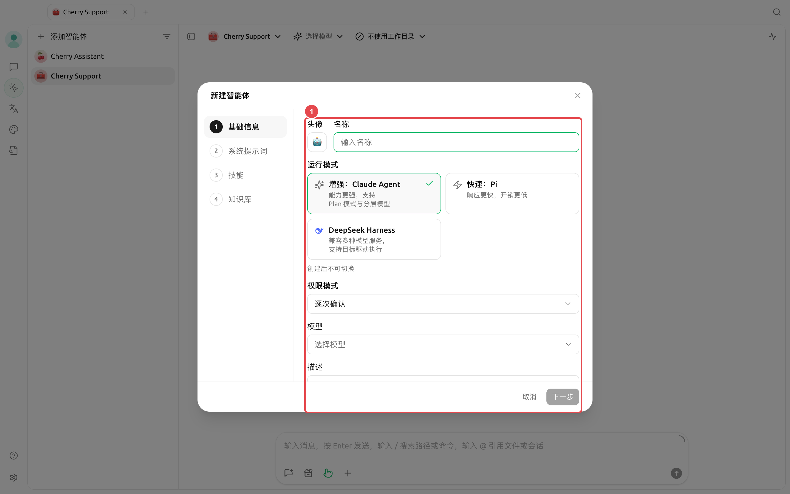
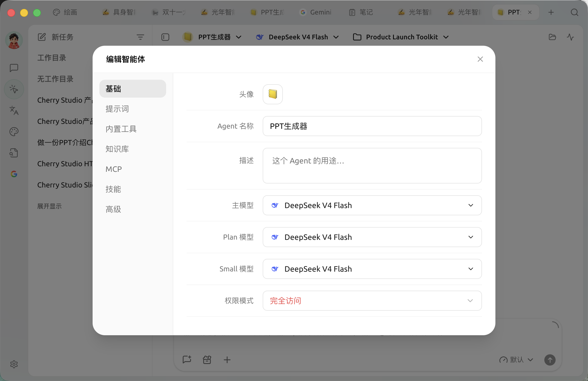

# 创建智能体与模型分工

创建入口：左侧导航【工作】→【添加智能体】。

新建向导分为【基础信息】、【系统提示词】、【技能】和【知识库】四步。第一步还要选择运行模式；运行模式会决定智能体可用的模型分工、权限模式和部分工具，创建后不能切换。

<figure><figcaption></figcaption></figure>

### 运行模式怎么选

| 运行模式 | 主要特点 | 模型配置 | 权限与限制 |
| ------------------ | ------------------- | -------------------- | ------------------------------------ |
| 【增强：Claude Agent】 | 能力面完整，适合复杂、多步骤任务 | 主模型、Plan 模型、Small 模型 | 支持全部权限模式与心跳检测 |
| 【快速：Pi】 | 响应快、开销低，适合日常文件和编码任务 | 只配置主模型 | 不提供【仅规划】；新建时默认【智能批准】 |
| 【DeepSeek Harness】 | 兼容多种模型服务，支持目标驱动执行 | 只配置主模型 | 不提供【智能批准】和心跳检测；支持 `/compact`、`/goal` |


运行模式创建后不可更改。如果目标、模型兼容性或权限需求发生根本变化，请新建一个智能体，而不是继续修改旧智能体。


### 四步怎么填写



#### 1. 基础信息

名称写成岗位或任务类型，例如“合同检查”“内容策划”。先选择运行模式，再选择页面列出的兼容模型。描述只用于帮助识别用途；主模型负责主要推理和执行。



#### 2. 编写系统提示词

写清角色、目标、边界和输出方式。与其堆砌形容词，不如给出可执行规则：先列风险，再引用原文，最后给出修改建议；遇到资料不足时明确标记，不要猜测。



#### 3. 选择技能

只选择与这个智能体长期工作方式有关的技能。技能可以在【设置】→【技能】安装，也可以之后让智能体帮你查找和安装。



#### 4. 绑定知识库

只绑定智能体确实需要检索的知识库。未绑定知识库时，知识库搜索和管理工具不会出现在该智能体的工具列表中。



<figure><figcaption>
先选好主模型；只有任务确实需要规划分工或轻量处理时，再配置 Plan 模型和 Small 模型。
</figcaption></figure>

### 创建后继续配置

在智能体列表打开菜单并选择编辑，可以调整以下内容：

* 【基础】：查看运行模式，并调整该模式支持的模型、权限和心跳设置；
* 【提示词】：角色说明、处理规则和行为边界；
* 【内置工具】：文件、搜索、图片、通知、定时任务、记忆、子智能体和工作流等；
* 【知识库】：限制智能体可以访问的知识库；
* 【MCP】：绑定已经连接的 MCP 服务器；
* 【技能】：选择已安装技能；
* 【高级】：为确实需要的工具设置环境变量。


当前编辑窗口会自动保存修改。关闭窗口前若仍有待保存内容，应用会先完成保存；保存失败时窗口会保持打开并显示错误。


### 推荐起点

| 配置项 | 产品默认值 | 建议起点 | 作用 | 适用场景 | 注意事项 |
| --------------- | ----------------------------- | ----------------------- | -------------- | ------------------ | ---------------------------------- |
| 运行模式 | 【增强：Claude Agent】 | 不确定时先用【增强：Claude Agent】 | 决定模型分工、权限和工具范围 | 所有智能体 | 创建后不可切换 |
| 主模型 | 使用创建时选择的模型 | 选择一个已验证能稳定调用工具的模型 | 主要推理和执行 | 所有智能体 | 选择器会按运行模式过滤不兼容模型 |
| Plan / Small 模型 | 与主模型相同 | 先保持与主模型一致 | 任务拆解、简单判断和格式化 | 仅【增强：Claude Agent】 | Pi 与 DeepSeek Harness 不显示这两个字段 |
| 权限模式 | Claude/DSH 为【逐次确认】；Pi 为【智能批准】 | 真实项目目录优先使用【逐次确认】 | 决定工具是否需要批准 | 文件、终端和网络任务 | 【完全访问】可能删除文件或访问网络 |
| 心跳检测 | 支持的运行模式初始开启，间隔 30 分钟 | 没有持续任务时可关闭 | 让智能体定期检查工作 | Claude 智能体、Pi | DeepSeek Harness 不提供心跳检测；固定时间用定时任务 |

### 用户案例：合同检查智能体

创建“合同检查”智能体，主模型选择已经验证的模型，在提示词中要求按“风险条款、原文位置、影响、建议”输出，绑定公司制度知识库，权限保持【逐次确认】。每份合同新建一个任务并选择对应文件目录，避免不同客户资料混在同一上下文中。

为什么创建时没有看到 MCP 和权限的完整设置？

创建向导只保留常用步骤。创建完成后打开智能体编辑窗口，可在【基础】【内置工具】【知识库】【MCP】【技能】和【高级】中继续配置；具体标签会随运行模式能力变化。

