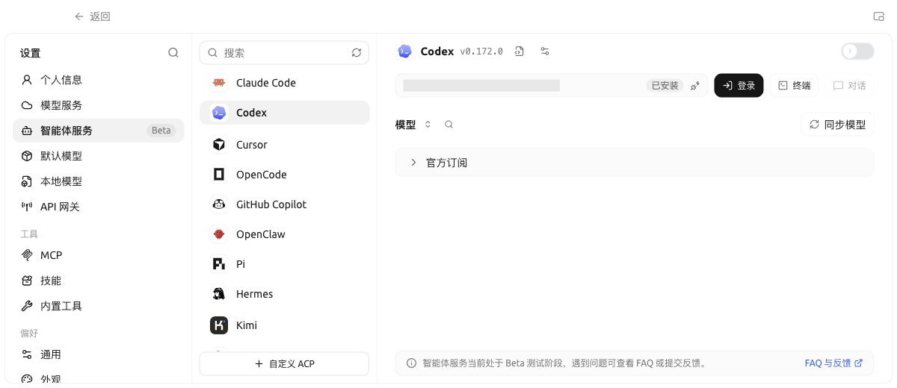
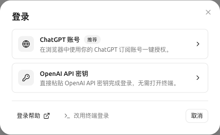

# 接入本地智能体

在【设置】→【智能体服务】连接 Codex、Claude Code、Cursor 等本地智能体，启用后就能在【工作】里和它们对话。「本地」指智能体在这台电脑上运行，所选模型仍可能通过网络提供服务。

## 用 Codex 跑通第一个任务



### 1. 找到或安装 Codex

在【智能体服务】列表中选择 **Codex**。如果已经安装，确认【程序】显示的是你要使用的版本；如果显示【未安装】，点击【安装】。其他智能体的安装方式以页面提示为准，例如 Cursor 可以直接登录，无需单独安装 CLI。

<figure><figcaption></figcaption></figure>



### 2. 登录并检查连接

如果检测到了已有的 Codex 登录状态，直接点击【检查连接】。需要登录时，点击【登录】，选择【ChatGPT 账号】在浏览器完成授权，或选择【OpenAI API 密钥】在应用内输入密钥。授权后回到 Cherry Studio 检查连接。

<figure><figcaption></figcaption></figure>



### 3. 启用并打开对话

打开页面右上角的启用开关，然后点击【对话】。之后也可以从【工作】的智能体列表进入 Codex。先使用默认模型，想换模型时可在【智能体服务】里设定默认值，或在对话中从当前可用的模型里选择。



### 4. 发送一个只读任务

点击【新任务】，在发送第一条消息前选择一个有 `README.md` 的项目目录。保持只读或需要确认的权限，发送下面这条消息。

```
阅读当前目录的 README.md，用三条要点概括这个项目。不要修改文件。
```

收到基于 README 的摘要后，就可以在这个目录里继续提问。第一条消息发出后，任务会锁定当前智能体和工作目录。要处理另一个目录时，新建任务。



## 选择模型来源

* 使用智能体自身提供的模型时，按该智能体支持的方式登录或配置凭证。模型列表由智能体提供；没有返回可选模型时，可沿用原生配置。
* 如果这个智能体支持 Cherry Studio 的服务商模型，先在【设置】→【模型服务】配置服务商，再回到【智能体服务】选择兼容模型。Cherry Studio 会在本机转接请求，无需在【API 网关】中手动启动服务。

## 连接失败时

* **系统里装了但页面显示未安装**。先点击【重新检测】。如果 CLI 装在自定义位置，打开该智能体的【高级设置】，填写【自定义可执行程序路径】，保存后再检查连接。
* **提示需要登录或配置**。按页面提示重新登录。若该智能体要求在终端登录，完成后回到 Cherry Studio 再检查连接。

## 接入自定义 ACP 智能体

如果要连接的工具未列在页面中，但支持 ACP（Agent Client Protocol），在列表底部选择【自定义 ACP】。填写可执行程序路径和该工具要求的启动参数，按需填写环境变量。保存并通过连接检查后启用。
