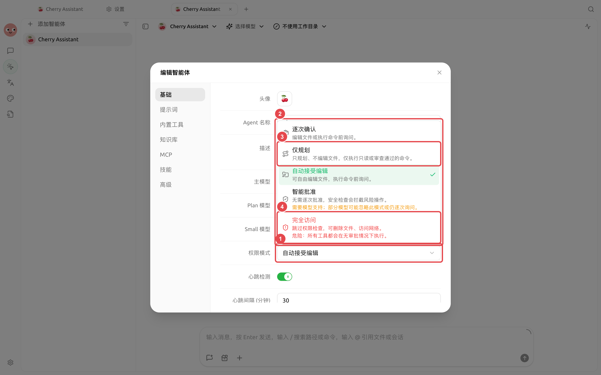

# 权限、记忆与后台任务

智能体能执行文件、终端和网络操作，也能调用子智能体与后台任务。权限决定“是否要先问”，记忆决定“下次是否还知道”，右侧状态面板则告诉你“现在正在做什么”。

<figure><figcaption><p>日常使用从默认权限开始；仅规划适合先看方案，完全访问只用于边界清楚且可恢复的任务。</p></figcaption></figure>

### 权限模式

| 模式 | 行为 | 适用场景 | 注意事项 |
| -------- | ------------- | ------------- | ---------------- |
| 【逐次确认】 | 编辑文件或执行命令前询问 | 默认起点、真实项目目录 | 操作多时会频繁确认，但最容易控制 |
| 【自动接受编辑】 | 可编辑文件，执行命令前询问 | 文档整理、可恢复的代码修改 | 先确认工作目录和版本控制状态 |
| 【智能批准】 | 由安全检查决定是否放行 | 模型支持且任务边界清晰 | 部分模型可能仍会逐次询问 |
| 【仅规划】 | 只规划、不编辑文件 | 方案评审、上线前审查 | 适合先看计划再执行 |
| 【完全访问】 | 跳过权限检查 | 隔离、可信、可恢复的环境 | 可能删除文件或访问网络，风险最高 |

不同运行模式提供的权限范围并不完全相同：Pi 不提供【仅规划】，新建 Pi 智能体时默认使用【智能批准】；DeepSeek Harness 不提供【智能批准】；【增强：Claude Agent】提供完整的五种模式。

配置路径：左侧导航【工作】→ 智能体菜单→【编辑】→【基础】→【权限模式】。


频道可以单独覆盖智能体的权限模式。外部聊天入口更容易收到意外指令，通常应选择【继承智能体设置】或比智能体更严格的模式，不要为了少点几次确认而开放完全访问。


<a id="agent-ji-yi"></a>
<a id="agent-记忆"></a>

### 智能体记忆

智能体的记忆跟随智能体，而不是跟随某个任务或工作目录。它适合保存长期有效的偏好、项目事实、技术决策和经验；一次性进度则记录为带时间的日志，供后续任务检索。

直接在【工作】中告诉智能体：

```
记住：所有对外发布的中文文案都使用全角标点，不使用夸张标题。以后相关任务按这条规则执行。
```

需要纠正时明确指出旧信息已经失效，并要求更新记忆。不要把密码、API Key、私密身份信息或短期无关内容写入长期记忆。

### 子智能体、工作流和后台命令

复杂任务中，智能体可以把研究、整理和验证分配给子智能体，或通过工作流编排多个步骤。耗时命令可以在后台运行，不必阻塞整个对话。智能体也可以在你确认后新建另一个会话，或向已有会话发送任务；请求会立即返回，完成结果随后回到发起会话，并保留来源和交付状态。

右侧【状态】可以查看：

* 正在进行和已完成的任务；
* 子智能体与工作流；
* 后台命令及停止入口；
* 工具调用的成功、失败和数量；
* 上下文用量和已声明产物。

开启【设置】→【通知】→【对话完成通知】后，切到其他标签页或窗口工作时，助手回复完成、智能体任务完成或等待批准都会通过系统通知提醒；点击通知会回到对应对话。

<figure><figcaption><p>长任务可在【状态】中查看产物、子任务、后台命令和上下文用量。</p></figcaption></figure>

### 用户案例：持续维护项目规范

团队把稳定的代码约定写入智能体记忆，把详细审查步骤做成技能。每次审查新分支时开一个任务，让智能体用子智能体分别检查接口、数据迁移和测试，再由主智能体汇总结论。规则发生变化时更新记忆，不需要改动每个任务的历史记录。

<details>

<summary>记忆能代替知识库吗？</summary>

不能。记忆适合少量、稳定、会跨任务使用的事实和经验；知识库适合成体系的文档，并能控制智能体的检索范围。

</details>

<details>

<summary>任务看起来卡住了，先看哪里？</summary>

先打开右侧【状态】，检查是否在等待权限、后台命令仍在运行、子任务失败或服务商正在重试。需要更深的请求细节时再打开开发者模式查看调用链。

</details>
