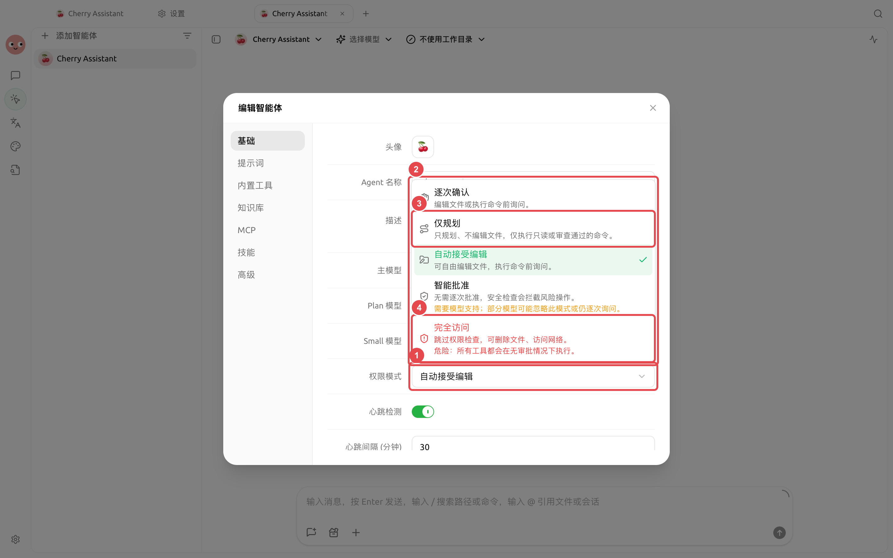
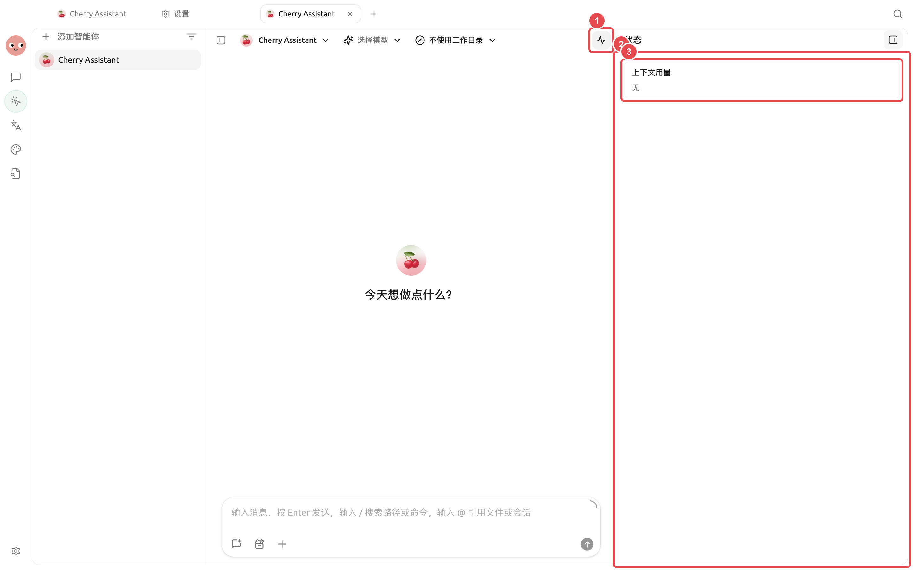

# 权限、记忆与后台任务

智能体能执行文件、终端和网络操作，也能调用子智能体与后台任务。权限决定“是否要先问”，记忆决定“下次是否还知道”，右侧状态面板则告诉你“现在正在做什么”。

<figure><figcaption><p>日常使用从默认权限开始；仅规划适合先看方案，完全访问只用于边界清楚且可恢复的任务。</p></figcaption></figure>

### 权限模式

| 模式 | 行为 | 适用场景 | 注意事项 |
| -------- | ------------- | ------------- | ---------------- |
| 【逐次确认】 | 编辑文件或执行命令前询问 | 默认起点、真实项目目录 | 操作多时会频繁确认，但最容易控制 |
| 【自动接受编辑】 | 可编辑文件，执行命令前询问 | 文档整理、可恢复的代码修改 | 先确认工作目录和版本控制状态 |
| 【智能批准】 | 由安全检查决定是否放行 | 模型支持且任务边界清晰 | 部分模型可能仍会逐次询问 |
| 【仅规划】 | 只规划、不编辑文件 | 方案评审、上线前审查 | 适合先看计划再执行 |
| 【完全访问】 | 跳过权限检查 | 隔离、可信、可恢复的环境 | 可能删除文件或访问网络，风险最高 |

检测到系统或全局软件包安装时，除【完全访问】外都需要审批，并且需要有人实时响应；【仅规划】仍会阻止安装。【完全访问】允许无人值守安装，但直接修改 `mise` 的操作在所有模式下都会被阻止。

不同运行模式提供的权限范围并不完全相同：Pi 不提供【仅规划】，新建 Pi 智能体时默认使用【智能批准】；DeepSeek Harness 不提供【智能批准】；【增强：Claude Agent】提供完整的五种模式。

配置路径：左侧导航【工作】→ 智能体菜单→【编辑】→【基础】→【权限模式】。


频道可以单独覆盖智能体的权限模式。外部聊天入口更容易收到意外指令，通常应选择【继承智能体设置】或比智能体更严格的模式，不要为了少点几次确认而开放完全访问。


<a id="agent-ji-yi"></a>
<a id="agent-记忆"></a>

### 智能体记忆

记忆分为共享和私有两层。共享记忆供已开启访问的助手和智能体使用，可保存对后续帮助有用的个人偏好、事实、经历、计划和约束。私有记忆保存项目和客户知识，跟随同一个智能体，跨任务和工作目录使用。

#### 开启共享记忆

打开【设置】→【工具】→【共享记忆】。它与 MCP、技能位于同一分类。

* 【聊天中生成记忆】：从新完成且已授权的对话中提取信息。
* 【自动整理记忆】：整理已经保存的文件，处理重复内容和主题组织。

这两个全局开关默认开启，使用应用的默认模型，可能消耗模型额度。生成和整理可以独立开关，也可点击【立即整理】手动运行。

还需要检查每个智能体或助手的【基础】设置中的【共享记忆】。智能体默认开启，开关位于【心跳检测】上方；助手默认关闭。共享对话提炼适用于已授权的桌面主会话和助手持久对话。

#### 对话中的信息如何保存

每个对话累计成功完成八轮后，应用在空闲时提炼；不足八轮的新内容在系统当地时间每天 21:00 补齐。关闭应用时保留已登记的待处理内容，下次启动补处理错过的批次。每批携带已有共享记忆，以及截至该批次最多十六条用户和助手消息，包含最后一轮回复。内容过长时保留较新的完整轮次，并记录预算跳过；上下文含糊时不猜。用户原话作为保存依据，助手回复只帮助理解。多个模型批次进一步核对重复和冲突。模型或网络失败后间隔十分钟重试，最多两次，之后等下个 21:00；前台聊天只让提炼延期。关闭生成、清空或撤销访问会丢弃相关待处理内容。

有后续用途的经历和计划会自动参与提炼，包括一次性事件和临时状态。保存时保留原话的时间、条件和确定程度。

你也可以直接在【工作】中告诉智能体：

```
记住：所有对外发布的中文文案都使用全角标点，不使用夸张标题。以后相关任务按这条规则执行。
```

需要纠正时，明确指出旧信息是什么、哪里变了。自动提炼遇到冲突会保留旧事实。Pi 和 Claude Code 还支持通过原生文件工具写入记忆，并检查权限和版本。请查看工具执行结果确认保存情况；未确认保存时，重新读取后再修改。

#### 已保存的信息何时生效

每个话题或智能体会话在首次有权限的请求中读取记忆入口快照。后续轮次和上下文压缩复用该快照，权限和遗忘状态会重新检查。普通新增或修改会在新会话中自动加载。

入口中的主题文件由模型通过当前运行模式支持的受控工具按需读取。

#### 回查以前的对话

启用共享记忆后，支持的助手、Pi 和 Claude Code 可以通过 `memory_search` 回查自己的历史对话。当前上下文缺少必要信息时，提示词要求模型先搜索历史。

助手只查自己的话题，智能体只查自己的桌面主会话。正在回答的这条提问会被排除，同一会话更早的消息仍可搜索。每次回答最多调用四次，搜索和展开消息共用次数。结果以原文片段返回，较长内容会标记截断，供本次回答参考。

#### 查看、清空与恢复

共享记忆设置页显示最近一次运行结果，提供【恢复备份】和【清除全局记忆】。清空和恢复都需要确认。清空仅处理共享记忆正文，保留智能体私有记忆、旧文件和已有备份。


清空非空记忆后会保留遗忘标记。可能含有旧记忆的会话会被拦截，重启或关闭共享开关不能解除保护。你可以新建会话继续聊天，新会话只读取过滤后的记忆。过期状态变化或损坏状态也会触发保护。恢复时若遇到后续修改或遗忘标记，会报告冲突并保留当前状态。


智能体设置中的【记忆】页展示身份文件 `SOUL.md`、`USER.md`，以及旧 `memory/FACT.md` 和只读的 `memory/JOURNAL.jsonl`。当前活动记忆使用 `MEMORY.md` 和 `.memories/` 主题文件。FACT 成功迁移后，旧页面中的编辑仅修改保留的 FACT 文件。JOURNAL 作为历史记录保留。

### 子智能体、工作流和后台命令

复杂任务中，智能体可以把研究、整理和验证分配给子智能体，或通过工作流编排多个步骤。耗时命令可以在后台运行，不必阻塞整个对话。智能体也可以在你确认后新建另一个会话，或向已有会话发送任务；请求会立即返回，完成结果随后回到发起会话，并保留来源和交付状态。

右侧【状态】可以查看：

* 正在进行和已完成的任务；
* 子智能体与工作流；
* 后台命令及停止入口；
* 工具调用的成功、失败和数量；
* 上下文用量和已声明产物。

开启【设置】→【通知】→【对话完成通知】后，切到其他标签页或窗口工作时，助手回复完成、智能体任务完成或等待批准都会通过系统通知提醒；点击通知会回到对应对话。

<figure><figcaption><p>长任务可在【状态】中查看产物、子任务、后台命令和上下文用量。</p></figcaption></figure>

### 用户案例：持续维护项目规范

团队把稳定的代码约定写入智能体记忆，把详细审查步骤做成技能。每次审查新分支时开一个任务，让智能体用子智能体分别检查接口、数据迁移和测试，再由主智能体汇总结论。规则发生变化时更新记忆，不需要改动每个任务的历史记录。

<details>

<summary>记忆能代替知识库吗？</summary>

三者适合不同用途：记忆保存有助于后续回答的个人信息或智能体私有知识；历史回查用于查找之前的对话；知识库管理成体系的参考文档，并支持控制检索范围。

</details>

<details>

<summary>任务看起来卡住了，先看哪里？</summary>

先打开右侧【状态】，检查是否在等待权限、后台命令仍在运行、子任务失败或服务商正在重试。需要更深的请求细节时再打开开发者模式查看调用链。

</details>
