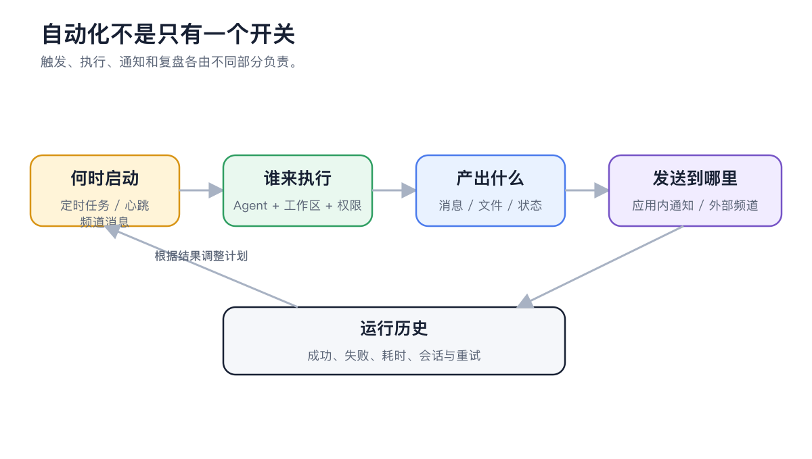

# 自动化与外部触达

Cherry Studio 的自动化不是单独的一组“机器人设置”。智能体负责完成工作，频道负责从外部平台收发消息，定时任务负责在指定时间启动智能体，心跳则用于让智能体周期检查自己的持续工作。

<figure><figcaption>
触发、执行、通知和运行历史是不同环节；先手动跑通智能体，再逐步接入。
</figcaption></figure>

## 四者如何配合

| 能力 | 负责什么 | 典型用途 |
| ----- | --------------- | ------------------ |
| 智能体 | 执行任务并生成结果 | 汇总、检查、写作、文件处理 |
| 频道 | 接收外部消息并发送通知 | 飞书群机器人、Telegram 私聊 |
| 定时任务 | 在明确时间运行智能体 | 日报、周报、一次性提醒 |
| 心跳 | 智能体按间隔检查持续工作 | 监控长流程、检查待处理事项 |

<figure><figcaption>
频道负责把智能体接到飞书、Telegram、QQ、微信、Discord 或 Slack。
</figcaption></figure>

## 正确的配置顺序



### 1. 先在【工作】中跑通任务

确认智能体的模型、提示词、工作目录和工具可以稳定产生期望结果。




### 2. 再让智能体引导配置频道

在智能体对话中说明平台和用途，例如“把这个智能体接到飞书群，用于接收日报请求”。按照提示准备机器人权限和凭据。



### 3. 用手动设置核对状态

打开【设置】→【频道】，检查凭据、绑定智能体、工作区、允许的会话范围和频道权限模式，并发送一条测试消息。



### 4. 最后创建定时任务

可以直接让智能体创建，也可以打开【设置】→【定时任务】→【新建】。选择已经验证的智能体、工作区、时间和通知频道。



## 上线前检查

* 频道只允许需要的会话或频道 ID；
* 外部入口使用【继承智能体设置】或更严格的权限；
* 定时任务提示词不包含会变化的密钥和路径；
* 先手动【运行】一次并查看运行记录；
* 失败时能在 Cherry Studio 内找到对应任务，不把“未发送”误判成“未执行”。

## 用户案例：工作日运营日报

“运营日报”智能体从工作目录读取数据，按团队技能生成日报。飞书频道负责把结果送到指定群，定时任务在每个工作日早上运行。上线前先手动执行，再在飞书中给机器人发送消息以建立接收目标，最后才启用计划。

心跳和定时任务有什么区别？

心跳按间隔让智能体检查持续工作，适合“有没有新情况”；定时任务有明确的执行计划和运行记录，适合“每天几点做什么”。固定日报优先用定时任务。

